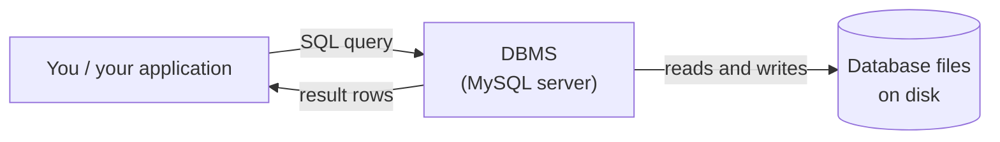
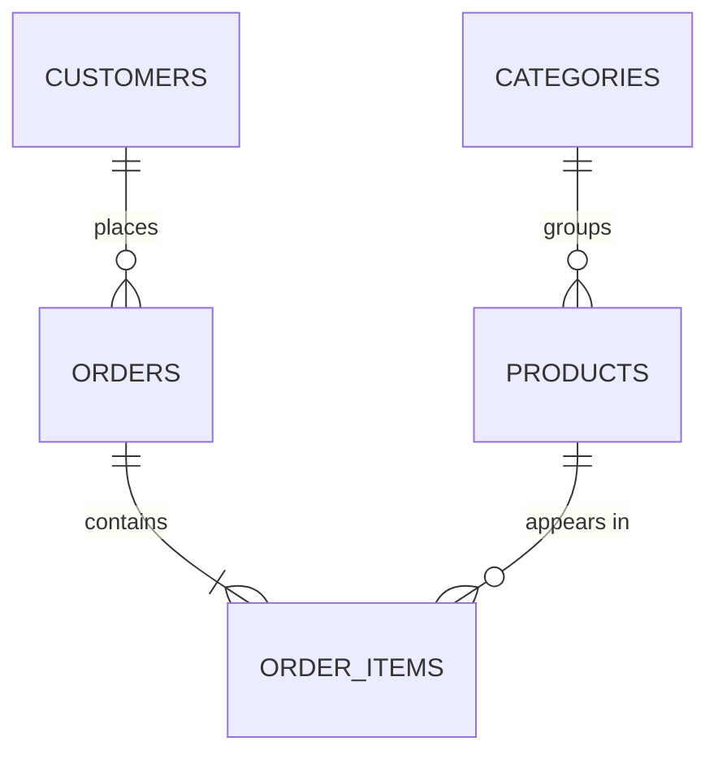
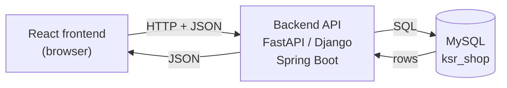

# Introduction to Databases

!!! abstract "Learning Objectives"
    By the end of this lesson, you can:

    - Explain data, database and DBMS in your own words
    - Explain why real applications use databases instead of Excel sheets or text files
    - Describe tables, rows, columns and keys in a relational database
    - Compare relational (SQL) and non-relational (NoSQL) databases
    - Show where MySQL sits in a full stack application

**Prerequisites:** None. This module is shared by the Full Stack Python and Full Stack Java tracks.

## What is Data?

**Data** is any fact that can be recorded: a name, a phone number, a price, a date, a photo, a click.

| Data | Example |
|------|---------|
| Text | `Asha Reddy`, `Hyderabad` |
| Numbers | `79999.00`, `25` |
| Dates and times | `2025-10-05`, `19:30` |
| Yes/no | `in stock`, `paid` |
| Files | profile photos, invoices |

On its own, `79999` means nothing. Organised as *"iPhone 15 costs ₹79,999 and 25 are in stock"*, it becomes **information** that a business can act on.

Think about what an app like Amazon or Swiggy stores every second: users, products, prices, carts, orders, payments, delivery locations, reviews. That data must be **stored safely**, **found instantly**, **updated correctly** and **shared** by millions of users at the same time.

## Why Not Excel or Text Files?

In the Python module you saved data to CSV and JSON files. That's fine for small personal scripts, but real applications hit serious limits:

| Problem | Files / Excel | Database |
|---------|---------------|----------|
| **Many users at once** | Two people editing the same file overwrite each other | Thousands of users read and write safely at the same time |
| **Size** | Slows down badly beyond a few lakh rows | Handles millions or billions of rows |
| **Finding data** | Scan the whole file | Indexes find a row in milliseconds |
| **Correct data** | Nothing stops a price of `"abc"` or a duplicate email | Rules (constraints) reject bad data |
| **Relationships** | Copy customer details into every order row | Link tables with keys; store each fact once |
| **Crashes** | A crash mid-save can corrupt the file | Transactions: all-or-nothing changes |
| **Security** | Whoever has the file sees everything | Users, passwords and fine-grained permissions |

!!! example "Real-life analogy: a library"
    A pile of books on the floor is like a folder of files: everything is technically there, but finding a book is slow and anyone can take or damage one. A **library** has shelves organised by subject, a catalogue to find any book in seconds, rules about who can borrow what, and a librarian who keeps records consistent. A database is that library for data.

## Database and DBMS

- A **database** is an organised collection of data, stored so it can be easily accessed, managed and updated.
- A **DBMS** (Database Management System) is the **software** that creates the database and lets you store, query, update and protect the data.

You never edit a database's files directly. You send **requests** to the DBMS, and it does the work safely.



**What a DBMS gives you**

- **Storage and retrieval:** fast reads and writes, even with huge data
- **Integrity:** rules that keep data valid (no duplicate emails, no negative stock)
- **Concurrency:** many users at once without conflicts
- **Security:** users, roles and permissions
- **Backup and recovery:** restore data after failures
- **Transactions:** a group of changes either all succeed or all fail

## Relational Databases: Tables, Rows and Columns

A **relational database** stores data in **tables**, like well-designed spreadsheets with strict rules. Each table holds one kind of thing.

Here is the `customers` table from **ksr_shop**, the practice database you'll use throughout this module:

| id | name | email | city | phone | joined_on |
|----|------|-------|------|-------|-----------|
| 1 | Asha Reddy | asha@example.com | Hyderabad | 9876500001 | 2024-01-15 |
| 2 | Ravi Kumar | ravi@example.com | Bangalore | 9876500002 | 2024-03-22 |
| 3 | Kiran Rao | kiran@example.com | Hyderabad | NULL | 2024-05-10 |

| Term | Also called | Meaning |
|------|-------------|---------|
| **Table** | Relation | A collection of related data about one kind of thing (`customers`) |
| **Column** | Field, attribute | One property, with a fixed data type (`email`, `city`) |
| **Row** | Record, tuple | One item: one customer |
| **Primary key** | PK | A column whose value uniquely identifies each row (`id`) |
| **Foreign key** | FK | A column that points to a primary key in another table |
| **NULL** | | "No value / unknown" (Kiran's phone) |

### Tables are connected

Instead of copying a customer's name and city into every order, an order stores only the customer's **id**:



That's why it's called **relational**: tables are linked by **relationships**, and SQL can **join** them back together when you need the full picture. You'll design these in [Database Design](08-database-design.md) and combine them in [Joins](09-joins.md).

## Relational vs Non-Relational (NoSQL)

| | Relational (SQL) | Non-relational (NoSQL) |
|---|---|---|
| **Structure** | Tables with a fixed schema | Documents, key-value pairs, graphs, wide columns |
| **Language** | SQL (standard) | Each database has its own API |
| **Relationships** | Strong: foreign keys and joins | Usually embedded or handled in application code |
| **Consistency** | Strong (ACID transactions) | Often trades consistency for scale and speed |
| **Best for** | Orders, payments, banking, inventory, HR | Chat messages, logs, caching, real-time feeds, flexible data |
| **Examples** | **MySQL**, PostgreSQL, Oracle, SQL Server, SQLite | MongoDB, Redis, Cassandra, DynamoDB, Neo4j |

**DBMS vs RDBMS**

| DBMS | RDBMS |
|------|-------|
| Any software that manages data | A DBMS that stores data in related tables |
| May store data as files or documents | Uses tables, keys and relationships |
| Relationships not enforced | Enforces relationships with foreign keys |
| Example: file systems, early DBMSs | Example: MySQL, PostgreSQL, Oracle |

!!! tip "Which should you learn first?"
    Relational databases and SQL. Most business applications (banking, e-commerce, ERP, HR, ticketing) run on relational databases, SQL is asked in almost every developer interview, and the concepts transfer directly to NoSQL later.

## Where MySQL Fits in Full Stack

**MySQL** is the world's most popular open-source relational database. It's free, fast and runs everywhere, and it powers sites like Facebook (originally), YouTube, Uber and Booking.com, plus countless Indian startups.

In this course, MySQL is the **data layer** of every application you build:



1. The user clicks **My Orders** in the React app.
2. React calls the backend API: `GET /api/orders`.
3. The backend runs SQL against MySQL: *"get this customer's orders"*.
4. MySQL returns rows; the backend converts them to JSON; React shows them.

Here's a taste of the SQL you'll write by the end of this module. It answers: *"Who are our top customers by amount spent on delivered orders?"*

```sql
SELECT c.name, SUM(oi.quantity * oi.unit_price) AS total_spent
FROM customers c
JOIN orders o       ON o.customer_id = c.id
JOIN order_items oi ON oi.order_id = o.id
WHERE o.status = 'delivered'
GROUP BY c.name
ORDER BY total_spent DESC
LIMIT 3;
```

```{ .text .output }
+------------+-------------+
| name       | total_spent |
+------------+-------------+
| Ravi Kumar |    77697.00 |
| Asha Reddy |     8993.00 |
| Divya Nair |     3499.00 |
+------------+-------------+
```

Don't worry about understanding it yet. By [lesson 09](09-joins.md) you'll write queries like this yourself.

!!! realworld "In Real Projects"
    Django and Spring Boot both have **ORMs** (Object-Relational Mappers) that generate SQL for you from Python or Java classes. But every serious backend developer still needs SQL: to design tables, debug slow queries, write reports and pass interviews. ORMs are built on the SQL you'll learn here.

## Common Misconceptions

| Misconception | Reality |
|---------------|---------|
| "SQL and MySQL are the same thing" | **SQL** is the language; **MySQL** is a database system that understands SQL (so do PostgreSQL, Oracle and others) |
| "A database is just a big Excel sheet" | Databases enforce types, rules, relationships, transactions and security |
| "NoSQL is newer, so it's better" | They solve different problems; most companies use both |
| "The frontend talks to the database directly" | Never. The backend sits in between and controls access |
| "NULL means zero or empty text" | `NULL` means *unknown / missing*; it's not `0` and not `''` |

## Practice Exercises

1. In your own words, explain the difference between **data**, a **database** and a **DBMS**.
2. List four problems you'd face if an online shop stored all orders in one Excel file shared by 50 employees.
3. For a **food delivery app**, list five tables you'd need and three columns for each.
4. Which column would make a good **primary key** for a `students` table: `name`, `email`, `phone` or a new `id` column? Explain.
5. Classify each as better suited to **SQL** or **NoSQL**: bank transactions, chat messages, product catalogue with orders, website click logs, hospital patient records.
6. Draw the full stack flow (browser → backend → database) for the action "user updates their delivery address".

??? success "Suggested answers (click to expand)"

    1. **Data** is raw facts (`Asha`, `79999`). A **database** is an organised collection of that data. A **DBMS** is the software (like MySQL) that stores, retrieves, protects and manages the database.
    2. Overwritten edits when two people save at once; no protection against invalid or duplicate entries; very slow to search as it grows; no access control; risk of corruption; customer details repeated in every row.
    3. `restaurants (id, name, city)`, `menu_items (id, restaurant_id, name, price)`, `customers (id, name, phone)`, `orders (id, customer_id, restaurant_id, status)`, `delivery_partners (id, name, phone)`. Other good answers are possible.
    4. A new `id` column. Names repeat; emails and phone numbers can change. A primary key should be unique, never NULL and never change. An auto-increment `id` guarantees all three.
    5. SQL: bank transactions, product catalogue with orders, hospital records. NoSQL: chat messages, click logs. Both choices can be argued; the key factors are consistency and relationships vs scale and flexibility.
    6. React form → `PUT /api/customers/5/address` with JSON → the backend validates and runs `UPDATE customers SET ... WHERE id = 5` → MySQL saves it → the backend returns `200 OK` → React shows "Address updated".

## Interview Questions

!!! interview "1. What is a database and what is a DBMS?"
    A database is an organised collection of structured data. A DBMS is the software that manages it, providing storage, retrieval, integrity rules, concurrency control, security, transactions and backup. MySQL is an RDBMS.

!!! interview "2. What is the difference between DBMS and RDBMS?"
    An RDBMS is a DBMS based on the relational model: data is stored in tables (relations) with rows and columns, relationships are enforced with keys, and data is queried with SQL. A generic DBMS doesn't necessarily use tables or enforce relationships.

!!! interview "3. What is the difference between SQL and MySQL?"
    SQL (Structured Query Language) is the standard language for working with relational databases. MySQL is a specific relational database management system that implements SQL (with some extensions of its own).

!!! interview "4. When would you choose NoSQL over a relational database?"
    When the data is unstructured or its shape changes often, when you need massive horizontal scale for simple access patterns (logs, sessions, chat, caching), or when relationships and multi-row transactions are not central. For financial or highly relational data, a relational database is usually the right choice.

!!! interview "5. What is a primary key?"
    A column (or set of columns) that uniquely identifies each row. It must be unique and NOT NULL, and a table can have only one primary key. Usually it's a surrogate `id INT AUTO_INCREMENT`.

!!! interview "Scenario: a startup stores orders in Google Sheets and now has 50,000 orders a month with frequent data mistakes. What would you recommend?"
    Move to a relational database like MySQL: design tables for customers, products, orders and order items with primary and foreign keys and constraints (NOT NULL, UNIQUE, CHECK) to stop bad data; use transactions for order placement; add indexes for common searches; and put a backend API in front of it instead of letting staff edit raw data.

## Summary

| Concept | Remember |
|---------|----------|
| Data | Raw facts; organised data becomes information |
| Database | Organised collection of data |
| DBMS | Software that manages databases safely (MySQL) |
| Why not files | Concurrency, scale, integrity, relationships, security, crash safety |
| Relational | Tables (rows × columns) linked by primary and foreign keys |
| NoSQL | Documents, key-value pairs, graphs; flexible schema, horizontal scale |
| SQL vs MySQL | Language vs database system |
| Full stack | React → backend API → MySQL; the frontend never talks to the DB directly |

**Next lesson:** [MySQL Setup & First Database](02-mysql-setup.md), installing MySQL and loading the `ksr_shop` practice database.
