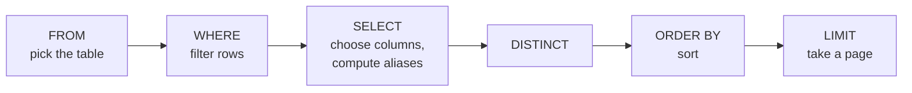

# Filtering, Sorting & Pagination

!!! abstract "Learning Objectives"
    By the end of this lesson, you can:

    - Filter rows with comparison operators and combine conditions with `AND`, `OR`, `NOT`
    - Use `IN`, `BETWEEN` and `LIKE` for cleaner, more powerful filters
    - Handle missing values correctly with `IS NULL` and `IS NOT NULL`
    - Sort results with `ORDER BY` and remove duplicates with `DISTINCT`
    - Paginate results with `LIMIT` and `OFFSET`, as every product listing page does

**Prerequisites:** [CRUD Operations](04-crud-operations.md). Reload `ksr_shop.sql` for a fresh copy of the data.

## Comparison Operators

`WHERE` keeps only the rows where the condition is **true**.

| Operator | Meaning | Example |
|----------|---------|---------|
| `=` | Equal | `city = 'Pune'` |
| `<>` or `!=` | Not equal | `status <> 'cancelled'` |
| `>` / `<` | Greater / less than | `price > 5000` |
| `>=` / `<=` | Greater / less than or equal | `rating >= 4.5` |

```sql
SELECT name, brand, price, rating
FROM products
WHERE rating >= 4.5;
```

```{ .text .output }
+---------------------+--------------------+----------+--------+
| name                | brand              | price    | rating |
+---------------------+--------------------+----------+--------+
| iPhone 15           | Apple              | 79999.00 |    4.7 |
| Galaxy S24          | Samsung            | 74999.00 |    4.5 |
| Atomic Habits       | Penguin            |   499.00 |    4.8 |
| Wings of Fire       | Universities Press |   350.00 |    4.7 |
| Python Crash Course | No Starch          |  2199.00 |    4.6 |
+---------------------+--------------------+----------+--------+
```

```sql
SELECT id, customer_id, status
FROM orders
WHERE status <> 'delivered';
```

```{ .text .output }
+----+-------------+-----------+
| id | customer_id | status    |
+----+-------------+-----------+
|  4 |           3 | cancelled |
|  6 |           5 | shipped   |
|  9 |           7 | pending   |
| 10 |           1 | shipped   |
| 12 |           4 | pending   |
+----+-------------+-----------+
```

Dates compare naturally because `'YYYY-MM-DD'` sorts chronologically:

```sql
SELECT name, joined_on
FROM customers
WHERE joined_on >= '2025-01-01';
```

```{ .text .output }
+--------------+------------+
| name         | joined_on  |
+--------------+------------+
| Rahul Verma  | 2025-01-05 |
| Sneha Patil  | 2025-02-14 |
| Vikram Joshi | 2025-06-21 |
| Priya Sharma | 2025-09-09 |
+--------------+------------+
```

## AND, OR, NOT

| Operator | Row is kept when |
|----------|------------------|
| `A AND B` | both conditions are true |
| `A OR B` | at least one is true |
| `NOT A` | the condition is false |

Electronics (category 1) under ₹2,000:

```sql
SELECT name, price
FROM products
WHERE category_id = 1 AND price < 2000;
```

```{ .text .output }
+--------------+---------+
| name         | price   |
+--------------+---------+
| Airdopes 141 | 1299.00 |
| USB-C Cable  |  299.00 |
+--------------+---------+
```

Customers from Pune **or** Chennai:

```sql
SELECT name, city
FROM customers
WHERE city = 'Pune' OR city = 'Chennai';
```

```{ .text .output }
+-------------+---------+
| name        | city    |
+-------------+---------+
| Meena Iyer  | Chennai |
| Rahul Verma | Pune    |
| Sneha Patil | Pune    |
+-------------+---------+
```

### Precedence: AND runs before OR

!!! mistake "Common Mistake: mixing AND and OR without brackets"
    *"Puma or Levis products that cost more than ₹3,000."*

    ```sql
    SELECT name, brand, price
    FROM products
    WHERE brand = 'Puma' OR brand = 'Levis' AND price > 3000;
    ```

    ```{ .text .output }
    +----------------+-------+---------+
    | name           | brand | price   |
    +----------------+-------+---------+
    | Denim Jacket   | Levis | 3499.00 |
    | Running Shoes  | Puma  | 4299.00 |
    | Cotton T-Shirt | Puma  |  799.00 |
    +----------------+-------+---------+
    ```

    The ₹799 T-shirt slipped in! `AND` binds tighter than `OR`, so MySQL read it as `brand = 'Puma' OR (brand = 'Levis' AND price > 3000)`. Use brackets to say what you mean:

    ```sql
    SELECT name, brand, price
    FROM products
    WHERE (brand = 'Puma' OR brand = 'Levis') AND price > 3000;
    ```

    ```{ .text .output }
    +---------------+-------+---------+
    | name          | brand | price   |
    +---------------+-------+---------+
    | Denim Jacket  | Levis | 3499.00 |
    | Running Shoes | Puma  | 4299.00 |
    +---------------+-------+---------+
    ```

    **Rule:** whenever a condition mixes `AND` and `OR`, add brackets.

## IN and BETWEEN

### IN: match any value in a list

A cleaner way to write many `OR`s on the same column:

```sql
SELECT name, city
FROM customers
WHERE city IN ('Hyderabad', 'Bangalore', 'Chennai');
```

```{ .text .output }
+--------------+-----------+
| name         | city      |
+--------------+-----------+
| Asha Reddy   | Hyderabad |
| Ravi Kumar   | Bangalore |
| Kiran Rao    | Hyderabad |
| Meena Iyer   | Chennai   |
| Priya Sharma | Bangalore |
+--------------+-----------+
```

`NOT IN` excludes the list:

```sql
SELECT id, status FROM orders WHERE status NOT IN ('delivered', 'cancelled');
```

```{ .text .output }
+----+---------+
| id | status  |
+----+---------+
|  6 | shipped |
|  9 | pending |
| 10 | shipped |
| 12 | pending |
+----+---------+
```

### BETWEEN: a range, both ends included

```sql
SELECT name, price
FROM products
WHERE price BETWEEN 1000 AND 4000;
```

```{ .text .output }
+---------------------+---------+
| name                | price   |
+---------------------+---------+
| Airdopes 141        | 1299.00 |
| Denim Jacket        | 3499.00 |
| Python Crash Course | 2199.00 |
| Non-stick Pan       | 1599.00 |
| Mixer Grinder       | 3899.00 |
| Cricket Bat         | 2499.00 |
+---------------------+---------+
```

`BETWEEN 1000 AND 4000` means `price >= 1000 AND price <= 4000`. Both ends are **inclusive**.

Orders placed in August 2025:

```sql
SELECT id, order_date, status
FROM orders
WHERE order_date BETWEEN '2025-08-01' AND '2025-08-31';
```

```{ .text .output }
+----+------------+-----------+
| id | order_date | status    |
+----+------------+-----------+
|  5 | 2025-08-03 | delivered |
|  6 | 2025-08-15 | shipped   |
|  7 | 2025-08-28 | delivered |
+----+------------+-----------+
```

!!! mistake "Common Mistake: BETWEEN with the bigger value first"
    `WHERE price BETWEEN 4000 AND 1000` returns **nothing**, because it means `price >= 4000 AND price <= 1000`. Always write the smaller value first.

    With `DATETIME` columns, `BETWEEN '2025-08-01' AND '2025-08-31'` stops at `2025-08-31 00:00:00` and misses the rest of the 31st. For datetimes, use `>= '2025-08-01' AND < '2025-09-01'`.

## LIKE: Pattern Matching

`LIKE` searches inside text using two wildcards:

| Wildcard | Matches | Example | Finds |
|----------|---------|---------|-------|
| `%` | Any number of characters (including none) | `'S%'` | Starts with S |
| `_` | Exactly one character | `'_a%'` | Second letter is a |

```sql
SELECT name FROM customers WHERE name LIKE 'R%';
```

```{ .text .output }
+-------------+
| name        |
+-------------+
| Ravi Kumar  |
| Rahul Verma |
+-------------+
```

Products with "Shoes" or "Shirt" anywhere in the name? Use `%` on both sides for "contains":

```sql
SELECT name FROM products WHERE name LIKE '%sh%';
```

```{ .text .output }
+---------------------+
| name                |
+---------------------+
| Running Shoes       |
| Cotton T-Shirt      |
| Python Crash Course |
+---------------------+
```

Matching is **case-insensitive** by default in MySQL, so `'%sh%'` found "**Sh**oes" and "T-**Sh**irt" (capital S) and also "Cra**sh**". `%sh%` matches those letters anywhere, not whole words.

Emails from a specific domain:

```sql
SELECT name, email FROM customers WHERE email LIKE '%@example.com' AND name LIKE '%a';
```

```{ .text .output }
+--------------+-------------------+
| name         | email             |
+--------------+-------------------+
| Rahul Verma  | rahul@example.com |
| Priya Sharma | priya@example.com |
+--------------+-------------------+
```

Exactly five letters: five underscores.

```sql
SELECT name FROM categories WHERE name LIKE '_____';
```

```{ .text .output }
+-------+
| name  |
+-------+
| Books |
+-------+
```

!!! realworld "In Real Projects"
    The search box on a small site often runs `WHERE name LIKE '%laptop%'`. It works, but a leading `%` means MySQL can't use an index and must scan every row, which is fine for thousands of products but slow for millions. Large sites use MySQL **FULLTEXT** indexes or dedicated search engines like Elasticsearch.

## Working with NULL

`NULL` means **unknown or missing**. It isn't zero, and it isn't an empty string. Several customers have no phone number:

```sql
SELECT name, phone FROM customers WHERE phone IS NULL;
```

```{ .text .output }
+--------------+-------+
| name         | phone |
+--------------+-------+
| Kiran Rao    | NULL  |
| Divya Nair   | NULL  |
| Priya Sharma | NULL  |
+--------------+-------+
```

```sql
SELECT COUNT(*) AS with_phone FROM customers WHERE phone IS NOT NULL;
```

```{ .text .output }
+------------+
| with_phone |
+------------+
|          7 |
+------------+
```

!!! mistake "Common Mistake: `= NULL` never matches"
    ```sql
    SELECT name FROM customers WHERE phone = NULL;
    ```

    ```{ .text .output }
    Empty set (0.00 sec)
    ```

    No rows, and no error! Comparing anything with `NULL` using `=`, `<>`, `>` gives **unknown**, not true, so the row is never kept. Always use `IS NULL` / `IS NOT NULL`.

The same trap hides in "not equal" filters. *"Products whose brand is not Puma"*:

```sql
SELECT name, brand FROM products WHERE brand <> 'Puma';
```

```{ .text .output }
+---------------------+--------------------+
| name                | brand              |
+---------------------+--------------------+
| iPhone 15           | Apple              |
| Galaxy S24          | Samsung            |
| Airdopes 141        | boAt               |
| Inspiron 15 Laptop  | Dell               |
| Denim Jacket        | Levis              |
| Atomic Habits       | Penguin            |
| Wings of Fire       | Universities Press |
| Python Crash Course | No Starch          |
| Non-stick Pan       | Prestige           |
| Mixer Grinder       | Bajaj              |
| Yoga Mat            | Decathlon          |
| Cricket Bat         | SG                 |
+---------------------+--------------------+
```

Count the rows: the USB-C Cable (brand `NULL`) is **missing**, because `NULL <> 'Puma'` is unknown, not true. To include it:

```{ .sql .no-run }
SELECT name, brand FROM products WHERE brand <> 'Puma' OR brand IS NULL;
```

## Sorting with ORDER BY

Without `ORDER BY`, MySQL returns rows in **no guaranteed order**. Sort with `ASC` (ascending, the default) or `DESC` (descending):

```sql
SELECT name, price
FROM products
ORDER BY price DESC;
```

```{ .text .output }
+---------------------+----------+
| name                | price    |
+---------------------+----------+
| iPhone 15           | 79999.00 |
| Galaxy S24          | 74999.00 |
| Inspiron 15 Laptop  | 58999.00 |
| Running Shoes       |  4299.00 |
| Mixer Grinder       |  3899.00 |
| Denim Jacket        |  3499.00 |
| Cricket Bat         |  2499.00 |
| Python Crash Course |  2199.00 |
| Non-stick Pan       |  1599.00 |
| Airdopes 141        |  1299.00 |
| Yoga Mat            |   999.00 |
| Cotton T-Shirt      |   799.00 |
| Atomic Habits       |   499.00 |
| Wings of Fire       |   350.00 |
| USB-C Cable         |   299.00 |
+---------------------+----------+
```

Sort by **several columns**: by department, then by salary (highest first) within each department:

```sql
SELECT name, department, salary
FROM employees
ORDER BY department ASC, salary DESC;
```

```{ .text .output }
+----------------+-------------+-----------+
| name           | department  | salary    |
+----------------+-------------+-----------+
| Suresh Babu    | Engineering | 180000.00 |
| Farhan Ali     | Engineering | 120000.00 |
| Pooja Hegde    | Engineering |  85000.00 |
| Nikhil Jain    | Engineering |  85000.00 |
| Lakshmi Menon  | Management  | 250000.00 |
| Anita Desai    | Sales       | 150000.00 |
| Ritu Kapoor    | Sales       |  60000.00 |
| Manoj Pillai   | Sales       |  55000.00 |
| Swati Kulkarni | Support     |  70000.00 |
| Imran Shaikh   | Support     |  40000.00 |
+----------------+-------------+-----------+
```

You can sort by an alias or a calculation:

```sql
SELECT name, price, stock, price * stock AS stock_value
FROM products
WHERE stock > 0
ORDER BY stock_value DESC
LIMIT 3;
```

```{ .text .output }
+--------------------+----------+-------+-------------+
| name               | price    | stock | stock_value |
+--------------------+----------+-------+-------------+
| Galaxy S24         | 74999.00 |    30 |  2249970.00 |
| iPhone 15          | 79999.00 |    25 |  1999975.00 |
| Inspiron 15 Laptop | 58999.00 |    12 |   707988.00 |
+--------------------+----------+-------+-------------+
```

`NULL` values sort **first** in ascending order and last in descending order in MySQL.

## DISTINCT: Unique Values

Which cities do our customers come from?

```sql
SELECT DISTINCT city
FROM customers
ORDER BY city;
```

```{ .text .output }
+-----------+
| city      |
+-----------+
| Bangalore |
| Chennai   |
| Delhi     |
| Hyderabad |
| Kochi     |
| Mumbai    |
| Pune      |
+-----------+
```

`DISTINCT` applies to the whole row of selected columns, so `SELECT DISTINCT city, phone` returns unique city-and-phone **combinations**.

```sql
SELECT DISTINCT department, job_title
FROM employees
ORDER BY department;
```

```{ .text .output }
+-------------+---------------------+
| department  | job_title           |
+-------------+---------------------+
| Engineering | Developer           |
| Engineering | Engineering Manager |
| Engineering | Senior Developer    |
| Management  | CEO                 |
| Sales       | Sales Executive     |
| Sales       | Sales Manager       |
| Support     | Support Executive   |
| Support     | Support Lead        |
+-------------+---------------------+
```

## Pagination with LIMIT and OFFSET

No app shows 10,000 products on one screen. It shows **pages**: 1–10, 11–20, and so on.

- `LIMIT n` returns at most `n` rows.
- `OFFSET m` skips the first `m` rows.

Page 1, 5 products per page, cheapest first:

```sql
SELECT id, name, price
FROM products
ORDER BY price, id
LIMIT 5 OFFSET 0;
```

```{ .text .output }
+----+----------------+--------+
| id | name           | price  |
+----+----------------+--------+
|  5 | USB-C Cable    | 299.00 |
| 10 | Wings of Fire  | 350.00 |
|  9 | Atomic Habits  | 499.00 |
|  8 | Cotton T-Shirt | 799.00 |
| 14 | Yoga Mat       | 999.00 |
+----+----------------+--------+
```

Page 2:

```sql
SELECT id, name, price
FROM products
ORDER BY price, id
LIMIT 5 OFFSET 5;
```

```{ .text .output }
+----+---------------------+---------+
| id | name                | price   |
+----+---------------------+---------+
|  3 | Airdopes 141        | 1299.00 |
| 12 | Non-stick Pan       | 1599.00 |
| 11 | Python Crash Course | 2199.00 |
| 15 | Cricket Bat         | 2499.00 |
|  6 | Denim Jacket        | 3499.00 |
+----+---------------------+---------+
```

The formula every backend uses:

```text
OFFSET = (page_number - 1) × page_size
```

| Page | `LIMIT` | `OFFSET` |
|------|---------|----------|
| 1 | 5 | 0 |
| 2 | 5 | 5 |
| 3 | 5 | 10 |

MySQL also accepts the short form `LIMIT offset, count`: `LIMIT 5, 5` is page 2.

!!! tip "Always ORDER BY when paginating"
    Without a stable `ORDER BY`, the database may return rows in a different order on each request, so users see duplicates or miss items between pages. Include a unique column (like `id`) as the last sort key to break ties.

!!! realworld "In Real Projects"
    Amazon's "Sort by: Price low to high" with page numbers is exactly `ORDER BY price LIMIT 24 OFFSET (page-1)*24`. Your FastAPI and Spring Boot APIs will accept `?page=2&size=10` and turn it into `LIMIT 10 OFFSET 10`. For very deep pages (page 5,000), large sites switch to **keyset pagination**: `WHERE id > last_seen_id ORDER BY id LIMIT 10`, which stays fast at any depth.

## The Order of a SELECT Statement

Clauses must be **written** in this order:

```{ .sql .no-run }
SELECT   columns
FROM     table
WHERE    row filter
ORDER BY sort
LIMIT    count OFFSET skip;
```

But MySQL **runs** them in a different logical order:



That's why you can `ORDER BY` an alias defined in `SELECT`, but you **can't** use that alias in `WHERE`: `WHERE` runs before the alias exists.

## Common Mistakes

| Mistake | Result | Fix |
|---------|--------|-----|
| `WHERE phone = NULL` | No rows, no error | `IS NULL` |
| `brand <> 'Puma'` expecting NULL brands too | NULL rows silently missing | Add `OR brand IS NULL` |
| Mixing `AND`/`OR` without brackets | Wrong rows | Always bracket mixed conditions |
| `BETWEEN 4000 AND 1000` | No rows | Smaller value first |
| `LIKE 'phone'` without `%` | Exact match only | `LIKE '%phone%'` for "contains" |
| Using a SELECT alias in WHERE | `ERROR 1054: Unknown column 'stock_value' in 'where clause'` | Repeat the expression in `WHERE`, or use a subquery |
| `LIMIT` without `ORDER BY` | Random-looking, unstable pages | Always sort when paginating |
| Clauses in the wrong order (`ORDER BY` before `WHERE`) | `ERROR 1064` syntax error | `SELECT → FROM → WHERE → ORDER BY → LIMIT` |

## Practice Exercises

Use a fresh `ksr_shop`.

**Easy**

1. List products that cost more than ₹50,000.
2. List customers who joined in 2024.
3. List orders that are `pending` or `shipped`, using `IN`.

**Medium**

4. List products from Puma **or** Samsung with a rating above 4.2.
5. Find customers whose name ends with `a` and who **have** a phone number.
6. Show the 3 newest products (by `added_on`) that are in stock.

**Challenge**

7. The product page shows 4 products per page, sorted by rating (highest first), then by name. Write the queries for **page 1, page 2 and page 4**. How many pages are there in total for 15 products? What does page 4 contain, and why?

??? success "Solutions (click to expand)"

    ```{ .sql .no-run }
    -- 1
    SELECT name, price FROM products WHERE price > 50000;

    -- 2
    SELECT name, joined_on FROM customers
    WHERE joined_on BETWEEN '2024-01-01' AND '2024-12-31';

    -- 3
    SELECT id, status FROM orders WHERE status IN ('pending', 'shipped');

    -- 4
    SELECT name, brand, rating FROM products
    WHERE brand IN ('Puma', 'Samsung') AND rating > 4.2;

    -- 5
    SELECT name, phone FROM customers
    WHERE name LIKE '%a' AND phone IS NOT NULL;

    -- 6
    SELECT name, added_on FROM products
    WHERE stock > 0
    ORDER BY added_on DESC
    LIMIT 3;

    -- 7
    SELECT name, rating FROM products ORDER BY rating DESC, name LIMIT 4 OFFSET 0;   -- page 1
    SELECT name, rating FROM products ORDER BY rating DESC, name LIMIT 4 OFFSET 4;   -- page 2
    SELECT name, rating FROM products ORDER BY rating DESC, name LIMIT 4 OFFSET 12;  -- page 4
    -- 15 products / 4 per page = 3.75, so 4 pages. Page 4 holds only the last 3 products.
    ```

!!! note "Mini Assignment"
    Write the SQL behind a **product listing page** with filters, like on any shopping site: (a) category = Electronics, (b) price between ₹1,000 and ₹80,000, (c) rating 4 and above, (d) in stock only, (e) search text "o" in the name, (f) sorted by price low to high, (g) page 2 with 2 items per page. Then rewrite it for "sorted by newest first".

## Interview Questions

!!! interview "1. What is the difference between `IN` and `BETWEEN`?"
    `IN` matches any value from a specific list (`city IN ('Pune', 'Delhi')`). `BETWEEN` matches a continuous range, inclusive of both ends (`price BETWEEN 100 AND 500`).

!!! interview "2. Why does `WHERE column = NULL` return no rows?"
    NULL represents an unknown value, so any comparison with it (`=`, `<>`, `<`) evaluates to UNKNOWN rather than TRUE, and `WHERE` only keeps TRUE rows. Use `IS NULL` or `IS NOT NULL`.

!!! interview "3. What are the wildcards in `LIKE`?"
    `%` matches zero or more characters and `_` matches exactly one character. For example, `'A%'` means starts with A, `'%son'` ends with son, `'_a%'` means the second letter is a.

!!! interview "4. How do you implement pagination in MySQL?"
    `ORDER BY <stable keys> LIMIT page_size OFFSET (page - 1) * page_size`. For large offsets, keyset (cursor) pagination, `WHERE id > :last_id ORDER BY id LIMIT n`, performs better because the database doesn't have to read and discard all the skipped rows.

!!! interview "5. Can you use a column alias in the WHERE clause? Why or why not?"
    No. Logically, `WHERE` is evaluated before `SELECT`, so aliases defined in `SELECT` don't exist yet. They can be used in `ORDER BY` (and in MySQL's `HAVING`). Repeat the expression, or wrap the query in a subquery or CTE.

!!! interview "Scenario: a report of 'customers not from Pune' is missing some customers. What's a likely cause?"
    Customers whose city is NULL. `city <> 'Pune'` evaluates to UNKNOWN for NULL cities, so they're excluded. Use `WHERE city <> 'Pune' OR city IS NULL`, or `WHERE NOT (city <=> 'Pune')` with MySQL's NULL-safe equality operator.

## Summary

| Tool | Example |
|------|---------|
| Compare | `=`, `<>`, `>`, `<`, `>=`, `<=` |
| Combine | `AND`, `OR`, `NOT`; **bracket** mixed conditions |
| List | `city IN ('Pune', 'Delhi')`, `NOT IN` |
| Range | `price BETWEEN 1000 AND 4000` (inclusive, smaller first) |
| Pattern | `LIKE 'R%'` starts with, `'%sh%'` contains, `_` one character |
| NULL | `IS NULL`, `IS NOT NULL`; never `= NULL` |
| Sort | `ORDER BY dept ASC, salary DESC` |
| Unique | `SELECT DISTINCT city` |
| Paginate | `LIMIT size OFFSET (page - 1) * size` |
| Logical order | FROM → WHERE → SELECT → DISTINCT → ORDER BY → LIMIT |

**Next lesson:** [Aggregations & GROUP BY](06-aggregations-group-by.md), turning rows into totals, averages and reports.
