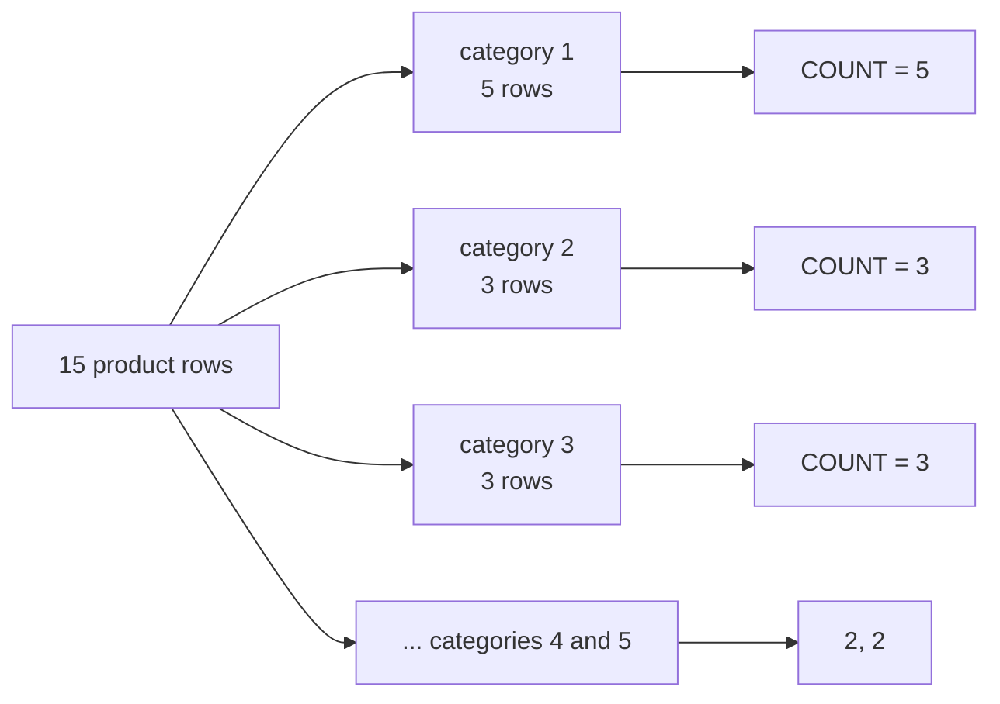

# Aggregations & GROUP BY

!!! abstract "Learning Objectives"
    By the end of this lesson, you can:

    - Summarise data with `COUNT`, `SUM`, `AVG`, `MIN` and `MAX`
    - Explain how aggregates treat `NULL` values
    - Produce per-group reports with `GROUP BY`
    - Filter groups with `HAVING`, and know when to use `WHERE` instead
    - Fix the classic *"isn't in GROUP BY"* error

**Prerequisites:** [Filtering, Sorting & Pagination](05-filtering-sorting.md)

## What are Aggregate Functions?

So far, every query returned individual rows. Business questions are usually about **summaries**:

- *How many customers do we have?*
- *What's our total revenue?*
- *What's the average salary in each department?*

**Aggregate functions** take many rows and return **one value**.

| Function | Returns | Example |
|----------|---------|---------|
| `COUNT(*)` | Number of rows | How many orders? |
| `COUNT(column)` | Number of non-NULL values | How many customers gave a phone? |
| `COUNT(DISTINCT column)` | Number of unique non-NULL values | How many cities? |
| `SUM(column)` | Total | Total stock |
| `AVG(column)` | Average | Average rating |
| `MIN(column)` / `MAX(column)` | Smallest / largest | Cheapest / most expensive product |

!!! example "Real-life analogy: an exam result sheet"
    A class teacher has every student's marks (rows). The principal only wants a summary: number of students, class average, highest and lowest score. Aggregate functions turn the full sheet into that summary.

```sql
SELECT
    COUNT(*)              AS products,
    SUM(stock)            AS total_units,
    MIN(price)            AS cheapest,
    MAX(price)            AS costliest,
    ROUND(AVG(rating), 2) AS avg_rating
FROM products;
```

```{ .text .output }
+----------+-------------+----------+-----------+------------+
| products | total_units | cheapest | costliest | avg_rating |
+----------+-------------+----------+-----------+------------+
|       15 |        1187 |   299.00 |  79999.00 |       4.34 |
+----------+-------------+----------+-----------+------------+
```

Aggregates work together with `WHERE`: filter first, then summarise.

```sql
SELECT COUNT(*) AS delivered_orders
FROM orders
WHERE status = 'delivered';
```

```{ .text .output }
+------------------+
| delivered_orders |
+------------------+
|                7 |
+------------------+
```

Revenue needs a calculation **inside** the aggregate: quantity × price for each line, summed:

```sql
SELECT SUM(quantity * unit_price) AS gross_revenue
FROM order_items;
```

```{ .text .output }
+---------------+
| gross_revenue |
+---------------+
|     239526.00 |
+---------------+
```

## COUNT and NULL

The three forms of `COUNT` give different answers when data is missing:

```sql
SELECT
    COUNT(*)             AS all_customers,
    COUNT(phone)         AS with_phone,
    COUNT(DISTINCT city) AS cities
FROM customers;
```

```{ .text .output }
+---------------+------------+--------+
| all_customers | with_phone | cities |
+---------------+------------+--------+
|            10 |          7 |      7 |
+---------------+------------+--------+
```

- `COUNT(*)` counts **rows**, whatever they contain.
- `COUNT(phone)` skips rows where `phone` is `NULL`.
- `COUNT(DISTINCT city)` counts unique cities (Pune, Hyderabad and Bangalore appear twice).

!!! warning "All aggregates except COUNT(*) ignore NULL"
    `SUM`, `AVG`, `MIN` and `MAX` skip `NULL` values completely. That matters most for `AVG`: the average of `(80, NULL, 40)` is `60` (two values), not `40` (three values). If a missing value should count as zero, convert it first: `AVG(COALESCE(score, 0))`.

On an empty set, `COUNT` returns `0`, but `SUM`, `AVG`, `MIN` and `MAX` return `NULL`:

```sql
SELECT COUNT(*) AS cnt, SUM(price) AS total
FROM products
WHERE price > 1000000;
```

```{ .text .output }
+-----+-------+
| cnt | total |
+-----+-------+
|   0 |  NULL |
+-----+-------+
```

## GROUP BY

`GROUP BY` splits rows into **groups** with the same value, then runs the aggregate **once per group**.

*How many products are in each category?*

```sql
SELECT category_id, COUNT(*) AS products
FROM products
GROUP BY category_id;
```

```{ .text .output }
+-------------+----------+
| category_id | products |
+-------------+----------+
|           1 |        5 |
|           2 |        3 |
|           3 |        3 |
|           4 |        2 |
|           5 |        2 |
+-------------+----------+
```



*Payroll by department*:

```sql
SELECT
    department,
    COUNT(*)              AS employees,
    SUM(salary)           AS total_salary,
    ROUND(AVG(salary), 0) AS avg_salary,
    MAX(salary)           AS highest
FROM employees
GROUP BY department
ORDER BY total_salary DESC;
```

```{ .text .output }
+-------------+-----------+--------------+------------+-----------+
| department  | employees | total_salary | avg_salary | highest   |
+-------------+-----------+--------------+------------+-----------+
| Engineering |         4 |    470000.00 |     117500 | 180000.00 |
| Sales       |         3 |    265000.00 |      88333 | 150000.00 |
| Management  |         1 |    250000.00 |     250000 | 250000.00 |
| Support     |         2 |    110000.00 |      55000 |  70000.00 |
+-------------+-----------+--------------+------------+-----------+
```

*Orders by status*:

```sql
SELECT status, COUNT(*) AS orders
FROM orders
GROUP BY status
ORDER BY orders DESC;
```

```{ .text .output }
+-----------+--------+
| status    | orders |
+-----------+--------+
| delivered |      7 |
| shipped   |      2 |
| pending   |      2 |
| cancelled |      1 |
+-----------+--------+
```

### Grouping by several columns

Each **combination** becomes a group. Customers per city per joining year:

```sql
SELECT city, YEAR(joined_on) AS year_joined, COUNT(*) AS customers
FROM customers
GROUP BY city, YEAR(joined_on)
ORDER BY city, year_joined;
```

```{ .text .output }
+-----------+-------------+-----------+
| city      | year_joined | customers |
+-----------+-------------+-----------+
| Bangalore |        2024 |         1 |
| Bangalore |        2025 |         1 |
| Chennai   |        2024 |         1 |
| Delhi     |        2024 |         1 |
| Hyderabad |        2024 |         2 |
| Kochi     |        2024 |         1 |
| Mumbai    |        2025 |         1 |
| Pune      |        2025 |         2 |
+-----------+-------------+-----------+
```

### Revenue per order

```sql
SELECT
    order_id,
    COUNT(*)                   AS line_items,
    SUM(quantity)              AS units,
    SUM(quantity * unit_price) AS order_total
FROM order_items
GROUP BY order_id
ORDER BY order_total DESC
LIMIT 5;
```

```{ .text .output }
+----------+------------+-------+-------------+
| order_id | line_items | units | order_total |
+----------+------------+-------+-------------+
|        9 |          1 |     1 |    79999.00 |
|        2 |          1 |     1 |    74999.00 |
|        4 |          1 |     1 |    58999.00 |
|        3 |          2 |     4 |     6696.00 |
|       10 |          2 |     6 |     3794.00 |
+----------+------------+-------+-------------+
```

!!! realworld "In Real Projects"
    Every dashboard and report is built on `GROUP BY`: sales per day, signups per week, revenue per city, tickets per support agent, top 10 products. When a manager asks for *"total X per Y"*, you'll reach for `SUM(X) ... GROUP BY Y`.

!!! mistake "Common Mistake: selecting a column that isn't grouped"
    ```sql
    SELECT department, name, AVG(salary)
    FROM employees
    GROUP BY department;
    ```

    ```{ .text .output }
    ERROR 1055 (42000): Expression #2 of SELECT list is not in GROUP BY clause and contains nonaggregated column 'ksr_shop.employees.name' which is not functionally dependent on columns in GROUP BY clause; this is incompatible with sql_mode=only_full_group_by
    ```

    Each department is **one** result row, but has several names. MySQL can't know which `name` to show, so it refuses. **Rule:** every column in `SELECT` must either be in `GROUP BY` or be inside an aggregate function. (To get "the highest-paid person per department", you'll use window functions in [lesson 11](11-window-functions.md).)

## HAVING: Filtering Groups

`WHERE` filters **rows before** grouping. `HAVING` filters **groups after** aggregation, so it can use aggregate results.

*Departments with more than 2 employees*:

```sql
SELECT department, COUNT(*) AS employees
FROM employees
GROUP BY department
HAVING COUNT(*) > 2;
```

```{ .text .output }
+-------------+-----------+
| department  | employees |
+-------------+-----------+
| Engineering |         4 |
| Sales       |         3 |
+-------------+-----------+
```

*Cities with at least two customers*:

```sql
SELECT city, COUNT(*) AS customers
FROM customers
GROUP BY city
HAVING customers >= 2
ORDER BY customers DESC, city;
```

```{ .text .output }
+-----------+-----------+
| city      | customers |
+-----------+-----------+
| Bangalore |         2 |
| Hyderabad |         2 |
| Pune      |         2 |
+-----------+-----------+
```

(MySQL lets `HAVING` use the alias `customers`. Standard SQL requires repeating `COUNT(*)`.)

You can't use an aggregate in `WHERE`:

```sql
SELECT department, AVG(salary)
FROM employees
WHERE AVG(salary) > 100000
GROUP BY department;
```

```{ .text .output }
ERROR 1111 (HY000): Invalid use of group function
```

### WHERE and HAVING together

*Among products that are in stock, which categories have an average price above ₹3,000?*

```sql
SELECT category_id, COUNT(*) AS in_stock_products, ROUND(AVG(price), 2) AS avg_price
FROM products
WHERE stock > 0                 -- 1. drop out-of-stock rows
GROUP BY category_id            -- 2. group what's left
HAVING AVG(price) > 3000        -- 3. keep only expensive groups
ORDER BY avg_price DESC;
```

```{ .text .output }
+-------------+-------------------+-----------+
| category_id | in_stock_products | avg_price |
+-------------+-------------------+-----------+
|           1 |                 5 |  43119.00 |
+-------------+-------------------+-----------+
```

| | `WHERE` | `HAVING` |
|---|---|---|
| Filters | Individual rows | Groups |
| Runs | Before `GROUP BY` | After `GROUP BY` |
| Can use aggregates? | ❌ | ✅ |
| Example | `WHERE status = 'delivered'` | `HAVING SUM(amount) > 10000` |

!!! tip "Filter early"
    If a condition doesn't need an aggregate, put it in `WHERE`, not `HAVING`. Filtering rows before grouping means less data to group, so the query is faster.

## Execution Order and WITH ROLLUP

The complete logical order of a query:


Written order: `SELECT … FROM … WHERE … GROUP BY … HAVING … ORDER BY … LIMIT`.

### Subtotals with WITH ROLLUP

`WITH ROLLUP` adds a **grand total** row (shown as `NULL` in the grouped column):

```sql
SELECT department, SUM(salary) AS total_salary
FROM employees
GROUP BY department WITH ROLLUP;
```

```{ .text .output }
+-------------+--------------+
| department  | total_salary |
+-------------+--------------+
| Engineering |    470000.00 |
| Management  |    250000.00 |
| Sales       |    265000.00 |
| Support     |    110000.00 |
| NULL        |   1095000.00 |
+-------------+--------------+
```

## Common Mistakes

| Mistake | Error / Result | Fix |
|---------|---------------|-----|
| Non-aggregated column not in `GROUP BY` | `ERROR 1055 (42000): ... isn't in GROUP BY` | Add it to `GROUP BY`, or aggregate it |
| Aggregate in `WHERE` | `ERROR 1111 (HY000): Invalid use of group function` | Move the condition to `HAVING` |
| `COUNT(column)` when you meant all rows | Smaller count (NULLs skipped) | `COUNT(*)` |
| `AVG` over a column with NULLs | Average of non-NULL values only | `AVG(COALESCE(col, 0))` if NULL means zero |
| `HAVING` for row-level filters | Slower queries | Use `WHERE` for non-aggregate conditions |
| Forgetting `ORDER BY` on reports | Groups in arbitrary order | Sort by the group or the metric |
| `SUM(price)` for revenue | Ignores quantity | `SUM(quantity * unit_price)` |

## Practice Exercises

Use a fresh `ksr_shop`.

**Easy**

1. How many customers are there, and how many have **no** phone number?
2. What is the total value of all stock (`price × stock`) in the store?
3. What is the earliest and the latest order date?

**Medium**

4. Show the number of products and the average rating for each `brand`, ignoring products with no brand. Sort by product count, then brand.
5. Show the number of orders per customer (`customer_id`), only for customers with more than one order.
6. Show total units sold per product (`product_id`) from `order_items`, top 5 by units.

**Challenge**

7. Build a **monthly sales report** from `orders` and `order_items`: for each month (`'2025-06'`, `'2025-07'`, …) show the number of distinct orders, units sold and revenue, counting only orders that weren't cancelled. (Hint: you'll need the order date and status, which live in `orders`. For now, use a subquery: `WHERE order_id IN (SELECT id FROM orders WHERE status <> 'cancelled')`, and get the month with `DATE_FORMAT`. You'll do this properly with a JOIN in lesson 09.)

??? success "Solutions (click to expand)"

    ```{ .sql .no-run }
    -- 1
    SELECT COUNT(*) AS customers, COUNT(*) - COUNT(phone) AS without_phone
    FROM customers;                                   -- 10, 3

    -- 2
    SELECT SUM(price * stock) AS stock_value FROM products;

    -- 3
    SELECT MIN(order_date) AS first_order, MAX(order_date) AS last_order FROM orders;

    -- 4
    SELECT brand, COUNT(*) AS products, ROUND(AVG(rating), 2) AS avg_rating
    FROM products
    WHERE brand IS NOT NULL
    GROUP BY brand
    ORDER BY products DESC, brand;

    -- 5
    SELECT customer_id, COUNT(*) AS orders
    FROM orders
    GROUP BY customer_id
    HAVING COUNT(*) > 1;                              -- customers 1 (3), 2 (2), 4 (2)

    -- 6
    SELECT product_id, SUM(quantity) AS units
    FROM order_items
    GROUP BY product_id
    ORDER BY units DESC
    LIMIT 5;

    -- 7 (JOIN version, after lesson 09)
    SELECT DATE_FORMAT(o.order_date, '%Y-%m') AS month,
           COUNT(DISTINCT o.id)               AS orders,
           SUM(oi.quantity)                   AS units,
           SUM(oi.quantity * oi.unit_price)   AS revenue
    FROM orders o
    JOIN order_items oi ON oi.order_id = o.id
    WHERE o.status <> 'cancelled'
    GROUP BY month
    ORDER BY month;
    ```

!!! note "Mini Assignment"
    Write the SQL for an **HR dashboard** using the `employees` table: headcount per department, average, lowest and highest salary per department, the number of people hired each year, the departments whose payroll is above ₹3,00,000, and a grand total row using `WITH ROLLUP`. Present each result with clear column aliases.

## Interview Questions

!!! interview "1. What is the difference between `COUNT(*)`, `COUNT(column)` and `COUNT(DISTINCT column)`?"
    `COUNT(*)` counts all rows. `COUNT(column)` counts rows where the column isn't NULL. `COUNT(DISTINCT column)` counts the unique non-NULL values.

!!! interview "2. What is the difference between WHERE and HAVING?"
    `WHERE` filters individual rows before grouping and can't use aggregate functions. `HAVING` filters groups after `GROUP BY` and can use aggregates like `COUNT(*) > 5`.

!!! interview "3. How do aggregate functions handle NULL?"
    `SUM`, `AVG`, `MIN`, `MAX` and `COUNT(column)` ignore NULLs; only `COUNT(*)` counts every row. On an empty set, `COUNT` returns 0 while the others return NULL.

!!! interview "4. Why do you get 'Expression #2 of SELECT list is not in GROUP BY clause'?"
    With `ONLY_FULL_GROUP_BY` (the MySQL 8 default), every selected column must be in `GROUP BY` or wrapped in an aggregate, because otherwise its value per group is ambiguous. Fix it by grouping by that column, aggregating it, or using a window function.

!!! interview "5. Write a query to find duplicate emails in a users table."
    `SELECT email, COUNT(*) FROM users GROUP BY email HAVING COUNT(*) > 1;`

!!! interview "Scenario: a manager says the 'average order value' on the dashboard looks too high. What might be wrong?"
    Possible causes: cancelled or test orders weren't excluded (add `WHERE status <> 'cancelled'`); the average was taken over order **lines** instead of orders (sum per order first, then average); NULL amounts were skipped when they should count as zero; or a join duplicated rows. Check each step with smaller queries.

## Summary

| Concept | Remember |
|---------|----------|
| Aggregates | `COUNT`, `SUM`, `AVG`, `MIN`, `MAX` turn many rows into one value |
| NULL | Ignored by all aggregates except `COUNT(*)` |
| `GROUP BY` | One result row per group; selected columns must be grouped or aggregated |
| `HAVING` | Filters groups; can use aggregates |
| `WHERE` vs `HAVING` | Rows before grouping vs groups after |
| Order | FROM → WHERE → GROUP BY → HAVING → SELECT → ORDER BY → LIMIT |
| `WITH ROLLUP` | Adds subtotal / grand total rows |

**Next lesson:** [Functions & Expressions](07-functions-expressions.md), with string, date and numeric functions, `CASE` and `COALESCE`.
