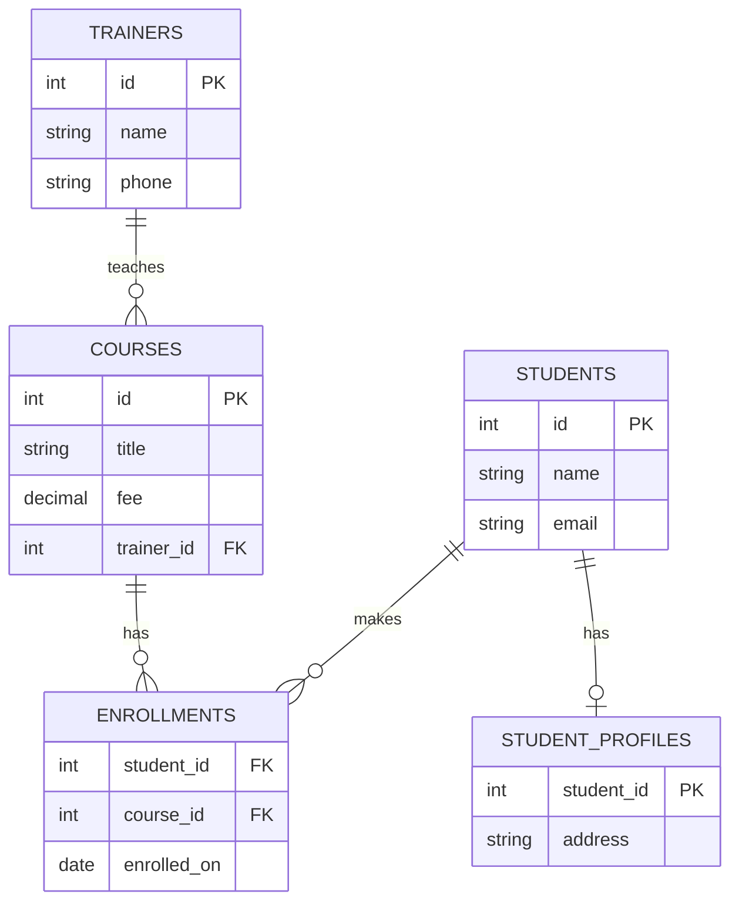

# Database Design: Keys, Relationships & Normalisation

!!! abstract "Learning Objectives"
    By the end of this lesson, you can:

    - Turn a real-world requirement into entities, attributes and relationships (ER model)
    - Choose primary keys (surrogate, natural, composite) and create foreign keys
    - Model one-to-one, one-to-many and many-to-many relationships
    - Decide what happens to child rows on delete: `RESTRICT`, `CASCADE`, `SET NULL`
    - Normalise a messy table into 1NF, 2NF and 3NF

**Prerequisites:** [Creating Tables & Data Types](03-creating-tables.md). This lesson works in the empty `ksr_practice` database.

## Why Design Matters

Imagine an academy storing everything in one table:

| student | phone | course | trainer | trainer_phone | fee |
|---------|-------|--------|---------|---------------|-----|
| Asha | 98765 00001 | Python | Kiran | 90000 11111 | 45000 |
| Asha | 98765 00001 | React | Meena | 90000 22222 | 25000 |
| Ravi | 98765 00002 | Python | Kiran | 90000 11111 | 45000 |

Problems appear immediately:

- **Repetition:** Kiran's phone is stored on every Python row. If it changes, you must update many rows, and if you miss one, the data contradicts itself (an **update anomaly**).
- **Insert anomaly:** you can't add a new course until a student enrols in it.
- **Delete anomaly:** if Ravi leaves and he was the only student in a course, you lose the course and trainer details too.

Good design stores **each fact exactly once** and connects facts through **keys**.

!!! example "Real-life analogy: a well-organised office"
    A messy office keeps a full copy of every customer's details on every invoice. An organised office keeps **one customer file** and writes only the customer number on each invoice. Updating an address means changing one file, not hundreds of invoices.

## The ER Model

The **Entity-Relationship (ER) model** is how developers sketch a database before writing SQL.

| Concept | Meaning | Academy example |
|---------|---------|-----------------|
| **Entity** | A thing we store data about (becomes a table) | Student, Course, Trainer |
| **Attribute** | A property of an entity (becomes a column) | name, phone, fee |
| **Key attribute** | Uniquely identifies each entity | student id |
| **Relationship** | How entities are connected | a Trainer **teaches** Courses; Students **enrol in** Courses |
| **Cardinality** | How many of each side | one trainer → many courses |



**Reading the crow's-foot notation:** `||` means exactly one, `o|` means zero or one, `o{` means zero or many, `|{` means one or many.

**Steps to design any database**

1. List the **nouns** in the requirement: these are candidate entities.
2. List each entity's **attributes**; pick a **primary key**.
3. Find the **relationships** (verbs) and their **cardinality**.
4. Turn one-to-many relationships into **foreign keys**, and many-to-many into **junction tables**.
5. **Normalise** to remove repetition.
6. Add **constraints**: NOT NULL, UNIQUE, CHECK, and ON DELETE rules.

## Primary Keys

A **primary key** uniquely identifies each row. It must be **unique**, **never NULL** and **never change**.

| Type | Example | Pros | Cons |
|------|---------|------|------|
| **Surrogate** | `id INT AUTO_INCREMENT` | Simple, small, never changes | Has no business meaning |
| **Natural** | email, Aadhaar number, PAN | Meaningful | Can change (emails!) or be sensitive |
| **Composite** | `(student_id, course_id)` | Natural for junction tables | Longer foreign keys elsewhere |

!!! tip "Default choice"
    Use a surrogate `id INT PRIMARY KEY AUTO_INCREMENT` (or `BIGINT` for huge tables) for entity tables, and put a `UNIQUE` constraint on natural identifiers like email. Junction tables often use a composite primary key.

## Foreign Keys and One-to-Many

A **foreign key** is a column whose value must match a primary key in another (parent) table. It creates the link and **enforces** it.

**One-to-many (1:N)**, the most common relationship: one trainer teaches many courses; each course has one trainer. The foreign key goes on the **many** side:

```sql
CREATE TABLE trainers (
    id    INT PRIMARY KEY AUTO_INCREMENT,
    name  VARCHAR(100) NOT NULL,
    phone VARCHAR(15)  NOT NULL UNIQUE
);

CREATE TABLE courses (
    id         INT PRIMARY KEY AUTO_INCREMENT,
    title      VARCHAR(100) NOT NULL UNIQUE,
    fee        DECIMAL(10, 2) NOT NULL CHECK (fee >= 0),
    trainer_id INT,
    CONSTRAINT fk_courses_trainer
        FOREIGN KEY (trainer_id) REFERENCES trainers (id)
        ON DELETE SET NULL
);

INSERT INTO trainers (name, phone) VALUES
('Kiran', '9000011111'), ('Meena', '9000022222'), ('Farhan', '9000033333');

INSERT INTO courses (title, fee, trainer_id) VALUES
('Full Stack Python', 45000, 1),
('Full Stack Java',   45000, 3),
('React',             25000, 2),
('MySQL',             15000, 1);

SELECT * FROM courses;
```

```{ .text .output }
+----+-------------------+----------+------------+
| id | title             | fee      | trainer_id |
+----+-------------------+----------+------------+
|  1 | Full Stack Python | 45000.00 |          1 |
|  2 | Full Stack Java   | 45000.00 |          3 |
|  3 | React             | 25000.00 |          2 |
|  4 | MySQL             | 15000.00 |          1 |
+----+-------------------+----------+------------+
```

The foreign key **refuses** a course for a trainer who doesn't exist:

```sql
INSERT INTO courses (title, fee, trainer_id) VALUES ('Django', 30000, 99);
```

```{ .text .output }
ERROR 1452 (23000): Cannot add or update a child row: a foreign key constraint fails (`ksr_practice`.`courses`, CONSTRAINT `fk_courses_trainer` FOREIGN KEY (`trainer_id`) REFERENCES `trainers` (`id`) ON DELETE SET NULL)
```

!!! realworld "In Real Projects"
    Foreign keys prevent **orphan rows**: orders for customers who don't exist, comments on deleted posts, payments with no order. Without them, application bugs slowly corrupt the data. Django's `models.ForeignKey(...)` and JPA's `@ManyToOne` create exactly these constraints for you.

## ON DELETE Rules

What should happen to child rows when a parent row is deleted? You decide when creating the foreign key:

| Rule | When the parent is deleted… | Use for |
|------|-----------------------------|---------|
| `RESTRICT` / `NO ACTION` (default) | The delete is **blocked** while children exist | Customers with orders, products in orders |
| `CASCADE` | Children are **deleted too** | Order items of an order, comments of a post |
| `SET NULL` | The child's foreign key becomes `NULL` | A course whose trainer leaves (the course stays, unassigned) |

We used `ON DELETE SET NULL` for courses. Farhan leaves the academy:

```sql
DELETE FROM trainers WHERE name = 'Farhan';
SELECT id, title, trainer_id FROM courses;
```

```{ .text .output }
+----+-------------------+------------+
| id | title             | trainer_id |
+----+-------------------+------------+
|  1 | Full Stack Python |          1 |
|  2 | Full Stack Java   |       NULL |
|  3 | React             |          2 |
|  4 | MySQL             |          1 |
+----+-------------------+------------+
```

The Java course survived with no trainer assigned, ready to be given to someone new. `ON UPDATE CASCADE` works the same way for key changes, but since surrogate keys never change, you rarely need it.

!!! warning "Use CASCADE carefully"
    `ON DELETE CASCADE` on the wrong relationship can wipe out a huge amount of data with one `DELETE`. Deleting a customer should **not** silently delete their orders and invoices. Cascade only from a true "owner" to things that can't exist without it.

## One-to-One and Many-to-Many

### One-to-one (1:1)

Each student has at most one profile. Put a foreign key that is **also unique** (often it's the primary key itself) on the optional side:

```sql
CREATE TABLE students (
    id    INT PRIMARY KEY AUTO_INCREMENT,
    name  VARCHAR(100) NOT NULL,
    email VARCHAR(100) NOT NULL UNIQUE
);

CREATE TABLE student_profiles (
    student_id   INT PRIMARY KEY,
    address      VARCHAR(255),
    linkedin_url VARCHAR(255),
    FOREIGN KEY (student_id) REFERENCES students (id) ON DELETE CASCADE
);

INSERT INTO students (name, email) VALUES
('Asha', 'asha@example.com'), ('Ravi', 'ravi@example.com'), ('Divya', 'divya@example.com');

INSERT INTO student_profiles (student_id, address) VALUES (1, 'Madhapur, Hyderabad');
INSERT INTO student_profiles (student_id, address) VALUES (1, 'Second address?');
```

```{ .text .output }
ERROR 1062 (23000): Duplicate entry '1' for key 'student_profiles.PRIMARY'
```

Because `student_id` is the primary key, a student can't have two profiles. Use 1:1 to split rarely-used or sensitive columns out of a busy table.

### Many-to-many (M:N)

A student can enrol in many courses, and a course has many students. A foreign key column can hold only one value, so you need a **junction table** (also called a bridge or associative table) that holds one row per pair:

```sql
CREATE TABLE enrollments (
    student_id  INT NOT NULL,
    course_id   INT NOT NULL,
    enrolled_on DATE NOT NULL,
    fee_paid    DECIMAL(10, 2) NOT NULL DEFAULT 0,
    PRIMARY KEY (student_id, course_id),
    FOREIGN KEY (student_id) REFERENCES students (id) ON DELETE CASCADE,
    FOREIGN KEY (course_id)  REFERENCES courses (id)
);

INSERT INTO enrollments (student_id, course_id, enrolled_on, fee_paid) VALUES
(1, 1, '2026-01-10', 45000),
(1, 3, '2026-02-01', 10000),
(2, 1, '2026-01-12', 20000),
(3, 2, '2026-01-15', 45000),
(3, 4, '2026-03-01', 15000);

SELECT * FROM enrollments ORDER BY student_id, course_id;
```

```{ .text .output }
+------------+-----------+-------------+----------+
| student_id | course_id | enrolled_on | fee_paid |
+------------+-----------+-------------+----------+
|          1 |         1 | 2026-01-10  | 45000.00 |
|          1 |         3 | 2026-02-01  | 10000.00 |
|          2 |         1 | 2026-01-12  | 20000.00 |
|          3 |         2 | 2026-01-15  | 45000.00 |
|          3 |         4 | 2026-03-01  | 15000.00 |
+------------+-----------+-------------+----------+
```

The composite primary key stops the same student enrolling twice in the same course:

```sql
INSERT INTO enrollments (student_id, course_id, enrolled_on) VALUES (1, 1, '2026-04-01');
```

```{ .text .output }
ERROR 1062 (23000): Duplicate entry '1-1' for key 'enrollments.PRIMARY'
```

The junction table can also carry data **about the relationship** itself: enrolment date, fee paid, grade. In ksr_shop, `order_items` is a junction table between `orders` and `products` that carries `quantity` and `unit_price`.

| Relationship | Example | How to implement |
|--------------|---------|------------------|
| 1:1 | Student ↔ profile | FK + `UNIQUE` (or FK as PK) on one side |
| 1:N | Trainer → courses | FK on the "many" side |
| M:N | Students ↔ courses | Junction table with two FKs |

## Normalisation

**Normalisation** is a step-by-step process for removing repetition and anomalies. The first three **normal forms** cover almost every real design.

Start with this unnormalised order data:

| order_id | customer | customer_city | products | order_date |
|----------|----------|---------------|----------|------------|
| 101 | Asha | Hyderabad | iPhone 15 (1), Cable (2) | 2025-06-05 |
| 102 | Ravi | Bangalore | Galaxy S24 (1) | 2025-06-18 |

### First Normal Form (1NF): atomic values, no lists

**Rule:** each cell holds a single value, and there are no repeating groups. `products` holds a list, which breaks 1NF. Give each product its own row:

| order_id | customer | customer_city | product | quantity | order_date |
|----------|----------|---------------|---------|----------|------------|
| 101 | Asha | Hyderabad | iPhone 15 | 1 | 2025-06-05 |
| 101 | Asha | Hyderabad | Cable | 2 | 2025-06-05 |
| 102 | Ravi | Bangalore | Galaxy S24 | 1 | 2025-06-18 |

### Second Normal Form (2NF): depend on the whole key

**Rule:** be in 1NF, and every non-key column depends on the **entire** primary key, not just part of it. The key here is `(order_id, product)`, but `customer` and `order_date` depend only on `order_id`. Split them out:

**orders**

| order_id | customer | customer_city | order_date |
|----------|----------|---------------|------------|
| 101 | Asha | Hyderabad | 2025-06-05 |
| 102 | Ravi | Bangalore | 2025-06-18 |

**order_items**

| order_id | product | quantity |
|----------|---------|----------|
| 101 | iPhone 15 | 1 |
| 101 | Cable | 2 |
| 102 | Galaxy S24 | 1 |

### Third Normal Form (3NF): no column depends on another non-key column

**Rule:** be in 2NF, and no non-key column depends on **another non-key column** (no *transitive* dependency). In `orders`, `customer_city` depends on `customer`, not on the order. Move customer details into their own table:

**customers**: `(customer_id, name, city)` · **orders**: `(order_id, customer_id, order_date)` · **order_items**: `(order_id, product_id, quantity)` · **products**: `(product_id, name, price)`

That's exactly the ksr_shop design.

!!! tip "Memory trick"
    Every non-key column must depend on **the key** (1NF), **the whole key** (2NF), and **nothing but the key** (3NF).

| Normal form | Rule | Fixes |
|-------------|------|-------|
| 1NF | Atomic values, no repeating groups | Lists in a cell |
| 2NF | No partial dependency on part of a composite key | Order details repeated per item |
| 3NF | No transitive dependency between non-key columns | Customer city repeated per order |

### When to denormalise

Normalised designs are correct and easy to update, but some read-heavy queries need many joins. Real systems sometimes **denormalise on purpose**. For example, they copy `unit_price` into `order_items`, because the product's price can change later but the invoice must show what the customer actually paid. That isn't a mistake; it's storing a **historical fact**. Denormalise deliberately, never by accident.

## Common Mistakes

| Mistake | Problem | Fix |
|---------|---------|-----|
| Storing lists in one column (`'Python,React'`) | Can't search, join or validate | Junction table (M:N) |
| Copying customer details into every order | Update anomalies, inconsistent data | Store `customer_id` only |
| No foreign keys | Orphan rows over time | Add FK constraints |
| FK column type doesn't match the PK type | `ERROR 3780: Referencing column ... and referenced column ... are incompatible` | Use identical types (`INT` ↔ `INT`) |
| Inserting a child before its parent | `ERROR 1452: Cannot add or update a child row` | Insert parents first |
| `CASCADE` everywhere | One delete wipes out related history | `RESTRICT` by default; cascade only for owned data |
| Natural key that can change (email) as the PK | Painful updates across every child table | Surrogate `id` + `UNIQUE(email)` |

## Practice Exercises

**Easy**

1. Identify the entities, attributes and relationships in: *"A hospital has doctors and patients. A patient can book many appointments; each appointment is with one doctor at a date and time."*
2. For each pair, name the cardinality (1:1, 1:N or M:N): country–capital, author–books, students–clubs, employee–department, user–Aadhaar.
3. Which `ON DELETE` rule would you choose for: post → comments, customer → orders, employee → manager (`manager_id`)?

**Medium**

4. Create the hospital tables from exercise 1 in `ksr_practice` with proper primary keys, foreign keys and constraints. An appointment's status should be `scheduled`, `completed` or `cancelled`.
5. Normalise this table to 3NF and show the final tables: `(invoice_no, invoice_date, customer_name, customer_phone, item_name, item_price, qty)`.
6. A movie app has movies and actors, where an actor plays a **role name** in each movie. Design the tables.

**Challenge**

7. Design a **food delivery** schema (restaurants, menu items, customers, addresses, orders, order items, delivery partners, ratings). Draw the ER diagram (on paper or with dbdiagram.io), then write the `CREATE TABLE` statements with all keys, constraints and `ON DELETE` rules, and justify each rule in a comment.

??? success "Solutions (click to expand)"

    1. Entities: Doctor, Patient, Appointment. Attributes: doctor (id, name, specialisation), patient (id, name, phone, dob), appointment (id, scheduled_at, status). Relationships: Patient 1:N Appointment; Doctor 1:N Appointment (so Doctor M:N Patient through Appointment).
    2. country–capital 1:1 · author–books 1:N (or M:N for co-authors) · students–clubs M:N · employee–department N:1 · user–Aadhaar 1:1.
    3. post → comments: `CASCADE` · customer → orders: `RESTRICT` (keep financial history) · employee → manager: `SET NULL` (the employee stays when the manager leaves).

    ```{ .sql .no-run }
    -- 4
    CREATE TABLE doctors (
        id             INT PRIMARY KEY AUTO_INCREMENT,
        name           VARCHAR(100) NOT NULL,
        specialisation VARCHAR(50)  NOT NULL
    );
    CREATE TABLE patients (
        id    INT PRIMARY KEY AUTO_INCREMENT,
        name  VARCHAR(100) NOT NULL,
        phone VARCHAR(15)  NOT NULL UNIQUE,
        dob   DATE
    );
    CREATE TABLE appointments (
        id           INT PRIMARY KEY AUTO_INCREMENT,
        doctor_id    INT NOT NULL,
        patient_id   INT NOT NULL,
        scheduled_at DATETIME NOT NULL,
        status       ENUM('scheduled', 'completed', 'cancelled') NOT NULL DEFAULT 'scheduled',
        UNIQUE (doctor_id, scheduled_at),            -- a doctor can't be double-booked
        FOREIGN KEY (doctor_id)  REFERENCES doctors (id),
        FOREIGN KEY (patient_id) REFERENCES patients (id)
    );

    -- 5
    -- customers(id, name, phone UNIQUE)
    -- items(id, name, price)
    -- invoices(invoice_no PK, invoice_date, customer_id FK)
    -- invoice_items(invoice_no FK, item_id FK, qty, price_at_sale, PK(invoice_no, item_id))

    -- 6
    CREATE TABLE movies (id INT PRIMARY KEY AUTO_INCREMENT, title VARCHAR(150) NOT NULL);
    CREATE TABLE actors (id INT PRIMARY KEY AUTO_INCREMENT, name VARCHAR(100) NOT NULL);
    CREATE TABLE movie_cast (
        movie_id  INT NOT NULL,
        actor_id  INT NOT NULL,
        role_name VARCHAR(100) NOT NULL,
        PRIMARY KEY (movie_id, actor_id, role_name),
        FOREIGN KEY (movie_id) REFERENCES movies (id) ON DELETE CASCADE,
        FOREIGN KEY (actor_id) REFERENCES actors (id)
    );
    ```

!!! note "Mini Assignment"
    Design the database for **your own capstone idea** (or a training institute portal: trainers, courses, batches, students, enrolments, payments, attendance). Deliver: an ER diagram, the `CREATE TABLE` script with all constraints, a short note on which normal form each table is in, and one place where you'd deliberately denormalise and why.

## Interview Questions

!!! interview "1. What is the difference between a primary key and a foreign key?"
    A primary key uniquely identifies rows in its own table (unique, NOT NULL, one per table). A foreign key is a column that references a primary (or unique) key in another table to enforce a relationship. A table can have many foreign keys, and they can be NULL unless constrained.

!!! interview "2. How do you implement a many-to-many relationship?"
    With a junction table containing foreign keys to both tables, usually with a composite primary key `(a_id, b_id)` to prevent duplicates. It can also hold attributes of the relationship, like enrolment date or quantity.

!!! interview "3. Explain 1NF, 2NF and 3NF."
    1NF: atomic values, no repeating groups. 2NF: 1NF and no partial dependency (every non-key column depends on the whole composite key). 3NF: 2NF and no transitive dependency (non-key columns depend only on the key, not on other non-key columns).

!!! interview "4. What are ON DELETE CASCADE and ON DELETE SET NULL?"
    Referential actions on a foreign key. CASCADE deletes child rows when the parent is deleted; SET NULL sets the child's foreign key to NULL (the column must be nullable); RESTRICT / NO ACTION (the default) blocks deleting a parent that still has children.

!!! interview "5. What is denormalisation and when is it acceptable?"
    Intentionally adding redundancy to speed up reads or to preserve historical values. Examples: storing `unit_price` in order items, keeping a cached `order_count` on customers, reporting tables. It's acceptable when the read benefit outweighs the cost of keeping copies consistent, and it should be done deliberately.

!!! interview "Scenario: a product's price changed and now old invoices show the new price. What design mistake caused this?"
    The invoice lines reference only `product_id` and read the current price from `products`. The price at the time of sale is a historical fact and must be stored on the order line (`unit_price`). Fix the schema, then backfill historical prices from any logs or payment records available.

## Summary

| Concept | Remember |
|---------|----------|
| ER model | Entities → tables, attributes → columns, relationships → keys |
| Primary key | Unique, NOT NULL, never changes; usually a surrogate `id` |
| Foreign key | References a parent key; prevents orphans |
| 1:N | FK on the "many" side |
| 1:1 | FK that is UNIQUE (or is the PK) |
| M:N | Junction table with two FKs and a composite PK |
| ON DELETE | `RESTRICT` (default), `CASCADE` (owned data), `SET NULL` (optional link) |
| Normalisation | The key (1NF), the whole key (2NF), nothing but the key (3NF) |
| Denormalise | Only deliberately: historical values, performance |

**Next lesson:** [Joins](09-joins.md), combining related tables back together in queries.
