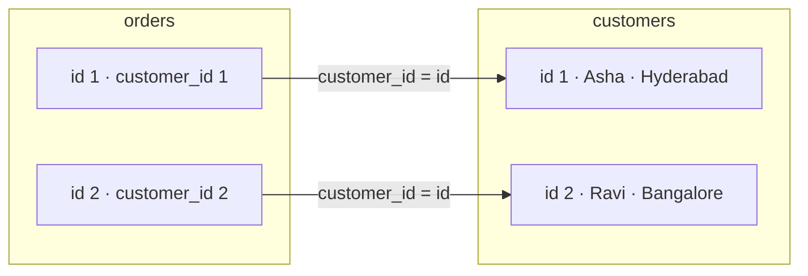

# Joins

!!! abstract "Learning Objectives"
    By the end of this lesson, you can:

    - Combine related tables with `INNER JOIN` and table aliases
    - Keep unmatched rows with `LEFT JOIN` and `RIGHT JOIN`, and emulate `FULL OUTER JOIN` in MySQL
    - Use `CROSS JOIN` and `SELF JOIN` for special cases
    - Join three or more tables and summarise the result with `GROUP BY`
    - Find "missing" data (customers who never ordered) and avoid the classic join mistakes

**Prerequisites:** [Database Design](08-database-design.md) and [Aggregations](06-aggregations-group-by.md). Use a fresh `ksr_shop`.

## Why Joins?

Good design splits data across tables, so `orders` stores only a `customer_id`:

```sql
SELECT id, customer_id, order_date, status FROM orders LIMIT 3;
```

```{ .text .output }
+----+-------------+------------+-----------+
| id | customer_id | order_date | status    |
+----+-------------+------------+-----------+
|  1 |           1 | 2025-06-05 | delivered |
|  2 |           2 | 2025-06-18 | delivered |
|  3 |           1 | 2025-07-02 | delivered |
+----+-------------+------------+-----------+
```

But the business asks *"show me each order with the customer's **name** and **city**"*. The name lives in `customers`. A **join** brings matching rows from two tables together into one result, using a related column such as `orders.customer_id = customers.id`.

!!! example "Real-life analogy: matching two lists"
    A teacher has an **attendance sheet** with roll numbers and a **class register** with roll numbers and names. To print "who attended" with names, they match each roll number on the attendance sheet to the register. That matching is a join.



## INNER JOIN

`INNER JOIN` returns only the rows that have a **match in both** tables.

```{ .sql .no-run }
SELECT columns
FROM table_a
INNER JOIN table_b ON table_a.column = table_b.column;
```

```sql
SELECT
    orders.id,
    orders.order_date,
    customers.name,
    customers.city,
    orders.status
FROM orders
INNER JOIN customers ON orders.customer_id = customers.id
ORDER BY orders.id;
```

```{ .text .output }
+----+------------+-------------+-----------+-----------+
| id | order_date | name        | city      | status    |
+----+------------+-------------+-----------+-----------+
|  1 | 2025-06-05 | Asha Reddy  | Hyderabad | delivered |
|  2 | 2025-06-18 | Ravi Kumar  | Bangalore | delivered |
|  3 | 2025-07-02 | Asha Reddy  | Hyderabad | delivered |
|  4 | 2025-07-20 | Kiran Rao   | Hyderabad | cancelled |
|  5 | 2025-08-03 | Meena Iyer  | Chennai   | delivered |
|  6 | 2025-08-15 | Arjun Singh | Delhi     | shipped   |
|  7 | 2025-08-28 | Ravi Kumar  | Bangalore | delivered |
|  8 | 2025-09-10 | Divya Nair  | Kochi     | delivered |
|  9 | 2025-09-25 | Rahul Verma | Pune      | pending   |
| 10 | 2025-10-01 | Asha Reddy  | Hyderabad | shipped   |
| 11 | 2025-10-05 | Sneha Patil | Pune      | delivered |
| 12 | 2025-10-12 | Meena Iyer  | Chennai   | pending   |
+----+------------+-------------+-----------+-----------+
```

### Table aliases

Writing full table names gets long. Give each table a short **alias**. Every professional query does this:

```sql
SELECT o.id, o.order_date, c.name, c.city
FROM orders AS o
JOIN customers AS c ON o.customer_id = c.id
WHERE c.city = 'Hyderabad'
ORDER BY o.order_date;
```

```{ .text .output }
+----+------------+------------+-----------+
| id | order_date | name       | city      |
+----+------------+------------+-----------+
|  1 | 2025-06-05 | Asha Reddy | Hyderabad |
|  3 | 2025-07-02 | Asha Reddy | Hyderabad |
|  4 | 2025-07-20 | Kiran Rao  | Hyderabad |
| 10 | 2025-10-01 | Asha Reddy | Hyderabad |
+----+------------+------------+-----------+
```

`JOIN` on its own means `INNER JOIN`, and `AS` is optional (`FROM orders o`).

!!! mistake "Common Mistake: ambiguous column names"
    Both tables have a column called `id`:

    ```sql
    SELECT id, name
    FROM orders o
    JOIN customers c ON o.customer_id = c.id;
    ```

    ```{ .text .output }
    ERROR 1052 (23000): Column 'id' in field list is ambiguous
    ```

    Prefix columns with the table alias (`o.id`, `c.name`) whenever a name exists in more than one table. It's good practice to prefix **every** column in a join.

## LEFT JOIN

`LEFT JOIN` returns **all rows from the left table**, plus matching rows from the right table. Where there's no match, the right side's columns are `NULL`.

*All customers with their orders, including customers who never ordered*:

```sql
SELECT c.id, c.name, o.id AS order_id, o.status
FROM customers c
LEFT JOIN orders o ON o.customer_id = c.id
ORDER BY c.id, o.id;
```

```{ .text .output }
+----+--------------+----------+-----------+
| id | name         | order_id | status    |
+----+--------------+----------+-----------+
|  1 | Asha Reddy   |        1 | delivered |
|  1 | Asha Reddy   |        3 | delivered |
|  1 | Asha Reddy   |       10 | shipped   |
|  2 | Ravi Kumar   |        2 | delivered |
|  2 | Ravi Kumar   |        7 | delivered |
|  3 | Kiran Rao    |        4 | cancelled |
|  4 | Meena Iyer   |        5 | delivered |
|  4 | Meena Iyer   |       12 | pending   |
|  5 | Arjun Singh  |        6 | shipped   |
|  6 | Divya Nair   |        8 | delivered |
|  7 | Rahul Verma  |        9 | pending   |
|  8 | Sneha Patil  |       11 | delivered |
|  9 | Vikram Joshi |     NULL | NULL      |
| 10 | Priya Sharma |     NULL | NULL      |
+----+--------------+----------+-----------+
```

Vikram and Priya appear with `NULL` order columns. An `INNER JOIN` would have dropped them.

### Finding rows with no match (anti-join)

*Customers who have **never** ordered* is a favourite interview question. LEFT JOIN, then keep the rows where the right side is `NULL`:

```sql
SELECT c.id, c.name, c.city
FROM customers c
LEFT JOIN orders o ON o.customer_id = c.id
WHERE o.id IS NULL;
```

```{ .text .output }
+----+--------------+-----------+
| id | name         | city      |
+----+--------------+-----------+
|  9 | Vikram Joshi | Mumbai    |
| 10 | Priya Sharma | Bangalore |
+----+--------------+-----------+
```

*Products that have never been ordered*:

```sql
SELECT p.id, p.name, p.stock
FROM products p
LEFT JOIN order_items oi ON oi.product_id = p.id
WHERE oi.id IS NULL;
```

```{ .text .output }
+----+---------------+-------+
| id | name          | stock |
+----+---------------+-------+
| 13 | Mixer Grinder |    18 |
| 14 | Yoga Mat      |     0 |
+----+---------------+-------+
```

!!! realworld "In Real Projects"
    Anti-joins power everyday business actions: email customers who signed up but never ordered, find products that never sell (to discount or delist), find users who haven't verified their email, or find invoices with no payment.

## RIGHT JOIN and FULL OUTER JOIN

### RIGHT JOIN

The mirror image: all rows from the **right** table plus matches from the left. *All categories, including those with no products*:

```sql
SELECT p.name AS product, c.name AS category
FROM products p
RIGHT JOIN categories c ON p.category_id = c.id
WHERE c.id IN (5, 6);
```

```{ .text .output }
+-------------+----------+
| product     | category |
+-------------+----------+
| Yoga Mat    | Sports   |
| Cricket Bat | Sports   |
| NULL        | Toys     |
+-------------+----------+
```

Any `RIGHT JOIN` can be rewritten as a `LEFT JOIN` by swapping the table order, and most teams stick to `LEFT JOIN` for readability.

### FULL OUTER JOIN (emulated)

A full outer join keeps **all rows from both** tables. MySQL doesn't support `FULL OUTER JOIN`, so you combine a LEFT and a RIGHT join with `UNION`. Let's make an example where both sides have unmatched rows: a product with no category isn't possible in ksr_shop (the foreign key forbids it), so we'll compare employees and the departments in a small list:

```sql
WITH departments AS (
    SELECT 'Engineering' AS dept UNION ALL
    SELECT 'Sales'              UNION ALL
    SELECT 'Marketing'
)
SELECT d.dept, e.name
FROM departments d
LEFT JOIN employees e ON e.department = d.dept AND e.job_title LIKE '%Manager%'
UNION
SELECT e.department, e.name
FROM departments d
RIGHT JOIN employees e ON e.department = d.dept
WHERE d.dept IS NULL AND e.job_title LIKE '%Lead%';
```

```{ .text .output }
+-------------+----------------+
| dept        | name           |
+-------------+----------------+
| Engineering | Suresh Babu    |
| Sales       | Anita Desai    |
| Marketing   | NULL           |
| Support     | Swati Kulkarni |
+-------------+----------------+
```

Marketing has no manager (left side kept), and Support's lead has no matching department in the list (right side kept). (`WITH` creates a temporary named result; you'll learn it properly in [lesson 10](10-subqueries-views-ctes.md).)

### Visual summary

| Join | Returns |
|------|---------|
| `INNER JOIN` | Only matching rows from both tables |
| `LEFT JOIN` | All rows from the left table + matches (NULLs where none) |
| `RIGHT JOIN` | All rows from the right table + matches |
| `FULL OUTER JOIN` | All rows from both (MySQL: `LEFT JOIN … UNION … RIGHT JOIN`) |
| `CROSS JOIN` | Every row of A paired with every row of B |
| `SELF JOIN` | A table joined with itself |

## CROSS JOIN and SELF JOIN

### CROSS JOIN: every combination

`CROSS JOIN` pairs every row of one table with every row of the other: 3 sizes × 2 colours = 6 combinations. Useful for generating product variants or a calendar grid.

```sql
SELECT s.size, c.colour
FROM (SELECT 'S' AS size UNION ALL SELECT 'M' UNION ALL SELECT 'L') AS s
CROSS JOIN (SELECT 'Black' AS colour UNION ALL SELECT 'White') AS c
ORDER BY c.colour, FIELD(s.size, 'S', 'M', 'L');
```

```{ .text .output }
+------+--------+
| size | colour |
+------+--------+
| S    | Black  |
| M    | Black  |
| L    | Black  |
| S    | White  |
| M    | White  |
| L    | White  |
+------+--------+
```

!!! warning "Accidental cross joins"
    Forgetting the `ON` condition can create a cross join by accident: 10,000 customers × 50,000 orders = 500 million rows. If a join returns far more rows than expected, check your `ON` clause first.

### SELF JOIN: a table joined to itself

`employees.manager_id` points to another row in the **same** table. Join the table to itself with two different aliases:

```sql
SELECT
    e.name       AS employee,
    e.job_title,
    m.name       AS manager
FROM employees e
LEFT JOIN employees m ON e.manager_id = m.id
ORDER BY m.name, e.name;
```

```{ .text .output }
+----------------+---------------------+----------------+
| employee       | job_title           | manager        |
+----------------+---------------------+----------------+
| Lakshmi Menon  | CEO                 | NULL           |
| Manoj Pillai   | Sales Executive     | Anita Desai    |
| Ritu Kapoor    | Sales Executive     | Anita Desai    |
| Anita Desai    | Sales Manager       | Lakshmi Menon  |
| Suresh Babu    | Engineering Manager | Lakshmi Menon  |
| Swati Kulkarni | Support Lead        | Lakshmi Menon  |
| Farhan Ali     | Senior Developer    | Suresh Babu    |
| Nikhil Jain    | Developer           | Suresh Babu    |
| Pooja Hegde    | Developer           | Suresh Babu    |
| Imran Shaikh   | Support Executive   | Swati Kulkarni |
+----------------+---------------------+----------------+
```

We used `LEFT JOIN` so the CEO, who has no manager, still appears. Self joins are used for org charts, referral programmes ("who referred whom") and category trees.

## Joining Many Tables

Chain joins one after another. *The full detail of every line in Asha's orders*:

```sql
SELECT
    o.id              AS order_id,
    o.order_date,
    p.name            AS product,
    cat.name          AS category,
    oi.quantity,
    oi.unit_price,
    oi.quantity * oi.unit_price AS line_total
FROM customers c
JOIN orders o        ON o.customer_id = c.id
JOIN order_items oi  ON oi.order_id   = o.id
JOIN products p      ON p.id          = oi.product_id
JOIN categories cat  ON cat.id        = p.category_id
WHERE c.name = 'Asha Reddy'
ORDER BY o.id, p.name;
```

```{ .text .output }
+----------+------------+----------------+-------------+----------+------------+------------+
| order_id | order_date | product        | category    | quantity | unit_price | line_total |
+----------+------------+----------------+-------------+----------+------------+------------+
|        1 | 2025-06-05 | Airdopes 141   | Electronics |        1 |    1299.00 |    1299.00 |
|        1 | 2025-06-05 | Atomic Habits  | Books       |        2 |     499.00 |     998.00 |
|        3 | 2025-07-02 | Cotton T-Shirt | Fashion     |        3 |     799.00 |    2397.00 |
|        3 | 2025-07-02 | Running Shoes  | Fashion     |        1 |    4299.00 |    4299.00 |
|       10 | 2025-10-01 | Airdopes 141   | Electronics |        2 |    1299.00 |    2598.00 |
|       10 | 2025-10-01 | USB-C Cable    | Electronics |        4 |     299.00 |    1196.00 |
+----------+------------+----------------+-------------+----------+------------+------------+
```

Five tables, one result. Each `JOIN … ON` follows a foreign key in the ER diagram.

## Joins with Aggregation

Joins really shine combined with `GROUP BY`.

*Total spent per customer (excluding cancelled orders), highest first*:

```sql
SELECT
    c.name,
    COUNT(DISTINCT o.id)              AS orders,
    SUM(oi.quantity * oi.unit_price)  AS total_spent
FROM customers c
JOIN orders o       ON o.customer_id = c.id
JOIN order_items oi ON oi.order_id  = o.id
WHERE o.status <> 'cancelled'
GROUP BY c.id, c.name
ORDER BY total_spent DESC;
```

```{ .text .output }
+-------------+--------+-------------+
| name        | orders | total_spent |
+-------------+--------+-------------+
| Rahul Verma |      1 |    79999.00 |
| Ravi Kumar  |      2 |    77697.00 |
| Asha Reddy  |      3 |    12787.00 |
| Divya Nair  |      1 |     3499.00 |
| Arjun Singh |      1 |     2499.00 |
| Meena Iyer  |      2 |     2098.00 |
| Sneha Patil |      1 |     1948.00 |
+-------------+--------+-------------+
```

*Revenue per category, including categories that have sold nothing*: `LEFT JOIN` all the way, and `COALESCE` turns the missing totals into 0:

```sql
SELECT
    cat.name                                        AS category,
    COUNT(oi.id)                                    AS items_sold,
    COALESCE(SUM(oi.quantity * oi.unit_price), 0)   AS revenue
FROM categories cat
LEFT JOIN products p     ON p.category_id = cat.id
LEFT JOIN order_items oi ON oi.product_id = p.id
GROUP BY cat.id, cat.name
ORDER BY revenue DESC;
```

```{ .text .output }
+----------------+------------+-----------+
| category       | items_sold | revenue   |
+----------------+------------+-----------+
| Electronics    |          6 | 219090.00 |
| Fashion        |          4 |  11793.00 |
| Books          |          5 |   4545.00 |
| Sports         |          1 |   2499.00 |
| Home & Kitchen |          1 |   1599.00 |
| Toys           |          0 |      0.00 |
+----------------+------------+-----------+
```

Note `COUNT(oi.id)` rather than `COUNT(*)`: it counts only real matches, so Toys correctly shows 0.

*Best-selling products by units*:

```sql
SELECT p.name, SUM(oi.quantity) AS units_sold
FROM products p
JOIN order_items oi ON oi.product_id = p.id
GROUP BY p.id, p.name
ORDER BY units_sold DESC, p.name
LIMIT 5;
```

```{ .text .output }
+----------------+------------+
| name           | units_sold |
+----------------+------------+
| Cotton T-Shirt |          5 |
| Atomic Habits  |          4 |
| USB-C Cable    |          4 |
| Airdopes 141   |          3 |
| Cricket Bat    |          1 |
+----------------+------------+
```

## Join Pitfalls

### 1. A WHERE filter on the right table turns a LEFT JOIN into an INNER JOIN

*All customers, with their **delivered** orders if any*:

```sql
SELECT c.name, o.id AS order_id
FROM customers c
LEFT JOIN orders o ON o.customer_id = c.id
WHERE o.status = 'delivered'
ORDER BY c.name;
```

```{ .text .output }
+-------------+----------+
| name        | order_id |
+-------------+----------+
| Asha Reddy  |        1 |
| Asha Reddy  |        3 |
| Divya Nair  |        8 |
| Meena Iyer  |        5 |
| Ravi Kumar  |        2 |
| Ravi Kumar  |        7 |
| Sneha Patil |       11 |
+-------------+----------+
```

Vikram, Priya and others vanished! For customers without a matching order, `o.status` is `NULL`, and `WHERE` drops those rows. Put conditions on the right table **in the `ON` clause** instead:

```sql
SELECT c.name, o.id AS order_id
FROM customers c
LEFT JOIN orders o ON o.customer_id = c.id AND o.status = 'delivered'
ORDER BY c.name;
```

```{ .text .output }
+--------------+----------+
| name         | order_id |
+--------------+----------+
| Arjun Singh  |     NULL |
| Asha Reddy   |        1 |
| Asha Reddy   |        3 |
| Divya Nair   |        8 |
| Kiran Rao    |     NULL |
| Meena Iyer   |        5 |
| Priya Sharma |     NULL |
| Rahul Verma  |     NULL |
| Ravi Kumar   |        2 |
| Ravi Kumar   |        7 |
| Sneha Patil  |       11 |
| Vikram Joshi |     NULL |
+--------------+----------+
```

Now every customer appears; those without delivered orders show `NULL`.

### 2. Joining a "many" table inflates sums

Suppose you count each customer's orders **and** sum their items in one go:

```sql
SELECT c.name, COUNT(o.id) AS orders_counted_wrong
FROM customers c
JOIN orders o       ON o.customer_id = c.id
JOIN order_items oi ON oi.order_id  = o.id
WHERE c.id = 1
GROUP BY c.name;
```

```{ .text .output }
+------------+----------------------+
| name       | orders_counted_wrong |
+------------+----------------------+
| Asha Reddy |                    6 |
+------------+----------------------+
```

Asha has **3** orders, but the result says **6**: each of her orders has 2 item lines, and joining `order_items` repeats every order once per line. Use `COUNT(DISTINCT o.id)`, or aggregate each table separately before joining.

!!! tip "Sanity-check every join"
    Before trusting a join, check the row count. Ask yourself: *"How many rows should this return?"* If one customer suddenly has twice the revenue, a join has duplicated rows.

### Shortcut syntax: USING and NATURAL JOIN

When both columns have the **same name**, `USING (col)` is a shorthand for `ON a.col = b.col`. `NATURAL JOIN` joins automatically on **all** columns with matching names. Avoid it: in ksr_shop both `customers` and `orders` have `id`, so a natural join would match `customers.id = orders.id`, which is wrong and silently returns rubbish.

## Common Mistakes

| Mistake | Result | Fix |
|---------|--------|-----|
| Unprefixed column that exists in both tables | `ERROR 1052 (23000): Column 'id' in field list is ambiguous` | Prefix it: `o.id` |
| Missing or wrong `ON` condition | Huge, duplicated results (cross join) | Join on the foreign key |
| `INNER JOIN` when you need unmatched rows | Missing customers or products | `LEFT JOIN` |
| Right-table filter in `WHERE` after a `LEFT JOIN` | Unmatched rows disappear | Move it into `ON` |
| `COUNT(*)` with `LEFT JOIN` | Counts 1 for "no match" | `COUNT(right_table.id)` |
| Summing after joining several "many" tables | Inflated totals | `COUNT(DISTINCT ...)` or pre-aggregate |
| `NATURAL JOIN` | Joins on unintended same-named columns | Explicit `ON` |
| `FULL OUTER JOIN` in MySQL | `ERROR 1064` syntax error | `LEFT JOIN ... UNION ... RIGHT JOIN` |

## Practice Exercises

Use a fresh `ksr_shop`.

**Easy**

1. List every product with its category name.
2. List every order with the customer's name and email, newest first.
3. List all employees with their manager's name (the CEO should show `NULL`).

**Medium**

4. Show each customer's name and number of orders, including customers with 0 orders.
5. Show the total quantity sold for each **brand**, highest first, ignoring products with no brand.
6. List the categories that have **no** products.

**Challenge**

7. Build an **order summary** report: order id, order date, customer name, city, number of distinct products, total units and order total, for orders that are not cancelled, sorted by order total (highest first). Then add the percentage that each order contributes to total revenue. (Hint: compute the grand total in a subquery: `(SELECT SUM(quantity * unit_price) FROM order_items ...)`.)

??? success "Solutions (click to expand)"

    ```{ .sql .no-run }
    -- 1
    SELECT p.name AS product, c.name AS category
    FROM products p
    JOIN categories c ON c.id = p.category_id;

    -- 2
    SELECT o.id, o.order_date, c.name, c.email
    FROM orders o
    JOIN customers c ON c.id = o.customer_id
    ORDER BY o.order_date DESC;

    -- 3
    SELECT e.name AS employee, m.name AS manager
    FROM employees e
    LEFT JOIN employees m ON m.id = e.manager_id;

    -- 4
    SELECT c.name, COUNT(o.id) AS orders
    FROM customers c
    LEFT JOIN orders o ON o.customer_id = c.id
    GROUP BY c.id, c.name
    ORDER BY orders DESC, c.name;

    -- 5
    SELECT p.brand, SUM(oi.quantity) AS units
    FROM products p
    JOIN order_items oi ON oi.product_id = p.id
    WHERE p.brand IS NOT NULL
    GROUP BY p.brand
    ORDER BY units DESC;

    -- 6
    SELECT c.name
    FROM categories c
    LEFT JOIN products p ON p.category_id = c.id
    WHERE p.id IS NULL;                         -- Toys

    -- 7
    SELECT
        o.id, o.order_date, c.name, c.city,
        COUNT(DISTINCT oi.product_id)          AS products,
        SUM(oi.quantity)                       AS units,
        SUM(oi.quantity * oi.unit_price)       AS order_total,
        ROUND(100 * SUM(oi.quantity * oi.unit_price) / (
            SELECT SUM(oi2.quantity * oi2.unit_price)
            FROM order_items oi2
            JOIN orders o2 ON o2.id = oi2.order_id
            WHERE o2.status <> 'cancelled'
        ), 1)                                  AS pct_of_revenue
    FROM orders o
    JOIN customers c    ON c.id = o.customer_id
    JOIN order_items oi ON oi.order_id = o.id
    WHERE o.status <> 'cancelled'
    GROUP BY o.id, o.order_date, c.name, c.city
    ORDER BY order_total DESC;
    ```

!!! note "Mini Assignment"
    Write the SQL behind these **admin dashboard** widgets: (1) top 3 cities by revenue, (2) each category's best-selling product, as far as you can get with joins and `GROUP BY` (you'll finish it with window functions in lesson 11), (3) customers who ordered more than once and their average order value, (4) products that are out of stock **and** have been ordered before (so they need restocking), and (5) each manager with the number of people reporting to them.

## Interview Questions

!!! interview "1. What is the difference between INNER JOIN and LEFT JOIN?"
    INNER JOIN returns only rows with matches in both tables. LEFT JOIN returns all rows from the left table plus matching rows from the right; where there's no match, the right table's columns are NULL.

!!! interview "2. How do you find records in one table that have no matching records in another?"
    A LEFT JOIN with `WHERE right.id IS NULL` (an anti-join), or `NOT EXISTS (SELECT 1 FROM right WHERE right.fk = left.id)`. Avoid `NOT IN` when the subquery can return NULLs.

!!! interview "3. Does MySQL support FULL OUTER JOIN? How do you emulate it?"
    No. Emulate it with `SELECT ... FROM a LEFT JOIN b ON ... UNION SELECT ... FROM a RIGHT JOIN b ON ...` (UNION removes the duplicated matched rows).

!!! interview "4. What is a self join? Give an example."
    Joining a table to itself using two aliases, typically for hierarchical data. Example: `employees e LEFT JOIN employees m ON e.manager_id = m.id` to list each employee with their manager's name.

!!! interview "5. Why might a query with joins return inflated totals?"
    Joining to a table with multiple matching rows (one-to-many) repeats the parent row once per child, so SUM and COUNT over parent values get multiplied. Fix it with COUNT(DISTINCT), by aggregating child tables in subqueries before joining, or by joining fewer "many" tables at once.

!!! interview "Scenario: a 'customers with their latest order' report shows only customers who have ordered, though the developer used LEFT JOIN. Why?"
    Most likely a condition on the orders table (like `o.status = 'delivered'` or a date filter) was put in the `WHERE` clause, which removes the NULL rows created by the LEFT JOIN, effectively making it an INNER JOIN. Move that condition into the `ON` clause.

## Summary

| Join | Use when |
|------|----------|
| `INNER JOIN` | You only want rows that match on both sides |
| `LEFT JOIN` | Keep every row from the main (left) table |
| `LEFT JOIN … WHERE right.id IS NULL` | Find rows with **no** match |
| `RIGHT JOIN` | Mirror of LEFT (usually rewrite as LEFT) |
| FULL (emulated) | `LEFT JOIN … UNION … RIGHT JOIN` |
| `CROSS JOIN` | Every combination (variants, grids) |
| `SELF JOIN` | Hierarchies within one table (managers, referrals) |
| Rules | Alias every table, prefix every column, filter the right table in `ON`, watch for inflated counts |

**Next lesson:** [Subqueries, Views & CTEs](10-subqueries-views-ctes.md), queries inside queries and reusable result sets.
