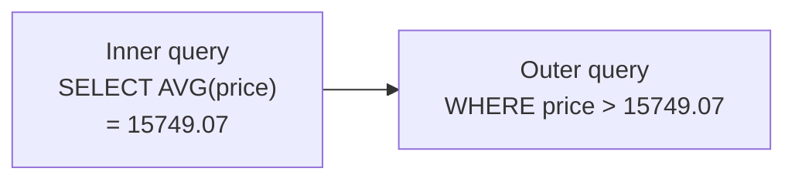

# Subqueries, Views & CTEs

!!! abstract "Learning Objectives"
    By the end of this lesson, you can:

    - Use subqueries inside `WHERE`, `SELECT` and `FROM`
    - Write correlated subqueries that run once per row
    - Use `EXISTS` / `NOT EXISTS`, and avoid the `NOT IN` + `NULL` trap
    - Save reusable queries as **views**
    - Break complex queries into readable steps with **CTEs**, including recursive CTEs for hierarchies

**Prerequisites:** [Joins](09-joins.md). Use a fresh `ksr_shop`.

## What is a Subquery?

A **subquery** is a `SELECT` inside another SQL statement. The inner query runs first and its result feeds the outer query.

*Which products cost more than the average price?* You'd need two steps: find the average, then compare. A subquery does both in one statement:

```sql
SELECT name, price
FROM products
WHERE price > (SELECT AVG(price) FROM products)
ORDER BY price DESC;
```

```{ .text .output }
+--------------------+----------+
| name               | price    |
+--------------------+----------+
| iPhone 15          | 79999.00 |
| Galaxy S24         | 74999.00 |
| Inspiron 15 Laptop | 58999.00 |
+--------------------+----------+
```



!!! example "Real-life analogy: asking a colleague first"
    To answer *"which employees earn more than average?"*, you first ask HR *"what's the average salary?"*, then use the answer to filter. The subquery is the question you ask first.

| Subquery returns | Example | Used with |
|------------------|---------|-----------|
| One value (scalar) | `(SELECT AVG(price) FROM products)` | `=`, `>`, `<`, or as a column in `SELECT` |
| One column, many rows | `(SELECT customer_id FROM orders)` | `IN`, `NOT IN`, `ANY`, `ALL` |
| A whole table | `(SELECT ... GROUP BY ...) AS t` | `FROM` (a *derived table*) |

## Subqueries in WHERE

### Scalar comparison

*Employees who earn more than the company average*:

```sql
SELECT name, department, salary
FROM employees
WHERE salary > (SELECT AVG(salary) FROM employees)
ORDER BY salary DESC;
```

```{ .text .output }
+---------------+-------------+-----------+
| name          | department  | salary    |
+---------------+-------------+-----------+
| Lakshmi Menon | Management  | 250000.00 |
| Suresh Babu   | Engineering | 180000.00 |
| Anita Desai   | Sales       | 150000.00 |
| Farhan Ali    | Engineering | 120000.00 |
+---------------+-------------+-----------+
```

*The most recent order(s)*:

```sql
SELECT id, customer_id, order_date
FROM orders
WHERE order_date = (SELECT MAX(order_date) FROM orders);
```

```{ .text .output }
+----+-------------+------------+
| id | customer_id | order_date |
+----+-------------+------------+
| 12 |           4 | 2025-10-12 |
+----+-------------+------------+
```

### IN with a list

*Customers who have bought something from the Electronics category*:

```sql
SELECT name, city
FROM customers
WHERE id IN (
    SELECT o.customer_id
    FROM orders o
    JOIN order_items oi ON oi.order_id = o.id
    JOIN products p     ON p.id = oi.product_id
    WHERE p.category_id = 1
)
ORDER BY name;
```

```{ .text .output }
+-------------+-----------+
| name        | city      |
+-------------+-----------+
| Asha Reddy  | Hyderabad |
| Kiran Rao   | Hyderabad |
| Rahul Verma | Pune      |
| Ravi Kumar  | Bangalore |
+-------------+-----------+
```

!!! mistake "Common Mistake: a scalar subquery returning many rows"
    ```sql
    SELECT name FROM customers
    WHERE id = (SELECT customer_id FROM orders WHERE status = 'delivered');
    ```

    ```{ .text .output }
    ERROR 1242 (21000): Subquery returns more than 1 row
    ```

    `=` expects exactly one value, but several orders are delivered. Use `IN` for lists.

## Subqueries in SELECT and FROM

### A subquery as a column

Show each category with its product count, without `GROUP BY`:

```sql
SELECT
    c.name,
    (SELECT COUNT(*) FROM products p WHERE p.category_id = c.id) AS products
FROM categories c
ORDER BY products DESC, c.name;
```

```{ .text .output }
+----------------+----------+
| name           | products |
+----------------+----------+
| Electronics    |        5 |
| Books          |        3 |
| Fashion        |        3 |
| Home & Kitchen |        2 |
| Sports         |        2 |
| Toys           |        0 |
+----------------+----------+
```

This inner query refers to `c.id` from the **outer** query, which makes it a **correlated** subquery (more below).

### A derived table in FROM

A subquery in `FROM` acts like a temporary table. It **must have an alias**.

*Average order value*: first compute each order's total, then average those totals:

```sql
SELECT
    COUNT(*)                 AS orders,
    ROUND(AVG(order_total))  AS avg_order_value,
    MAX(order_total)         AS largest_order
FROM (
    SELECT order_id, SUM(quantity * unit_price) AS order_total
    FROM order_items
    GROUP BY order_id
) AS order_totals;
```

```{ .text .output }
+--------+-----------------+---------------+
| orders | avg_order_value | largest_order |
+--------+-----------------+---------------+
|     12 |           19961 |      79999.00 |
+--------+-----------------+---------------+
```

This "aggregate, then aggregate again" pattern is impossible in a single `GROUP BY`. Derived tables (or CTEs) are how you do it.

## Correlated Subqueries

A **correlated subquery** references a column from the outer query, so it's evaluated **once for each outer row**.

*Employees who earn more than the average **of their own department***:

```sql
SELECT e.name, e.department, e.salary
FROM employees e
WHERE e.salary > (
    SELECT AVG(e2.salary)
    FROM employees e2
    WHERE e2.department = e.department     -- refers to the outer row
)
ORDER BY e.department;
```

```{ .text .output }
+----------------+-------------+-----------+
| name           | department  | salary    |
+----------------+-------------+-----------+
| Suresh Babu    | Engineering | 180000.00 |
| Farhan Ali     | Engineering | 120000.00 |
| Anita Desai    | Sales       | 150000.00 |
| Swati Kulkarni | Support     |  70000.00 |
+----------------+-------------+-----------+
```

For each employee, the inner query calculates that person's department average, then compares.

*Each customer's most recent order date*:

```sql
SELECT
    c.name,
    (SELECT MAX(o.order_date) FROM orders o WHERE o.customer_id = c.id) AS last_order
FROM customers c
ORDER BY last_order DESC;
```

```{ .text .output }
+--------------+------------+
| name         | last_order |
+--------------+------------+
| Meena Iyer   | 2025-10-12 |
| Sneha Patil  | 2025-10-05 |
| Asha Reddy   | 2025-10-01 |
| Rahul Verma  | 2025-09-25 |
| Divya Nair   | 2025-09-10 |
| Ravi Kumar   | 2025-08-28 |
| Arjun Singh  | 2025-08-15 |
| Kiran Rao    | 2025-07-20 |
| Vikram Joshi | NULL       |
| Priya Sharma | NULL       |
+--------------+------------+
```

!!! tip "Performance"
    Correlated subqueries can be slow on big tables because they may run once per row. MySQL often optimises them, but if a query is slow, try rewriting it as a `JOIN` with `GROUP BY`, or with a window function ([next lesson](11-window-functions.md)).

## EXISTS and NOT EXISTS

`EXISTS (subquery)` is true if the subquery returns **at least one row**. It doesn't care what the rows contain, only whether any exist, so `SELECT 1` is conventional.

*Customers who have at least one pending order*:

```sql
SELECT c.name
FROM customers c
WHERE EXISTS (
    SELECT 1 FROM orders o
    WHERE o.customer_id = c.id AND o.status = 'pending'
);
```

```{ .text .output }
+-------------+
| name        |
+-------------+
| Rahul Verma |
| Meena Iyer  |
+-------------+
```

*Products never ordered*, the same anti-join as last lesson, written with `NOT EXISTS`:

```sql
SELECT p.name
FROM products p
WHERE NOT EXISTS (
    SELECT 1 FROM order_items oi WHERE oi.product_id = p.id
);
```

```{ .text .output }
+---------------+
| name          |
+---------------+
| Mixer Grinder |
| Yoga Mat      |
+---------------+
```

### The NOT IN + NULL trap

`NOT IN` behaves unexpectedly when its list contains a `NULL`. Here's the smallest possible example, a list with a NULL in it:

```sql
SELECT name FROM categories
WHERE id NOT IN (1, 2, NULL);
```

```{ .text .output }
Empty set (0.00 sec)
```

**No rows**, even though categories 3 to 6 clearly aren't 1 or 2! `id NOT IN (1, 2, NULL)` means `id <> 1 AND id <> 2 AND id <> NULL`, and `id <> NULL` is never true. If a subquery can return a NULL, `NOT IN` silently returns nothing.

!!! warning "Prefer NOT EXISTS over NOT IN"
    `NOT EXISTS` handles NULLs correctly and is usually just as fast. Use it (or a `LEFT JOIN … IS NULL`) for "find rows with no match" queries.

## Views

A **view** is a **saved query** that you can use like a table. It stores the query, not the data, so it always shows current data.

```{ .sql .no-run }
CREATE VIEW view_name AS
SELECT ...;
```

Create a view of order totals with customer details:

```sql
CREATE VIEW order_summary AS
SELECT
    o.id                              AS order_id,
    o.order_date,
    o.status,
    c.name                            AS customer,
    c.city,
    SUM(oi.quantity * oi.unit_price)  AS order_total
FROM orders o
JOIN customers c    ON c.id = o.customer_id
JOIN order_items oi ON oi.order_id = o.id
GROUP BY o.id, o.order_date, o.status, c.name, c.city;

SELECT * FROM order_summary WHERE city = 'Hyderabad' ORDER BY order_date;
```

```{ .text .output }
+----------+------------+-----------+------------+-----------+-------------+
| order_id | order_date | status    | customer   | city      | order_total |
+----------+------------+-----------+------------+-----------+-------------+
|        1 | 2025-06-05 | delivered | Asha Reddy | Hyderabad |     2297.00 |
|        3 | 2025-07-02 | delivered | Asha Reddy | Hyderabad |     6696.00 |
|        4 | 2025-07-20 | cancelled | Kiran Rao  | Hyderabad |    58999.00 |
|       10 | 2025-10-01 | shipped   | Asha Reddy | Hyderabad |     3794.00 |
+----------+------------+-----------+------------+-----------+-------------+
```

Now anyone can query `order_summary` without knowing about the three-table join underneath:

```sql
SELECT city, COUNT(*) AS orders, SUM(order_total) AS revenue
FROM order_summary
WHERE status <> 'cancelled'
GROUP BY city
ORDER BY revenue DESC;
```

```{ .text .output }
+-----------+--------+----------+
| city      | orders | revenue  |
+-----------+--------+----------+
| Pune      |      2 | 81947.00 |
| Bangalore |      2 | 77697.00 |
| Hyderabad |      3 | 12787.00 |
| Kochi     |      1 |  3499.00 |
| Delhi     |      1 |  2499.00 |
| Chennai   |      2 |  2098.00 |
+-----------+--------+----------+
```

**Managing views**

| Command | Purpose |
|---------|---------|
| `CREATE VIEW v AS SELECT ...` | Create |
| `CREATE OR REPLACE VIEW v AS SELECT ...` | Create or update the definition |
| `SHOW FULL TABLES WHERE Table_type = 'VIEW';` | List views |
| `SHOW CREATE VIEW v;` | See the definition |
| `DROP VIEW v;` | Delete the view (the underlying data is untouched) |

**Why use views?**

- **Simplicity:** hide complex joins behind a simple name
- **Consistency:** everyone calculates "order total" the same way
- **Security:** give a reporting user access to a view with only safe columns (no emails, phones or salaries) instead of the full tables

!!! realworld "In Real Projects"
    Analytics and BI tools (Power BI, Metabase, Tableau) are often connected to **views** rather than raw tables. Views give analysts clean, pre-joined data with friendly column names, and give the database team freedom to change the underlying tables without breaking every dashboard.

## Common Table Expressions (CTEs)

A **CTE** gives a name to a subquery at the **top** of a statement using `WITH`. Long queries become a series of readable, named steps.

```{ .sql .no-run }
WITH step_name AS (
    SELECT ...
)
SELECT ... FROM step_name;
```

The average-order-value query from earlier, rewritten as a CTE, reads top to bottom:

```sql
WITH order_totals AS (
    SELECT order_id, SUM(quantity * unit_price) AS order_total
    FROM order_items
    GROUP BY order_id
)
SELECT COUNT(*) AS orders, ROUND(AVG(order_total)) AS avg_order_value
FROM order_totals;
```

```{ .text .output }
+--------+-----------------+
| orders | avg_order_value |
+--------+-----------------+
|     12 |           19961 |
+--------+-----------------+
```

### Several CTEs in a row

Each CTE can use the ones defined before it. *Customers whose total spend is above the average customer spend*:

```sql
WITH customer_spend AS (
    SELECT o.customer_id, SUM(oi.quantity * oi.unit_price) AS spent
    FROM orders o
    JOIN order_items oi ON oi.order_id = o.id
    WHERE o.status <> 'cancelled'
    GROUP BY o.customer_id
),
average_spend AS (
    SELECT AVG(spent) AS avg_spent FROM customer_spend
)
SELECT c.name, cs.spent, ROUND(a.avg_spent) AS average
FROM customer_spend cs
JOIN customers c ON c.id = cs.customer_id
CROSS JOIN average_spend a
WHERE cs.spent > a.avg_spent
ORDER BY cs.spent DESC;
```

```{ .text .output }
+-------------+----------+---------+
| name        | spent    | average |
+-------------+----------+---------+
| Rahul Verma | 79999.00 |   25790 |
| Ravi Kumar  | 77697.00 |   25790 |
+-------------+----------+---------+
```

### Recursive CTEs: walking a hierarchy

A **recursive CTE** refers to itself, so it can walk tree-shaped data like an org chart, where each employee points to their manager:

```sql
WITH RECURSIVE org_chart AS (
    -- anchor: start with the CEO (no manager)
    SELECT id, name, job_title, manager_id, 1 AS level,
           CAST(name AS CHAR(200)) AS path
    FROM employees
    WHERE manager_id IS NULL

    UNION ALL

    -- recursive step: add the people who report to someone already in the chart
    SELECT e.id, e.name, e.job_title, e.manager_id, oc.level + 1,
           CONCAT(oc.path, ' > ', e.name)
    FROM employees e
    JOIN org_chart oc ON e.manager_id = oc.id
)
SELECT level, CONCAT(REPEAT('    ', level - 1), name) AS employee, job_title, path
FROM org_chart
ORDER BY path;
```

```{ .text .output }
+-------+----------------------+---------------------+-----------------------------------------------+
| level | employee             | job_title           | path                                          |
+-------+----------------------+---------------------+-----------------------------------------------+
|     1 | Lakshmi Menon        | CEO                 | Lakshmi Menon                                 |
|     2 |     Anita Desai      | Sales Manager       | Lakshmi Menon > Anita Desai                   |
|     3 |         Manoj Pillai | Sales Executive     | Lakshmi Menon > Anita Desai > Manoj Pillai    |
|     3 |         Ritu Kapoor  | Sales Executive     | Lakshmi Menon > Anita Desai > Ritu Kapoor     |
|     2 |     Suresh Babu      | Engineering Manager | Lakshmi Menon > Suresh Babu                   |
|     3 |         Farhan Ali   | Senior Developer    | Lakshmi Menon > Suresh Babu > Farhan Ali      |
|     3 |         Nikhil Jain  | Developer           | Lakshmi Menon > Suresh Babu > Nikhil Jain     |
|     3 |         Pooja Hegde  | Developer           | Lakshmi Menon > Suresh Babu > Pooja Hegde     |
|     2 |     Swati Kulkarni   | Support Lead        | Lakshmi Menon > Swati Kulkarni                |
|     3 |         Imran Shaikh | Support Executive   | Lakshmi Menon > Swati Kulkarni > Imran Shaikh |
+-------+----------------------+---------------------+-----------------------------------------------+
```

1. The **anchor** query finds the starting rows (the CEO).
2. The **recursive** query joins `employees` to the rows found so far, adding the next level.
3. It repeats until no new rows are found.

Recursive CTEs can also **generate** data, for example a series of dates for a report with no gaps:

```sql
WITH RECURSIVE months AS (
    SELECT DATE('2025-06-01') AS month_start
    UNION ALL
    SELECT DATE_ADD(month_start, INTERVAL 1 MONTH) FROM months
    WHERE month_start < '2025-10-01'
)
SELECT DATE_FORMAT(m.month_start, '%Y-%m') AS month, COUNT(o.id) AS orders
FROM months m
LEFT JOIN orders o
       ON o.order_date >= m.month_start
      AND o.order_date <  DATE_ADD(m.month_start, INTERVAL 1 MONTH)
GROUP BY m.month_start
ORDER BY m.month_start;
```

```{ .text .output }
+---------+--------+
| month   | orders |
+---------+--------+
| 2025-06 |      2 |
| 2025-07 |      2 |
| 2025-08 |      3 |
| 2025-09 |      2 |
| 2025-10 |      3 |
+---------+--------+
```

### Subquery vs CTE vs View vs JOIN

| Tool | Best for | Lifetime |
|------|----------|----------|
| Subquery | A small, one-off inner question | One statement |
| CTE | Multi-step logic, readability, recursion | One statement |
| View | Logic reused by many queries, users or tools | Permanent (until dropped) |
| JOIN | Combining columns from related tables | One statement |

## Common Mistakes

| Mistake | Error / Result | Fix |
|---------|---------------|-----|
| `=` with a subquery returning many rows | `ERROR 1242 (21000): Subquery returns more than 1 row` | Use `IN`, or make it return one row |
| Derived table without an alias | `ERROR 1248 (42000): Every derived table must have its own alias` | `(...) AS t` |
| `NOT IN` with a subquery that may contain NULL | Returns no rows | `NOT EXISTS` |
| Recursive CTE without a stopping condition | `ERROR 3636: Recursive query aborted after 1001 iterations` | Add a `WHERE` that ends the recursion |
| Forgetting `RECURSIVE` | `ERROR 1146: Table '...' doesn't exist` | `WITH RECURSIVE` |
| Treating a view as a copy of the data | Expecting old data | Views always run the query on current data |
| Deeply nested subqueries | Unreadable | Rewrite as CTEs |

## Practice Exercises

Use a fresh `ksr_shop`.

**Easy**

1. List products whose rating is higher than the average rating.
2. List customers who have placed at least one order, using `IN`.
3. Create a view `out_of_stock` that lists products with `stock = 0`, then query it.

**Medium**

4. Using `NOT EXISTS`, list customers who have never placed an order.
5. For each product, show its price and the average price of its category (correlated subquery), and only list products priced above their category average.
6. Using a CTE, find the order with the highest total, and show the customer's name.

**Challenge**

7. Using CTEs, build a **customer segmentation** report: compute each customer's total spend (non-cancelled orders, including customers with ₹0), then label them `VIP` (≥ ₹50,000), `Regular` (≥ ₹2,000), `New` (> 0) or `Inactive` (0). Show the number of customers and total revenue per segment. Save the final query as a view called `customer_segments`.

??? success "Solutions (click to expand)"

    ```{ .sql .no-run }
    -- 1
    SELECT name, rating FROM products
    WHERE rating > (SELECT AVG(rating) FROM products);

    -- 2
    SELECT name FROM customers
    WHERE id IN (SELECT customer_id FROM orders);

    -- 3
    CREATE VIEW out_of_stock AS
    SELECT id, name, brand FROM products WHERE stock = 0;
    SELECT * FROM out_of_stock;

    -- 4
    SELECT c.name FROM customers c
    WHERE NOT EXISTS (SELECT 1 FROM orders o WHERE o.customer_id = c.id);

    -- 5
    SELECT p.name, p.price,
           (SELECT ROUND(AVG(p2.price), 2) FROM products p2
            WHERE p2.category_id = p.category_id) AS category_avg
    FROM products p
    WHERE p.price > (SELECT AVG(p2.price) FROM products p2
                     WHERE p2.category_id = p.category_id);

    -- 6
    WITH totals AS (
        SELECT order_id, SUM(quantity * unit_price) AS total
        FROM order_items GROUP BY order_id
    )
    SELECT t.order_id, t.total, c.name
    FROM totals t
    JOIN orders o    ON o.id = t.order_id
    JOIN customers c ON c.id = o.customer_id
    ORDER BY t.total DESC
    LIMIT 1;

    -- 7
    CREATE VIEW customer_segments AS
    WITH spend AS (
        SELECT c.id, c.name,
               COALESCE(SUM(CASE WHEN o.status <> 'cancelled'
                                 THEN oi.quantity * oi.unit_price END), 0) AS spent
        FROM customers c
        LEFT JOIN orders o       ON o.customer_id = c.id
        LEFT JOIN order_items oi ON oi.order_id = o.id
        GROUP BY c.id, c.name
    ),
    labelled AS (
        SELECT *, CASE
                     WHEN spent >= 50000 THEN 'VIP'
                     WHEN spent >= 2000  THEN 'Regular'
                     WHEN spent > 0      THEN 'New'
                     ELSE 'Inactive'
                  END AS segment
        FROM spend
    )
    SELECT segment, COUNT(*) AS customers, SUM(spent) AS revenue
    FROM labelled
    GROUP BY segment;

    SELECT * FROM customer_segments ORDER BY revenue DESC;
    ```

!!! note "Mini Assignment"
    Create three **reporting views** for the ksr_shop management team: `v_daily_sales` (date, orders, units, revenue for non-cancelled orders), `v_product_performance` (product, category, units sold, revenue, never-sold flag) and `v_customer_overview` (customer, city, orders, total spent, last order date, days since last order as of `'2025-10-31'`). Then write three questions a manager might ask and answer each with a simple query on your views.

## Interview Questions

!!! interview "1. What is a correlated subquery?"
    A subquery that references columns from the outer query, so it's logically evaluated once per outer row. Example: employees earning more than their own department's average (`WHERE e2.department = e.department`).

!!! interview "2. What is the difference between `IN` and `EXISTS`?"
    `IN` compares a value against a list returned by the subquery. `EXISTS` checks whether the subquery returns any row (usually correlated). `EXISTS` stops at the first match and handles NULLs safely; `NOT EXISTS` is preferred over `NOT IN`, which returns no rows if the list contains a NULL.

!!! interview "3. What is a view? Does it store data?"
    A named, saved SELECT query that can be used like a table. A standard view doesn't store data; it runs its query each time, so it always reflects current data. Views simplify complex queries, enforce consistent logic and restrict access to columns.

!!! interview "4. What is a CTE, and how is it different from a subquery?"
    A Common Table Expression is a named temporary result defined with `WITH` at the start of a query. It's equivalent to a derived table, but more readable, can be referenced several times in the same query, can build on earlier CTEs, and can be recursive.

!!! interview "5. How would you find the second-highest salary?"
    `SELECT MAX(salary) FROM employees WHERE salary < (SELECT MAX(salary) FROM employees);`, or `SELECT DISTINCT salary FROM employees ORDER BY salary DESC LIMIT 1 OFFSET 1;`, or with `DENSE_RANK()` (next lesson).

!!! interview "Scenario: a query using `WHERE customer_id NOT IN (SELECT referrer_id FROM referrals)` suddenly returns no rows after new data was added. Why?"
    A row with a NULL `referrer_id` was inserted. `NOT IN` with a NULL in the list evaluates to UNKNOWN for every row, so nothing is returned. Rewrite it with `NOT EXISTS`, or add `WHERE referrer_id IS NOT NULL` inside the subquery.

## Summary

| Concept | Remember |
|---------|----------|
| Scalar subquery | Returns one value; use with `=`, `>`; can be a column |
| List subquery | Use with `IN` / `NOT IN` |
| Derived table | Subquery in `FROM`; needs an alias; aggregate-then-aggregate |
| Correlated | References the outer row; runs per row |
| `EXISTS` / `NOT EXISTS` | Checks for any matching row; NULL-safe |
| `NOT IN` trap | A NULL in the list returns nothing |
| View | Saved query; always current data; simplicity and security |
| CTE | `WITH name AS (...)`: readable, multi-step |
| Recursive CTE | Anchor + `UNION ALL` + recursive step; hierarchies and series |

**Next lesson:** [Window Functions](11-window-functions.md), with rankings, running totals and comparing rows.
