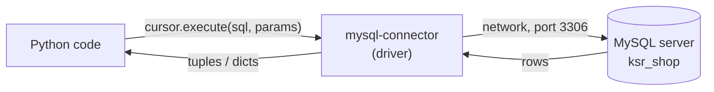

# Python + MySQL

!!! abstract "Learning Objectives"
    By the end of this lesson, you can:

    - Connect to MySQL from Python using `mysql-connector-python`
    - Run `SELECT` queries and read rows as tuples or dictionaries
    - Insert, update and delete data with **parameterised** queries
    - Explain SQL injection and why you must never build SQL with f-strings
    - Use transactions, handle database errors and organise code in a repository class

**Prerequisites:** [Transactions, Indexes & Users](12-transactions-indexes-users.md), and from the Python track: [Exception Handling](../../python/oop/03-exception-handling.md) and [Virtual Environments & pip](../../python/functions/06-virtual-environments-and-pip.md).

!!! info "Java track"
    Java students will do the same things with **JDBC** in the Java module: connections, `PreparedStatement`, transactions. The concepts in this lesson (parameters, injection, transactions, closing connections) are identical, so it's worth reading even if you're on the Java track.

## How Python Talks to MySQL

Your Python program can't speak to MySQL directly. It uses a **driver**: a library that opens a network connection to the MySQL server, sends SQL, and turns the results into Python objects.



| Object | Role | Analogy |
|--------|------|---------|
| **Connection** | An open session with the server | A phone call to the database |
| **Cursor** | Sends statements and fetches results | Your voice on the call |
| `commit()` | Saves your changes | "Yes, confirm that" |
| `close()` | Ends the session | Hanging up |

## Setup

Create a project with a virtual environment and install the official MySQL driver:

```bash
mkdir shop-python && cd shop-python
python -m venv .venv
source .venv/bin/activate          # Windows: .venv\Scripts\activate
pip install mysql-connector-python
```

Never hard-code passwords. Read connection settings from **environment variables**:

=== "macOS / Linux"

    ```bash
    export DB_HOST=localhost DB_PORT=3306 DB_USER=root DB_PASSWORD='your-password' DB_NAME=ksr_shop
    ```

=== "Windows (Command Prompt)"

    ```bash
    set DB_PASSWORD=your-password
    ```

Put the connection logic in one small module so every script reuses it:

```python title="db.py"
import os
import mysql.connector


def get_connection():
    """Open a new connection to the ksr_shop database."""
    return mysql.connector.connect(
        host=os.environ.get("DB_HOST", "localhost"),
        port=int(os.environ.get("DB_PORT", 3306)),
        user=os.environ.get("DB_USER", "root"),
        password=os.environ.get("DB_PASSWORD", ""),
        database=os.environ.get("DB_NAME", "ksr_shop"),
    )
```

Test the connection:

```python
from db import get_connection

conn = get_connection()
print("Connected:", conn.is_connected())
print("Server version:", conn.get_server_info()[:3])
conn.close()
```

```{ .text .output }
Connected: True
Server version: 8.4
```

## Reading Data

```python
from db import get_connection

conn = get_connection()
cursor = conn.cursor()

cursor.execute("SELECT id, name, price FROM products ORDER BY price DESC LIMIT 3")
rows = cursor.fetchall()            # list of tuples

for row in rows:
    print(row)

cursor.close()
conn.close()
```

```{ .text .output }
(1, 'iPhone 15', Decimal('79999.00'))
(2, 'Galaxy S24', Decimal('74999.00'))
(4, 'Inspiron 15 Laptop', Decimal('58999.00'))
```

`DECIMAL` columns arrive as Python `Decimal` objects, which are exact, just like in MySQL. Convert with `float()` or format with an f-string when displaying.

| Method | Returns |
|--------|---------|
| `cursor.fetchall()` | All remaining rows as a list |
| `cursor.fetchone()` | The next row, or `None` |
| `cursor.fetchmany(n)` | Up to `n` rows |
| `for row in cursor:` | Rows one at a time (memory-friendly for big results) |

### Rows as dictionaries

Tuples force you to remember column positions. `cursor(dictionary=True)` returns each row as a dict, which is much clearer and maps directly to JSON in an API:

```python
from db import get_connection

conn = get_connection()
cursor = conn.cursor(dictionary=True)

cursor.execute("SELECT name, city FROM customers WHERE city = 'Pune'")
for customer in cursor.fetchall():
    print(f"{customer['name']} lives in {customer['city']}")

cursor.close()
conn.close()
```

```{ .text .output }
Rahul Verma lives in Pune
Sneha Patil lives in Pune
```

### Context managers: never forget to close

Connections are a limited resource. Forgetting `close()` eventually exhausts the server's connection limit. `contextlib.closing` closes them automatically, even if an error occurs:

```python
from contextlib import closing
from db import get_connection

with closing(get_connection()) as conn, closing(conn.cursor(dictionary=True)) as cur:
    cur.execute("SELECT COUNT(*) AS total FROM orders")
    print(cur.fetchone())
```

```{ .text .output }
{'total': 12}
```

## Parameterised Queries

Real queries depend on user input: a search term, an id from the URL, a form field. **Never** paste values into the SQL string. Pass them **separately** with `%s` placeholders:

```python
from contextlib import closing
from db import get_connection

city = "Hyderabad"          # imagine this came from a web form
min_orders = 1

sql = """
    SELECT c.name, COUNT(o.id) AS orders
    FROM customers c
    JOIN orders o ON o.customer_id = c.id
    WHERE c.city = %s
    GROUP BY c.id, c.name
    HAVING COUNT(o.id) >= %s
"""

with closing(get_connection()) as conn, closing(conn.cursor(dictionary=True)) as cur:
    cur.execute(sql, (city, min_orders))     # values passed as a tuple
    for row in cur.fetchall():
        print(row)
```

```{ .text .output }
{'name': 'Asha Reddy', 'orders': 3}
{'name': 'Kiran Rao', 'orders': 1}
```

The driver sends the SQL and the values separately, and the values are always treated as **data**, never as SQL code.

!!! mistake "Common Mistake: a single parameter needs a one-item tuple"
    `cur.execute(sql, (city))` passes a **string**, not a tuple, because brackets alone don't make a tuple (remember the [Tuples](../../python/foundation/10-tuples.md) lesson). Write `(city,)` with the comma. Also, don't put quotes around `%s` in the SQL: the driver adds them.

## SQL Injection

**SQL injection** is one of the most dangerous and most common security bugs. It happens when user input is glued directly into SQL.

Here's a login check built the **wrong** way, with an f-string:

```python
from contextlib import closing
from db import get_connection

def find_customer_unsafe(email):
    sql = f"SELECT id, name FROM customers WHERE email = '{email}'"   # ❌ NEVER do this
    print("SQL sent:", sql)
    with closing(get_connection()) as conn, closing(conn.cursor()) as cur:
        cur.execute(sql)
        return cur.fetchall()

print(find_customer_unsafe("asha@example.com"))
print(find_customer_unsafe("x' OR '1'='1"))       # what an attacker types
```

```{ .text .output }
SQL sent: SELECT id, name FROM customers WHERE email = 'asha@example.com'
[(1, 'Asha Reddy')]
SQL sent: SELECT id, name FROM customers WHERE email = 'x' OR '1'='1'
[(1, 'Asha Reddy'), (2, 'Ravi Kumar'), (3, 'Kiran Rao'), (4, 'Meena Iyer'), (5, 'Arjun Singh'), (6, 'Divya Nair'), (7, 'Rahul Verma'), (8, 'Sneha Patil'), (9, 'Vikram Joshi'), (10, 'Priya Sharma')]
```

The attacker typed `x' OR '1'='1` into the email box. The quote closed the string, and `OR '1'='1'` is **always true**, so the query returned **every customer**. With a little more effort, attackers can read password hashes or delete tables.

The same function with a parameter is completely safe:

```python
from contextlib import closing
from db import get_connection

def find_customer(email):
    sql = "SELECT id, name FROM customers WHERE email = %s"           # ✅ placeholder
    with closing(get_connection()) as conn, closing(conn.cursor()) as cur:
        cur.execute(sql, (email,))
        return cur.fetchall()

print(find_customer("asha@example.com"))
print(find_customer("x' OR '1'='1"))
```

```{ .text .output }
[(1, 'Asha Reddy')]
[]
```

The malicious text is searched for as a literal email address, and nothing matches.

!!! danger "The rule"
    **Never** build SQL with f-strings, `+`, `%` or `.format()` using values that come from users, files, URLs or APIs. Always use placeholders. This one habit prevents the majority of database breaches. (Placeholders work only for **values**. Table or column names can't be parameterised, so if you must choose them dynamically, check them against a fixed allow-list.)

!!! realworld "In Real Projects"
    SQL injection has caused some of the largest data breaches in history and is in the OWASP Top 10 web security risks. ORMs like Django's ORM and SQLAlchemy (used with FastAPI) use parameters automatically, which is one reason teams use them. Code reviews in every serious company reject f-string SQL on sight.

## Writing Data

Changes aren't saved until you call `conn.commit()`. The driver starts a transaction automatically.

### INSERT and getting the new id

```python
from contextlib import closing
from db import get_connection

with closing(get_connection()) as conn, closing(conn.cursor()) as cur:
    cur.execute(
        "INSERT INTO customers (name, email, city, phone, joined_on) VALUES (%s, %s, %s, %s, %s)",
        ("Neha Gupta", "neha@example.com", "Jaipur", "9876500011", "2025-10-20"),
    )
    conn.commit()
    print("New customer id:", cur.lastrowid)
    print("Rows inserted:", cur.rowcount)
```

```{ .text .output }
New customer id: 11
Rows inserted: 1
```

### Many rows at once with executemany

```python
from contextlib import closing
from db import get_connection

new_products = [
    ("Clean Code",     3, "Pearson", 899.00, 40, 4.6, "2025-10-25"),
    ("The Alchemist",  3, "Harper",  299.00, 70, 4.5, "2025-10-25"),
    ("Steel Bottle",   4, "Milton",  749.00, 90, 4.4, "2025-10-25"),
]

sql = """INSERT INTO products (name, category_id, brand, price, stock, rating, added_on)
         VALUES (%s, %s, %s, %s, %s, %s, %s)"""

with closing(get_connection()) as conn, closing(conn.cursor()) as cur:
    cur.executemany(sql, new_products)
    conn.commit()
    print("Inserted:", cur.rowcount)
```

```{ .text .output }
Inserted: 3
```

### UPDATE and DELETE

```python
from contextlib import closing
from db import get_connection

with closing(get_connection()) as conn, closing(conn.cursor()) as cur:
    cur.execute("UPDATE products SET stock = stock + %s WHERE name = %s", (25, "Yoga Mat"))
    print("Updated rows:", cur.rowcount)

    cur.execute("DELETE FROM products WHERE name = %s", ("The Alchemist",))
    print("Deleted rows:", cur.rowcount)

    conn.commit()
```

```{ .text .output }
Updated rows: 1
Deleted rows: 1
```

`rowcount` tells you how many rows were affected. If an update by id returns 0, the record doesn't exist, and your API should respond with **404 Not Found**.

## Transactions and Error Handling

Database errors raise `mysql.connector.Error`. Its `errno` holds the MySQL error code you learned earlier (1062 duplicate, 1452 bad foreign key, 3819 check violated):

```python
import mysql.connector
from contextlib import closing
from db import get_connection

with closing(get_connection()) as conn, closing(conn.cursor()) as cur:
    try:
        cur.execute(
            "INSERT INTO customers (name, email, city, joined_on) VALUES (%s, %s, %s, %s)",
            ("Fake Asha", "asha@example.com", "Pune", "2025-10-30"),
        )
        conn.commit()
    except mysql.connector.Error as e:
        conn.rollback()
        if e.errno == 1062:
            print("This email is already registered.")
        else:
            print("Database error:", e.errno, e.msg)
```

```{ .text .output }
This email is already registered.
```

### Placing an order as one transaction

All steps succeed together, or none do:

```python
import mysql.connector
from contextlib import closing
from datetime import date
from db import get_connection


class OutOfStockError(Exception):
    pass


def place_order(customer_id, product_id, quantity):
    with closing(get_connection()) as conn, closing(conn.cursor(dictionary=True)) as cur:
        try:
            # 1. lock the product row so two buyers can't take the same stock
            cur.execute("SELECT name, price, stock FROM products WHERE id = %s FOR UPDATE", (product_id,))
            product = cur.fetchone()
            if product is None or product["stock"] < quantity:
                raise OutOfStockError(f"Not enough stock for product {product_id}")

            # 2. create the order
            cur.execute(
                "INSERT INTO orders (customer_id, order_date, status) VALUES (%s, %s, 'pending')",
                (customer_id, date(2025, 10, 31)),
            )
            order_id = cur.lastrowid

            # 3. add the line item at today's price
            cur.execute(
                "INSERT INTO order_items (order_id, product_id, quantity, unit_price) VALUES (%s, %s, %s, %s)",
                (order_id, product_id, quantity, product["price"]),
            )

            # 4. reduce stock
            cur.execute("UPDATE products SET stock = stock - %s WHERE id = %s", (quantity, product_id))

            conn.commit()
            return f"Order {order_id} placed: {quantity} x {product['name']}"
        except (OutOfStockError, mysql.connector.Error) as e:
            conn.rollback()
            return f"Order failed, nothing was saved: {e}"


print(place_order(customer_id=9, product_id=7, quantity=2))     # Running Shoes, 60 in stock
print(place_order(customer_id=9, product_id=10, quantity=1))    # Wings of Fire, 0 in stock
print(place_order(customer_id=999, product_id=7, quantity=1))   # customer doesn't exist
```

```{ .text .output }
Order 13 placed: 2 x Running Shoes
Order failed, nothing was saved: Not enough stock for product 10
Order failed, nothing was saved: 1452 (23000): Cannot add or update a child row: a foreign key constraint fails (`ksr_shop`.`orders`, CONSTRAINT `orders_ibfk_1` FOREIGN KEY (`customer_id`) REFERENCES `customers` (`id`))
```

The third call inserted nothing: the foreign key rejected customer 999 and the rollback undid the whole transaction, so stock wasn't reduced either.

## A Repository Class

In real projects, all SQL for one table lives in one class (a **repository**), so the rest of the code never writes SQL directly. This is exactly how FastAPI and Spring Boot backends are organised:

```python
from contextlib import closing
from db import get_connection


class ProductRepository:
    def find_by_id(self, product_id):
        with closing(get_connection()) as conn, closing(conn.cursor(dictionary=True)) as cur:
            cur.execute("SELECT id, name, price, stock FROM products WHERE id = %s", (product_id,))
            return cur.fetchone()

    def search(self, text, max_price=None, page=1, size=3):
        sql = "SELECT id, name, price FROM products WHERE name LIKE %s"
        params = [f"%{text}%"]
        if max_price is not None:
            sql += " AND price <= %s"
            params.append(max_price)
        sql += " ORDER BY price, id LIMIT %s OFFSET %s"
        params += [size, (page - 1) * size]
        with closing(get_connection()) as conn, closing(conn.cursor(dictionary=True)) as cur:
            cur.execute(sql, params)
            return cur.fetchall()

    def update_price(self, product_id, new_price):
        with closing(get_connection()) as conn, closing(conn.cursor()) as cur:
            cur.execute("UPDATE products SET price = %s WHERE id = %s", (new_price, product_id))
            conn.commit()
            return cur.rowcount == 1


repo = ProductRepository()
print(repo.find_by_id(9))
for p in repo.search("o", max_price=3000):
    print(p["id"], p["name"], p["price"])
print("Updated:", repo.update_price(9, 449.00))
print("Updated:", repo.update_price(999, 100.00))
```

```{ .text .output }
{'id': 9, 'name': 'Atomic Habits', 'price': Decimal('499.00'), 'stock': 80}
10 Wings of Fire 350.00
9 Atomic Habits 499.00
18 Steel Bottle 749.00
Updated: True
Updated: False
```

Notice how the `%` wildcards go **into the parameter value** (`f"%{text}%"`), not into the SQL string. That keeps the search safe from injection.

!!! tip "What comes next"
    Opening a new connection for every query is fine for learning, but slow under load. Production apps use a **connection pool** (`mysql.connector.pooling`, or the pool built into SQLAlchemy). In the FastAPI module you'll use **SQLAlchemy**, which handles pooling, parameters and transactions for you and maps tables to Python classes.

## Common Mistakes

| Mistake | Problem | Fix |
|---------|---------|-----|
| f-string / `+` to build SQL with user input | **SQL injection** | `%s` placeholders + a params tuple |
| `(value)` instead of `(value,)` | Parameter error, or each character treated separately | One-item tuple needs a comma |
| `'%s'` with quotes in the SQL | Literal quotes in the data, or errors | Write `%s` without quotes |
| Forgetting `conn.commit()` | Inserts and updates silently lost | Commit after writes |
| Not closing connections | "Too many connections" errors | `with closing(...)` |
| Catching errors without `rollback()` | A half-finished transaction stays open | `conn.rollback()` in `except` |
| Password in code | Leaks via GitHub | Environment variables / `.env` (in `.gitignore`) |
| `ModuleNotFoundError: No module named 'mysql'` | Driver not installed in this venv | Activate the venv; `pip install mysql-connector-python` |
| `ERROR 2003: Can't connect to MySQL server` | Server down, wrong host or port | Start MySQL; check `DB_HOST` / `DB_PORT` |

## Practice Exercises

Use a fresh `ksr_shop` and the `db.py` module from this lesson.

**Easy**

1. Print the names and cities of all customers, one per line, using a dictionary cursor.
2. Ask the user for a category id (`input()`) and print that category's products, using a parameter.
3. Print the total revenue from `order_items`, formatted like `₹2,39,526.00` (Indian grouping is optional; `₹239,526.00` is fine).

**Medium**

4. Write `add_category(name)` that inserts a category and returns its new id, or returns `None` with a friendly message if the name already exists (catch error 1062).
5. Write `customer_orders(email)` that returns a list of dicts with order id, date, status and total for that customer (join with `GROUP BY`).
6. Show that your `customer_orders` function is safe by calling it with `"' OR '1'='1"`.

**Challenge**

7. Build a small **command-line admin tool** with a menu: (1) search products by name with pagination, (2) restock a product, (3) place an order (using a transaction), (4) show the top 3 customers by spend, (5) exit. Organise the SQL in `ProductRepository`, `OrderRepository` and `ReportRepository` classes, validate all user input, and make sure no input can crash the program.

??? success "Solutions (click to expand)"

    ```python
    import mysql.connector
    from contextlib import closing
    from db import get_connection

    # 1
    with closing(get_connection()) as conn, closing(conn.cursor(dictionary=True)) as cur:
        cur.execute("SELECT name, city FROM customers ORDER BY name")
        for row in cur:
            print(f"{row['name']} - {row['city']}")

    # 2
    category_id = int(input("Category id: "))
    with closing(get_connection()) as conn, closing(conn.cursor()) as cur:
        cur.execute("SELECT name, price FROM products WHERE category_id = %s", (category_id,))
        for name, price in cur.fetchall():
            print(name, price)

    # 3
    with closing(get_connection()) as conn, closing(conn.cursor()) as cur:
        cur.execute("SELECT SUM(quantity * unit_price) FROM order_items")
        (total,) = cur.fetchone()
        print(f"₹{total:,.2f}")

    # 4
    def add_category(name):
        with closing(get_connection()) as conn, closing(conn.cursor()) as cur:
            try:
                cur.execute("INSERT INTO categories (name) VALUES (%s)", (name,))
                conn.commit()
                return cur.lastrowid
            except mysql.connector.Error as e:
                conn.rollback()
                if e.errno == 1062:
                    print(f"Category {name!r} already exists")
                    return None
                raise

    # 5 and 6
    def customer_orders(email):
        sql = """
            SELECT o.id, o.order_date, o.status, SUM(oi.quantity * oi.unit_price) AS total
            FROM customers c
            JOIN orders o       ON o.customer_id = c.id
            JOIN order_items oi ON oi.order_id = o.id
            WHERE c.email = %s
            GROUP BY o.id, o.order_date, o.status
            ORDER BY o.order_date
        """
        with closing(get_connection()) as conn, closing(conn.cursor(dictionary=True)) as cur:
            cur.execute(sql, (email,))
            return cur.fetchall()

    print(customer_orders("asha@example.com"))
    print(customer_orders("' OR '1'='1"))        # [] (safe)
    ```

!!! note "Mini Assignment: module capstone"
    Connect your Python **student_manager** project to MySQL. Design tables for students, subjects and marks (with keys and constraints), write a `StudentRepository` class that uses parameterised queries for every operation, wrap "add student with all their marks" in a transaction, handle duplicate roll numbers using error 1062, and keep credentials in environment variables. Your menu-driven app should now store everything in MySQL instead of a JSON file.

## Interview Questions

!!! interview "1. What is SQL injection and how do you prevent it?"
    An attack where user input is interpreted as part of a SQL statement, letting an attacker change the query (bypass logins, read or delete data). Prevent it with parameterised queries / prepared statements (placeholders with separately passed values), never string concatenation; validate input; use least-privilege database users; and use ORMs that parameterise automatically.

!!! interview "2. What is the difference between `fetchone()`, `fetchall()` and `fetchmany()`?"
    `fetchone()` returns the next row (or None), `fetchall()` returns all remaining rows as a list, and `fetchmany(n)` returns up to n rows. For very large results, iterate the cursor or use `fetchmany` to avoid loading everything into memory.

!!! interview "3. Why do you need `commit()` in Python but not in the MySQL CLI?"
    The CLI runs in autocommit mode by default. Python DB-API drivers like mysql-connector start a transaction automatically, so changes are visible to others and permanent only after `conn.commit()`; otherwise they're rolled back when the connection closes.

!!! interview "4. How do you get the auto-generated id after an INSERT in Python?"
    `cursor.lastrowid` after executing the INSERT (equivalent to `SELECT LAST_INSERT_ID()` for that connection).

!!! interview "5. What is a connection pool and why use one?"
    A set of pre-opened database connections that the application borrows and returns, instead of opening a new connection per request. It avoids the overhead of the connection handshake and caps the number of connections, improving performance and stability under load.

!!! interview "Scenario: a login form is vulnerable because the code does `f\"SELECT * FROM users WHERE email='{email}' AND password='{pw}'\"`. List everything wrong with it."
    SQL injection (use placeholders); storing or comparing plain-text passwords (store salted hashes with bcrypt or argon2 and verify in code); `SELECT *` (select only the needed columns); and probably no rate limiting or account lockout. The fix is a parameterised query by email only, then verifying the password hash in application code.

## Summary

| Task | Code |
|------|------|
| Install | `pip install mysql-connector-python` |
| Connect | `mysql.connector.connect(host=..., user=..., password=..., database=...)` with values from env vars |
| Query | `cur.execute(sql, params)` → `fetchall()` / `fetchone()` |
| Dict rows | `conn.cursor(dictionary=True)` |
| Parameters | `%s` placeholders + a tuple: `(value,)` |
| Write | `execute` / `executemany` → `conn.commit()` |
| New id / affected rows | `cur.lastrowid` / `cur.rowcount` |
| Errors | `except mysql.connector.Error as e:` → `e.errno`, `conn.rollback()` |
| Cleanup | `with closing(conn), closing(cur):` |
| Security | Never f-string SQL; least-privilege users; no passwords in code |

**Next lesson:** [Real-Time Projects](14-real-time-projects.md), four complete database projects to practise everything.
