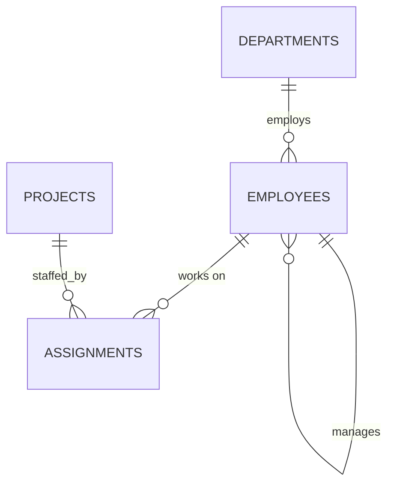
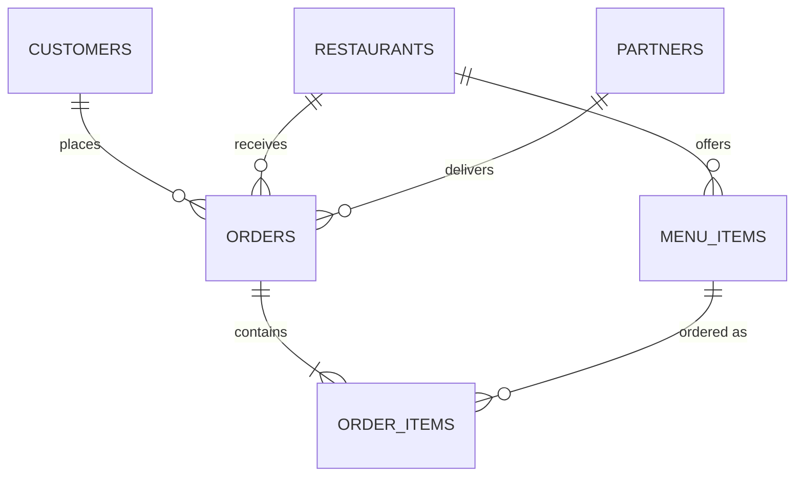
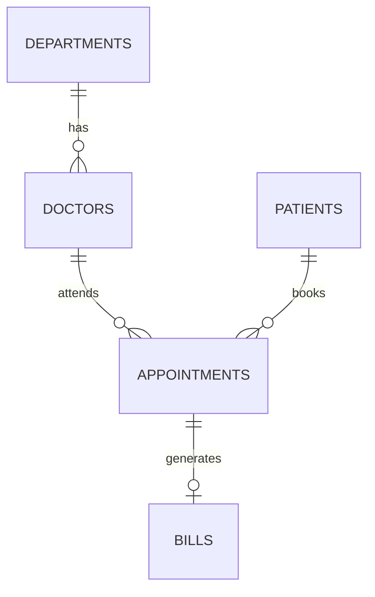
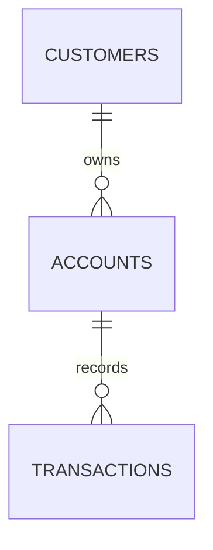

# Real-Time Projects

!!! abstract "How to use this lesson"
    Each project is a small but realistic database from a real industry. For each one:

    1. Read the requirements and sketch the ER diagram **yourself** before looking at ours.
    2. Run the schema and sample data script (copy it into Workbench and execute).
    3. Write SQL for each business question **before** opening the solution.
    4. Compare your output with the expected output, and then try the extension tasks.

    Every project uses its own database, so they don't interfere with `ksr_shop`.

**Prerequisites:** the whole MySQL module, especially [Database Design](08-database-design.md), [Joins](09-joins.md) and [Window Functions](11-window-functions.md).

| Project | Industry | Key skills |
|---------|----------|-----------|
| 1. HR Portal | IT services | Self joins, correlated subqueries, window ranking |
| 2. Food Delivery | Consumer tech | Multi-table joins, time calculations, conditional aggregation |
| 3. Hospital Management | Healthcare | Scheduling constraints, anti-joins, revenue reports |
| 4. Banking | Finance | Transactions, running balances, data integrity |

## Project 1: HR Portal

**Scenario:** An IT services company wants an internal portal to manage departments, employees, reporting lines and project allocation. Managers want reports on headcount, payroll and who is working on what.



```sql
DROP DATABASE IF EXISTS hr_portal;
CREATE DATABASE hr_portal;
USE hr_portal;

CREATE TABLE departments (
    id       INT PRIMARY KEY AUTO_INCREMENT,
    name     VARCHAR(50) NOT NULL UNIQUE,
    location VARCHAR(50) NOT NULL
);

CREATE TABLE employees (
    id         INT PRIMARY KEY AUTO_INCREMENT,
    name       VARCHAR(100) NOT NULL,
    email      VARCHAR(100) NOT NULL UNIQUE,
    dept_id    INT NOT NULL,
    manager_id INT,
    salary     DECIMAL(10, 2) NOT NULL CHECK (salary > 0),
    hire_date  DATE NOT NULL,
    FOREIGN KEY (dept_id)    REFERENCES departments (id),
    FOREIGN KEY (manager_id) REFERENCES employees (id) ON DELETE SET NULL
);

CREATE TABLE projects (
    id     INT PRIMARY KEY AUTO_INCREMENT,
    name   VARCHAR(100) NOT NULL UNIQUE,
    client VARCHAR(100) NOT NULL,
    budget DECIMAL(12, 2) NOT NULL
);

CREATE TABLE assignments (
    employee_id INT NOT NULL,
    project_id  INT NOT NULL,
    role        VARCHAR(50) NOT NULL,
    hours       INT NOT NULL DEFAULT 0 CHECK (hours >= 0),
    PRIMARY KEY (employee_id, project_id),
    FOREIGN KEY (employee_id) REFERENCES employees (id) ON DELETE CASCADE,
    FOREIGN KEY (project_id)  REFERENCES projects (id)  ON DELETE CASCADE
);

INSERT INTO departments (name, location) VALUES
('Engineering', 'Hyderabad'), ('QA', 'Hyderabad'), ('HR', 'Bangalore'), ('Sales', 'Mumbai');

INSERT INTO employees (name, email, dept_id, manager_id, salary, hire_date) VALUES
('Lakshmi Rao',   'lakshmi@corp.in', 1, NULL, 220000, '2017-03-01'),
('Arvind Shetty', 'arvind@corp.in',  1, 1,    150000, '2019-07-15'),
('Pooja Menon',   'pooja@corp.in',   1, 2,     95000, '2021-01-10'),
('Karthik Iyer',  'karthik@corp.in', 1, 2,     88000, '2022-06-20'),
('Sana Khan',     'sana@corp.in',    2, 1,    110000, '2020-02-01'),
('Rohit Das',     'rohit@corp.in',   2, 5,     65000, '2023-04-03'),
('Meera Joshi',   'meera@corp.in',   3, 1,     90000, '2018-11-12'),
('Vivek Nair',    'vivek@corp.in',   4, 1,    120000, '2020-09-30'),
('Anjali Gupta',  'anjali@corp.in',  4, 8,     60000, '2024-01-08');

INSERT INTO projects (name, client, budget) VALUES
('Payments Revamp', 'FinEdge Bank',   4500000),
('Mobile App',      'QuickMart',      3000000),
('Data Platform',   'HealthPlus',     6000000),
('Website Refresh', 'Internal',        500000);

INSERT INTO assignments (employee_id, project_id, role, hours) VALUES
(2, 1, 'Tech Lead', 320), (3, 1, 'Developer', 410), (5, 1, 'QA Lead', 150),
(3, 2, 'Developer', 120), (4, 2, 'Developer', 380), (6, 2, 'Tester',   290),
(2, 3, 'Architect', 200), (4, 3, 'Developer', 60);

SELECT d.name AS department, COUNT(e.id) AS employees
FROM departments d LEFT JOIN employees e ON e.dept_id = d.id
GROUP BY d.id, d.name;
```

```{ .text .output }
+-------------+-----------+
| department  | employees |
+-------------+-----------+
| Engineering |         4 |
| HR          |         1 |
| QA          |         2 |
| Sales       |         2 |
+-------------+-----------+
```

### Business questions

1. List every employee with their department and manager's name (the CEO has no manager).
2. Show headcount, total payroll and average salary per department, highest payroll first.
3. Who earns more than the average salary of their own department?
4. Which employees are not assigned to any project?
5. For each project, show the team size, total hours and the estimated cost if each hour costs ₹1,500. Flag projects whose cost exceeds 10% of the budget.
6. Rank employees by salary within each department and show only the top earner per department.

??? success "Solutions (click to expand)"

    **1. Employees with department and manager**

    ```sql
    USE hr_portal;
    SELECT e.name AS employee, d.name AS department, m.name AS manager
    FROM employees e
    JOIN departments d    ON d.id = e.dept_id
    LEFT JOIN employees m ON m.id = e.manager_id
    ORDER BY d.name, e.name;
    ```

    ```{ .text .output }
    +---------------+-------------+---------------+
    | employee      | department  | manager       |
    +---------------+-------------+---------------+
    | Arvind Shetty | Engineering | Lakshmi Rao   |
    | Karthik Iyer  | Engineering | Arvind Shetty |
    | Lakshmi Rao   | Engineering | NULL          |
    | Pooja Menon   | Engineering | Arvind Shetty |
    | Meera Joshi   | HR          | Lakshmi Rao   |
    | Rohit Das     | QA          | Sana Khan     |
    | Sana Khan     | QA          | Lakshmi Rao   |
    | Anjali Gupta  | Sales       | Vivek Nair    |
    | Vivek Nair    | Sales       | Lakshmi Rao   |
    +---------------+-------------+---------------+
    ```

    **2. Payroll per department**

    ```sql
    USE hr_portal;
    SELECT d.name AS department, COUNT(*) AS headcount,
           SUM(e.salary) AS payroll, ROUND(AVG(e.salary)) AS avg_salary
    FROM employees e
    JOIN departments d ON d.id = e.dept_id
    GROUP BY d.id, d.name
    ORDER BY payroll DESC;
    ```

    ```{ .text .output }
    +-------------+-----------+-----------+------------+
    | department  | headcount | payroll   | avg_salary |
    +-------------+-----------+-----------+------------+
    | Engineering |         4 | 553000.00 |     138250 |
    | Sales       |         2 | 180000.00 |      90000 |
    | QA          |         2 | 175000.00 |      87500 |
    | HR          |         1 |  90000.00 |      90000 |
    +-------------+-----------+-----------+------------+
    ```

    **3. Above their department's average (correlated subquery)**

    ```sql
    USE hr_portal;
    SELECT e.name, e.salary
    FROM employees e
    WHERE e.salary > (SELECT AVG(salary) FROM employees WHERE dept_id = e.dept_id)
    ORDER BY e.salary DESC;
    ```

    ```{ .text .output }
    +---------------+-----------+
    | name          | salary    |
    +---------------+-----------+
    | Lakshmi Rao   | 220000.00 |
    | Arvind Shetty | 150000.00 |
    | Vivek Nair    | 120000.00 |
    | Sana Khan     | 110000.00 |
    +---------------+-----------+
    ```

    **4. Not on any project (anti-join)**

    ```sql
    USE hr_portal;
    SELECT e.name
    FROM employees e
    LEFT JOIN assignments a ON a.employee_id = e.id
    WHERE a.employee_id IS NULL
    ORDER BY e.name;
    ```

    ```{ .text .output }
    +--------------+
    | name         |
    +--------------+
    | Anjali Gupta |
    | Lakshmi Rao  |
    | Meera Joshi  |
    | Vivek Nair   |
    +--------------+
    ```

    **5. Project cost vs budget**

    ```sql
    USE hr_portal;
    SELECT p.name, COUNT(a.employee_id) AS team_size,
           COALESCE(SUM(a.hours), 0)        AS total_hours,
           COALESCE(SUM(a.hours), 0) * 1500 AS est_cost,
           IF(COALESCE(SUM(a.hours), 0) * 1500 > 0.10 * p.budget, 'Over 10%', 'OK') AS budget_flag
    FROM projects p
    LEFT JOIN assignments a ON a.project_id = p.id
    GROUP BY p.id, p.name, p.budget
    ORDER BY est_cost DESC;
    ```

    ```{ .text .output }
    +-----------------+-----------+-------------+----------+-------------+
    | name            | team_size | total_hours | est_cost | budget_flag |
    +-----------------+-----------+-------------+----------+-------------+
    | Payments Revamp |         3 |         880 |  1320000 | Over 10%    |
    | Mobile App      |         3 |         790 |  1185000 | Over 10%    |
    | Data Platform   |         2 |         260 |   390000 | OK          |
    | Website Refresh |         0 |           0 |        0 | OK          |
    +-----------------+-----------+-------------+----------+-------------+
    ```

    **6. Top earner per department (window function)**

    ```sql
    USE hr_portal;
    WITH ranked AS (
        SELECT d.name AS department, e.name, e.salary,
               RANK() OVER (PARTITION BY e.dept_id ORDER BY e.salary DESC) AS rnk
        FROM employees e JOIN departments d ON d.id = e.dept_id
    )
    SELECT department, name, salary FROM ranked WHERE rnk = 1 ORDER BY salary DESC;
    ```

    ```{ .text .output }
    +-------------+-------------+-----------+
    | department  | name        | salary    |
    +-------------+-------------+-----------+
    | Engineering | Lakshmi Rao | 220000.00 |
    | Sales       | Vivek Nair  | 120000.00 |
    | QA          | Sana Khan   | 110000.00 |
    | HR          | Meera Joshi |  90000.00 |
    +-------------+-------------+-----------+
    ```

**Extensions:** add an `attendance (employee_id, work_date, status)` table and report monthly attendance %; use a recursive CTE to print the full reporting chain under Lakshmi; create a `v_employee_directory` view without salaries for all staff to use.

## Project 2: Food Delivery

**Scenario:** A food delivery startup in Hyderabad and Bangalore connects customers, restaurants and delivery partners. The business team wants to know which restaurants and dishes perform best, how fast deliveries are, and how reliable partners are.



```sql
DROP DATABASE IF EXISTS food_delivery;
CREATE DATABASE food_delivery;
USE food_delivery;

CREATE TABLE restaurants (
    id      INT PRIMARY KEY AUTO_INCREMENT,
    name    VARCHAR(100) NOT NULL,
    city    VARCHAR(50)  NOT NULL,
    cuisine VARCHAR(50)  NOT NULL
);

CREATE TABLE menu_items (
    id            INT PRIMARY KEY AUTO_INCREMENT,
    restaurant_id INT NOT NULL,
    name          VARCHAR(100) NOT NULL,
    price         DECIMAL(8, 2) NOT NULL CHECK (price > 0),
    is_veg        BOOLEAN NOT NULL,
    FOREIGN KEY (restaurant_id) REFERENCES restaurants (id)
);

CREATE TABLE customers (
    id    INT PRIMARY KEY AUTO_INCREMENT,
    name  VARCHAR(100) NOT NULL,
    phone VARCHAR(15)  NOT NULL UNIQUE,
    city  VARCHAR(50)  NOT NULL
);

CREATE TABLE partners (
    id     INT PRIMARY KEY AUTO_INCREMENT,
    name   VARCHAR(100) NOT NULL,
    city   VARCHAR(50)  NOT NULL,
    rating DECIMAL(2, 1)
);

CREATE TABLE orders (
    id            INT PRIMARY KEY AUTO_INCREMENT,
    customer_id   INT NOT NULL,
    restaurant_id INT NOT NULL,
    partner_id    INT,
    placed_at     DATETIME NOT NULL,
    delivered_at  DATETIME,
    status        ENUM('delivered', 'cancelled', 'on_the_way') NOT NULL,
    FOREIGN KEY (customer_id)   REFERENCES customers (id),
    FOREIGN KEY (restaurant_id) REFERENCES restaurants (id),
    FOREIGN KEY (partner_id)    REFERENCES partners (id)
);

CREATE TABLE order_items (
    order_id     INT NOT NULL,
    menu_item_id INT NOT NULL,
    quantity     INT NOT NULL CHECK (quantity > 0),
    PRIMARY KEY (order_id, menu_item_id),
    FOREIGN KEY (order_id)     REFERENCES orders (id) ON DELETE CASCADE,
    FOREIGN KEY (menu_item_id) REFERENCES menu_items (id)
);

INSERT INTO restaurants (name, city, cuisine) VALUES
('Paradise Biryani House', 'Hyderabad', 'Biryani'),
('Dosa Corner',            'Bangalore', 'South Indian'),
('Punjab Grill',           'Hyderabad', 'North Indian'),
('Green Bowl',             'Bangalore', 'Healthy');

INSERT INTO menu_items (restaurant_id, name, price, is_veg) VALUES
(1, 'Chicken Biryani', 320, FALSE), (1, 'Veg Biryani', 240, TRUE), (1, 'Double Ka Meetha', 120, TRUE),
(2, 'Masala Dosa', 110, TRUE), (2, 'Filter Coffee', 40, TRUE),
(3, 'Butter Chicken', 360, FALSE), (3, 'Dal Makhani', 260, TRUE), (3, 'Garlic Naan', 60, TRUE),
(4, 'Quinoa Salad', 280, TRUE);

INSERT INTO customers (name, phone, city) VALUES
('Asha', '9000000001', 'Hyderabad'), ('Ravi', '9000000002', 'Bangalore'),
('Kiran', '9000000003', 'Hyderabad'), ('Meena', '9000000004', 'Bangalore'),
('Arjun', '9000000005', 'Hyderabad');

INSERT INTO partners (name, city, rating) VALUES
('Suresh', 'Hyderabad', 4.8), ('Imran', 'Hyderabad', 4.5), ('Lokesh', 'Bangalore', 4.6);

INSERT INTO orders (customer_id, restaurant_id, partner_id, placed_at, delivered_at, status) VALUES
(1, 1, 1, '2025-10-01 13:05:00', '2025-10-01 13:41:00', 'delivered'),
(3, 1, 2, '2025-10-01 20:10:00', '2025-10-01 20:58:00', 'delivered'),
(2, 2, 3, '2025-10-02 08:30:00', '2025-10-02 08:52:00', 'delivered'),
(1, 3, 1, '2025-10-02 21:00:00', NULL,                  'cancelled'),
(5, 3, 2, '2025-10-03 13:20:00', '2025-10-03 14:05:00', 'delivered'),
(4, 4, 3, '2025-10-03 12:45:00', '2025-10-03 13:10:00', 'delivered'),
(1, 1, 2, '2025-10-04 19:50:00', '2025-10-04 20:25:00', 'delivered'),
(2, 2, NULL, '2025-10-04 09:00:00', NULL,                'cancelled'),
(3, 3, 1, '2025-10-05 20:30:00', NULL,                  'on_the_way');

INSERT INTO order_items (order_id, menu_item_id, quantity) VALUES
(1, 1, 2), (1, 3, 1),
(2, 2, 1), (2, 1, 1),
(3, 4, 2), (3, 5, 2),
(4, 6, 1),
(5, 6, 1), (5, 7, 1), (5, 8, 3),
(6, 9, 1),
(7, 1, 3),
(8, 4, 1),
(9, 7, 2), (9, 8, 2);

SELECT status, COUNT(*) AS orders FROM orders GROUP BY status;
```

```{ .text .output }
+------------+--------+
| status     | orders |
+------------+--------+
| delivered  |      6 |
| cancelled  |      2 |
| on_the_way |      1 |
+------------+--------+
```

### Business questions

1. Revenue per restaurant from **delivered** orders, highest first.
2. The top 3 dishes by quantity sold (delivered orders), with their restaurant.
3. Average delivery time in minutes per partner, plus their number of deliveries.
4. Cancellation rate (%) per restaurant.
5. Customers who have ordered from more than one restaurant.
6. Veg vs non-veg share of items sold (delivered orders).

??? success "Solutions (click to expand)"

    **1. Revenue per restaurant**

    ```sql
    USE food_delivery;
    SELECT r.name, SUM(oi.quantity * mi.price) AS revenue
    FROM orders o
    JOIN restaurants r  ON r.id = o.restaurant_id
    JOIN order_items oi ON oi.order_id = o.id
    JOIN menu_items mi  ON mi.id = oi.menu_item_id
    WHERE o.status = 'delivered'
    GROUP BY r.id, r.name
    ORDER BY revenue DESC;
    ```

    ```{ .text .output }
    +------------------------+---------+
    | name                   | revenue |
    +------------------------+---------+
    | Paradise Biryani House | 2280.00 |
    | Punjab Grill           |  800.00 |
    | Dosa Corner            |  300.00 |
    | Green Bowl             |  280.00 |
    +------------------------+---------+
    ```

    **2. Top 3 dishes**

    ```sql
    USE food_delivery;
    SELECT mi.name AS dish, r.name AS restaurant, SUM(oi.quantity) AS qty
    FROM order_items oi
    JOIN orders o       ON o.id = oi.order_id AND o.status = 'delivered'
    JOIN menu_items mi  ON mi.id = oi.menu_item_id
    JOIN restaurants r  ON r.id = mi.restaurant_id
    GROUP BY mi.id, mi.name, r.name
    ORDER BY qty DESC, dish
    LIMIT 3;
    ```

    ```{ .text .output }
    +-----------------+------------------------+------+
    | dish            | restaurant             | qty  |
    +-----------------+------------------------+------+
    | Chicken Biryani | Paradise Biryani House |    6 |
    | Garlic Naan     | Punjab Grill           |    3 |
    | Filter Coffee   | Dosa Corner            |    2 |
    +-----------------+------------------------+------+
    ```

    **3. Delivery time per partner**

    ```sql
    USE food_delivery;
    SELECT p.name, COUNT(*) AS deliveries,
           ROUND(AVG(TIMESTAMPDIFF(MINUTE, o.placed_at, o.delivered_at)), 1) AS avg_minutes
    FROM orders o
    JOIN partners p ON p.id = o.partner_id
    WHERE o.status = 'delivered'
    GROUP BY p.id, p.name
    ORDER BY avg_minutes;
    ```

    ```{ .text .output }
    +--------+------------+-------------+
    | name   | deliveries | avg_minutes |
    +--------+------------+-------------+
    | Lokesh |          2 |        23.5 |
    | Suresh |          1 |        36.0 |
    | Imran  |          3 |        42.7 |
    +--------+------------+-------------+
    ```

    **4. Cancellation rate**

    ```sql
    USE food_delivery;
    SELECT r.name, COUNT(*) AS orders,
           SUM(o.status = 'cancelled') AS cancelled,
           ROUND(100 * SUM(o.status = 'cancelled') / COUNT(*), 1) AS cancel_pct
    FROM restaurants r
    JOIN orders o ON o.restaurant_id = r.id
    GROUP BY r.id, r.name
    ORDER BY cancel_pct DESC, r.name;
    ```

    ```{ .text .output }
    +------------------------+--------+-----------+------------+
    | name                   | orders | cancelled | cancel_pct |
    +------------------------+--------+-----------+------------+
    | Dosa Corner            |      2 |         1 |       50.0 |
    | Punjab Grill           |      3 |         1 |       33.3 |
    | Green Bowl             |      1 |         0 |        0.0 |
    | Paradise Biryani House |      3 |         0 |        0.0 |
    +------------------------+--------+-----------+------------+
    ```

    **5. Customers who tried more than one restaurant**

    ```sql
    USE food_delivery;
    SELECT c.name, COUNT(DISTINCT o.restaurant_id) AS restaurants
    FROM customers c
    JOIN orders o ON o.customer_id = c.id
    GROUP BY c.id, c.name
    HAVING COUNT(DISTINCT o.restaurant_id) > 1;
    ```

    ```{ .text .output }
    +-------+-------------+
    | name  | restaurants |
    +-------+-------------+
    | Asha  |           2 |
    | Kiran |           2 |
    +-------+-------------+
    ```

    **6. Veg vs non-veg share**

    ```sql
    USE food_delivery;
    SELECT IF(mi.is_veg, 'Veg', 'Non-veg') AS type,
           SUM(oi.quantity) AS items,
           ROUND(100 * SUM(oi.quantity) / SUM(SUM(oi.quantity)) OVER (), 1) AS share_pct
    FROM order_items oi
    JOIN orders o      ON o.id = oi.order_id AND o.status = 'delivered'
    JOIN menu_items mi ON mi.id = oi.menu_item_id
    GROUP BY type;
    ```

    ```{ .text .output }
    +---------+-------+-----------+
    | type    | items | share_pct |
    +---------+-------+-----------+
    | Non-veg |     7 |      38.9 |
    | Veg     |    11 |      61.1 |
    +---------+-------+-----------+
    ```

**Extensions:** add a `ratings (order_id, food_rating, delivery_rating)` table and find restaurants rated below 4; find the busiest hour of the day (`HOUR(placed_at)`); write the transaction that assigns the nearest free partner to a new order.

## Project 3: Hospital Management

**Scenario:** A multi-speciality hospital manages doctors, patients, appointments and bills. A doctor must never be double-booked, and the management wants department-wise revenue and follow-up reports.



```sql
DROP DATABASE IF EXISTS hospital;
CREATE DATABASE hospital;
USE hospital;

CREATE TABLE departments (
    id   INT PRIMARY KEY AUTO_INCREMENT,
    name VARCHAR(50) NOT NULL UNIQUE
);

CREATE TABLE doctors (
    id      INT PRIMARY KEY AUTO_INCREMENT,
    name    VARCHAR(100) NOT NULL,
    dept_id INT NOT NULL,
    fee     DECIMAL(8, 2) NOT NULL,
    FOREIGN KEY (dept_id) REFERENCES departments (id)
);

CREATE TABLE patients (
    id     INT PRIMARY KEY AUTO_INCREMENT,
    name   VARCHAR(100) NOT NULL,
    phone  VARCHAR(15) NOT NULL UNIQUE,
    dob    DATE NOT NULL,
    gender ENUM('F', 'M', 'O') NOT NULL
);

CREATE TABLE appointments (
    id         INT PRIMARY KEY AUTO_INCREMENT,
    patient_id INT NOT NULL,
    doctor_id  INT NOT NULL,
    slot       DATETIME NOT NULL,
    status     ENUM('scheduled', 'completed', 'cancelled', 'no_show') NOT NULL DEFAULT 'scheduled',
    UNIQUE (doctor_id, slot),
    FOREIGN KEY (patient_id) REFERENCES patients (id),
    FOREIGN KEY (doctor_id)  REFERENCES doctors (id)
);

CREATE TABLE bills (
    id             INT PRIMARY KEY AUTO_INCREMENT,
    appointment_id INT NOT NULL UNIQUE,
    consultation   DECIMAL(8, 2) NOT NULL,
    tests          DECIMAL(8, 2) NOT NULL DEFAULT 0,
    medicines      DECIMAL(8, 2) NOT NULL DEFAULT 0,
    paid           BOOLEAN NOT NULL DEFAULT FALSE,
    FOREIGN KEY (appointment_id) REFERENCES appointments (id)
);

INSERT INTO departments (name) VALUES ('Cardiology'), ('Orthopaedics'), ('Paediatrics'), ('Dermatology');

INSERT INTO doctors (name, dept_id, fee) VALUES
('Dr. Srinivas', 1, 1200), ('Dr. Farah', 1, 1000), ('Dr. Prakash', 2, 900),
('Dr. Nandini', 3, 700),   ('Dr. Joseph', 4, 800);

INSERT INTO patients (name, phone, dob, gender) VALUES
('Ramesh', '9100000001', '1965-04-12', 'M'), ('Sunita', '9100000002', '1988-09-30', 'F'),
('Aarav',  '9100000003', '2019-01-15', 'M'), ('Fatima', '9100000004', '1975-12-05', 'F'),
('George', '9100000005', '1992-07-21', 'M'), ('Lata',   '9100000006', '1958-03-03', 'F');

INSERT INTO appointments (patient_id, doctor_id, slot, status) VALUES
(1, 1, '2025-10-06 10:00:00', 'completed'),
(2, 5, '2025-10-06 11:00:00', 'completed'),
(3, 4, '2025-10-07 09:30:00', 'completed'),
(1, 1, '2025-10-20 10:00:00', 'completed'),
(4, 3, '2025-10-21 12:00:00', 'no_show'),
(5, 3, '2025-10-22 15:00:00', 'completed'),
(6, 2, '2025-10-23 10:30:00', 'cancelled'),
(2, 5, '2025-11-03 11:00:00', 'scheduled'),
(4, 1, '2025-11-04 10:00:00', 'scheduled');

INSERT INTO bills (appointment_id, consultation, tests, medicines, paid) VALUES
(1, 1200, 3500, 900, TRUE),
(2,  800,    0, 650, TRUE),
(3,  700,  400, 300, TRUE),
(4, 1200, 1500, 1200, FALSE),
(6,  900, 2200, 500, TRUE);

INSERT INTO appointments (patient_id, doctor_id, slot) VALUES (5, 1, '2025-11-04 10:00:00');
```

```{ .text .output }
ERROR 1062 (23000): Duplicate entry '1-2025-11-04 10:00:00' for key 'appointments.doctor_id'
```

The last insert proves the `UNIQUE (doctor_id, slot)` constraint works: Dr. Srinivas can't be booked twice for the same slot.

### Business questions

1. Total billed and collected (paid) revenue per department.
2. Each doctor's number of completed appointments and no-show / cancellation count.
3. Patients with more than one visit (follow-ups), with their visit dates.
4. Unpaid bills with the patient's name and the outstanding amount.
5. Patients' ages (as of `'2025-10-31'`) and an age group: Child (< 13), Adult (13–59), Senior (60+).
6. Doctors who have **no** upcoming scheduled appointments after `'2025-10-31'`.

??? success "Solutions (click to expand)"

    **1. Revenue per department**

    ```sql
    USE hospital;
    SELECT dp.name AS department,
           SUM(b.consultation + b.tests + b.medicines)                         AS billed,
           SUM(IF(b.paid, b.consultation + b.tests + b.medicines, 0))          AS collected
    FROM bills b
    JOIN appointments a ON a.id = b.appointment_id
    JOIN doctors d      ON d.id = a.doctor_id
    JOIN departments dp ON dp.id = d.dept_id
    GROUP BY dp.id, dp.name
    ORDER BY billed DESC;
    ```

    ```{ .text .output }
    +--------------+---------+-----------+
    | department   | billed  | collected |
    +--------------+---------+-----------+
    | Cardiology   | 9500.00 |   5600.00 |
    | Orthopaedics | 3600.00 |   3600.00 |
    | Dermatology  | 1450.00 |   1450.00 |
    | Paediatrics  | 1400.00 |   1400.00 |
    +--------------+---------+-----------+
    ```

    **2. Doctor activity**

    ```sql
    USE hospital;
    SELECT d.name,
           SUM(a.status = 'completed')                AS completed,
           SUM(a.status IN ('no_show', 'cancelled'))  AS missed
    FROM doctors d
    LEFT JOIN appointments a ON a.doctor_id = d.id
    GROUP BY d.id, d.name
    ORDER BY completed DESC, d.name;
    ```

    ```{ .text .output }
    +--------------+-----------+--------+
    | name         | completed | missed |
    +--------------+-----------+--------+
    | Dr. Srinivas |         2 |      0 |
    | Dr. Joseph   |         1 |      0 |
    | Dr. Nandini  |         1 |      0 |
    | Dr. Prakash  |         1 |      1 |
    | Dr. Farah    |         0 |      1 |
    +--------------+-----------+--------+
    ```

    **3. Follow-up patients**

    ```sql
    USE hospital;
    SELECT p.name, COUNT(*) AS visits,
           GROUP_CONCAT(DATE(a.slot) ORDER BY a.slot SEPARATOR ', ') AS visit_dates
    FROM patients p
    JOIN appointments a ON a.patient_id = p.id AND a.status = 'completed'
    GROUP BY p.id, p.name
    HAVING COUNT(*) > 1;
    ```

    ```{ .text .output }
    +--------+--------+------------------------+
    | name   | visits | visit_dates            |
    +--------+--------+------------------------+
    | Ramesh |      2 | 2025-10-06, 2025-10-20 |
    +--------+--------+------------------------+
    ```

    **4. Unpaid bills**

    ```sql
    USE hospital;
    SELECT p.name, DATE(a.slot) AS visit, b.consultation + b.tests + b.medicines AS outstanding
    FROM bills b
    JOIN appointments a ON a.id = b.appointment_id
    JOIN patients p     ON p.id = a.patient_id
    WHERE b.paid = FALSE;
    ```

    ```{ .text .output }
    +--------+------------+-------------+
    | name   | visit      | outstanding |
    +--------+------------+-------------+
    | Ramesh | 2025-10-20 |     3900.00 |
    +--------+------------+-------------+
    ```

    **5. Age groups**

    ```sql
    USE hospital;
    SELECT name,
           TIMESTAMPDIFF(YEAR, dob, '2025-10-31') AS age,
           CASE
               WHEN TIMESTAMPDIFF(YEAR, dob, '2025-10-31') < 13 THEN 'Child'
               WHEN TIMESTAMPDIFF(YEAR, dob, '2025-10-31') < 60 THEN 'Adult'
               ELSE 'Senior'
           END AS age_group
    FROM patients
    ORDER BY age DESC;
    ```

    ```{ .text .output }
    +--------+------+-----------+
    | name   | age  | age_group |
    +--------+------+-----------+
    | Lata   |   67 | Senior    |
    | Ramesh |   60 | Senior    |
    | Fatima |   49 | Adult     |
    | Sunita |   37 | Adult     |
    | George |   33 | Adult     |
    | Aarav  |    6 | Child     |
    +--------+------+-----------+
    ```

    **6. Doctors with no upcoming appointments**

    ```sql
    USE hospital;
    SELECT d.name
    FROM doctors d
    WHERE NOT EXISTS (
        SELECT 1 FROM appointments a
        WHERE a.doctor_id = d.id AND a.status = 'scheduled' AND a.slot > '2025-10-31'
    )
    ORDER BY d.name;
    ```

    ```{ .text .output }
    +-------------+
    | name        |
    +-------------+
    | Dr. Farah   |
    | Dr. Nandini |
    | Dr. Prakash |
    +-------------+
    ```

**Extensions:** add `prescriptions (appointment_id, medicine, dosage, days)`; create a view for the reception desk showing today's appointments without any billing data; write a transaction that completes an appointment and creates its bill together.

## Project 4: Banking

**Scenario:** A bank stores customers, their accounts and every transaction. Money must never be created or lost, every balance change must be traceable, and customers need statements with running balances.



```sql
DROP DATABASE IF EXISTS bank;
CREATE DATABASE bank;
USE bank;

CREATE TABLE customers (
    id    INT PRIMARY KEY AUTO_INCREMENT,
    name  VARCHAR(100) NOT NULL,
    pan   CHAR(10) NOT NULL UNIQUE,
    city  VARCHAR(50) NOT NULL
);

CREATE TABLE accounts (
    account_no  CHAR(12) PRIMARY KEY,
    customer_id INT NOT NULL,
    type        ENUM('savings', 'current') NOT NULL,
    balance     DECIMAL(14, 2) NOT NULL DEFAULT 0 CHECK (balance >= 0),
    opened_on   DATE NOT NULL,
    FOREIGN KEY (customer_id) REFERENCES customers (id)
);

CREATE TABLE transactions (
    id         INT PRIMARY KEY AUTO_INCREMENT,
    account_no CHAR(12) NOT NULL,
    txn_time   DATETIME NOT NULL,
    type       ENUM('credit', 'debit') NOT NULL,
    amount     DECIMAL(14, 2) NOT NULL CHECK (amount > 0),
    note       VARCHAR(100),
    FOREIGN KEY (account_no) REFERENCES accounts (account_no)
);

INSERT INTO customers (name, pan, city) VALUES
('Anil Kumar',   'ABCPK1234A', 'Hyderabad'),
('Bhavana Rao',  'BCDPR2345B', 'Chennai'),
('Chetan Shah',  'CDEPS3456C', 'Mumbai');

INSERT INTO accounts (account_no, customer_id, type, balance, opened_on) VALUES
('100000000001', 1, 'savings', 0, '2025-01-10'),
('100000000002', 1, 'current', 0, '2025-03-15'),
('100000000003', 2, 'savings', 0, '2025-02-01'),
('100000000004', 3, 'savings', 0, '2025-06-20');

INSERT INTO transactions (account_no, txn_time, type, amount, note) VALUES
('100000000001', '2025-10-01 09:00:00', 'credit', 50000, 'Salary'),
('100000000001', '2025-10-03 18:30:00', 'debit',  12000, 'Rent'),
('100000000001', '2025-10-10 12:15:00', 'debit',   2500, 'Groceries'),
('100000000002', '2025-10-02 11:00:00', 'credit', 150000, 'Client payment'),
('100000000002', '2025-10-15 16:45:00', 'debit',  40000, 'Vendor'),
('100000000003', '2025-10-01 10:00:00', 'credit', 30000, 'Salary'),
('100000000003', '2025-10-20 20:00:00', 'debit',   8000, 'Shopping'),
('100000000004', '2025-07-01 10:00:00', 'credit',  5000, 'Opening deposit');

-- derive balances from the transaction history
UPDATE accounts a
SET balance = (
    SELECT COALESCE(SUM(CASE WHEN t.type = 'credit' THEN t.amount ELSE -t.amount END), 0)
    FROM transactions t WHERE t.account_no = a.account_no
);

SELECT * FROM accounts;
```

```{ .text .output }
+--------------+-------------+---------+-----------+------------+
| account_no   | customer_id | type    | balance   | opened_on  |
+--------------+-------------+---------+-----------+------------+
| 100000000001 |           1 | savings |  35500.00 | 2025-01-10 |
| 100000000002 |           1 | current | 110000.00 | 2025-03-15 |
| 100000000003 |           2 | savings |  22000.00 | 2025-02-01 |
| 100000000004 |           3 | savings |   5000.00 | 2025-06-20 |
+--------------+-------------+---------+-----------+------------+
```

### Business questions

1. Total balance per customer across all their accounts.
2. Write a **transfer** of ₹5,000 from account `…001` to `…003` as a transaction that also records both transactions.
3. A statement for account `…001` with a **running balance** after every transaction.
4. Total credits, debits and net flow per account for October 2025.
5. **Dormant** accounts: no transactions in the 60 days before `'2025-10-31'`.
6. Check data integrity: does every account's balance equal credits minus debits?

??? success "Solutions (click to expand)"

    **1. Balance per customer**

    ```sql
    USE bank;
    SELECT c.name, COUNT(a.account_no) AS accounts, SUM(a.balance) AS total_balance
    FROM customers c
    JOIN accounts a ON a.customer_id = c.id
    GROUP BY c.id, c.name
    ORDER BY total_balance DESC;
    ```

    ```{ .text .output }
    +-------------+----------+---------------+
    | name        | accounts | total_balance |
    +-------------+----------+---------------+
    | Anil Kumar  |        2 |     145500.00 |
    | Bhavana Rao |        1 |      22000.00 |
    | Chetan Shah |        1 |       5000.00 |
    +-------------+----------+---------------+
    ```

    **2. Transfer as a transaction**

    ```sql
    USE bank;
    START TRANSACTION;

    UPDATE accounts SET balance = balance - 5000 WHERE account_no = '100000000001';
    UPDATE accounts SET balance = balance + 5000 WHERE account_no = '100000000003';

    INSERT INTO transactions (account_no, txn_time, type, amount, note) VALUES
    ('100000000001', '2025-10-25 10:00:00', 'debit',  5000, 'Transfer to 100000000003'),
    ('100000000003', '2025-10-25 10:00:00', 'credit', 5000, 'Transfer from 100000000001');

    COMMIT;

    SELECT account_no, balance FROM accounts WHERE account_no IN ('100000000001', '100000000003');
    ```

    ```{ .text .output }
    +--------------+----------+
    | account_no   | balance  |
    +--------------+----------+
    | 100000000001 | 30500.00 |
    | 100000000003 | 27000.00 |
    +--------------+----------+
    ```

    In application code, any error between `START TRANSACTION` and `COMMIT` must trigger `ROLLBACK`. If the debit would make the balance negative, the `CHECK` constraint raises an error and the transfer is cancelled.

    **3. Statement with running balance**

    ```sql
    USE bank;
    SELECT txn_time, type, amount, note,
           SUM(CASE WHEN type = 'credit' THEN amount ELSE -amount END)
               OVER (ORDER BY txn_time, id) AS running_balance
    FROM transactions
    WHERE account_no = '100000000001'
    ORDER BY txn_time, id;
    ```

    ```{ .text .output }
    +---------------------+--------+----------+--------------------------+-----------------+
    | txn_time            | type   | amount   | note                     | running_balance |
    +---------------------+--------+----------+--------------------------+-----------------+
    | 2025-10-01 09:00:00 | credit | 50000.00 | Salary                   |        50000.00 |
    | 2025-10-03 18:30:00 | debit  | 12000.00 | Rent                     |        38000.00 |
    | 2025-10-10 12:15:00 | debit  |  2500.00 | Groceries                |        35500.00 |
    | 2025-10-25 10:00:00 | debit  |  5000.00 | Transfer to 100000000003 |        30500.00 |
    +---------------------+--------+----------+--------------------------+-----------------+
    ```

    **4. October 2025 flows**

    ```sql
    USE bank;
    SELECT account_no,
           SUM(IF(type = 'credit', amount, 0)) AS credits,
           SUM(IF(type = 'debit',  amount, 0)) AS debits,
           SUM(IF(type = 'credit', amount, -amount)) AS net_flow
    FROM transactions
    WHERE txn_time >= '2025-10-01' AND txn_time < '2025-11-01'
    GROUP BY account_no
    ORDER BY account_no;
    ```

    ```{ .text .output }
    +--------------+-----------+----------+-----------+
    | account_no   | credits   | debits   | net_flow  |
    +--------------+-----------+----------+-----------+
    | 100000000001 |  50000.00 | 19500.00 |  30500.00 |
    | 100000000002 | 150000.00 | 40000.00 | 110000.00 |
    | 100000000003 |  35000.00 |  8000.00 |  27000.00 |
    +--------------+-----------+----------+-----------+
    ```

    **5. Dormant accounts**

    ```sql
    USE bank;
    SELECT a.account_no, c.name, MAX(t.txn_time) AS last_txn
    FROM accounts a
    JOIN customers c ON c.id = a.customer_id
    LEFT JOIN transactions t ON t.account_no = a.account_no
    GROUP BY a.account_no, c.name
    HAVING last_txn IS NULL OR last_txn < DATE_SUB('2025-10-31', INTERVAL 60 DAY);
    ```

    ```{ .text .output }
    +--------------+-------------+---------------------+
    | account_no   | name        | last_txn            |
    +--------------+-------------+---------------------+
    | 100000000004 | Chetan Shah | 2025-07-01 10:00:00 |
    +--------------+-------------+---------------------+
    ```

    **6. Integrity check**

    ```sql
    USE bank;
    SELECT a.account_no, a.balance,
           SUM(CASE WHEN t.type = 'credit' THEN t.amount ELSE -t.amount END) AS computed,
           a.balance = SUM(CASE WHEN t.type = 'credit' THEN t.amount ELSE -t.amount END) AS matches
    FROM accounts a
    JOIN transactions t ON t.account_no = a.account_no
    GROUP BY a.account_no, a.balance;
    ```

    ```{ .text .output }
    +--------------+-----------+-----------+---------+
    | account_no   | balance   | computed  | matches |
    +--------------+-----------+-----------+---------+
    | 100000000001 |  30500.00 |  30500.00 |       1 |
    | 100000000002 | 110000.00 | 110000.00 |       1 |
    | 100000000003 |  27000.00 |  27000.00 |       1 |
    | 100000000004 |   5000.00 |   5000.00 |       1 |
    +--------------+-----------+-----------+---------+
    ```

    Every account matches (`1`), which proves the transfer kept the books balanced.

**Extensions:** add a minimum balance rule for savings accounts (₹1,000) and list accounts below it; add a `loans` table with EMI schedules generated by a recursive CTE; create a read-only `auditor` user who can only see `transactions`.

## Project Completion Checklist

Use this checklist for every project, including your own capstone:

- [ ] ER diagram drawn **before** writing SQL
- [ ] Every table has a primary key; relationships use foreign keys with sensible `ON DELETE` rules
- [ ] Constraints protect the data: `NOT NULL`, `UNIQUE`, `CHECK`, `ENUM`/defaults
- [ ] Money in `DECIMAL`, dates in `DATE`/`DATETIME`, identifiers as `VARCHAR`/`CHAR`
- [ ] Sample data covers edge cases (no orders, NULLs, ties, cancelled records)
- [ ] All business questions answered and outputs checked by hand for one or two rows
- [ ] Multi-step writes wrapped in transactions
- [ ] Indexes on foreign keys and on frequently filtered columns; `EXPLAIN` checked
- [ ] At least one view for reporting and one restricted database user
- [ ] Scripts saved in Git (`schema.sql`, `seed.sql`, `queries.sql`) with a README

!!! realworld "Put it on your resume"
    A finished project with a clean schema, a seed script and a `queries.sql` file answering real business questions makes a strong GitHub portfolio piece. In interviews, be ready to explain **why** you chose each key, constraint and index, and how you'd handle 10 times more data.

## Interview Questions

!!! interview "1. How would you design the database for a food delivery app?"
    Start with entities: customers, addresses, restaurants, menu items, orders, order items, delivery partners and payments. Orders reference a customer, a restaurant and (optionally) a partner; order items form the M:N link between orders and menu items and store the price at the time of order. Add constraints (ENUMs for status, CHECKs for quantities), indexes on foreign keys and on `placed_at`, and transactions for order placement and partner assignment.

!!! interview "2. How do you guarantee money is never lost in a banking transfer?"
    Perform the debit, the credit and the transaction log inserts in a single ACID transaction; use `CHECK (balance >= 0)` or explicit validation; lock the account rows (`SELECT ... FOR UPDATE`) in a consistent order to avoid races and deadlocks; roll back on any error; and run periodic reconciliation queries that compare balances with the transaction history.

!!! interview "3. How do you prevent double booking in an appointment system?"
    Add a `UNIQUE (doctor_id, slot)` constraint so the database rejects duplicates even under concurrent requests, and handle the duplicate-key error in the application with a friendly "slot already booked" message. For variable-length slots, check for overlapping time ranges inside a transaction with row locking.

!!! interview "4. Why store the price in order_items when products already have a price?"
    Prices change over time. The order line must record the price the customer actually paid, for invoices, refunds and accurate revenue reports. It's a deliberate denormalisation that preserves historical truth.

!!! interview "5. How would you compute a running balance for a bank statement?"
    With a window function: `SUM(CASE WHEN type = 'credit' THEN amount ELSE -amount END) OVER (ORDER BY txn_time, id)`, filtered to the account. Adding `id` to the ordering breaks ties between transactions at the same timestamp.

## Summary

| Project | Highlights you practised |
|---------|--------------------------|
| HR Portal | Self join (managers), correlated subquery, anti-join, window ranking |
| Food Delivery | 4-table joins, `TIMESTAMPDIFF`, conditional aggregation, `COUNT(DISTINCT)` |
| Hospital | `UNIQUE` scheduling constraint, `GROUP_CONCAT`, `CASE` age groups, `NOT EXISTS` |
| Banking | Transactions, deriving balances, running totals, integrity checks |

🎉 **You've completed the MySQL module!** Python track: next up is [**FastAPI**](../../python/fastapi/index.md), where you'll build APIs on top of these databases. Java track: next up is **JDBC**.
