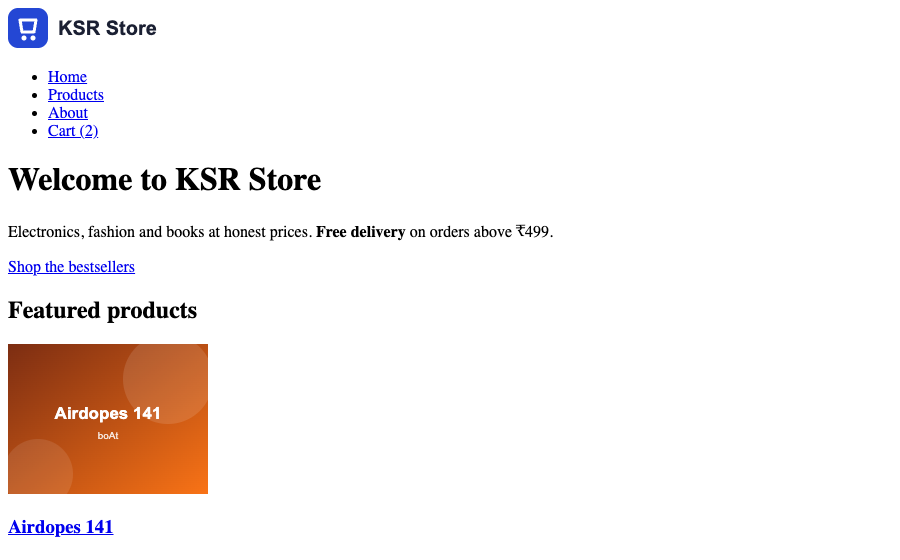
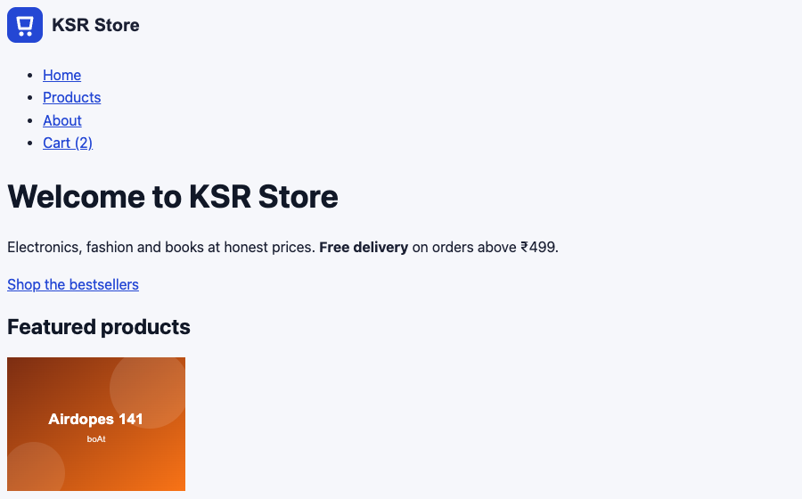
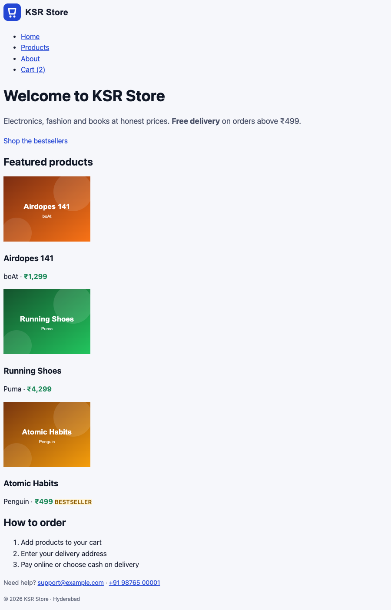

# CSS Basics

!!! abstract "Learning Objectives"
    By the end of this lesson, you can:

    - Add CSS to a page in three ways, and explain why an **external stylesheet** is best
    - Read and write CSS rules: **selector**, property and value
    - Target elements with element, class, id, descendant, grouping, attribute and pseudo-class **selectors**
    - Predict which rule wins using the **cascade**, **specificity** and **inheritance**
    - Use colours (`hex`, `rgb`, `hsl`), units (`px`, `rem`, `em`, `%`) and font properties

**Prerequisites:** the [HTML module](../html/01-how-the-web-works.md). You'll style the KSR Store pages you built there.

## What CSS Does

**CSS (Cascading Style Sheets)** controls how HTML looks: colours, fonts, spacing, layout, and how the page adapts to phones. The HTML stays the same; only the presentation changes. That's why you wrote meaningful HTML first.

### A rule

```{ .css .no-run }
selector {  property: value;  property: value;  }

h1 {
  color: #2447d4;        /* a declaration: property + value, ending with ; */
  font-size: 2.25rem;
}
```

- The **selector** chooses which elements the rule applies to.
- Each **declaration** sets one **property** to a **value**.
- `/* ... */` is a CSS comment.

### Three ways to add CSS

| Way | Example | Use |
|-----|---------|-----|
| Inline (`style` attribute) | `<p style="color: red">` | Almost never: impossible to reuse or override cleanly |
| Internal (`<style>` in `<head>`) | `<style> p { color: red; } </style>` | Quick demos, one-off pages |
| **External stylesheet** | `<link rel="stylesheet" href="css/style.css">` | **Real websites**: one file styles every page, and the browser caches it |

## Linking the KSR Store Stylesheet

Create a `css` folder and an empty `css/style.css`, then link it from the `<head>` of every page. Add the line marked `<!-- new -->` to `index.html`, and the same line to `about.html`, `product.html`, `cart.html`, `checkout.html` and `order-confirmed.html`:

```{ .html .edit title="index.html" also="about.html product.html cart.html checkout.html order-confirmed.html" }
<head>
  <meta charset="UTF-8">
  <link rel="stylesheet" href="css/style.css">  <!-- new -->
```

This is the page we'll transform. Here's the home page **before** any CSS:

```css title="css/style.css"
/* KSR Store stylesheet */
```

{ .ksr-shot data-page="index.html" data-height="560" data-width="900" }

## Your First Styles

Add these rules to `css/style.css`:

```{ .css .append title="css/style.css" }
body {
  font-family: system-ui, -apple-system, "Segoe UI", Roboto, Arial, sans-serif;
  font-size: 16px;
  line-height: 1.6;
  color: #1b2033;
  background-color: #f6f7fb;
}

h1, h2, h3 {
  line-height: 1.2;
  color: #111827;
}

h1 {
  font-size: 2.25rem;
}

h2 {
  font-size: 1.5rem;
}

a {
  color: #2447d4;
}

a:hover {
  color: #1a33a0;
}
```

Save, and Live Server reloads the page:

{ .ksr-shot data-page="index.html" data-height="560" data-width="900" }

Five small rules, and the page already looks more modern: a clean system font, comfortable line spacing, a soft background and brand-blue links. Notice we styled **every page at once**, because they all link the same file.

## Selectors

| Selector | Example | Selects |
|----------|---------|---------|
| Element (type) | `p` | Every `<p>` |
| Class | `.price` | Every element with `class="price"` |
| ID | `#featured` | The element with `id="featured"` |
| Grouping | `h1, h2, h3` | All three (one rule, several selectors) |
| Descendant | `nav a` | `<a>` elements anywhere **inside** a `<nav>` |
| Child | `nav > ul` | `<ul>` elements that are **direct** children of `<nav>` |
| Combined | `p.price` | `<p>` elements that also have `class="price"` |
| Attribute | `a[aria-current="page"]` | Links with that attribute value |
| Pseudo-class | `a:hover`, `li:first-child`, `input:focus` | Elements in a state or position |
| Universal | `*` | Every element |

Add rules for the KSR Store's own classes and states:

```{ .css .append title="css/style.css" }
.hero p {
  font-size: 1.125rem;
  color: #4a5168;
}

.price {
  font-weight: 700;
  color: #1f8a5b;
}

.badge {
  background-color: #fff4d6;
  color: #8a5a00;
  font-size: 0.8rem;
  font-weight: 600;
  text-transform: uppercase;
  letter-spacing: 0.04em;
}

.product-card h3 a {
  color: inherit;
  text-decoration: none;
}

.product-card h3 a:hover {
  text-decoration: underline;
}

nav a[aria-current="page"] {
  font-weight: 700;
}

.site-footer {
  color: #5b6275;
  font-size: 0.9rem;
}
```

{ .ksr-shot data-page="index.html" data-full="true" data-width="900" }

The prices are green and bold everywhere, the "Bestseller" badge has its own colours, and the product names are no longer underlined blue links (`color: inherit` takes the colour of the parent element). Spacing is still default and the layout still stacks; that's the next two lessons.

## The Cascade: Which Rule Wins?

When several rules set the same property on the same element, CSS decides in this order:

1. **Importance:** `!important` beats everything (avoid it; it makes CSS hard to maintain).
2. **Specificity:** the more specific selector wins.
3. **Order:** if specificity is equal, the rule that comes **later** wins.

**Specificity** is counted as three numbers, (IDs, classes / attributes / pseudo-classes, elements), compared left to right:

| Selector | Specificity | |
|----------|-------------|---|
| `p` | (0, 0, 1) | weakest |
| `.price` | (0, 1, 0) | |
| `p.price` | (0, 1, 1) | |
| `.product-card .price` | (0, 2, 0) | |
| `#featured .price` | (1, 1, 0) | strongest here |
| `style="..."` (inline) | beats all selectors | |

Let's prove it. This demo page has three rules fighting over the same paragraph:

```html title="specificity.html"
<!DOCTYPE html>
<html lang="en">
<head>
  <meta charset="UTF-8">
  <title>Specificity | KSR Store</title>
  <style>
    #offer { color: crimson; }          /* (1,0,0) */
    .highlight { color: green; }        /* (0,1,0) */
    p { color: blue; }                  /* (0,0,1) */
    p { font-size: 18px; }
    p { font-size: 22px; }              /* same specificity, later wins */
    .card { color: purple; font-style: italic; }
  </style>
</head>
<body>
  <p id="offer" class="highlight">Diwali sale: 20% off!</p>
  <p class="highlight">Free delivery above ₹499</p>
  <p>Cash on delivery available</p>
  <div class="card">Inherited: <strong>this strong text</strong> takes the card's colour and style.</div>
</body>
</html>
```

{ .ksr-shot data-page="specificity.html" data-height="230" data-width="700" }

The browser can tell us exactly what it computed for each element:

```{ .text .output page="specificity.html" actions="eval:for (const el of document.querySelectorAll('p, strong')) { const s = getComputedStyle(el); console.log(el.textContent.slice(0, 26).padEnd(27), s.color.padEnd(17), s.fontSize, s.fontStyle) }" }
Diwali sale: 20% off!       rgb(220, 20, 60)  22px normal
Free delivery above ₹499    rgb(0, 128, 0)    22px normal
Cash on delivery available  rgb(0, 0, 255)    22px normal
this strong text            rgb(128, 0, 128)  16px italic
```

- The first paragraph matches all three colour rules; the **ID** wins (crimson is `rgb(220, 20, 60)`).
- The second matches the class and the element rules; the **class** wins (green).
- All paragraphs are `22px`: the two `font-size` rules have equal specificity, so the **later** one wins.
- `<strong>` has no rule of its own, but it **inherited** the purple colour and italic style from `.card`.

### Inheritance

Some properties pass from a parent element to its children automatically: mostly **text** properties (`color`, `font-family`, `font-size`, `line-height`, `text-align`). That's why setting `font-family` on `body` changed the whole page. **Box** properties (`margin`, `padding`, `border`, `background`, `width`) don't inherit. Use `inherit` to force it, as we did with the product links.

!!! tip "Inspect, don't guess"
    In DevTools, select an element: the **Styles** pane lists every matching rule in specificity order, with overridden declarations ~~struck through~~. The **Computed** tab shows the final value of each property and where it came from.

## Colours

| Format | Example | Notes |
|--------|---------|-------|
| Named | `crimson`, `white` | 140+ names; fine for quick tests |
| Hex | `#2447d4`, `#fff` | The most common in design files |
| `rgb()` | `rgb(36 71 212)`, `rgb(36 71 212 / 50%)` | Red, green, blue 0–255; optional transparency |
| `hsl()` | `hsl(228 71% 49%)` | Hue (0–360°), saturation, lightness: easy to make lighter or darker shades |

Make sure text has enough **contrast** against its background (at least 4.5:1 for normal text). DevTools shows the contrast ratio when you click a colour swatch in the Styles pane.

## Units

| Unit | Relative to | Use for |
|------|-------------|---------|
| `px` | Fixed pixels | Borders, small details |
| `rem` | The **root** (`html`) font size, usually 16px | **Font sizes, spacing**: respects the user's browser font setting |
| `em` | The element's **own** font size | Spacing that should scale with the text, e.g. button padding |
| `%` | The parent's size | Widths |
| `vw` / `vh` | 1% of the viewport width / height | Full-screen sections |

`2.25rem` = 2.25 × 16px = 36px. If a user with poor eyesight sets their browser's default font to 20px, `rem` sizes grow with it; `px` sizes don't.

## Fonts and Text

| Property | Example |
|----------|---------|
| `font-family` | `system-ui, -apple-system, "Segoe UI", Roboto, Arial, sans-serif` |
| `font-size` | `1.125rem` |
| `font-weight` | `400` (normal), `600`, `700` (bold) |
| `font-style` | `italic` |
| `line-height` | `1.6` (no unit: 1.6 × the font size) |
| `text-align` | `left`, `center`, `right` |
| `text-decoration` | `none`, `underline`, `line-through` |
| `text-transform` | `uppercase`, `capitalize` |
| `letter-spacing` | `0.04em` |

A **font stack** lists fonts in order of preference: the browser uses the first one installed. `system-ui` uses the operating system's own font (San Francisco on Mac, Segoe UI on Windows, Roboto on Android): fast, because nothing is downloaded. For brand fonts, sites use **Google Fonts** or self-hosted files with `@font-face`.

!!! realworld "In Real Projects"
    Teams keep specificity low and predictable: mostly single class selectors (`.product-card`, `.price`), almost no IDs in CSS, and no `!important`. Naming conventions such as **BEM** (`.card`, `.card__title`, `.card--featured`) make this systematic. Colours and font sizes come from a **design system** shared with designers, often as CSS variables (you'll use them in the responsive design lesson).

## Common Mistakes

| Mistake | Symptom | Fix |
|---------|---------|-----|
| Wrong path in `href` (`style.css` vs `css/style.css`) | No styles at all; 404 in the Network tab | Check the path relative to the HTML file |
| Missing `;` between declarations | The next declaration is ignored | End every declaration with `;` |
| `.price` written as `price` in CSS | Rule never matches | Classes need the dot, IDs need `#` |
| `class="price"` vs `.Price` | No match (class names are case-sensitive) | Use the same lowercase-hyphen names everywhere |
| Rule "not working" | It's overridden by a more specific rule | Check the Styles pane in DevTools; lower the other rule's specificity |
| Using `!important` to win | Specificity wars later | Fix the selector instead |
| Font sizes in `px` only | Ignores users' font settings | Use `rem` |

## Practice Exercises

**Easy**

1. Make all `h2` headings brand blue (`#2447d4`).
2. Make the `<del>` old price on the product page grey (`#8a90a2`) and the `<mark>` discount green on a light green background.
3. Style `<figcaption>` on the product page: smaller (`0.875rem`), grey and italic.

**Medium**

4. Write a rule that makes **only the first** list item in "How to order" bold, using a pseudo-class.
5. Style the specification list (`dl`) so terms (`dt`) are bold and descriptions (`dd`) are grey.
6. Without opening DevTools, predict the colour of `<p class="price sale" id="today">` given `.price { color: green }`, `.sale { color: red }`, `p.price { color: blue }`. Then check it in the browser.

**Challenge**

7. Create `theme-test.html` with an internal `<style>` that defines the same five colours of the KSR Store in `hsl()`, then add three lighter and three darker shades of the brand blue by changing only the lightness. Display them as a row of labelled paragraphs.

??? success "Solutions (click to expand)"

    ```{ .css .no-run }
    /* 1 */
    h2 { color: #2447d4; }

    /* 2 */
    del { color: #8a90a2; }
    mark { background-color: #dff5ea; color: #1f8a5b; }

    /* 3 */
    figcaption { font-size: 0.875rem; color: #5b6275; font-style: italic; }

    /* 4 */
    ol li:first-child { font-weight: 700; }

    /* 5 */
    dt { font-weight: 700; }
    dd { color: #5b6275; }

    /* 6: p.price is (0,1,1), more specific than .price and .sale (0,1,0) -> blue */

    /* 7 (part) */
    .blue-90 { background-color: hsl(228 71% 90%); }
    .blue-70 { background-color: hsl(228 71% 70%); }
    .blue-49 { background-color: hsl(228 71% 49%); color: white; }
    .blue-30 { background-color: hsl(228 71% 30%); color: white; }
    ```

!!! note "Mini Assignment"
    Create `css/style.css` for your own business site: pick a brand colour, a text colour, a muted colour and a background colour (check their contrast in DevTools), set a system font stack on `body`, size the headings in `rem`, and style your price and badge classes. Use only class and element selectors, with no IDs and no `!important`.

## Interview Questions

!!! interview "1. What are the three ways to add CSS, and which is preferred?"
    Inline (`style` attribute), internal (`<style>` in the head) and external (`<link rel="stylesheet">`). External stylesheets are preferred: one file styles every page, it's cached by the browser, and it keeps content and presentation separate.

!!! interview "2. Explain the cascade."
    When several declarations apply to the same property of an element, the browser picks one by importance (`!important`), then specificity, then source order (the later rule wins). Inherited values only apply when no rule targets the element directly.

!!! interview "3. How is specificity calculated?"
    As (IDs, classes + attributes + pseudo-classes, elements + pseudo-elements), compared from left to right. `#nav .link` is (1,1,0) and beats `.menu .link:hover` (0,3,0). Inline styles beat all selectors, and `!important` overrides normal declarations.

!!! interview "4. What is the difference between `rem` and `em`?"
    `rem` is relative to the root (`html`) font size, so it's consistent everywhere. `em` is relative to the current element's font size, so it compounds when nested. Use `rem` for font sizes and layout spacing, `em` for spacing that should scale with a component's own text.

!!! interview "5. Which CSS properties are inherited?"
    Mostly text-related properties: `color`, `font-*`, `line-height`, `text-align`, `letter-spacing`, `visibility`, `cursor`. Box-model and layout properties such as `margin`, `padding`, `border`, `background`, `width` and `display` are not inherited.

!!! interview "Scenario: your CSS rule has no effect. How do you debug it?"
    Inspect the element in DevTools. If the rule isn't listed, the stylesheet isn't loaded (check the Network tab for a 404 or a cached old file) or the selector doesn't match (typo, missing dot, wrong class). If it's listed but struck through, another rule with higher specificity or later order wins; adjust the selector rather than adding `!important`.

## Summary

| Concept | Example |
|---------|---------|
| Link a stylesheet | `<link rel="stylesheet" href="css/style.css">` |
| Rule | `.price { font-weight: 700; color: #1f8a5b; }` |
| Selectors | `p`, `.class`, `#id`, `h1, h2`, `nav a`, `nav > ul`, `a[aria-current="page"]`, `a:hover` |
| Cascade | Importance → specificity → order |
| Specificity | (IDs, classes/attributes/pseudo-classes, elements) |
| Inheritance | Text properties inherit; box properties don't; `inherit` forces it |
| Colours | `#2447d4`, `rgb(36 71 212 / 50%)`, `hsl(228 71% 49%)` |
| Units | `rem` for text and spacing, `px` for borders, `%` for widths |
| Fonts | `font-family` stack, `font-size`, `font-weight`, `line-height` |

**Next lesson:** [Box Model, Display & Positioning](02-box-model-display-positioning.md), spacing, borders, cards and a sticky header.
