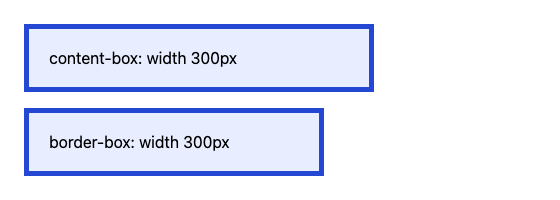
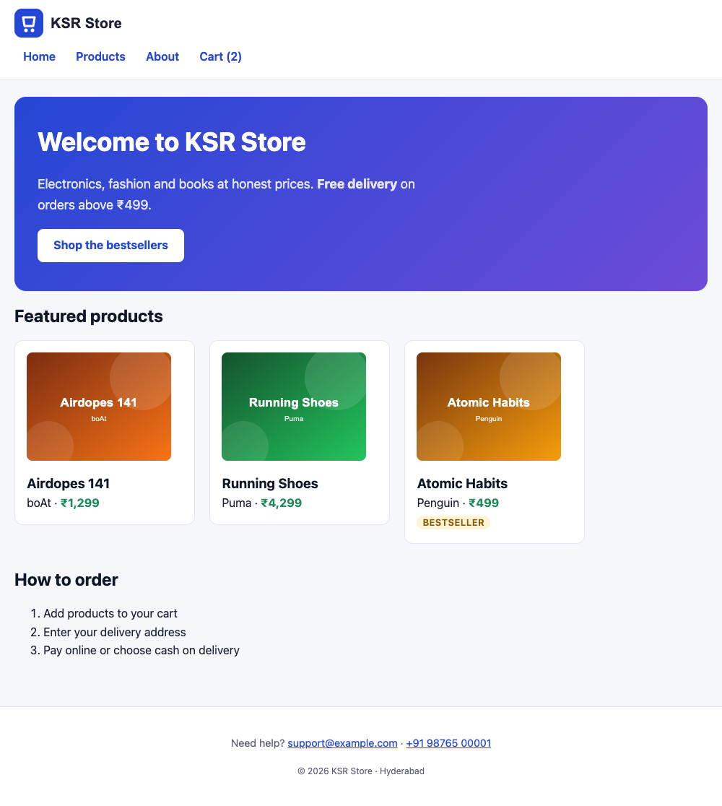
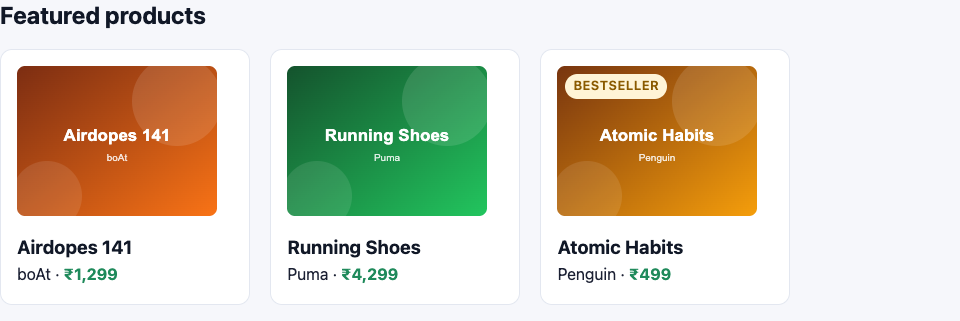
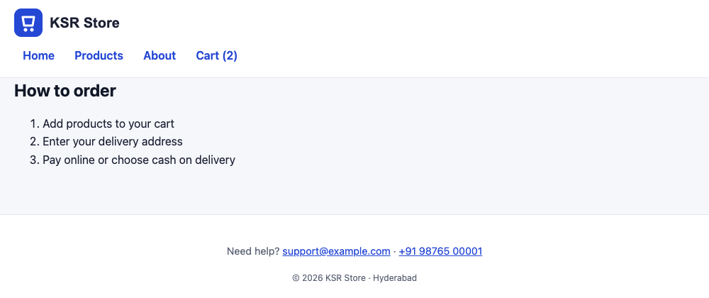

# Box Model, Display & Positioning

!!! abstract "Learning Objectives"
    By the end of this lesson, you can:

    - Explain the **box model**: content, padding, border and margin
    - Use `box-sizing: border-box` and know why every project sets it
    - Centre a page with `max-width` and `margin: 0 auto`, and recognise **margin collapse**
    - Choose between `display: block`, `inline`, `inline-block` and `none`
    - Place elements with `position: relative`, `absolute`, `fixed` and `sticky`, and stack them with `z-index`

**Prerequisites:** [CSS Basics](01-css-basics.md)

## Every Element Is a Box

The browser draws every element as a rectangle made of four layers:

```{ .text .no-run }
┌──────────────────────── margin (transparent space outside) ─────────────────────────┐
│   ┌──────────────────────────────── border ──────────────────────────────────┐      │
│   │   ┌──────────────────── padding (space inside the border) ───────────┐   │      │
│   │   │                                                                  │   │      │
│   │   │                content (text, image) - width × height            │   │      │
│   │   │                                                                  │   │      │
│   │   └──────────────────────────────────────────────────────────────────┘   │      │
│   └──────────────────────────────────────────────────────────────────────────┘      │
└─────────────────────────────────────────────────────────────────────────────────────┘
```

| Layer | Property | Example |
|-------|----------|---------|
| Content | `width`, `height` | `width: 240px;` |
| Padding | `padding` | `padding: 16px;` (background colour shows here) |
| Border | `border` | `border: 1px solid #e3e7f0;` |
| Margin | `margin` | `margin-bottom: 24px;` (always transparent) |

### Shorthand values

`margin` and `padding` take one to four values, going **clockwise from the top**:

| Written | Means |
|---------|-------|
| `padding: 16px;` | All four sides 16px |
| `padding: 8px 16px;` | Top and bottom 8px, left and right 16px |
| `padding: 8px 16px 24px;` | Top 8px, sides 16px, bottom 24px |
| `padding: 8px 16px 24px 4px;` | Top, right, bottom, left |
| `margin-top: 0;` | Just one side (`-top`, `-right`, `-bottom`, `-left`) |

## `box-sizing`: What Does `width` Mean?

By default, `width` sets only the **content**; padding and border are added on top. That makes sizes hard to reason about. Compare two boxes with the same CSS except `box-sizing`:

```html title="box-model.html"
<!DOCTYPE html>
<html lang="en">
<head>
  <meta charset="UTF-8">
  <title>Box model | KSR Store</title>
  <style>
    body { font-family: system-ui, sans-serif; margin: 24px; }
    .box {
      width: 300px;
      padding: 20px;
      border: 5px solid #2447d4;
      margin-bottom: 16px;
      background-color: #e8edff;
    }
    .content-box { box-sizing: content-box; }   /* the default */
    .border-box { box-sizing: border-box; }
  </style>
</head>
<body>
  <div class="box content-box">content-box: width 300px</div>
  <div class="box border-box">border-box: width 300px</div>
</body>
</html>
```

{ .ksr-shot data-page="box-model.html" data-height="200" data-width="560" }

The browser reports the real rendered widths:

```{ .text .output page="box-model.html" actions="eval:for (const el of document.querySelectorAll('.box')) console.log(getComputedStyle(el).boxSizing.padEnd(12), 'rendered width:', el.offsetWidth + 'px')" }
content-box  rendered width: 350px
border-box   rendered width: 300px
```

With `content-box`, the box is 300 + 2×20 padding + 2×5 border = **350px** wide. With `border-box`, padding and border fit **inside** the 300px. That's what everyone expects, so every modern stylesheet starts with:

```{ .css .no-run }
*, *::before, *::after { box-sizing: border-box; }
```

## `display`: Block, Inline and More

| Value | Starts on a new line? | Width / height / vertical margin work? | Default for |
|-------|----------------------|----------------------------------------|-------------|
| `block` | Yes, takes the full width | Yes | `div`, `p`, `h1`–`h6`, `section`, `ul`, `li` |
| `inline` | No, flows in the text | **No** | `span`, `a`, `strong`, `em`, `img` (sort of) |
| `inline-block` | No, flows in the text | Yes | `button`, `input` |
| `none` | Removed from the page completely | | `head`, hidden elements |
| `flex`, `grid` | (layouts: next two lessons) | | |

Two common tricks:

- Make a link look like a **button**: give it `display: inline-block` so padding pushes the surrounding content away properly.
- Hide something: `display: none` removes it (screen readers too). `visibility: hidden` hides it but keeps its space.

## Centring the Page and Margin Collapse

Text running edge to edge on a wide screen is hard to read. Limit the width and centre it:

```{ .css .no-run }
main {
  max-width: 1100px;    /* never wider than this */
  margin: 0 auto;       /* top/bottom 0, left/right shared equally = centred */
  padding: 24px 20px;   /* breathing room on small screens */
}
```

`margin: auto` centres **block** elements that have a width or max-width. (To centre text or inline content inside a box, use `text-align: center`.)

**Margin collapse:** when two vertical margins touch, they don't add up. The bigger one wins. A heading with `margin-bottom: 24px` above a paragraph with `margin-top: 16px` gives a 24px gap, not 40px. Horizontal margins and padding never collapse.

## Styling the KSR Store with Boxes

Add this to `css/style.css`. Read the comments: each block uses a box-model or display idea from above:

```{ .css .append title="css/style.css" }
/* ---------- Lesson: box model ---------- */
*, *::before, *::after {
  box-sizing: border-box;
}

body {
  margin: 0;                       /* remove the browser's default 8px */
}

img {
  max-width: 100%;                 /* never overflow the container */
  height: auto;
}

main {
  max-width: 1100px;
  margin: 0 auto;
  padding: 24px 20px 48px;
}

/* Header bar */
.site-header {
  background-color: #ffffff;
  border-bottom: 1px solid #e3e7f0;
  padding: 12px 20px;
}

.site-header ul {
  list-style: none;                /* no bullets */
  margin: 0;
  padding: 0;
}

.site-header li {
  display: inline-block;           /* menu items side by side */
}

.site-header nav a {
  display: inline-block;
  padding: 6px 12px;
  border-radius: 6px;
  font-weight: 600;
  text-decoration: none;
}

.site-header nav a:hover {
  background-color: #eef2ff;
}

/* Hero banner */
.hero {
  background: linear-gradient(135deg, #2447d4, #6d4bd8);
  color: #ffffff;
  padding: 40px 32px;
  border-radius: 16px;
}

.hero h1 {
  color: #ffffff;
  margin-top: 0;
}

.hero p {
  color: #e4e8ff;
  max-width: 560px;
}

.hero a {
  display: inline-block;           /* so padding works on a link */
  background-color: #ffffff;
  color: #2447d4;
  padding: 10px 22px;
  border-radius: 8px;
  font-weight: 700;
  text-decoration: none;
}

/* Product cards */
.product-card {
  display: inline-block;           /* cards in a row (Flexbox will do this better) */
  vertical-align: top;
  width: 250px;
  margin: 0 16px 16px 0;
  padding: 16px;
  background-color: #ffffff;
  border: 1px solid #e3e7f0;
  border-radius: 12px;
}

.product-card img {
  border-radius: 8px;
}

.product-card h3 {
  margin: 12px 0 4px;
}

.product-card p {
  margin: 0;
}

.badge {
  padding: 2px 8px;
  border-radius: 999px;            /* a pill shape */
}

/* Footer */
.site-footer {
  background-color: #ffffff;
  border-top: 1px solid #e3e7f0;
  padding: 24px 20px;
  text-align: center;
}
```

{ .ksr-shot data-page="index.html" data-full="true" data-width="1000" }

A real difference: a white header bar, a gradient banner with a proper button, product **cards** with padding, borders and rounded corners, and a centred page. Two things still need fixing: the logo and menu sit on separate lines, and the cards are aligned with `inline-block`, which is fragile (the gaps depend on whitespace in the HTML). Flexbox fixes both in the next lesson.

!!! tip "See the box model in DevTools"
    Select a card in the Elements tab. The **Computed** pane shows a diagram of its margin, border, padding and content sizes. Hovering an element on the page highlights margin in orange and padding in green.

## Positioning

`position` takes an element out of the normal top-to-bottom flow and places it with `top`, `right`, `bottom` and `left`:

| Value | Positioned relative to | Still takes up space? | Typical use |
|-------|------------------------|-----------------------|-------------|
| `static` (default) | Normal flow | Yes | Everything |
| `relative` | Its own normal position | Yes | Small nudges; the **anchor** for absolute children |
| `absolute` | The nearest **positioned** ancestor | No | Badges, icons on cards, dropdowns |
| `fixed` | The browser window | No | Chat buttons, cookie banners |
| `sticky` | Scrolls normally, then **sticks** at `top` | Yes | Headers, table headings |

### A badge on the card corner

Make the card the anchor (`position: relative`) and pin the badge to its top-left corner (`position: absolute`):

```{ .css .append title="css/style.css" }
/* ---------- Lesson: positioning ---------- */
.product-card {
  position: relative;              /* anchor for the badge */
}

.product-card .badge {
  position: absolute;
  top: 24px;
  left: 24px;
}
```

{ .ksr-shot data-page="index.html" data-selector="#featured" }

The badge no longer sits after the price: it floats over the image corner, measured from the card's edges. Without `position: relative` on the card, it would be measured from the whole page instead.

### A sticky header

```{ .css .append title="css/style.css" }
.site-header {
  position: sticky;
  top: 0;                          /* stick when it reaches the top of the window */
  z-index: 10;                     /* stay above the content that scrolls under it */
}
```

Here's the page scrolled down to "How to order". The header stays at the top:

{ .ksr-shot data-page="index.html" data-height="420" data-width="1000" data-actions="eval:window.scrollTo(0, 650)" }

### `z-index`: who's on top?

When positioned elements overlap, the one with the higher `z-index` is drawn on top. It only works on **positioned** elements (anything except `static`). Keep the numbers simple and documented, for example header `10`, dropdowns `20`, modals `100`.

### `overflow`

When content is bigger than its box: `overflow: visible` (default, spills out), `hidden` (clipped), `auto` (scrollbars only when needed). `overflow-x: auto` on a wrapper is how wide tables scroll sideways on phones.

!!! realworld "In Real Projects"
    Every CSS reset or framework starts with `box-sizing: border-box`, `margin: 0` on `body`, and `max-width: 100%` on images. Layout itself is done with Flexbox and Grid, not with `inline-block` or floats. `position: absolute` is reserved for small overlays (badges, icons, tooltips), and `sticky` headers are everywhere.

## Common Mistakes

| Mistake | Symptom | Fix |
|---------|---------|-----|
| No `box-sizing: border-box` | Boxes wider than their `width`; layouts overflow | Set it globally on `*, *::before, *::after` |
| Width or vertical padding on an inline element | Nothing changes, or padding overlaps lines | `display: inline-block` or `block` |
| `margin: auto` not centring | The element has no width, or isn't a block | Give it `max-width` and `display: block` |
| Two margins add up to less than expected | Margin collapse | Expected: the larger margin wins; use padding or gap if you need both |
| `position: absolute` element flies to the page corner | No positioned ancestor | Add `position: relative` to the intended parent |
| `z-index` has no effect | The element is `position: static` | Give it a position (`relative`, `sticky`...) |
| Fixed heights on text boxes | Text overflows when it's longer or zoomed | Let height be automatic; use padding |

## Practice Exercises

**Easy**

1. Give `.hero` a `margin-bottom` of `32px` so the featured section doesn't touch it.
2. Add a subtle shadow to the cards: `box-shadow: 0 4px 12px rgb(0 0 0 / 6%);`
3. Hide the "Cart (2)" link with `display: none`, look at the page, then undo it.

**Medium**

4. Style the about page: a white "card" `<section>` centred with `max-width: 700px`, padding and rounded corners.
5. Create a fixed "Chat with us" button in the bottom-right corner of every page (`position: fixed; right: 20px; bottom: 20px;`). Check that it stays put while scrolling.
6. On `cart.html`, wrap the table in `<div class="table-wrap">` with `overflow-x: auto`, then make the window narrow and scroll the table sideways.

**Challenge**

7. Add a "−57%" discount ribbon on the product page image: a `<span class="ribbon">` inside the `<figure>`, positioned in the top-right corner, rotated with `transform: rotate(8deg)`. The figure must be the positioning anchor.

??? success "Solutions (click to expand)"

    ```{ .css .no-run }
    /* 1 + 2 */
    .hero { margin-bottom: 32px; }
    .product-card { box-shadow: 0 4px 12px rgb(0 0 0 / 6%); }

    /* 4 */
    .about-card {
      max-width: 700px;
      margin: 0 auto;
      padding: 32px;
      background-color: #ffffff;
      border-radius: 16px;
    }

    /* 5 */
    .chat-button {
      position: fixed;
      right: 20px;
      bottom: 20px;
      padding: 12px 18px;
      border-radius: 999px;
      background-color: #2447d4;
      color: #ffffff;
      z-index: 20;
    }

    /* 6 */
    .table-wrap { overflow-x: auto; }

    /* 7 */
    .product figure { position: relative; }
    .ribbon {
      position: absolute;
      top: 12px;
      right: 12px;
      padding: 4px 10px;
      background-color: #e11d48;
      color: #ffffff;
      font-weight: 700;
      border-radius: 6px;
      transform: rotate(8deg);
    }
    ```

!!! note "Mini Assignment"
    Turn your own business site's service list into **cards**: white background, padding, border, rounded corners and a shadow, a centred `main` with a `max-width`, a header bar with a sticky position and an inline-block menu, a gradient hero with a button-styled link, and a "New" badge positioned on one card.

## Interview Questions

!!! interview "1. Explain the CSS box model."
    Every element is a rectangular box made of content, padding (inside the border), border, and margin (outside the border). By default `width` and `height` apply to the content only; with `box-sizing: border-box` they include padding and border.

!!! interview "2. What is the difference between `display: block`, `inline` and `inline-block`?"
    Block elements start on a new line and take the full available width, respecting width, height and margins. Inline elements flow within text and ignore width, height and vertical margins. Inline-block flows like inline but respects width, height, padding and margins like a block.

!!! interview "3. What is margin collapse?"
    When the vertical margins of adjacent block elements (or a parent and its first or last child) touch, they combine into a single margin equal to the larger of them, instead of adding up. It doesn't happen with padding, borders between them, flex or grid items, or horizontal margins.

!!! interview "4. What is the difference between `relative`, `absolute`, `fixed` and `sticky` positioning?"
    `relative` offsets an element from its normal position while keeping its space. `absolute` removes it from the flow and positions it against the nearest positioned ancestor. `fixed` positions it against the viewport so it doesn't scroll. `sticky` behaves normally until a scroll threshold, then sticks like fixed within its container.

!!! interview "5. How do you centre a block element horizontally?"
    Give it a width or `max-width` and `margin-left` / `margin-right: auto` (`margin: 0 auto`). Modern alternatives are Flexbox (`justify-content: center` on the parent) or Grid (`place-items: center`).

!!! interview "Scenario: a badge positioned with `position: absolute` appears at the top of the page instead of on its card. Why?"
    Absolute elements are positioned against their nearest positioned ancestor. If the card (or another ancestor) isn't positioned, the badge uses the initial containing block, the page. Add `position: relative` to the card.

## Summary

| Concept | CSS |
|---------|-----|
| Box layers | `width`, `padding`, `border`, `margin` |
| Shorthand | `padding: 8px 16px;` (top/bottom, left/right), clockwise from top |
| Predictable sizes | `*, *::before, *::after { box-sizing: border-box; }` |
| Centre a page | `max-width: 1100px; margin: 0 auto;` |
| Display | `block`, `inline`, `inline-block`, `none` |
| Decoration | `background`, `linear-gradient()`, `border-radius`, `box-shadow` |
| Positioning | `relative` (anchor), `absolute` (badges), `fixed` (floating buttons), `sticky` (headers) |
| Stacking | `z-index` on positioned elements |
| Overflow | `overflow: hidden / auto`, `overflow-x: auto` for wide tables |

**Next lesson:** [Flexbox](03-flexbox.md), a real navigation bar and product cards that line up perfectly.
