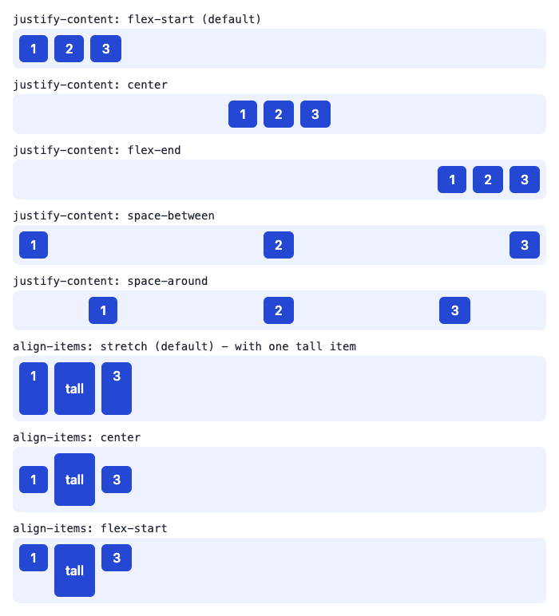
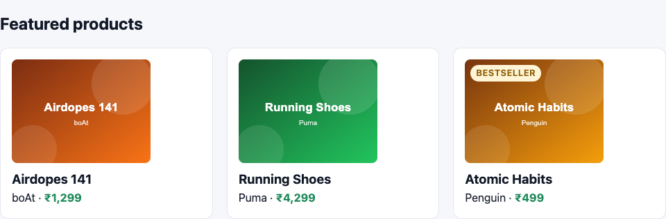
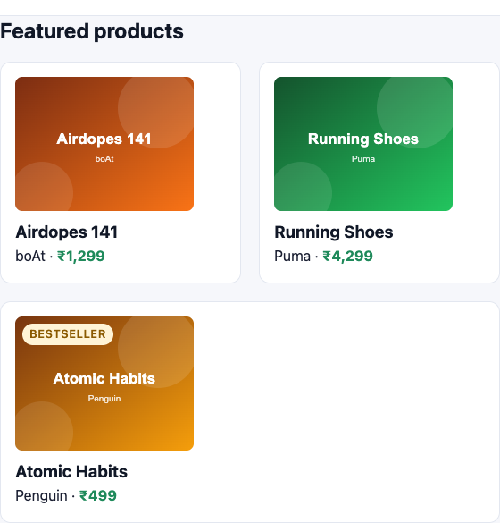
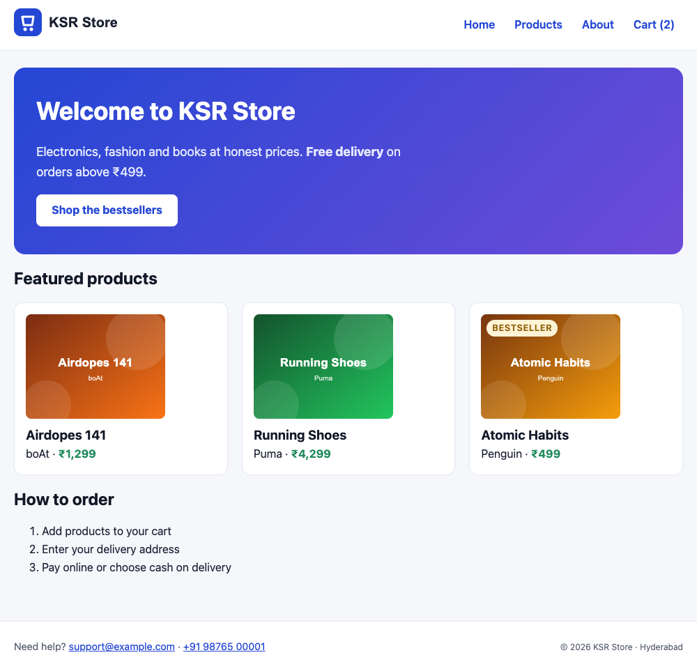
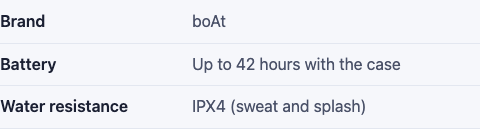

# Flexbox

!!! abstract "Learning Objectives"
    By the end of this lesson, you can:

    - Turn an element into a **flex container** and explain the main axis and cross axis
    - Distribute and align items with `justify-content`, `align-items` and `gap`
    - Change direction with `flex-direction`, and let items wrap with `flex-wrap`
    - Control how items grow and shrink with `flex: grow shrink basis`
    - Build common patterns: a navigation bar, equal-height cards, centring anything

**Prerequisites:** [Box Model, Display & Positioning](02-box-model-display-positioning.md)

## Why Flexbox?

At the end of the last lesson, the KSR Store had two layout problems: the logo and menu were on separate lines, and the cards were lined up with fragile `inline-block`. **Flexbox** is the CSS layout system for arranging items **in a row or a column**: spacing them out, aligning them, and letting them grow or wrap.

```{ .css .no-run }
.container {
  display: flex;      /* the children become flex items, side by side */
}
```

```{ .text .no-run }
            main axis (flex-direction: row) ─────────────────────────▶
          ┌──────────────────────────────────────────────────────────┐
cross     │  ┌────────┐   ┌────────┐   ┌────────┐                    │
axis      │  │ item 1 │   │ item 2 │   │ item 3 │                    │
  │       │  └────────┘   └────────┘   └────────┘                    │
  ▼       └──────────────────────────────────────────────────────────┘
                             flex container
```

- `justify-content` positions items along the **main axis** (horizontal for a row).
- `align-items` positions them along the **cross axis** (vertical for a row).
- `gap` puts space **between** items (never at the edges).

## A Flexbox Playground

This demo page shows the main properties side by side:

```html title="flex-demo.html"
<!DOCTYPE html>
<html lang="en">
<head>
  <meta charset="UTF-8">
  <title>Flexbox demo | KSR Store</title>
  <style>
    body { font-family: system-ui, sans-serif; margin: 16px; color: #1b2033; }
    .row { display: flex; gap: 8px; padding: 8px; margin-bottom: 4px; background: #eef2ff; border-radius: 8px; }
    .row div { padding: 8px 14px; background: #2447d4; color: white; border-radius: 6px; font-weight: 600; }
    code { display: block; margin: 12px 0 4px; font-size: 14px; }
    .tall { padding-top: 24px !important; padding-bottom: 24px !important; }
  </style>
</head>
<body>
  <code>justify-content: flex-start (default)</code>
  <div class="row"><div>1</div><div>2</div><div>3</div></div>
  <code>justify-content: center</code>
  <div class="row" style="justify-content: center"><div>1</div><div>2</div><div>3</div></div>
  <code>justify-content: flex-end</code>
  <div class="row" style="justify-content: flex-end"><div>1</div><div>2</div><div>3</div></div>
  <code>justify-content: space-between</code>
  <div class="row" style="justify-content: space-between"><div>1</div><div>2</div><div>3</div></div>
  <code>justify-content: space-around</code>
  <div class="row" style="justify-content: space-around"><div>1</div><div>2</div><div>3</div></div>
  <code>align-items: stretch (default) - with one tall item</code>
  <div class="row"><div>1</div><div class="tall">tall</div><div>3</div></div>
  <code>align-items: center</code>
  <div class="row" style="align-items: center"><div>1</div><div class="tall">tall</div><div>3</div></div>
  <code>align-items: flex-start</code>
  <div class="row" style="align-items: flex-start"><div>1</div><div class="tall">tall</div><div>3</div></div>
</body>
</html>
```

{ .ksr-shot data-page="flex-demo.html" data-full="true" data-width="700" }

(The demo uses inline `style` attributes only to keep each example on one line. In real projects, use classes.)

| Property (on the container) | Values | Effect |
|-----------------------------|--------|--------|
| `justify-content` | `flex-start`, `center`, `flex-end`, `space-between`, `space-around`, `space-evenly` | Main-axis distribution |
| `align-items` | `stretch` (default), `center`, `flex-start`, `flex-end`, `baseline` | Cross-axis alignment |
| `gap` | `16px`, `1rem 2rem` (row gap, column gap) | Space between items |
| `flex-direction` | `row` (default), `column`, `row-reverse`, `column-reverse` | Which way the main axis runs |
| `flex-wrap` | `nowrap` (default), `wrap` | Whether items may move onto new lines |

Notice `align-items: stretch`: by default, all items in a row become **as tall as the tallest one**. That's what makes equal-height cards easy.

!!! tip "Centre anything"
    The famous "how do I centre a div?" question has a two-line answer:

    ```{ .css .no-run }
    .parent { display: flex; justify-content: center; align-items: center; }
    ```

## A Real Navigation Bar

Make the header a flex container: logo on the left, menu on the right, both vertically centred. Add to `css/style.css`:

```{ .css .append title="css/style.css" }
/* ---------- Lesson: Flexbox ---------- */
.site-header {
  display: flex;
  justify-content: space-between;  /* logo left, menu right */
  align-items: center;             /* vertically centred */
  gap: 16px;
}

.site-header ul {
  display: flex;                   /* menu items in a row */
  gap: 4px;
}
```

{ .ksr-shot data-page="index.html" data-selector=".site-header" data-width="1000" }

Two lines for the bar, two for the menu. `space-between` pushes the first and last children (the logo link and the `<nav>`) to the two ends. The `display: inline-block` we gave the list items earlier no longer matters: flex items are laid out by the flex container.

## Wrapping and Growing: The Product Cards

`flex-wrap: wrap` lets items move onto a new line when they don't fit, and the `flex` property on the **items** controls their size:

| Property (on items) | Example | Meaning |
|---------------------|---------|---------|
| `flex-grow` | `1` | Share extra space (0 = don't grow) |
| `flex-shrink` | `1` | Shrink when there's not enough space (0 = never shrink) |
| `flex-basis` | `220px` | The starting size before growing or shrinking |
| `flex` (shorthand) | `flex: 1 1 220px` | grow, shrink, basis |
| `align-self` | `flex-end` | Override `align-items` for one item |
| `order` | `-1` | Visual order (doesn't change the HTML or reading order) |

The featured section contains the `<h2>` and the three `<article>` cards. We make the section a wrapping flex container, give the heading `flex-basis: 100%` so it takes a whole line, and let each card grow from 220px:

```{ .css .append title="css/style.css" }
#featured {
  display: flex;
  flex-wrap: wrap;
  gap: 20px;
}

#featured h2 {
  flex-basis: 100%;                /* the heading takes the whole first line */
  margin-bottom: 0;
}

.product-card {
  flex: 1 1 220px;                 /* grow and shrink, starting from 220px */
  width: auto;                     /* replaces the fixed inline-block width */
  margin: 0;
  display: flex;                   /* the card itself is a column of content */
  flex-direction: column;
}

.product-card p {
  margin-top: auto;                /* push the brand-and-price line to the bottom of the card */
}
```

{ .ksr-shot data-page="index.html" data-selector="#featured" data-width="1000" }

The cards now share the full width equally, have equal heights (stretch), and keep consistent gaps. Each card is **also** a flex container, in a column. That's normal: flex containers nest freely.

Watch what happens on a narrow screen. At 600px wide, only two 220px cards fit in a row, so the third wraps and grows to fill its line:

{ .ksr-shot data-page="index.html" data-selector="#featured" data-width="600" }

No media query needed: `flex-wrap` plus `flex-basis` already make the cards adapt.

!!! mistake "Two different ways to get the same column"
    `flex-direction: column` swaps the axes: now `justify-content` works **vertically** and `align-items` **horizontally**. If alignment "does the wrong thing" in a column, you probably used the property for the other axis.

## The Footer and the Product Page

Two more patterns. The footer puts its two paragraphs at opposite ends, and the specification list on the product page becomes a neat two-column list:

```{ .css .append title="css/style.css" }
.site-footer {
  display: flex;
  justify-content: space-between;
  flex-wrap: wrap;
  gap: 8px 24px;
  text-align: left;
}

.site-footer p {
  margin: 0;
}

.product dl {
  display: flex;
  flex-wrap: wrap;
  max-width: 480px;
}

.product dt {
  flex-basis: 40%;
  font-weight: 600;
  padding: 8px 0;
  border-bottom: 1px solid #e3e7f0;
}

.product dd {
  flex-basis: 60%;
  margin: 0;
  padding: 8px 0;
  color: #4a5168;
  border-bottom: 1px solid #e3e7f0;
}
```

{ .ksr-shot data-page="index.html" data-full="true" data-width="1000" }

{ .ksr-shot data-page="product.html" data-selector=".product dl" data-width="1000" }

Flexbox works in **one dimension** at a time: a row or a column. For layouts that need rows **and** columns lined up together (a product grid, a page with sidebar and content), CSS Grid is the better tool. That's next.

!!! realworld "In Real Projects"
    Flexbox is the most used layout tool on the web: navigation bars, toolbars, buttons with icons, form rows, card contents, footers, chat bubbles. CSS frameworks are built on it too: Bootstrap's `d-flex justify-content-between`, Tailwind's `flex items-center gap-4` are just Flexbox properties as class names.

## Common Mistakes

| Mistake | Symptom | Fix |
|---------|---------|-----|
| `display: flex` on the item instead of its parent | Nothing lines up | Put `display: flex` on the **container** |
| `justify-content` expected to work vertically in a row | Items don't move | Use `align-items` for the cross axis |
| Using margins between items | Uneven edges, extra space at the end | Use `gap` |
| Items squash instead of wrapping | Text overflows, images shrink | `flex-wrap: wrap` and a `flex-basis` |
| Images shrinking oddly in a flex row | Distorted logos | `flex-shrink: 0` on the image |
| Using `order` to fix reading order | Keyboard and screen-reader order no longer matches what users see | Change the HTML order instead |
| Expecting `align-items: center` to centre text inside items | Text stays left | That aligns the boxes; use `text-align` for the text |

## Practice Exercises

**Easy**

1. Centre the hero content horizontally and vertically by making `.hero` a flex column with `align-items: center` and `text-align: center`.
2. Add a cart icon `🛒` before "Cart (2)" and make the link a flex row with `gap: 6px` and `align-items: center`.
3. Make the "How to order" list items appear in a row with `display: flex; gap: 24px` on the `ol`. What happens to the numbers?

**Medium**

4. Add an "Add to cart" `<button>` to each product card and push it to the bottom with `margin-top: auto`, so all buttons line up.
5. On the product page, put the price, old price and discount on one line, vertically aligned on the text **baseline**.
6. Build a "trust bar" under the hero: four items (Free delivery, 7-day returns, Secure payment, Genuine products) spread evenly with `space-evenly`, wrapping on small screens.

**Challenge**

7. Build a "Customer reviews" strip: each review is a card with an avatar circle (`flex-shrink: 0`), and next to it the name and the review text in a column. The strip scrolls horizontally on small screens (`overflow-x: auto` with `flex-wrap: nowrap`).

??? success "Solutions (click to expand)"

    ```{ .css .no-run }
    /* 1 */
    .hero { display: flex; flex-direction: column; align-items: center; text-align: center; }

    /* 4 */
    .product-card button { margin-top: auto; }

    /* 5 */
    .product .price { display: flex; align-items: baseline; gap: 8px; }

    /* 6 */
    .trust-bar { display: flex; justify-content: space-evenly; flex-wrap: wrap; gap: 12px; }

    /* 7 */
    .reviews { display: flex; gap: 16px; overflow-x: auto; }
    .review { display: flex; gap: 12px; flex: 0 0 300px; }
    .review .avatar { width: 48px; height: 48px; border-radius: 50%; flex-shrink: 0; }
    .review .body { display: flex; flex-direction: column; }
    ```

!!! note "Mini Assignment"
    Rebuild your business site's header, service cards and footer with Flexbox: logo left and menu right in the header, cards that wrap from `flex-basis: 240px` with equal heights and buttons aligned at the bottom, and a footer with contact details and social links at opposite ends. Check it at 1000px and at 400px wide.

## Interview Questions

!!! interview "1. What is the difference between `justify-content` and `align-items`?"
    `justify-content` distributes items along the main axis (horizontal in a row), while `align-items` aligns them along the cross axis (vertical in a row). With `flex-direction: column` the axes swap.

!!! interview "2. What does `flex: 1 1 220px` mean?"
    `flex-grow: 1` (take a share of extra space), `flex-shrink: 1` (shrink if needed), `flex-basis: 220px` (the starting size before growing or shrinking). `flex: 1` alone means `1 1 0%`, so items share all space equally.

!!! interview "3. How do you centre an element horizontally and vertically?"
    Make the parent a flex container with `justify-content: center` and `align-items: center` (or a grid with `place-items: center`). The parent needs a height for vertical centring to be visible.

!!! interview "4. When would you use Flexbox instead of Grid?"
    Flexbox is one-dimensional: best for laying out items in a single row or column where content size drives the layout (navigation bars, toolbars, card contents). Grid is two-dimensional: best when rows and columns must align, such as page layouts and product grids.

!!! interview "5. Why is `gap` better than margins between flex items?"
    `gap` only adds space between items, never at the outer edges, adapts automatically when items wrap, and doesn't need special cases for the first or last item.

!!! interview "Scenario: the logo in a flex header shrinks to a tiny size on mobile. How do you fix it?"
    Flex items shrink by default (`flex-shrink: 1`) when space runs out. Set `flex-shrink: 0` on the logo (or a fixed `flex-basis`), and allow the menu to wrap or collapse instead.

## Summary

| Concept | CSS |
|---------|-----|
| Flex container | `display: flex;` |
| Main axis distribution | `justify-content: space-between / center / flex-end` |
| Cross axis alignment | `align-items: center / stretch / flex-start` |
| Spacing | `gap: 16px;` |
| Direction | `flex-direction: row / column` |
| Wrapping | `flex-wrap: wrap;` |
| Item sizing | `flex: 1 1 220px;` (grow, shrink, basis) |
| One item | `align-self`, `order`, `margin-top: auto` (push to the end) |
| Centre anything | `display: flex; justify-content: center; align-items: center;` |

**Next lesson:** [CSS Grid](04-grid.md), a two-dimensional product grid and a real page layout.
