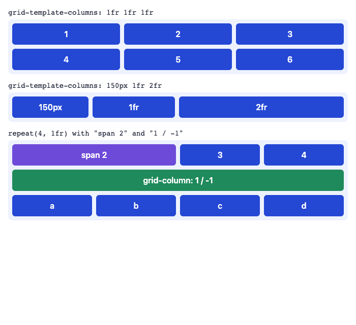
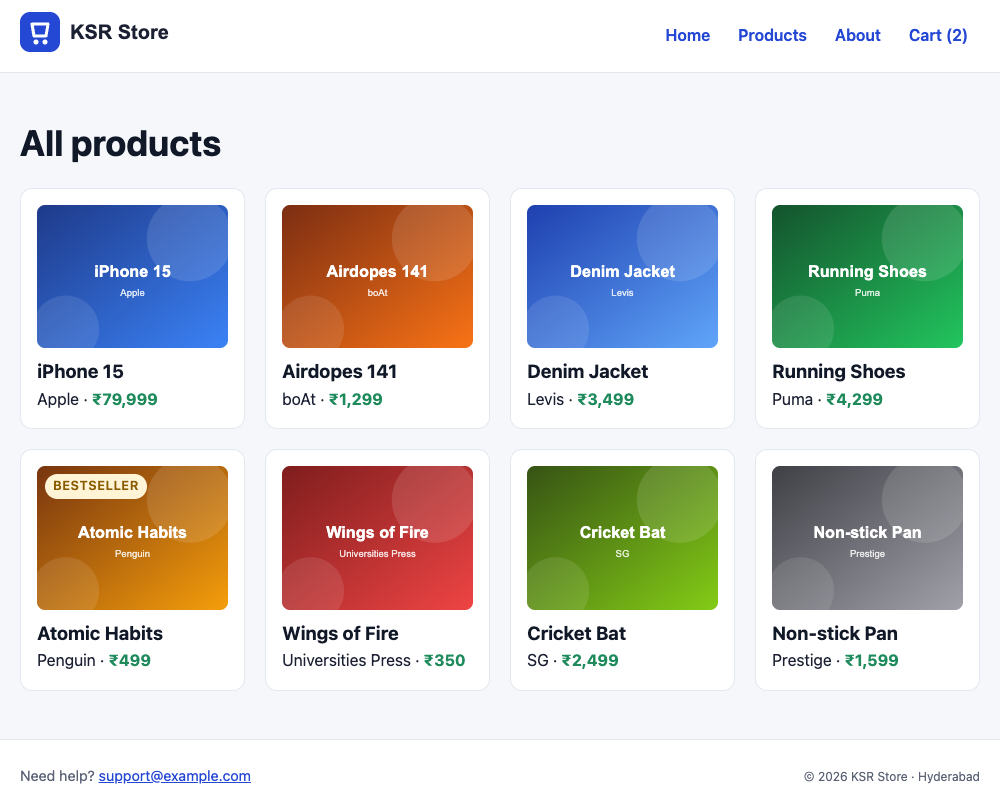
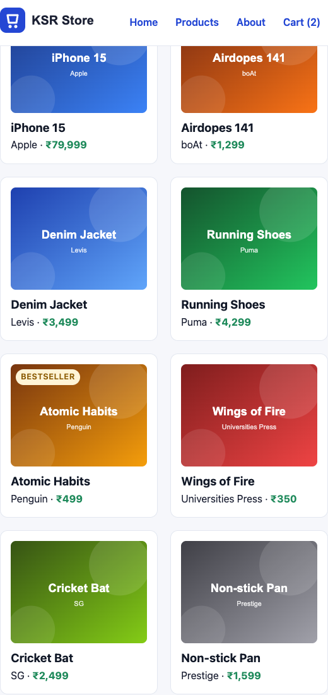
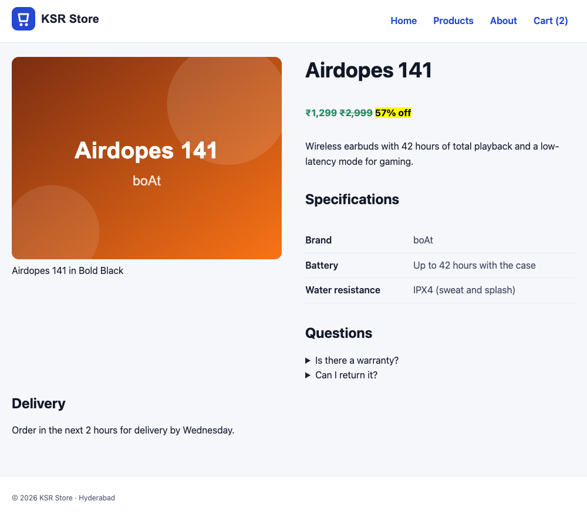
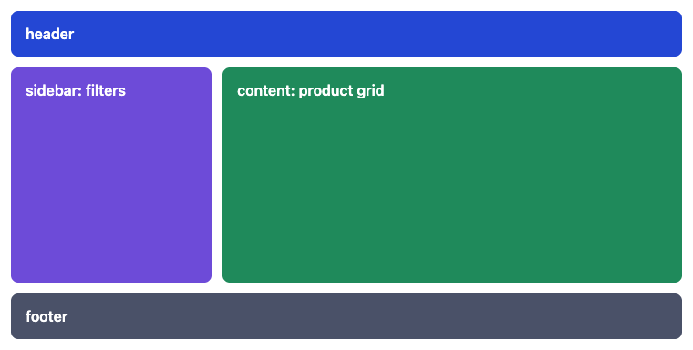

# CSS Grid

!!! abstract "Learning Objectives"
    By the end of this lesson, you can:

    - Create a grid with `grid-template-columns` and the **`fr`** unit
    - Build a responsive card grid with `repeat(auto-fill, minmax(220px, 1fr))`, with no media queries
    - Place and span items using **grid lines** (`grid-column: 1 / -1`, `span 2`)
    - Design a page layout with named **`grid-template-areas`**
    - Choose between Grid and Flexbox for a layout

**Prerequisites:** [Flexbox](03-flexbox.md)

## Rows and Columns at Once

Flexbox lays items out in **one** direction. **Grid** controls **rows and columns together**, so items line up in both directions, like a spreadsheet:

```{ .text .no-run }
        column line 1   2           3           4
               │        │           │           │
row line 1 ────┼────────┼───────────┼───────────┼──
               │ item 1 │  item 2   │  item 3   │
row line 2 ────┼────────┼───────────┼───────────┼──   ← a "track" is a row or column
               │ item 4 │  item 5   │  item 6   │      between two lines
row line 3 ────┼────────┼───────────┼───────────┼──
```

```{ .css .no-run }
.grid {
  display: grid;
  grid-template-columns: 200px 1fr 1fr;   /* three columns */
  gap: 16px;
}
```

The **`fr`** unit means "a fraction of the free space". `200px 1fr 1fr` = the first column is 200px, and the other two share what's left equally. `1fr 2fr` = the second column is twice as wide as the first.

## A Grid Playground

```html title="grid-demo.html"
<!DOCTYPE html>
<html lang="en">
<head>
  <meta charset="UTF-8">
  <title>Grid demo | KSR Store</title>
  <style>
    body { font-family: system-ui, sans-serif; margin: 16px; color: #1b2033; }
    code { display: block; margin: 14px 0 6px; font-size: 14px; }
    .grid { display: grid; gap: 8px; padding: 8px; background: #eef2ff; border-radius: 8px; }
    .grid div { padding: 12px; background: #2447d4; color: white; border-radius: 6px; font-weight: 600; text-align: center; }
    .a { grid-template-columns: 1fr 1fr 1fr; }
    .b { grid-template-columns: 150px 1fr 2fr; }
    .c { grid-template-columns: repeat(4, 1fr); }
    .c .wide { grid-column: span 2; background: #6d4bd8; }
    .c .full { grid-column: 1 / -1; background: #1f8a5b; }
  </style>
</head>
<body>
  <code>grid-template-columns: 1fr 1fr 1fr</code>
  <div class="grid a"><div>1</div><div>2</div><div>3</div><div>4</div><div>5</div><div>6</div></div>
  <code>grid-template-columns: 150px 1fr 2fr</code>
  <div class="grid b"><div>150px</div><div>1fr</div><div>2fr</div></div>
  <code>repeat(4, 1fr) with "span 2" and "1 / -1"</code>
  <div class="grid c"><div class="wide">span 2</div><div>3</div><div>4</div><div class="full">grid-column: 1 / -1</div><div>a</div><div>b</div><div>c</div><div>d</div></div>
</body>
</html>
```

{ .ksr-shot data-page="grid-demo.html" data-full="true" data-width="700" }

| Property | Example | Meaning |
|----------|---------|---------|
| `grid-template-columns` | `repeat(3, 1fr)` | Three equal columns |
| `grid-template-rows` | `auto 1fr auto` | Row sizes (usually left automatic) |
| `gap` | `16px` / `16px 24px` | Space between rows and columns |
| `grid-column` (on an item) | `1 / 3`, `span 2`, `1 / -1` | Start line / end line, or how many columns to span (`-1` = the last line) |
| `grid-row` (on an item) | `1 / span 3` | The same for rows |

Items you don't place are put into the next free cell automatically (**auto-placement**), left to right, row by row.

## The Responsive Product Grid

The most useful line of Grid you'll ever write:

```{ .css .no-run }
grid-template-columns: repeat(auto-fill, minmax(220px, 1fr));
```

Read it inside out:

- `minmax(220px, 1fr)`: each column is at least 220px, and at most an equal share of the space.
- `repeat(auto-fill, ...)`: create **as many columns as fit**.

On a wide screen you get four or five columns, on a tablet three, on a phone one, with **no media queries**.

Let's build a full catalogue page. Create `products.html` with all eight products:

```html title="products.html"
<!DOCTYPE html>
<html lang="en">
<head>
  <meta charset="UTF-8">
  <link rel="stylesheet" href="css/style.css">
  <meta name="viewport" content="width=device-width, initial-scale=1.0">
  <title>All products | KSR Store</title>
</head>
<body>
  <header class="site-header">
    <a href="index.html"></a>
    <nav>
      <ul>
        <li><a href="index.html">Home</a></li>
        <li><a href="products.html" aria-current="page">Products</a></li>
        <li><a href="about.html">About</a></li>
        <li><a href="cart.html">Cart (2)</a></li>
      </ul>
    </nav>
  </header>

  <main>
    <h1>All products</h1>
    <section class="product-grid">
      <article class="product-card">
        
        <h3>iPhone 15</h3>
        <p>Apple · <span class="price">₹79,999</span></p>
      </article>
      <article class="product-card">
        
        <h3><a href="product.html">Airdopes 141</a></h3>
        <p>boAt · <span class="price">₹1,299</span></p>
      </article>
      <article class="product-card">
        
        <h3>Denim Jacket</h3>
        <p>Levis · <span class="price">₹3,499</span></p>
      </article>
      <article class="product-card">
        
        <h3>Running Shoes</h3>
        <p>Puma · <span class="price">₹4,299</span></p>
      </article>
      <article class="product-card">
        
        <h3>Atomic Habits</h3>
        <p>Penguin · <span class="price">₹499</span> <span class="badge">Bestseller</span></p>
      </article>
      <article class="product-card">
        
        <h3>Wings of Fire</h3>
        <p>Universities Press · <span class="price">₹350</span></p>
      </article>
      <article class="product-card">
        
        <h3>Cricket Bat</h3>
        <p>SG · <span class="price">₹2,499</span></p>
      </article>
      <article class="product-card">
        
        <h3>Non-stick Pan</h3>
        <p>Prestige · <span class="price">₹1,599</span></p>
      </article>
    </section>
  </main>

  <footer class="site-footer">
    <p>Need help? <a href="mailto:support@example.com">support@example.com</a></p>
    <p><small>&copy; 2026 KSR Store · Hyderabad</small></p>
  </footer>
</body>
</html>
```

Add the grid to `css/style.css`. We also switch the home page's featured section from the Flexbox version to Grid, where the heading spans the full row:

```{ .css .append title="css/style.css" }
/* ---------- Lesson: Grid ---------- */
.product-grid,
#featured {
  display: grid;
  grid-template-columns: repeat(auto-fill, minmax(220px, 1fr));
  gap: 20px;
}

#featured h2 {
  grid-column: 1 / -1;             /* the heading spans every column */
}

.product-card img {
  width: 100%;                     /* images fill the card */
  aspect-ratio: 4 / 3;
  object-fit: cover;
}
```

{ .ksr-shot data-page="products.html" data-full="true" data-width="1000" }

The same page at **560px** wide. Nothing changed in the CSS, but only two columns fit now:

{ .ksr-shot data-page="products.html" data-selector=".product-grid" data-width="560" }

New properties here:

- `aspect-ratio: 4 / 3` keeps every image the same shape, whatever the card width.
- `object-fit: cover` fills that shape without stretching (it crops a little if needed). `contain` would fit the whole image with empty space around it.

!!! tip "`auto-fill` vs `auto-fit`"
    They differ only when there are **fewer** items than columns. `auto-fill` keeps the empty columns, so three cards stay card-sized on a wide screen. `auto-fit` collapses the empty columns, so the three cards stretch to fill the row. Try both on the home page.

## Placing Items: The Product Page

Grid can place items on specific lines. On the product page, the `<article class="product">` contains a figure followed by the title, price, description, specifications and questions. Put the figure in the left column spanning many rows, and let everything else flow into the right column:

```{ .css .append title="css/style.css" }
.product {
  display: grid;
  grid-template-columns: minmax(0, 1fr) minmax(0, 1fr);
  column-gap: 40px;
  align-items: start;
}

.product > * {
  grid-column: 2;                  /* by default, everything goes in the right column */
}

.product figure {
  grid-column: 1;
  grid-row: 1 / span 12;           /* the image occupies the left column */
  margin: 0;
}

.product h1 {
  margin-top: 0;
}

.product figure img {
  width: 100%;
  border-radius: 12px;
}
```

{ .ksr-shot data-page="product.html" data-full="true" data-width="1000" }

`minmax(0, 1fr)` instead of plain `1fr` stops a long word or a wide image from forcing a column wider than its share. It's a good default for content columns.

## Named Areas: Whole Page Layouts

For page-level layouts, you can **draw** the layout with `grid-template-areas`, then assign each element to an area by name:

```html title="layout-demo.html"
<!DOCTYPE html>
<html lang="en">
<head>
  <meta charset="UTF-8">
  <title>Layout demo | KSR Store</title>
  <style>
    body { font-family: system-ui, sans-serif; margin: 0; }
    .page {
      display: grid;
      grid-template-columns: 220px 1fr;
      grid-template-rows: auto 1fr auto;
      grid-template-areas:
        "header  header"
        "sidebar content"
        "footer  footer";
      gap: 12px;
      min-height: 360px;
      padding: 12px;
    }
    .page > * { padding: 16px; border-radius: 8px; color: white; font-weight: 600; }
    header  { grid-area: header;  background: #2447d4; }
    aside   { grid-area: sidebar; background: #6d4bd8; }
    main    { grid-area: content; background: #1f8a5b; }
    footer  { grid-area: footer;  background: #4a5168; }
  </style>
</head>
<body>
  <div class="page">
    <header>header</header>
    <aside>sidebar: filters</aside>
    <main>content: product grid</main>
    <footer>footer</footer>
  </div>
</body>
</html>
```

{ .ksr-shot data-page="layout-demo.html" data-height="384" data-width="760" }

Each string is a row and each word a column; repeating a name makes the area span. To change the layout on a phone, you only redraw the strings (for example `"header" "content" "sidebar" "footer"` with one column), which you'll do in the next lesson.

## Grid or Flexbox?

| Use Grid when... | Use Flexbox when... |
|------------------|---------------------|
| You need rows **and** columns to line up | Items flow in **one** direction |
| The layout defines the sizes (a catalogue, a page skeleton) | The content defines the sizes (a menu, buttons, tags) |
| You want to place items in specific cells | You want to distribute items along a line |

They work together: the **page** and the **product grid** use Grid; the **header**, card **contents** and the **footer** use Flexbox. That's exactly how the KSR Store is built now.

!!! realworld "In Real Projects"
    Dashboards, admin panels, galleries, e-commerce catalogues and magazine layouts are built with Grid. The `repeat(auto-fill, minmax(…, 1fr))` pattern alone replaces dozens of media queries that older sites needed. Frameworks expose it too, such as Tailwind's `grid grid-cols-4 gap-6` and Bootstrap's grid classes, but knowing the real CSS lets you build layouts the framework doesn't provide.

## Common Mistakes

| Mistake | Symptom | Fix |
|---------|---------|-----|
| `grid-template-columns` on the items | Nothing happens | Put it on the **container** with `display: grid` |
| Using `%` columns plus `gap` | The grid overflows (percentages + gaps > 100%) | Use `fr` units: they account for gaps |
| `1fr` columns blown out by long content | One column much wider than the others | `minmax(0, 1fr)` |
| `grid-column: 1 / 3` expecting three columns | Spans only two (lines 1 to 3) | Lines are **between** columns; `span 3` is often clearer |
| Typos in `grid-template-areas` | The whole template is ignored | Every row needs the same number of names; names must match `grid-area` exactly |
| Images stretching in cards | Distorted products | `aspect-ratio` + `object-fit: cover` |

## Practice Exercises

**Easy**

1. Change the product grid's minimum column width to 180px. How many columns fit at 1000px now?
2. Make the "Atomic Habits" card span two columns on the products page (add a `featured` class).
3. Change `auto-fill` to `auto-fit` on the home page and describe the difference.

**Medium**

4. Lay out the cart page with Grid: the table on the left (`2fr`) and an order-summary box with the checkout button on the right (`1fr`).
5. Build a "Shop by category" section on the home page: six category tiles in a `repeat(3, 1fr)` grid, with the first tile spanning two rows.
6. Use `grid-template-areas` to lay out the checkout page: the form on the left and the order summary on the right, with the heading spanning both.

**Challenge**

7. Build `dashboard.html`, a small store dashboard: four "stat" cards in the first row (Revenue, Orders, Customers, Low stock), a large "Sales chart" area spanning three columns and two rows, and a "Top products" list next to it. Use named areas.

??? success "Solutions (click to expand)"

    ```{ .css .no-run }
    /* 2 */
    .product-card.featured { grid-column: span 2; }

    /* 4 */
    .cart-layout { display: grid; grid-template-columns: 2fr 1fr; gap: 24px; align-items: start; }

    /* 5 */
    .categories { display: grid; grid-template-columns: repeat(3, 1fr); gap: 16px; }
    .categories a:first-child { grid-row: span 2; }

    /* 7 */
    .dashboard {
      display: grid;
      grid-template-columns: repeat(4, 1fr);
      grid-template-areas:
        "rev   orders customers low"
        "chart chart  chart     top"
        "chart chart  chart     top";
      gap: 16px;
    }
    .stat-revenue { grid-area: rev; }
    .chart { grid-area: chart; }
    .top-products { grid-area: top; }
    ```

!!! note "Mini Assignment"
    Add a **gallery or catalogue page** to your business site with at least eight items in a `repeat(auto-fill, minmax(…, 1fr))` grid, equal-shaped images (`aspect-ratio`, `object-fit`), one featured item spanning two columns, and a details page that uses grid lines to put an image on the left and the information on the right.

## Interview Questions

!!! interview "1. What is the `fr` unit?"
    A fraction of the free space in the grid container, after fixed sizes and gaps are subtracted. `1fr 2fr` gives the second track twice the space of the first.

!!! interview "2. Explain `repeat(auto-fill, minmax(220px, 1fr))`."
    It creates as many columns as fit in the container, each at least 220px wide and at most an equal share of the remaining space. The number of columns adapts to the screen width without media queries.

!!! interview "3. What is the difference between `auto-fill` and `auto-fit`?"
    Both create as many tracks as fit. With fewer items than tracks, `auto-fill` keeps the empty tracks (items stay at their minimum size), while `auto-fit` collapses them so the items stretch to fill the row.

!!! interview "4. What does `grid-column: 1 / -1` do?"
    The item starts at the first column line and ends at the last line (`-1` counts from the end), so it spans the full width of the grid regardless of the number of columns.

!!! interview "5. When do you choose Grid over Flexbox?"
    Grid for two-dimensional layouts where rows and columns must align, or where the container defines the structure (page layouts, catalogues, dashboards). Flexbox for one-dimensional alignment driven by content size (navigation, toolbars, items inside a card).

!!! interview "Scenario: a three-column `1fr 1fr 1fr` grid has one column much wider than the others. Why?"
    `1fr` has an automatic minimum, so a column can't shrink below its longest unbreakable content (a long URL, a wide image or a table). Use `minmax(0, 1fr)` for the columns, and make sure images have `max-width: 100%` and long text can wrap (`overflow-wrap: anywhere`).

## Summary

| Concept | CSS |
|---------|-----|
| Grid container | `display: grid;` |
| Columns | `grid-template-columns: 200px 1fr 2fr;` · `repeat(4, 1fr)` |
| Responsive columns | `repeat(auto-fill, minmax(220px, 1fr))` |
| Safe flexible column | `minmax(0, 1fr)` |
| Spacing | `gap: 20px;` |
| Placement | `grid-column: 1 / -1;` · `grid-row: 1 / span 12;` · `grid-column: span 2;` |
| Named areas | `grid-template-areas: "header header" "sidebar content";` + `grid-area: header;` |
| Image shape | `aspect-ratio: 4 / 3; object-fit: cover;` |
| Grid vs Flex | Grid for 2D structure, Flexbox for 1D alignment; combine them |

**Next lesson:** [Responsive Design & CSS Variables](05-responsive-design-variables.md), making every page work on phones, and a theme you can change in one place.
