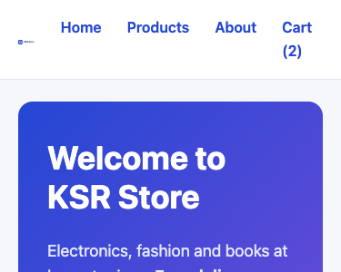
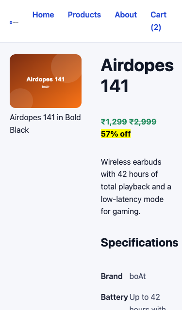
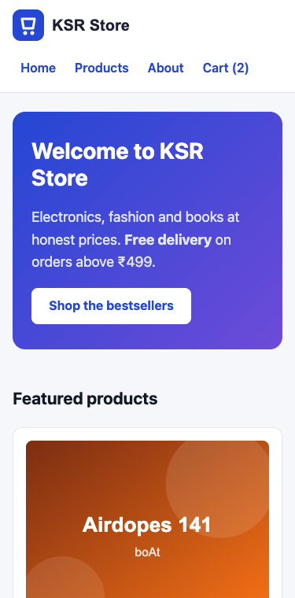
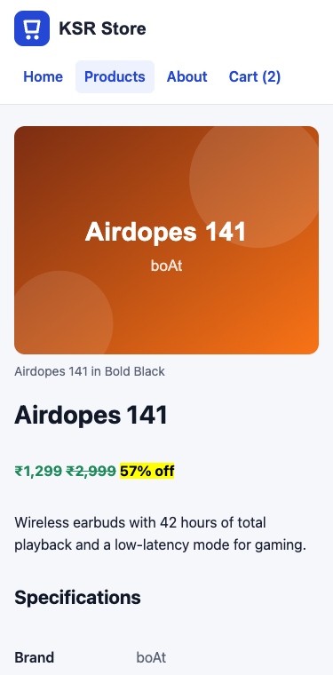
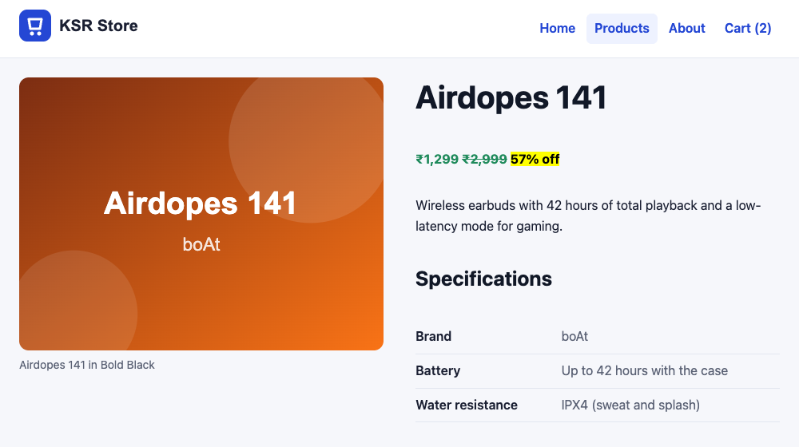
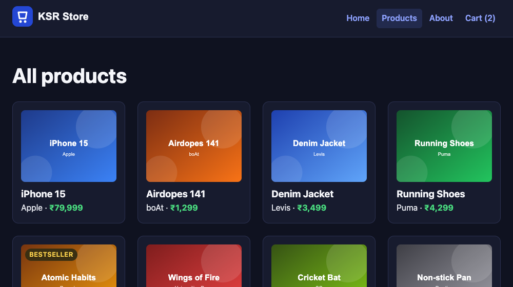

# Responsive Design & CSS Variables

!!! abstract "Learning Objectives"
    By the end of this lesson, you can:

    - Explain the **viewport** meta tag and test pages at phone sizes in DevTools
    - Write **mobile-first** CSS with `@media (min-width: ...)` **media queries** and sensible breakpoints
    - Size things fluidly with `%`, `vw`, `min()` and **`clamp()`**
    - Define and use **CSS custom properties** (variables) for colours, spacing and fonts
    - Refactor a stylesheet into a clean design system, and add **dark mode**

**Prerequisites:** [CSS Grid](04-grid.md)

## The Problem: Phones

More than half of all web traffic in India comes from phones. Here are two KSR Store pages at **375px**, the width of a common phone, with the CSS we have so far:

{ .ksr-shot data-page="index.html" data-width="375" data-height="300" }

{ .ksr-shot data-page="product.html" data-width="375" data-height="640" }

The menu doesn't fit next to the logo (Flexbox shrinks the logo to a tiny size to make room), the hero has desktop-sized padding, and the product page squeezes the image and text into two narrow columns. **Responsive design** means one page that adapts to every screen size. Some of our CSS is already responsive (the `auto-fill` product grid, wrapping flex cards); the rest needs work.

## The Viewport Meta Tag

Every page you built has this line in its `<head>`:

```{ .html .no-run }
<meta name="viewport" content="width=device-width, initial-scale=1.0">
```

Without it, phones pretend to be a 980px-wide desktop and shrink the whole page until the text is unreadable. With it, the page's width equals the phone's real width, so your CSS can adapt. **Every page needs it.**

!!! tip "Test with the device toolbar"
    In Chrome DevTools, press ++ctrl+shift+m++ (Mac: ++cmd+shift+m++) to toggle the **device toolbar**. Choose a phone, or drag the edge to any width, and watch your layout adapt live.

## Media Queries

A **media query** applies CSS only when a condition is true, usually a minimum screen width:

```{ .css .no-run }
/* Always applies: phones first */
.product { display: grid; }

/* Only when the viewport is at least 768px wide */
@media (min-width: 768px) {
  .product { grid-template-columns: 1fr 1fr; }
}
```

### Mobile-first

There are two ways to write responsive CSS:

| Approach | Base CSS is for... | Media queries use | |
|----------|-------------------|-------------------|---|
| **Mobile-first** | Phones | `min-width`: add layout as the screen grows | Recommended |
| Desktop-first | Desktops | `max-width`: undo layout as the screen shrinks | Leads to lots of overrides |

Mobile-first works better because the phone layout is usually the **simplest**: one column, stacked content. Bigger screens **add** columns and space. You write less CSS, and phones download and apply the minimum.

### Breakpoints

Choose breakpoints where **your content** breaks, not for specific devices. Common starting points:

| Name | Media query | Typically |
|------|-------------|-----------|
| Small (base) | none | Phones |
| Medium | `@media (min-width: 640px)` | Large phones, small tablets |
| Large | `@media (min-width: 768px)` | Tablets, two-column layouts |
| Extra large | `@media (min-width: 1024px)` | Laptops and desktops |

## Fluid Sizes: `%`, `vw`, `min()` and `clamp()`

Not everything needs a breakpoint. Sizes can **flow** with the screen:

| Function | Example | Meaning |
|----------|---------|---------|
| `%` | `width: 100%` | Relative to the parent |
| `vw` | `font-size: 5vw` | 5% of the viewport width (too small on phones, too big on desktops on its own) |
| `min(a, b)` | `minmax(min(100%, 220px), 1fr)` | The smaller value: never wider than the container |
| `max(a, b)` | `padding: max(16px, 3vw)` | The larger value |
| `clamp(min, ideal, max)` | `font-size: clamp(1.75rem, 1.2rem + 2.5vw, 2.5rem)` | Grows with the screen but stays between a minimum and a maximum |

`clamp()` gives **fluid typography**: the `h1` is 28px on a phone and grows smoothly to 40px on a desktop, with no media query.

### Responsive images

`img { max-width: 100%; height: auto; }` (which we already have) stops images overflowing. For large photos, let the browser download the right size:

```{ .html .no-run }

```

The browser picks the smallest file that looks sharp on the device. `loading="lazy"` delays images below the fold until the user scrolls near them.

## CSS Custom Properties (Variables)

Our stylesheet repeats `#2447d4` (brand blue), `#e3e7f0` (borders) and `#5b6275` (muted text) many times. Changing the brand colour means finding every copy. **Custom properties** fix that:

```{ .css .no-run }
:root {                              /* :root = the <html> element: variables available everywhere */
  --color-brand: #2447d4;
  --radius: 12px;
}

a { color: var(--color-brand); }
.card { border-radius: var(--radius); }
.notice { color: var(--color-warning, #b45309); }   /* fallback if the variable isn't defined */
```

- Names start with `--`, values are read with `var(--name)`.
- They follow the cascade and inheritance: a variable set on `.dark-section` changes only inside it.
- They can change in a **media query**, which is how dark mode works below.
- Unlike variables in Sass, they're live in the browser: JavaScript can read and change them (`element.style.setProperty("--color-brand", "#e11d48")`).

A set of variables for colours, spacing, fonts, radii and shadows is called **design tokens**: the shared vocabulary between designers and developers.

## Refactoring the KSR Store Stylesheet

Over four lessons, `css/style.css` grew by **appending**: some rules are defined, then overridden later (the `inline-block` cards, the Flexbox `#featured` that Grid replaced). That's normal while learning, but real projects refactor. Replace the **whole** file with this clean, mobile-first version. It produces the same desktop design, plus a proper phone layout and dark mode:

```css title="css/style.css"
/* ==========================================================
   KSR Store stylesheet (mobile-first)
   1. Design tokens   2. Base   3. Layout   4. Components
   5. Pages           6. Dark mode
   Base rules are for phones; @media (min-width) adds more.
   ========================================================== */

/* ---------- 1. Design tokens ---------- */
:root {
  --color-brand: #2447d4;
  --color-brand-dark: #1a33a0;
  --color-brand-soft: #eef2ff;
  --color-accent: #6d4bd8;
  --color-text: #1b2033;
  --color-heading: #111827;
  --color-muted: #5b6275;
  --color-bg: #f6f7fb;
  --color-surface: #ffffff;
  --color-border: #e3e7f0;
  --color-success: #1f8a5b;
  --color-badge-bg: #fff4d6;
  --color-badge-text: #8a5a00;

  --font-sans: system-ui, -apple-system, "Segoe UI", Roboto, Arial, sans-serif;

  --space-1: 4px;
  --space-2: 8px;
  --space-3: 12px;
  --space-4: 16px;
  --space-5: 24px;
  --space-6: 32px;
  --space-7: 48px;

  --radius-sm: 6px;
  --radius: 12px;
  --radius-lg: 16px;
  --shadow: 0 4px 14px rgb(17 24 39 / 6%);
  --content-width: 1100px;
}

/* ---------- 2. Base ---------- */
*, *::before, *::after {
  box-sizing: border-box;
}

body {
  margin: 0;
  font-family: var(--font-sans);
  font-size: 1rem;
  line-height: 1.6;
  color: var(--color-text);
  background-color: var(--color-bg);
}

h1, h2, h3 {
  line-height: 1.2;
  color: var(--color-heading);
}

h1 {
  font-size: clamp(1.75rem, 1.2rem + 2.5vw, 2.5rem);
}

h2 {
  font-size: clamp(1.3rem, 1.1rem + 1vw, 1.6rem);
}

a {
  color: var(--color-brand);
}

a:hover {
  color: var(--color-brand-dark);
}

img {
  max-width: 100%;
  height: auto;
}

/* ---------- 3. Layout ---------- */
main {
  max-width: var(--content-width);
  margin: 0 auto;
  padding: var(--space-5) var(--space-4) var(--space-7);
}

.site-header {
  position: sticky;
  top: 0;
  z-index: 10;
  display: flex;
  flex-wrap: wrap;                     /* the menu drops below the logo on phones */
  justify-content: space-between;
  align-items: center;
  gap: var(--space-2) var(--space-4);
  padding: var(--space-3) var(--space-4);
  background-color: var(--color-surface);
  border-bottom: 1px solid var(--color-border);
}

.site-header ul {
  display: flex;
  flex-wrap: wrap;
  gap: var(--space-1);
  margin: 0;
  padding: 0;
  list-style: none;
}

.site-header nav a {
  display: inline-block;
  padding: 6px 10px;
  border-radius: var(--radius-sm);
  font-weight: 600;
  text-decoration: none;
}

.site-header nav a:hover,
.site-header nav a[aria-current="page"] {
  background-color: var(--color-brand-soft);
}

.site-footer {
  display: flex;
  flex-direction: column;              /* stacked on phones */
  gap: var(--space-2);
  padding: var(--space-5) var(--space-4);
  background-color: var(--color-surface);
  border-top: 1px solid var(--color-border);
  color: var(--color-muted);
  font-size: 0.9rem;
}

.site-footer p {
  margin: 0;
}

@media (min-width: 640px) {
  main {
    padding-inline: var(--space-5);
  }

  .site-header {
    padding-inline: var(--space-5);
  }

  .site-footer {
    flex-direction: row;               /* side by side on wider screens */
    justify-content: space-between;
    padding-inline: var(--space-5);
  }
}

/* ---------- 4. Components ---------- */
.hero {
  margin-bottom: var(--space-6);
  padding: var(--space-6) var(--space-5);
  border-radius: var(--radius-lg);
  background: linear-gradient(135deg, var(--color-brand), var(--color-accent));
  color: #ffffff;
}

.hero h1 {
  margin-top: 0;
  color: #ffffff;
}

.hero p {
  max-width: 560px;
  font-size: 1.125rem;
  color: #e4e8ff;
}

.hero a {
  display: inline-block;
  padding: 10px 22px;
  border-radius: 8px;
  background-color: #ffffff;
  color: #2447d4;
  font-weight: 700;
  text-decoration: none;
}

@media (min-width: 640px) {
  .hero {
    padding: var(--space-7) var(--space-6);
  }
}

.product-grid,
#featured {
  display: grid;
  grid-template-columns: repeat(auto-fill, minmax(min(100%, 220px), 1fr));
  gap: var(--space-5);
}

#featured h2 {
  grid-column: 1 / -1;
  margin-bottom: 0;
}

.product-card {
  position: relative;
  display: flex;
  flex-direction: column;
  padding: var(--space-4);
  background-color: var(--color-surface);
  border: 1px solid var(--color-border);
  border-radius: var(--radius);
}

.product-card img {
  width: 100%;
  aspect-ratio: 4 / 3;
  object-fit: cover;
  border-radius: 8px;
}

.product-card h3 {
  margin: var(--space-3) 0 var(--space-1);
}

.product-card h3 a {
  color: inherit;
  text-decoration: none;
}

.product-card h3 a:hover {
  text-decoration: underline;
}

.product-card p {
  margin: auto 0 0;                    /* push the price line to the bottom */
}

.price {
  font-weight: 700;
  color: var(--color-success);
}

.badge {
  padding: 2px 8px;
  border-radius: 999px;
  background-color: var(--color-badge-bg);
  color: var(--color-badge-text);
  font-size: 0.8rem;
  font-weight: 600;
  letter-spacing: 0.04em;
  text-transform: uppercase;
}

.product-card .badge {
  position: absolute;
  top: var(--space-5);
  left: var(--space-5);
}

/* ---------- 5. Pages ---------- */
.product {
  display: grid;
  gap: 0 40px;
  align-items: start;
}

.product figure {
  margin: 0;
}

.product figure img {
  width: 100%;
  border-radius: var(--radius);
}

.product figcaption {
  font-size: 0.875rem;
  color: var(--color-muted);
}

.product dl {
  display: flex;
  flex-wrap: wrap;
  max-width: 480px;
}

.product dt,
.product dd {
  padding: var(--space-2) 0;
  border-bottom: 1px solid var(--color-border);
}

.product dt {
  flex-basis: 40%;
  font-weight: 600;
}

.product dd {
  flex-basis: 60%;
  margin: 0;
  color: var(--color-muted);
}

@media (min-width: 768px) {
  .product {
    grid-template-columns: minmax(0, 1fr) minmax(0, 1fr);
  }

  .product > * {
    grid-column: 2;
  }

  .product figure {
    grid-column: 1;
    grid-row: 1 / span 12;
  }

  .product h1 {
    margin-top: 0;
  }
}

/* ---------- 6. Dark mode ---------- */
@media (prefers-color-scheme: dark) {
  :root {
    --color-brand: #8ea2ff;
    --color-brand-dark: #b7c3ff;
    --color-brand-soft: #222a4d;
    --color-text: #e6e8ef;
    --color-heading: #f5f6fa;
    --color-muted: #a3a9bb;
    --color-bg: #0f1220;
    --color-surface: #171b2e;
    --color-border: #2a3050;
    --color-success: #4ade80;
    --color-badge-bg: #3a2f12;
    --color-badge-text: #fcd34d;
  }
}
```

### The phone layout

The same pages at 375px, after the refactor:

{ .ksr-shot data-page="index.html" data-width="375" data-height="760" }

{ .ksr-shot data-page="product.html" data-width="375" data-height="760" }

The menu wraps below the logo, the hero padding is smaller, the heading size is fluid, and the product page is a single column: image first, then the information. At 768px and wider, the product page switches back to two columns:

{ .ksr-shot data-page="product.html" data-width="1000" data-height="560" }

### Dark mode for free

Look at section 6: it only **changes variable values** when the operating system is in dark mode (`prefers-color-scheme: dark`). Because every rule uses the variables, the whole site switches. Here's the catalogue with the computer set to dark mode:

{ .ksr-shot data-page="products.html" data-width="1000" data-height="560" data-scheme="dark" }

(The logo is an SVG file, which CSS can't recolour from outside. It switches by itself because `logo.svg` contains its own `@media (prefers-color-scheme: dark)` rule; open it in VS Code to see.)

You can try it in DevTools: open the **Rendering** panel (++ctrl+shift+p++, type "rendering") and set *Emulate CSS media feature prefers-color-scheme* to `dark`.

The browser confirms that the variables changed, not the rules:

```{ .text .output page="products.html" actions="eval:const s = getComputedStyle(document.documentElement); for (const name of ['--color-bg', '--color-surface', '--color-brand']) console.log(name.padEnd(16), s.getPropertyValue(name).trim())" }
--color-bg       #f6f7fb
--color-surface  #ffffff
--color-brand    #2447d4
```

(That output is from the normal light mode. In dark mode the same three lines read `#0f1220`, `#171b2e` and `#8ea2ff`.)

!!! realworld "In Real Projects"
    Responsive design isn't optional: Google ranks pages by their **mobile** version, and most customers shop on phones. Teams design mobile-first, test on real devices and in DevTools, and store design tokens as CSS variables (often generated from the design tool, Figma). Frameworks like Tailwind and Bootstrap use the same ideas: mobile-first breakpoint prefixes (`md:grid-cols-2`) and theme variables.

## Common Mistakes

| Mistake | Symptom | Fix |
|---------|---------|-----|
| No viewport meta tag | The page is tiny on phones; media queries never match | `<meta name="viewport" content="width=device-width, initial-scale=1.0">` |
| Desktop-first with many `max-width` overrides | Long, conflicting CSS | Base styles for phones, `min-width` queries for more |
| Breakpoints per device (iPhone 12, Galaxy S21...) | Breaks on every other device | Breakpoints where your content breaks |
| Fixed widths (`width: 1000px`) | Horizontal scrolling on phones | `max-width`, `%`, `fr`, `min()` |
| `font-size: 5vw` alone | Tiny on phones, huge on desktops | `clamp(min, preferred, max)` |
| Variable typo (`var(--color-brnd)`) | The property silently falls back to its initial value | Check the Computed tab; give a fallback |
| Hiding important content on mobile | Users can't find features | Rearrange instead of hiding |

## Practice Exercises

**Easy**

1. Add a breakpoint so the hero text is centred on screens narrower than 640px (hint: write it mobile-first).
2. Change `--color-brand` to `#e11d48` and watch the whole site change. Then change it back.
3. Add `--radius-lg` to the cards instead of `--radius`, and see where else it's used.

**Medium**

4. Make the cart table responsive: wrap it in `<div class="table-wrap">` with `overflow-x: auto`, and reduce the cell padding below 640px.
5. Use `grid-template-areas` with a media query to lay out `layout-demo.html` as one column on phones and as header / sidebar + content / footer from 768px.
6. Add a theme toggle without JavaScript: a `.theme-ocean` class on `<body>` that overrides five colour variables. Test it by adding the class to `products.html`.

**Challenge**

7. Make the header's navigation scroll horizontally on very small screens instead of wrapping (`overflow-x: auto`, `flex-wrap: nowrap`, hidden scrollbar), and make sure the current page link is visible.

??? success "Solutions (click to expand)"

    ```{ .css .no-run }
    /* 1: centred by default, left-aligned from 640px */
    .hero { text-align: center; }
    @media (min-width: 640px) { .hero { text-align: left; } }

    /* 4 */
    .table-wrap { overflow-x: auto; }
    .cart-table th, .cart-table td { padding: var(--space-2); }
    @media (min-width: 640px) {
      .cart-table th, .cart-table td { padding: var(--space-3) var(--space-4); }
    }

    /* 5 */
    .page { grid-template-columns: 1fr; grid-template-areas: "header" "content" "sidebar" "footer"; }
    @media (min-width: 768px) {
      .page { grid-template-columns: 220px 1fr; grid-template-areas: "header header" "sidebar content" "footer footer"; }
    }

    /* 6 */
    .theme-ocean {
      --color-brand: #0e7490;
      --color-brand-dark: #155e75;
      --color-brand-soft: #e0f7fa;
      --color-accent: #0891b2;
      --color-bg: #f0fbfc;
    }

    /* 7 */
    .site-header ul { flex-wrap: nowrap; overflow-x: auto; scrollbar-width: none; }
    ```

!!! note "Mini Assignment"
    Refactor your business site's stylesheet the same way: design tokens in `:root`, a mobile-first structure with at most two breakpoints, fluid headings with `clamp()`, `min()` in your card grid, and a dark mode that only changes variables. Test it at 360px, 768px and 1280px in the DevTools device toolbar.

## Interview Questions

!!! interview "1. What is responsive web design?"
    Building one website whose layout and content adapt to any screen size and device, using a viewport meta tag, flexible layouts (Flexbox, Grid, relative units), responsive images and media queries.

!!! interview "2. What does mobile-first mean?"
    Writing the base CSS for the smallest screens and adding enhancements for larger screens with `min-width` media queries. It produces simpler CSS, fewer overrides and a faster experience on phones.

!!! interview "3. What does `clamp()` do?"
    `clamp(min, preferred, max)` returns the preferred value, limited to a minimum and a maximum. With a viewport-based preferred value, it creates fluid sizes, such as headings that scale smoothly between screen sizes without media queries.

!!! interview "4. What are CSS custom properties, and how are they different from Sass variables?"
    Custom properties (`--name: value`, used with `var(--name)`) are live in the browser: they cascade, inherit, can be scoped to elements, change inside media queries, and can be read or set by JavaScript. Sass variables are replaced with fixed values when the CSS is compiled.

!!! interview "5. How would you implement dark mode?"
    Define colours as custom properties, then redefine those properties inside `@media (prefers-color-scheme: dark)` to follow the operating system, and optionally on a class like `.dark` toggled by JavaScript and saved in `localStorage` for a manual switch.

!!! interview "Scenario: the site shows a horizontal scrollbar on phones. How do you find the cause?"
    Open DevTools' device mode and look for the element wider than the viewport. Common causes are fixed widths, large images without `max-width: 100%`, long words or URLs, wide tables, and negative margins. A temporary `* { outline: 1px solid red; }` reveals the overflowing box.

## Summary

| Concept | CSS |
|---------|-----|
| Viewport | `<meta name="viewport" content="width=device-width, initial-scale=1.0">` |
| Media query | `@media (min-width: 768px) { ... }` |
| Mobile-first | Base styles for phones, `min-width` queries add layout |
| Fluid sizes | `clamp(1.75rem, 1.2rem + 2.5vw, 2.5rem)`, `min(100%, 220px)` |
| Responsive images | `max-width: 100%`, `srcset` + `sizes`, `loading="lazy"` |
| Variables | `:root { --color-brand: #2447d4; }` → `color: var(--color-brand);` |
| Dark mode | `@media (prefers-color-scheme: dark) { :root { --color-bg: #0f1220; } }` |
| Testing | DevTools device toolbar (++ctrl+shift+m++), Rendering panel |

**Next lesson:** [Forms, Tables, Effects & Project](06-forms-tables-effects-project.md), styling the checkout and cart, adding hover effects and animations, and finishing the KSR Store design.
