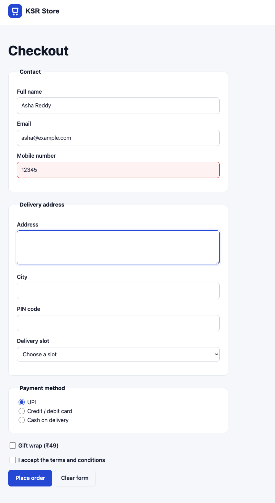
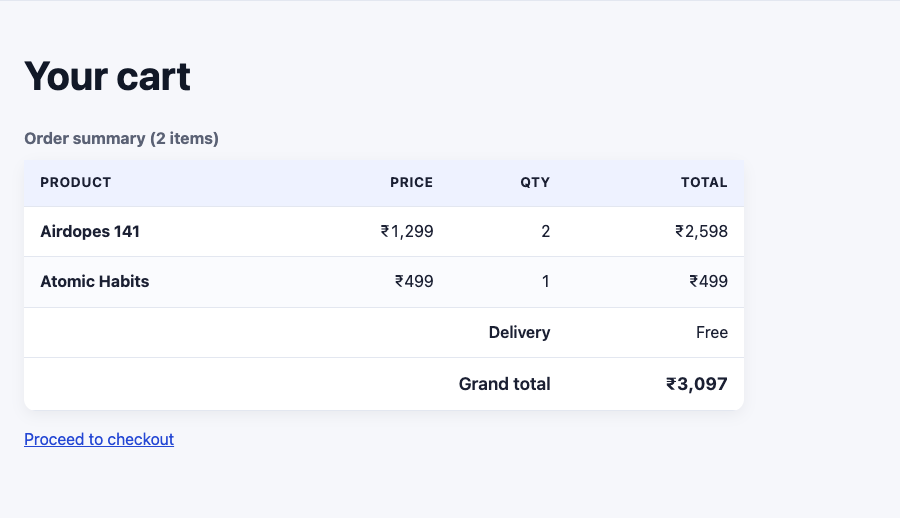
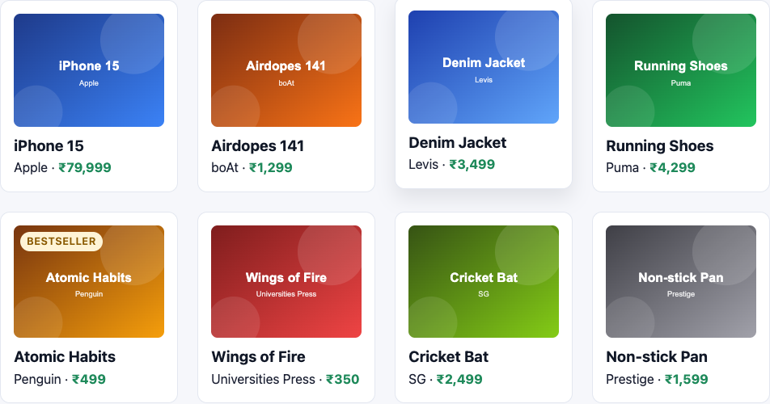
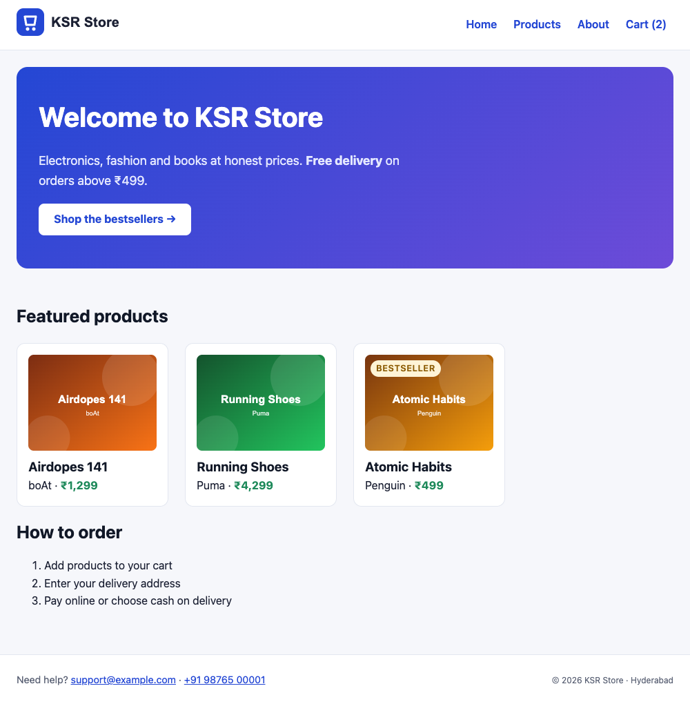
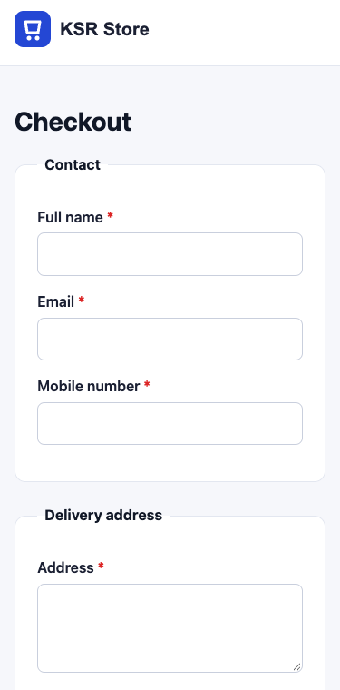

# Forms, Tables, Effects & Project

!!! abstract "Learning Objectives"
    By the end of this lesson, you can:

    - Style **buttons** and **form controls**, with clear `:focus-visible` and `:user-invalid` states
    - Style a **data table** that's easy to scan: borders, zebra rows, aligned numbers
    - Add content with `::before` / `::after` **pseudo-elements**
    - Animate with **transitions**, **transforms** and `@keyframes`, while respecting `prefers-reduced-motion`
    - Compare hand-written CSS with **Bootstrap** and **Tailwind**, and finish the KSR Store design

**Prerequisites:** [Responsive Design & CSS Variables](05-responsive-design-variables.md)

## Buttons

Browsers give buttons a dated grey look. Define one reusable `.button` class, and style form buttons the same way. Add to `css/style.css`:

```{ .css .append title="css/style.css" }
/* ---------- 7. Buttons ---------- */
.button,
button {
  display: inline-flex;
  align-items: center;
  justify-content: center;
  gap: var(--space-2);
  padding: 10px 20px;
  border: 1px solid transparent;
  border-radius: 8px;
  background-color: var(--color-brand);
  color: #ffffff;
  font: inherit;                       /* buttons don't inherit fonts by default */
  font-weight: 600;
  text-decoration: none;
  cursor: pointer;
  transition: background-color 0.2s ease, transform 0.1s ease;
}

.button:hover,
button:hover {
  background-color: var(--color-brand-dark);
  color: #ffffff;
}

.button:active,
button:active {
  transform: scale(0.97);              /* a tiny "press" effect */
}

.button-secondary,
button[type="reset"] {
  background-color: transparent;
  border-color: var(--color-border);
  color: var(--color-text);
}

.button-secondary:hover,
button[type="reset"]:hover {
  background-color: var(--color-brand-soft);
  color: var(--color-text);
}

/* Keyboard users must always see where they are */
:focus-visible {
  outline: 3px solid var(--color-brand);
  outline-offset: 2px;
}
```

- **`:focus-visible`** shows a focus ring when someone navigates with the **keyboard** (++tab++), but not after a mouse click. Never remove focus outlines without a replacement: keyboard users would be lost.
- `font: inherit` is needed because form controls don't inherit the page font by default.
- **`transition`** animates the change of a property (here, the background on hover) instead of switching instantly.

## Form Controls

Now the checkout form. Labels on their own line, full-width fields, a visible focus state, and a red border on fields the user has filled in **wrongly**:

```{ .css .append title="css/style.css" }
/* ---------- 8. Forms ---------- */
.checkout-form {
  max-width: 640px;
}

.checkout-form fieldset {
  margin: 0 0 var(--space-5);
  padding: var(--space-4) var(--space-5) var(--space-5);
  border: 1px solid var(--color-border);
  border-radius: var(--radius);
  background-color: var(--color-surface);
}

.checkout-form legend {
  padding: 0 var(--space-2);
  font-weight: 700;
  color: var(--color-heading);
}

.checkout-form label {
  font-weight: 600;
}

input[type="text"],
input[type="email"],
input[type="tel"],
select,
textarea {
  width: 100%;
  margin-top: var(--space-1);
  padding: 10px 12px;
  border: 1px solid #c9cfdd;
  border-radius: 8px;
  background-color: var(--color-surface);
  color: var(--color-text);
  font: inherit;
}

input:focus-visible,
select:focus-visible,
textarea:focus-visible {
  outline: 3px solid var(--color-brand-soft);
  border-color: var(--color-brand);
}

input:user-invalid,
select:user-invalid,
textarea:user-invalid {
  border-color: #dc2626;               /* red only after the user has interacted */
  background-color: #fef2f2;
}

input[type="radio"],
input[type="checkbox"] {
  accent-color: var(--color-brand);    /* brand-coloured ticks and dots */
  width: 18px;
  height: 18px;
  vertical-align: -3px;
}

.checkout-form fieldset label:has(input[type="radio"]) {
  font-weight: 400;
}
```

{ .ksr-shot data-page="checkout.html" data-full="true" data-width="800" data-actions="fill:#full-name=Asha Reddy | fill:#email=asha@example.com | fill:#phone=12345 | click:#address" }

In the screenshot, we typed a 5-digit phone number and moved to the next field: `:user-invalid` turned it red. Why not `:invalid`? Because `:invalid` matches **empty required fields immediately**, so a fresh form would be covered in red before the user typed anything. `:user-invalid` waits until the user has interacted with the field.

New selectors:

| Selector | Matches |
|----------|---------|
| `input[type="email"]` | Attribute selector: inputs of that type |
| `:focus-visible` | The focused element, when focus should be shown (keyboard) |
| `:user-invalid` | A field that fails validation **after** the user changed it |
| `:has(...)` | A parent that **contains** something: `label:has(input[type="radio"])` = labels wrapping a radio button |
| `accent-color` | The colour of checkboxes, radios and range sliders |

## Data Tables

Tables need two things to be readable: clear rows and aligned numbers.

```{ .css .append title="css/style.css" }
/* ---------- 9. Tables ---------- */
.cart-table {
  width: 100%;
  max-width: 720px;
  border-collapse: collapse;           /* one line between cells, not two */
  background-color: var(--color-surface);
  border-radius: var(--radius);
  overflow: hidden;
  box-shadow: var(--shadow);
}

.cart-table caption {
  padding-bottom: var(--space-2);
  text-align: left;
  font-weight: 700;
  color: var(--color-muted);
}

.cart-table th,
.cart-table td {
  padding: var(--space-3) var(--space-4);
  text-align: left;
  border-bottom: 1px solid var(--color-border);
}

.cart-table thead th {
  background-color: var(--color-brand-soft);
  font-size: 0.85rem;
  text-transform: uppercase;
  letter-spacing: 0.04em;
}

.cart-table tbody tr:nth-child(even) {
  background-color: #fafbfe;           /* zebra stripes */
}

.cart-table td,
.cart-table thead th:not(:first-child) {
  text-align: right;                   /* numbers line up on the right */
  font-variant-numeric: tabular-nums;  /* every digit the same width */
}

.cart-table tfoot th {
  text-align: right;
  font-weight: 600;
}

.cart-table tfoot tr:last-child {
  font-size: 1.1rem;
}
```

{ .ksr-shot data-page="cart.html" data-selector="main" data-width="900" }

`:nth-child(even)` selects every second row, and `:not(:first-child)` every header except the first. `font-variant-numeric: tabular-nums` makes every digit the same width, so `₹2,598` and `₹499` line up digit for digit.

## Pseudo-elements: `::before` and `::after`

A **pseudo-element** adds decorative content from CSS, without changing the HTML. It needs a `content` property:

```{ .css .append title="css/style.css" }
/* ---------- 10. Small touches ---------- */
.hero a::after {
  content: " →";                       /* an arrow after the hero button text */
}

.checkout-form label:has(+ br + [required])::after {
  content: " *";                       /* a red star after labels of required fields */
  color: #dc2626;
}
```

The second rule reads: "after a label that is followed by a `<br>` and then a required field". You'll see the stars in the final screenshots. Pseudo-elements are for **decoration** only. Screen readers may ignore them, so never put essential information in `content`.

## Transitions, Transforms and Animations

**Transforms** move, scale or rotate an element **visually**, without affecting the layout around it:

| Transform | Example |
|-----------|---------|
| `translateY(-4px)` | Move up 4px |
| `scale(1.05)` | 5% bigger |
| `rotate(8deg)` | Rotate |

Combine a transform with a **transition** for a smooth hover effect on the product cards:

```{ .css .append title="css/style.css" }
/* ---------- 11. Motion ---------- */
.product-card {
  transition: transform 0.2s ease, box-shadow 0.2s ease;
}

.product-card:hover {
  transform: translateY(-4px);
  box-shadow: 0 12px 24px rgb(17 24 39 / 10%);
}

@keyframes pop-in {
  from { opacity: 0; transform: scale(0.6); }
  to   { opacity: 1; transform: scale(1); }
}

.badge {
  animation: pop-in 0.4s ease-out both;
}

@media (prefers-reduced-motion: reduce) {
  *, *::before, *::after {
    animation-duration: 0.01ms !important;
    transition-duration: 0.01ms !important;
  }
}
```

Here's the catalogue with the mouse over the Denim Jacket card. It lifts and casts a deeper shadow:

{ .ksr-shot data-page="products.html" data-selector=".product-grid" data-width="1000" data-actions="hover:.product-card:nth-child(3) | wait:400" }

| Property | Example | Meaning |
|----------|---------|---------|
| `transition` | `transform 0.2s ease` | Animate changes to this property over 0.2s |
| `@keyframes name` | `from { ... } to { ... }` (or `0%`, `50%`, `100%`) | Define an animation |
| `animation` | `pop-in 0.4s ease-out both` | Run an animation: name, duration, timing, fill mode |
| `prefers-reduced-motion` | `@media (prefers-reduced-motion: reduce)` | The user asked their OS for less motion |

!!! warning "Respect reduced motion"
    Animations can make some people dizzy or nauseous (vestibular disorders). The `prefers-reduced-motion` rule turns them off for users who chose "reduce motion" in their operating system settings. This is the one place where `!important` is the accepted solution. Animate only `transform` and `opacity` when possible: they're smooth even on cheap phones.

## The Finished Design

Here's the KSR Store home page with everything from the CSS module. Compare it with the plain HTML page from lesson 1:

{ .ksr-shot data-page="index.html" data-full="true" data-width="1000" }

{ .ksr-shot data-page="checkout.html" data-width="375" data-height="760" }

## A Quick Look at CSS Frameworks

Frameworks give you ready-made classes. Here's the same product card in each:

=== "Our CSS"

    ```{ .html .no-run }
    <article class="product-card">
      
      <h3>Running Shoes</h3>
      <p>Puma · <span class="price">₹4,299</span></p>
    </article>
    ```

=== "Bootstrap"

    ```{ .html .no-run }
    <div class="card h-100 shadow-sm">
      
      <div class="card-body d-flex flex-column">
        <h3 class="card-title h5">Running Shoes</h3>
        <p class="mt-auto mb-0">Puma · <span class="fw-bold text-success">₹4,299</span></p>
      </div>
    </div>
    ```

=== "Tailwind CSS"

    ```{ .html .no-run }
    <article class="flex flex-col rounded-xl border border-slate-200 bg-white p-4 transition hover:-translate-y-1 hover:shadow-lg">
      
      <h3 class="mt-3 font-semibold">Running Shoes</h3>
      <p class="mt-auto">Puma · <span class="font-bold text-green-700">₹4,299</span></p>
    </article>
    ```

| | Hand-written CSS | Bootstrap | Tailwind |
|---|---|---|---|
| Idea | Your own classes and stylesheet | Ready-made **components** (cards, navbars, modals) | Tiny **utility** classes, one per property |
| Speed to start | Slowest | Fastest for standard UIs | Fast once you know the classes |
| Looks unique | Yes | Often "looks like Bootstrap" | Yes |
| You still need to know CSS | Yes | Yes, to customise | Yes: every class is a CSS property |

Everything in Bootstrap and Tailwind is Flexbox, Grid, the box model, media queries and variables, which you now know. That's why this course taught real CSS first. In the React lessons you're free to use either.

!!! realworld "In Real Projects"
    Polish is what users notice: consistent buttons, obvious focus states, forms that show errors kindly, tables that scan easily, subtle motion. Accessibility audits check focus visibility, colour contrast and reduced motion. Most teams use a framework or a component library, but every one of them still writes custom CSS for the parts that make their product unique.

## Common Mistakes

| Mistake | Symptom | Fix |
|---------|---------|-----|
| `outline: none` on focus | Keyboard users can't see where they are | Style `:focus-visible` instead of removing it |
| `:invalid` for error styles | The form is red before the user types anything | `:user-invalid` |
| Form controls in a different font | Inputs look out of place | `font: inherit` on inputs, selects, textareas and buttons |
| `border-collapse` forgotten | Double borders in tables | `border-collapse: collapse` |
| Animating `width`, `top` or `margin` | Janky animation on phones | Animate `transform` and `opacity` |
| Ignoring reduced motion | Users with motion sensitivity feel unwell | `@media (prefers-reduced-motion: reduce)` |
| Important text in `::before` / `::after` | Screen readers and copy-paste miss it | Put real content in HTML |

## Practice Exercises

**Easy**

1. Use the `.button` class on the "Proceed to checkout" link in `cart.html`.
2. Make the Bestseller badge `pop-in` animation slower (`0.8s`) and add a `0.3s` delay.
3. Add a hover effect to the header menu links that animates the background colour with a `transition`.

**Medium**

4. Lay out the checkout fieldsets in two columns from 900px wide (Contact and Address side by side, Payment below spanning both).
5. Add a `.button-danger` variant (red) and use it for the "Clear form" button.
6. Add a loading skeleton: a `.skeleton` card with grey blocks that shimmer using a `@keyframes` moving `background-position`.

**Challenge**

7. Build a pure-CSS toast notification ("Added to cart!") that slides in from the bottom-right with `@keyframes`, stays for 3 seconds and fades out, using only `animation` with several keyframe percentages.

??? success "Solutions (click to expand)"

    ```{ .css .no-run }
    /* 2 */
    .badge { animation: pop-in 0.8s ease-out 0.3s both; }

    /* 3 */
    .site-header nav a { transition: background-color 0.2s ease; }

    /* 4 */
    @media (min-width: 900px) {
      .checkout-form { max-width: none; display: grid; grid-template-columns: 1fr 1fr; gap: 0 var(--space-5); }
      .checkout-form fieldset:nth-of-type(3),
      .checkout-form > p,
      .checkout-form > button { grid-column: 1 / -1; }
    }

    /* 5 */
    .button-danger { background-color: #dc2626; }
    .button-danger:hover { background-color: #b91c1c; }

    /* 6 */
    @keyframes shimmer { to { background-position: -200% 0; } }
    .skeleton div {
      height: 16px;
      margin-bottom: 8px;
      border-radius: 4px;
      background: linear-gradient(90deg, #eceff5 25%, #f6f8fc 50%, #eceff5 75%) 0 0 / 200% 100%;
      animation: shimmer 1.2s linear infinite;
    }

    /* 7 */
    @keyframes toast {
      0%   { opacity: 0; transform: translateY(20px); }
      10%  { opacity: 1; transform: translateY(0); }
      90%  { opacity: 1; transform: translateY(0); }
      100% { opacity: 0; transform: translateY(20px); }
    }
    .toast { position: fixed; right: 20px; bottom: 20px; animation: toast 3.5s ease forwards; }
    ```

!!! note "Project: Finish Your Site's Design"
    Complete the design of **your own** business site (the one you've built through every mini assignment), or of the KSR Store if you prefer. It must include:

    - A design-token `:root` block, mobile-first CSS with at most two breakpoints, and dark mode
    - A sticky header with a Flexbox menu, a gradient hero, a Grid catalogue with hover effects
    - A details page laid out with Grid lines, a styled form with `:focus-visible` and `:user-invalid`, and a styled data table
    - One `@keyframes` animation and a `prefers-reduced-motion` rule
    - A Lighthouse score of 90+ for Accessibility, and no horizontal scrolling at 360px

    Present it in 5 minutes: show it on a phone-sized window and a desktop, switch to dark mode, tab through the form with the keyboard, and explain one layout decision.

## Interview Questions

!!! interview "1. What is the difference between `:focus` and `:focus-visible`?"
    `:focus` matches any focused element, including after a mouse click. `:focus-visible` matches only when the browser decides focus should be shown, typically keyboard navigation, so you can show strong focus rings for keyboard users without showing them on every click.

!!! interview "2. What is the difference between a transition and an animation?"
    A transition animates a property between two states when it changes (for example on `:hover`). A keyframe animation (`@keyframes` + `animation`) runs on its own, can have many steps, repeat and start automatically.

!!! interview "3. Why animate `transform` and `opacity` rather than `top` or `width`?"
    Changing layout properties forces the browser to recalculate layout and repaint on every frame. `transform` and `opacity` can be handled by the GPU compositor without re-layout, so they stay smooth at 60fps.

!!! interview "4. What are pseudo-classes and pseudo-elements?"
    Pseudo-classes (`:hover`, `:focus-visible`, `:nth-child(2)`, `:has()`) select elements in a particular state or position. Pseudo-elements (`::before`, `::after`, `::placeholder`, `::first-line`) style a part of an element or insert generated content.

!!! interview "5. Bootstrap or Tailwind: how do you choose?"
    Bootstrap provides ready-made components and is fast for standard admin-style interfaces. Tailwind provides utility classes for building custom designs quickly with consistent spacing and colours. Both need a good understanding of CSS, and the choice usually depends on the team, the design requirements and the existing codebase.

!!! interview "Scenario: a user says they can't use your checkout with only the keyboard. What do you check?"
    That all fields and buttons are real form controls (focusable with Tab), that focus is clearly visible (`:focus-visible` styles, no `outline: none`), that the tab order follows the visual order (no CSS `order` tricks), that custom controls have proper roles and keyboard handlers, and that errors are announced and reachable.

## Summary

| Concept | CSS |
|---------|-----|
| Buttons | `.button`, `:hover`, `:active { transform: scale(0.97) }`, `font: inherit` |
| Focus | `:focus-visible { outline: 3px solid ... }` |
| Validation styles | `:user-invalid` (not `:invalid`) |
| Checkboxes and radios | `accent-color` |
| Parent selector | `label:has(input[type="radio"])` |
| Tables | `border-collapse: collapse`, `:nth-child(even)`, `font-variant-numeric: tabular-nums` |
| Pseudo-elements | `::before`, `::after` with `content` |
| Motion | `transition`, `transform`, `@keyframes` + `animation`, `prefers-reduced-motion` |
| Frameworks | Bootstrap (components), Tailwind (utilities): both built on the CSS you know |

**You've finished the CSS module!** Next: [JavaScript: Introduction, Variables & Data Types](../javascript/01-introduction-variables-data-types.md), making the KSR Store interactive.
