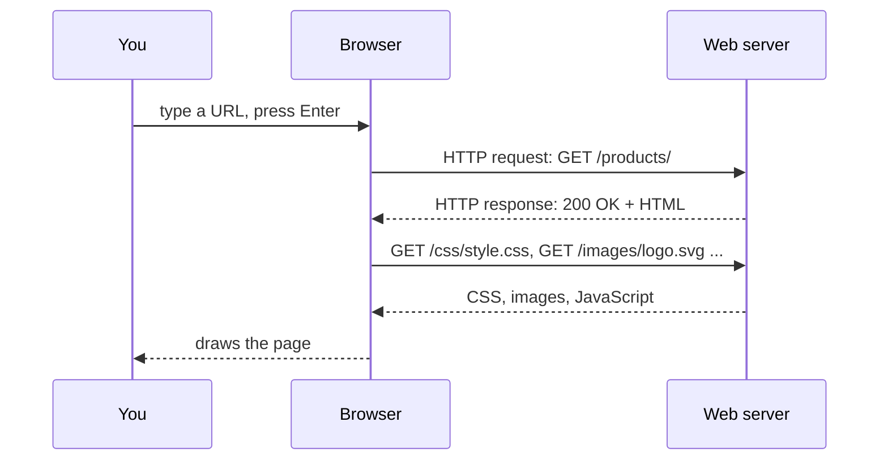
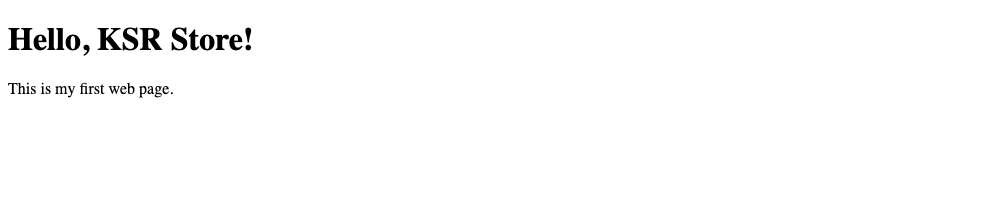
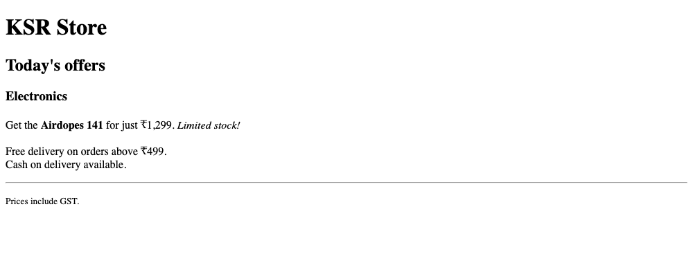
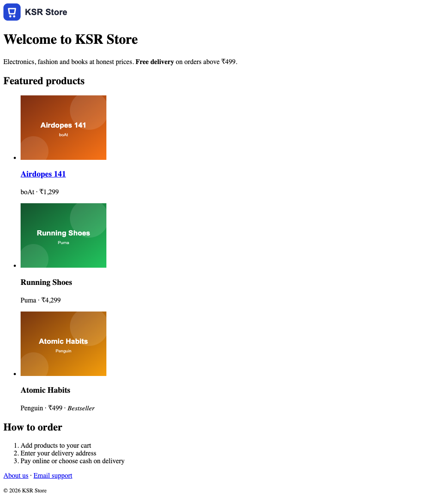

# How the Web Works & Your First Page

!!! abstract "Learning Objectives"
    By the end of this lesson, you can:

    - Explain what happens between typing a URL and seeing a page: **browser, server, HTTP request and response**
    - Describe the job of **HTML**, **CSS** and **JavaScript**
    - Set up **VS Code** with **Live Server**, and use the browser's **DevTools**
    - Write a valid HTML page skeleton and explain every line
    - Use headings, paragraphs, emphasis, links, images and lists to build the **KSR Store** home page

**Prerequisites:** None. This is where the Frontend section starts. If you've done the Python or Java backend modules, you'll recognise HTTP from there.

## How the Web Works

When you open `https://shop.example.com/products/`, four things happen:



1. The **browser** (Chrome, Edge, Firefox, Safari) sends an **HTTP request** to a **server**.
2. The server sends back a **response**: a **status code** and some content, usually HTML.
3. The browser reads the HTML, sees it needs more files (CSS, images, JavaScript) and requests each of them.
4. It combines everything and **renders** (draws) the page.

| Status code | Meaning | You'll see it when... |
|-------------|---------|-----------------------|
| `200 OK` | Success | The page loads |
| `301` / `302` | Moved / redirect | An old URL sends you to a new one |
| `404 Not Found` | No such page or file | A typo in a link or image path |
| `500 Internal Server Error` | The server crashed | A bug in the backend code |

!!! tip "You've seen this from the other side"
    In the FastAPI, Django or Spring Boot modules, **you** wrote the server. The frontend is the other half: the code the browser runs. Full stack developers work on both.

## HTML, CSS and JavaScript

Every web page is made of up to three languages, each with one job:

| Language | Job | Analogy |
|----------|-----|---------|
| **HTML** | Structure and meaning: "this is a heading, this is a link, this is a product" | The walls and rooms of a house |
| **CSS** | Presentation: colours, fonts, spacing, layout | Paint, furniture, decoration |
| **JavaScript** | Behaviour: react to clicks, change the page, talk to APIs | Electricity: lights, switches, appliances |

In this course you'll build the **KSR Store** website in that order: HTML (3 lessons), CSS (6 lessons), then JavaScript (11 lessons), until it lists products from an API and has a working cart.

## Setting Up Your Tools

1. **Install [VS Code](https://code.visualstudio.com/)**, the code editor most web developers use.
2. **Install the Live Server extension** in VS Code (Extensions panel, search "Live Server" by Ritwick Dey). It serves your folder at **http://127.0.0.1:5500/** and reloads the browser every time you save.
3. **Use Google Chrome** (or Edge) and learn one shortcut: ++f12++ (Mac: ++cmd+option+i++) opens **DevTools**, where you can inspect the HTML, CSS, network requests and the JavaScript console of any page.
4. Create a folder called **`ksr-store`** and open it in VS Code (*File → Open Folder*).

Every page and screenshot in this course comes from that folder, served at `http://127.0.0.1:5500/`. Download the logo and product images, and unzip them into `ksr-store/` so you get an `images` folder:

[:material-download: Download the KSR Store images (zip)](../../assets/frontend/ksr-store/ksr-store-images.zip){ .md-button }

Your folder should look like this:

```{ .text .no-run }
ksr-store/
└── images/
    ├── logo.svg
    ├── iphone-15.svg
    ├── airdopes-141.svg
    ├── running-shoes.svg
    ├── atomic-habits.svg
    └── ... (8 product images)
```

## Your First Page

Create `hello.html` in the `ksr-store` folder:

```html title="hello.html"
<!DOCTYPE html>
<html lang="en">
<head>
  <meta charset="UTF-8">
  <meta name="viewport" content="width=device-width, initial-scale=1.0">
  <title>Hello | KSR Store</title>
</head>
<body>
  <h1>Hello, KSR Store!</h1>
  <p>This is my first web page.</p>
</body>
</html>
```

Right-click the file and choose **Open with Live Server**:

{ .ksr-shot data-page="hello.html" data-height="200" }

Every line has a purpose:

| Line | Meaning |
|------|---------|
| `<!DOCTYPE html>` | "This is a modern HTML page." Always the first line |
| `<html lang="en">` | The root element; `lang` helps screen readers and translation tools |
| `<head>` | Information **about** the page (not shown in the page itself) |
| `<meta charset="UTF-8">` | Text encoding, so `₹`, `é` and Hindi or Telugu text display correctly |
| `<meta name="viewport" ...>` | Makes the page fit phone screens (more in the responsive design lesson) |
| `<title>` | The text on the browser tab and in search results |
| `<body>` | Everything visible on the page |

!!! tip "Emmet shortcut"
    In an empty `.html` file in VS Code, type `!` and press ++tab++. VS Code writes the whole skeleton for you.

## Elements, Tags and Attributes

```{ .text .no-run }
  opening tag            content       closing tag
 ┌─────────────────────┐┌──────────┐┌────┐
 <a href="about.html">  About us    </a>
    └──┘ └─────────┘
attribute   value
 └──────────── the whole thing is an ELEMENT ────────────┘
```

- An **element** usually has an opening tag, content and a closing tag.
- **Attributes** add extra information inside the opening tag: `name="value"`.
- Some elements are **empty** (no content, no closing tag): ``, `<br>`, `<meta>`, `<input>`.
- Elements **nest** inside each other, like boxes in boxes. Close them in reverse order: `<p><strong>Sale!</strong></p>`.

## Text: Headings, Paragraphs and Emphasis

```html title="text.html"
<!DOCTYPE html>
<html lang="en">
<head>
  <meta charset="UTF-8">
  <title>Text | KSR Store</title>
</head>
<body>
  <h1>KSR Store</h1>
  <h2>Today's offers</h2>
  <h3>Electronics</h3>
  <p>Get the <strong>Airdopes 141</strong> for just ₹1,299. <em>Limited stock!</em></p>
  <p>Free delivery on orders above ₹499.<br>Cash on delivery available.</p>
  <hr>
  <p><small>Prices include GST.</small></p>
</body>
</html>
```

{ .ksr-shot data-page="text.html" data-height="380" }

| Element | Use for |
|---------|---------|
| `<h1>` … `<h6>` | Headings, from most to least important. **One `<h1>` per page**; don't skip levels |
| `<p>` | A paragraph |
| `<strong>` | Important text (bold by default) |
| `<em>` | Emphasised text (italic by default) |
| `<br>` | A line break inside a paragraph (for addresses, poems; not for spacing) |
| `<hr>` | A thematic break (a horizontal line) |
| `<small>` | Fine print |

!!! mistake "Choosing a heading by its size"
    Don't use `<h4>` because "it's the size I want". Headings describe the **outline** of the page; screen readers and Google use them to understand it. You'll control the size with CSS.

## Links

```html
<a href="about.html">About us</a>                                 <!-- relative: a file in this folder -->
<a href="products/shoes.html">Shoes</a>                           <!-- relative: inside a subfolder -->
<a href="../index.html">Back to home</a>                          <!-- relative: one folder up -->
<a href="https://www.python.org/">Python</a>                      <!-- absolute: another website -->
<a href="https://react.dev/" target="_blank" rel="noopener">React docs</a>   <!-- open in a new tab -->
<a href="mailto:support@example.com">Email us</a>                 <!-- opens the email app -->
<a href="tel:+919876500001">Call us</a>                           <!-- dials on a phone -->
<a href="#offers">Jump to offers</a>                              <!-- to id="offers" on this page -->
```

| Path type | Example | Use for |
|-----------|---------|---------|
| Relative | `about.html`, `images/logo.svg`, `../index.html` | Pages and files in **your** site |
| Absolute | `https://react.dev/` | Other websites |
| Fragment | `#offers` | A section of the same page (the element with `id="offers"`) |

Use **relative paths** inside your own site: they keep working when you move the folder or deploy it.

## Images

```html

```

| Attribute | Purpose |
|-----------|---------|
| `src` | Path or URL of the image file |
| `alt` | Text description: read by screen readers, shown if the image fails, used by search engines |
| `width`, `height` | The intended size; lets the browser reserve space before the image loads, so the page doesn't jump |

Good `alt` text describes what the image **shows or does**. A decorative image gets an empty `alt=""` so screen readers skip it. Never leave `alt` out.

Common image formats: **JPG** for photos, **PNG** for screenshots and transparency, **SVG** for logos and icons (sharp at any size), **WebP / AVIF** for modern, smaller photos.

## Lists

```html
<ul>                         <!-- unordered: bullets -->
  <li>Free delivery</li>
  <li>7-day returns</li>
</ul>

<ol>                         <!-- ordered: numbers -->
  <li>Add to cart</li>
  <li>Enter your address</li>
  <li>Pay</li>
</ol>
```

A list item can contain anything: links, images, even other lists. Navigation menus and product listings are usually lists.

## Special Characters and Comments

Some characters have a special meaning in HTML, so you write them as **entities**:

| You want | Write |
|----------|-------|
| `<` and `>` | `&lt;` and `&gt;` |
| `&` | `&amp;` |
| `©` | `&copy;` |
| A non-breaking space (keeps `₹ 1,299` together) | `&nbsp;` |

With `<meta charset="UTF-8">`, characters like `₹` can be typed directly.

```html
<!-- This is a comment. The browser ignores it. -->
```

## Building the KSR Store Home Page

Put it all together. Create `index.html` (the name matters: servers show `index.html` when you visit a folder) and `about.html`:

```html title="index.html"
<!DOCTYPE html>
<html lang="en">
<head>
  <meta charset="UTF-8">
  <meta name="viewport" content="width=device-width, initial-scale=1.0">
  <title>KSR Store | Electronics, Fashion & Books</title>
</head>
<body>
  

  <h1>Welcome to KSR Store</h1>
  <p>Electronics, fashion and books at honest prices. <strong>Free delivery</strong> on orders above ₹499.</p>

  <h2 id="featured">Featured products</h2>
  <ul>
    <li>
      
      <h3><a href="product.html">Airdopes 141</a></h3>
      <p>boAt · ₹1,299</p>
    </li>
    <li>
      
      <h3>Running Shoes</h3>
      <p>Puma · ₹4,299</p>
    </li>
    <li>
      
      <h3>Atomic Habits</h3>
      <p>Penguin · ₹499 · <em>Bestseller</em></p>
    </li>
  </ul>

  <h2>How to order</h2>
  <ol>
    <li>Add products to your cart</li>
    <li>Enter your delivery address</li>
    <li>Pay online or choose cash on delivery</li>
  </ol>

  <p><a href="about.html">About us</a> · <a href="mailto:support@example.com">Email support</a></p>
  <!-- Footer will move into its own section in the next lesson -->
  <p><small>&copy; 2026 KSR Store</small></p>
</body>
</html>
```

```html title="about.html"
<!DOCTYPE html>
<html lang="en">
<head>
  <meta charset="UTF-8">
  <meta name="viewport" content="width=device-width, initial-scale=1.0">
  <title>About | KSR Store</title>
</head>
<body>
  <h1>About KSR Store</h1>
  <p>KSR Store started in Hyderabad in 2024 with one goal: genuine products, fair prices and fast delivery.</p>
  <p><a href="index.html">&larr; Back to the home page</a></p>
</body>
</html>
```

{ .ksr-shot data-page="index.html" data-full="true" }

It's plain, but it's **complete and meaningful**: headings, a list of products, images with descriptions, and working links. CSS will make it beautiful later; the HTML won't need to change much.

### The browser forgives mistakes (and that's a problem)

Delete a closing `</a>` or `</li>` and reload: the page usually still appears, because browsers guess what you meant. But each browser may guess differently, and CSS and JavaScript can break in confusing ways. Check your HTML with the **[W3C validator](https://validator.w3.org/#validate_by_input)** (paste your code) or the VS Code **HTMLHint** extension.

### See it in DevTools

Open DevTools (++f12++) on your page:

- **Elements** tab: the HTML as the browser understood it. Hover an element to highlight it on the page.
- **Network** tab: reload, and you'll see one request for `index.html` and one for each image, each with its status code. Misspell an image name and you'll see a red **404**.

!!! realworld "In Real Projects"
    Almost every page you'll build at work is still HTML in the end, whether it's written by hand, generated by Django or Spring templates, or produced by React. Teams care about **semantic, valid HTML** because it decides accessibility (a legal requirement for many companies), SEO (how Google ranks the page) and how easily CSS and JavaScript can work with it.

## Common Mistakes

| Mistake | Symptom | Fix |
|---------|---------|-----|
| Missing `<meta charset="UTF-8">` | `₹` shows as `₹` | Add it as the first line in `<head>` |
| Wrong image path or file name case (`Logo.svg` vs `logo.svg`) | Broken image icon; 404 in the Network tab | Match the path and case exactly (servers are case-sensitive) |
| Missing `alt` | Inaccessible image, SEO penalty | Always add `alt` (empty for decorative images) |
| Opening the file directly (`file:///...`) | Some features break later (fetch, modules) | Use Live Server (`http://127.0.0.1:5500/`) |
| Forgetting to close tags | Strange layout, the rest of the page in bold or inside a link | Indent nested elements; validate the HTML |
| Using `<br><br>` for spacing | Messy, hard to restyle | Use separate `<p>` elements and CSS margins |
| Several `<h1>` or skipped levels | Poor accessibility and SEO | One `<h1>`, then `<h2>`, `<h3>` in order |

## Practice Exercises

**Easy**

1. Add a fourth featured product (Cricket Bat, SG, ₹2,499, `images/cricket-bat.svg`) to the home page.
2. Add a "Contact" paragraph with a `tel:` link and a `mailto:` link.
3. Add a "Back to top" link at the bottom of `index.html` that jumps to the `featured` heading.

**Medium**

4. Create `product.html` for the Airdopes 141: an `<h1>`, the image, the price in `<strong>`, a list of three features and a link back home. (The home page already links to it.)
5. In `about.html`, add an ordered list "Our journey" with three milestones, and a nested unordered list under one of them.
6. Break an image path on purpose, then find the 404 in the DevTools Network tab. Fix it.

**Challenge**

7. Build `help.html`: a "Help centre" with a short list of questions at the top, where each question is a fragment link (`#delivery`, `#returns`, `#payment`) that jumps to its answer further down the page.

??? success "Solutions (click to expand)"

    ```{ .html .no-run }
    <!-- 1 -->
    <li>
      
      <h3>Cricket Bat</h3>
      <p>SG · ₹2,499</p>
    </li>

    <!-- 3 -->
    <p><a href="#featured">Back to top</a></p>

    <!-- 4: product.html (body) -->
    <h1>Airdopes 141</h1>
    
    <p><strong>₹1,299</strong> · boAt</p>
    <ul>
      <li>42 hours of playback</li>
      <li>Low-latency mode for gaming</li>
      <li>IPX4 water resistance</li>
    </ul>
    <p><a href="index.html">&larr; Back to the home page</a></p>

    <!-- 7: help.html (body, part) -->
    <h1>Help centre</h1>
    <ul>
      <li><a href="#delivery">How long does delivery take?</a></li>
      <li><a href="#returns">How do I return a product?</a></li>
    </ul>
    <h2 id="delivery">Delivery</h2>
    <p>Most orders arrive in 2-4 working days.</p>
    <h2 id="returns">Returns</h2>
    <p>You can return most products within 7 days.</p>
    ```

!!! note "Mini Assignment"
    Build the first page of **your own** small business website (a bakery, a coaching centre, a gym): a logo or title image, an `<h1>`, a paragraph about the business, a list of three services with images and prices, an ordered "How it works" list, and links to an About page and to email and phone. Validate it with the W3C validator until there are no errors.

## Interview Questions

!!! interview "1. What happens when you type a URL into the browser and press Enter?"
    The browser looks up the server's IP address (DNS), connects (and sets up HTTPS), sends an HTTP GET request, and receives a response with a status code and HTML. It parses the HTML, requests the CSS, JavaScript and images it references, builds the page structure (DOM) and styles, and renders the page.

!!! interview "2. What is the difference between HTML, CSS and JavaScript?"
    HTML describes the structure and meaning of content, CSS controls how it looks and is laid out, and JavaScript adds behaviour and interactivity, such as responding to events and fetching data from APIs.

!!! interview "3. What is the purpose of `<!DOCTYPE html>` and `<meta charset="UTF-8">`?"
    The doctype tells the browser to render the page in standards mode (modern HTML) instead of the old "quirks mode". The charset declares the text encoding so all characters, including symbols and non-English scripts, display correctly.

!!! interview "4. Why is the `alt` attribute important?"
    It provides a text alternative for images: screen readers read it to visually impaired users, browsers show it when the image fails to load, and search engines use it to understand the image. Decorative images should have an empty `alt=""`.

!!! interview "5. What is the difference between relative and absolute URLs?"
    An absolute URL includes the scheme and domain (`https://react.dev/learn`) and points to the same place from anywhere. A relative URL (`images/logo.svg`, `../index.html`) is resolved from the current page's location and is used for files within the same site.

!!! interview "Scenario: the logo shows on your laptop but is broken after deploying to a Linux server. Why?"
    Most likely the file name's case differs from the path in the HTML (`Logo.SVG` vs `logo.svg`). Windows and macOS file systems usually ignore case, but Linux servers don't. Check the request in the Network tab (it will be a 404) and make the names match exactly.

## Summary

| Concept | Example |
|---------|---------|
| Page skeleton | `<!DOCTYPE html>`, `<html lang="en">`, `<head>`, `<body>` |
| Head essentials | `<meta charset="UTF-8">`, viewport meta, `<title>` |
| Headings / text | `<h1>`…`<h6>`, `<p>`, `<strong>`, `<em>`, `<br>`, `<hr>` |
| Links | `<a href="about.html">`, `href="https://..."`, `href="#id"`, `mailto:`, `tel:` |
| Images | `` |
| Lists | `<ul>` / `<ol>` with `<li>` |
| Entities | `&lt;`, `&gt;`, `&amp;`, `&copy;`, `&nbsp;` |
| Tools | VS Code + Live Server (`127.0.0.1:5500`), DevTools (++f12++), W3C validator |

**Next lesson:** [Semantic Structure, Tables & Media](02-semantic-structure-tables-media.md), giving the page real regions (header, navigation, main, footer), an order summary table, and accessibility basics.
