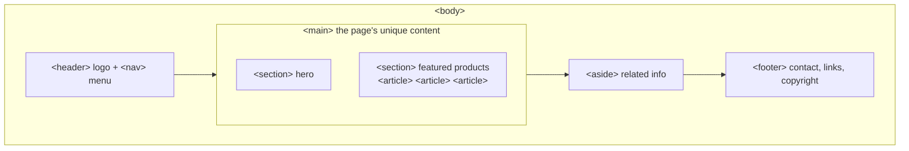
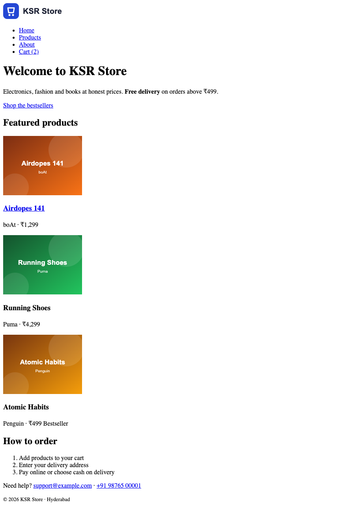
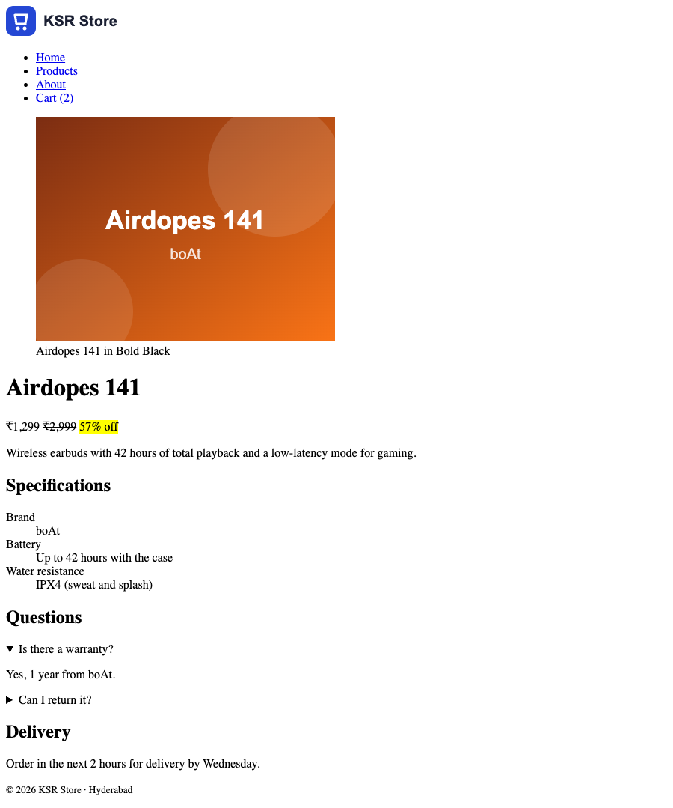
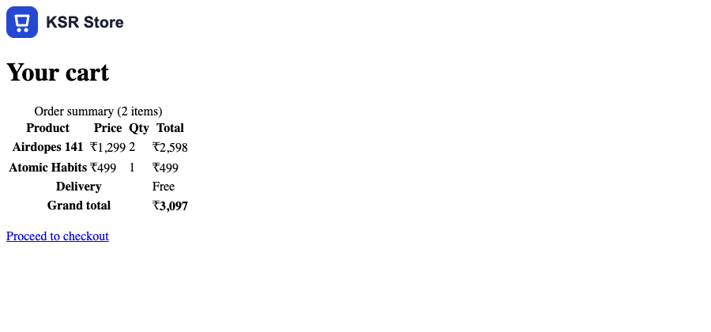

# Semantic Structure, Tables & Media

!!! abstract "Learning Objectives"
    By the end of this lesson, you can:

    - Divide a page into **semantic regions**: `header`, `nav`, `main`, `section`, `article`, `aside`, `footer`
    - Choose between semantic elements and the generic `div` / `span`, and add `id` and `class` hooks
    - Mark up product details with `figure`, description lists and `details` / `summary`
    - Build an accessible **table** with `caption`, `thead`, `tbody`, `tfoot` and `scope`
    - Embed video, audio and maps, and apply the basics of **accessibility** and **SEO**

**Prerequisites:** [How the Web Works & Your First Page](01-how-the-web-works.md)

## Why Structure Matters

The home page from lesson 1 works, but to a browser it's one long list of headings and paragraphs. Which part is the navigation? Where does the main content start? Where's the footer?

**Semantic elements** answer those questions. They look exactly like plain text until you style them, but they tell browsers, screen readers, search engines and other developers what each part **is**.



| Element | Meaning | KSR Store example |
|---------|---------|-------------------|
| `<header>` | Introductory content: logo, site title, navigation | Top bar with the logo and menu |
| `<nav>` | A block of major navigation links | Home · Products · About · Cart |
| `<main>` | The main, unique content of the page. **Only one per page** | Everything between header and footer |
| `<section>` | A themed group of content, usually with a heading | "Featured products", "Why shop with us" |
| `<article>` | A self-contained item that makes sense on its own | One product card, one review, one blog post |
| `<aside>` | Related but secondary content | "Customers also bought", delivery info box |
| `<footer>` | Closing content: contact, copyright, legal links | Bottom of every page |

Screen-reader users can jump straight to `<nav>` or `<main>` with one key press, and Google gives more weight to content inside `<main>` and `<article>`.

## `div`, `span`, `id` and `class`

Sometimes you need a box that has **no** special meaning, only so you can style or group things:

| Element | Type | Use when |
|---------|------|----------|
| `<div>` | Block (starts on a new line, full width) | Grouping for layout, when no semantic element fits |
| `<span>` | Inline (flows inside text) | Styling a few words, like a price or a badge |

Use a semantic element first; reach for `div` and `span` only when none fits.

Two attributes work on **every** element and are the hooks CSS and JavaScript use:

| Attribute | Rule | Example |
|-----------|------|---------|
| `id` | Unique on the page: one element only | `<section id="featured">` (also a link target: `#featured`) |
| `class` | Reusable; an element can have several, separated by spaces | `<article class="product-card">`, `<span class="badge sale">` |

Class names describe **what** something is (`product-card`, `price`), not how it looks (`red-text`, `big-box`), so they still make sense after a redesign.

## The Home Page with Structure

Rewrite `index.html` with semantic regions. The content is the same as lesson 1, now organised:

```html title="index.html"
<!DOCTYPE html>
<html lang="en">
<head>
  <meta charset="UTF-8">
  <meta name="viewport" content="width=device-width, initial-scale=1.0">
  <meta name="description" content="Shop electronics, fashion and books at KSR Store. Free delivery on orders above ₹499.">
  <title>KSR Store | Electronics, Fashion & Books</title>
</head>
<body>
  <header class="site-header">
    <a href="index.html"></a>
    <nav>
      <ul>
        <li><a href="index.html">Home</a></li>
        <li><a href="product.html">Products</a></li>
        <li><a href="about.html">About</a></li>
        <li><a href="cart.html">Cart (2)</a></li>
      </ul>
    </nav>
  </header>

  <main>
    <section class="hero">
      <h1>Welcome to KSR Store</h1>
      <p>Electronics, fashion and books at honest prices. <strong>Free delivery</strong> on orders above ₹499.</p>
      <a href="product.html">Shop the bestsellers</a>
    </section>

    <section id="featured">
      <h2>Featured products</h2>
      <article class="product-card">
        
        <h3><a href="product.html">Airdopes 141</a></h3>
        <p>boAt · <span class="price">₹1,299</span></p>
      </article>
      <article class="product-card">
        
        <h3>Running Shoes</h3>
        <p>Puma · <span class="price">₹4,299</span></p>
      </article>
      <article class="product-card">
        
        <h3>Atomic Habits</h3>
        <p>Penguin · <span class="price">₹499</span> <span class="badge">Bestseller</span></p>
      </article>
    </section>

    <section>
      <h2>How to order</h2>
      <ol>
        <li>Add products to your cart</li>
        <li>Enter your delivery address</li>
        <li>Pay online or choose cash on delivery</li>
      </ol>
    </section>
  </main>

  <footer class="site-footer">
    <p>Need help? <a href="mailto:support@example.com">support@example.com</a> · <a href="tel:+919876500001">+91 98765 00001</a></p>
    <p><small>&copy; 2026 KSR Store · Hyderabad</small></p>
  </footer>
</body>
</html>
```

{ .ksr-shot data-page="index.html" data-full="true" data-width="900" }

It looks almost the same as before: semantic elements have no visual style yet. The difference is in **meaning**, and you can see it in DevTools: the Elements tab now shows a clear `header` / `main` / `footer` tree, and the **Accessibility** pane lists the landmarks.

!!! tip "Repeated header and footer"
    Every page needs the same header and footer. In plain HTML you copy them into each file. In the backend modules you'll see the real solution: Django template inheritance (``), Thymeleaf layouts in Spring, and components in React.

## The Product Page

The product page introduces four more elements:

```html title="product.html"
<!DOCTYPE html>
<html lang="en">
<head>
  <meta charset="UTF-8">
  <meta name="viewport" content="width=device-width, initial-scale=1.0">
  <meta name="description" content="boAt Airdopes 141 wireless earbuds with 42 hours of playback. ₹1,299 at KSR Store.">
  <title>Airdopes 141 | KSR Store</title>
</head>
<body>
  <header class="site-header">
    <a href="index.html"></a>
    <nav>
      <ul>
        <li><a href="index.html">Home</a></li>
        <li><a href="product.html" aria-current="page">Products</a></li>
        <li><a href="about.html">About</a></li>
        <li><a href="cart.html">Cart (2)</a></li>
      </ul>
    </nav>
  </header>

  <main>
    <article class="product">
      <figure>
        
        <figcaption>Airdopes 141 in Bold Black</figcaption>
      </figure>

      <h1>Airdopes 141</h1>
      <p class="price">₹1,299 <del>₹2,999</del> <mark>57% off</mark></p>
      <p>Wireless earbuds with 42 hours of total playback and a low-latency mode for gaming.</p>

      <h2>Specifications</h2>
      <dl>
        <dt>Brand</dt>
        <dd>boAt</dd>
        <dt>Battery</dt>
        <dd>Up to 42 hours with the case</dd>
        <dt>Water resistance</dt>
        <dd>IPX4 (sweat and splash)</dd>
      </dl>

      <h2>Questions</h2>
      <details>
        <summary>Is there a warranty?</summary>
        <p>Yes, 1 year from boAt.</p>
      </details>
      <details>
        <summary>Can I return it?</summary>
        <p>Within 7 days if unused and in its original packaging.</p>
      </details>
    </article>

    <aside>
      <h2>Delivery</h2>
      <p>Order in the next <time datetime="PT2H">2 hours</time> for delivery by <time datetime="2026-11-04">Wednesday</time>.</p>
    </aside>
  </main>

  <footer class="site-footer">
    <p><small>&copy; 2026 KSR Store · Hyderabad</small></p>
  </footer>
</body>
</html>
```

{ .ksr-shot data-page="product.html" data-full="true" data-width="900" data-actions="click:details:first-of-type summary" }

(The screenshot was taken after clicking the first question, so its answer is open.)

| Element | Meaning |
|---------|---------|
| `<figure>` + `<figcaption>` | An image (or chart, code sample) with its caption |
| `<dl>`, `<dt>`, `<dd>` | A description list: term / description pairs, ideal for specifications |
| `<details>` + `<summary>` | A disclosure widget: the summary is always visible; clicking it shows the rest. No JavaScript needed |
| `<del>`, `<mark>` | Deleted text (an old price) and highlighted text |
| `<time datetime="...">` | A date, time or duration in a machine-readable form |
| `aria-current="page"` | Tells screen readers "this link is the current page" (CSS will use it too) |

## Tables

Tables are for **tabular data**: rows and columns of related values. The cart's order summary is a perfect example:

```html title="cart.html"
<!DOCTYPE html>
<html lang="en">
<head>
  <meta charset="UTF-8">
  <meta name="viewport" content="width=device-width, initial-scale=1.0">
  <title>Your cart | KSR Store</title>
</head>
<body>
  <header class="site-header">
    <a href="index.html"></a>
  </header>

  <main>
    <h1>Your cart</h1>
    <table class="cart-table">
      <caption>Order summary (2 items)</caption>
      <thead>
        <tr>
          <th scope="col">Product</th>
          <th scope="col">Price</th>
          <th scope="col">Qty</th>
          <th scope="col">Total</th>
        </tr>
      </thead>
      <tbody>
        <tr>
          <th scope="row">Airdopes 141</th>
          <td>₹1,299</td>
          <td>2</td>
          <td>₹2,598</td>
        </tr>
        <tr>
          <th scope="row">Atomic Habits</th>
          <td>₹499</td>
          <td>1</td>
          <td>₹499</td>
        </tr>
      </tbody>
      <tfoot>
        <tr>
          <th scope="row" colspan="3">Delivery</th>
          <td>Free</td>
        </tr>
        <tr>
          <th scope="row" colspan="3">Grand total</th>
          <td><strong>₹3,097</strong></td>
        </tr>
      </tfoot>
    </table>
    <p><a href="checkout.html">Proceed to checkout</a></p>
  </main>
</body>
</html>
```

{ .ksr-shot data-page="cart.html" data-height="420" data-width="900" }

| Element | Meaning |
|---------|---------|
| `<table>` | The table |
| `<caption>` | The table's title (read first by screen readers) |
| `<thead>`, `<tbody>`, `<tfoot>` | Header rows, data rows, summary rows |
| `<tr>` | A table row |
| `<th scope="col">` / `<th scope="row">` | A header cell for a column / a row |
| `<td>` | A data cell |
| `colspan="3"` / `rowspan="2"` | A cell spanning several columns / rows |

Without CSS it has no borders and looks cramped. You'll style it in the CSS module. But the structure is already right: a screen reader announces "Atomic Habits, Price, ₹499" because `scope` links every cell to its headers.

!!! mistake "Tables for page layout"
    In the early 2000s, whole websites were laid out with tables. Don't. Use tables only for data; use CSS (Flexbox and Grid) for layout.

## Video, Audio and Embeds

```{ .html .no-run }
<!-- Your own video file -->
<video src="videos/unboxing.mp4" controls width="640" poster="images/unboxing-poster.jpg">
  Your browser doesn't support video. <a href="videos/unboxing.mp4">Download it</a>.
</video>

<!-- Audio -->
<audio src="audio/jingle.mp3" controls></audio>

<!-- Content from another site: a YouTube video or a Google Map -->
<iframe src="https://www.youtube.com/embed/VIDEO_ID" title="Product demo video"
        width="560" height="315" loading="lazy" allowfullscreen></iframe>
```

- `controls` shows the play/pause/volume bar. Avoid `autoplay` with sound: browsers block it, and users hate it.
- An `<iframe>` displays another web page inside yours. Always give it a `title` for screen readers, and `loading="lazy"` so it only loads when scrolled into view.
- Heavy media slows pages down. Compress videos, and prefer embedding from a video platform for long videos.

## Accessibility and SEO Basics

**Accessibility (a11y)** means people with disabilities can use your site: blind users with screen readers, people who can't use a mouse, people with low vision or colour blindness. **SEO** means search engines understand and rank your pages. Good HTML helps both, for free:

| Practice | Helps |
|----------|-------|
| One `<h1>`, then headings in order | Screen-reader navigation, SEO outline |
| Landmarks: `header`, `nav`, `main`, `footer` | Jumping between page regions |
| Meaningful `alt` text | Blind users, image search |
| Descriptive link text ("Read the return policy", not "click here") | Screen readers list links out of context |
| `<html lang="en">` | Correct pronunciation, translation |
| Unique `<title>` and `<meta name="description">` per page | Search results show them |
| Real `<button>` for actions and `<a>` for navigation | Keyboard users (lesson 3 and JavaScript lessons) |
| Tables with `caption` and `scope` | Understanding data cell by cell |

**Try it:** open DevTools, go to the **Lighthouse** tab, tick *Accessibility* and *SEO*, and click *Analyze page load*. It scores the page and lists exactly what to fix.

!!! realworld "In Real Projects"
    Accessibility is a legal requirement for many websites (government, banking, education, and large companies in many countries follow the WCAG guidelines). Teams run Lighthouse or axe checks in their CI pipeline, and code reviewers ask "where's the `alt`?" and "why is this a `div` and not a `button`?". Semantic HTML is the cheapest accessibility win there is.

## Common Mistakes

| Mistake | Symptom | Fix |
|---------|---------|-----|
| `<div>` for everything ("div soup") | Screen readers see no structure | Use `header`, `nav`, `main`, `section`, `article`, `footer` |
| More than one `<main>` | Invalid HTML, confused assistive tech | Exactly one `<main>` per page |
| Using the same `id` twice | Links and JavaScript find the wrong element | `id` is unique; use `class` for repeats |
| `<section>` without a heading | A meaningless region | Give each section a heading, or use `div` |
| Table without `<th>` / `scope` | Data unreadable to screen readers | Header cells with `scope="col"` / `scope="row"` |
| Tables used for layout | Rigid, inaccessible pages | CSS Flexbox / Grid |
| `<iframe>` without `title` | Screen readers say "frame" with no context | Add a descriptive `title` |

## Practice Exercises

**Easy**

1. Add the same `<header>` and `<footer>` to `about.html`, with `aria-current="page"` on the About link.
2. Add a fourth `<article class="product-card">` to the featured section (Cricket Bat, SG, ₹2,499).
3. Add a third `<details>` question to the product page: "Does it work with iPhone?"

**Medium**

4. Add an `<aside>` to the home page titled "Why shop with us" with a list of three reasons.
5. In the cart table, add a "Discount" row in `<tfoot>` (`-₹200`) and update the grand total.
6. Run Lighthouse (Accessibility and SEO) on `index.html` and fix anything it reports.

**Challenge**

7. Create `orders.html` with a table of the customer's past orders: order number, date (`<time>`), items, status and total. Group the rows with two `<tbody>` elements, "2026" and "2025", each starting with a header row whose single cell spans all columns.

??? success "Solutions (click to expand)"

    ```{ .html .no-run }
    <!-- 4 -->
    <aside>
      <h2>Why shop with us</h2>
      <ul>
        <li>Genuine products with brand warranty</li>
        <li>Free delivery above ₹499</li>
        <li>7-day easy returns</li>
      </ul>
    </aside>

    <!-- 5 -->
    <tr>
      <th scope="row" colspan="3">Discount</th>
      <td>-₹200</td>
    </tr>
    <!-- grand total becomes ₹2,897 -->

    <!-- 7 (part) -->
    <table>
      <caption>Your orders</caption>
      <thead>
        <tr><th scope="col">Order</th><th scope="col">Date</th><th scope="col">Items</th>
            <th scope="col">Status</th><th scope="col">Total</th></tr>
      </thead>
      <tbody>
        <tr><th scope="colgroup" colspan="5">2026</th></tr>
        <tr><td>#1013</td><td><time datetime="2026-10-12">12 Oct 2026</time></td><td>2</td>
            <td>Delivered</td><td>₹3,097</td></tr>
      </tbody>
      <tbody>
        <tr><th scope="colgroup" colspan="5">2025</th></tr>
        <tr><td>#1001</td><td><time datetime="2025-06-05">5 Jun 2025</time></td><td>3</td>
            <td>Delivered</td><td>₹2,297</td></tr>
      </tbody>
    </table>
    ```

!!! note "Mini Assignment"
    Restructure your own business site from lesson 1 with semantic regions, add a details page for one service (with a `figure`, a description list and two `details` questions), and a price table with `caption`, `thead`, `tbody`, `tfoot` and `scope`. Get a Lighthouse Accessibility score of at least 95.

## Interview Questions

!!! interview "1. What is semantic HTML and why does it matter?"
    Using elements that describe the meaning of content (`header`, `nav`, `main`, `article`, `button`) instead of generic `div`s. It improves accessibility (screen readers expose landmarks and roles), SEO, and makes code easier to read and style.

!!! interview "2. What is the difference between `section`, `article` and `div`?"
    `article` is self-contained content that could stand alone (a product card, a blog post). `section` is a thematic grouping of content, normally with a heading. `div` has no meaning and is used only for styling or layout when no semantic element fits.

!!! interview "3. What is the difference between `id` and `class`?"
    An `id` must be unique on the page and identifies one element (also usable as a link fragment). A `class` can be shared by many elements, and an element can have several classes. CSS and JavaScript use both as selectors.

!!! interview "4. When should you use a table?"
    Only for tabular data where rows and columns have meaning, such as an order summary or a timetable. Never for page layout. Use `caption`, `thead` / `tbody` / `tfoot` and `th` with `scope` so assistive technology can relate cells to headers.

!!! interview "5. Name some HTML practices that improve SEO."
    A unique, descriptive `title` and meta description per page, one `h1` and a logical heading order, semantic landmarks, descriptive link text, `alt` text on images, `lang` on the `html` element, and fast-loading pages (sized and lazy-loaded media).

!!! interview "Scenario: a blind user says they can't find the main content on your page. What do you check?"
    Whether the page uses landmarks (`header`, `nav`, `main`, `footer`) and one `h1` with a logical heading order, whether there's a "Skip to main content" link at the top, whether images and icon links have text alternatives, and run Lighthouse or axe plus a quick test with a screen reader (NVDA, VoiceOver).

## Summary

| Concept | Elements |
|---------|----------|
| Page regions | `header`, `nav`, `main` (one), `section`, `article`, `aside`, `footer` |
| Generic boxes | `div` (block), `span` (inline) |
| Hooks | `id` (unique), `class` (reusable, several per element) |
| Product details | `figure` + `figcaption`, `dl` / `dt` / `dd`, `details` + `summary`, `del`, `mark`, `time` |
| Tables | `table`, `caption`, `thead` / `tbody` / `tfoot`, `tr`, `th scope`, `td`, `colspan` / `rowspan` |
| Media | `video`, `audio` (with `controls`), `iframe` (with `title`, `loading="lazy"`) |
| A11y and SEO | Landmarks, heading order, `alt`, link text, `lang`, `title`, meta description, Lighthouse |

**Next lesson:** [Forms](03-forms.md), the checkout form where HTML meets your backend.
