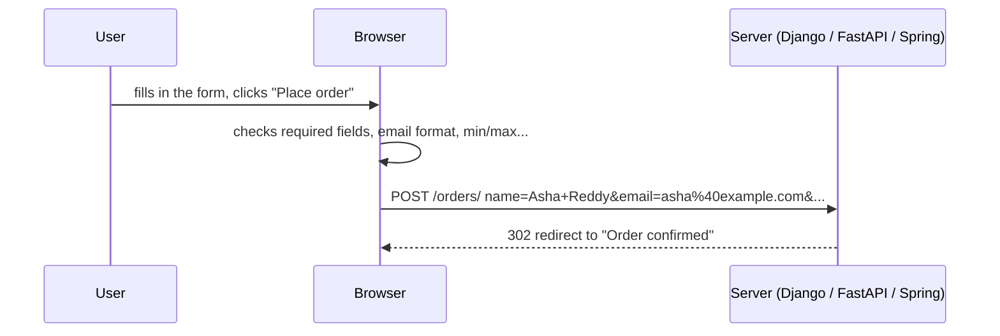
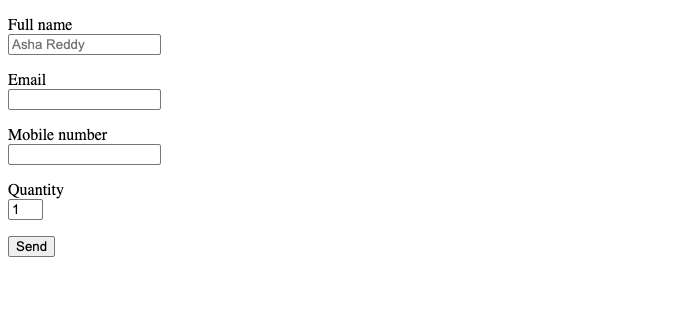
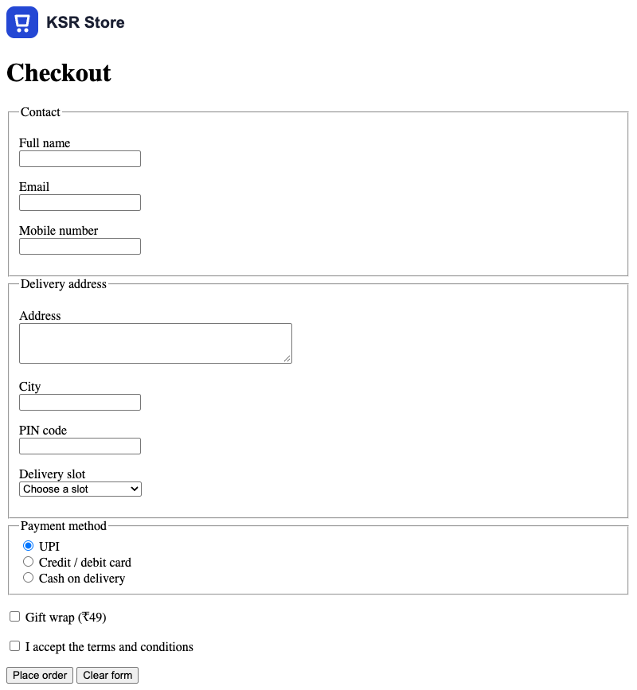

# Forms

!!! abstract "Learning Objectives"
    By the end of this lesson, you can:

    - Build a form with `form`, `label`, `input`, `select`, `textarea` and `button`
    - Choose the right **input type** (`email`, `tel`, `number`, `date`, `radio`, `checkbox`...)
    - Group related fields with `fieldset` and `legend`
    - Add **built-in validation** with `required`, `pattern`, `min`, `max` and `minlength`
    - Explain `action`, `method` (GET vs POST) and exactly **what the server receives**

**Prerequisites:** [Semantic Structure, Tables & Media](02-semantic-structure-tables-media.md)

## Forms: Where Frontend Meets Backend

Every sign-up, login, search box and checkout is a **form**. The browser collects what the user types and sends it to a server as `name=value` pairs.



```{ .html .no-run }
<form action="/orders/" method="post">
  <label for="email">Email</label>
  <input type="email" id="email" name="email" required>
  <button type="submit">Place order</button>
</form>
```

| Attribute | Meaning |
|-----------|---------|
| `action` | The URL that receives the data (empty = the current page) |
| `method="get"` | Data goes **in the URL**: `/search?q=shoes`. For searching and filtering |
| `method="post"` | Data goes in the **request body**. For anything that creates or changes data (orders, sign-ups, logins) |
| `name` (on each field) | The key the server sees. **A field without `name` is not sent** |

## Labels and Text Inputs

Every field needs a **label**. Connect them with `for` (on the label) and `id` (on the input):

```html title="form-basics.html"
<!DOCTYPE html>
<html lang="en">
<head>
  <meta charset="UTF-8">
  <title>Form basics | KSR Store</title>
</head>
<body>
  <form action="form-basics.html" method="get">
    <p>
      <label for="full-name">Full name</label><br>
      <input type="text" id="full-name" name="full_name" placeholder="Asha Reddy" required>
    </p>
    <p>
      <label for="email">Email</label><br>
      <input type="email" id="email" name="email" required>
    </p>
    <p>
      <label for="phone">Mobile number</label><br>
      <input type="tel" id="phone" name="phone" pattern="[6-9][0-9]{9}" title="10-digit Indian mobile number">
    </p>
    <p>
      <label for="qty">Quantity</label><br>
      <input type="number" id="qty" name="qty" min="1" max="5" value="1">
    </p>
    <button type="submit">Send</button>
  </form>
</body>
</html>
```

{ .ksr-shot data-page="form-basics.html" data-height="330" data-width="700" }

Why labels matter:

- **Clicking the label focuses the field.** Bigger target, easier on phones.
- **Screen readers read the label** when the field gets focus. A placeholder is not a label: it disappears as soon as you type.

## Input Types

The `type` decides what the field accepts, which keyboard phones show, and what the browser validates:

| Type | For | Phone keyboard / browser help |
|------|-----|-------------------------------|
| `text` | Names, short text | Normal keyboard |
| `email` | Email addresses | `@` key; must contain `@` |
| `tel` | Phone numbers | Number pad |
| `number` | Quantities | Number pad, up/down arrows, `min` / `max` / `step` |
| `password` | Passwords | Characters hidden |
| `date` / `time` | Dates and times | A date or time picker |
| `search` | Search boxes | A clear (×) button |
| `url` | Web addresses | `.com` / `/` keys; must be a URL |
| `checkbox` | Yes / no, or several choices | Tick box |
| `radio` | One choice from a group | Round button |
| `file` | Uploads | File picker (needs `method="post"` and `enctype="multipart/form-data"`) |
| `hidden` | Values the user doesn't see (like an id) | Not displayed |
| `range`, `color` | Sliders, colour pickers | |

## Built-in Validation

The browser checks fields **before** sending, and refuses to submit while any is invalid:

| Attribute | Rule |
|-----------|------|
| `required` | Must not be empty |
| `minlength` / `maxlength` | Text length |
| `min` / `max` / `step` | Number and date range |
| `pattern="..."` | Must match a regular expression (`[6-9][0-9]{9}` = a 10-digit number starting 6–9) |
| `type="email"` / `"url"` | Must look like an email / URL |

Here are the real messages Chrome gives for invalid values in the form above (we fill in bad data, then ask each field for its `validationMessage`):

```{ .text .output page="form-basics.html" actions="fill:#email=asha.example.com | fill:#phone=12345 | fill:#qty=9 | eval:for (const f of document.querySelectorAll('input')) console.log(f.name.padEnd(10), '->', f.validationMessage || 'OK')" }
full_name  -> Please fill in this field.
email      -> Please include an '@' in the email address. 'asha.example.com' is missing an '@'.
phone      -> Please match the format requested.
qty        -> Value must be less than or equal to 5.
```

"Please match the format requested." doesn't say *which* format. In the popup Chrome shows when you submit, the `title` text ("10-digit Indian mobile number") appears under that message, so always write a `title` for `pattern` fields.

!!! warning "Browser validation is for convenience, not security"
    Anyone can bypass it: by editing the HTML in DevTools, or by sending a request with `curl` as you did in the backend modules. **The server must validate everything again** (Django forms, Pydantic models, Spring `@Valid`). Frontend validation just gives users quick feedback.

## Choices: Select, Radio Buttons and Checkboxes

```html
<label for="slot">Delivery slot</label>
<select id="slot" name="slot">
  <option value="">Choose a slot</option>
  <option value="morning">Morning (9am - 12pm)</option>
  <option value="evening" selected>Evening (5pm - 9pm)</option>
</select>

<fieldset>
  <legend>Payment method</legend>
  <label><input type="radio" name="payment" value="upi" checked> UPI</label>
  <label><input type="radio" name="payment" value="card"> Card</label>
  <label><input type="radio" name="payment" value="cod"> Cash on delivery</label>
</fieldset>

<label><input type="checkbox" name="gift_wrap" value="yes"> Gift wrap (₹49)</label>
```

- **Radio buttons with the same `name` form a group**: choosing one unselects the others.
- The **`value`** is what the server receives; the visible text is for people. `payment=cod`, not `payment=Cash on delivery`.
- A checkbox is sent **only when ticked** (`gift_wrap=yes`). If it's not ticked, the name doesn't appear at all.
- Wrapping the input inside the `<label>` is another way to connect them (no `for` / `id` needed).
- `<fieldset>` + `<legend>` group related fields; screen readers announce "Payment method, UPI, radio button, 1 of 3".

## The Checkout Form

Combine everything into the KSR Store checkout. Until we have a backend for this page, it sends the data with GET to a static "confirmed" page, so you can **see** what would be submitted in the address bar:

```html title="checkout.html"
<!DOCTYPE html>
<html lang="en">
<head>
  <meta charset="UTF-8">
  <meta name="viewport" content="width=device-width, initial-scale=1.0">
  <title>Checkout | KSR Store</title>
</head>
<body>
  <header class="site-header">
    <a href="index.html"></a>
  </header>

  <main>
    <h1>Checkout</h1>
    <form class="checkout-form" action="order-confirmed.html" method="get">
      <fieldset>
        <legend>Contact</legend>
        <p>
          <label for="full-name">Full name</label><br>
          <input type="text" id="full-name" name="full_name" autocomplete="name" required minlength="3">
        </p>
        <p>
          <label for="email">Email</label><br>
          <input type="email" id="email" name="email" autocomplete="email" required>
        </p>
        <p>
          <label for="phone">Mobile number</label><br>
          <input type="tel" id="phone" name="phone" autocomplete="tel" required
                 pattern="[6-9][0-9]{9}" title="10-digit Indian mobile number">
        </p>
      </fieldset>

      <fieldset>
        <legend>Delivery address</legend>
        <p>
          <label for="address">Address</label><br>
          <textarea id="address" name="address" rows="3" cols="40" autocomplete="street-address" required></textarea>
        </p>
        <p>
          <label for="city">City</label><br>
          <input type="text" id="city" name="city" autocomplete="address-level2" required list="cities">
          <datalist id="cities">
            <option value="Hyderabad"><option value="Bengaluru"><option value="Chennai"><option value="Pune">
          </datalist>
        </p>
        <p>
          <label for="pincode">PIN code</label><br>
          <input type="text" id="pincode" name="pincode" autocomplete="postal-code" required
                 inputmode="numeric" pattern="[1-9][0-9]{5}" title="6-digit PIN code">
        </p>
        <p>
          <label for="slot">Delivery slot</label><br>
          <select id="slot" name="slot" required>
            <option value="">Choose a slot</option>
            <option value="morning">Morning (9am - 12pm)</option>
            <option value="evening">Evening (5pm - 9pm)</option>
          </select>
        </p>
      </fieldset>

      <fieldset>
        <legend>Payment method</legend>
        <label><input type="radio" name="payment" value="upi" checked> UPI</label><br>
        <label><input type="radio" name="payment" value="card"> Credit / debit card</label><br>
        <label><input type="radio" name="payment" value="cod"> Cash on delivery</label>
      </fieldset>

      <p><label><input type="checkbox" name="gift_wrap" value="yes"> Gift wrap (₹49)</label></p>
      <p><label><input type="checkbox" name="terms" value="accepted" required> I accept the terms and conditions</label></p>

      <input type="hidden" name="cart_id" value="C1042">
      <button type="submit">Place order</button>
      <button type="reset">Clear form</button>
    </form>
  </main>
</body>
</html>
```

```html title="order-confirmed.html"
<!DOCTYPE html>
<html lang="en">
<head>
  <meta charset="UTF-8">
  <title>Order confirmed | KSR Store</title>
</head>
<body>
  <h1>Thank you! Your order is confirmed.</h1>
  <p>Look at the address bar to see what the form sent.</p>
  <p><a href="index.html">Continue shopping</a></p>
</body>
</html>
```

{ .ksr-shot data-page="checkout.html" data-full="true" data-width="800" }

New pieces:

- **`autocomplete="..."`** tells the browser what each field is, so it can fill in the user's saved name, email and address with one tap. This makes checkouts much faster on phones.
- **`inputmode="numeric"`** shows a number pad for the PIN code while keeping it a text field (PIN codes are not numbers you add up; `type="number"` would also drop leading zeros in other countries' codes).
- **`<datalist>`** suggests values (cities) while still allowing anything.
- **`type="reset"`** clears the form; **`type="submit"`** (the default for `<button>` inside a form) sends it. Use `type="button"` for buttons that only run JavaScript.

### What the server receives

Fill in the form, choose cash on delivery and gift wrap, and submit. The browser goes to `order-confirmed.html` with every field in the URL:

```{ .text .output page="checkout.html" actions="fill:#full-name=Asha Reddy | fill:#email=asha@example.com | fill:#phone=9876500001 | fill:#address=12 MG Road, Ameerpet | fill:#city=Hyderabad | fill:#pincode=500016 | select:#slot=evening | check:input[value=cod] | check:input[name=gift_wrap] | check:input[name=terms] | click:button[type=submit] | wait:300 | eval:console.log(decodeURIComponent(location.search.slice(1)).replaceAll('+', ' ').split('&').join('\n'))" }
full_name=Asha Reddy
email=asha@example.com
phone=9876500001
address=12 MG Road, Ameerpet
city=Hyderabad
pincode=500016
slot=evening
payment=cod
gift_wrap=yes
terms=accepted
cart_id=C1042
```

Notice:

- The keys are the **`name`** attributes, not the ids or labels.
- `payment=cod`: the **value** of the chosen radio button.
- `gift_wrap=yes` appears because it was ticked. Untick it and the key disappears.
- The hidden `cart_id` was sent too.
- In the real URL, spaces become `+` and `@` becomes `%40` (**URL encoding**); we decoded it here to make it readable.

With `method="post"`, exactly the same `name=value` pairs travel in the request body instead, invisible in the URL. That's what a real checkout uses, and it's what your backend reads:

| Backend | Reading the `email` field |
|---------|---------------------------|
| Django | `request.POST["email"]` or a `forms.Form` / `ModelForm` |
| FastAPI | `email: str = Form()` |
| Spring Boot | `@RequestParam String email` or a `@ModelAttribute` object |

!!! mistake "Forgetting `name`"
    A field with an `id` and a label but **no `name`** looks fine and validates fine, but is silently **not sent**. If your backend says a field is missing, check the `name` first.

!!! realworld "In Real Projects"
    Checkout and sign-up forms are where companies lose customers, so teams obsess over them: the right input types and `autocomplete` for one-tap filling, clear labels, helpful error messages next to the field, as few fields as possible, and validation on both the frontend (fast feedback) and the backend (security). Many sites use JavaScript to submit forms without a page reload (you'll do this in the JavaScript lessons), but the HTML underneath is exactly what you wrote here.

## Common Mistakes

| Mistake | Symptom | Fix |
|---------|---------|-----|
| No `name` on a field | The server never receives it | Add `name="..."` to every field you want sent |
| Placeholder instead of a label | Field purpose disappears while typing; inaccessible | A real `<label>` connected with `for` / `id` |
| Radio buttons with different `name`s | Several can be selected at once | Same `name` for the whole group |
| `method="get"` for passwords or orders | Sensitive data in the URL, history and server logs | `method="post"` |
| `type="number"` for phone or PIN codes | Spinner arrows, lost leading zeros | `type="tel"` or `text` with `inputmode="numeric"` |
| Trusting browser validation | Bad data reaches the database | Validate again on the server |
| `<button>` that should only run JavaScript submits the form | Page reloads unexpectedly | `type="button"` |

## Practice Exercises

**Easy**

1. Add a "Landmark (optional)" text field to the delivery address with `maxlength="60"`.
2. Add a "Coupon code" field that accepts exactly 6 uppercase letters or digits (`pattern="[A-Z0-9]{6}"`) with a helpful `title`.
3. Add a `<select>` for the state with an `<optgroup>` for "South" (Telangana, Karnataka, Tamil Nadu) and "West" (Maharashtra, Gujarat).

**Medium**

4. Build `search.html`: a GET form with a search box (`name="q"`), a category select and a "Max price" number field, submitting to `search.html`. Submit it and read the query string in the address bar.
5. Build `signup.html` with name, email, password (`minlength="8"`), confirm password, date of birth (`type="date"` with a `max`), and a newsletter checkbox. Use correct `autocomplete` values (`new-password`, `bday`...).
6. Add a "Contact preference" fieldset with checkboxes (Email, SMS, WhatsApp). Tick two and look at what's sent: the same `name` appears twice.

**Challenge**

7. Build `return.html`, a product return request: order number (pattern `KSR[0-9]{5}`), a reason (radio group of four), details (`textarea`, required only conceptually), and a photo upload (`type="file"`, `accept="image/*"`). Explain why this form must use `method="post"` and `enctype="multipart/form-data"`.

??? success "Solutions (click to expand)"

    ```{ .html .no-run }
    <!-- 2 -->
    <label for="coupon">Coupon code</label>
    <input type="text" id="coupon" name="coupon" pattern="[A-Z0-9]{6}" title="6 capital letters or digits, e.g. SAVE10">

    <!-- 3 -->
    <select id="state" name="state">
      <optgroup label="South">
        <option value="TS">Telangana</option>
        <option value="KA">Karnataka</option>
        <option value="TN">Tamil Nadu</option>
      </optgroup>
      <optgroup label="West">
        <option value="MH">Maharashtra</option>
        <option value="GJ">Gujarat</option>
      </optgroup>
    </select>

    <!-- 5 (part) -->
    <input type="password" id="password" name="password" minlength="8" autocomplete="new-password" required>
    <input type="date" id="dob" name="dob" max="2010-12-31" autocomplete="bday">

    <!-- 6: ticking Email and WhatsApp sends contact=email&contact=whatsapp -->
    <fieldset>
      <legend>Contact preference</legend>
      <label><input type="checkbox" name="contact" value="email"> Email</label>
      <label><input type="checkbox" name="contact" value="sms"> SMS</label>
      <label><input type="checkbox" name="contact" value="whatsapp"> WhatsApp</label>
    </fieldset>

    <!-- 7 -->
    <form action="/returns/" method="post" enctype="multipart/form-data">
      <input type="text" name="order_no" pattern="KSR[0-9]{5}" title="e.g. KSR10421" required>
      <input type="file" name="photo" accept="image/*">
      ...
    </form>
    <!-- Files can't travel in a URL: they need the request body (POST), and
         multipart/form-data lets the body carry binary file data alongside the text fields. -->
    ```

!!! note "Mini Assignment"
    Add an **enquiry / booking form** to your own business site: name, email, phone (with a pattern), a service `select`, a preferred date (`type="date"` with a `min`), a time slot radio group, a message `textarea` and a consent checkbox. Use labels, fieldsets and `autocomplete` everywhere, submit it with GET to a thank-you page, and write down every `name=value` pair it sends.

## Interview Questions

!!! interview "1. What is the difference between GET and POST for forms?"
    GET puts the form data in the URL query string; it's bookmarkable and cacheable, and suited to searches and filters. POST sends data in the request body; it's used for creating or changing data, for sensitive values such as passwords, and for file uploads.

!!! interview "2. Why should every input have a label?"
    Labels describe the field to screen-reader users, make the clickable area larger (clicking the label focuses the field), and stay visible while typing, unlike placeholders.

!!! interview "3. What is the role of the `name` attribute?"
    It's the key under which the field's value is submitted. Fields without a `name` aren't sent. Radio buttons that share a `name` form a single-choice group, and checkboxes sharing a `name` can send several values.

!!! interview "4. Is HTML5 validation enough to protect the server?"
    No. It improves user experience but can be bypassed by editing the page or sending requests directly. The server must always validate and sanitise input itself.

!!! interview "5. What do `autocomplete` and `inputmode` do?"
    `autocomplete` tells the browser what a field contains (`email`, `tel`, `street-address`, `new-password`) so it can autofill saved data and password managers work properly. `inputmode` chooses the on-screen keyboard (`numeric`, `email`, `tel`) without changing the field's type or validation.

!!! interview "Scenario: the backend says the `phone` field is always empty, but users fill it in. What do you check?"
    That the input has `name="phone"` (matching what the backend expects) and isn't `disabled` (disabled fields aren't submitted), that it's inside the `<form>` element (or linked with the `form` attribute), and in DevTools' Network tab, the actual request payload to see which keys were sent.

## Summary

| Concept | Syntax |
|---------|--------|
| Form | `<form action="/orders/" method="post">` |
| Label | `<label for="email">` + `<input id="email">`, or wrap the input in the label |
| Inputs | `type="text"`, `email`, `tel`, `number`, `password`, `date`, `search`, `checkbox`, `radio`, `file`, `hidden` |
| Choices | `<select>` + `<option value>`, radio group (same `name`), checkbox |
| Long text | `<textarea rows="3">` |
| Grouping | `<fieldset>` + `<legend>` |
| Validation | `required`, `minlength`, `maxlength`, `min`, `max`, `pattern` + `title` |
| Better input | `autocomplete="email"`, `inputmode="numeric"`, `<datalist>` |
| Buttons | `type="submit"` (default), `type="reset"`, `type="button"` |
| Sent data | `name=value` pairs: in the URL (GET) or the body (POST) |

**You've finished the HTML module!** Next: [CSS Basics](../css/01-css-basics.md), where the KSR Store finally gets colours, fonts and a real design.
