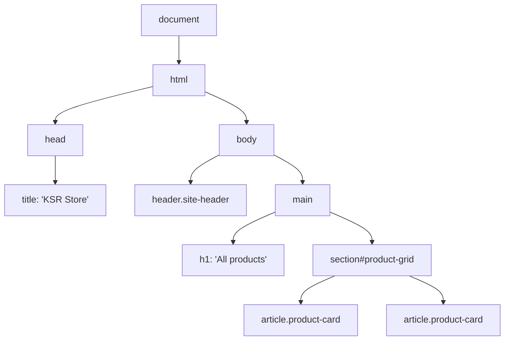
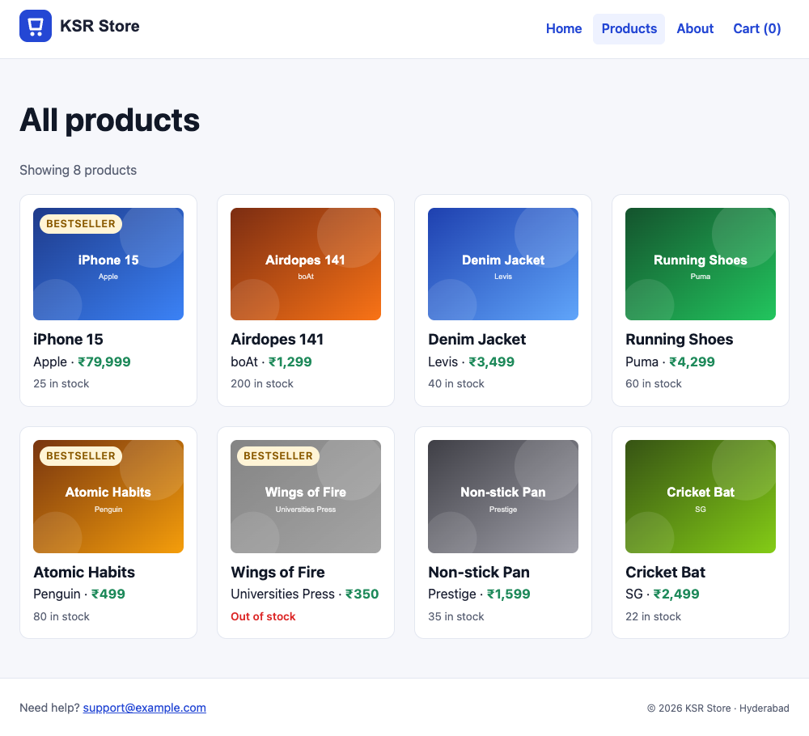

# The DOM

!!! abstract "Learning Objectives"
    By the end of this lesson, you can:

    - Explain the **DOM** and how JavaScript sees a page as a tree of objects
    - Load scripts correctly with `defer` or `type="module"`
    - **Select** elements with `querySelector` and `querySelectorAll`
    - Change **text**, **HTML**, **attributes**, **`data-*` attributes**, **classes** and styles
    - **Create**, insert and remove elements, and render a whole product grid from data, safely

**Prerequisites:** [Objects, Destructuring & JSON](05-objects-json.md), and the KSR Store pages and stylesheet from the HTML and CSS modules.

## What Is the DOM?

When the browser loads HTML, it builds a tree of objects in memory called the **DOM (Document Object Model)**. Every element, attribute and piece of text becomes a **node** that JavaScript can read and change. Change the DOM, and the page on screen updates immediately.



| Object | Is | Example |
|--------|----|---------|
| `document` | The whole page | `document.title`, `document.querySelector(...)` |
| An element | One HTML tag | `<h1>`, `<article class="product-card">` |
| `window` | The browser tab | `window.innerWidth`, `window.localStorage`, `alert()` |

The DOM is **not** your HTML file: the file is just the starting point. After JavaScript changes the DOM, DevTools' Elements tab shows the **current** DOM, while *View Page Source* still shows the original file.

## Loading Scripts

A script can only change elements that already exist. If it runs in `<head>` before the body is parsed, `document.querySelector("h1")` finds nothing. Three solutions:

```{ .html .no-run }
<!-- 1. defer: download now, run after the HTML is parsed (in order) -->
<script src="js/app.js" defer></script>

<!-- 2. type="module": deferred automatically, and can use import / export -->
<script type="module" src="js/catalog.js"></script>

<!-- 3. Old style: put the script at the end of <body> -->
```

We'll use **`type="module"`** from now on, so files can `import` each other (like `products-data.js` in lesson 4).

## Selecting Elements

Create a small page to experiment with:

```html title="dom-demo.html"
<!DOCTYPE html>
<html lang="en">
<head>
  <meta charset="UTF-8">
  <link rel="stylesheet" href="css/style.css">
  <title>DOM demo | KSR Store</title>
  <script type="module" src="js/dom-demo.js"></script>
</head>
<body>
  <main>
    <h1 id="title">Today's deals</h1>
    <p class="intro">Prices drop at midnight.</p>
    <ul class="deals">
      <li data-id="3" data-price="1299">Airdopes 141</li>
      <li data-id="9" data-price="499">Atomic Habits</li>
      <li data-id="15" data-price="2499" class="sold-out">Cricket Bat</li>
    </ul>
    <a id="help" href="help.html">Help</a>
  </main>
</body>
</html>
```

```js title="js/dom-demo.js"
// Select ONE element: the first match of a CSS selector (or null)
const title = document.querySelector("#title");
const intro = document.querySelector(".intro");
const firstDeal = document.querySelector(".deals li");
console.log(title.textContent, "|", intro.textContent, "|", firstDeal.textContent);

// Select ALL matches: a NodeList you can loop over
const deals = document.querySelectorAll(".deals li");
console.log("deals found:", deals.length);
deals.forEach(li => console.log(" -", li.textContent, "costs", li.dataset.price));

// No match gives null, so check before using it
console.log("missing element:", document.querySelector(".banner"));

// Older methods you'll still see
console.log(document.getElementById("title") === title);
```

```{ .text .output page="dom-demo.html" }
Today's deals | Prices drop at midnight. | Airdopes 141
deals found: 3
 - Airdopes 141 costs 1299
 - Atomic Habits costs 499
 - Cricket Bat costs 2499
missing element: null
true
```

| Method | Returns |
|--------|---------|
| `document.querySelector(css)` | The **first** matching element, or `null` |
| `document.querySelectorAll(css)` | A **NodeList** of all matches (use `forEach`, or `[...list]` for array methods) |
| `element.querySelector(css)` | Search **inside** an element only |
| `document.getElementById("id")` | The element with that id (older, still common) |

Any CSS selector works: `"#title"`, `".deals li"`, `"a[href^='help']"`, `"li:not(.sold-out)"`.

## Changing Elements

Add these lines to the end of `js/dom-demo.js`:

```{ .js .append title="js/dom-demo.js" }
// Text and HTML
title.textContent = "Diwali deals";                         // plain text (safe)
intro.innerHTML = "Prices drop at <strong>midnight</strong>!"; // parses HTML

// Attributes
const help = document.querySelector("#help");
help.setAttribute("href", "faq.html");
help.textContent = "FAQ";
console.log("link now goes to", help.getAttribute("href"));

// data-* attributes become element.dataset (data-price -> dataset.price, always a string)
const prices = [...deals].map(li => Number(li.dataset.price));
console.log("total of deals:", prices.reduce((a, b) => a + b, 0));

// Classes: the right way to change styles
deals.forEach(li => {
  if (li.classList.contains("sold-out")) {
    li.textContent += " (sold out)";
  } else {
    li.classList.add("hot");
  }
});
console.log(firstDeal.className, "|", firstDeal.classList.contains("hot"));

// Inline style: only for values computed in JavaScript
title.style.color = "#e11d48";
```

and give the new classes a style at the end of `css/style.css`:

```{ .css .append title="css/style.css" }
/* ---------- JavaScript lessons ---------- */
.deals .hot {
  font-weight: 700;
  color: var(--color-success);
}

.deals .sold-out {
  color: var(--color-muted);
  text-decoration: line-through;
}
```

```{ .text .output page="dom-demo.html" }
Today's deals | Prices drop at midnight. | Airdopes 141
deals found: 3
 - Airdopes 141 costs 1299
 - Atomic Habits costs 499
 - Cricket Bat costs 2499
missing element: null
true
link now goes to faq.html
total of deals: 4297
hot | true
```

{ .ksr-shot data-page="dom-demo.html" data-width="700" data-height="330" }

| Property / method | Use |
|-------------------|-----|
| `el.textContent` | Read or set **text** (HTML tags are shown literally: safe for user data) |
| `el.innerHTML` | Read or set **HTML** (tags are parsed: never with untrusted data) |
| `el.getAttribute(name)` / `setAttribute(name, value)` / `removeAttribute(name)` | Any attribute |
| `el.src`, `el.href`, `el.value`, `el.disabled` | Common attributes as properties |
| `el.dataset.price` | `data-price="..."` (always a string: convert with `Number()`) |
| `el.classList.add / remove / toggle / contains` | Change classes, and let CSS do the styling |
| `el.style.color = "..."` | Inline styles: avoid except for computed values (positions, progress widths) |

!!! danger "innerHTML and XSS"
    Never put **user input** or other untrusted text into `innerHTML`. If a review says ``, `innerHTML` creates that image and runs the attacker's code: a **cross-site scripting (XSS)** attack. Use `textContent` for text from users or APIs. (It's the same danger as `|safe` in Django templates.)

## Creating, Inserting and Removing Elements

```{ .js .no-run }
const li = document.createElement("li");    // a new, detached element
li.textContent = "Yoga Mat";
li.dataset.price = "999";

list.append(li);                             // add as the last child
list.prepend(li);                            // ... or as the first child
existing.before(li);  existing.after(li);    // next to another element
li.remove();                                 // take it out of the page
list.replaceChildren(a, b, c);               // replace ALL children at once (or empty it: replaceChildren())
```

Each change to the DOM can make the browser recalculate the layout. When adding many elements, build them first and insert them in **one** operation (`replaceChildren(...items)` or `append(...items)`).

## Rendering the Catalogue from Data

Until now, `products.html` had eight hard-coded `<article>` cards. Real shops render products from **data** (soon, from an API). First, give each product its image file name. Replace `js/products-data.js`:

```js title="js/products-data.js"
const products = [
  { id: 1, name: "iPhone 15", category: "Electronics", brand: "Apple", price: 79999, stock: 25, rating: 4.7, image: "iphone-15.svg" },
  { id: 3, name: "Airdopes 141", category: "Electronics", brand: "boAt", price: 1299, stock: 200, rating: 4.1, image: "airdopes-141.svg" },
  { id: 6, name: "Denim Jacket", category: "Fashion", brand: "Levis", price: 3499, stock: 40, rating: 4.4, image: "denim-jacket.svg" },
  { id: 7, name: "Running Shoes", category: "Fashion", brand: "Puma", price: 4299, stock: 60, rating: 4.2, image: "running-shoes.svg" },
  { id: 9, name: "Atomic Habits", category: "Books", brand: "Penguin", price: 499, stock: 80, rating: 4.8, image: "atomic-habits.svg" },
  { id: 10, name: "Wings of Fire", category: "Books", brand: "Universities Press", price: 350, stock: 0, rating: 4.7, image: "wings-of-fire.svg" },
  { id: 12, name: "Non-stick Pan", category: "Home & Kitchen", brand: "Prestige", price: 1599, stock: 35, rating: 4.2, image: "non-stick-pan.svg" },
  { id: 15, name: "Cricket Bat", category: "Sports", brand: "SG", price: 2499, stock: 22, rating: 4.4, image: "cricket-bat.svg" },
];

export default products;
```

Replace `products.html` with a version that has an **empty** grid for JavaScript to fill:

```html title="products.html"
<!DOCTYPE html>
<html lang="en">
<head>
  <meta charset="UTF-8">
  <link rel="stylesheet" href="css/style.css">
  <meta name="viewport" content="width=device-width, initial-scale=1.0">
  <title>All products | KSR Store</title>
  <script type="module" src="js/catalog.js"></script>
</head>
<body>
  <header class="site-header">
    <a href="index.html"></a>
    <nav>
      <ul>
        <li><a href="index.html">Home</a></li>
        <li><a href="products.html" aria-current="page">Products</a></li>
        <li><a href="about.html">About</a></li>
        <li><a href="cart.html">Cart (<span class="cart-count">0</span>)</a></li>
      </ul>
    </nav>
  </header>

  <main>
    <h1>All products</h1>
    <p id="result-count" class="result-count">Loading products...</p>
    <section id="product-grid" class="product-grid" aria-live="polite"></section>
  </main>

  <footer class="site-footer">
    <p>Need help? <a href="mailto:support@example.com">support@example.com</a></p>
    <p><small>&copy; 2026 KSR Store · Hyderabad</small></p>
  </footer>
</body>
</html>
```

Now the script that turns each product object into a card:

```js title="js/catalog.js"
import products from "./products-data.js";

const grid = document.querySelector("#product-grid");
const resultCount = document.querySelector("#result-count");

const formatRupees = amount =>
  amount.toLocaleString("en-IN", { style: "currency", currency: "INR", maximumFractionDigits: 0 });

function productCard(product) {
  const card = document.createElement("article");
  card.className = "product-card";
  card.dataset.id = product.id;
  if (product.stock === 0) {
    card.classList.add("is-out-of-stock");
  }

  card.innerHTML = `
    
    <h3></h3>
    <p><span class="brand"></span> · <span class="price">${formatRupees(product.price)}</span>
      ${product.rating >= 4.7 ? '<span class="badge">Bestseller</span>' : ""}</p>
    <p class="stock-label">${product.stock > 0 ? `${product.stock} in stock` : "Out of stock"}</p>
  `;
  // Text that comes from data goes in with textContent / properties, never inside innerHTML
  card.querySelector("img").alt = product.name;
  card.querySelector("h3").textContent = product.name;
  card.querySelector(".brand").textContent = product.brand;
  return card;
}

function renderProducts(list) {
  grid.replaceChildren(...list.map(productCard));
  resultCount.textContent = `Showing ${list.length} product${list.length === 1 ? "" : "s"}`;
}

renderProducts(products);
console.log("Rendered", grid.children.length, "cards");
console.log("First card:", grid.firstElementChild.querySelector("h3").textContent,
            "| data-id:", grid.firstElementChild.dataset.id);
console.log("Out of stock:", [...grid.querySelectorAll(".is-out-of-stock h3")].map(h => h.textContent).join(", "));
```

The card **structure** (the HTML template) is ours, so `innerHTML` is fine for it. Values that come from **data** (names, brands) are set with `textContent` and properties, so even a product named `<script>` would be shown as text. The formatted price and stock label are produced by our own code.

Style the new states:

```{ .css .append title="css/style.css" }
.result-count {
  color: var(--color-muted);
}

.product-card .stock-label {
  margin-top: var(--space-1);
  font-size: 0.85rem;
  color: var(--color-muted);
}

.product-card.is-out-of-stock img {
  filter: grayscale(1);
  opacity: 0.6;
}

.product-card.is-out-of-stock .stock-label {
  color: #dc2626;
  font-weight: 600;
}
```

```{ .text .output page="products.html" }
Rendered 8 cards
First card: iPhone 15 | data-id: 1
Out of stock: Wings of Fire
```

{ .ksr-shot data-page="products.html" data-full="true" data-width="1000" }

The page looks like the hand-written version from the CSS module, with extras computed from the data: Bestseller badges for products rated 4.7 or more, stock labels, and a greyed-out Wings of Fire. Change a price in `products-data.js`, save, and the page updates: **the data drives the page.** That's the core idea behind React, which you'll learn after this module.

!!! tip "Check the live DOM"
    Open DevTools on `products.html`. The Elements tab shows eight `<article>` elements that **aren't in the HTML file**: JavaScript created them. *View Page Source* still shows the empty `<section>`.

!!! realworld "In Real Projects"
    Writing DOM code by hand is how every framework works underneath. React, Vue and Angular compare your data with what's on screen and make the minimum DOM changes for you, but you still need DOM knowledge for debugging, forms, focus management, third-party widgets and performance. And the XSS rule never changes: frameworks escape text by default, and functions like React's `dangerouslySetInnerHTML` are named to scare you.

## Common Mistakes

| Mistake | Symptom | Fix |
|---------|---------|-----|
| Script in `<head>` without `defer` / `module` | `Cannot read properties of null` | `defer` or `type="module"` |
| `querySelector("product-card")` (missing dot) | `null` | CSS selector syntax: `.product-card`, `#id` |
| Treating a NodeList like an array (`list.map`) | `list.map is not a function` | `[...list].map(...)` |
| `dataset.price + 1` | `"12991"` | `Number(el.dataset.price) + 1` |
| User data in `innerHTML` | XSS vulnerability | `textContent` |
| `el.style` everywhere | Styles scattered in JavaScript | Toggle classes; style in CSS |
| `type="module"` opened from `file://` | CORS error in the console, nothing renders | Use Live Server (`http://127.0.0.1:5500`) |
| Appending in a loop, one by one | Slow with many items | Build the elements, then `replaceChildren(...items)` once |

## Practice Exercises

**Easy**

1. On `products.html`, change the `<h1>` text to "Our products" with JavaScript.
2. Add the class `featured` to the first product card, and style it with a brand-coloured border.
3. Log the names of all products priced under ₹1,000 by reading the rendered cards' `h3` elements.

**Medium**

4. Show the **number of products per category** above the grid, e.g. "Electronics (2) · Fashion (2) · Books (2) ...", built with `reduce` and inserted with `textContent`.
5. Update the header's `.cart-count` to show the number of products in stock (just as practice for selecting by class).
6. Sort the rendered catalogue by price (low to high) before rendering, without changing the original array.

**Challenge**

7. Render a `<table>` of the catalogue on a new `inventory.html` page (name, category, price, stock), with rows created by `createElement("tr")`, out-of-stock rows given a class, and a `<tfoot>` row with the total stock value.

??? success "Solutions (click to expand)"

    ```{ .js .no-run }
    // 1
    document.querySelector("h1").textContent = "Our products";

    // 2
    document.querySelector(".product-card").classList.add("featured");
    // CSS: .product-card.featured { border: 2px solid var(--color-brand); }

    // 3
    document.querySelectorAll(".product-card").forEach(card => {
      const price = products.find(p => p.id === Number(card.dataset.id)).price;
      if (price < 1000) console.log(card.querySelector("h3").textContent);
    });

    // 4
    const counts = products.reduce((acc, p) => ({ ...acc, [p.category]: (acc[p.category] ?? 0) + 1 }), {});
    const summary = document.createElement("p");
    summary.textContent = Object.entries(counts).map(([c, n]) => `${c} (${n})`).join(" · ");
    resultCount.after(summary);

    // 6
    renderProducts(products.toSorted((a, b) => a.price - b.price));

    // 7 (part)
    for (const p of products) {
      const tr = document.createElement("tr");
      if (p.stock === 0) tr.classList.add("is-out-of-stock");
      for (const value of [p.name, p.category, p.price, p.stock]) {
        const td = document.createElement("td");
        td.textContent = value;
        tr.append(td);
      }
      tbody.append(tr);
    }
    ```

!!! note "Mini Assignment"
    Turn your own business site's catalogue into a **data-driven** page: a `data.js` module exporting an array of items, an empty grid in the HTML, and a `render.js` module that builds the cards with `createElement` and `textContent`, adds classes based on the data (sold out, new, discounted), and shows a result count. Change the data and confirm the page follows.

## Interview Questions

!!! interview "1. What is the DOM?"
    The Document Object Model: the browser's in-memory tree representation of the page, where every element, attribute and text is a node object. JavaScript reads and modifies the DOM, and the browser re-renders the affected parts.

!!! interview "2. What is the difference between `textContent` and `innerHTML`?"
    `textContent` reads or sets plain text; any HTML in it is shown literally, so it's safe for untrusted data. `innerHTML` parses the string as HTML and creates elements, which is powerful but allows XSS if the string contains user input.

!!! interview "3. What is the difference between `querySelector` and `querySelectorAll`?"
    `querySelector` returns the first element matching a CSS selector (or `null`). `querySelectorAll` returns a static NodeList of all matches, which supports `forEach` but must be spread into an array for methods like `map` and `filter`.

!!! interview "4. What do `defer` and `async` do on a script tag?"
    Both download the script without blocking HTML parsing. `defer` runs scripts after parsing finishes, in document order. `async` runs each script as soon as it downloads, in any order, which suits independent scripts like analytics. `type="module"` scripts are deferred by default.

!!! interview "5. What are `data-*` attributes used for?"
    Storing custom data on HTML elements, such as `data-id="7"`, readable in JavaScript through `element.dataset.id` (always a string). They're commonly used to connect elements to records, such as which product an "Add to cart" button belongs to.

!!! interview "Scenario: your script works when placed at the end of the body, but breaks with `Cannot read properties of null` when moved into the head. Why?"
    In the head, the script runs before the body has been parsed, so `querySelector` returns `null` for elements that don't exist yet. Add `defer` (or use `type="module"`), or wait for the `DOMContentLoaded` event.

## Summary

| Task | Code |
|------|------|
| Load scripts | `<script type="module" src="js/catalog.js"></script>` (or `defer`) |
| Select one / all | `document.querySelector(".card")` · `document.querySelectorAll(".card")` |
| Text / HTML | `el.textContent = "..."` (safe) · `el.innerHTML = "..."` (only trusted HTML) |
| Attributes | `el.setAttribute("href", "...")` · `el.src` · `el.dataset.id` |
| Classes | `el.classList.add / remove / toggle / contains("name")` |
| Create | `document.createElement("article")` |
| Insert / remove | `append`, `prepend`, `before`, `after`, `remove`, `replaceChildren(...items)` |
| Render from data | `grid.replaceChildren(...products.map(productCard))` |

**Next lesson:** [Events & Forms](07-events-forms.md), live search, category filters, "Add to cart" buttons and form validation.
