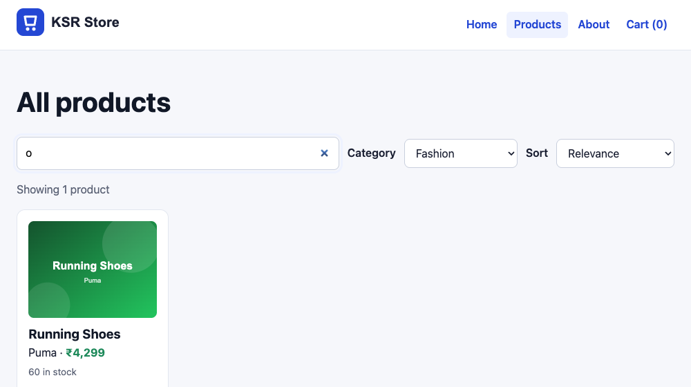
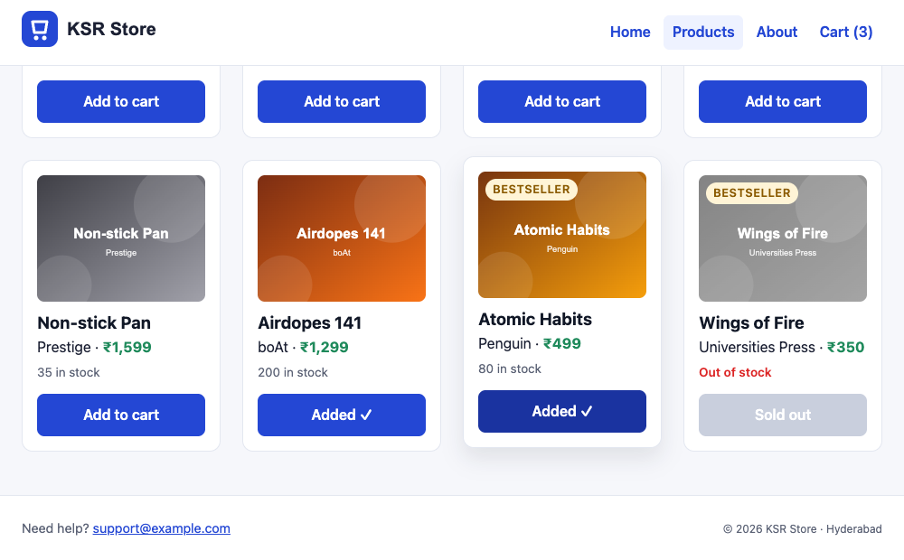
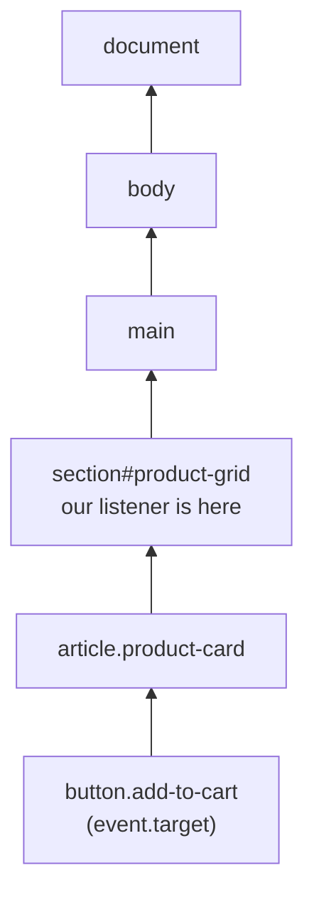
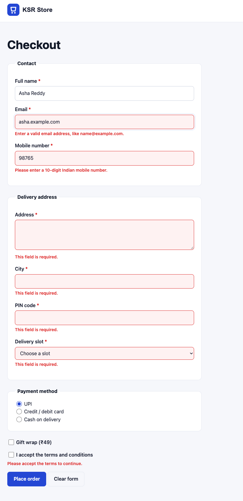
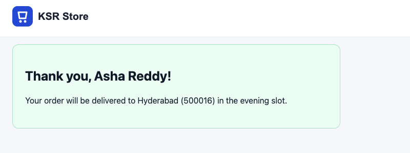

# Events & Forms

!!! abstract "Learning Objectives"
    By the end of this lesson, you can:

    - React to user actions with **`addEventListener`** and read the **event object**
    - Use the most common events: `click`, `input`, `change`, `submit`, `keydown`, `focusout`
    - Stop the browser's default behaviour with **`preventDefault()`**
    - Explain **bubbling** and handle many buttons with one listener (**event delegation**)
    - Validate a form with JavaScript (`validity`, custom messages) and read it with **`FormData`**

**Prerequisites:** [The DOM](06-dom.md)

## Listening for Events

Everything a user does (clicking, typing, scrolling, pressing a key, submitting a form) fires an **event**. You attach a function that runs when it happens:

```{ .js .no-run }
const button = document.querySelector("#subscribe");

button.addEventListener("click", event => {
  console.log("Clicked!", event.target);
});
```

- The first argument is the **event type** (`"click"`), the second is the **handler** (a callback).
- The handler receives an **event object** with details: `event.target` (the element the event happened on), `event.key` (for keyboard events), `event.type`, and more.
- Pass the function, don't call it: `addEventListener("click", handle)`, not `handle()`.

| Event | Fires when | Typical use |
|-------|-----------|-------------|
| `click` | An element is clicked (or activated with ++enter++ / ++space++ on buttons) | Buttons, links |
| `input` | The value of an input changes, on **every** keystroke | Live search, character counters |
| `change` | A select, checkbox or radio changes, or a text input loses focus after a change | Filters, options |
| `submit` | A form is submitted (button click or ++enter++) | Forms |
| `keydown` | A key is pressed | Keyboard shortcuts |
| `focusout` | An element (or anything inside it) loses focus | Validate a field when the user leaves it |
| `DOMContentLoaded` | The HTML has been parsed | Start-up code in non-module scripts |
| `scroll`, `resize` | The page scrolls, the window resizes | Sticky effects, layouts (use sparingly) |

!!! warning "No `onclick` attributes"
    Old tutorials use `<button onclick="buy()">`. It mixes JavaScript into HTML and allows only one handler. Use `addEventListener` in your JavaScript files.

## A Search Bar, Filters and Sorting

Add a toolbar to `products.html` under the heading (the lines marked `<!-- new -->`):

```{ .html .edit title="products.html" }
    <h1>All products</h1>
    <form id="search-form" class="toolbar" role="search">  <!-- new -->
      <label class="visually-hidden" for="search">Search products</label>  <!-- new -->
      <input type="search" id="search" placeholder="Search products or brands (press /)">  <!-- new -->
      <label for="category">Category</label>  <!-- new -->
      <select id="category">  <!-- new -->
        <option value="">All categories</option>  <!-- new -->
      </select>  <!-- new -->
      <label for="sort">Sort</label>  <!-- new -->
      <select id="sort">  <!-- new -->
        <option value="relevance">Relevance</option>  <!-- new -->
        <option value="price-asc">Price: low to high</option>  <!-- new -->
        <option value="price-desc">Price: high to low</option>  <!-- new -->
        <option value="rating">Top rated</option>  <!-- new -->
      </select>  <!-- new -->
    </form>  <!-- new -->
```

Style it, plus the "Add to cart" buttons we're about to add:

```{ .css .append title="css/style.css" }
.visually-hidden {                     /* hidden on screen, still read by screen readers */
  position: absolute;
  width: 1px;
  height: 1px;
  overflow: hidden;
  clip-path: inset(50%);
  white-space: nowrap;
}

.toolbar {
  display: flex;
  flex-wrap: wrap;
  align-items: center;
  gap: var(--space-2) var(--space-3);
  margin-bottom: var(--space-4);
}

.toolbar input[type="search"] {
  flex: 1 1 260px;
  padding: 10px 12px;
  border: 1px solid #c9cfdd;
  border-radius: 8px;
  font: inherit;
}

.toolbar label {
  font-weight: 600;
}

.toolbar select {
  width: auto;
  margin-top: 0;
}

.add-to-cart {
  width: 100%;
  margin-top: var(--space-3);
}

button:disabled {
  background-color: #c9cfdd;
  cursor: not-allowed;
}
```

Now replace `js/catalog.js` with an event-driven version. Read it in sections: state, rendering, filtering, events.

```js title="js/catalog.js"
import products from "./products-data.js";

const grid = document.querySelector("#product-grid");
const resultCount = document.querySelector("#result-count");
const searchForm = document.querySelector("#search-form");
const searchInput = document.querySelector("#search");
const categorySelect = document.querySelector("#category");
const sortSelect = document.querySelector("#sort");
const cartCount = document.querySelector(".cart-count");

const cart = {};          // productId -> quantity (saved in localStorage in the next lesson)

const formatRupees = amount =>
  amount.toLocaleString("en-IN", { style: "currency", currency: "INR", maximumFractionDigits: 0 });

// ---------- Rendering ----------
function productCard(product) {
  const card = document.createElement("article");
  card.className = "product-card";
  card.dataset.id = product.id;
  const soldOut = product.stock === 0;
  if (soldOut) {
    card.classList.add("is-out-of-stock");
  }
  card.innerHTML = `
    
    <h3></h3>
    <p><span class="brand"></span> · <span class="price">${formatRupees(product.price)}</span>
      ${product.rating >= 4.7 ? '<span class="badge">Bestseller</span>' : ""}</p>
    <p class="stock-label">${soldOut ? "Out of stock" : `${product.stock} in stock`}</p>
    <button type="button" class="add-to-cart" data-id="${product.id}" ${soldOut ? "disabled" : ""}>
      ${soldOut ? "Sold out" : "Add to cart"}
    </button>
  `;
  card.querySelector("img").alt = product.name;
  card.querySelector("h3").textContent = product.name;
  card.querySelector(".brand").textContent = product.brand;
  return card;
}

// ---------- Filtering and sorting ----------
function visibleProducts() {
  const query = searchInput.value.trim().toLowerCase();
  const category = categorySelect.value;

  const matches = products.filter(p =>
    (p.name.toLowerCase().includes(query) || p.brand.toLowerCase().includes(query)) &&
    (category === "" || p.category === category)
  );

  switch (sortSelect.value) {
    case "price-asc":
      return matches.toSorted((a, b) => a.price - b.price);
    case "price-desc":
      return matches.toSorted((a, b) => b.price - a.price);
    case "rating":
      return matches.toSorted((a, b) => b.rating - a.rating);
    default:
      return matches;
  }
}

function render() {
  const list = visibleProducts();
  grid.replaceChildren(...list.map(productCard));
  resultCount.textContent = list.length
    ? `Showing ${list.length} product${list.length === 1 ? "" : "s"}`
    : "No products match your search.";
}

// ---------- Cart ----------
function addToCart(id) {
  cart[id] = (cart[id] ?? 0) + 1;
  const totalItems = Object.values(cart).reduce((sum, qty) => sum + qty, 0);
  cartCount.textContent = totalItems;
  console.log(`Added product ${id}. Cart: ${JSON.stringify(cart)}`);
}

// ---------- Events ----------
searchInput.addEventListener("input", render);              // every keystroke
categorySelect.addEventListener("change", render);
sortSelect.addEventListener("change", render);

searchForm.addEventListener("submit", event => {
  event.preventDefault();                                     // don't reload the page on Enter
  render();
});

grid.addEventListener("click", event => {                     // ONE listener for every card button
  const button = event.target.closest(".add-to-cart");
  if (!button) {
    return;                                                   // the click wasn't on a button
  }
  addToCart(Number(button.dataset.id));
  button.textContent = "Added ✓";
});

document.addEventListener("keydown", event => {               // press "/" to jump to the search box
  if (event.key === "/" && document.activeElement !== searchInput) {
    event.preventDefault();
    searchInput.focus();
  }
});

// ---------- Start ----------
const categories = [...new Set(products.map(p => p.category))].sort();
for (const category of categories) {
  categorySelect.append(new Option(category, category));      // new Option(text, value)
}
render();
```

New pieces:

- `new Set(array)` keeps only **unique** values, and `[...set]` turns it back into an array: an easy way to get the list of categories from the data, so a new category appears in the filter automatically.
- `new Option(text, value)` creates an `<option>` element.
- `render()` always derives the visible list from the **current state** of the controls. Every event just calls it again.

Type "o" in the search box and choose the **Fashion** category:

{ .ksr-shot data-page="products.html" data-width="1000" data-height="560" data-actions="fill:#search=o | select:#category=Fashion" }

Sort by "Price: high to low", then add two products to the cart. The console shows the cart object, and the header count updates:

```{ .text .output page="products.html" actions="select:#sort=price-desc | click:.product-card[data-id='3'] .add-to-cart | click:.product-card[data-id='3'] .add-to-cart | click:.product-card[data-id='9'] .add-to-cart" }
Added product 3. Cart: {"3":1}
Added product 3. Cart: {"3":2}
Added product 9. Cart: {"3":2,"9":1}
```

{ .ksr-shot data-page="products.html" data-width="1000" data-height="620" data-actions="select:#sort=price-desc | click:.product-card[data-id='3'] .add-to-cart | click:.product-card[data-id='3'] .add-to-cart | click:.product-card[data-id='9'] .add-to-cart" }

"Cart (3)" in the header, and the clicked buttons say "Added ✓". The cart lives only in memory: reload the page and it's gone. The next lesson fixes that with `localStorage`.

## Bubbling and Event Delegation

Why does **one** listener on the grid work for every "Add to cart" button, including buttons created **after** the listener was added?



When you click the button, the `click` event **bubbles up**: it fires on the button, then on the card, then on the grid, then up to `document`. Our listener on the grid catches every click inside it. `event.target` is the element that was actually clicked, and **`target.closest(".add-to-cart")`** walks up from there to find the button (in case the click landed on text or an icon inside it), or returns `null` if the click wasn't on a button.

That's **event delegation**:

| One listener per button | One delegated listener |
|-------------------------|------------------------|
| Must be re-added every time the grid re-renders | Added once; works for future buttons |
| 100 products = 100 listeners | Always 1 listener |

`event.stopPropagation()` stops bubbling, but you rarely need it, and it can break other code that relies on delegation.

## `preventDefault()`

Some events have a **default action**: submitting a form loads a new page, clicking a link navigates, pressing ++space++ scrolls. `event.preventDefault()` cancels it so JavaScript can handle things instead:

| Event | Default action | Why prevent it |
|-------|----------------|----------------|
| `submit` on a form | Send the form and load a new page | Validate or send the data with JavaScript |
| `click` on a link | Navigate | Open a dialog instead |
| `keydown` of "/" | Type "/" into the focused field | Use it as a shortcut |

## Validating the Checkout Form with JavaScript

In the HTML module, the browser validated the checkout form with its own pop-up bubbles. Those bubbles can't be styled and disappear quickly. With JavaScript you can show **your own messages next to each field**, while still using the browser's rules (`required`, `pattern`, `type="email"`).

Every form field has a **`validity`** object describing what's wrong:

| Property | `true` when |
|----------|-------------|
| `valueMissing` | A `required` field is empty |
| `typeMismatch` | The value doesn't match `type="email"` / `"url"` |
| `patternMismatch` | The value doesn't match `pattern` |
| `tooShort` / `tooLong` | Outside `minlength` / `maxlength` |
| `rangeUnderflow` / `rangeOverflow` | Below `min` / above `max` |
| `valid` | Everything is fine |

Load a script on the checkout page:

```{ .html .edit title="checkout.html" }
  <title>Checkout | KSR Store</title>
  <script type="module" src="js/checkout.js"></script>  <!-- new -->
```

```js title="js/checkout.js"
const form = document.querySelector(".checkout-form");
form.noValidate = true;                       // turn off the browser bubbles: we show our own messages

function errorFor(input) {
  const anchor = input.closest("label") ?? input;   // checkboxes live inside their label
  let error = anchor.nextElementSibling;
  if (!error?.classList.contains("field-error")) {
    error = document.createElement("p");
    error.className = "field-error";
    error.id = `${input.name}-error`;
    anchor.after(error);
    input.setAttribute("aria-describedby", error.id);   // screen readers read the message
  }
  return error;
}

function messageFor(input) {
  const v = input.validity;
  if (v.valueMissing) return input.type === "checkbox" ? "Please accept the terms to continue." : "This field is required.";
  if (v.typeMismatch) return "Enter a valid email address, like name@example.com.";
  if (v.patternMismatch) return `Please enter a ${input.title}.`;
  if (v.tooShort) return `Use at least ${input.minLength} characters.`;
  return "";
}

function validateField(input) {
  const message = messageFor(input);
  errorFor(input).textContent = message;
  input.setAttribute("aria-invalid", String(message !== ""));
  return message === "";
}

// Check a field as soon as the user leaves it
form.addEventListener("focusout", event => {
  if (event.target.matches("[required]")) {
    validateField(event.target);
  }
});

form.addEventListener("submit", event => {
  event.preventDefault();
  const fields = [...form.querySelectorAll("[required]")];
  const results = fields.map(validateField);           // check ALL fields, not just the first
  const invalidCount = results.filter(ok => !ok).length;

  if (invalidCount > 0) {
    console.log(`${invalidCount} field(s) need attention`);
    form.querySelector('[aria-invalid="true"]').focus();   // move the user to the first problem
    return;
  }

  const data = Object.fromEntries(new FormData(form));     // every name=value pair
  console.log("Order data:", JSON.stringify(data, null, 2));

  const confirmation = document.createElement("section");
  confirmation.className = "confirmation";
  const heading = document.createElement("h2");
  heading.textContent = `Thank you, ${data.full_name}!`;
  const text = document.createElement("p");
  text.textContent = `Your order will be delivered to ${data.city} (${data.pincode}) in the ${data.slot} slot.`;
  confirmation.append(heading, text);
  form.replaceWith(confirmation);
});
```

```{ .css .append title="css/style.css" }
.field-error {
  margin: var(--space-1) 0 0;
  color: #dc2626;
  font-size: 0.875rem;
  font-weight: 600;
}

.field-error:empty {
  display: none;
}

[aria-invalid="true"] {
  border-color: #dc2626;
  background-color: #fef2f2;
}

.confirmation {
  max-width: 640px;
  padding: var(--space-5);
  background-color: #ecfdf3;
  border: 1px solid #a6e4c2;
  border-radius: var(--radius);
}
```

Submit the form after filling in only a name, a wrong email and a 5-digit phone number:

```{ .text .output page="checkout.html" actions="fill:#full-name=Asha Reddy | fill:#email=asha.example.com | fill:#phone=98765 | click:button[type=submit]" }
7 field(s) need attention
```

{ .ksr-shot data-page="checkout.html" data-full="true" data-width="800" data-actions="fill:#full-name=Asha Reddy | fill:#email=asha.example.com | fill:#phone=98765 | click:button[type=submit] | eval:window.scrollTo(0, 0)" }

Every invalid field shows its own message (the pattern messages reuse each field's `title`), and the cursor jumps to the first problem. Now a complete, valid order:

```{ .text .output page="checkout.html" actions="fill:#full-name=Asha Reddy | fill:#email=asha@example.com | fill:#phone=9876500001 | fill:#address=12 MG Road, Ameerpet | fill:#city=Hyderabad | fill:#pincode=500016 | select:#slot=evening | check:input[name=terms] | click:button[type=submit]" }
Order data: {
  "full_name": "Asha Reddy",
  "email": "asha@example.com",
  "phone": "9876500001",
  "address": "12 MG Road, Ameerpet",
  "city": "Hyderabad",
  "pincode": "500016",
  "slot": "evening",
  "payment": "upi",
  "terms": "accepted",
  "cart_id": "C1042"
}
```

{ .ksr-shot data-page="checkout.html" data-width="800" data-height="300" data-actions="fill:#full-name=Asha Reddy | fill:#email=asha@example.com | fill:#phone=9876500001 | fill:#address=12 MG Road, Ameerpet | fill:#city=Hyderabad | fill:#pincode=500016 | select:#slot=evening | check:input[name=terms] | click:button[type=submit]" }

**`new FormData(form)`** collects every field by its `name`, exactly what the browser would have sent, and `Object.fromEntries` turns it into a plain object. In lesson 10 you'll send that object to an API with `fetch` instead of just logging it.

!!! warning "Still validate on the server"
    JavaScript validation is for a better experience, not for security: users can switch JavaScript off or send requests directly. The backend must check everything again.

!!! realworld "In Real Projects"
    Interactive pages are mostly event handlers that update state and re-render: search-as-you-type, filters, add-to-cart, inline form validation. Teams use delegation for lists, `preventDefault` on forms handled by JavaScript, accessible error messages (`aria-invalid`, `aria-describedby`), and focus management. Typing in a search box that calls an API usually waits until the user pauses (**debouncing**) so not every keystroke sends a request. React's `onClick` and `onChange` are this same event system, wrapped in components.

## Common Mistakes

| Mistake | Symptom | Fix |
|---------|---------|-----|
| `addEventListener("click", handle())` | Runs once immediately, never on click | Pass the function: `handle`, or `() => handle(id)` |
| Listeners on buttons that get re-rendered | Clicks stop working after a filter | Delegate from a parent that stays: `grid.addEventListener(...)` |
| `event.target` is a child, not the button | `dataset.id` is `undefined` | `event.target.closest(".add-to-cart")` |
| Forgetting `preventDefault()` on submit | The page reloads, the console clears | `event.preventDefault()` first |
| Using `change` for live search | Results only update when the input loses focus | `input` event |
| `button` without `type="button"` inside a form | Clicking it submits the form | `type="button"` |
| Showing only the first error | Users fix errors one by one | Validate all fields, focus the first invalid one |

## Practice Exercises

**Easy**

1. Log the value of the search box on every keystroke.
2. Add a "Clear" button to the toolbar that empties the search, resets the selects and re-renders (remember `type="button"`).
3. Make pressing ++escape++ inside the search box clear it.

**Medium**

4. Add an "In stock only" checkbox to the toolbar that filters out sold-out products.
5. Show a live character counter under the address `textarea` ("23 / 200 characters") with the `input` event.
6. Add a "Quick view" button to each card that shows the product's details in a `<dialog>` element (`dialog.showModal()`), using delegation.

**Challenge**

7. Make the filters **shareable**: when a filter changes, update the URL with `history.replaceState(null, "", "?q=o&category=Fashion")`, and when the page loads, read `new URLSearchParams(location.search)` and restore the filters.

??? success "Solutions (click to expand)"

    ```{ .js .no-run }
    // 2
    clearButton.addEventListener("click", () => {
      searchForm.reset();
      render();
    });

    // 3
    searchInput.addEventListener("keydown", event => {
      if (event.key === "Escape") {
        searchInput.value = "";
        render();
      }
    });

    // 4 (in visibleProducts)
    const inStockOnly = document.querySelector("#in-stock").checked;
    // ... && (!inStockOnly || p.stock > 0)

    // 5
    address.addEventListener("input", () => {
      counter.textContent = `${address.value.length} / 200 characters`;
    });

    // 7
    function saveFiltersToUrl() {
      const params = new URLSearchParams({ q: searchInput.value, category: categorySelect.value, sort: sortSelect.value });
      history.replaceState(null, "", `?${params}`);
    }
    const params = new URLSearchParams(location.search);
    searchInput.value = params.get("q") ?? "";
    categorySelect.value = params.get("category") ?? "";
    sortSelect.value = params.get("sort") ?? "relevance";
    ```

!!! note "Mini Assignment"
    Add interactivity to your own business site: a live search and a category filter over your data-driven catalogue, a delegated "Book now" or "Add to cart" button that updates a counter, and JavaScript validation on your enquiry form with custom messages next to the fields, focus on the first error, and a confirmation built from `FormData`.

## Interview Questions

!!! interview "1. What is event bubbling?"
    After an event fires on its target element, it propagates up through each ancestor to `document` (and `window`), triggering their listeners for the same event type. (Before that there's a capture phase from the top down, used with `{ capture: true }`.)

!!! interview "2. What is event delegation and why use it?"
    Attaching one listener to a common ancestor instead of many listeners to child elements, then using `event.target` (often with `closest()`) to see which child was involved. It uses less memory and automatically works for elements added later.

!!! interview "3. What is the difference between `event.target` and `event.currentTarget`?"
    `target` is the element where the event originated (what was actually clicked). `currentTarget` is the element whose listener is currently running (the one you attached it to).

!!! interview "4. What does `preventDefault()` do, and how is it different from `stopPropagation()`?"
    `preventDefault()` cancels the browser's default action for the event (submitting a form, following a link). `stopPropagation()` stops the event from bubbling to ancestor elements. They're independent.

!!! interview "5. What is the difference between the `input` and `change` events?"
    `input` fires on every change to the value as the user types. `change` fires when the change is committed: immediately for selects, checkboxes and radios, and when a text field loses focus after being edited.

!!! interview "Scenario: "Add to cart" works at first, but after the user searches, the buttons stop responding. Why?"
    The listeners were attached directly to the original buttons, and re-rendering replaced those elements with new buttons that have no listeners. Use event delegation on the grid container (which isn't replaced) and identify the button with `event.target.closest(...)`.

## Summary

| Task | Code |
|------|------|
| Listen | `el.addEventListener("click", event => { ... })` |
| Event info | `event.target`, `event.key`, `event.type`, `event.currentTarget` |
| Live input | `input` event · `select` / checkbox: `change` event |
| Forms | `form.addEventListener("submit", e => { e.preventDefault(); ... })` |
| Delegation | `grid.addEventListener("click", e => { const b = e.target.closest(".add-to-cart"); ... })` |
| Validation | `input.validity.valueMissing / typeMismatch / patternMismatch`, `form.noValidate = true` |
| Read a form | `Object.fromEntries(new FormData(form))` |
| Accessibility | `aria-invalid`, `aria-describedby`, focus the first error |

**Next lesson:** [localStorage & the Shopping Cart](08-local-storage-cart.md), a cart that survives page reloads and a cart page built from it.
