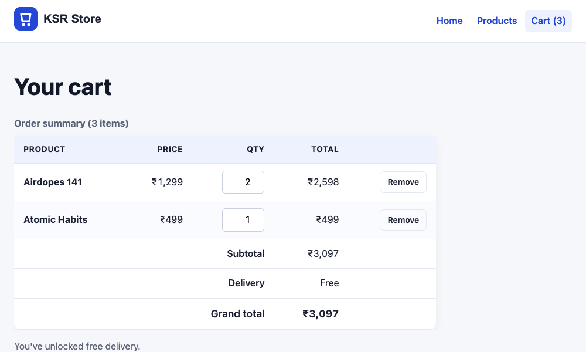

# localStorage & the Shopping Cart

!!! abstract "Learning Objectives"
    By the end of this lesson, you can:

    - Save and read data with **`localStorage`** and `sessionStorage`
    - Store objects and arrays as **JSON**, and handle missing or corrupted data safely
    - Explain what **not** to store in the browser
    - Build a reusable **cart module** with functions to add, update, remove and count items
    - Render a **cart page** from stored data, with quantities, totals and an empty state

**Prerequisites:** [Events & Forms](07-events-forms.md)

## The Problem: A Cart That Forgets

In the last lesson, "Add to cart" updated an object in memory. Reload the page, or open the cart page, and the cart is empty again: every page load starts JavaScript from scratch. The browser needs somewhere to **remember** data between page loads.

## `localStorage`

Every website gets a small key-value store in the browser (about 5 MB per site), kept until it's cleared:

```{ .js .no-run }
localStorage.setItem("theme", "dark");          // save (key and value are strings)
localStorage.getItem("theme");                  // "dark"
localStorage.getItem("missing");                // null when the key doesn't exist
localStorage.removeItem("theme");               // delete one key
localStorage.clear();                           // delete everything for this site
```

| Storage | Lifetime | Shared between tabs? |
|---------|----------|----------------------|
| `localStorage` | Until cleared by code or the user | Yes, all tabs of the same site |
| `sessionStorage` | Until the **tab** is closed | No, one tab only |
| Cookies | Set by an expiry date; sent to the server with **every request** | Yes |

Data is stored **per origin** (`http://127.0.0.1:5500` and `https://shop.example.com` have separate stores), so other websites can't read yours.

### Only strings: use JSON

`localStorage` stores **strings only**. Give it an object and you get the useless text `"[object Object]"`. Convert with JSON:

```html title="storage-demo.html"
<!DOCTYPE html>
<html lang="en">
<head>
  <meta charset="UTF-8">
  <title>Storage demo | KSR Store</title>
  <script type="module">
    const cart = { 3: 2, 9: 1 };

    localStorage.setItem("wrong", cart);                    // the object becomes a useless string
    console.log("without JSON:", localStorage.getItem("wrong"));

    localStorage.setItem("demo-cart", JSON.stringify(cart)); // save as JSON text
    const text = localStorage.getItem("demo-cart");
    console.log("stored text:", text, "| type:", typeof text);

    const restored = JSON.parse(text);                       // back to an object
    console.log("restored qty of product 3:", restored[3]);

    console.log("missing key:", localStorage.getItem("nothing-here"));
    console.log("keys:", Object.keys(localStorage).sort().join(", "));
    localStorage.clear();
  </script>
</head>
<body><h1>Open the console</h1></body>
</html>
```

```{ .text .output page="storage-demo.html" }
without JSON: [object Object]
stored text: {"3":2,"9":1} | type: string
restored qty of product 3: 2
missing key: null
keys: demo-cart, wrong
```

(An inline `<script type="module">` like this is fine for a quick demo; real code goes in `.js` files.)

!!! tip "See it in DevTools"
    DevTools → **Application** tab → *Storage* → *Local storage* → `http://127.0.0.1:5500` shows every key and value. You can edit or delete them there while testing.

!!! danger "Never store secrets"
    Any JavaScript running on the page can read `localStorage`, including a malicious script injected through an XSS bug. Never store passwords, card numbers or long-lived login tokens in it. A cart, a theme preference or recently viewed products are fine.

## The Cart Module

Several pages need the cart: the catalogue adds to it, the cart page shows it, the header everywhere shows the count, and checkout will send it to the server. Put all the cart logic in **one module** with clear functions:

```js title="js/cart-store.js"
// The cart is stored as { productId: quantity }, e.g. { "3": 2, "9": 1 }
const STORAGE_KEY = "ksr-cart";

export function loadCart() {
  try {
    return JSON.parse(localStorage.getItem(STORAGE_KEY)) ?? {};
  } catch {
    return {};                          // corrupted data: start with an empty cart
  }
}

function saveCart(cart) {
  localStorage.setItem(STORAGE_KEY, JSON.stringify(cart));
  updateCartBadge(cart);
}

export function addItem(productId, qty = 1) {
  const cart = loadCart();
  cart[productId] = (cart[productId] ?? 0) + qty;
  saveCart(cart);
  return cart;
}

export function setQuantity(productId, qty) {
  const cart = loadCart();
  if (qty > 0) {
    cart[productId] = qty;
  } else {
    delete cart[productId];             // quantity 0 removes the item
  }
  saveCart(cart);
}

export function removeItem(productId) {
  setQuantity(productId, 0);
}

export function clearCart() {
  localStorage.removeItem(STORAGE_KEY);
  updateCartBadge({});
}

export function itemCount(cart = loadCart()) {
  return Object.values(cart).reduce((sum, qty) => sum + qty, 0);
}

export function updateCartBadge(cart = loadCart()) {
  for (const badge of document.querySelectorAll(".cart-count")) {
    badge.textContent = itemCount(cart);
  }
}
```

- **`export`** in front of a function makes it available to other files, which `import` it by name: `import { addItem } from "./cart-store.js";`. (Lesson 11 covers modules in full.)
- `saveCart` is **not** exported: only this module writes to `localStorage`, so the storage format can change in one place.
- `try` / `catch` protects against broken data (someone edited it in DevTools, or an old version stored something else). `?? {}` handles the very first visit, when `getItem` returns `null`.
- Every change saves the cart **and** updates the header badge.

## Using the Module in the Catalogue

Replace `js/catalog.js` once more. Only the imports, `addToCart` and the start-up code change from the previous lesson:

```js title="js/catalog.js"
import products from "./products-data.js";
import { addItem, itemCount, updateCartBadge } from "./cart-store.js";

const grid = document.querySelector("#product-grid");
const resultCount = document.querySelector("#result-count");
const searchForm = document.querySelector("#search-form");
const searchInput = document.querySelector("#search");
const categorySelect = document.querySelector("#category");
const sortSelect = document.querySelector("#sort");

const formatRupees = amount =>
  amount.toLocaleString("en-IN", { style: "currency", currency: "INR", maximumFractionDigits: 0 });

// ---------- Rendering ----------
function productCard(product) {
  const card = document.createElement("article");
  card.className = "product-card";
  card.dataset.id = product.id;
  const soldOut = product.stock === 0;
  if (soldOut) {
    card.classList.add("is-out-of-stock");
  }
  card.innerHTML = `
    
    <h3></h3>
    <p><span class="brand"></span> · <span class="price">${formatRupees(product.price)}</span>
      ${product.rating >= 4.7 ? '<span class="badge">Bestseller</span>' : ""}</p>
    <p class="stock-label">${soldOut ? "Out of stock" : `${product.stock} in stock`}</p>
    <button type="button" class="add-to-cart" data-id="${product.id}" ${soldOut ? "disabled" : ""}>
      ${soldOut ? "Sold out" : "Add to cart"}
    </button>
  `;
  card.querySelector("img").alt = product.name;
  card.querySelector("h3").textContent = product.name;
  card.querySelector(".brand").textContent = product.brand;
  return card;
}

// ---------- Filtering and sorting ----------
function visibleProducts() {
  const query = searchInput.value.trim().toLowerCase();
  const category = categorySelect.value;

  const matches = products.filter(p =>
    (p.name.toLowerCase().includes(query) || p.brand.toLowerCase().includes(query)) &&
    (category === "" || p.category === category)
  );

  switch (sortSelect.value) {
    case "price-asc":
      return matches.toSorted((a, b) => a.price - b.price);
    case "price-desc":
      return matches.toSorted((a, b) => b.price - a.price);
    case "rating":
      return matches.toSorted((a, b) => b.rating - a.rating);
    default:
      return matches;
  }
}

function render() {
  const list = visibleProducts();
  grid.replaceChildren(...list.map(productCard));
  resultCount.textContent = list.length
    ? `Showing ${list.length} product${list.length === 1 ? "" : "s"}`
    : "No products match your search.";
}

// ---------- Events ----------
searchInput.addEventListener("input", render);
categorySelect.addEventListener("change", render);
sortSelect.addEventListener("change", render);

searchForm.addEventListener("submit", event => {
  event.preventDefault();
  render();
});

grid.addEventListener("click", event => {
  const button = event.target.closest(".add-to-cart");
  if (!button) {
    return;
  }
  const cart = addItem(Number(button.dataset.id));       // saved to localStorage
  console.log(`Added product ${button.dataset.id}. Cart: ${JSON.stringify(cart)} - items in cart: ${itemCount(cart)}`);
  button.textContent = "Added ✓";
});

document.addEventListener("keydown", event => {
  if (event.key === "/" && document.activeElement !== searchInput) {
    event.preventDefault();
    searchInput.focus();
  }
});

// ---------- Start ----------
const categories = [...new Set(products.map(p => p.category))].sort();
for (const category of categories) {
  categorySelect.append(new Option(category, category));
}
render();
updateCartBadge();                                        // show the saved count on page load
```

Add three products, then **reload the page**. The badge still says 3, because the cart was read back from `localStorage`:

```{ .text .output page="products.html" actions="click:.product-card[data-id='3'] .add-to-cart | click:.product-card[data-id='3'] .add-to-cart | click:.product-card[data-id='9'] .add-to-cart | reload | eval:console.log('after reload, badge shows:', document.querySelector('.cart-count').textContent, '| stored:', localStorage.getItem('ksr-cart'))" }
Added product 3. Cart: {"3":1} - items in cart: 1
Added product 3. Cart: {"3":2} - items in cart: 2
Added product 9. Cart: {"3":2,"9":1} - items in cart: 3
after reload, badge shows: 3 | stored: {"3":2,"9":1}
```

## The Cart Page

Replace the static `cart.html` from the HTML module with a page JavaScript fills in:

```html title="cart.html"
<!DOCTYPE html>
<html lang="en">
<head>
  <meta charset="UTF-8">
  <link rel="stylesheet" href="css/style.css">
  <meta name="viewport" content="width=device-width, initial-scale=1.0">
  <title>Your cart | KSR Store</title>
  <script type="module" src="js/cart-page.js"></script>
</head>
<body>
  <header class="site-header">
    <a href="index.html"></a>
    <nav>
      <ul>
        <li><a href="index.html">Home</a></li>
        <li><a href="products.html">Products</a></li>
        <li><a href="cart.html" aria-current="page">Cart (<span class="cart-count">0</span>)</a></li>
      </ul>
    </nav>
  </header>

  <main>
    <h1>Your cart</h1>

    <p id="cart-empty" class="cart-empty" hidden>
      Your cart is empty. <a href="products.html">Browse products</a>
    </p>

    <div id="cart-content" hidden>
      <div class="table-wrap">
        <table class="cart-table">
          <caption id="cart-caption">Order summary</caption>
          <thead>
            <tr>
              <th scope="col">Product</th>
              <th scope="col">Price</th>
              <th scope="col">Qty</th>
              <th scope="col">Total</th>
              <th scope="col"><span class="visually-hidden">Remove</span></th>
            </tr>
          </thead>
          <tbody id="cart-rows"></tbody>
          <tfoot>
            <tr><th scope="row" colspan="3">Subtotal</th><td id="subtotal"></td><td></td></tr>
            <tr><th scope="row" colspan="3">Delivery</th><td id="delivery"></td><td></td></tr>
            <tr><th scope="row" colspan="3">Grand total</th><td><strong id="grand-total"></strong></td><td></td></tr>
          </tfoot>
        </table>
      </div>
      <p id="delivery-hint" class="delivery-hint"></p>
      <div class="cart-actions">
        <button type="button" id="clear-cart" class="button-secondary">Clear cart</button>
        <a class="button" href="checkout.html">Proceed to checkout</a>
      </div>
    </div>
  </main>
</body>
</html>
```

The **`hidden`** attribute hides an element until JavaScript removes it. The page script decides whether to show the empty message or the table:

```js title="js/cart-page.js"
import products from "./products-data.js";
import { loadCart, setQuantity, removeItem, clearCart, itemCount, updateCartBadge } from "./cart-store.js";

const FREE_DELIVERY_MIN = 499;
const DELIVERY_FEE = 40;

const emptyMessage = document.querySelector("#cart-empty");
const content = document.querySelector("#cart-content");
const rows = document.querySelector("#cart-rows");

const formatRupees = amount =>
  amount.toLocaleString("en-IN", { style: "currency", currency: "INR", maximumFractionDigits: 0 });

function cartLines() {
  return Object.entries(loadCart())
    .map(([id, qty]) => ({ product: products.find(p => p.id === Number(id)), qty }))
    .filter(line => line.product);                 // ignore ids that no longer exist
}

function cartRow({ product, qty }) {
  const tr = document.createElement("tr");
  tr.innerHTML = `
    <th scope="row"></th>
    <td>${formatRupees(product.price)}</td>
    <td><input type="number" class="qty-input" min="0" max="${product.stock}" value="${qty}" data-id="${product.id}"></td>
    <td>${formatRupees(product.price * qty)}</td>
    <td><button type="button" class="remove-item button-secondary" data-id="${product.id}">Remove</button></td>
  `;
  tr.querySelector("th").textContent = product.name;
  tr.querySelector(".qty-input").setAttribute("aria-label", `Quantity of ${product.name}`);
  return tr;
}

function render() {
  const lines = cartLines();
  emptyMessage.hidden = lines.length > 0;
  content.hidden = lines.length === 0;
  updateCartBadge();
  if (lines.length === 0) {
    return;
  }

  rows.replaceChildren(...lines.map(cartRow));
  const subtotal = lines.reduce((sum, { product, qty }) => sum + product.price * qty, 0);
  const delivery = subtotal >= FREE_DELIVERY_MIN ? 0 : DELIVERY_FEE;
  const count = itemCount();

  document.querySelector("#cart-caption").textContent = `Order summary (${count} item${count === 1 ? "" : "s"})`;
  document.querySelector("#subtotal").textContent = formatRupees(subtotal);
  document.querySelector("#delivery").textContent = delivery === 0 ? "Free" : formatRupees(delivery);
  document.querySelector("#grand-total").textContent = formatRupees(subtotal + delivery);
  document.querySelector("#delivery-hint").textContent = delivery === 0
    ? "You've unlocked free delivery."
    : `Add ${formatRupees(FREE_DELIVERY_MIN - subtotal)} more for free delivery.`;
}

rows.addEventListener("change", event => {
  if (event.target.matches(".qty-input")) {
    const max = Number(event.target.max);
    const qty = Math.min(Math.max(Number(event.target.value) || 0, 0), max);   // keep it between 0 and the stock
    setQuantity(Number(event.target.dataset.id), qty);
    render();
  }
});

rows.addEventListener("click", event => {
  const button = event.target.closest(".remove-item");
  if (button) {
    removeItem(Number(button.dataset.id));
    render();
  }
});

document.querySelector("#clear-cart").addEventListener("click", () => {
  clearCart();
  render();
});

window.addEventListener("storage", render);   // the cart changed in another tab: refresh

render();
```

```{ .css .append title="css/style.css" }
.qty-input {
  width: 4.5rem;
  padding: 6px 8px;
  border: 1px solid #c9cfdd;
  border-radius: 6px;
  font: inherit;
  text-align: right;
}

.remove-item {
  padding: 6px 12px;
  font-size: 0.875rem;
}

.cart-actions {
  display: flex;
  flex-wrap: wrap;
  gap: var(--space-3);
  margin-top: var(--space-4);
}

.delivery-hint,
.cart-empty {
  color: var(--color-muted);
}

.table-wrap {
  overflow-x: auto;
}
```

Now a full journey. On the catalogue, add the Airdopes twice and Atomic Habits once, then go to the cart page:

{ .ksr-shot data-page="products.html" data-width="1000" data-height="600" data-actions="click:.product-card[data-id='3'] .add-to-cart | click:.product-card[data-id='3'] .add-to-cart | click:.product-card[data-id='9'] .add-to-cart | goto:cart.html" }

Change the Airdopes quantity to 0 (which removes it). Only Atomic Habits (₹499) is left, which still qualifies for free delivery. Then click Remove on that too:

```{ .text .output page="products.html" actions="click:.product-card[data-id='3'] .add-to-cart | click:.product-card[data-id='3'] .add-to-cart | click:.product-card[data-id='9'] .add-to-cart | goto:cart.html | eval:console.log('start:', document.querySelector('#cart-caption').textContent, '| total', document.querySelector('#grand-total').textContent) | fill:.qty-input[data-id='3']=0 | press:.qty-input[data-id='3']=Tab | eval:console.log('after qty 0:', document.querySelector('#cart-caption').textContent, '| total', document.querySelector('#grand-total').textContent, '|', document.querySelector('#delivery-hint').textContent) | click:.remove-item | eval:console.log('after remove: empty message visible?', !document.querySelector('#cart-empty').hidden, '| stored:', localStorage.getItem('ksr-cart'))" }
Added product 3. Cart: {"3":1} - items in cart: 1
Added product 3. Cart: {"3":2} - items in cart: 2
Added product 9. Cart: {"3":2,"9":1} - items in cart: 3
start: Order summary (3 items) | total ₹3,097
after qty 0: Order summary (1 item) | total ₹499 | You've unlocked free delivery.
after remove: empty message visible? true | stored: {}
```

!!! realworld "In Real Projects"
    Guest carts often live in `localStorage` exactly like this, and are merged into the server-side cart when the user logs in. Theme choices, recently viewed items and form drafts are stored the same way. The rules teams follow: one module owns each storage key, values are versioned or validated when read, nothing sensitive is stored, and the server re-checks prices and stock at checkout, because anyone can edit `localStorage` in DevTools.

## Common Mistakes

| Mistake | Symptom | Fix |
|---------|---------|-----|
| Storing an object directly | `"[object Object]"` comes back | `JSON.stringify` to save, `JSON.parse` to read |
| `JSON.parse(null)` on the first visit | `null` instead of an empty cart | `JSON.parse(...) ?? {}` |
| Corrupted data crashes the page | `SyntaxError` on load | `try` / `catch` around `JSON.parse` |
| Reading and writing storage all over the code | Inconsistent formats, hard to change | One module owns the key |
| Storing prices in the cart | Stale or manipulated prices | Store ids and quantities; look up prices from fresh data |
| Saving tokens or personal data | Readable by any injected script | Keep secrets out of `localStorage` |
| Forgetting `updateCartBadge()` on load | The header shows 0 until the next click | Call it when the page starts |

## Practice Exercises

**Easy**

1. Save the user's last search text in `localStorage` and restore it into the search box when the catalogue loads.
2. Add a "Cart (n)" badge to `index.html` and `about.html` that reads the cart count (load a tiny script that imports `updateCartBadge`).
3. Show the number of distinct products (not items) under the cart heading.

**Medium**

4. Add `+` and `−` buttons next to each quantity field on the cart page, using delegation.
5. Add a **wishlist**: a ♡ button on each card that toggles the product id in a `ksr-wishlist` array in `localStorage`, with the heart filled when saved.
6. Store the checkout form as a **draft** in `sessionStorage` on every `input` event, and restore it if the user reloads the page.

**Challenge**

7. Add a "Recently viewed" strip to the catalogue: clicking a product name stores its id at the front of a `ksr-recent` array (no duplicates, at most 4), and the strip shows those products' images and names.

??? success "Solutions (click to expand)"

    ```{ .js .no-run }
    // 1
    searchInput.value = localStorage.getItem("ksr-last-search") ?? "";
    searchInput.addEventListener("input", () => localStorage.setItem("ksr-last-search", searchInput.value));

    // 2: js/badge.js, loaded with <script type="module" src="js/badge.js"> on each page
    import { updateCartBadge } from "./cart-store.js";
    updateCartBadge();

    // 5
    function toggleWishlist(id) {
      const list = JSON.parse(localStorage.getItem("ksr-wishlist") ?? "[]");
      const next = list.includes(id) ? list.filter(x => x !== id) : [...list, id];
      localStorage.setItem("ksr-wishlist", JSON.stringify(next));
      return next.includes(id);
    }

    // 7
    function addRecent(id) {
      const recent = JSON.parse(localStorage.getItem("ksr-recent") ?? "[]");
      const next = [id, ...recent.filter(x => x !== id)].slice(0, 4);
      localStorage.setItem("ksr-recent", JSON.stringify(next));
    }
    ```

!!! note "Mini Assignment"
    Give your own business site a persistent **selection**: a "Book" or "Add" button on each item that saves to `localStorage` through a single store module, a badge in the header on every page, and a summary page that lists the selection with quantity controls, a remove button, totals and an empty state. Test it across two tabs (the `storage` event).

## Interview Questions

!!! interview "1. What is the difference between `localStorage`, `sessionStorage` and cookies?"
    `localStorage` persists until cleared and is shared by all tabs of an origin. `sessionStorage` lasts only for the tab's session. Cookies are small, can expire, and are sent to the server with every request, which suits session ids (ideally `HttpOnly`), while web storage stays in the browser.

!!! interview "2. How do you store an object in `localStorage`?"
    Convert it with `JSON.stringify` before `setItem`, and convert it back with `JSON.parse` after `getItem`, handling `null` (the key doesn't exist) and parse errors.

!!! interview "3. What shouldn't be stored in `localStorage`, and why?"
    Secrets such as passwords, payment data and long-lived authentication tokens, because any JavaScript on the page (including code injected through XSS) can read it. Store only non-sensitive data like preferences and guest carts.

!!! interview "4. How can several tabs stay in sync when one changes `localStorage`?"
    The `storage` event fires in the other tabs of the same origin when a key changes, so they can listen with `window.addEventListener("storage", ...)` and re-render.

!!! interview "5. Why store product ids and quantities in the cart instead of full product objects with prices?"
    Prices and stock change, and anything in the browser can be edited by the user. Storing ids keeps the cart small, the page can look up fresh product data, and the server always recalculates prices at checkout.

!!! interview "Scenario: after a site update, some users' cart pages are blank with a JavaScript error. What might cause it?"
    The new code expects a different storage format (for example an array instead of an object), and old data in users' browsers breaks it. Validate data when reading, wrap `JSON.parse` in `try` / `catch`, fall back to an empty cart, and version the key (`ksr-cart-v2`) when the format changes.

## Summary

| Task | Code |
|------|------|
| Save / read / delete | `localStorage.setItem(k, v)` · `getItem(k)` · `removeItem(k)` · `clear()` |
| Objects | `setItem(k, JSON.stringify(obj))` · `JSON.parse(getItem(k)) ?? {}` |
| Safe reading | `try { ... } catch { return {}; }` |
| Per-tab storage | `sessionStorage` (same API) |
| Other tabs changed it | `window.addEventListener("storage", render)` |
| Module | `export function addItem(...)` · `import { addItem } from "./cart-store.js"` |
| Show / hide | `element.hidden = true / false` |

**Next lesson:** [Asynchronous JavaScript](09-async-javascript.md), timers, promises and `async` / `await`: the foundation for talking to APIs.
