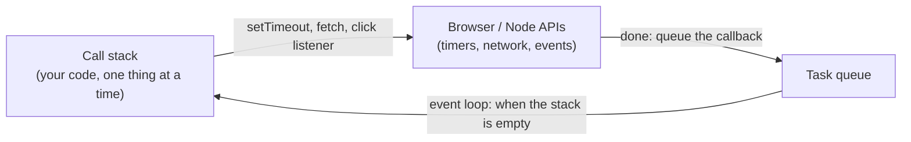
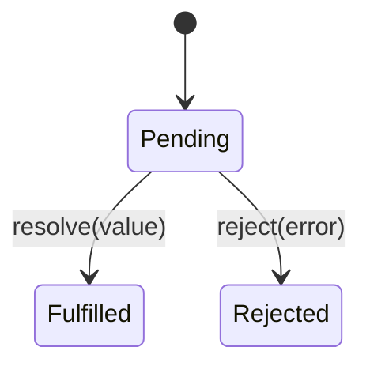

# Asynchronous JavaScript

!!! abstract "Learning Objectives"
    By the end of this lesson, you can:

    - Explain the difference between **synchronous** and **asynchronous** code, and why JavaScript needs async
    - Use `setTimeout` and `setInterval`, and describe the **event loop**
    - Work with **promises**: `then`, `catch`, `finally`, and create your own
    - Write clean async code with **`async` / `await`** and handle errors with `try` / `catch`
    - Run independent tasks **in parallel** with `Promise.all` and `Promise.allSettled`

**Prerequisites:** [localStorage & the Shopping Cart](08-local-storage-cart.md)

## Why Asynchronous?

Some work takes time: loading products from a server (100–2000 ms), waiting for a user to click, a timer. If JavaScript **waited** for each of these, the whole page would freeze: no scrolling, no clicking, nothing.

JavaScript in the browser runs on **one thread**: it does one thing at a time. So slow work is **asynchronous**: you start it, JavaScript carries on with other code, and a function runs **later** when the result is ready.

```js
console.log("1. Start loading products");

setTimeout(() => {
  console.log("3. Products arrived (after 500 ms)");
}, 500);

console.log("2. Meanwhile, draw the page header");
```

```{ .text .output }
1. Start loading products
2. Meanwhile, draw the page header
3. Products arrived (after 500 ms)
```

The order is 1, 2, 3 even though the `setTimeout` line comes before line 2. `setTimeout(callback, ms)` **schedules** the callback and returns immediately.

## Timers

```js
const timerId = setTimeout(() => console.log("never shown"), 1000);
clearTimeout(timerId);                       // cancel a scheduled timeout

let secondsLeft = 3;
const countdown = setInterval(() => {        // repeat every 200 ms (pretend each is a second)
  console.log(`Offer ends in ${secondsLeft}...`);
  secondsLeft--;
  if (secondsLeft === 0) {
    clearInterval(countdown);                // stop repeating
    console.log("Offer expired!");
  }
}, 200);
```

```{ .text .output }
Offer ends in 3...
Offer ends in 2...
Offer ends in 1...
Offer expired!
```

| Function | Does |
|----------|------|
| `setTimeout(fn, ms)` | Run `fn` once after at least `ms` milliseconds; returns an id |
| `clearTimeout(id)` | Cancel it |
| `setInterval(fn, ms)` | Run `fn` every `ms` milliseconds |
| `clearInterval(id)` | Stop it |

## The Event Loop

How can one thread "do something later"? The browser (or Node) does the waiting for you, and the **event loop** feeds finished work back to JavaScript:



1. Your code runs on the **call stack** until it finishes.
2. Timers, network requests and event listeners are handled **outside** JavaScript by the browser.
3. When one finishes, its callback waits in a **queue**.
4. When the call stack is empty, the **event loop** takes the next callback from the queue and runs it.

That's why even `setTimeout(fn, 0)` runs **after** the current code. And it's why a long loop freezes the page: while it runs, the event loop can't run anything else, including click handlers.

```js
setTimeout(() => console.log("timeout 0 ms"), 0);
Promise.resolve().then(() => console.log("promise callback"));
console.log("synchronous code");
```

```{ .text .output }
synchronous code
promise callback
timeout 0 ms
```

Promise callbacks (**microtasks**) run before timer callbacks (**tasks**), as soon as the current code finishes. You rarely need this detail, but it explains surprising output orders in interviews.

## Callbacks and "Callback Hell"

The original way to handle async results was to pass a **callback**. It gets messy when one step depends on the previous one:

```{ .js .no-run }
getUser(userId, user => {
  getCart(user.id, cart => {
    getProducts(cart.productIds, products => {
      calculateTotal(products, total => {
        showTotal(total);                 // four levels deep, and no error handling yet
      });
    });
  });
});
```

This "pyramid of doom" is hard to read and harder to handle errors in. **Promises** solve it.

## Promises

A **promise** is an object representing a value that will arrive **later**. It's in one of three states:



You attach handlers with `then` (success), `catch` (failure) and `finally` (either way). To try this, we'll simulate a slow server with our own promise-returning functions:

```js
const catalogue = {
  3: { id: 3, name: "Airdopes 141", price: 1299 },
  9: { id: 9, name: "Atomic Habits", price: 499 },
};

function fetchProduct(id) {
  return new Promise((resolve, reject) => {
    setTimeout(() => {                         // pretend the network takes 300 ms
      const product = catalogue[id];
      if (product) {
        resolve(product);                      // success: fulfil with a value
      } else {
        reject(new Error(`Product ${id} not found`));   // failure: reject with an error
      }
    }, 300);
  });
}

fetchProduct(3)
  .then(product => {
    console.log("Got:", product.name);
    return product.price * 2;                  // a value returned here goes to the next then
  })
  .then(total => console.log("Two of them cost", total))
  .catch(error => console.log("Failed:", error.message))
  .finally(() => console.log("First request finished"));

fetchProduct(99)
  .then(product => console.log("Got:", product.name))
  .catch(error => console.log("Failed:", error.message))
  .finally(() => console.log("Second request finished"));
```

```{ .text .output }
Got: Airdopes 141
Two of them cost 2598
First request finished
Failed: Product 99 not found
Second request finished
```

- `new Promise((resolve, reject) => { ... })` creates a promise. Call `resolve(value)` on success or `reject(error)` on failure.
- `then` returns a **new** promise, so you can **chain**: each `then` receives what the previous one returned. The chain stays flat instead of nesting deeper.
- One `catch` at the end handles an error from **any** step above it.
- In real code you rarely create promises yourself: `fetch` and most libraries return them already.

## `async` / `await`

**`async` / `await`** lets you write promise code that reads like normal, top-to-bottom code:

```js
const delay = ms => new Promise(resolve => setTimeout(resolve, ms));

const catalogue = {
  3: { id: 3, name: "Airdopes 141", price: 1299 },
  9: { id: 9, name: "Atomic Habits", price: 499 },
};

async function fetchProduct(id) {
  await delay(300);                           // wait without blocking anything else
  if (!catalogue[id]) {
    throw new Error(`Product ${id} not found`);   // throwing in an async function = rejecting
  }
  return catalogue[id];                       // returning = resolving
}

async function showCart(ids) {
  try {
    let total = 0;
    for (const id of ids) {
      const product = await fetchProduct(id); // pauses THIS function until the promise settles
      console.log("Loaded", product.name);
      total += product.price;
    }
    console.log("Cart total:", total);
  } catch (error) {
    console.log("Could not load the cart:", error.message);
  } finally {
    console.log("Hide the loading spinner");
  }
}

await showCart([3, 9]);
await showCart([3, 99, 9]);
```

```{ .text .output }
Loaded Airdopes 141
Loaded Atomic Habits
Cart total: 1798
Hide the loading spinner
Loaded Airdopes 141
Could not load the cart: Product 99 not found
Hide the loading spinner
```

| Keyword | Meaning |
|---------|---------|
| `async function f()` | `f` always returns a promise. `return x` resolves it; `throw` rejects it |
| `await promise` | Pause **this async function** until the promise settles, then give its value (or throw its error) |
| `try` / `catch` / `finally` | Handle rejected promises like ordinary errors |

`await` only pauses the current `async` function, **not** the page: buttons, scrolling and other code keep working. In the second call, product 99 failed, so the loop stopped and `catch` ran; `finally` ran in both cases (the right place to hide a loading spinner).

!!! tip "Top-level `await`"
    Inside a **module** (`type="module"` scripts, `.mjs` files, or `"type": "module"` in `package.json`), you can use `await` at the top level, as in the last two lines above. In ordinary scripts, `await` must be inside an `async` function.

## Sequential vs Parallel

Each `await` in a loop waits for the previous request. If the requests **don't depend on each other**, start them all at once and wait for all of them with **`Promise.all`**:

```js
const delay = ms => new Promise(resolve => setTimeout(resolve, ms));
const fetchPrice = async (name, price) => { await delay(300); return { name, price }; };

let start = Date.now();
const a = await fetchPrice("Airdopes 141", 1299);
const b = await fetchPrice("Atomic Habits", 499);
const c = await fetchPrice("Cricket Bat", 2499);
console.log("One after another:", [a, b, c].map(p => p.name).join(", "),
            `- about ${Math.round((Date.now() - start) / 100) * 100} ms`);

start = Date.now();
const all = await Promise.all([
  fetchPrice("Airdopes 141", 1299),
  fetchPrice("Atomic Habits", 499),
  fetchPrice("Cricket Bat", 2499),
]);
console.log("All at once:     ", all.map(p => p.name).join(", "),
            `- about ${Math.round((Date.now() - start) / 100) * 100} ms`);
```

```{ .text .output }
One after another: Airdopes 141, Atomic Habits, Cricket Bat - about 900 ms
All at once:      Airdopes 141, Atomic Habits, Cricket Bat - about 300 ms
```

Three 300 ms requests take about 900 ms one after another, but about 300 ms in parallel. `Promise.all` keeps the results **in the same order** as the promises you passed.

### When some may fail

`Promise.all` rejects as soon as **any** promise fails. When you want every result, successful or not, use **`Promise.allSettled`**:

```js
const delay = ms => new Promise(resolve => setTimeout(resolve, ms));
async function fetchStock(name) {
  await delay(100);
  if (name === "Yoga Mat") throw new Error("warehouse offline");
  return { name, stock: name.length * 10 };
}

try {
  await Promise.all(["Airdopes 141", "Yoga Mat", "Cricket Bat"].map(fetchStock));
} catch (error) {
  console.log("Promise.all failed completely:", error.message);
}

const results = await Promise.allSettled(["Airdopes 141", "Yoga Mat", "Cricket Bat"].map(fetchStock));
for (const r of results) {
  console.log(r.status.padEnd(9), r.status === "fulfilled" ? `${r.value.name}: ${r.value.stock}` : r.reason.message);
}
```

```{ .text .output }
Promise.all failed completely: warehouse offline
fulfilled Airdopes 141: 120
rejected  warehouse offline
fulfilled Cricket Bat: 110
```

| Method | Resolves when | Rejects when |
|--------|---------------|--------------|
| `Promise.all([...])` | **All** succeed (array of values) | **Any** fails |
| `Promise.allSettled([...])` | All have finished (array of `{ status, value / reason }`) | Never |
| `Promise.race([...])` | The **first** to finish succeeds | The first to finish fails |
| `Promise.any([...])` | The first to **succeed** | All fail |

!!! realworld "In Real Projects"
    Nearly all real frontend code is asynchronous: loading data from APIs, saving forms, uploading files, waiting for user actions. Teams write it with `async` / `await` and `try` / `catch`, show loading and error states for every request, run independent requests in parallel with `Promise.all`, and set timeouts so a slow server can't hang the page forever. React data libraries (React Query, SWR) are built on promises, and Node.js servers use the same patterns for database and file access.

## Common Mistakes

| Mistake | Symptom | Fix |
|---------|---------|-----|
| Forgetting `await` | You get `Promise { <pending> }` instead of data | `const data = await fetchData();` |
| `await` outside an `async` function (non-module script) | `SyntaxError` | Make the function `async`, or use a module |
| No `catch` / `try` | `Unhandled promise rejection`; nothing shown to the user | Always handle errors |
| `await` in a loop for independent requests | Slow pages | `Promise.all(ids.map(fetchProduct))` |
| `forEach(async item => { await ... })` | The code after it doesn't wait | `for...of` with `await`, or `Promise.all` with `map` |
| Expecting `setTimeout(fn, 0)` to run immediately | It runs after the current code | That's the event loop: it's queued |
| Long synchronous loops | The page freezes | Break up the work, or move it to the server or a Web Worker |

## Practice Exercises

**Easy**

1. Write `delay(ms)` returning a promise, and use it to print "Order placed", then "Packed" after 300 ms, then "Shipped" after another 300 ms.
2. Rewrite this with `async` / `await`: `fetchProduct(3).then(p => console.log(p.name)).catch(e => console.log(e.message));`
3. Use `setInterval` to print a countdown from 5 to 1, then "Sale started!", and stop.

**Medium**

4. Write `fetchProducts(ids)` that loads several products **in parallel** and returns their names.
5. Write `withTimeout(promise, ms)` using `Promise.race` that rejects with "Request timed out" if the promise takes longer than `ms`.
6. Write `retry(fn, attempts)` that calls an async function and retries it up to `attempts` times if it throws, waiting 200 ms between attempts.

**Challenge**

7. Simulate a checkout: `checkStock(items)`, `reserveItems(items)` and `chargePayment(total)` are async functions (use `delay`). Run them in order with `await`; if payment fails, call `releaseItems(items)` in `catch`; always log "Checkout finished" in `finally`. Test both a success and a payment failure.

??? success "Solutions (click to expand)"

    ```{ .js .no-run }
    // 1
    const delay = ms => new Promise(resolve => setTimeout(resolve, ms));
    console.log("Order placed");
    await delay(300);
    console.log("Packed");
    await delay(300);
    console.log("Shipped");

    // 2
    try {
      const p = await fetchProduct(3);
      console.log(p.name);
    } catch (e) {
      console.log(e.message);
    }

    // 4
    async function fetchProducts(ids) {
      const products = await Promise.all(ids.map(fetchProduct));
      return products.map(p => p.name);
    }

    // 5
    function withTimeout(promise, ms) {
      const timeout = new Promise((_, reject) => setTimeout(() => reject(new Error("Request timed out")), ms));
      return Promise.race([promise, timeout]);
    }

    // 6
    async function retry(fn, attempts) {
      for (let i = 1; i <= attempts; i++) {
        try {
          return await fn();
        } catch (error) {
          if (i === attempts) throw error;
          await delay(200);
        }
      }
    }
    ```

!!! note "Mini Assignment"
    Write `js/booking-flow.js` for your own business that simulates a booking with three async steps (check availability, hold the slot, confirm payment) using a `delay` helper and promises that sometimes reject. Show a "Loading..." message before, the result after, a clear error message on failure, and use `Promise.all` to check the availability of three dates at once.

## Interview Questions

!!! interview "1. What is the event loop?"
    The mechanism that lets single-threaded JavaScript handle asynchronous work. Long-running operations are handled by the browser or Node; when they finish, their callbacks are queued, and the event loop runs queued callbacks whenever the call stack is empty (microtasks such as promise callbacks before macrotasks such as timers).

!!! interview "2. What is a promise, and what states can it be in?"
    An object representing the eventual result of an asynchronous operation. It's pending until it's either fulfilled with a value or rejected with an error; once settled, its state never changes. Handlers are attached with `then`, `catch` and `finally`.

!!! interview "3. What do `async` and `await` do?"
    `async` makes a function always return a promise. `await` pauses that async function until a promise settles, returning its value or throwing its rejection, so asynchronous code can be written in a sequential style with `try` / `catch`.

!!! interview "4. What is the difference between `Promise.all` and `Promise.allSettled`?"
    `Promise.all` resolves with all values when every promise succeeds, and rejects immediately when any fails. `Promise.allSettled` always waits for all of them and returns each outcome as `{ status: "fulfilled", value }` or `{ status: "rejected", reason }`.

!!! interview "5. In what order is this logged: `setTimeout(() => log("A"), 0); Promise.resolve().then(() => log("B")); log("C");`?"
    C, B, A. Synchronous code runs first, then microtasks (promise callbacks), then macrotasks (timers), even with a 0 ms delay.

!!! interview "Scenario: a dashboard makes 5 independent API calls and takes 4 seconds to load. How do you speed it up?"
    The calls are probably awaited one after another. Start them together and await `Promise.all` (or `allSettled`, so one failing widget doesn't break the page), so the total time is roughly the slowest call instead of the sum. Also show each widget as soon as its own data arrives, and consider caching.

## Summary

| Concept | Code |
|---------|------|
| Run later | `setTimeout(fn, ms)` · `clearTimeout(id)` |
| Repeat | `setInterval(fn, ms)` · `clearInterval(id)` |
| Create a promise | `new Promise((resolve, reject) => { ... })` |
| Use a promise | `.then(value => ...)` · `.catch(err => ...)` · `.finally(() => ...)` |
| Async function | `async function load() { const x = await getX(); }` |
| Errors | `try { await ... } catch (e) { ... } finally { ... }` |
| Parallel | `await Promise.all([a(), b(), c()])` |
| Keep every result | `await Promise.allSettled([...])` |
| Helper | `const delay = ms => new Promise(r => setTimeout(r, ms));` |

**Next lesson:** [Fetch & APIs](10-fetch-apis.md), loading the KSR Store catalogue from a real API and sending orders to it.
