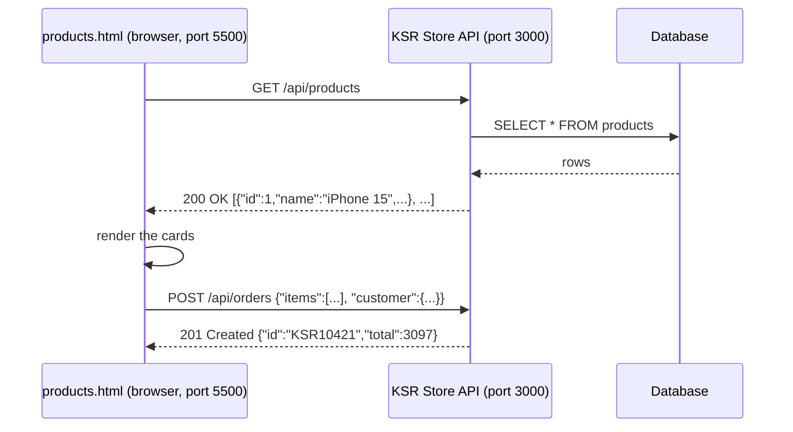
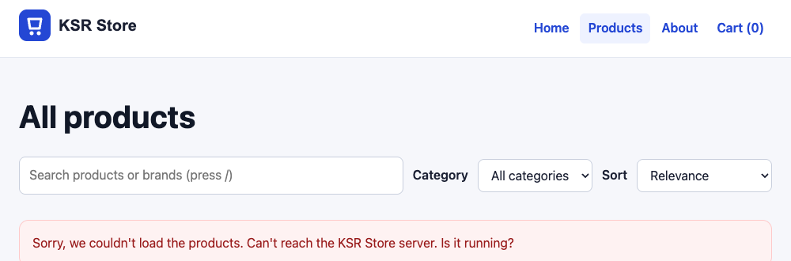
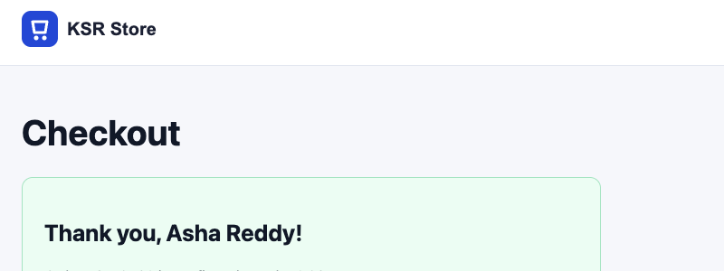

# Fetch & APIs

!!! abstract "Learning Objectives"
    By the end of this lesson, you can:

    - Explain how a frontend talks to a backend **REST API** with HTTP and JSON
    - Load data with **`fetch`**, check **`response.ok`** and status codes, and parse JSON
    - Show **loading**, **empty** and **error** states for every request
    - Send data with a **POST** request and a JSON body
    - Explain **CORS**, and connect the frontend to Django, FastAPI or Spring Boot

**Prerequisites:** [Asynchronous JavaScript](09-async-javascript.md). The backend modules ([FastAPI](../../python/fastapi/index.md), [Django REST Framework](../../python/django/09-django-rest-framework.md)) are helpful but not required.

## Frontend + Backend

Until now, the product list lived in a JavaScript file. In a real shop, products, stock and orders live in a **database** on a server, and the frontend asks for them through an **API**:



| HTTP method | Meaning | KSR Store example |
|-------------|---------|-------------------|
| `GET` | Read | `GET /api/products`, `GET /api/products/9` |
| `POST` | Create | `POST /api/orders` |
| `PUT` / `PATCH` | Replace / update | `PATCH /api/cart/items/3` |
| `DELETE` | Delete | `DELETE /api/cart/items/3` |

## A Small KSR Store API

So that this lesson works for **every** student (Python or Java track), we'll run a tiny API written in Node.js with no extra packages. It reuses `js/products-data.js` as its "database". Create `api/server.js`:

```js title="api/server.js"
import http from "node:http";
import products from "../js/products-data.js";

const PORT = 3000;
const ALLOWED_ORIGIN = "http://127.0.0.1:5500";   // the Live Server address
const orders = [];

function send(res, status, data) {
  res.writeHead(status, {
    "Content-Type": "application/json",
    "Access-Control-Allow-Origin": ALLOWED_ORIGIN,        // CORS: explained later in this lesson
    "Access-Control-Allow-Methods": "GET, POST, OPTIONS",
    "Access-Control-Allow-Headers": "Content-Type",
  });
  res.end(status === 204 ? "" : JSON.stringify(data));
}

async function readJson(req) {
  let body = "";
  for await (const chunk of req) {
    body += chunk;
  }
  return JSON.parse(body || "{}");
}

const server = http.createServer(async (req, res) => {
  const url = new URL(req.url, `http://${req.headers.host}`);
  console.log(req.method, url.pathname + url.search);

  if (req.method === "OPTIONS") {
    return send(res, 204);                                // CORS preflight
  }
  await new Promise(resolve => setTimeout(resolve, 300)); // pretend the network is slow

  if (req.method === "GET" && url.pathname === "/api/products") {
    const q = (url.searchParams.get("q") ?? "").toLowerCase();
    const category = url.searchParams.get("category");
    const results = products.filter(p =>
      p.name.toLowerCase().includes(q) && (!category || p.category === category));
    return send(res, 200, results);
  }

  const match = url.pathname.match(/^\/api\/products\/(\d+)$/);
  if (req.method === "GET" && match) {
    const product = products.find(p => p.id === Number(match[1]));
    return product ? send(res, 200, product) : send(res, 404, { detail: "Product not found" });
  }

  if (req.method === "POST" && url.pathname === "/api/orders") {
    let order;
    try {
      order = await readJson(req);
    } catch {
      return send(res, 400, { detail: "Body must be valid JSON" });
    }
    if (!order.customer?.full_name || !Array.isArray(order.items) || order.items.length === 0) {
      return send(res, 400, { detail: "customer.full_name and at least one item are required" });
    }
    let total = 0;
    for (const { productId, qty } of order.items) {
      const product = products.find(p => p.id === productId);
      if (!product) return send(res, 400, { detail: `Unknown product ${productId}` });
      if (qty > product.stock) return send(res, 400, { detail: `${product.name} is out of stock` });
      total += product.price * qty;                     // prices come from the server, not the browser
    }
    const created = { id: `KSR${10421 + orders.length}`, status: "pending", total, items: order.items };
    orders.push(created);
    return send(res, 201, created);
  }

  send(res, 404, { detail: "Not found" });
});

server.listen(PORT, () => console.log(`KSR Store API running at http://127.0.0.1:${PORT}`));
```

You don't need to understand every line yet (servers are what the backend modules teach). The important parts: three **endpoints**, JSON responses with proper **status codes**, a 300 ms artificial delay so you can see loading states, and an order total calculated from the **server's** prices.

Run it in a **second terminal** and leave it running (++ctrl+c++ stops it):

```{ .bash .no-run }
node api/server.js
```

```{ .text .output }
KSR Store API running at http://127.0.0.1:3000
```

Try the endpoints from the first terminal with `curl` (or open the GET URLs in the browser):

```bash
curl -s http://127.0.0.1:3000/api/products/9
echo
curl -s "http://127.0.0.1:3000/api/products?q=shoe"
echo
curl -s -w "\nHTTP %{http_code}\n" http://127.0.0.1:3000/api/products/999
```

```{ .text .output }
{"id":9,"name":"Atomic Habits","category":"Books","brand":"Penguin","price":499,"stock":80,"rating":4.8,"image":"atomic-habits.svg"}
[{"id":7,"name":"Running Shoes","category":"Fashion","brand":"Puma","price":4299,"stock":60,"rating":4.2,"image":"running-shoes.svg"}]
{"detail":"Product not found"}
HTTP 404
```

## Your First `fetch`

`fetch(url)` sends a request and returns a **promise** for the response:

```html title="fetch-demo.html"
<!DOCTYPE html>
<html lang="en">
<head>
  <meta charset="UTF-8">
  <title>Fetch demo | KSR Store</title>
  <script type="module">
    const response = await fetch("http://127.0.0.1:3000/api/products/9");
    console.log("status:", response.status, response.statusText, "| ok:", response.ok);
    console.log("content type:", response.headers.get("Content-Type"));

    const product = await response.json();              // parse the JSON body (also a promise)
    console.log("product:", product.name, "costs", product.price);

    const missing = await fetch("http://127.0.0.1:3000/api/products/999");
    console.log("missing -> status:", missing.status, "| ok:", missing.ok);
    const error = await missing.json();
    console.log("error body:", error.detail);
  </script>
</head>
<body><h1>Open the console</h1></body>
</html>
```

```{ .text .output page="fetch-demo.html" }
status: 200 OK | ok: true
content type: application/json
product: Atomic Habits costs 499
missing -> status: 404 | ok: false
error body: Product not found
```

Two `await`s: one for the response **headers** to arrive (`fetch`), one for the **body** to be read and parsed (`response.json()`).

!!! warning "A 404 is not an error for `fetch`"
    `fetch` only **rejects** when the request can't be made at all (server down, no internet, CORS blocked). A `404` or `500` response **resolves** normally, with `response.ok === false`. Always check `response.ok` (true for status 200–299) yourself.

## An API Client Module

Put every API call in one module with consistent error handling, just as `cart-store.js` owns the cart:

```js title="js/api.js"
const API_BASE = "http://127.0.0.1:3000/api";

async function request(path, options = {}) {
  let response;
  try {
    response = await fetch(`${API_BASE}${path}`, {
      headers: { "Content-Type": "application/json" },
      ...options,
    });
  } catch {
    throw new Error("Can't reach the KSR Store server. Is it running?");   // network failure
  }
  const data = await response.json().catch(() => ({}));                  // body may be empty
  if (!response.ok) {
    throw new Error(data.detail ?? `Request failed with status ${response.status}`);
  }
  return data;
}

export function getProducts() {
  return request("/products");
}

export function getProduct(id) {
  return request(`/products/${id}`);
}

export function createOrder(order) {
  return request("/orders", { method: "POST", body: JSON.stringify(order) });
}
```

Now pages call `await getProducts()` and only deal with **data** or a readable **error message**. If the API address changes (for example to your Django server), you change one line.

## Loading the Catalogue from the API

Replace `js/catalog.js`. The only differences from the previous lesson are at the top (`products` starts empty and comes from the API) and in the start-up code at the bottom (loading and error states):

```js title="js/catalog.js"
import { getProducts } from "./api.js";
import { addItem, itemCount, updateCartBadge } from "./cart-store.js";

const grid = document.querySelector("#product-grid");
const resultCount = document.querySelector("#result-count");
const searchForm = document.querySelector("#search-form");
const searchInput = document.querySelector("#search");
const categorySelect = document.querySelector("#category");
const sortSelect = document.querySelector("#sort");

let products = [];                       // filled from the API on page load

const formatRupees = amount =>
  amount.toLocaleString("en-IN", { style: "currency", currency: "INR", maximumFractionDigits: 0 });

// ---------- Rendering ----------
function productCard(product) {
  const card = document.createElement("article");
  card.className = "product-card";
  card.dataset.id = product.id;
  const soldOut = product.stock === 0;
  if (soldOut) {
    card.classList.add("is-out-of-stock");
  }
  card.innerHTML = `
    
    <h3></h3>
    <p><span class="brand"></span> · <span class="price">${formatRupees(product.price)}</span>
      ${product.rating >= 4.7 ? '<span class="badge">Bestseller</span>' : ""}</p>
    <p class="stock-label">${soldOut ? "Out of stock" : `${product.stock} in stock`}</p>
    <button type="button" class="add-to-cart" data-id="${product.id}" ${soldOut ? "disabled" : ""}>
      ${soldOut ? "Sold out" : "Add to cart"}
    </button>
  `;
  card.querySelector("img").alt = product.name;
  card.querySelector("h3").textContent = product.name;
  card.querySelector(".brand").textContent = product.brand;
  return card;
}

// ---------- Filtering and sorting ----------
function visibleProducts() {
  const query = searchInput.value.trim().toLowerCase();
  const category = categorySelect.value;

  const matches = products.filter(p =>
    (p.name.toLowerCase().includes(query) || p.brand.toLowerCase().includes(query)) &&
    (category === "" || p.category === category)
  );

  switch (sortSelect.value) {
    case "price-asc":
      return matches.toSorted((a, b) => a.price - b.price);
    case "price-desc":
      return matches.toSorted((a, b) => b.price - a.price);
    case "rating":
      return matches.toSorted((a, b) => b.rating - a.rating);
    default:
      return matches;
  }
}

function render() {
  const list = visibleProducts();
  grid.replaceChildren(...list.map(productCard));
  resultCount.textContent = list.length
    ? `Showing ${list.length} product${list.length === 1 ? "" : "s"}`
    : "No products match your search.";
}

// ---------- Events ----------
searchInput.addEventListener("input", render);
categorySelect.addEventListener("change", render);
sortSelect.addEventListener("change", render);

searchForm.addEventListener("submit", event => {
  event.preventDefault();
  render();
});

grid.addEventListener("click", event => {
  const button = event.target.closest(".add-to-cart");
  if (!button) {
    return;
  }
  const cart = addItem(Number(button.dataset.id));
  console.log(`Added product ${button.dataset.id} - items in cart: ${itemCount(cart)}`);
  button.textContent = "Added ✓";
});

document.addEventListener("keydown", event => {
  if (event.key === "/" && document.activeElement !== searchInput) {
    event.preventDefault();
    searchInput.focus();
  }
});

// ---------- Start: load from the API ----------
updateCartBadge();
resultCount.textContent = "Loading products...";
grid.setAttribute("aria-busy", "true");
try {
  products = await getProducts();
  const categories = [...new Set(products.map(p => p.category))].sort();
  for (const category of categories) {
    categorySelect.append(new Option(category, category));
  }
  render();
  console.log(`Loaded ${products.length} products from the API`);
} catch (error) {
  resultCount.textContent = "";
  const message = document.createElement("p");
  message.className = "error-message";
  message.textContent = `Sorry, we couldn't load the products. ${error.message}`;
  grid.replaceChildren(message);
  console.log("Loading failed:", error.message);
} finally {
  grid.removeAttribute("aria-busy");
}
```

```{ .css .append title="css/style.css" }
.error-message {
  grid-column: 1 / -1;
  padding: var(--space-4);
  background-color: #fef2f2;
  border: 1px solid #fecaca;
  border-radius: var(--radius);
  color: #991b1b;
}
```

```{ .text .output page="products.html" }
Loaded 8 products from the API
```

The page looks exactly the same as before, but the data now comes from the server. Open DevTools' **Network** tab, filter by **Fetch/XHR**, and reload: you'll see the `products` request, its 200 status, the ~300 ms timing and the JSON response.

Every request has three possible outcomes, and the page handles each one:

| State | What the user sees |
|-------|--------------------|
| **Loading** | "Loading products..." (and `aria-busy` for screen readers) |
| **Success** | The cards, or "No products match your search." when the list is empty |
| **Error** | A friendly message saying what went wrong |

Stop the API server (++ctrl+c++) and reload the page:

{ .ksr-shot data-page="products.html" data-width="1000" data-height="330" data-errors="expected" data-block="127.0.0.1:3000" }

(For this screenshot the browser's requests to port 3000 were blocked, which is exactly what happens when the server isn't running.)

## Sending an Order with POST

To send data, give `fetch` a **method**, **headers** and a **body**. Our `createOrder` does it like this:

```{ .js .no-run }
fetch("http://127.0.0.1:3000/api/orders", {
  method: "POST",
  headers: { "Content-Type": "application/json" },   // tell the server the body is JSON
  body: JSON.stringify(order),                        // the body must be a string
});
```

The API validates every order. Try one valid and one invalid order with `curl`:

```bash
curl -s -X POST http://127.0.0.1:3000/api/orders -H "Content-Type: application/json" \
  -d '{"customer": {"full_name": "Ravi Kumar"}, "items": [{"productId": 9, "qty": 2}]}'
echo
curl -s -w "\nHTTP %{http_code}\n" -X POST http://127.0.0.1:3000/api/orders -H "Content-Type: application/json" \
  -d '{"customer": {"full_name": "Ravi Kumar"}, "items": [{"productId": 10, "qty": 1}]}'
```

```{ .text .output }
{"id":"KSR10421","status":"pending","total":998,"items":[{"productId":9,"qty":2}]}
{"detail":"Wings of Fire is out of stock"}
HTTP 400
```

Now connect the checkout page. Replace `js/checkout.js`: validation is the same as in lesson 7, and the submit handler now sends the cart to the API:

```js title="js/checkout.js"
import { createOrder } from "./api.js";
import { loadCart, clearCart, itemCount } from "./cart-store.js";

const form = document.querySelector(".checkout-form");
const submitButton = form.querySelector('button[type="submit"]');
form.noValidate = true;

function errorFor(input) {
  const anchor = input.closest("label") ?? input;
  let error = anchor.nextElementSibling;
  if (!error?.classList.contains("field-error")) {
    error = document.createElement("p");
    error.className = "field-error";
    error.id = `${input.name}-error`;
    anchor.after(error);
    input.setAttribute("aria-describedby", error.id);
  }
  return error;
}

function messageFor(input) {
  const v = input.validity;
  if (v.valueMissing) return input.type === "checkbox" ? "Please accept the terms to continue." : "This field is required.";
  if (v.typeMismatch) return "Enter a valid email address, like name@example.com.";
  if (v.patternMismatch) return `Please enter a ${input.title}.`;
  if (v.tooShort) return `Use at least ${input.minLength} characters.`;
  return "";
}

function validateField(input) {
  const message = messageFor(input);
  errorFor(input).textContent = message;
  input.setAttribute("aria-invalid", String(message !== ""));
  return message === "";
}

function showMessage(className, title, text) {
  const box = document.createElement("section");
  box.className = className;
  const heading = document.createElement("h2");
  heading.textContent = title;
  const paragraph = document.createElement("p");
  paragraph.textContent = text;
  box.append(heading, paragraph);
  return box;
}

form.addEventListener("focusout", event => {
  if (event.target.matches("[required]")) {
    validateField(event.target);
  }
});

form.addEventListener("submit", async event => {
  event.preventDefault();
  const results = [...form.querySelectorAll("[required]")].map(validateField);
  if (results.includes(false)) {
    form.querySelector('[aria-invalid="true"]').focus();
    return;
  }

  const cart = loadCart();
  if (itemCount(cart) === 0) {
    form.before(showMessage("error-message", "Your cart is empty", "Add some products before checking out."));
    return;
  }

  const customer = Object.fromEntries(new FormData(form));
  const order = {
    customer,
    items: Object.entries(cart).map(([productId, qty]) => ({ productId: Number(productId), qty })),
  };

  submitButton.disabled = true;                      // stop double submits
  submitButton.textContent = "Placing order...";
  try {
    const created = await createOrder(order);
    console.log("Order created:", JSON.stringify(created));
    clearCart();
    form.replaceWith(showMessage("confirmation", `Thank you, ${customer.full_name}!`,
      `Order ${created.id} is confirmed. Total: ₹${created.total.toLocaleString("en-IN")}.`));
  } catch (error) {
    console.log("Order failed:", error.message);
    form.before(showMessage("error-message", "We couldn't place your order", error.message));
    submitButton.disabled = false;
    submitButton.textContent = "Place order";
  }
});
```

The full journey, in one browser session: add the Airdopes twice and Atomic Habits once on the catalogue, go to checkout, fill in the form and place the order:

```{ .text .output page="products.html" actions="click:.product-card[data-id='3'] .add-to-cart | click:.product-card[data-id='3'] .add-to-cart | click:.product-card[data-id='9'] .add-to-cart | goto:checkout.html | fill:#full-name=Asha Reddy | fill:#email=asha@example.com | fill:#phone=9876500001 | fill:#address=12 MG Road, Ameerpet | fill:#city=Hyderabad | fill:#pincode=500016 | select:#slot=evening | check:input[name=terms] | click:button[type=submit] | wait:800 | eval:console.log('cart after order:', localStorage.getItem('ksr-cart'))" }
Loaded 8 products from the API
Added product 3 - items in cart: 1
Added product 3 - items in cart: 2
Added product 9 - items in cart: 3
Order created: {"id":"KSR10422","status":"pending","total":3097,"items":[{"productId":3,"qty":2},{"productId":9,"qty":1}]}
cart after order: null
```

{ .ksr-shot data-page="products.html" data-width="800" data-height="300" data-actions="click:.product-card[data-id='3'] .add-to-cart | click:.product-card[data-id='3'] .add-to-cart | click:.product-card[data-id='9'] .add-to-cart | goto:checkout.html | fill:#full-name=Asha Reddy | fill:#email=asha@example.com | fill:#phone=9876500001 | fill:#address=12 MG Road, Ameerpet | fill:#city=Hyderabad | fill:#pincode=500016 | select:#slot=evening | check:input[name=terms] | click:button[type=submit] | wait:800 | eval:window.scrollTo(0, 0)" }

The server calculated the total (₹3,097) from **its own** prices: the browser only sent product ids and quantities. The order number depends on how many orders the server has received since it started.

## CORS: Why the API Sends Special Headers

Our page runs at `http://127.0.0.1:5500` and the API at `http://127.0.0.1:3000`. A different **port** means a different **origin**, and browsers block JavaScript from reading responses from another origin **unless the server allows it**. This is the **same-origin policy**, and the permission system is **CORS** (Cross-Origin Resource Sharing).

```bash
curl -s -D - -o /dev/null http://127.0.0.1:3000/api/products/9 | grep -i "^access-control"
```

```{ .text .output }
Access-Control-Allow-Origin: http://127.0.0.1:5500
Access-Control-Allow-Methods: GET, POST, OPTIONS
Access-Control-Allow-Headers: Content-Type
```

That `Access-Control-Allow-Origin` header is the server saying "pages from `http://127.0.0.1:5500` may read my responses". For a POST with JSON, the browser first sends an **OPTIONS "preflight"** request to ask permission, which our server answers with `204`.

Without the header, you'd see this in the console (and `fetch` would reject):

```{ .text .no-run }
Access to fetch at 'http://127.0.0.1:3000/api/products' from origin 'http://127.0.0.1:5500'
has been blocked by CORS policy: No 'Access-Control-Allow-Origin' header is present on the requested resource.
```

!!! tip "CORS is fixed on the server"
    CORS errors can't be fixed in frontend code: the **server** must send the headers. `curl` and Postman never show CORS errors because they aren't browsers.

## Using Your Real Backend

The same frontend works with the backends from the other modules. Change `API_BASE` in `js/api.js`, enable CORS on the server, and adjust for each API's response shape:

| Backend | Products URL | Enable CORS for `http://127.0.0.1:5500` | Notes |
|---------|--------------|------------------------------------------|-------|
| **Django REST Framework** (Django lesson 9) | `http://127.0.0.1:8000/api/products/` | `pip install django-cors-headers`, add its middleware, `CORS_ALLOWED_ORIGINS = ["http://127.0.0.1:5500"]` | Lists are paginated: use `data.results`; `category` is a slug; price is a string (`Number(p.price)`) |
| **FastAPI** (FastAPI lesson 12) | The FastAPI module builds AcmeHR, an HR system, so add a small `/products` router over `ksr_shop` yourself (FastAPI lessons 05–07 show how) | `app.add_middleware(CORSMiddleware, allow_origins=["http://127.0.0.1:5500"], ...)` | Errors use `detail`, like our mock API |
| **Spring Boot** | `http://localhost:8080/api/products` | `@CrossOrigin(origins = "http://127.0.0.1:5500")` on the controller, or a `WebMvcConfigurer` | Field names follow your Java DTOs |

For Django, the only code change is one line in `getProducts`:

```{ .js .no-run }
export async function getProducts() {
  const data = await request("/products/");
  return data.results.map(p => ({ ...p, price: Number(p.price) }));
}
```

!!! realworld "In Real Projects"
    Frontends and backends are often separate projects, deployed separately, talking only through JSON APIs. Teams keep all requests in an API module (or use a library such as Axios, or React Query for caching), always handle loading, empty and error states, disable buttons while a request is running, never trust prices or totals from the browser, and configure CORS on the server for exactly the frontend's origin. The API address comes from configuration (for example `import.meta.env.VITE_API_URL` in React projects), not hard-coded strings.

## Common Mistakes

| Mistake | Symptom | Fix |
|---------|---------|-----|
| Not checking `response.ok` | A 404 or 500 is treated as data | `if (!response.ok) throw ...` |
| Forgetting `await response.json()` | You get a `Promise` or a `Response`, not the data | `const data = await response.json();` |
| Sending an object as the body | The server receives `[object Object]` | `body: JSON.stringify(order)` |
| Missing `Content-Type: application/json` | The server can't read the body (`422`, `400`, empty data) | Add the header |
| CORS error in the console | `fetch` rejects; works in `curl` but not the browser | Allow the frontend origin on the server |
| Opening the page from `file://` | CORS and module errors | Use Live Server |
| No loading or error state | A blank page while waiting or when the server fails | Show both, every time |
| Double-clicking "Place order" | Two orders | Disable the button while the request runs |

## Practice Exercises

**Easy**

1. In the browser console on any KSR page, fetch `http://127.0.0.1:3000/api/products/1` and log the product's name and stock.
2. Add a `getProductsByCategory(category)` function to `api.js` that calls `/products?category=...` (use `encodeURIComponent`).
3. Show the number of milliseconds the products request took under the result count (`performance.now()` before and after).

**Medium**

4. Make the search box query the **server** (`/products?q=...`) instead of filtering locally, waiting 300 ms after the user stops typing (debounce with `setTimeout` / `clearTimeout`).
5. Build `product.html?id=9`: read the id with `new URLSearchParams(location.search)`, fetch that product, show it, and show "Product not found" for a 404.
6. Show a skeleton (grey placeholder cards) while products are loading, instead of the text message.

**Challenge**

7. Add `GET /api/orders/:id` to the server, and an `order-status.html?id=KSR10421` page that loads the order, shows its items with names (fetching the products in parallel with `Promise.all`), and refreshes the status every 10 seconds with `setInterval`.

??? success "Solutions (click to expand)"

    ```{ .js .no-run }
    // 1
    const p = await (await fetch("http://127.0.0.1:3000/api/products/1")).json();
    console.log(p.name, p.stock);

    // 2
    export function getProductsByCategory(category) {
      return request(`/products?category=${encodeURIComponent(category)}`);
    }

    // 4
    let timer;
    searchInput.addEventListener("input", () => {
      clearTimeout(timer);
      timer = setTimeout(async () => {
        products = await request(`/products?q=${encodeURIComponent(searchInput.value)}`);
        render();
      }, 300);
    });

    // 5
    const id = new URLSearchParams(location.search).get("id");
    try {
      const product = await getProduct(id);
      renderProduct(product);
    } catch (error) {
      main.textContent = error.message;   // "Product not found"
    }
    ```

!!! note "Mini Assignment"
    Connect your own business site to an API: either extend the mock server with your data, or use the backend you built in the Python or Java track. Load your catalogue with `fetch` through an `api.js` module, handle loading, empty and error states, and submit your booking form as a POST with a JSON body, showing the server's confirmation or its error message.

## Interview Questions

!!! interview "1. How does `fetch` work?"
    `fetch(url, options)` sends an HTTP request and returns a promise that resolves to a `Response` when the headers arrive. You then read the body with `response.json()`, `text()` or `blob()` (also promises). It rejects only on network failures, not on HTTP error statuses.

!!! interview "2. Why do you need to check `response.ok`?"
    Because `fetch` resolves for every HTTP response, including 404 and 500. `response.ok` is true only for statuses 200–299, so checking it (and throwing otherwise) is how you turn HTTP errors into errors your code can catch.

!!! interview "3. What is CORS?"
    Cross-Origin Resource Sharing: a browser security mechanism that, by default, prevents a page from reading responses from a different origin (scheme, host or port). The server opts in by sending headers like `Access-Control-Allow-Origin`; for non-simple requests, the browser first sends an OPTIONS preflight to check permission.

!!! interview "4. How do you send JSON with `fetch`?"
    Use `method: "POST"` (or PUT / PATCH), the header `Content-Type: application/json`, and `body: JSON.stringify(data)`. Then check `response.ok` and parse the response body.

!!! interview "5. Why shouldn't the browser send the order total to the server?"
    Anything in the browser can be changed by the user (DevTools, edited requests). The server must calculate prices, discounts and totals from its own data and validate stock; the client only sends ids and quantities.

!!! interview "Scenario: the API works in Postman but the browser console shows a CORS error. What do you do?"
    Postman isn't subject to the same-origin policy. Configure the server to allow the frontend's exact origin (for example `django-cors-headers` with `CORS_ALLOWED_ORIGINS`, FastAPI's `CORSMiddleware`, or Spring's `@CrossOrigin`), including the methods and headers used, and make sure OPTIONS preflight requests are answered.

## Summary

| Task | Code |
|------|------|
| GET | `const res = await fetch(url); const data = await res.json();` |
| Check errors | `if (!res.ok) throw new Error(data.detail ?? res.status)` |
| POST JSON | `fetch(url, { method: "POST", headers: { "Content-Type": "application/json" }, body: JSON.stringify(obj) })` |
| API module | `request(path, options)` + `getProducts()`, `createOrder()` |
| States | Loading → success / empty → error, every request |
| Double submit | `button.disabled = true` while waiting |
| CORS | The **server** sends `Access-Control-Allow-Origin` for your frontend's origin |
| Real backends | Change `API_BASE`, enable CORS, adapt to the response shape |

**Next lesson:** [Modules, Classes, Errors & Capstone](11-modules-classes-errors-capstone.md), organising the code, a `Cart` class, error handling and debugging, and the final project.
