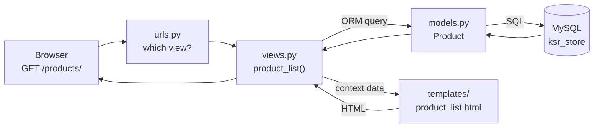

# Introduction & Setup

!!! abstract "Learning Objectives"
    By the end of this lesson, you can:

    - Explain what Django is, its "batteries included" philosophy, and when to choose it over FastAPI
    - Describe the **MTV** pattern (Model, Template, View) and how a request flows through Django
    - Create a Django **project** and an **app**, and explain the purpose of each generated file
    - Connect Django to **MySQL** using `mysql-connector-python`
    - Run migrations, start the development server and write your first view

**Prerequisites:** [FastAPI](../fastapi/index.md) (you know HTTP, routing and the ORM idea) and the [MySQL](../../database/index.md) module.

## What is Django?

**Django** is a full-featured Python web framework for building complete web applications: pages, forms, login, an admin panel, a database layer and APIs, all in one consistent package. Its motto is *"the web framework for perfectionists with deadlines"*.

In the FastAPI module you assembled pieces yourself: SQLAlchemy for the database, PyJWT for tokens, bcrypt for passwords, Alembic for migrations. Django ships all of these built in, designed to work together. This is called **"batteries included"**.

| Built into Django | What you used with FastAPI |
|-------------------|----------------------------|
| ORM + migrations | SQLAlchemy + Alembic |
| User accounts, login, password hashing, permissions | Your own `users` table, bcrypt, PyJWT |
| Admin panel (auto-generated CRUD UI) | Nothing; you'd build it yourself |
| Forms with validation and CSRF protection | Pydantic (for JSON only) |
| Templates for HTML pages | Not covered (API only) |
| Sessions, messages, caching, email | Extra libraries |

!!! example "Real-life analogy: a furnished apartment"
    FastAPI is like an empty flat: you choose and fit every piece of furniture yourself, which is flexible and lightweight. Django is a **fully furnished apartment**: the kitchen, beds and wardrobes are already there and they match. You move in and start living on day one, and you can still swap any piece later.

### Django or FastAPI?

| Choose **Django** when… | Choose **FastAPI** when… |
|-------------------------|--------------------------|
| You're building a full website or product with users, admin staff and many models | You're building a focused API or microservice |
| You want an admin panel for non-technical staff, for free | Raw performance and async I/O matter most (AI model serving, real-time) |
| You want conventions, so a team can move fast and stay consistent | You want to pick every component yourself |
| E-commerce sites, CMSs, school/hospital/ERP systems, SaaS dashboards | ML inference APIs, gateways, small services |

!!! realworld "In Real Projects"
    Instagram, Pinterest, Mozilla, Disqus and many Indian startups and government portals run on Django. It's one of the most requested skills in Python full stack job listings, often alongside **Django REST Framework** (DRF), which you'll learn in lesson 09. Many companies use both: Django for the main product and admin, FastAPI for specialised high-performance services.

## The MTV Pattern

Django organises code into three roles:

| Letter | Part | Responsibility | File |
|--------|------|----------------|------|
| **M** | **Model** | The data: tables, fields, relationships, queries | `models.py` |
| **T** | **Template** | The presentation: HTML with placeholders | `templates/*.html` |
| **V** | **View** | The logic: take a request, use models, return a response | `views.py` |

Plus **URLs** (`urls.py`) that map addresses to views.



(If you've heard of MVC, Django's *View* plays the role of MVC's *Controller*, and Django's *Template* is MVC's *View*. Same idea, different names.)

## Project vs App

| | **Project** | **App** |
|---|---|---|
| What | The whole website: settings, root URLs, deployment config | One feature area of the site |
| How many | One per website | Many per project |
| Created with | `django-admin startproject` | `python manage.py startapp` |
| KSR Store example | `config` | `shop` (products, orders), `accounts` (login, sign-up) |

!!! tip "Think in apps"
    A good app does one thing and could, in principle, be reused in another project. A blog app, a payments app, an accounts app. Django itself is built this way: the admin, auth and sessions are all apps you'll see in `INSTALLED_APPS`.

Throughout this module you'll build the **KSR Store**: a Django website and API for the same online shop you modelled in the MySQL module and served with FastAPI. This time Django will manage the tables itself.

## Creating the Project

Create a folder and virtual environment, then install Django and the MySQL driver you already know:

```{ .bash .no-run }
mkdir ksr-store
cd ksr-store
python -m venv .venv
source .venv/bin/activate          # Windows: .venv\Scripts\activate
pip install django mysql-connector-python
```

Create the project **in the current folder** (note the `.` at the end) and the first app:

```bash
django-admin startproject config .
python manage.py startapp shop
```

```bash
find . -name "*.py" -not -path "./.venv/*" | sort
```

```{ .text .output }
./config/__init__.py
./config/asgi.py
./config/settings.py
./config/urls.py
./config/wsgi.py
./manage.py
./shop/__init__.py
./shop/admin.py
./shop/apps.py
./shop/migrations/__init__.py
./shop/models.py
./shop/tests.py
./shop/views.py
```

| File | Purpose |
|------|---------|
| `manage.py` | Command-line tool for this project: run the server, migrations, shell, tests |
| `config/settings.py` | All configuration: database, installed apps, templates, security |
| `config/urls.py` | The root URL table |
| `config/wsgi.py`, `config/asgi.py` | Entry points for production servers |
| `shop/models.py` | Database models for this app |
| `shop/views.py` | Views (request handlers) |
| `shop/admin.py` | Admin panel registration |
| `shop/apps.py` | App configuration |
| `shop/tests.py` | Tests |
| `shop/migrations/` | Generated database migration files |

!!! mistake "Common Mistake: forgetting the dot"
    `django-admin startproject config` (no dot) creates an extra nested folder, `config/config/`, and `manage.py` ends up one level deeper than you expect. With the dot, `manage.py` sits in your project root next to `config/`.

## Connecting to MySQL

Create an empty database for Django in MySQL (Workbench or the CLI):

```{ .sql .no-run }
CREATE DATABASE ksr_store CHARACTER SET utf8mb4;
```

Django will create **its own tables** in it through migrations. We use a new database rather than `ksr_shop` so Django can manage the schema from scratch.

Now replace `config/settings.py` with this clean version. It reads secrets and database details from **environment variables**, as you learned in the FastAPI module:

```python title="config/settings.py"
import os
from pathlib import Path

BASE_DIR = Path(__file__).resolve().parent.parent

SECRET_KEY = os.environ.get("DJANGO_SECRET_KEY", "dev-only-insecure-key-change-me")
DEBUG = os.environ.get("DJANGO_DEBUG", "true").lower() == "true"
ALLOWED_HOSTS = ["127.0.0.1", "localhost"]

INSTALLED_APPS = [
    "django.contrib.admin",
    "django.contrib.auth",
    "django.contrib.contenttypes",
    "django.contrib.sessions",
    "django.contrib.messages",
    "django.contrib.staticfiles",
    "shop",
]

MIDDLEWARE = [
    "django.middleware.security.SecurityMiddleware",
    "django.contrib.sessions.middleware.SessionMiddleware",
    "django.middleware.common.CommonMiddleware",
    "django.middleware.csrf.CsrfViewMiddleware",
    "django.contrib.auth.middleware.AuthenticationMiddleware",
    "django.contrib.messages.middleware.MessageMiddleware",
    "django.middleware.clickjacking.XFrameOptionsMiddleware",
]

ROOT_URLCONF = "config.urls"

TEMPLATES = [
    {
        "BACKEND": "django.template.backends.django.DjangoTemplates",
        "DIRS": [BASE_DIR / "templates"],
        "APP_DIRS": True,
        "OPTIONS": {
            "context_processors": [
                "django.template.context_processors.request",
                "django.contrib.auth.context_processors.auth",
                "django.contrib.messages.context_processors.messages",
            ],
        },
    },
]

WSGI_APPLICATION = "config.wsgi.application"

DATABASES = {
    "default": {
        "ENGINE": "mysql.connector.django",
        "NAME": os.environ.get("DB_NAME", "ksr_store"),
        "USER": os.environ.get("DB_USER", "root"),
        "PASSWORD": os.environ.get("DB_PASSWORD", ""),
        "HOST": os.environ.get("DB_HOST", "localhost"),
        "PORT": os.environ.get("DB_PORT", "3306"),
    }
}

AUTH_PASSWORD_VALIDATORS = [
    {"NAME": "django.contrib.auth.password_validation.UserAttributeSimilarityValidator"},
    {"NAME": "django.contrib.auth.password_validation.MinimumLengthValidator"},
    {"NAME": "django.contrib.auth.password_validation.CommonPasswordValidator"},
    {"NAME": "django.contrib.auth.password_validation.NumericPasswordValidator"},
]

LANGUAGE_CODE = "en-in"
TIME_ZONE = "Asia/Kolkata"
USE_I18N = True
USE_TZ = True

STATIC_URL = "static/"
STATICFILES_DIRS = [BASE_DIR / "static"]

DEFAULT_AUTO_FIELD = "django.db.models.BigAutoField"
```

| Setting | Meaning |
|---------|---------|
| `SECRET_KEY` | Signs sessions, CSRF tokens and password-reset links. Must be secret in production |
| `DEBUG` | Detailed error pages. **Never `True` in production** |
| `ALLOWED_HOSTS` | Which domain names this site answers to |
| `INSTALLED_APPS` | Django's built-in apps + yours (`"shop"`) |
| `MIDDLEWARE` | Code that runs on every request: sessions, CSRF, auth (like FastAPI middleware) |
| `TEMPLATES["DIRS"]` | Extra folder for site-wide templates |
| `DATABASES` | `mysql.connector.django` is the Django backend that ships with `mysql-connector-python` |
| `TIME_ZONE` | `Asia/Kolkata` so times display in IST |

Set your database password for this terminal session:

=== "macOS / Linux"

    ```{ .bash .no-run }
    export DB_PASSWORD='your-mysql-password'
    ```

=== "Windows (Command Prompt)"

    ```{ .bash .no-run }
    set DB_PASSWORD=your-mysql-password
    ```

Create the folders the settings refer to, and check the configuration:

```bash
mkdir -p templates static
python manage.py check
```

```{ .text .output }
System check identified no issues (0 silenced).
```

## Migrations: Django Creates the Tables

Django's built-in apps (auth, admin, sessions) need tables. **Migrations** create them:

```bash
python manage.py migrate
```

```{ .text .output }
Operations to perform:
  Apply all migrations: admin, auth, contenttypes, sessions
Running migrations:
  Applying contenttypes.0001_initial... OK
  Applying auth.0001_initial... OK
  Applying admin.0001_initial... OK
  Applying admin.0002_logentry_remove_auto_add... OK
  Applying admin.0003_logentry_add_action_flag_choices... OK
  Applying contenttypes.0002_remove_content_type_name... OK
  Applying auth.0002_alter_permission_name_max_length... OK
  Applying auth.0003_alter_user_email_max_length... OK
  Applying auth.0004_alter_user_username_opts... OK
  Applying auth.0005_alter_user_last_login_null... OK
  Applying auth.0006_require_contenttypes_0002... OK
  Applying auth.0007_alter_validators_add_error_messages... OK
  Applying auth.0008_alter_user_username_max_length... OK
  Applying auth.0009_alter_user_last_name_max_length... OK
  Applying auth.0010_alter_group_name_max_length... OK
  Applying auth.0011_update_proxy_permissions... OK
  Applying auth.0012_alter_user_first_name_max_length... OK
  Applying sessions.0001_initial... OK
```

Each line is a migration file being applied: a versioned, repeatable change to the database schema. Look in MySQL Workbench: `ksr_store` now has tables like `auth_user`, `django_session` and `django_migrations` (which records what has been applied).

```bash
python manage.py showmigrations auth | head -5
```

```{ .text .output }
auth
 [X] 0001_initial
 [X] 0002_alter_permission_name_max_length
 [X] 0003_alter_user_email_max_length
 [X] 0004_alter_user_username_opts
```

`[X]` means applied. You'll write your own migrations in lesson 03.

## Your First View

A **view** is a function that receives a **request** and returns a **response**:

```python title="shop/views.py"
from django.http import HttpResponse, JsonResponse


def home(request):
    return HttpResponse("<h1>Welcome to KSR Store</h1><p>Built with Django.</p>")


def health(request):
    return JsonResponse({"status": "ok", "framework": "Django"})
```

Connect URLs to the views. Each app gets its own `urls.py`:

```python title="shop/urls.py"
from django.urls import path

from . import views

app_name = "shop"

urlpatterns = [
    path("", views.home, name="home"),
    path("health/", views.health, name="health"),
]
```

And the project's root URL table includes the app's URLs:

```python title="config/urls.py"
from django.contrib import admin
from django.urls import include, path

urlpatterns = [
    path("admin/", admin.site.urls),
    path("", include("shop.urls")),
]
```

Start the development server:

```{ .bash .no-run }
python manage.py runserver
```

```{ .text .output }
Watching for file changes with StatReloader
Performing system checks...

System check identified no issues (0 silenced).
October 31, 2026 - 10:00:00
Django version 6.1.2, using settings 'config.settings'
Starting WSGI development server at http://127.0.0.1:8000/
Quit the server with CONTROL-C.

WARNING: This is a development server. Do not use it in a production setting. Use a production WSGI or ASGI server instead.
For more information on production servers see: https://docs.djangoproject.com/en/6.1/howto/deployment/
```

Open **http://127.0.0.1:8000/** in the browser, or use curl:

```bash
curl -s http://127.0.0.1:8000/
```

```{ .text .output }
<h1>Welcome to KSR Store</h1><p>Built with Django.</p>
```

```bash
curl -s http://127.0.0.1:8000/health/
```

```{ .text .output }
{
  "status": "ok",
  "framework": "Django"
}
```

A URL that doesn't exist shows Django's **debug 404 page** (because `DEBUG=True`), which lists the URL patterns it tried:

```bash
curl -s http://127.0.0.1:8000/products/ | grep -oE "<title>[^<]*</title>|tried these URL patterns"
```

```{ .text .output }
<title>Page not found at /products/</title>
tried these URL patterns
```

!!! warning "The debug page is for you, not the public"
    The detailed error pages reveal your URL structure, settings and code. That's why `DEBUG` must be `False` in production, where Django shows a plain "Not Found" page instead. Lesson 11 covers production settings.

## Common Mistakes

| Mistake | Error / Symptom | Fix |
|---------|-----------------|-----|
| venv not active | `django-admin: command not found` / `No module named 'django'` | Activate `.venv`, then `pip install django` |
| MySQL driver missing | `django.core.exceptions.ImproperlyConfigured: 'mysql.connector.django' isn't an available database backend` | `pip install mysql-connector-python` |
| Wrong password / DB doesn't exist | `ProgrammingError: 1045 (28000): Access denied` / `1049 (42000): Unknown database 'ksr_store'` | Set `DB_PASSWORD`; create the database |
| App not in `INSTALLED_APPS` | Models and templates of the app ignored | Add `"shop"` |
| Missing trailing slash in the URL | Redirect (or 404 for POST) | Django URLs end with `/` by convention (`health/`) |
| `include` not imported | `NameError: name 'include' is not defined` | `from django.urls import include, path` |
| Port 8000 busy | `Error: That port is already in use.` | `python manage.py runserver 8001` |
| Forgot to `migrate` | "You have 18 unapplied migration(s)" warning; admin and login fail | `python manage.py migrate` |

## Practice Exercises

**Easy**

1. Add a view at `/about/` that returns an HTML paragraph about the store.
2. Add `/time/` that returns the current server time as JSON (use `django.utils.timezone.now()`).
3. Run `python manage.py help` and list five commands you haven't used yet.

**Medium**

4. Create a second app called `pages` with `/contact/` and `/faq/` views, and include its URLs in `config/urls.py`.
5. Add a URL with a path converter, `/hello/<str:name>/`, that greets the visitor by name.
6. Change `TIME_ZONE` back to `"UTC"`, call `/time/` again, and explain the difference.

**Challenge**

7. In MySQL Workbench, look at the `auth_user` and `django_migrations` tables. Write SQL that lists every applied migration of the `auth` app in the order it was applied. What does this table let Django do?

??? success "Solutions (click to expand)"

    ```{ .python .no-run }
    # 1, 2 (shop/views.py)
    from django.utils import timezone

    def about(request):
        return HttpResponse("<p>KSR Store sells electronics, fashion and books across India.</p>")

    def server_time(request):
        return JsonResponse({"time": timezone.now().isoformat()})

    # shop/urls.py: path("about/", views.about, name="about"), path("time/", views.server_time, name="time")

    # 5
    def hello(request, name):
        return HttpResponse(f"<h2>Hello, {name}!</h2>")
    # path("hello/<str:name>/", views.hello, name="hello")
    ```

    ```{ .bash .no-run }
    # 4
    python manage.py startapp pages
    # add "pages" to INSTALLED_APPS, create pages/urls.py, then in config/urls.py:
    # path("", include("pages.urls")),
    ```

    ```{ .sql .no-run }
    -- 7
    SELECT name, applied FROM django_migrations WHERE app = 'auth' ORDER BY applied, id;
    -- Django uses this table to know which migrations have run, so `migrate` only applies new ones.
    ```

!!! note "Mini Assignment"
    Create your **KSR Store** repository: the project with the `shop` app, MySQL settings from environment variables, a `.gitignore` (`.venv/`, `__pycache__/`, `.env`, `db.sqlite3`), a `requirements.txt`, and `home`, `health` and `about` views. Push it to GitHub with a README that explains how to create the database and run the server.

## Interview Questions

!!! interview "1. What is Django and what does 'batteries included' mean?"
    A high-level Python web framework for building complete web applications quickly. "Batteries included" means common needs (ORM, migrations, authentication, admin, forms, templates, sessions, security protections) come built in and designed to work together, rather than as separate libraries.

!!! interview "2. Explain the MTV architecture."
    Model (data and business logic tied to the database), Template (presentation: HTML with template tags) and View (request handling logic that uses models and returns a response, often by rendering a template). URL configuration maps incoming URLs to views.

!!! interview "3. What is the difference between a Django project and an app?"
    A project is the whole web application: settings, root URLs and deployment configuration. An app is a self-contained module for one feature area (shop, accounts, blog) with its own models, views, templates and migrations. A project contains many apps; an app can be reused across projects.

!!! interview "4. What does `python manage.py migrate` do?"
    It applies pending migrations, the versioned schema changes generated from models, to the database, and records each applied migration in the `django_migrations` table so it's never applied twice.

!!! interview "5. When would you choose Django over FastAPI?"
    For full web products with many models, user accounts, an admin back office, forms and server-rendered pages, where Django's integrated features and conventions save a lot of time. FastAPI suits lean, high-performance or async-heavy APIs and microservices.

!!! interview "Scenario: a new developer runs the project and gets `Unknown database 'ksr_store'`. What do you tell them?"
    Django doesn't create the database itself, only the tables inside it. Create it with `CREATE DATABASE ksr_store CHARACTER SET utf8mb4;`, set the `DB_*` environment variables (especially `DB_PASSWORD`), then run `python manage.py migrate`.

## Summary

| Concept | Remember |
|---------|----------|
| Django | Batteries-included web framework: ORM, admin, auth, forms, templates |
| MTV | Model (data) · Template (HTML) · View (logic) + URLs |
| Project / app | `django-admin startproject config .` · `python manage.py startapp shop` |
| MySQL | `pip install mysql-connector-python` · `ENGINE: "mysql.connector.django"` |
| Settings | Secrets and DB details from environment variables; `DEBUG` off in production |
| Migrations | `python manage.py migrate` creates and updates tables |
| Server | `python manage.py runserver` → http://127.0.0.1:8000/ |
| First view | `def home(request): return HttpResponse(...)` + `path("", views.home)` |

**Next lesson:** [URLs, Views & Templates](02-urls-views-templates.md), building real HTML pages with Django templates.
