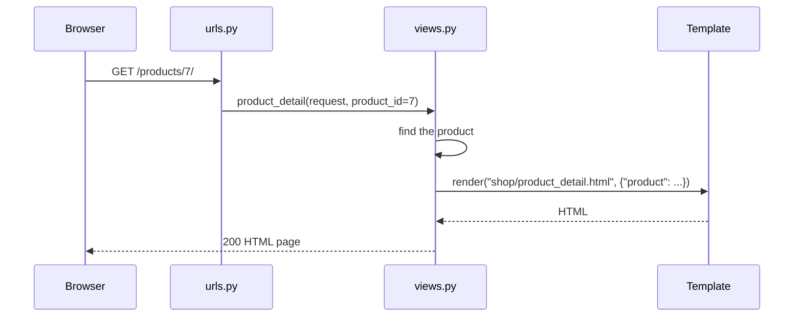
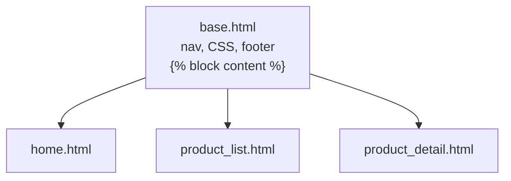

# URLs, Views & Templates

!!! abstract "Learning Objectives"
    By the end of this lesson, you can:

    - Map URLs to views with `path()`, path converters and named URLs
    - Read query parameters from `request.GET` and return `404` and redirects
    - Render HTML with `render()` and pass data to templates through a **context**
    - Use the Django template language: variables, filters, ``, ``, ``
    - Share a layout with **template inheritance**, and serve CSS with **static files**

**Prerequisites:** [Introduction & Setup](01-introduction-and-setup.md)

## How a Page Request Works



1. Django matches the URL against the patterns in `urls.py`, top to bottom.
2. It calls the matching **view** with the `request` (and any values captured from the URL).
3. The view gathers data and **renders a template** with it.
4. The HTML goes back to the browser.

We don't have database models yet (that's lesson 03), so this lesson uses a small Python list of products. The views and templates you write now will barely change when the data moves to MySQL.

```python title="shop/data.py"
PRODUCTS = [
    {"id": 1, "name": "iPhone 15", "category": "Electronics", "brand": "Apple", "price": 79999, "stock": 25},
    {"id": 3, "name": "Airdopes 141", "category": "Electronics", "brand": "boAt", "price": 1299, "stock": 200},
    {"id": 6, "name": "Denim Jacket", "category": "Fashion", "brand": "Levis", "price": 3499, "stock": 40},
    {"id": 7, "name": "Running Shoes", "category": "Fashion", "brand": "Puma", "price": 4299, "stock": 60},
    {"id": 9, "name": "Atomic Habits", "category": "Books", "brand": "Penguin", "price": 499, "stock": 80},
    {"id": 10, "name": "Wings of Fire", "category": "Books", "brand": "Universities Press", "price": 350, "stock": 0},
]
```

## URL Patterns and Path Converters

```python title="shop/urls.py"
from django.urls import path

from . import views

app_name = "shop"

urlpatterns = [
    path("", views.home, name="home"),
    path("health/", views.health, name="health"),
    path("products/", views.product_list, name="product_list"),
    path("products/<int:product_id>/", views.product_detail, name="product_detail"),
    path("category/<slug:category>/", views.category_products, name="category"),
    path("old-shop/", views.old_shop_redirect),
]
```

`<int:product_id>` is a **path converter**: it matches digits, converts them to an `int` and passes them to the view as `product_id`, like FastAPI's typed path parameters.

| Converter | Matches | Example |
|-----------|---------|---------|
| `<int:id>` | Zero or positive integers | `/products/7/` |
| `<str:name>` | Any text except `/` (the default) | `/hello/asha/` |
| `<slug:category>` | Letters, numbers, hyphens, underscores | `/category/home-kitchen/` |
| `<uuid:token>` | A UUID | `/verify/0b2c…/` |
| `<path:rest>` | Any text including `/` | `/files/docs/a.pdf` |

### Named URLs

`name="product_detail"` gives the URL a name. Templates and views refer to URLs **by name**, never by hard-coded paths, so you can change a URL in one place:

```{ .python .no-run }
from django.urls import reverse
reverse("shop:product_detail", args=[7])        # "/products/7/"
```

`app_name = "shop"` creates the **namespace** `shop:`, so two apps can both have a URL named `home` without clashing.

## Views

```python title="shop/views.py"
from django.http import Http404, JsonResponse
from django.shortcuts import redirect, render

from .data import PRODUCTS


def home(request):
    featured = [p for p in PRODUCTS if p["stock"] > 0][:3]
    return render(request, "shop/home.html", {"featured": featured})


def health(request):
    return JsonResponse({"status": "ok", "framework": "Django"})


def product_list(request):
    query = request.GET.get("q", "").strip()
    products = PRODUCTS
    if query:
        products = [p for p in PRODUCTS if query.lower() in p["name"].lower()]
    return render(request, "shop/product_list.html", {"products": products, "query": query})


def product_detail(request, product_id):
    product = next((p for p in PRODUCTS if p["id"] == product_id), None)
    if product is None:
        raise Http404("Product not found")
    return render(request, "shop/product_detail.html", {"product": product})


def category_products(request, category):
    products = [p for p in PRODUCTS if p["category"].lower() == category.lower()]
    return render(request, "shop/product_list.html", {"products": products, "query": "", "category": category})


def old_shop_redirect(request):
    return redirect("shop:product_list")
```

| Tool | What it does |
|------|--------------|
| `render(request, template, context)` | Renders a template with a context dict and returns an `HttpResponse` |
| `request.GET.get("q", "")` | Reads the query parameter `?q=...` (empty string if missing) |
| `request.method`, `request.POST`, `request.user` | Method, form data (lesson 06), logged-in user (lesson 08) |
| `raise Http404(...)` | Returns a 404 page |
| `redirect("shop:product_list")` | Returns a 302 redirect to a named URL |
| `JsonResponse(dict)` | Returns JSON (for full APIs, use DRF in lesson 09) |

## Templates and the Template Language

Templates are HTML files with placeholders. With `APP_DIRS: True`, Django looks for templates in each app's `templates/` folder. By convention you add a subfolder named after the app (`shop/templates/shop/`) so template names never clash between apps.

### Template inheritance: one layout for every page

The site-wide layout lives in the project's `templates/` folder (the `DIRS` setting):

```html title="templates/base.html"

<!doctype html>
<html lang="en">
<head>
  <meta charset="utf-8">
  <title>KSR Store</title>
  <link rel="stylesheet" href="">
</head>
<body>
  <nav>
    <a href="">Home</a>
    <a href="">All products</a>
  </nav>
  <main>
    
  </main>
  <footer>KSR Store · Built with Django</footer>
</body>
</html>
```

Each page **extends** the base and fills in its **blocks**:

```html title="shop/templates/shop/home.html"


Home | KSR Store


<h1>Welcome to KSR Store</h1>
<h2>Featured products</h2>
<ul>

  <li><a href="">{{ product.name }}</a> - ₹{{ product.price|floatformat:"0g" }}</li>

</ul>

```

```html title="shop/templates/shop/product_list.html"


Products | KSR Store


<h1>{{ category|title }}All products</h1>

<form method="get" action="">
  <input type="search" name="q" value="{{ query }}" placeholder="Search products">
  <button type="submit">Search</button>
</form>

<p class="info">{{ products|length }} result{{ products|length|pluralize }} for "{{ query }}"</p>

<ul>

  <li>{{ forloop.counter }}. {{ product.name }} ({{ product.brand }}) - ₹{{ product.price|floatformat:"0g" }} - Out of stock</li>

  <li>No products found.</li>

</ul>

```

```html title="shop/templates/shop/product_detail.html"


{{ product.name }} | KSR Store


<h1>{{ product.name }}</h1>
<p class="meta">{{ product.category }} · {{ product.brand }}</p>
<p class="price">₹{{ product.price|floatformat:"2g" }}</p>

<p class="stock">In stock</p>

<p class="stock">Only {{ product.stock }} left!</p>

<p class="stock">Out of stock</p>

<a href="">Back to all products</a>

```

| Syntax | Meaning | Example |
|--------|---------|---------|
| `{{ variable }}` | Output a value (HTML-escaped automatically) | `{{ product.name }}` |
| `{{ value\|filter }}` | Transform a value | `{{ name\|upper }}`, `{{ price\|floatformat:"2g" }}`, `{{ items\|length }}` |
| `` | Logic | ``, ``, ``, `` |
| `` | Inherit a layout (must be the first tag) | |
| `…` | A replaceable section | `title`, `content` |
| `` | Shown when a `for` loop has no items | |
| `forloop.counter` | 1-based loop index | |
| `{# comment #}` | Template comment | |

`product.name` works for dictionaries **and** objects: Django tries dict lookup, then attribute access. That's why these templates will keep working when products become model objects.



### Static files

CSS, JavaScript and images are **static files**. `` and `` build the right URL; `STATICFILES_DIRS` (in settings) points to the project's `static/` folder:

```css title="static/css/site.css"
body { font-family: system-ui, sans-serif; max-width: 860px; margin: 0 auto; padding: 1rem; color: #1b2033; }
nav { display: flex; gap: 1rem; padding: .75rem 0; border-bottom: 1px solid #e3e7f0; }
nav a { color: #2447d4; text-decoration: none; font-weight: 600; }
.price { font-size: 1.5rem; font-weight: 700; color: #2f8a68; }
.info { color: #4a5168; }
footer { margin-top: 3rem; color: #4a5168; font-size: .9rem; }
```

## Trying the Pages

The home page renders the featured list inside the shared layout. We filter curl's output to the interesting lines:

```bash
curl -s http://127.0.0.1:8000/ | grep -E "<title>|<h1>|<li>"
```

```{ .text .output }
  <title>Home | KSR Store</title>
<h1>Welcome to KSR Store</h1>
  <li><a href="/products/1/">iPhone 15</a> - ₹79,999</li>
  <li><a href="/products/3/">Airdopes 141</a> - ₹1,299</li>
  <li><a href="/products/6/">Denim Jacket</a> - ₹3,499</li>
```

The links were generated by ``. The CSS link was built by ``:

```bash
curl -s http://127.0.0.1:8000/ | grep -o 'href="/static/[^"]*"'
curl -s -o /dev/null -w "CSS: HTTP %{http_code}\n" http://127.0.0.1:8000/static/css/site.css
```

```{ .text .output }
href="/static/css/site.css"
CSS: HTTP 200
```

Search with a query parameter:

```bash
curl -s "http://127.0.0.1:8000/products/?q=in" | grep -E "<h1>|class=\"info\"|<li>"
```

```{ .text .output }
<h1>All products</h1>
<p class="info">2 results for "in"</p>
  <li>1. Running Shoes (Puma) - ₹4,299</li>
  <li>2. Wings of Fire (Universities Press) - ₹350 - Out of stock</li>
```

`{{ products|length|pluralize }}` added the "s" in "results". A path converter and a category page:

```bash
curl -s http://127.0.0.1:8000/products/10/ | grep -E "<h1>|class=\"(meta|price|stock)\""
curl -s http://127.0.0.1:8000/category/books/ | grep -E "<h1>|<li>"
```

```{ .text .output }
<h1>Wings of Fire</h1>
<p class="meta">Books · Universities Press</p>
<p class="price">₹350.00</p>
<p class="stock">Out of stock</p>
<h1>Books</h1>
  <li>1. Atomic Habits (Penguin) - ₹499</li>
  <li>2. Wings of Fire (Universities Press) - ₹350 - Out of stock</li>
```

`{{ product.price|floatformat:"2g" }}` printed `350.00`, and the `` chose "Out of stock". A missing product raises `Http404`, and a non-number never reaches the view because `<int:...>` doesn't match it:

```bash
curl -s -o /dev/null -w "products/99/ -> HTTP %{http_code}\n" http://127.0.0.1:8000/products/99/
curl -s -o /dev/null -w "products/abc/ -> HTTP %{http_code}\n" http://127.0.0.1:8000/products/abc/
curl -s -o /dev/null -w "old-shop/ -> HTTP %{http_code}, redirects to %{redirect_url}\n" http://127.0.0.1:8000/old-shop/
```

```{ .text .output }
products/99/ -> HTTP 404
products/abc/ -> HTTP 404
old-shop/ -> HTTP 302, redirects to http://127.0.0.1:8000/products/
```

### Automatic escaping protects you from XSS

Template variables are **HTML-escaped automatically**. If an attacker types a script into the search box, it's displayed as harmless text:

```bash
curl -s "http://127.0.0.1:8000/products/?q=<script>alert(1)</script>" | grep 'class="info"'
```

```{ .text .output }
<p class="info">0 results for "&lt;script&gt;alert(1)&lt;/script&gt;"</p>
```

`<` became `&lt;`, so the browser shows the text instead of running it. Only mark content safe (`|safe`) when **you** control it completely.

!!! realworld "In Real Projects"
    Many Django sites render pages on the server like this: e-commerce listings, admin dashboards, school portals. It's fast to build, great for SEO (search engines see full HTML), and works without JavaScript. Modern teams often combine server-rendered pages with small interactive pieces (HTMX, Alpine.js) or use Django purely as an API for a React frontend (lesson 09).

## Common Mistakes

| Mistake | Error / Symptom | Fix |
|---------|-----------------|-----|
| Template in the wrong folder | `TemplateDoesNotExist: shop/home.html` | `shop/templates/shop/home.html`; app in `INSTALLED_APPS` |
| `` not the first tag | Page renders without the layout | Make `` the very first line |
| `` without the namespace | `NoReverseMatch` | `` |
| Missing URL argument | `NoReverseMatch ... with no arguments not found` | Pass it: `` |
| `` missing | `Invalid block tag ... 'static'` | Add `` at the top of the template |
| Hard-coded links (`href="/products/7/"`) | Links break when URLs change | Always use `` / `reverse()` |
| Logic-heavy templates | Hard to read and test | Do the work in the view; keep templates simple |
| `\|safe` on user input | XSS vulnerability | Never mark user input safe |

## Practice Exercises

**Easy**

1. Add an "About" page that extends `base.html`, and add it to the navigation.
2. Show the product count on the list page: "Showing 6 products".
3. Display each product's name in upper case on the home page using a filter.

**Medium**

4. Add `?max_price=` filtering to the product list view, combined with the search.
5. Add `?sort=price` or `?sort=name` to the product list, and highlight the active sort option in the template.
6. Create a reusable `templates/includes/product_card.html` and use `` in both the list and home templates.

**Challenge**

7. Add a custom **404 page**: create `templates/404.html` that extends `base.html` with a friendly message and a search box. It only shows when `DEBUG=False`; test it by temporarily setting `DJANGO_DEBUG=false` and adding `"*"` to `ALLOWED_HOSTS` (then revert).

??? success "Solutions (click to expand)"

    ```{ .python .no-run }
    # 4 + 5 (product_list view)
    def product_list(request):
        query = request.GET.get("q", "").strip()
        max_price = request.GET.get("max_price")
        sort = request.GET.get("sort", "name")
        products = PRODUCTS
        if query:
            products = [p for p in products if query.lower() in p["name"].lower()]
        if max_price and max_price.isdigit():
            products = [p for p in products if p["price"] <= int(max_price)]
        if sort in ("name", "price"):
            products = sorted(products, key=lambda p: p[sort])
        return render(request, "shop/product_list.html", {"products": products, "query": query, "sort": sort})
    ```

    ```{ .html .no-run }
    <!-- 2 -->
    <p>Showing {{ products|length }} product{{ products|length|pluralize }}</p>

    <!-- 5: active sort -->
    <a href="?sort=name" class="active">Name</a>
    <a href="?sort=price" class="active">Price</a>

    <!-- 6: templates/includes/product_card.html -->
    <li><a href="">{{ product.name }}</a> - ₹{{ product.price|floatformat:"0g" }}</li>
    <!-- usage -->
    
    ```

!!! note "Mini Assignment"
    Build the public pages of your **KSR Store**: a base layout with navigation and footer, a home page with featured products, a product list with search and category links, a product detail page with stock messages, and an About page, all styled with one CSS file and all links generated with ``.

## Interview Questions

!!! interview "1. What is template inheritance in Django?"
    A base template defines the common layout with `` placeholders. Child templates `` it and override only the blocks they need, so the layout (navigation, CSS, footer) lives in one file.

!!! interview "2. What are path converters?"
    Typed placeholders in URL patterns, such as `<int:id>`, `<slug:slug>`, `<str:name>`, `<uuid:id>` and `<path:p>`, that match a segment, convert it and pass it to the view as a keyword argument. Non-matching URLs never reach the view.

!!! interview "3. Why use named URLs and `` instead of hard-coded paths?"
    URLs can then be changed in `urls.py` without breaking links across templates and views. `reverse()` and `` build paths from names and arguments, and namespaces (`app_name`) avoid name clashes between apps.

!!! interview "4. How does Django protect templates against XSS?"
    It auto-escapes every variable rendered in a template, converting characters like `<`, `>`, `&`, `"` and `'` to HTML entities. Content is only output raw when explicitly marked safe (`|safe`, `mark_safe`), which should never be done with user input.

!!! interview "5. What is the difference between `render()`, `HttpResponse` and `redirect()`?"
    `HttpResponse` returns content you build yourself. `render()` loads a template, renders it with a context and returns an `HttpResponse`. `redirect()` returns a 302 (or 301) response pointing the browser to another URL, which can be given as a path, a URL name or a model instance.

!!! interview "Scenario: a page shows `TemplateDoesNotExist` after you move a template. How do you debug it?"
    Read the "Template-loader postmortem" on the debug page: it lists every directory Django searched. Check the template's path matches the name used in `render()` (including the app subfolder), that the app is in `INSTALLED_APPS` with `APP_DIRS=True`, or that the project `templates/` folder is in `TEMPLATES["DIRS"]`.

## Summary

| Concept | Syntax |
|---------|--------|
| URL | `path("products/<int:product_id>/", views.product_detail, name="product_detail")` |
| Namespace | `app_name = "shop"` → `"shop:product_detail"` |
| Query params | `request.GET.get("q", "")` |
| Render | `render(request, "shop/page.html", {"key": value})` |
| 404 / redirect | `raise Http404(...)` · `redirect("shop:product_list")` |
| Variables / filters | `{{ product.name }}` · `{{ price\|floatformat:"2g" }}` |
| Tags | `……` · `……` · `` |
| Inheritance | `` + `` |
| Static | `` + `` |

**Next lesson:** [Models & Migrations](03-models-and-migrations.md), moving the products into MySQL tables that Django creates for you.
