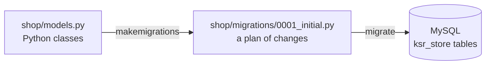
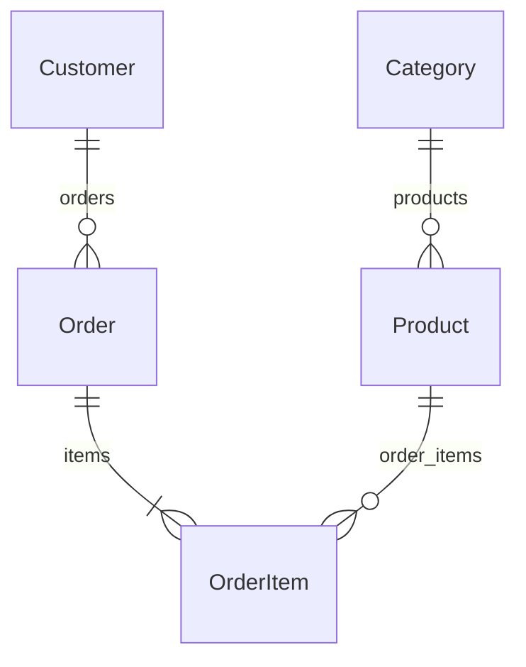

# Models & Migrations

!!! abstract "Learning Objectives"
    By the end of this lesson, you can:

    - Describe a database table as a Django **model** class, choosing the right field types and options
    - Connect models with `ForeignKey`, `related_name` and `on_delete`
    - Use `TextChoices`, `Meta` options and database constraints
    - Create and apply **migrations**, read the SQL they generate, and evolve a model safely
    - Write a **management command** that loads sample data, and serve pages from MySQL with `get_object_or_404`

**Prerequisites:** [URLs, Views & Templates](02-urls-views-templates.md)

## What is a Model?

In the MySQL module you wrote `CREATE TABLE` by hand. In FastAPI you wrote SQLAlchemy classes. In Django you write a **model**: a Python class that describes one table. Django creates the table, and later lets you query it without SQL.

| Database | Django |
|----------|--------|
| Table | Model class (`class Product(models.Model)`) |
| Column | Field (`price = models.DecimalField(...)`) |
| Row | Model instance (`Product(name="iPhone 15", ...)`) |
| Primary key | `id`, added automatically (`BigAutoField`) |
| Foreign key | `models.ForeignKey(...)` |
| `ALTER TABLE` script | Migration file |



## Your First Models

Start with the two tables the shop pages need: categories and products.

```python title="shop/models.py"
from datetime import date

from django.db import models


class Category(models.Model):
    name = models.CharField(max_length=50, unique=True)
    slug = models.SlugField(max_length=60, unique=True)

    class Meta:
        ordering = ["name"]
        verbose_name_plural = "categories"

    def __str__(self):
        return self.name


class Product(models.Model):
    category = models.ForeignKey(Category, on_delete=models.PROTECT, related_name="products")
    name = models.CharField(max_length=100)
    brand = models.CharField(max_length=50, blank=True)
    price = models.DecimalField(max_digits=10, decimal_places=2)
    stock = models.PositiveIntegerField(default=0)
    rating = models.DecimalField(max_digits=2, decimal_places=1, null=True, blank=True)
    added_on = models.DateField(default=date.today)

    class Meta:
        ordering = ["name"]
        constraints = [
            models.CheckConstraint(condition=models.Q(price__gt=0), name="product_price_positive"),
        ]

    def __str__(self):
        return self.name
```

### Field types you'll use most

| Field | MySQL column | Use for |
|-------|--------------|---------|
| `CharField(max_length=...)` | `VARCHAR` | Names, titles, codes |
| `TextField()` | `LONGTEXT` | Long descriptions |
| `SlugField()` | `VARCHAR` + index | URL-friendly text (`home-kitchen`) |
| `IntegerField()` / `PositiveIntegerField()` | `INT` / `INT UNSIGNED` | Counts, stock |
| `DecimalField(max_digits, decimal_places)` | `DECIMAL` | **Money** (never `FloatField`) |
| `BooleanField()` | `BOOL` | Flags (`is_active`) |
| `DateField()` / `DateTimeField()` | `DATE` / `DATETIME` | Dates and timestamps |
| `EmailField()` | `VARCHAR` | Emails (validated in forms) |
| `ForeignKey(Model, on_delete=...)` | `BIGINT` + foreign key | Many-to-one relationships |

### Field options

| Option | Meaning |
|--------|---------|
| `null=True` | The **database** column allows `NULL` |
| `blank=True` | **Forms and validation** allow an empty value |
| `default=...` | Value used when none is given (`date.today`, without brackets, is called on each save) |
| `unique=True` | No two rows can have the same value |
| `choices=...` | Restrict the values (shown as a dropdown in forms and admin) |
| `db_index=True` | Add an index for faster lookups |

!!! tip "`null` vs `blank`"
    For text fields, use `blank=True` alone: an empty brand is stored as `""`, so there's only one kind of "empty". Use `null=True` for non-text fields that may be unknown, like `rating`.

`__str__` controls how an object is shown: in the shell, in the admin, and when a template prints `{{ product.category }}`. Always define it.

## Creating and Applying Migrations

`makemigrations` compares your models with the existing migrations and writes a new migration file:

```bash
python manage.py makemigrations shop
```

```{ .text .output }
Migrations for 'shop':
  shop/migrations/0001_initial.py
    + Create model Category
    + Create model Product
```

Curious what SQL Django will run? `sqlmigrate` prints it without touching the database. We pick out the tables, the foreign key and the check constraint:

```bash
python manage.py sqlmigrate shop 0001 | grep -oE 'CREATE TABLE `[a-z_]+`|FOREIGN KEY \(`[a-z_]+`\) REFERENCES `[a-z_]+`|CHECK \(`price` > 0[^)]*\)'
```

```{ .text .output }
CREATE TABLE `shop_category`
CREATE TABLE `shop_product`
CHECK (`price` > 0)
FOREIGN KEY (`category_id`) REFERENCES `shop_category`
```

Django named the tables `<app>_<model>`, so `shop_category` and `shop_product`. Now apply the migration:

```bash
python manage.py migrate shop
```

```{ .text .output }
Operations to perform:
  Apply all migrations: shop
Running migrations:
  Applying shop.0001_initial... OK
```

Let's look at the real table in MySQL from Django's shell:

```{ .python .shell }
from django.db import connection

with connection.cursor() as cursor:
    cursor.execute("DESCRIBE shop_product")
    for field, col_type, null, key, *_ in cursor.fetchall():
        print(f"{field:<12} {col_type:<16} null={null:<4} {key}")
```

```{ .text .output }
id           bigint           null=NO   PRI
name         varchar(100)     null=NO   
brand        varchar(50)      null=NO   
price        decimal(10,2)    null=NO   
stock        int unsigned     null=NO   
rating       decimal(2,1)     null=YES  
added_on     date             null=NO   
category_id  bigint           null=NO   MUL
```

Every field became a column, the `ForeignKey` became `category_id` with an index (`MUL`), and `blank=True` on `brand` did **not** make the column nullable.

!!! mistake "Never edit the database by hand"
    Once Django manages a table, change it **only** through models and migrations. If you add a column directly in MySQL, Django doesn't know about it, and the next migration may fail or overwrite it.

## Relationships: Customers and Orders

A shop also needs customers, orders and the items inside each order. Add three models to the same file:

```python title="shop/models.py"
from datetime import date

from django.db import models


class Category(models.Model):
    name = models.CharField(max_length=50, unique=True)
    slug = models.SlugField(max_length=60, unique=True)

    class Meta:
        ordering = ["name"]
        verbose_name_plural = "categories"

    def __str__(self):
        return self.name


class Product(models.Model):
    category = models.ForeignKey(Category, on_delete=models.PROTECT, related_name="products")
    name = models.CharField(max_length=100)
    brand = models.CharField(max_length=50, blank=True)
    price = models.DecimalField(max_digits=10, decimal_places=2)
    stock = models.PositiveIntegerField(default=0)
    rating = models.DecimalField(max_digits=2, decimal_places=1, null=True, blank=True)
    added_on = models.DateField(default=date.today)

    class Meta:
        ordering = ["name"]
        constraints = [
            models.CheckConstraint(condition=models.Q(price__gt=0), name="product_price_positive"),
        ]

    def __str__(self):
        return self.name


class Customer(models.Model):
    name = models.CharField(max_length=100)
    email = models.EmailField(unique=True)
    city = models.CharField(max_length=50)
    phone = models.CharField(max_length=15, blank=True)
    joined_on = models.DateField(default=date.today)

    class Meta:
        ordering = ["name"]

    def __str__(self):
        return self.name


class Order(models.Model):
    class Status(models.TextChoices):
        PENDING = "pending", "Pending"
        SHIPPED = "shipped", "Shipped"
        DELIVERED = "delivered", "Delivered"
        CANCELLED = "cancelled", "Cancelled"

    customer = models.ForeignKey(Customer, on_delete=models.CASCADE, related_name="orders")
    order_date = models.DateField(default=date.today)
    status = models.CharField(max_length=10, choices=Status.choices, default=Status.PENDING)

    class Meta:
        ordering = ["-order_date"]

    def __str__(self):
        return f"Order #{self.id}"

    @property
    def total(self):
        return sum(item.line_total for item in self.items.all())


class OrderItem(models.Model):
    order = models.ForeignKey(Order, on_delete=models.CASCADE, related_name="items")
    product = models.ForeignKey(Product, on_delete=models.PROTECT, related_name="order_items")
    quantity = models.PositiveIntegerField()
    unit_price = models.DecimalField(max_digits=10, decimal_places=2)

    def __str__(self):
        return f"{self.quantity} x {self.product}"

    @property
    def line_total(self):
        return self.quantity * self.unit_price
```



### `on_delete`: what happens when the parent row is deleted?

| Option | Effect | Used here for |
|--------|--------|---------------|
| `CASCADE` | Delete the children too | An order's items; a customer's orders |
| `PROTECT` | Refuse to delete the parent (`ProtectedError`) | A category that still has products; a product that was ordered |
| `SET_NULL` | Set the foreign key to `NULL` (needs `null=True`) | e.g. an article whose author left |
| `SET_DEFAULT` / `DO_NOTHING` | Set a default / do nothing in Django | Rarely |

### `related_name`: the reverse direction

`ForeignKey` gives you both directions:

- Forward: `product.category` returns the `Category`
- Reverse: `category.products.all()` returns its products (thanks to `related_name="products"`; without it the name would be `product_set`)

### `TextChoices`

`Order.Status` stores short codes (`"shipped"`) in the database and gives each a label (`"Shipped"`). Use `Order.Status.SHIPPED` in code instead of typing strings, and `order.get_status_display()` to show the label.

Create and apply the second migration. Django works out that only the three new tables are needed:

```bash
python manage.py makemigrations shop
python manage.py migrate shop
```

```{ .text .output }
Migrations for 'shop':
  shop/migrations/0002_customer_order_orderitem.py
    + Create model Customer
    + Create model Order
    + Create model OrderItem
Operations to perform:
  Apply all migrations: shop
Running migrations:
  Applying shop.0002_customer_order_orderitem... OK
```

```bash
python manage.py showmigrations shop
```

```{ .text .output }
shop
 [X] 0001_initial
 [X] 0002_customer_order_orderitem
```

`[X]` means applied. Django records applied migrations in the `django_migrations` table, so each runs exactly once per database.

## Loading Sample Data with a Management Command

You'll want the same sample data as the MySQL module, and a way to reset it any time. Django lets you add your own `manage.py` commands: a file in `<app>/management/commands/` with a `Command` class.

```bash
mkdir -p shop/management/commands
touch shop/management/__init__.py shop/management/commands/__init__.py
```

```python title="shop/management/commands/seed_shop.py"
from datetime import date
from decimal import Decimal

from django.core.management.base import BaseCommand
from django.db import transaction
from django.utils.text import slugify

from shop.models import Category, Customer, Order, OrderItem, Product

CATEGORIES = ["Electronics", "Fashion", "Books", "Home & Kitchen", "Sports", "Toys"]

PRODUCTS = [  # name, category, brand, price, stock, rating, added_on
    ("iPhone 15", "Electronics", "Apple", "79999.00", 25, "4.7", "2025-09-20"),
    ("Galaxy S24", "Electronics", "Samsung", "74999.00", 30, "4.5", "2025-08-11"),
    ("Airdopes 141", "Electronics", "boAt", "1299.00", 200, "4.1", "2025-06-02"),
    ("Inspiron 15 Laptop", "Electronics", "Dell", "58999.00", 12, "4.3", "2025-07-15"),
    ("USB-C Cable", "Electronics", "", "299.00", 500, "3.9", "2025-05-01"),
    ("Denim Jacket", "Fashion", "Levis", "3499.00", 40, "4.4", "2025-10-01"),
    ("Running Shoes", "Fashion", "Puma", "4299.00", 60, "4.2", "2025-09-05"),
    ("Cotton T-Shirt", "Fashion", "Puma", "799.00", 150, "4.0", "2025-03-12"),
    ("Atomic Habits", "Books", "Penguin", "499.00", 80, "4.8", "2025-01-20"),
    ("Wings of Fire", "Books", "Universities Press", "350.00", 0, "4.7", "2024-11-10"),
    ("Python Crash Course", "Books", "No Starch", "2199.00", 15, "4.6", "2025-04-18"),
    ("Non-stick Pan", "Home & Kitchen", "Prestige", "1599.00", 35, "4.2", "2025-02-25"),
    ("Mixer Grinder", "Home & Kitchen", "Bajaj", "3899.00", 18, "4.0", "2025-06-30"),
    ("Yoga Mat", "Sports", "Decathlon", "999.00", 0, "4.3", "2025-08-22"),
    ("Cricket Bat", "Sports", "SG", "2499.00", 22, "4.4", "2025-07-07"),
]

CUSTOMERS = [  # name, email, city, phone, joined_on
    ("Asha Reddy", "asha@example.com", "Hyderabad", "9876500001", "2024-01-15"),
    ("Ravi Kumar", "ravi@example.com", "Bangalore", "9876500002", "2024-03-22"),
    ("Kiran Rao", "kiran@example.com", "Hyderabad", "", "2024-05-10"),
    ("Meena Iyer", "meena@example.com", "Chennai", "9876500004", "2024-07-01"),
    ("Arjun Singh", "arjun@example.com", "Delhi", "9876500005", "2024-08-19"),
    ("Divya Nair", "divya@example.com", "Kochi", "", "2024-11-30"),
    ("Rahul Verma", "rahul@example.com", "Pune", "9876500007", "2025-01-05"),
    ("Sneha Patil", "sneha@example.com", "Pune", "9876500008", "2025-02-14"),
    ("Vikram Joshi", "vikram@example.com", "Mumbai", "9876500009", "2025-06-21"),
    ("Priya Sharma", "priya@example.com", "Bangalore", "", "2025-09-09"),
]

ORDERS = [  # customer id, order_date, status, [(product id, quantity), ...]
    (1, "2025-06-05", "delivered", [(9, 2), (3, 1)]),
    (2, "2025-06-18", "delivered", [(2, 1)]),
    (1, "2025-07-02", "delivered", [(7, 1), (8, 3)]),
    (3, "2025-07-20", "cancelled", [(4, 1)]),
    (4, "2025-08-03", "delivered", [(12, 1)]),
    (5, "2025-08-15", "shipped", [(15, 1)]),
    (2, "2025-08-28", "delivered", [(11, 1), (9, 1)]),
    (6, "2025-09-10", "delivered", [(6, 1)]),
    (7, "2025-09-25", "pending", [(1, 1)]),
    (1, "2025-10-01", "shipped", [(5, 4), (3, 2)]),
    (8, "2025-10-05", "delivered", [(8, 2), (10, 1)]),
    (4, "2025-10-12", "pending", [(9, 1)]),
]


class Command(BaseCommand):
    help = "Load the KSR Store sample data (existing shop data is deleted first)."

    @transaction.atomic
    def handle(self, *args, **options):
        for model in (OrderItem, Order, Customer, Product, Category):
            model.objects.all().delete()

        categories = {}
        for i, name in enumerate(CATEGORIES, start=1):
            categories[name] = Category.objects.create(id=i, name=name, slug=slugify(name))

        products = {}
        for i, (name, category, brand, price, stock, rating, added_on) in enumerate(PRODUCTS, start=1):
            products[i] = Product.objects.create(
                id=i, category=categories[category], name=name, brand=brand, price=Decimal(price),
                stock=stock, rating=Decimal(rating), added_on=date.fromisoformat(added_on),
            )

        for i, (name, email, city, phone, joined_on) in enumerate(CUSTOMERS, start=1):
            Customer.objects.create(id=i, name=name, email=email, city=city, phone=phone,
                                    joined_on=date.fromisoformat(joined_on))

        for i, (customer_id, order_date, status, items) in enumerate(ORDERS, start=1):
            order = Order.objects.create(id=i, customer_id=customer_id, status=status,
                                         order_date=date.fromisoformat(order_date))
            for product_id, quantity in items:
                product = products[product_id]
                OrderItem.objects.create(order=order, product=product, quantity=quantity, unit_price=product.price)

        self.stdout.write(self.style.SUCCESS(
            f"Loaded {Category.objects.count()} categories, {Product.objects.count()} products, "
            f"{Customer.objects.count()} customers, {Order.objects.count()} orders "
            f"and {OrderItem.objects.count()} order items."
        ))
```

Points to notice:

- `@transaction.atomic` runs the whole command in **one transaction**: if anything fails, nothing is half-loaded.
- Fixed `id` values keep the data identical to the MySQL module (product 10 is always *Wings of Fire*), however many times you re-run it.
- `unit_price=product.price` copies the price into the order item, so later price changes don't rewrite order history.
- `self.stdout.write(self.style.SUCCESS(...))` prints in green in a terminal.

```bash
python manage.py seed_shop
```

```{ .text .output }
Loaded 6 categories, 15 products, 10 customers, 12 orders and 17 order items.
```

Your new command even appears in `python manage.py help` and has its own `--help`.

## A First Look at the ORM

Lesson 04 covers querying properly. Here is a quick taste in `python manage.py shell` to check the data:

```{ .python .shell }
from shop.models import Category, Order, Product

print(Product.objects.count())
book = Product.objects.get(id=9)
print(book, "|", book.category, "|", book.price)

books = Category.objects.get(slug="books")
print([p.name for p in books.products.all()])

order = Order.objects.get(id=1)
print(order, order.customer, order.get_status_display(), order.total)
for item in order.items.all():
    print(" ", item, "=", item.line_total)
```

```{ .text .output }
15
Atomic Habits | Books | 499.00
['Atomic Habits', 'Python Crash Course', 'Wings of Fire']
Order #1 Asha Reddy Delivered 2297.00
  2 x Atomic Habits = 998.00
  1 x Airdopes 141 = 1299.00
```

`book.category` followed the foreign key; `books.products.all()` followed it backwards using `related_name`; `order.total` used the property we wrote.

## Serving Pages from MySQL

Now switch the views from the Python list to the database. `get_object_or_404` replaces the "find it or raise `Http404`" code from lesson 02:

```bash
rm shop/data.py
```

```python title="shop/views.py"
from django.http import JsonResponse
from django.shortcuts import get_object_or_404, redirect, render

from .models import Category, Product


def home(request):
    featured = Product.objects.filter(stock__gt=0)[:3]
    return render(request, "shop/home.html", {"featured": featured})


def health(request):
    return JsonResponse({"status": "ok", "framework": "Django"})


def product_list(request):
    query = request.GET.get("q", "").strip()
    products = Product.objects.all()
    if query:
        products = products.filter(name__icontains=query)
    return render(request, "shop/product_list.html", {"products": products, "query": query})


def product_detail(request, product_id):
    product = get_object_or_404(Product, pk=product_id)
    return render(request, "shop/product_detail.html", {"product": product})


def category_products(request, slug):
    category = get_object_or_404(Category, slug=slug)
    products = category.products.all()
    return render(request, "shop/product_list.html", {"products": products, "query": "", "category": category})


def old_shop_redirect(request):
    return redirect("shop:product_list")
```

The category URL now captures a real slug:

```python title="shop/urls.py"
from django.urls import path

from . import views

app_name = "shop"

urlpatterns = [
    path("", views.home, name="home"),
    path("health/", views.health, name="health"),
    path("products/", views.product_list, name="product_list"),
    path("products/<int:product_id>/", views.product_detail, name="product_detail"),
    path("category/<slug:slug>/", views.category_products, name="category"),
    path("old-shop/", views.old_shop_redirect),
]
```

The list template prints the category's `name` and skips the brackets when a product has no brand:

```html title="shop/templates/shop/product_list.html"


Products | KSR Store


<h1>{{ category.name }}All products</h1>

<form method="get" action="">
  <input type="search" name="q" value="{{ query }}" placeholder="Search products">
  <button type="submit">Search</button>
</form>

<p class="info">{{ products|length }} result{{ products|length|pluralize }} for "{{ query }}"</p>

<ul>

  <li>{{ forloop.counter }}. {{ product.name }} ({{ product.brand }}) - ₹{{ product.price|floatformat:"0g" }} - Out of stock</li>

  <li>No products found.</li>

</ul>

```

The home and detail templates need **no changes**: `{{ product.name }}` works the same for a dict and a model object, and `{{ product.category }}` prints the category's `__str__`.

```bash
curl -s http://127.0.0.1:8000/ | grep "<li>"
curl -s "http://127.0.0.1:8000/products/?q=in" | grep -E "class=\"info\"|<li>"
```

```{ .text .output }
  <li><a href="/products/3/">Airdopes 141</a> - ₹1,299</li>
  <li><a href="/products/9/">Atomic Habits</a> - ₹499</li>
  <li><a href="/products/8/">Cotton T-Shirt</a> - ₹799</li>
<p class="info">4 results for "in"</p>
  <li>1. Inspiron 15 Laptop (Dell) - ₹58,999</li>
  <li>2. Mixer Grinder (Bajaj) - ₹3,899</li>
  <li>3. Running Shoes (Puma) - ₹4,299</li>
  <li>4. Wings of Fire (Universities Press) - ₹350 - Out of stock</li>
```

`name__icontains` became a case-insensitive `LIKE '%in%'` in MySQL. The category page and a product page:

```bash
curl -s http://127.0.0.1:8000/category/home-kitchen/ | grep -E "<h1>|<li>"
curl -s http://127.0.0.1:8000/products/5/ | grep -E "<h1>|class=\"(meta|price|stock)\""
curl -s -o /dev/null -w "category/toys-games/ -> HTTP %{http_code}\n" http://127.0.0.1:8000/category/toys-games/
```

```{ .text .output }
<h1>Home &amp; Kitchen</h1>
  <li>1. Mixer Grinder (Bajaj) - ₹3,899</li>
  <li>2. Non-stick Pan (Prestige) - ₹1,599</li>
<h1>USB-C Cable</h1>
<p class="meta">Electronics · </p>
<p class="price">₹299.00</p>
<p class="stock">In stock</p>
category/toys-games/ -> HTTP 404
```

`Home & Kitchen` was escaped to `Home &amp; Kitchen` in the HTML, and the browser shows it as `Home & Kitchen`. The USB-C cable has an empty brand, so the detail page shows `Electronics · ` with nothing after the dot (a practice exercise fixes that).

## Changing Models Later

Real projects change their models all the time. The workflow is always the same:

1. Edit `models.py` (add a field, rename one, add an index).
2. `python manage.py makemigrations` and **read** the generated file.
3. `python manage.py migrate` locally, then commit the migration file **with** the model change.
4. On every other machine and on the server, run `python manage.py migrate`.

| Command | What it does |
|---------|--------------|
| `makemigrations [app]` | Writes new migration files from model changes |
| `migrate [app] [number]` | Applies (or rolls back to) migrations |
| `showmigrations [app]` | Lists migrations and whether each is applied |
| `sqlmigrate app 0001` | Shows the SQL a migration will run |
| `migrate shop 0001` | Rolls `shop` back to migration 0001 |
| `makemigrations --check` | Fails if models changed without a migration (useful in CI) |

When you add a **non-null field to a table that already has rows**, Django asks what value to put in existing rows. Give the field a `default` (or `null=True`) to avoid the question.

!!! realworld "In Real Projects"
    Migration files are code: they're reviewed in pull requests and committed to Git. Teams never delete applied migrations or edit them after they've run on a shared database. Deployments run `python manage.py migrate` automatically before starting the new version, and large tables get extra care, because adding an index to a table with millions of rows can lock it.

## Common Mistakes

| Mistake | Error / Symptom | Fix |
|---------|-----------------|-----|
| Forgot `makemigrations` | `Table 'ksr_store.shop_product' doesn't exist` | `makemigrations` then `migrate` |
| Model changed, migration not created | `Your models in app(s): 'shop' have changes that are not yet reflected` | Run `makemigrations` |
| `ForeignKey` without `on_delete` | `TypeError: ... missing 1 required positional argument: 'on_delete'` | Always choose `on_delete` |
| `FloatField` for money | `0.1 + 0.2` rounding errors | `DecimalField(max_digits=10, decimal_places=2)` |
| `null=True` on `CharField` | Two kinds of "empty": `NULL` and `""` | Use `blank=True` only |
| Deleting a category that has products | `ProtectedError` | Intended with `PROTECT`; move or delete the products first |
| Editing tables directly in MySQL | Migrations fail or drift | Change models, then migrate |
| Missing `__init__.py` in `management/commands` | `Unknown command: 'seed_shop'` | Add both `__init__.py` files |

## Practice Exercises

**Easy**

1. Add a `description = models.TextField(blank=True)` field to `Product`, then create and apply the migration. Look at the SQL with `sqlmigrate`.
2. Fix the detail template so it only shows `· brand` when the product has a brand.
3. Print every customer from Pune in the shell.

**Medium**

4. Add an `is_active = models.BooleanField(default=True)` field to `Product` and make the product list show only active products.
5. Add a `Review` model (product, customer, rating 1–5, comment, created_at with `auto_now_add=True`) with a check constraint on the rating, plus a migration.
6. Add a `--clear-only` option to `seed_shop` that deletes the data without reloading it. (Hint: override `add_arguments(self, parser)`.)

**Challenge**

7. Try to delete the "Books" category in the shell. Explain the error, then write the code that moves its products to a new "Reading" category first.

??? success "Solutions (click to expand)"

    ```{ .html .no-run }
    <!-- 2 -->
    <p class="meta">{{ product.category }} · {{ product.brand }}</p>
    ```

    ```{ .python .no-run }
    # 3
    from shop.models import Customer
    for c in Customer.objects.filter(city="Pune"):
        print(c.name, c.email)

    # 5
    class Review(models.Model):
        product = models.ForeignKey(Product, on_delete=models.CASCADE, related_name="reviews")
        customer = models.ForeignKey(Customer, on_delete=models.CASCADE, related_name="reviews")
        rating = models.PositiveSmallIntegerField()
        comment = models.TextField(blank=True)
        created_at = models.DateTimeField(auto_now_add=True)

        class Meta:
            constraints = [
                models.CheckConstraint(condition=models.Q(rating__gte=1, rating__lte=5), name="review_rating_1_to_5"),
            ]

    # 6
    def add_arguments(self, parser):
        parser.add_argument("--clear-only", action="store_true", help="Delete shop data without reloading")

    # inside handle(), after deleting:
    if options["clear_only"]:
        self.stdout.write("Shop data cleared.")
        return

    # 7: Category uses on_delete=PROTECT, so deleting raises ProtectedError
    reading = Category.objects.create(name="Reading", slug="reading")
    Product.objects.filter(category__slug="books").update(category=reading)
    Category.objects.get(slug="books").delete()
    ```

!!! note "Mini Assignment"
    Model a small **college library**: `Author`, `Book` (title, ISBN unique, published year, copies available), `Member` and `Loan` (book, member, borrowed_on, returned_on nullable). Choose `on_delete` for every foreign key and justify it, add a constraint that copies available is never negative, and write a `seed_library` command.

## Interview Questions

!!! interview "1. What is the difference between `makemigrations` and `migrate`?"
    `makemigrations` compares models with existing migration files and **writes** new migration files (it doesn't touch the database). `migrate` **applies** unapplied migrations to the database and records them in the `django_migrations` table.

!!! interview "2. What is the difference between `null=True` and `blank=True`?"
    `null=True` is about the database: the column accepts `NULL`. `blank=True` is about validation: forms and `full_clean()` accept an empty value. For string fields, Django's convention is `blank=True` without `null=True`, so empty is always `""`.

!!! interview "3. Explain the `on_delete` options."
    They decide what happens to rows that reference a deleted row: `CASCADE` deletes them too, `PROTECT` blocks the delete with `ProtectedError`, `SET_NULL` sets the foreign key to `NULL`, `SET_DEFAULT` sets its default, and `DO_NOTHING` leaves it to the database.

!!! interview "4. What does `related_name` do?"
    It names the reverse relation from the parent model to its children. With `related_name="products"` on `Product.category`, you write `category.products.all()` instead of the default `category.product_set.all()`. It also avoids clashes when a model has two foreign keys to the same model.

!!! interview "5. Why should you use `DecimalField` for money?"
    Floating-point numbers can't represent most decimal fractions exactly, so sums drift (`0.1 + 0.2 != 0.3`). `DecimalField` maps to MySQL `DECIMAL` and to Python's `Decimal`, which store exact decimal values.

!!! interview "Scenario: two developers each created migration `0003` and now `migrate` complains about conflicting migrations. What do you do?"
    Run `python manage.py makemigrations --merge`, which creates a merge migration that depends on both. If the two change the same field, resolve that by hand. To prevent it, pull and migrate before creating migrations, and keep migration changes in small, frequent pull requests.

## Summary

| Concept | Example |
|---------|---------|
| Model | `class Product(models.Model): name = models.CharField(max_length=100)` |
| Money | `models.DecimalField(max_digits=10, decimal_places=2)` |
| Relationship | `models.ForeignKey(Category, on_delete=models.PROTECT, related_name="products")` |
| Choices | `class Status(models.TextChoices): SHIPPED = "shipped", "Shipped"` |
| Meta | `ordering`, `verbose_name_plural`, `constraints` |
| Migrations | `makemigrations` → `migrate` → `showmigrations` / `sqlmigrate` |
| Custom command | `shop/management/commands/seed_shop.py` with `class Command(BaseCommand)` |
| Fetch or 404 | `get_object_or_404(Product, pk=product_id)` |

**Next lesson:** [The Django ORM](04-the-django-orm.md), filtering, sorting, relationships, aggregations and avoiding the N+1 query problem.
