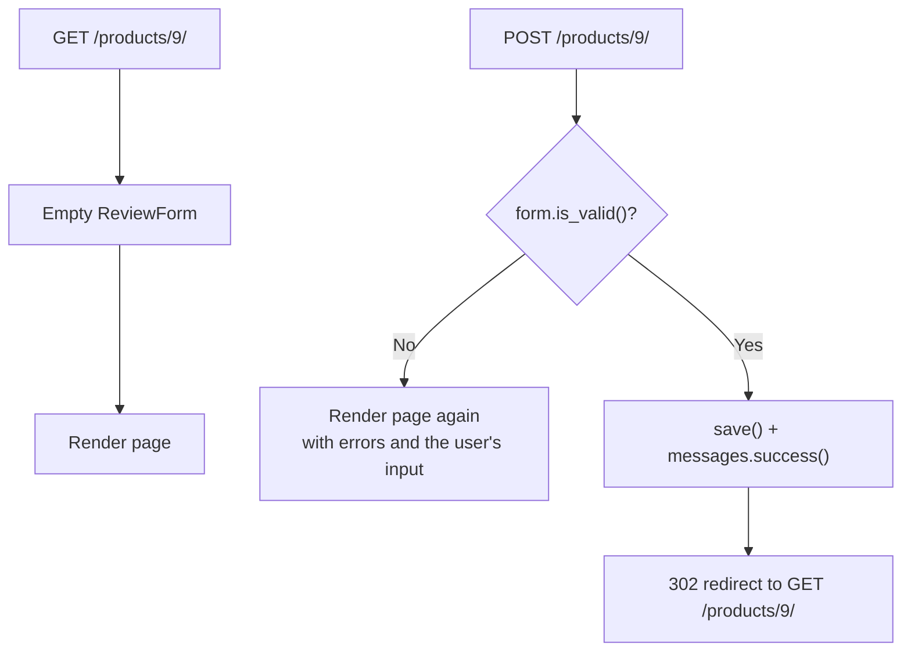

# Forms & ModelForms

!!! abstract "Learning Objectives"
    By the end of this lesson, you can:

    - Explain how HTML forms send data with **GET** and **POST**, and what **CSRF** protection does
    - Build a `forms.Form` with typed fields, field validation and cross-field validation
    - Use `is_valid()`, `cleaned_data` and `errors`, and render forms in templates
    - Create a **ModelForm** that validates and saves a model instance
    - Handle form submissions with the **Post/Redirect/Get** pattern and show **flash messages**

**Prerequisites:** [Django Admin](05-django-admin.md)

## How HTML Forms Send Data

```html
<form method="get" action="/products/">
  <input name="q" value="shoes">
  <button>Search</button>
</form>
```

| | `method="get"` | `method="post"` |
|---|---|---|
| Data goes in | The URL: `/products/?q=shoes` | The request body |
| Use for | Searching, filtering, sorting (reading) | Creating, changing, deleting (writing) |
| Bookmarkable / shareable | Yes | No |
| Needs a CSRF token in Django | No | **Yes** |

In lesson 02 you read `request.GET.get("q")` by hand. That gets painful quickly: every value arrives as a **string**, may be missing, may be invalid, and must be shown back to the user with error messages. Django's **forms** do all of that.

## Your First Form Class

A form class lists the fields, their types and their rules, much like a Pydantic model in FastAPI. This one powers a filter bar for the product list:

```python title="shop/forms.py"
from django import forms

from .models import Category


class ProductFilterForm(forms.Form):
    SORT_CHOICES = [("name", "Name"), ("price", "Price: low to high"), ("-price", "Price: high to low")]

    q = forms.CharField(label="Search", required=False, max_length=50)
    category = forms.ModelChoiceField(queryset=Category.objects.all(), required=False, empty_label="All categories")
    min_price = forms.DecimalField(required=False, min_value=0, decimal_places=2)
    max_price = forms.DecimalField(required=False, min_value=0, decimal_places=2)
    sort = forms.ChoiceField(choices=SORT_CHOICES, required=False)

    def clean(self):
        cleaned = super().clean()
        low, high = cleaned.get("min_price"), cleaned.get("max_price")
        if low is not None and high is not None and low > high:
            raise forms.ValidationError("Minimum price must not be more than the maximum price.")
        return cleaned
```

| Field | Cleaned value | Renders as |
|-------|---------------|------------|
| `CharField` | `str` | `<input type="text">` |
| `IntegerField` / `DecimalField` | `int` / `Decimal` | `<input type="number">` |
| `EmailField` | `str` (validated) | `<input type="email">` |
| `BooleanField` | `bool` | checkbox |
| `DateField` | `date` | `<input type="text">` (change the widget for a date picker) |
| `ChoiceField` | `str` | `<select>` |
| `ModelChoiceField` | a model instance | `<select>` of rows |

### Validating data

Give a form a dict of strings (like `request.GET`), call `is_valid()`, then read **`cleaned_data`**, which holds real Python types:

```{ .python .shell }
from shop.forms import ProductFilterForm

form = ProductFilterForm({"q": "shoe", "category": "2", "min_price": "1000", "max_price": "5000", "sort": "-price"})
print(form.is_valid())
print(form.cleaned_data)
```

```{ .text .output }
True
{'q': 'shoe', 'category': <Category: Fashion>, 'min_price': Decimal('1000'), 'max_price': Decimal('5000'), 'sort': '-price'}
```

`"2"` became the Fashion `Category` object and `"1000"` became `Decimal('1000')`. Invalid data fills `form.errors` instead:

```{ .python .shell }
from shop.forms import ProductFilterForm

form = ProductFilterForm({"min_price": "abc", "max_price": "-5", "sort": "cheapest", "category": "99"})
print(form.is_valid())
for field, errors in form.errors.items():
    print(f"{field}: {errors[0]}")

form = ProductFilterForm({"min_price": "5000", "max_price": "1000"})
print(form.is_valid(), list(form.non_field_errors()))
```

```{ .text .output }
False
category: Select a valid choice. That choice is not one of the available choices.
min_price: Enter a number.
max_price: Ensure this value is greater than or equal to 0.
sort: Select a valid choice. cheapest is not one of the available choices.
False ['Minimum price must not be more than the maximum price.']
```

Validation happens in this order:

1. Each field converts and checks its own value (`to_python`, `required`, `min_value`, `max_length`...).
2. A `clean_<fieldname>()` method, if you write one, checks that single field further.
3. `clean()` checks fields **together** (like min ≤ max). Its errors are **non-field errors**.

## Using the Form in a View

`request.GET or None` gives the form data when the URL has a query string, and leaves it **unbound** (no data, no errors) otherwise:

```python title="shop/views.py"
from django.db.models import Count
from django.http import JsonResponse
from django.shortcuts import get_object_or_404, redirect, render

from .forms import ProductFilterForm
from .models import Category, Product


def home(request):
    featured = Product.objects.select_related("category").filter(stock__gt=0)[:3]
    categories = Category.objects.annotate(product_count=Count("products")).order_by("name")
    return render(request, "shop/home.html", {"featured": featured, "categories": categories})


def health(request):
    return JsonResponse({"status": "ok", "framework": "Django"})


def product_list(request):
    form = ProductFilterForm(request.GET or None)
    products = Product.objects.select_related("category")
    if form.is_valid():
        data = form.cleaned_data
        if data["q"]:
            products = products.filter(name__icontains=data["q"])
        if data["category"]:
            products = products.filter(category=data["category"])
        if data["min_price"] is not None:
            products = products.filter(price__gte=data["min_price"])
        if data["max_price"] is not None:
            products = products.filter(price__lte=data["max_price"])
        if data["sort"]:
            products = products.order_by(data["sort"])
    return render(request, "shop/product_list.html", {"products": products, "form": form})


def product_detail(request, product_id):
    product = get_object_or_404(Product.objects.select_related("category"), pk=product_id)
    return render(request, "shop/product_detail.html", {"product": product})


def category_products(request, slug):
    category = get_object_or_404(Category, slug=slug)
    products = category.products.all()
    return render(request, "shop/product_list.html", {"products": products, "category": category})


def old_shop_redirect(request):
    return redirect("shop:product_list")
```

### Rendering a form

`{{ form }}` renders every field with its label, current value and errors, plus any non-field errors at the top. You can also place fields one by one with `{{ form.q }}`, `{{ form.q.label_tag }}` and `{{ form.q.errors }}` when you need a custom layout.

```html title="shop/templates/shop/product_list.html"


Products | KSR Store


<h1>{{ category.name }}All products</h1>


<form method="get" action="" class="filters">
  {{ form }}
  <button type="submit">Apply</button>
</form>


<p class="info">{{ products|length }} result{{ products|length|pluralize }}</p>

<ul>

  <li>{{ forloop.counter }}. {{ product.name }} ({{ product.brand }}) - ₹{{ product.price|floatformat:"0g" }} - Out of stock</li>

  <li>No products found.</li>

</ul>

```

Fashion products between ₹500 and ₹5,000, most expensive first, then Books under ₹1,000:

```bash
curl -s "http://127.0.0.1:8000/products/?category=2&min_price=500&max_price=5000&sort=-price" | grep -E 'class="info"|<li>'
curl -s "http://127.0.0.1:8000/products/?category=3&max_price=1000" | grep -E 'class="info"|<li>'
```

```{ .text .output }
<p class="info">3 results</p>
  <li>1. Running Shoes (Puma) - ₹4,299</li>
  <li>2. Denim Jacket (Levis) - ₹3,499</li>
  <li>3. Cotton T-Shirt (Puma) - ₹799</li>
<p class="info">2 results</p>
  <li>1. Atomic Habits (Penguin) - ₹499</li>
  <li>2. Wings of Fire (Universities Press) - ₹350 - Out of stock</li>
```

The form remembers what the user chose, so the page shows their selections again:

```bash
curl -s "http://127.0.0.1:8000/products/?category=3&max_price=1000" | grep -oE '<option value="3" selected>[^<]+|name="max_price" value="[^"]+"'
```

```{ .text .output }
<option value="3" selected>Books
name="max_price" value="1000"
```

Invalid input shows errors **and** the full, unfiltered list (the view only filters when the form is valid):

```bash
curl -s "http://127.0.0.1:8000/products/?min_price=5000&max_price=1000" | grep -oE '<ul class="errorlist[^>]*><li>[^<]+' | sed 's/.*<li>/error: /'
curl -s "http://127.0.0.1:8000/products/?min_price=abc" | grep -oE '<ul class="errorlist[^>]*><li>[^<]+' | sed 's/.*<li>/error: /'
curl -s "http://127.0.0.1:8000/products/?min_price=abc" | grep -c "<li>[0-9]*\. "
```

```{ .text .output }
error: Minimum price must not be more than the maximum price.
error: Enter a number.
15
```

## ModelForms: Forms that Save to the Database

Customers should be able to review products. First, the model. Add it to the **end** of `shop/models.py`:

```{ .python .append title="shop/models.py" }
class Review(models.Model):
    RATING_CHOICES = [(1, "1 star"), (2, "2 stars"), (3, "3 stars"), (4, "4 stars"), (5, "5 stars")]

    product = models.ForeignKey(Product, on_delete=models.CASCADE, related_name="reviews")
    name = models.CharField(max_length=60)
    rating = models.PositiveSmallIntegerField(choices=RATING_CHOICES)
    comment = models.TextField(max_length=500)
    created_at = models.DateTimeField(auto_now_add=True)

    class Meta:
        ordering = ["-created_at"]

    def __str__(self):
        return f"{self.name} on {self.product}: {self.rating}/5"
```

```bash
python manage.py makemigrations shop
python manage.py migrate shop
```

```{ .text .output }
Migrations for 'shop':
  shop/migrations/0003_review.py
    + Create model Review
Operations to perform:
  Apply all migrations: shop
Running migrations:
  Applying shop.0003_review... OK
```

Writing a `forms.Form` with `name`, `rating` and `comment` would repeat what the model already says. A **ModelForm** builds the fields from the model, including `max_length`, `choices` and required-ness, and adds a `save()` method. Add it to `shop/forms.py`:

```python title="shop/forms.py"
from django import forms

from .models import Category, Review


class ProductFilterForm(forms.Form):
    SORT_CHOICES = [("name", "Name"), ("price", "Price: low to high"), ("-price", "Price: high to low")]

    q = forms.CharField(label="Search", required=False, max_length=50)
    category = forms.ModelChoiceField(queryset=Category.objects.all(), required=False, empty_label="All categories")
    min_price = forms.DecimalField(required=False, min_value=0, decimal_places=2)
    max_price = forms.DecimalField(required=False, min_value=0, decimal_places=2)
    sort = forms.ChoiceField(choices=SORT_CHOICES, required=False)

    def clean(self):
        cleaned = super().clean()
        low, high = cleaned.get("min_price"), cleaned.get("max_price")
        if low is not None and high is not None and low > high:
            raise forms.ValidationError("Minimum price must not be more than the maximum price.")
        return cleaned


class ReviewForm(forms.ModelForm):
    class Meta:
        model = Review
        fields = ["name", "rating", "comment"]
        labels = {"name": "Your name"}
        widgets = {"comment": forms.Textarea(attrs={"rows": 3})}

    def clean_comment(self):
        comment = self.cleaned_data["comment"].strip()
        if "http://" in comment or "https://" in comment:
            raise forms.ValidationError("Links are not allowed in reviews.")
        if len(comment) < 10:
            raise forms.ValidationError("Please write at least 10 characters.")
        return comment
```

`fields = [...]` lists exactly what users may submit. `product` and `created_at` are **not** in the list, so a user can't attach their review to another product by tampering with the form. The view sets `product` itself.

```{ .python .shell }
from shop.forms import ReviewForm
from shop.models import Product

form = ReviewForm({"name": "Ravi", "rating": "9", "comment": "Visit https://spam.example"})
print(form.is_valid())
for field, errors in form.errors.items():
    print(f"{field}: {errors[0]}")

form = ReviewForm({"name": "Ravi Kumar", "rating": "4", "comment": "Good read, practical tips."})
print(form.is_valid())
review = form.save(commit=False)          # build the object, don't INSERT yet
review.product = Product.objects.get(pk=11)
review.save()                             # now INSERT
print(review, "| id:", review.id)
```

```{ .text .output }
False
rating: Select a valid choice. 9 is not one of the available choices.
comment: Links are not allowed in reviews.
True
Ravi Kumar on Python Crash Course: 4/5 | id: 1
```

`save(commit=False)` returns an unsaved instance so you can fill in fields the user doesn't submit. Without it, `save()` would fail because `product` is required.

## The Post/Redirect/Get Pattern

Now make `product_detail` accept reviews. A GET shows an empty form; a POST validates it, saves the review and redirects. Here is the complete `views.py`:

```python title="shop/views.py"
from django.contrib import messages
from django.db.models import Count
from django.http import JsonResponse
from django.shortcuts import get_object_or_404, redirect, render

from .forms import ProductFilterForm, ReviewForm
from .models import Category, Product


def home(request):
    featured = Product.objects.select_related("category").filter(stock__gt=0)[:3]
    categories = Category.objects.annotate(product_count=Count("products")).order_by("name")
    return render(request, "shop/home.html", {"featured": featured, "categories": categories})


def health(request):
    return JsonResponse({"status": "ok", "framework": "Django"})


def product_list(request):
    form = ProductFilterForm(request.GET or None)
    products = Product.objects.select_related("category")
    if form.is_valid():
        data = form.cleaned_data
        if data["q"]:
            products = products.filter(name__icontains=data["q"])
        if data["category"]:
            products = products.filter(category=data["category"])
        if data["min_price"] is not None:
            products = products.filter(price__gte=data["min_price"])
        if data["max_price"] is not None:
            products = products.filter(price__lte=data["max_price"])
        if data["sort"]:
            products = products.order_by(data["sort"])
    return render(request, "shop/product_list.html", {"products": products, "form": form})


def product_detail(request, product_id):
    product = get_object_or_404(Product.objects.select_related("category"), pk=product_id)
    if request.method == "POST":
        form = ReviewForm(request.POST)
        if form.is_valid():
            review = form.save(commit=False)
            review.product = product
            review.save()
            messages.success(request, "Thanks! Your review has been posted.")
            return redirect("shop:product_detail", product_id=product.id)
    else:
        form = ReviewForm()
    return render(request, "shop/product_detail.html", {"product": product, "form": form, "reviews": product.reviews.all()})


def category_products(request, slug):
    category = get_object_or_404(Category, slug=slug)
    products = category.products.all()
    return render(request, "shop/product_list.html", {"products": products, "category": category})


def old_shop_redirect(request):
    return redirect("shop:product_list")
```

The flow of `product_detail`:



After a successful POST, always **redirect**. If you rendered the page directly, pressing *Refresh* would ask "Resubmit form?" and post a duplicate review.

### Flash messages

`messages.success(request, "...")` stores a one-time message that the **next** page shows. Display them in the base template so every page supports them:

```html title="templates/base.html"

<!doctype html>
<html lang="en">
<head>
  <meta charset="utf-8">
  <title>KSR Store</title>
  <link rel="stylesheet" href="">
</head>
<body>
  <nav>
    <a href="">Home</a>
    <a href="">All products</a>
  </nav>
  
  <p class="message {{ message.tags }}">{{ message }}</p>
  
  <main>
    
  </main>
  <footer>KSR Store · Built with Django</footer>
</body>
</html>
```

The product page lists reviews and shows the form. **`` is required inside every POST form**:

```html title="shop/templates/shop/product_detail.html"


{{ product.name }} | KSR Store


<h1>{{ product.name }}</h1>
<p class="meta">{{ product.category }} · {{ product.brand }}</p>
<p class="price">₹{{ product.price|floatformat:"2g" }}</p>

<p class="stock">In stock</p>

<p class="stock">Only {{ product.stock }} left!</p>

<p class="stock">Out of stock</p>


<h2>Reviews ({{ reviews|length }})</h2>
<ul>

  <li class="review"><strong>{{ review.name }}</strong> ({{ review.get_rating_display }}): {{ review.comment }}</li>

  <li class="review">No reviews yet. Be the first!</li>

</ul>

<h2>Write a review</h2>
<form method="post">
  
  {{ form }}
  <button type="submit">Post review</button>
</form>
<a href="">Back to all products</a>

```

## CSRF: Why the Token Matters

**Cross-Site Request Forgery**: while you're logged in to your shop, a malicious site could contain a hidden form that POSTs to `your-shop.com/...`. Your browser would send your cookies along, and the request would look like it came from you.

Django blocks this with a secret **token**: it sets a `csrftoken` cookie and `` puts a matching hidden field in the form. Another site can't read your cookie, so it can't send the right token. Let's see it with curl. First load the page to receive the cookie:

```bash
curl -s -c cookies.txt http://127.0.0.1:8000/products/9/ | grep -oE 'name="csrfmiddlewaretoken"|<h2>Reviews[^<]+'
CSRF=$(grep csrftoken cookies.txt | cut -f7)
curl -s -o /dev/null -w "POST without token -> HTTP %{http_code}\n" \
  --data-urlencode "name=Hacker" --data-urlencode "rating=1" --data-urlencode "comment=Forged review here" \
  http://127.0.0.1:8000/products/9/
curl -s -b cookies.txt -c cookies.txt -o /dev/null -w "POST with token    -> HTTP %{http_code}, redirects to %{redirect_url}\n" \
  --data-urlencode "csrfmiddlewaretoken=$CSRF" --data-urlencode "name=Asha Reddy" \
  --data-urlencode "rating=5" --data-urlencode "comment=Changed how I plan my day." \
  http://127.0.0.1:8000/products/9/
```

```{ .text .output }
<h2>Reviews (0)
name="csrfmiddlewaretoken"
POST without token -> HTTP 403
POST with token    -> HTTP 302, redirects to http://127.0.0.1:8000/products/9/
```

The forged POST got **403 Forbidden**. The real one was saved and redirected (Post/Redirect/Get). Following the redirect shows the flash message and the new review:

```bash
curl -s -b cookies.txt http://127.0.0.1:8000/products/9/ | grep -E 'class="message|<h2>Reviews|class="review"'
```

```{ .text .output }
  <p class="message success">Thanks! Your review has been posted.</p>
<h2>Reviews (1)</h2>
  <li class="review"><strong>Asha Reddy</strong> (5 stars): Changed how I plan my day.</li>
```

An invalid review re-renders the page (**200**, no redirect) with the errors next to the fields:

```bash
CSRF=$(grep csrftoken cookies.txt | cut -f7)
curl -s -b cookies.txt -w "HTTP %{http_code}\n" \
  --data-urlencode "csrfmiddlewaretoken=$CSRF" --data-urlencode "name=" \
  --data-urlencode "rating=9" --data-urlencode "comment=Nice" \
  http://127.0.0.1:8000/products/9/ | grep -oE '<ul class="errorlist[^>]*><li>[^<]+|HTTP [0-9]+' | sed 's/.*<li>/error: /'
```

```{ .text .output }
error: This field is required.
error: Select a valid choice. 9 is not one of the available choices.
error: Please write at least 10 characters.
HTTP 200
```

!!! mistake "Disabling CSRF to \"fix\" a 403"
    If a form returns `403 CSRF verification failed`, the fix is to add `` to the form (or send the `X-CSRFToken` header from JavaScript), **never** `@csrf_exempt`. Exempting a view reopens the attack described above.

!!! realworld "In Real Projects"
    Forms are everywhere: sign-up, checkout, address books, job applications, support tickets. Teams use ModelForms for anything that maps to a model, plain Forms for searches and multi-step flows, and packages like **django-crispy-forms** or **django-widget-tweaks** to render forms with Bootstrap or Tailwind styles. The same validation rules are reused by Django REST Framework serializers for APIs (lesson 09).

## Common Mistakes

| Mistake | Error / Symptom | Fix |
|---------|-----------------|-----|
| No `` in a POST form | `403 CSRF verification failed` | Add the tag inside the `<form>` |
| Reading `request.POST["field"]` directly | Unvalidated strings, `KeyError` | Use a form and `cleaned_data` |
| Accessing `cleaned_data` before `is_valid()` | `AttributeError: no attribute 'cleaned_data'` | Call `is_valid()` first |
| Rendering after a successful POST | Refresh posts a duplicate | `redirect()` after saving |
| `fields = "__all__"` in a ModelForm | Users can set fields they shouldn't | List the allowed fields explicitly |
| `form.save()` with a required field not in the form | `IntegrityError` | `save(commit=False)`, set the field, then `save()` |
| `clean_<field>()` not returning the value | The field becomes `None` | Always `return` the cleaned value |
| Forgetting `method="post"` | Data appears in the URL, nothing is saved | `<form method="post">` |

## Practice Exercises

**Easy**

1. Add an `in_stock` `BooleanField` to `ProductFilterForm` that, when ticked, shows only products with stock.
2. Register `Review` in the admin with `list_display = ["product", "name", "rating", "created_at"]` and a rating filter.
3. Show the average rating on the product page (`product.reviews.aggregate(Avg("rating"))`).

**Medium**

4. Build a **Contact us** page with a plain `ContactForm` (name, email, subject as a choice, message). On success, redirect to the home page with a message.
5. Reject reviews whose `name` contains digits with a `clean_name()` method.
6. Stop the same name from reviewing the same product twice (check in the view, or add a `UniqueConstraint` on `product` and `name` and handle the error).

**Challenge**

7. Build a **staff product editor** at `/manage/products/<id>/edit/` using a `ProductForm(ModelForm)` with `fields = ["name", "brand", "price", "stock"]`, pre-filled with `instance=product`. Validate that the price is not more than 50% lower than the current price, with a non-field error.

??? success "Solutions (click to expand)"

    ```{ .python .no-run }
    # 1 (form + view)
    in_stock = forms.BooleanField(required=False)
    # in product_list: if data["in_stock"]: products = products.filter(stock__gt=0)

    # 4
    class ContactForm(forms.Form):
        SUBJECTS = [("order", "Order problem"), ("product", "Product question"), ("other", "Other")]
        name = forms.CharField(max_length=60)
        email = forms.EmailField()
        subject = forms.ChoiceField(choices=SUBJECTS)
        message = forms.CharField(widget=forms.Textarea, min_length=20)

    def contact(request):
        form = ContactForm(request.POST or None)
        if request.method == "POST" and form.is_valid():
            # e.g. send_mail(...) or save to a model
            messages.success(request, "Thanks, we'll reply within one working day.")
            return redirect("shop:home")
        return render(request, "shop/contact.html", {"form": form})

    # 5
    def clean_name(self):
        name = self.cleaned_data["name"]
        if any(ch.isdigit() for ch in name):
            raise forms.ValidationError("Names can't contain numbers.")
        return name

    # 7
    class ProductForm(forms.ModelForm):
        class Meta:
            model = Product
            fields = ["name", "brand", "price", "stock"]

        def clean(self):
            cleaned = super().clean()
            new_price = cleaned.get("price")
            if self.instance.pk and new_price is not None and new_price < self.instance.price / 2:
                raise forms.ValidationError("Price can't drop by more than 50% at once.")
            return cleaned

    def edit_product(request, product_id):
        product = get_object_or_404(Product, pk=product_id)
        form = ProductForm(request.POST or None, instance=product)
        if request.method == "POST" and form.is_valid():
            form.save()
            messages.success(request, f"{product.name} updated.")
            return redirect("shop:product_detail", product_id=product.id)
        return render(request, "shop/product_form.html", {"form": form, "product": product})
    ```

    Note: when the model's `clean()` or the form's `__init__` read `self.instance`, it still holds the **old** values; the new ones are in `cleaned_data` until `save()`.

!!! note "Mini Assignment"
    Add a **newsletter sign-up** to your store: a `Subscriber` model (email unique, subscribed_at), a `SubscribeForm(ModelForm)` in the footer of every page (via the base template), a view that only accepts POST, shows "You're subscribed!" or "You're already subscribed." as a flash message, and redirects back to the page the user came from.

## Interview Questions

!!! interview "1. What is the difference between `Form` and `ModelForm`?"
    A `Form` defines its fields by hand and is used for data that isn't saved directly as a model (searches, contact forms, filters). A `ModelForm` generates fields and validation from a model and adds `save()` to create or update that model instance.

!!! interview "2. How does Django form validation work?"
    `is_valid()` runs `full_clean()`: each field's `clean()` converts and validates its value, then `clean_<field>()` methods run, then the form's `clean()` for cross-field rules. For ModelForms, the model's validation (`unique`, `choices`, constraints) also runs. Valid values end up in `cleaned_data`, failures in `errors`.

!!! interview "3. What is CSRF and how does Django prevent it?"
    Cross-Site Request Forgery tricks a logged-in user's browser into sending a state-changing request to your site. Django's `CsrfViewMiddleware` requires every unsafe request (POST, PUT, PATCH, DELETE) to include a token that matches the user's `csrftoken` cookie; other sites can't read the cookie, so they can't forge the token.

!!! interview "4. What is the Post/Redirect/Get pattern?"
    After a successful POST, the server responds with a redirect to a GET page instead of rendering HTML directly. Refreshing then repeats the harmless GET instead of resubmitting the form, which prevents duplicate orders, reviews or payments.

!!! interview "5. What does `save(commit=False)` do?"
    It builds the model instance from the form data without saving it to the database, so you can set extra fields (like the product or the logged-in user) before calling `instance.save()`. For forms with many-to-many fields, call `form.save_m2m()` afterwards.

!!! interview "Scenario: users report that submitting the checkout form twice creates two orders. How do you fix it?"
    Use Post/Redirect/Get so refresh doesn't resubmit, disable the submit button after the first click in JavaScript, and make the server side idempotent, for example with a unique order token stored in the form (a hidden field) and a unique constraint in the database, so a second submit with the same token is rejected.

## Summary

| Concept | Code |
|---------|------|
| Form class | `class ProductFilterForm(forms.Form): q = forms.CharField(required=False)` |
| Validate | `form = MyForm(request.GET or None)` → `form.is_valid()` → `form.cleaned_data` |
| Field rule | `def clean_comment(self): ... return value` |
| Cross-field rule | `def clean(self): ... raise forms.ValidationError(...)` |
| ModelForm | `class Meta: model = Review; fields = ["name", "rating", "comment"]` |
| Save with extras | `obj = form.save(commit=False); obj.product = product; obj.save()` |
| Render | `{{ form }}`, `{{ form.field }}`, `{{ form.non_field_errors }}` |
| POST safety | `<form method="post">` |
| After success | `messages.success(...)` + `redirect(...)` |

**Next lesson:** [Class-Based Views](07-class-based-views.md), rewriting these views with Django's generic `ListView`, `DetailView` and `CreateView`.
