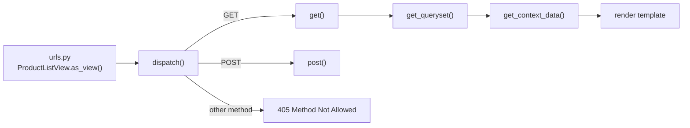

# Class-Based Views

!!! abstract "Learning Objectives"
    By the end of this lesson, you can:

    - Explain how a class-based view handles a request (`as_view()` → `dispatch()` → `get()` / `post()`)
    - Replace hand-written views with **generic views**: `TemplateView`, `ListView`, `DetailView`, `CreateView`, `RedirectView`
    - Customise generic views by overriding hooks: `get_queryset()`, `get_context_data()`, `form_valid()`, `get_success_url()`
    - Add **pagination** that keeps the user's filters
    - Combine behaviour with **mixins**, and choose between function-based and class-based views

**Prerequisites:** [Forms & ModelForms](06-forms-and-modelforms.md)

## Why Class-Based Views?

Look at the views you've written. Many follow the same recipe:

- **List:** query some rows, maybe filter, render a template.
- **Detail:** fetch one row or 404, render a template.
- **Create:** show a form on GET; on POST validate, save, redirect.

Django ships these recipes as **generic class-based views (CBVs)**. You configure them with attributes and override only the steps that differ.

```{ .python .no-run }
# Function-based view (lesson 03)
def product_detail(request, product_id):
    product = get_object_or_404(Product, pk=product_id)
    return render(request, "shop/product_detail.html", {"product": product})

# The same with a generic class-based view
class ProductDetailView(DetailView):
    model = Product
```

`DetailView` reads `pk` from the URL, calls `get_object_or_404`, picks the template `shop/product_detail.html` (`<app>/<model>_detail.html`) and puts the object in the context as `product` (and `object`).

## How a Class-Based View Runs



- `as_view()` turns the class into a function that `urls.py` can use. Each request gets a **fresh instance**, so `self` is safe to use for that request.
- `dispatch()` looks at the HTTP method and calls the method with the same name (`get`, `post`...). Unsupported methods return **405** automatically.
- Inside, `self.request`, `self.args` and `self.kwargs` (URL parameters) are always available.

The simplest CBV is a plain `View` where you write the method handlers yourself:

```{ .python .no-run }
from django.views import View

class HealthView(View):
    def get(self, request):
        return JsonResponse({"status": "ok", "framework": "Django"})
```

## The Generic Views

| View | Does | Template (default) | Main hooks |
|------|------|--------------------|------------|
| `TemplateView` | Renders a template | must set `template_name` | `get_context_data` |
| `ListView` | A list of objects, with optional pagination | `<app>/<model>_list.html` | `get_queryset`, `get_context_data` |
| `DetailView` | One object or 404 | `<app>/<model>_detail.html` | `get_object`, `get_queryset` |
| `CreateView` | Form that creates an object | `<app>/<model>_form.html` | `form_valid`, `get_success_url` |
| `UpdateView` | Form that edits an object | `<app>/<model>_form.html` | same as `CreateView` |
| `DeleteView` | Confirm page, deletes on POST | `<app>/<model>_confirm_delete.html` | `get_success_url` |
| `FormView` | Any form, not tied to a model | must set `template_name` | `form_valid` |
| `RedirectView` | Redirects | none | `get_redirect_url` |

## Rewriting the Shop with CBVs

Here is the whole `views.py` rewritten. Read it alongside the lesson 06 version: the behaviour is the same, plus pagination and an About page.

```python title="shop/views.py"
from django.contrib.messages.views import SuccessMessageMixin
from django.db.models import Count
from django.http import JsonResponse
from django.shortcuts import get_object_or_404
from django.urls import reverse
from django.views import View
from django.views.generic import CreateView, DetailView, ListView, TemplateView

from .forms import ProductFilterForm, ReviewForm
from .models import Category, Product


class HomeView(TemplateView):
    template_name = "shop/home.html"

    def get_context_data(self, **kwargs):
        context = super().get_context_data(**kwargs)
        context["featured"] = Product.objects.select_related("category").filter(stock__gt=0)[:3]
        context["categories"] = Category.objects.annotate(product_count=Count("products")).order_by("name")
        return context


class HealthView(View):
    def get(self, request):
        return JsonResponse({"status": "ok", "framework": "Django"})


class ProductListView(ListView):
    template_name = "shop/product_list.html"
    context_object_name = "products"
    paginate_by = 5

    def get_queryset(self):
        products = Product.objects.select_related("category")
        self.form = ProductFilterForm(self.request.GET or None)
        if self.form.is_valid():
            data = self.form.cleaned_data
            if data["q"]:
                products = products.filter(name__icontains=data["q"])
            if data["category"]:
                products = products.filter(category=data["category"])
            if data["min_price"] is not None:
                products = products.filter(price__gte=data["min_price"])
            if data["max_price"] is not None:
                products = products.filter(price__lte=data["max_price"])
            if data["sort"]:
                products = products.order_by(data["sort"])
        return products

    def get_context_data(self, **kwargs):
        context = super().get_context_data(**kwargs)
        context["form"] = self.form
        return context


class CategoryProductsView(ListView):
    template_name = "shop/product_list.html"
    context_object_name = "products"
    paginate_by = 5

    def get_queryset(self):
        self.category = get_object_or_404(Category, slug=self.kwargs["slug"])
        return self.category.products.all()

    def get_context_data(self, **kwargs):
        context = super().get_context_data(**kwargs)
        context["category"] = self.category
        return context


class ProductDetailView(DetailView):
    queryset = Product.objects.select_related("category")
    template_name = "shop/product_detail.html"

    def get_context_data(self, **kwargs):
        context = super().get_context_data(**kwargs)
        context["reviews"] = self.object.reviews.all()
        context["form"] = ReviewForm()
        return context


class ReviewCreateView(SuccessMessageMixin, CreateView):
    form_class = ReviewForm
    template_name = "shop/review_form.html"
    success_message = "Thanks! Your review has been posted."

    def dispatch(self, request, *args, **kwargs):
        self.product = get_object_or_404(Product, pk=kwargs["pk"])
        return super().dispatch(request, *args, **kwargs)

    def form_valid(self, form):
        form.instance.product = self.product
        return super().form_valid(form)

    def get_success_url(self):
        return reverse("shop:product_detail", args=[self.product.pk])

    def get_context_data(self, **kwargs):
        context = super().get_context_data(**kwargs)
        context["product"] = self.product
        return context
```

The hooks we overrode, and why:

| Hook | Overridden in | Why |
|------|---------------|-----|
| `get_context_data()` | `HomeView`, list and detail views | Add extra variables to the template (always call `super()` first) |
| `get_queryset()` | `ProductListView`, `CategoryProductsView` | Filter the rows based on the request or URL |
| `dispatch()` | `ReviewCreateView` | Load the product once for both GET and POST (and 404 early) |
| `form_valid()` | `ReviewCreateView` | Set the product before saving (the `commit=False` step from lesson 06) |
| `get_success_url()` | `ReviewCreateView` | Where to redirect after saving (Post/Redirect/Get is built in) |

`SuccessMessageMixin` adds the flash message after a successful save. It comes **first** in the class list, so its `form_valid()` runs before `CreateView`'s.

### URLs: `as_view()`

Simple views can be configured directly in `urls.py` without writing a class:

```python title="shop/urls.py"
from django.urls import path
from django.views.generic import RedirectView, TemplateView

from . import views

app_name = "shop"

urlpatterns = [
    path("", views.HomeView.as_view(), name="home"),
    path("health/", views.HealthView.as_view(), name="health"),
    path("about/", TemplateView.as_view(template_name="shop/about.html"), name="about"),
    path("products/", views.ProductListView.as_view(), name="product_list"),
    path("products/<int:pk>/", views.ProductDetailView.as_view(), name="product_detail"),
    path("products/<int:pk>/reviews/new/", views.ReviewCreateView.as_view(), name="review_create"),
    path("category/<slug:slug>/", views.CategoryProductsView.as_view(), name="category"),
    path("old-shop/", RedirectView.as_view(pattern_name="shop:product_list", permanent=True)),
]
```

The detail URL parameter is now `pk`, the name `DetailView` looks for. Templates are unaffected because they pass the id positionally: ``.

## Pagination

`paginate_by = 5` splits the list into pages of five and adds these to the context:

| Variable | Meaning |
|----------|---------|
| `page_obj` | The current page: `number`, `has_next`, `has_previous`, `next_page_number`, `start_index` |
| `paginator` | All pages: `count` (total rows), `num_pages` |
| `is_paginated` | `True` when there's more than one page |
| `products` | Only the rows on the current page |

The `` tag builds the link to another page while **keeping the current filters** (`?category=1&page=2`):

```html title="shop/templates/shop/product_list.html"


Products | KSR Store


<h1>{{ category.name }}All products</h1>


<form method="get" action="" class="filters">
  {{ form }}
  <button type="submit">Apply</button>
</form>


<p class="info">{{ paginator.count }} product{{ paginator.count|pluralize }}</p>

<ul>

  <li>{{ page_obj.start_index|add:forloop.counter0 }}. <a href="">{{ product.name }}</a> - ₹{{ product.price|floatformat:"0g" }} - Out of stock</li>

  <li>No products found.</li>

</ul>


<nav class="pagination">
  <a href="">Previous</a>
  <span>Page {{ page_obj.number }} of {{ paginator.num_pages }}</span>
  <a href="">Next</a>
</nav>


```

`page_obj.start_index|add:forloop.counter0` numbers items 6, 7, 8... on page 2 instead of restarting at 1.

## The Remaining Templates

The detail page now posts reviews to the separate `review_create` URL:

```html title="shop/templates/shop/product_detail.html"


{{ product.name }} | KSR Store


<h1>{{ product.name }}</h1>
<p class="meta">{{ product.category }} · {{ product.brand }}</p>
<p class="price">₹{{ product.price|floatformat:"2g" }}</p>

<p class="stock">In stock</p>

<p class="stock">Only {{ product.stock }} left!</p>

<p class="stock">Out of stock</p>


<h2>Reviews ({{ reviews|length }})</h2>
<ul>

  <li class="review"><strong>{{ review.name }}</strong> ({{ review.get_rating_display }}): {{ review.comment }}</li>

  <li class="review">No reviews yet. Be the first!</li>

</ul>

<h2>Write a review</h2>
<form method="post" action="">
  
  {{ form }}
  <button type="submit">Post review</button>
</form>
<a href="">Back to all products</a>

```

If a review is invalid, `CreateView` re-renders **its own** template with the errors:

```html title="shop/templates/shop/review_form.html"


Review {{ product.name }} | KSR Store


<h1>Review: {{ product.name }}</h1>
<form method="post">
  
  {{ form }}
  <button type="submit">Post review</button>
</form>
<a href="">Back to {{ product.name }}</a>

```

```html title="shop/templates/shop/about.html"


About | KSR Store


<h1>About KSR Store</h1>
<p>An online shop built step by step while learning Django.</p>

```

## Trying It

Page 1 and page 3 of all products:

```bash
curl -s http://127.0.0.1:8000/products/ | grep -E 'class="info"|<li>|<span>Page|>Next<'
curl -s "http://127.0.0.1:8000/products/?page=3" | grep -E '<li>|<span>Page|>Previous<'
```

```{ .text .output }
<p class="info">15 products</p>
  <li>1. <a href="/products/3/">Airdopes 141</a> - ₹1,299</li>
  <li>2. <a href="/products/9/">Atomic Habits</a> - ₹499</li>
  <li>3. <a href="/products/8/">Cotton T-Shirt</a> - ₹799</li>
  <li>4. <a href="/products/15/">Cricket Bat</a> - ₹2,499</li>
  <li>5. <a href="/products/6/">Denim Jacket</a> - ₹3,499</li>
  <span>Page 1 of 3</span>
  <a href="?page=2">Next</a>
  <li>11. <a href="/products/11/">Python Crash Course</a> - ₹2,199</li>
  <li>12. <a href="/products/7/">Running Shoes</a> - ₹4,299</li>
  <li>13. <a href="/products/5/">USB-C Cable</a> - ₹299</li>
  <li>14. <a href="/products/10/">Wings of Fire</a> - ₹350 - Out of stock</li>
  <li>15. <a href="/products/14/">Yoga Mat</a> - ₹999 - Out of stock</li>
  <a href="?page=2">Previous</a>
  <span>Page 3 of 3</span>
```

Filters survive pagination thanks to ``, and a page that doesn't exist is a 404:

```bash
curl -s "http://127.0.0.1:8000/products/?sort=-price" | grep -oE 'class="info">[^<]+|href="\?[^"]*">Next'
curl -s -o /dev/null -w "page 9 -> HTTP %{http_code}\n" "http://127.0.0.1:8000/products/?page=9"
```

```{ .text .output }
class="info">15 products
href="?sort=-price&amp;page=2">Next
page 9 -> HTTP 404
```

`TemplateView`, `RedirectView` (now a permanent **301**) and `HealthView`:

```bash
curl -s http://127.0.0.1:8000/about/ | grep "<h1>"
curl -s -o /dev/null -w "old-shop/ -> HTTP %{http_code}, redirects to %{redirect_url}\n" http://127.0.0.1:8000/old-shop/
curl -s http://127.0.0.1:8000/health/; echo
curl -s -X OPTIONS -D - -o /dev/null http://127.0.0.1:8000/health/ | grep -i "^allow"
```

```{ .text .output }
<h1>About KSR Store</h1>
old-shop/ -> HTTP 301, redirects to http://127.0.0.1:8000/products/
{"status": "ok", "framework": "Django"}
Allow: GET, HEAD, OPTIONS
```

`HealthView` only defines `get()`, and the view worked out the allowed methods by itself: `HEAD` reuses `get()`, and `OPTIONS` is built in. Any other method gets **405 Method Not Allowed**. (A POST, PUT or DELETE without a CSRF token is stopped even earlier with **403** by the CSRF middleware.)

Post a review through `ReviewCreateView`, then an invalid one:

```bash
curl -s -c cookies.txt -o /dev/null http://127.0.0.1:8000/products/7/
CSRF=$(grep csrftoken cookies.txt | cut -f7)
curl -s -b cookies.txt -c cookies.txt -o /dev/null -w "valid -> HTTP %{http_code}, redirects to %{redirect_url}\n" \
  --data-urlencode "csrfmiddlewaretoken=$CSRF" --data-urlencode "name=Arjun Singh" \
  --data-urlencode "rating=4" --data-urlencode "comment=Comfortable for daily runs." \
  http://127.0.0.1:8000/products/7/reviews/new/
curl -s -b cookies.txt http://127.0.0.1:8000/products/7/ | grep -E 'class="message|class="review"'
curl -s -b cookies.txt -w "invalid -> HTTP %{http_code}\n" \
  --data-urlencode "csrfmiddlewaretoken=$CSRF" --data-urlencode "name=Arjun" \
  --data-urlencode "rating=4" --data-urlencode "comment=ok" \
  http://127.0.0.1:8000/products/7/reviews/new/ | grep -oE '<h1>[^<]+|<ul class="errorlist[^>]*><li>[^<]+|invalid -> .*' | sed 's/.*<li>/error: /'
```

```{ .text .output }
valid -> HTTP 302, redirects to http://127.0.0.1:8000/products/7/
  <p class="message success">Thanks! Your review has been posted.</p>
  <li class="review"><strong>Arjun Singh</strong> (4 stars): Comfortable for daily runs.</li>
<h1>Review: Running Shoes
error: Please write at least 10 characters.
invalid -> HTTP 200
```

## Mixins: Reusable Pieces of Behaviour

A **mixin** is a small class that adds one feature to a view. You list mixins **before** the generic view so their methods run first:

```{ .python .no-run }
class ReviewCreateView(SuccessMessageMixin, CreateView): ...
class StaffProductUpdateView(LoginRequiredMixin, PermissionRequiredMixin, UpdateView): ...   # lesson 08
```

| Mixin | Adds |
|-------|------|
| `SuccessMessageMixin` | A flash message after a successful form |
| `LoginRequiredMixin` | Redirects anonymous users to the login page |
| `PermissionRequiredMixin` | Requires a permission like `shop.change_product` |
| `UserPassesTestMixin` | Your own `test_func()` check |

Python decides the order with the **MRO** (method resolution order). You can inspect it:

```{ .python .shell }
from shop.views import ReviewCreateView

print([cls.__name__ for cls in ReviewCreateView.__mro__][:8])
```

```{ .text .output }
['ReviewCreateView', 'SuccessMessageMixin', 'CreateView', 'SingleObjectTemplateResponseMixin', 'TemplateResponseMixin', 'BaseCreateView', 'ModelFormMixin', 'FormMixin']
```

Each `super().form_valid(form)` call passes control to the **next** class in this list. That's why every overridden hook must call `super()`.

## Function-Based or Class-Based?

| Choose function-based views when... | Choose class-based views when... |
|-------------------------------------|----------------------------------|
| The logic is unusual or doesn't fit a generic view | It's standard list / detail / create / update / delete |
| You want everything visible in one place | You want pagination, forms and redirects for free |
| The view does several unrelated things | Several views share behaviour (mixins, base classes) |
| You're a beginner reading the code top to bottom | The team already uses CBVs consistently |

Both are first-class in Django, and most projects mix them. The [Classy Class-Based Views](https://ccbv.co.uk/) website shows every attribute and method of each generic view, which is very useful when you're unsure which hook to override.

!!! realworld "In Real Projects"
    Teams usually standardise: generic CBVs for CRUD screens, a few project-wide base classes and mixins (for example `CompanyScopedMixin` that filters every queryset to the user's company), and function-based views for one-off endpoints like webhooks. The same ideas carry over to Django REST Framework, whose `ListCreateAPIView` and `ModelViewSet` are class-based views for APIs (lesson 09).

## Common Mistakes

| Mistake | Error / Symptom | Fix |
|---------|-----------------|-----|
| `path("...", ProductListView)` | `TypeError: ... takes 1 positional argument` | `ProductListView.as_view()` |
| Not calling `super()` in a hook | Missing context, lost pagination or messages | `context = super().get_context_data(**kwargs)` |
| URL uses `<int:id>` with `DetailView` | `AttributeError: ... must be called with either an object pk or a slug` | Name it `pk` (or set `pk_url_kwarg`) |
| Mixin listed after the generic view | Mixin has no effect | Mixins first: `class V(LoginRequiredMixin, ListView)` |
| Template uses `object_list` vs `products` confusion | Empty list in template | Set `context_object_name` and use that name |
| `CreateView` without `get_success_url` or `success_url` | `ImproperlyConfigured: No URL to redirect to` | Define one (or `get_absolute_url()` on the model) |
| Storing data on the class (`items = []`) and mutating it | Data leaks between requests | Use instance attributes set inside methods |

## Practice Exercises

**Easy**

1. Change `paginate_by` to 4 and check how many pages there are now.
2. Turn the About page into an `AboutView(TemplateView)` that adds `product_count` to the context and shows "We sell 15 products".
3. Add a "Contact" page with `TemplateView.as_view(...)` directly in `urls.py`.

**Medium**

4. Make `CategoryProductsView` a subclass of `ProductListView` so category pages also get the filter form (hint: override `get_queryset()` to call `super()` and then filter by category).
5. Add a `get_absolute_url()` method to `Product` returning its detail URL, and use `{{ product.get_absolute_url }}` in templates.
6. Add a `ReviewListView` at `/reviews/` showing the latest reviews across all products, 10 per page.

**Challenge**

7. Write a `CustomerOrdersView(DetailView)` for `/customers/<pk>/orders/` that shows a customer with their orders and items using **one** `prefetch_related` query plan, and prove it runs at most 3 queries with `CaptureQueriesContext` in the shell (use `django.test.Client`).

??? success "Solutions (click to expand)"

    ```{ .python .no-run }
    # 2
    class AboutView(TemplateView):
        template_name = "shop/about.html"

        def get_context_data(self, **kwargs):
            context = super().get_context_data(**kwargs)
            context["product_count"] = Product.objects.count()
            return context

    # 4
    class CategoryProductsView(ProductListView):
        def get_queryset(self):
            self.category = get_object_or_404(Category, slug=self.kwargs["slug"])
            return super().get_queryset().filter(category=self.category)

        def get_context_data(self, **kwargs):
            context = super().get_context_data(**kwargs)
            context["category"] = self.category
            return context

    # 5 (models.py)
    from django.urls import reverse

    def get_absolute_url(self):
        return reverse("shop:product_detail", args=[self.pk])

    # 6
    class ReviewListView(ListView):
        queryset = Review.objects.select_related("product")
        template_name = "shop/review_list.html"
        context_object_name = "reviews"
        paginate_by = 10

    # 7
    class CustomerOrdersView(DetailView):
        model = Customer
        template_name = "shop/customer_orders.html"
        queryset = Customer.objects.prefetch_related("orders__items__product")
    ```

!!! note "Mini Assignment"
    Rebuild your **college library** public pages with CBVs: `BookListView` (search form + pagination of 10), `BookDetailView`, `AuthorDetailView` with their books, and a `LoanRequestCreateView` with a success message. Use at least one mixin of your own (for example `PageTitleMixin` that adds a `page_title` to the context).

## Interview Questions

!!! interview "1. What does `as_view()` do?"
    It's a class method that returns a plain view function. For each request, that function creates a new instance of the class, sets `request`, `args` and `kwargs`, and calls `dispatch()`, which routes to the method handler matching the HTTP method.

!!! interview "2. What is the difference between `get_queryset()` and `get_context_data()`?"
    `get_queryset()` returns the objects the view works with (the list in a `ListView`, the set to look up from in a `DetailView`). `get_context_data()` builds the dictionary passed to the template; you override it to add extra variables, after calling `super()`.

!!! interview "3. What is a mixin, and why does the order of base classes matter?"
    A mixin is a small class providing one reusable behaviour (login required, success message). Python resolves methods using the MRO, from left to right, so mixins must come before the generic view to run their version of `dispatch()` or `form_valid()` first and then call `super()`.

!!! interview "4. How does pagination work in a `ListView`?"
    Setting `paginate_by` makes the view slice the queryset with a `Paginator`, read the page number from `?page=`, and add `page_obj`, `paginator` and `is_paginated` to the context. An invalid or out-of-range page returns 404.

!!! interview "5. When would you use a function-based view instead of a class-based one?"
    When the logic doesn't fit a generic pattern, when it's simpler to read top to bottom, or for small one-off endpoints like webhooks. CBVs shine for repetitive CRUD screens and shared behaviour via mixins.

!!! interview "Scenario: a `ListView` shows the right data but each page takes 2 seconds. What would you check?"
    Whether the template accesses related objects in a loop (fix with `select_related` / `prefetch_related` in `get_queryset()`), whether the count query on a huge table is slow (consider caching or a custom paginator), whether filters hit indexed columns, and whether `paginate_by` is set at all (otherwise every row is loaded).

## Summary

| Concept | Code |
|---------|------|
| Plain CBV | `class HealthView(View): def get(self, request): ...` |
| URL | `path("products/", ProductListView.as_view(), name="product_list")` |
| List + pagination | `class ProductListView(ListView): paginate_by = 5` |
| Detail | `class ProductDetailView(DetailView): queryset = ...` (URL kwarg `pk`) |
| Create | `class ReviewCreateView(CreateView): form_class = ReviewForm` + `form_valid` + `get_success_url` |
| Inline config | `TemplateView.as_view(template_name=...)`, `RedirectView.as_view(pattern_name=...)` |
| Add context | `context = super().get_context_data(**kwargs); context["x"] = ...` |
| Keep filters | `` |
| Mixins | `class V(SuccessMessageMixin, CreateView)`: mixins first |

**Next lesson:** [Authentication & Authorization](08-authentication-and-authorization.md), sign-up, login, logout, and pages only certain users can see.
