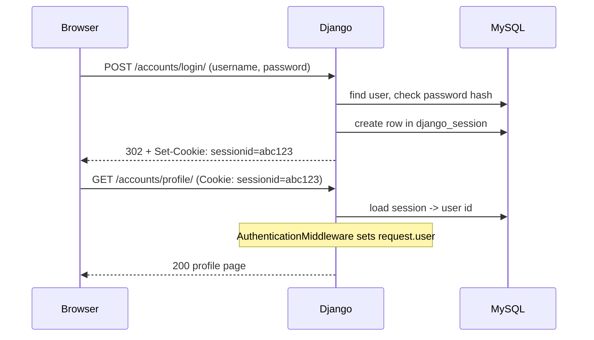

# Authentication & Authorization

!!! abstract "Learning Objectives"
    By the end of this lesson, you can:

    - Explain how Django authentication works: the `User` model, password hashing, sessions and `request.user`
    - Build **sign-up**, **login** and **logout** in an `accounts` app using Django's built-in views and forms
    - Protect pages with `@login_required` and `LoginRequiredMixin`
    - Link data to the logged-in user (reviews written by a user)
    - Restrict actions with **permissions** (`PermissionRequiredMixin`, ``) and tell 401-style redirects from **403 Forbidden**

**Prerequisites:** [Class-Based Views](07-class-based-views.md)

## Authentication vs Authorization

| | Authentication | Authorization |
|---|---|---|
| Question | **Who are you?** | **What are you allowed to do?** |
| Django tools | Login, logout, sessions, `request.user` | `is_staff`, permissions, groups, `has_perm()` |
| Failure | Redirect to the login page | **403 Forbidden** |
| Shop example | Asha logs in | Only store managers may edit prices |

## How Django Authentication Works

`django.contrib.auth` and `django.contrib.sessions` have been in `INSTALLED_APPS` since lesson 01, and their tables were created by your first `migrate`.



- Passwords are **never stored**. Django stores a salted hash (PBKDF2 with hundreds of thousands of iterations by default).
- After login, the browser only holds a random **session id**. The session data lives in the `django_session` table.
- On every request, `AuthenticationMiddleware` sets `request.user`: a `User`, or an `AnonymousUser` when nobody is logged in.

```{ .python .shell }
from django.contrib.auth.models import User

user = User.objects.create_user("demo", email="demo@example.com", password="Learn@Django6")
algorithm, iterations, salt, hashed = user.password.split("$")
print(algorithm, iterations, f"salt: {len(salt)} chars, hash: {len(hashed)} chars")
print(user.check_password("Learn@Django6"), user.check_password("wrong"))
print(user.is_authenticated, user.is_staff, user.is_superuser)
user.delete()
```

```{ .text .output }
pbkdf2_sha256 1500000 salt: 22 chars, hash: 44 chars
True False
True False False
```

The stored value is `algorithm$iterations$salt$hash`. The salt is random, so two users with the same password get different hashes, and even the database administrator can't read the password.

!!! tip "Custom user model for new projects"
    Django's documentation recommends starting every **new** project with a custom user model (`class User(AbstractUser)` and `AUTH_USER_MODEL = "accounts.User"`) **before the first migrate**, so you can add fields like `phone` later. Switching after tables exist is hard. In this module we keep the built-in `User` to stay focused, and always refer to it through `settings.AUTH_USER_MODEL` or `get_user_model()` so the code works either way.

## The `accounts` App

Keep everything about users in its own app:

```bash
python manage.py startapp accounts
mkdir -p templates/registration accounts/templates/accounts
```

Register the app in `config/settings.py` (the line marked `# new`):

```{ .python .edit title="config/settings.py" }
INSTALLED_APPS = [
    ...
    "shop",
    "accounts",  # new
]
```

and add these settings at the **end** of the file. They tell Django where the login page is and where to go after logging in or out:

```{ .python .append title="config/settings.py" }
LOGIN_URL = "accounts:login"
LOGIN_REDIRECT_URL = "shop:home"
LOGOUT_REDIRECT_URL = "shop:home"
```

### Sign-up form

Django's `UserCreationForm` already handles the username, two password fields, password validation (the `AUTH_PASSWORD_VALIDATORS` in settings) and hashing. We add a required, unique email:

```python title="accounts/forms.py"
from django import forms
from django.contrib.auth import get_user_model
from django.contrib.auth.forms import UserCreationForm

User = get_user_model()


class SignUpForm(UserCreationForm):
    email = forms.EmailField(required=True)

    class Meta(UserCreationForm.Meta):
        model = User
        fields = ["username", "email"]

    def clean_email(self):
        email = self.cleaned_data["email"].lower()
        if User.objects.filter(email__iexact=email).exists():
            raise forms.ValidationError("An account with this email already exists.")
        return email
```

### Views

Login and logout are **built in** (`LoginView`, `LogoutView`). We write only sign-up and a profile page:

```python title="accounts/views.py"
from django.contrib import messages
from django.contrib.auth import login
from django.contrib.auth.decorators import login_required
from django.shortcuts import render
from django.urls import reverse_lazy
from django.views.generic import CreateView

from .forms import SignUpForm


class SignUpView(CreateView):
    form_class = SignUpForm
    template_name = "accounts/signup.html"
    success_url = reverse_lazy("shop:home")

    def form_valid(self, form):
        response = super().form_valid(form)          # saves the user (password hashed)
        login(self.request, self.object)             # log them in straight away
        messages.success(self.request, f"Welcome, {self.object.username}! Your account is ready.")
        return response


@login_required
def profile(request):
    reviews = request.user.reviews.select_related("product")
    return render(request, "accounts/profile.html", {"reviews": reviews})
```

- `reverse_lazy` is needed for class attributes: the URLconf isn't loaded yet when the class is defined.
- `@login_required` sends anonymous visitors to `LOGIN_URL` with `?next=/accounts/profile/`, and `LoginView` sends them back there after logging in.
- `request.user.reviews` will work once reviews are linked to users (below).

```python title="accounts/urls.py"
from django.contrib.auth import views as auth_views
from django.urls import path

from . import views

app_name = "accounts"

urlpatterns = [
    path("signup/", views.SignUpView.as_view(), name="signup"),
    path("login/", auth_views.LoginView.as_view(redirect_authenticated_user=True), name="login"),
    path("logout/", auth_views.LogoutView.as_view(), name="logout"),
    path("profile/", views.profile, name="profile"),
]
```

```python title="config/urls.py"
from django.contrib import admin
from django.urls import include, path

admin.site.site_header = "KSR Store Admin"
admin.site.site_title = "KSR Store Admin"
admin.site.index_title = "Back office"

urlpatterns = [
    path("admin/", admin.site.urls),
    path("accounts/", include("accounts.urls")),
    path("", include("shop.urls")),
]
```

### Templates

`LoginView` looks for `registration/login.html` by default. It passes a `form` and the `next` value:

```html title="templates/registration/login.html"


Log in | KSR Store


<h1>Log in</h1>
<form method="post">
  
  {{ form }}
  <input type="hidden" name="next" value="{{ next }}">
  <button type="submit">Log in</button>
</form>
<p>New here? <a href="">Create an account</a></p>

```

```html title="accounts/templates/accounts/signup.html"


Sign up | KSR Store


<h1>Create your account</h1>
<form method="post">
  
  {{ form }}
  <button type="submit">Sign up</button>
</form>

```

```html title="accounts/templates/accounts/profile.html"


My account | KSR Store


<h1>Hello, {{ user.username }}</h1>
<p>Email: {{ user.email }} · Member since {{ user.date_joined|date:"j M Y" }}</p>
<h2>My reviews ({{ reviews|length }})</h2>
<ul>

  <li class="review">{{ review.product.name }}: {{ review.get_rating_display }}</li>

  <li class="review">You haven't written any reviews yet.</li>

</ul>

```

Every template automatically receives **`user`** (the same object as `request.user`) and **`perms`**, thanks to the `auth` context processor in `TEMPLATES`. The navigation uses `user` to show the right links. **Logout must be a POST** with a CSRF token (since Django 5.0), so it's a small form:

```html title="templates/base.html"

<!doctype html>
<html lang="en">
<head>
  <meta charset="utf-8">
  <title>KSR Store</title>
  <link rel="stylesheet" href="">
</head>
<body>
  <nav>
    <a href="">Home</a>
    <a href="">All products</a>
    
      <a href="" class="user">Hi, {{ user.username }}</a>
      <form method="post" action="">
        
        <button type="submit">Log out</button>
      </form>
    
      <a href="">Log in</a>
      <a href="">Sign up</a>
    
  </nav>
  
  <p class="message {{ message.tags }}">{{ message }}</p>
  
  <main>
    
  </main>
  <footer>KSR Store · Built with Django</footer>
</body>
</html>
```

## Linking Reviews to Users

Anyone could type any name on a review. Now that we have accounts, a review should belong to the **logged-in user**. Add a `user` foreign key to `Review` (new lines marked `# new`):

```{ .python .edit title="shop/models.py" }
from datetime import date

from django.conf import settings  # new
from django.db import models
...
class Review(models.Model):
    ...
    product = models.ForeignKey(Product, on_delete=models.CASCADE, related_name="reviews")
    user = models.ForeignKey(  # new
        settings.AUTH_USER_MODEL, on_delete=models.SET_NULL, null=True, blank=True, related_name="reviews"  # new
    )  # new
    name = models.CharField(max_length=60)
```

- `settings.AUTH_USER_MODEL` (not `User` directly) keeps the code working with a custom user model.
- `null=True` because existing reviews have no user, and `SET_NULL` keeps a review if its author deletes their account.

```bash
python manage.py makemigrations shop
python manage.py migrate shop
```

```{ .text .output }
Migrations for 'shop':
  shop/migrations/0004_review_user.py
    + Add field user to review
Operations to perform:
  Apply all migrations: shop
Running migrations:
  Applying shop.0004_review_user... OK
```

The review form no longer asks for a name. We take it from the account:

```python title="shop/forms.py"
from django import forms

from .models import Category, Review


class ProductFilterForm(forms.Form):
    SORT_CHOICES = [("name", "Name"), ("price", "Price: low to high"), ("-price", "Price: high to low")]

    q = forms.CharField(label="Search", required=False, max_length=50)
    category = forms.ModelChoiceField(queryset=Category.objects.all(), required=False, empty_label="All categories")
    min_price = forms.DecimalField(required=False, min_value=0, decimal_places=2)
    max_price = forms.DecimalField(required=False, min_value=0, decimal_places=2)
    sort = forms.ChoiceField(choices=SORT_CHOICES, required=False)

    def clean(self):
        cleaned = super().clean()
        low, high = cleaned.get("min_price"), cleaned.get("max_price")
        if low is not None and high is not None and low > high:
            raise forms.ValidationError("Minimum price must not be more than the maximum price.")
        return cleaned


class ReviewForm(forms.ModelForm):
    class Meta:
        model = Review
        fields = ["rating", "comment"]
        widgets = {"comment": forms.Textarea(attrs={"rows": 3})}

    def clean_comment(self):
        comment = self.cleaned_data["comment"].strip()
        if "http://" in comment or "https://" in comment:
            raise forms.ValidationError("Links are not allowed in reviews.")
        if len(comment) < 10:
            raise forms.ValidationError("Please write at least 10 characters.")
        return comment
```

## Protecting Views

In `shop/views.py`, `ReviewCreateView` gains `LoginRequiredMixin` and fills in the user, and a new **staff-only** view lets store managers edit products:

```python title="shop/views.py"
from django.contrib.auth.mixins import LoginRequiredMixin, PermissionRequiredMixin
from django.contrib.messages.views import SuccessMessageMixin
from django.db.models import Count
from django.http import JsonResponse
from django.shortcuts import get_object_or_404
from django.urls import reverse
from django.views import View
from django.views.generic import CreateView, DetailView, ListView, TemplateView, UpdateView

from .forms import ProductFilterForm, ReviewForm
from .models import Category, Product


class HomeView(TemplateView):
    template_name = "shop/home.html"

    def get_context_data(self, **kwargs):
        context = super().get_context_data(**kwargs)
        context["featured"] = Product.objects.select_related("category").filter(stock__gt=0)[:3]
        context["categories"] = Category.objects.annotate(product_count=Count("products")).order_by("name")
        return context


class HealthView(View):
    def get(self, request):
        return JsonResponse({"status": "ok", "framework": "Django"})


class ProductListView(ListView):
    template_name = "shop/product_list.html"
    context_object_name = "products"
    paginate_by = 5

    def get_queryset(self):
        products = Product.objects.select_related("category")
        self.form = ProductFilterForm(self.request.GET or None)
        if self.form.is_valid():
            data = self.form.cleaned_data
            if data["q"]:
                products = products.filter(name__icontains=data["q"])
            if data["category"]:
                products = products.filter(category=data["category"])
            if data["min_price"] is not None:
                products = products.filter(price__gte=data["min_price"])
            if data["max_price"] is not None:
                products = products.filter(price__lte=data["max_price"])
            if data["sort"]:
                products = products.order_by(data["sort"])
        return products

    def get_context_data(self, **kwargs):
        context = super().get_context_data(**kwargs)
        context["form"] = self.form
        return context


class CategoryProductsView(ListView):
    template_name = "shop/product_list.html"
    context_object_name = "products"
    paginate_by = 5

    def get_queryset(self):
        self.category = get_object_or_404(Category, slug=self.kwargs["slug"])
        return self.category.products.all()

    def get_context_data(self, **kwargs):
        context = super().get_context_data(**kwargs)
        context["category"] = self.category
        return context


class ProductDetailView(DetailView):
    queryset = Product.objects.select_related("category")
    template_name = "shop/product_detail.html"

    def get_context_data(self, **kwargs):
        context = super().get_context_data(**kwargs)
        context["reviews"] = self.object.reviews.all()
        context["form"] = ReviewForm()
        return context


class ReviewCreateView(LoginRequiredMixin, SuccessMessageMixin, CreateView):
    form_class = ReviewForm
    template_name = "shop/review_form.html"
    success_message = "Thanks! Your review has been posted."

    def dispatch(self, request, *args, **kwargs):
        self.product = get_object_or_404(Product, pk=kwargs["pk"])
        return super().dispatch(request, *args, **kwargs)

    def form_valid(self, form):
        form.instance.product = self.product
        form.instance.user = self.request.user
        form.instance.name = self.request.user.get_full_name() or self.request.user.username
        return super().form_valid(form)

    def get_success_url(self):
        return reverse("shop:product_detail", args=[self.product.pk])

    def get_context_data(self, **kwargs):
        context = super().get_context_data(**kwargs)
        context["product"] = self.product
        return context


class StaffProductUpdateView(LoginRequiredMixin, PermissionRequiredMixin, SuccessMessageMixin, UpdateView):
    model = Product
    fields = ["name", "brand", "price", "stock"]
    permission_required = "shop.change_product"
    template_name = "shop/product_form.html"
    success_message = "%(name)s was updated."

    def get_success_url(self):
        return reverse("shop:product_detail", args=[self.object.pk])
```

| Tool | For | Not logged in | Logged in, not allowed |
|------|-----|---------------|------------------------|
| `@login_required` | Function views | Redirect to login | n/a |
| `LoginRequiredMixin` | Class views | Redirect to login | n/a |
| `@permission_required("app.perm")` | Function views | Redirect to login | Redirect to login (or 403 with `raise_exception=True`) |
| `PermissionRequiredMixin` | Class views | Redirect to login | **403 Forbidden** |
| `UserPassesTestMixin` | Any rule (`test_func`) | Redirect to login | **403 Forbidden** |

Add the staff URL to `shop/urls.py`:

```{ .python .edit title="shop/urls.py" }
urlpatterns = [
    ...
    path("category/<slug:slug>/", views.CategoryProductsView.as_view(), name="category"),
    path("manage/products/<int:pk>/edit/", views.StaffProductUpdateView.as_view(), name="product_edit"),  # new
```

```html title="shop/templates/shop/product_form.html"


Edit {{ product.name }} | KSR Store


<h1>Edit: {{ product.name }}</h1>
<form method="post">
  
  {{ form }}
  <button type="submit">Save</button>
</form>

```

### Checking permissions in templates

On the product page, show the review form only to logged-in users and the **Edit** link only to users with the permission. `perms.shop.change_product` is the template version of `user.has_perm("shop.change_product")`:

```html title="shop/templates/shop/product_detail.html"


{{ product.name }} | KSR Store


<h1>{{ product.name }}</h1>
<p class="meta">{{ product.category }} · {{ product.brand }}</p>
<p class="price">₹{{ product.price|floatformat:"2g" }}</p>

<p class="stock">In stock</p>

<p class="stock">Only {{ product.stock }} left!</p>

<p class="stock">Out of stock</p>


<p class="staff"><a href="">Edit product</a></p>


<h2>Reviews ({{ reviews|length }})</h2>
<ul>

  <li class="review"><strong>{{ review.name }}</strong> ({{ review.get_rating_display }}): {{ review.comment }}</li>

  <li class="review">No reviews yet. Be the first!</li>

</ul>


<h2>Write a review</h2>
<form method="post" action="">
  
  {{ form }}
  <button type="submit">Post review</button>
</form>

<p class="login-hint"><a href="?next={{ request.path }}">Log in</a> to write a review.</p>

<a href="">Back to all products</a>

```

!!! mistake "Hiding a link is not security"
    `` only hides the link. Someone can still type `/manage/products/1/edit/`. The real protection is `PermissionRequiredMixin` **on the view**. Always protect the view; hide links only for a nicer interface.

## Trying It

An anonymous visitor is redirected to the login page, with `next` remembering where they wanted to go:

```bash
curl -s -o /dev/null -w "profile -> HTTP %{http_code}, redirects to %{redirect_url}\n" http://127.0.0.1:8000/accounts/profile/
curl -s -o /dev/null -w "edit    -> HTTP %{http_code}, redirects to %{redirect_url}\n" http://127.0.0.1:8000/manage/products/1/edit/
curl -s http://127.0.0.1:8000/products/9/ | grep -E 'class="login-hint"|>Log in<|>Sign up<'
```

```{ .text .output }
profile -> HTTP 302, redirects to http://127.0.0.1:8000/accounts/login/?next=/accounts/profile/
edit    -> HTTP 302, redirects to http://127.0.0.1:8000/accounts/login/?next=/manage/products/1/edit/
      <a href="/accounts/login/">Log in</a>
      <a href="/accounts/signup/">Sign up</a>
<p class="login-hint"><a href="/accounts/login/?next=/products/9/">Log in</a> to write a review.</p>
```

**Sign up.** A weak password is rejected by the `AUTH_PASSWORD_VALIDATORS` from `settings.py` (if the two passwords don't match, you get "The two password fields didn't match." instead):

```bash
curl -s -c kiran.txt -o /dev/null http://127.0.0.1:8000/accounts/signup/
CSRF=$(grep csrftoken kiran.txt | cut -f7)
curl -s -b kiran.txt -c kiran.txt \
  --data-urlencode "csrfmiddlewaretoken=$CSRF" --data-urlencode "username=kiran" \
  --data-urlencode "email=asha@example.com" --data-urlencode "password1=12345" --data-urlencode "password2=12345" \
  http://127.0.0.1:8000/accounts/signup/ | grep -oE '<ul class="errorlist[^>]*>(<li>[^<]*</li>)+' | grep -oE '<li>[^<]+' | sed 's/<li>/error: /'
```

```{ .text .output }
error: This password is too short. It must contain at least 8 characters.
error: This password is too common.
error: This password is entirely numeric.
```

Notice that `asha@example.com` wasn't rejected: Asha is a shop **customer** (the `Customer` table), not a `User`, and our `clean_email()` checks users only. Now a valid sign-up:

```bash
CSRF=$(grep csrftoken kiran.txt | cut -f7)
curl -s -b kiran.txt -c kiran.txt -o /dev/null -w "signup -> HTTP %{http_code}, redirects to %{redirect_url}\n" \
  --data-urlencode "csrfmiddlewaretoken=$CSRF" --data-urlencode "username=kiran" \
  --data-urlencode "email=kiran@example.com" --data-urlencode "password1=Kiran@Learns2026" --data-urlencode "password2=Kiran@Learns2026" \
  http://127.0.0.1:8000/accounts/signup/
cut -f6 kiran.txt | grep -E "^(csrftoken|sessionid)$"
curl -s -b kiran.txt http://127.0.0.1:8000/ | grep -E 'class="message|class="user"|Log out'
```

```{ .text .output }
signup -> HTTP 302, redirects to http://127.0.0.1:8000/
sessionid
csrftoken
      <a href="/accounts/profile/" class="user">Hi, kiran</a>
        <button type="submit">Log out</button>
  <p class="message success">Welcome, kiran! Your account is ready.</p>
```

The browser now holds a `sessionid` cookie, and the navigation greets Kiran. Kiran writes a review, which is linked to the account:

```bash
CSRF=$(grep csrftoken kiran.txt | cut -f7)
curl -s -b kiran.txt -c kiran.txt -o /dev/null -w "review -> HTTP %{http_code}\n" \
  --data-urlencode "csrfmiddlewaretoken=$CSRF" --data-urlencode "rating=5" \
  --data-urlencode "comment=Inspiring story, a must read." \
  http://127.0.0.1:8000/products/10/reviews/new/
curl -s -b kiran.txt http://127.0.0.1:8000/accounts/profile/ | grep -E '<h1>|<h2>|class="review"'
```

```{ .text .output }
review -> HTTP 302
<h1>Hello, kiran</h1>
<h2>My reviews (1)</h2>
  <li class="review">Wings of Fire: 5 stars</li>
```

Kiran is logged in but has no permission to edit products, so the staff page answers **403**:

```bash
curl -s -b kiran.txt -o /dev/null -w "kiran edit -> HTTP %{http_code}\n" http://127.0.0.1:8000/manage/products/1/edit/
curl -s -b kiran.txt http://127.0.0.1:8000/products/1/ | grep -c "Edit product"
```

```{ .text .output }
kiran edit -> HTTP 403
0
```

**Log in as Meena**, the store manager from lesson 05 (staff, in the "Store managers" group with `change_product`):

```bash
curl -s -c meena.txt -o /dev/null http://127.0.0.1:8000/accounts/login/
CSRF=$(grep csrftoken meena.txt | cut -f7)
curl -s -b meena.txt -c meena.txt -o /dev/null -w "login -> HTTP %{http_code}, redirects to %{redirect_url}\n" \
  --data-urlencode "csrfmiddlewaretoken=$CSRF" --data-urlencode "username=meena" \
  --data-urlencode "password=Practice@123" --data-urlencode "next=/products/1/" \
  http://127.0.0.1:8000/accounts/login/
curl -s -b meena.txt http://127.0.0.1:8000/products/1/ | grep -E 'class="staff"'
curl -s -b meena.txt -o /dev/null -w "meena edit -> HTTP %{http_code}\n" http://127.0.0.1:8000/manage/products/1/edit/
```

```{ .text .output }
login -> HTTP 302, redirects to http://127.0.0.1:8000/products/1/
<p class="staff"><a href="/manage/products/1/edit/">Edit product</a></p>
meena edit -> HTTP 200
```

`next=/products/1/` sent Meena back to the page she came from. She updates the price (Django **rotates the CSRF token at login**, so we read it again):

```bash
CSRF=$(grep csrftoken meena.txt | cut -f7)
curl -s -b meena.txt -c meena.txt -o /dev/null -w "save -> HTTP %{http_code}, redirects to %{redirect_url}\n" \
  --data-urlencode "csrfmiddlewaretoken=$CSRF" --data-urlencode "name=iPhone 15" --data-urlencode "brand=Apple" \
  --data-urlencode "price=74999" --data-urlencode "stock=25" \
  http://127.0.0.1:8000/manage/products/1/edit/
curl -s -b meena.txt http://127.0.0.1:8000/products/1/ | grep -E 'class="(message|price)'
```

```{ .text .output }
save -> HTTP 302, redirects to http://127.0.0.1:8000/products/1/
  <p class="message success">iPhone 15 was updated.</p>
<p class="price">₹74,999.00</p>
```

**Log out** with a POST. A GET is refused with **405**:

```bash
CSRF=$(grep csrftoken meena.txt | cut -f7)
curl -s -b meena.txt -o /dev/null -w "GET logout  -> HTTP %{http_code}\n" http://127.0.0.1:8000/accounts/logout/
curl -s -b meena.txt -c meena.txt -o /dev/null -w "POST logout -> HTTP %{http_code}, redirects to %{redirect_url}\n" \
  --data-urlencode "csrfmiddlewaretoken=$CSRF" http://127.0.0.1:8000/accounts/logout/
curl -s -b meena.txt -o /dev/null -w "edit after logout -> HTTP %{http_code}\n" http://127.0.0.1:8000/manage/products/1/edit/
```

```{ .text .output }
GET logout  -> HTTP 405
POST logout -> HTTP 302, redirects to http://127.0.0.1:8000/
edit after logout -> HTTP 302
```

Reset the product data that Meena changed:

```bash
python manage.py seed_shop
```

```{ .text .output }
Loaded 6 categories, 15 products, 10 customers, 12 orders and 17 order items.
```

## More Built-in Auth Views

Django also ships views for the rest of the account lifecycle. You only provide templates:

| View | Purpose | Default template |
|------|---------|------------------|
| `PasswordChangeView` / `PasswordChangeDoneView` | Change password while logged in | `registration/password_change_form.html` |
| `PasswordResetView` | "Forgot password": email a reset link | `registration/password_reset_form.html` |
| `PasswordResetConfirmView` | Set a new password from the emailed link | `registration/password_reset_confirm.html` |

`path("accounts/", include("django.contrib.auth.urls"))` adds all of them at once (with non-namespaced URL names such as `password_reset`). Password reset needs email settings (`EMAIL_BACKEND`); during development, `django.core.mail.backends.console.EmailBackend` prints emails to the terminal.

!!! realworld "In Real Projects"
    Most production Django sites use **django-allauth** for sign-up, email verification, social login (Google, GitHub) and two-factor authentication, on top of a **custom user model** that logs in with email instead of username. Authorization usually combines groups (roles such as "Support" or "Warehouse") with object-level rules, for example "a user can only see their own orders", enforced in `get_queryset()`: `Order.objects.filter(customer__user=self.request.user)`.

## Common Mistakes

| Mistake | Error / Symptom | Fix |
|---------|-----------------|-----|
| Logout link as `<a href>` | `405 Method Not Allowed` | POST form with `` |
| `LoginRequiredMixin` placed after the view class | Anonymous users get in | Mixins first: `class V(LoginRequiredMixin, CreateView)` |
| `ForeignKey(User, ...)` imported directly | Breaks with a custom user model | `settings.AUTH_USER_MODEL` in models, `get_user_model()` elsewhere |
| Only hiding links in templates | Anyone can type the URL | Protect the view with mixins or decorators |
| Storing passwords yourself / `user.password = "..."` | Plain-text password, login fails | `create_user()`, `set_password()`, `UserCreationForm` |
| `LOGIN_URL` not set with a namespaced login URL | `/accounts/login/` 404 or `NoReverseMatch` | `LOGIN_URL = "accounts:login"` |
| Not using `next` | Users land on the home page after logging in | Keep the hidden `next` field in the login form |
| Showing other users' data | Users read others' orders by changing the id | Filter querysets by `request.user` |

## Practice Exercises

**Easy**

1. Show "Logged in as *username*" in the footer for authenticated users.
2. Add a link to "My account" in the navigation only for logged-in users.
3. Add `first_name` and `last_name` to the sign-up form, and show the full name in reviews.

**Medium**

4. Add `PasswordChangeView` at `/accounts/password/` with a template, redirecting to the profile with a success message.
5. Let users **delete their own reviews** only: a `ReviewDeleteView(LoginRequiredMixin, DeleteView)` whose `get_queryset()` returns `Review.objects.filter(user=self.request.user)` (others get 404).
6. Prevent a user from reviewing the same product twice: a `UniqueConstraint(fields=["product", "user"], name="one_review_per_user")` plus a friendly message in the view.

**Challenge**

7. Create a "Customer support" group with `view_order` only, and a `/manage/orders/` `ListView` protected by `PermissionRequiredMixin` that lists orders with customer names (no N+1). Test it with curl as Kiran (403), as a new support user (200) and as anonymous (redirect).

??? success "Solutions (click to expand)"

    ```{ .python .no-run }
    # 4 (accounts/urls.py)
    from django.contrib.messages.views import SuccessMessageMixin
    from django.urls import reverse_lazy

    class PasswordChange(SuccessMessageMixin, auth_views.PasswordChangeView):
        template_name = "accounts/password_change.html"
        success_url = reverse_lazy("accounts:profile")
        success_message = "Your password was changed."

    path("password/", PasswordChange.as_view(), name="password_change")

    # 5 (shop/views.py)
    from django.views.generic import DeleteView

    class ReviewDeleteView(LoginRequiredMixin, DeleteView):
        template_name = "shop/review_confirm_delete.html"
        success_url = reverse_lazy("accounts:profile")

        def get_queryset(self):
            return Review.objects.filter(user=self.request.user)

    # 6 (Review.Meta)
    constraints = [models.UniqueConstraint(fields=["product", "user"], name="one_review_per_user")]
    # in ReviewCreateView.form_valid, before super():
    if Review.objects.filter(product=self.product, user=self.request.user).exists():
        messages.error(self.request, "You have already reviewed this product.")
        return redirect("shop:product_detail", pk=self.product.pk)

    # 7
    class StaffOrderListView(LoginRequiredMixin, PermissionRequiredMixin, ListView):
        permission_required = "shop.view_order"
        queryset = Order.objects.select_related("customer").order_by("-order_date")
        template_name = "shop/staff_order_list.html"
        context_object_name = "orders"
        paginate_by = 20
    ```

!!! note "Mini Assignment"
    Add accounts to your **college library**: students sign up and log in, see "My loans" (only their own), and can request a book only when logged in. Librarians (a group with `change_loan`) get a protected page listing overdue loans with a button to mark a loan as returned. Write down, for every URL, what an anonymous user, a student and a librarian see.

## Interview Questions

!!! interview "1. How does Django store passwords?"
    As a salted, slow hash, by default PBKDF2-SHA256 with a high iteration count, stored as `algorithm$iterations$salt$hash`. The plain password is never stored, `check_password()` re-hashes the input to compare, and `PASSWORD_HASHERS` can switch to Argon2 or bcrypt.

!!! interview "2. How do sessions work in Django?"
    On login, Django creates a session (by default a row in `django_session`) holding the user's id, and sends the browser a `sessionid` cookie. On each request, `SessionMiddleware` loads the session and `AuthenticationMiddleware` sets `request.user`. Logging out deletes the session.

!!! interview "3. What is the difference between `LoginRequiredMixin` and `PermissionRequiredMixin`?"
    `LoginRequiredMixin` only requires an authenticated user and redirects anonymous users to `LOGIN_URL`. `PermissionRequiredMixin` additionally requires specific permissions; anonymous users are redirected to log in, while logged-in users without the permission get 403 Forbidden.

!!! interview "4. Why should you use `settings.AUTH_USER_MODEL` instead of importing `User`?"
    The project might use a custom user model. Referring to `settings.AUTH_USER_MODEL` in model fields, and `get_user_model()` in other code, always points to the active user model, so apps keep working whether or not the default `User` is swapped.

!!! interview "5. Why does Django require logout to be a POST request?"
    A GET logout could be triggered by any page (for example an `` on another site), logging users out without consent. Requiring POST means the CSRF protection applies, so only a real form on your site can log the user out.

!!! interview "Scenario: users can see other people's orders by changing the number in `/orders/15/`. How do you fix it?"
    This is an Insecure Direct Object Reference. Restrict the view's queryset to the current user, for example `get_queryset()` returning `Order.objects.filter(customer__user=self.request.user)` together with `LoginRequiredMixin`, so other ids return 404. Add a test that a second user gets 404 for the first user's order.

## Summary

| Task | Code |
|------|------|
| Current user | `request.user` · `{{ user }}` · `user.is_authenticated` |
| Create user safely | `User.objects.create_user(...)` · `UserCreationForm` |
| Sign-up then log in | `CreateView` + `login(self.request, self.object)` |
| Login / logout | `LoginView` (`registration/login.html`) · `LogoutView` (POST only) |
| Settings | `LOGIN_URL`, `LOGIN_REDIRECT_URL`, `LOGOUT_REDIRECT_URL` |
| Require login | `@login_required` · `LoginRequiredMixin` |
| Require permission | `PermissionRequiredMixin` + `permission_required = "shop.change_product"` |
| Template checks | `` · `` |
| Link data to users | `ForeignKey(settings.AUTH_USER_MODEL, ...)` + `form.instance.user = self.request.user` |

**Next lesson:** [Django REST Framework](09-django-rest-framework.md), turning the store into a JSON API for mobile apps and React.
