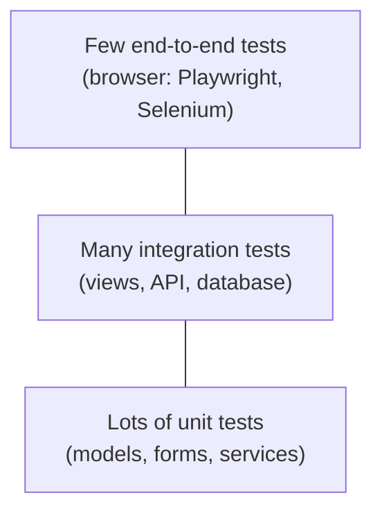

# Testing Django

!!! abstract "Learning Objectives"
    By the end of this lesson, you can:

    - Explain how Django's test runner works: test discovery, the **test database**, and isolation with `TestCase`
    - Write fast fixtures with `setUpTestData()`
    - Test models, services, management commands and forms
    - Test views with the test client: status codes, templates, redirects, content, permissions and **query counts**
    - Test a DRF API with `APITestCase`, build a feature **test-first**, and measure **coverage**

**Prerequisites:** [Django REST Framework](09-django-rest-framework.md), and testing ideas from the FastAPI module (pytest, arrange-act-assert).

## Why Test?

So far we've checked everything by hand with curl. That doesn't scale: every change could break something you tested last week. Automated tests re-check **everything** in seconds, before your code reaches users.



| Test type | Checks | Speed | In this lesson |
|-----------|--------|-------|----------------|
| Unit | One function, model method or form | Very fast | Models, services, forms |
| Integration | Several parts together (URL → view → DB → template) | Fast | Views, API |
| End-to-end | The real app in a real browser | Slow | Mentioned only |

## How Django Runs Tests

`python manage.py test` finds every file named `test*.py` in your apps, runs the classes that subclass `TestCase`, and reports the results.

- It creates a separate **test database** (`test_ksr_store`), runs all migrations on it, and deletes it at the end. **Your real data is never touched**, and tests start with empty tables.
- `django.test.TestCase` wraps **each test in a transaction** that is rolled back afterwards, so tests can't affect each other.
- `setUpTestData()` runs **once per class** to create shared rows (fast); `setUp()` runs before **every** test.

Our MySQL user needs permission to create databases. The `root` user we've been using has it; on a real server you would grant it to a dedicated test user.

## Organising Tests

`startapp` created a single `tests.py` in each app. As the shop grows, a `tests/` **package** with one file per topic is easier to navigate. Replace `shop/tests.py` with a package:

```bash
rm shop/tests.py
mkdir shop/tests
touch shop/tests/__init__.py
```

## Testing Models and Commands

```python title="shop/tests/test_models.py"
from decimal import Decimal
from io import StringIO

from django.core.management import call_command
from django.db import DatabaseError, transaction
from django.test import TestCase

from shop.models import Category, Customer, Order, OrderItem, Product


class ProductModelTests(TestCase):
    @classmethod
    def setUpTestData(cls):
        cls.books = Category.objects.create(name="Books", slug="books")
        cls.book = Product.objects.create(category=cls.books, name="Atomic Habits", price=Decimal("499.00"), stock=80)

    def test_str_is_the_name(self):
        self.assertEqual(str(self.book), "Atomic Habits")

    def test_category_lists_its_products(self):
        self.assertQuerySetEqual(self.books.products.all(), [self.book])

    def test_price_must_be_positive(self):
        with self.assertRaises(DatabaseError):
            with transaction.atomic():
                Product.objects.create(category=self.books, name="Free book", price=0)


class OrderModelTests(TestCase):
    @classmethod
    def setUpTestData(cls):
        books = Category.objects.create(name="Books", slug="books")
        book = Product.objects.create(category=books, name="Atomic Habits", price=Decimal("499.00"), stock=80)
        pan = Product.objects.create(category=books, name="Notebook", price=Decimal("120.50"), stock=10)
        customer = Customer.objects.create(name="Asha Reddy", email="asha@example.com", city="Hyderabad")
        cls.order = Order.objects.create(customer=customer)
        cls.item = OrderItem.objects.create(order=cls.order, product=book, quantity=2, unit_price=book.price)
        OrderItem.objects.create(order=cls.order, product=pan, quantity=1, unit_price=pan.price)

    def test_new_order_is_pending(self):
        self.assertEqual(self.order.status, Order.Status.PENDING)

    def test_line_total(self):
        self.assertEqual(self.item.line_total, Decimal("998.00"))

    def test_order_total_adds_all_items(self):
        self.assertEqual(self.order.total, Decimal("1118.50"))


class SeedShopCommandTests(TestCase):
    def test_loads_the_sample_data(self):
        out = StringIO()
        call_command("seed_shop", stdout=out)
        self.assertEqual(Product.objects.count(), 15)
        self.assertEqual(Order.objects.count(), 12)
        self.assertIn("15 products", out.getvalue())
```

Each test follows **Arrange, Act, Assert**: the data is arranged in `setUpTestData`, the test does one thing, then checks the result.

| Assertion | Checks |
|-----------|--------|
| `assertEqual(a, b)` / `assertNotEqual` | Equal values |
| `assertTrue(x)` / `assertFalse(x)` | Truthiness |
| `assertIn(a, b)` | `a in b` |
| `assertRaises(Error)` | The block raises that exception |
| `assertQuerySetEqual(qs, [...])` | A queryset contains exactly these objects |

Two details in `test_price_must_be_positive`:

- It expects `DatabaseError`: MySQL reports a broken `CHECK` constraint as error 3819, which mysql-connector raises as a `DatabaseError` (the parent class of `IntegrityError`).
- It needs `transaction.atomic()`: after a database error, the surrounding test transaction is broken, and the inner savepoint lets the test continue cleanly.

Run just this file:

```bash
python manage.py test shop.tests.test_models
```

```{ .text .output }
Found 7 test(s).
Creating test database for alias 'default'...
System check identified no issues (0 silenced).
.......
----------------------------------------------------------------------
Ran 7 tests in 0.079s

OK
Destroying test database for alias 'default'...
```

## Testing Services and Forms

The `place_order` service from lesson 04 is business-critical, so test both the happy path and the rollback:

```python title="shop/tests/test_services.py"
from decimal import Decimal

from django.test import TestCase

from shop.models import Category, Customer, Order, Product
from shop.services import OutOfStock, place_order


class PlaceOrderTests(TestCase):
    @classmethod
    def setUpTestData(cls):
        books = Category.objects.create(name="Books", slug="books")
        cls.book = Product.objects.create(category=books, name="Atomic Habits", price=Decimal("499.00"), stock=5)
        cls.sold_out = Product.objects.create(category=books, name="Wings of Fire", price=Decimal("350.00"), stock=0)
        cls.customer = Customer.objects.create(name="Asha Reddy", email="asha@example.com", city="Hyderabad")

    def test_creates_order_and_reduces_stock(self):
        order = place_order(self.customer, {self.book.pk: 2})
        self.book.refresh_from_db()
        self.assertEqual(self.book.stock, 3)
        self.assertEqual(order.total, Decimal("998.00"))

    def test_out_of_stock_rolls_everything_back(self):
        with self.assertRaises(OutOfStock):
            place_order(self.customer, {self.book.pk: 2, self.sold_out.pk: 1})
        self.book.refresh_from_db()
        self.assertEqual(self.book.stock, 5)
        self.assertEqual(Order.objects.count(), 0)
```

`refresh_from_db()` reloads the object, because `self.book` in memory still holds the old stock.

```python title="shop/tests/test_forms.py"
from django.test import TestCase

from shop.forms import ProductFilterForm, ReviewForm


class ProductFilterFormTests(TestCase):
    def test_converts_strings_to_numbers(self):
        form = ProductFilterForm({"min_price": "100", "max_price": "500"})
        self.assertTrue(form.is_valid())
        self.assertEqual(form.cleaned_data["max_price"], 500)

    def test_min_price_above_max_price_is_invalid(self):
        form = ProductFilterForm({"min_price": "500", "max_price": "100"})
        self.assertFalse(form.is_valid())
        self.assertIn("Minimum price must not be more than the maximum price.", form.non_field_errors())


class ReviewFormTests(TestCase):
    def test_rejects_links(self):
        form = ReviewForm({"rating": 5, "comment": "Cheap copies at https://spam.example"})
        self.assertFalse(form.is_valid())
        self.assertEqual(form.errors["comment"], ["Links are not allowed in reviews."])

    def test_rejects_rating_outside_choices(self):
        form = ReviewForm({"rating": 6, "comment": "Out of this world!"})
        self.assertFalse(form.is_valid())
        self.assertIn("rating", form.errors)
```

## Testing Views with the Test Client

`self.client` is a fake browser: it sends requests through URLs, middleware, views and templates without a running server, and lets you inspect the response, including the **template and context** used.

```python title="shop/tests/test_views.py"
from decimal import Decimal

from django.contrib.auth.models import Permission, User
from django.test import TestCase
from django.urls import reverse

from shop.models import Category, Product, Review


class ShopPageTests(TestCase):
    @classmethod
    def setUpTestData(cls):
        books = Category.objects.create(name="Books", slug="books")
        cls.book = Product.objects.create(category=books, name="Atomic Habits", price=Decimal("499.00"), stock=80)
        Product.objects.create(category=books, name="Wings of Fire", price=Decimal("350.00"), stock=0)

    def test_home_features_only_products_in_stock(self):
        response = self.client.get(reverse("shop:home"))
        self.assertEqual(response.status_code, 200)
        self.assertTemplateUsed(response, "shop/home.html")
        self.assertContains(response, "Atomic Habits")
        self.assertNotContains(response, "Wings of Fire")

    def test_unknown_product_is_404(self):
        response = self.client.get(reverse("shop:product_detail", args=[999]))
        self.assertEqual(response.status_code, 404)

    def test_search_filters_the_list(self):
        response = self.client.get(reverse("shop:product_list"), {"q": "wings"})
        self.assertEqual([p.name for p in response.context["products"]], ["Wings of Fire"])

    def test_product_list_query_count(self):
        with self.assertNumQueries(3):  # count for pagination, one page of products, categories for the filter form
            self.client.get(reverse("shop:product_list"))


class ReviewViewTests(TestCase):
    @classmethod
    def setUpTestData(cls):
        books = Category.objects.create(name="Books", slug="books")
        cls.book = Product.objects.create(category=books, name="Atomic Habits", price=Decimal("499.00"), stock=80)
        cls.user = User.objects.create_user("kiran", password="Kiran@Learns2026")
        cls.url = reverse("shop:review_create", args=[cls.book.pk])
        cls.data = {"rating": 5, "comment": "Small habits, big results."}

    def test_anonymous_user_is_sent_to_login(self):
        response = self.client.post(self.url, self.data)
        self.assertRedirects(response, f"{reverse('accounts:login')}?next={self.url}")
        self.assertFalse(Review.objects.exists())

    def test_logged_in_user_can_review(self):
        self.client.force_login(self.user)
        response = self.client.post(self.url, self.data, follow=True)
        self.assertRedirects(response, reverse("shop:product_detail", args=[self.book.pk]))
        self.assertContains(response, "Thanks! Your review has been posted.")
        review = Review.objects.get()
        self.assertEqual((review.user, review.name, review.rating), (self.user, "kiran", 5))


class StaffEditTests(TestCase):
    @classmethod
    def setUpTestData(cls):
        books = Category.objects.create(name="Books", slug="books")
        cls.book = Product.objects.create(category=books, name="Atomic Habits", price=Decimal("499.00"), stock=80)
        cls.url = reverse("shop:product_edit", args=[cls.book.pk])
        cls.customer = User.objects.create_user("kiran", password="Kiran@Learns2026")
        cls.manager = User.objects.create_user("meena", password="Practice@123")
        cls.manager.user_permissions.add(Permission.objects.get(codename="change_product"))

    def test_customer_is_forbidden(self):
        self.client.force_login(self.customer)
        self.assertEqual(self.client.get(self.url).status_code, 403)

    def test_manager_can_change_the_price(self):
        self.client.force_login(self.manager)
        data = {"name": "Atomic Habits", "brand": "Penguin", "price": "449.00", "stock": 80}
        response = self.client.post(self.url, data)
        self.assertEqual(response.status_code, 302)
        self.book.refresh_from_db()
        self.assertEqual(self.book.price, Decimal("449.00"))
```

| Client tool | Use |
|-------------|-----|
| `self.client.get(url, {"q": "x"})` / `.post(url, data)` | Send a request (the dict becomes the query string / form data) |
| `follow=True` | Follow redirects; `response.redirect_chain` lists them |
| `self.client.force_login(user)` | Log in without a password (fast) |
| `response.status_code`, `response.context["products"]` | Inspect the result and the template context |
| `assertTemplateUsed`, `assertContains`, `assertNotContains` | Template and HTML checks |
| `assertRedirects(response, url)` | Status is 302 and the target page loads |
| `assertNumQueries(n)` | Fails if the block runs a different number of queries: guards against N+1 |

The test client **doesn't check CSRF tokens** by default, so tests can post forms directly. (`Client(enforce_csrf_checks=True)` turns the check on.)

## Testing the API

DRF's `APITestCase` provides `self.client` as an `APIClient`, which can send JSON and authenticate with `force_authenticate()`:

```python title="api/tests.py"
from decimal import Decimal

from django.contrib.auth.models import Permission, User
from django.urls import reverse
from rest_framework import status
from rest_framework.test import APITestCase

from shop.models import Category, Product


class ProductAPITests(APITestCase):
    @classmethod
    def setUpTestData(cls):
        cls.toys = Category.objects.create(name="Toys", slug="toys")
        cls.shoes = Product.objects.create(category=cls.toys, name="Kids Running Shoes", brand="Puma",
                                           price=Decimal("1999.00"), stock=10)
        cls.manager = User.objects.create_user("meena", password="Practice@123")
        cls.manager.user_permissions.add(Permission.objects.get(codename="change_product"))
        cls.admin = User.objects.create_superuser("admin", password="KsrAdmin@2026")
        cls.list_url = reverse("product-list")
        cls.detail_url = reverse("product-detail", args=[cls.shoes.pk])

    def test_anyone_can_list_products(self):
        response = self.client.get(self.list_url)
        self.assertEqual(response.status_code, status.HTTP_200_OK)
        self.assertEqual(response.data["count"], 1)
        self.assertEqual(response.data["results"][0]["category"], "toys")

    def test_anonymous_cannot_create(self):
        response = self.client.post(self.list_url, {"name": "Kite"}, format="json")
        self.assertEqual(response.status_code, status.HTTP_401_UNAUTHORIZED)

    def test_manager_can_update_but_not_create(self):
        self.client.force_authenticate(self.manager)
        response = self.client.patch(self.detail_url, {"price": "1799.00"}, format="json")
        self.assertEqual(response.status_code, status.HTTP_200_OK)
        response = self.client.post(self.list_url, {"name": "Kite", "category": "toys", "price": "299"}, format="json")
        self.assertEqual(response.status_code, status.HTTP_403_FORBIDDEN)

    def test_invalid_price_returns_400(self):
        self.client.force_authenticate(self.admin)
        response = self.client.post(self.list_url, {"name": "Kite", "category": "toys", "price": "0"}, format="json")
        self.assertEqual(response.status_code, status.HTTP_400_BAD_REQUEST)
        self.assertEqual(response.data["price"], ["Price must be greater than zero."])
```

`reverse("product-list")` and `reverse("product-detail", ...)` are the URL names the router generated from `basename="product"`.

## Test-Driven Development: Search by Brand

The marketing team asks: *"Searching the API for `puma` should also find Puma products."* With **TDD** you write the test **first**, watch it fail, then write just enough code to make it pass. Add this method to `ProductAPITests` in `api/tests.py`:

```{ .python .append title="api/tests.py" }
    def test_search_also_matches_brand(self):
        response = self.client.get(self.list_url, {"search": "puma"})
        self.assertEqual([p["name"] for p in response.data["results"]], ["Kids Running Shoes"])
```

(The product's **name** doesn't contain "puma", only its brand.) Run the API tests:

```bash
python manage.py test api
```

```{ .text .output }
Found 5 test(s).
Creating test database for alias 'default'...
System check identified no issues (0 silenced).
....F
======================================================================
FAIL: test_search_also_matches_brand (api.tests.ProductAPITests.test_search_also_matches_brand)
----------------------------------------------------------------------
Traceback (most recent call last):
  File "/home/student/ksr-store/api/tests.py", line 49, in test_search_also_matches_brand
    self.assertEqual([p["name"] for p in response.data["results"]], ["Kids Running Shoes"])
AssertionError: Lists differ: [] != ['Kids Running Shoes']

Second list contains 1 additional elements.
First extra element 0:
'Kids Running Shoes'

- []
+ ['Kids Running Shoes']

----------------------------------------------------------------------
Ran 5 tests in 0.265s

FAILED (failures=1)
Destroying test database for alias 'default'...
```

**Red**: the test fails with a clear message, the list was empty. Now make it **green** by searching both fields with a `Q` object in `api/views.py`:

```python title="api/views.py"
from django.db.models import Count, Q
from rest_framework import status, viewsets
from rest_framework.decorators import action
from rest_framework.permissions import DjangoModelPermissionsOrAnonReadOnly, IsAuthenticatedOrReadOnly
from rest_framework.response import Response

from shop.models import Category, Product

from .serializers import CategorySerializer, ProductSerializer, ReviewSerializer


class CategoryViewSet(viewsets.ReadOnlyModelViewSet):
    queryset = Category.objects.annotate(product_count=Count("products")).order_by("name")
    serializer_class = CategorySerializer
    lookup_field = "slug"
    pagination_class = None


class ProductViewSet(viewsets.ModelViewSet):
    serializer_class = ProductSerializer
    permission_classes = [DjangoModelPermissionsOrAnonReadOnly]

    def get_queryset(self):
        products = Product.objects.select_related("category")
        params = self.request.query_params
        if category := params.get("category"):
            products = products.filter(category__slug=category)
        if search := params.get("search"):
            products = products.filter(Q(name__icontains=search) | Q(brand__icontains=search))
        if params.get("in_stock") == "true":
            products = products.filter(stock__gt=0)
        if params.get("ordering") in ("price", "-price", "name", "-name"):
            products = products.order_by(params["ordering"])
        return products

    @action(detail=True, methods=["get", "post"], permission_classes=[IsAuthenticatedOrReadOnly])
    def reviews(self, request, pk=None):
        product = self.get_object()
        if request.method == "POST":
            serializer = ReviewSerializer(data=request.data)
            serializer.is_valid(raise_exception=True)
            serializer.save(product=product, user=request.user, name=request.user.username)
            return Response(serializer.data, status=status.HTTP_201_CREATED)
        return Response(ReviewSerializer(product.reviews.all(), many=True).data)
```

```bash
python manage.py test api
```

```{ .text .output }
Found 5 test(s).
Creating test database for alias 'default'...
System check identified no issues (0 silenced).
.....
----------------------------------------------------------------------
Ran 5 tests in 0.274s

OK
Destroying test database for alias 'default'...
```

**Green.** The new test also protects the feature: if someone removes the brand search later, it fails immediately. That's the TDD cycle: **red → green → refactor**.

## Running the Whole Suite

```bash
python manage.py test
```

```{ .text .output }
Found 26 test(s).
Creating test database for alias 'default'...
System check identified no issues (0 silenced).
..........................
----------------------------------------------------------------------
Ran 26 tests in 0.835s

OK
Destroying test database for alias 'default'...
```

Each dot is a passing test. Other useful ways to run tests:

| Command | Runs |
|---------|------|
| `python manage.py test` | Every test in every app |
| `python manage.py test shop` | One app |
| `python manage.py test shop.tests.test_views` | One file |
| `python manage.py test shop.tests.test_views.ReviewViewTests` | One class |
| `python manage.py test shop.tests.test_views.ReviewViewTests.test_logged_in_user_can_review` | One test |
| `--keepdb` | Reuse the test database between runs (much faster with MySQL) |
| `--parallel` | Run test classes in parallel processes |
| `--failfast` | Stop at the first failure |
| `-v 2` | Print the name and result of every test |

## Measuring Coverage

**Coverage** shows which lines your tests actually ran. Install it with `pip install coverage`, then run the tests through it:

```bash
coverage run --source=shop,api,accounts --omit="*/migrations/*,*/tests/*,*/tests.py" manage.py test > /dev/null 2>&1
coverage report --skip-covered --skip-empty
```

```{ .text .output }
Name                Stmts   Miss  Cover
---------------------------------------
accounts/forms.py      14      4    71%
accounts/views.py      20      6    70%
api/views.py           36     10    72%
shop/admin.py          52      7    87%
shop/forms.py          27      1    96%
shop/models.py         72      4    94%
shop/views.py          89     13    85%
---------------------------------------
TOTAL                 413     45    89%

18 files skipped due to complete coverage.
```

`--skip-covered` hides the files that are already at 100%. The lowest scores are `accounts/views.py` and `accounts/forms.py` (we never tested sign-up or the profile page) and `api/views.py` (the `reviews` action has no test yet). `coverage html` creates a browsable report highlighting the exact missed lines. Aim for high coverage of important logic, but remember that 100% coverage doesn't mean bug-free: it only shows the lines ran, not that the assertions were meaningful.

!!! realworld "In Real Projects"
    Tests run automatically in **CI** (GitHub Actions, GitLab CI) on every pull request, usually against a real MySQL service container, and a failing test blocks the merge. Many teams use **pytest-django** (plain `assert`, fixtures, parametrize) and **factory_boy** to build test data, and add a few end-to-end browser tests with Playwright for the most important journeys, such as sign-up and checkout.

## Common Mistakes

| Mistake | Error / Symptom | Fix |
|---------|-----------------|-----|
| Both `shop/tests.py` and `shop/tests/` exist | `ImportError: 'tests' module incorrectly imported` | Keep only one of them |
| Test file not named `test*.py` | "Ran 0 tests" | Name files `test_something.py` |
| Test method not starting with `test` | The method silently never runs | `def test_...` |
| Database user can't create databases | `Got an error creating the test database: access denied` | Grant `CREATE` on `test_ksr_store` or use a user with that right |
| Old test DB left after a crash | `Type 'yes' if you would like to try deleting the test database` | Answer `yes`, or run with `--noinput` |
| Comparing with stale objects | Assertion fails although the DB changed | `obj.refresh_from_db()` |
| Tests depending on each other's data | Pass alone, fail together | Each test sets up its own data (`setUpTestData` / `setUp`) |
| Testing Django itself | Slow, pointless tests | Test **your** logic, rules and permissions |

## Practice Exercises

**Easy**

1. Test that `/health/` returns JSON `{"status": "ok", "framework": "Django"}` (use `response.json()`).
2. Test that the category page for `toys-games` returns 404.
3. Test that `Review.__str__` returns `"kiran on Atomic Habits: 5/5"`.

**Medium**

4. Write `accounts/tests.py`: sign-up creates a user with a hashed password and logs them in; a duplicate email shows the error; the profile page redirects anonymous users.
5. Test that `GET /accounts/logout/` returns 405 and `POST` logs the user out.
6. Add `assertNumQueries` to the API list endpoint test and make sure adding more products doesn't increase the count.

**Challenge**

7. Write tests for the admin action `mark_shipped` from lesson 05: log in as a superuser with `force_login`, post to the order changelist with `action` and `_selected_action`, and assert that only pending orders changed.

??? success "Solutions (click to expand)"

    ```{ .python .no-run }
    # 1
    def test_health(self):
        response = self.client.get(reverse("shop:health"))
        self.assertEqual(response.json(), {"status": "ok", "framework": "Django"})

    # 4 (part)
    class SignUpTests(TestCase):
        def test_sign_up_creates_and_logs_in_user(self):
            data = {"username": "kiran", "email": "kiran@example.com",
                    "password1": "Kiran@Learns2026", "password2": "Kiran@Learns2026"}
            response = self.client.post(reverse("accounts:signup"), data)
            self.assertRedirects(response, reverse("shop:home"))
            user = User.objects.get(username="kiran")
            self.assertTrue(user.check_password("Kiran@Learns2026"))
            self.assertEqual(int(self.client.session["_auth_user_id"]), user.pk)

    # 7
    def test_mark_shipped_only_changes_pending(self):
        self.client.force_login(User.objects.create_superuser("boss", password="x"))
        url = reverse("admin:shop_order_changelist")
        self.client.post(url, {"action": "mark_shipped", "_selected_action": [self.pending.pk, self.delivered.pk]})
        self.pending.refresh_from_db()
        self.delivered.refresh_from_db()
        self.assertEqual(self.pending.status, "shipped")
        self.assertEqual(self.delivered.status, "delivered")
    ```

!!! note "Mini Assignment"
    Write a test suite for your **college library**: model rules (copies never negative), the loan service (can't borrow an unavailable book, rollback on failure), views (only members can request loans, librarians see overdue loans, students get 403), and the API (401/403/400/201 cases). Reach at least 85% coverage of `library/` and add the test command to your README.

## Interview Questions

!!! interview "1. How does Django keep tests from touching real data?"
    The test runner creates a separate test database (prefixed `test_`), applies migrations to it and destroys it afterwards. `TestCase` wraps each test in a transaction that is rolled back, so every test starts from the same state.

!!! interview "2. What is the difference between `setUp()` and `setUpTestData()`?"
    `setUpTestData()` is a class method that runs once per `TestCase` class; its objects are shared (and restored for each test). `setUp()` runs before every test method. Use `setUpTestData()` for database fixtures because it's much faster.

!!! interview "3. What is the difference between `TestCase`, `TransactionTestCase` and `SimpleTestCase`?"
    `SimpleTestCase` blocks database access, for pure logic. `TestCase` uses transactions with rollback for fast isolation. `TransactionTestCase` truncates tables after each test instead, needed when testing code that depends on real commits, such as `transaction.on_commit()` callbacks or some locking behaviour.

!!! interview "4. How would you catch an N+1 query regression in tests?"
    Wrap the request in `self.assertNumQueries(n)`. If someone removes a `select_related` or a template starts accessing a relationship in a loop, the query count changes and the test fails.

!!! interview "5. What is TDD?"
    Test-Driven Development: write a failing test describing the desired behaviour (red), write the minimum code to make it pass (green), then clean up the code with the test as a safety net (refactor). It forces clear requirements and leaves a regression test behind.

!!! interview "Scenario: a test passes on your laptop but fails in CI. What could be different?"
    The database engine or version (SQLite locally vs MySQL in CI), time zones and dates (`date.today()` near midnight), test order and shared state between tests, missing environment variables or settings, or dependencies installed at different versions. Reproduce with the same database and pinned requirements, and make tests independent of time and order.

## Summary

| Task | Code |
|------|------|
| Run tests | `python manage.py test [app.module.Class.method] [-v 2] [--keepdb]` |
| Base classes | `django.test.TestCase` · `rest_framework.test.APITestCase` |
| Fixtures | `@classmethod def setUpTestData(cls): ...` |
| Requests | `self.client.get(url, params)` · `.post(url, data, follow=True)` |
| Log in | `self.client.force_login(user)` · API: `self.client.force_authenticate(user)` |
| Assertions | `assertEqual`, `assertContains`, `assertRedirects`, `assertTemplateUsed`, `assertNumQueries` |
| Commands | `call_command("seed_shop", stdout=StringIO())` |
| Coverage | `coverage run manage.py test` → `coverage report` / `coverage html` |

**Next lesson:** [Security, Deployment & Capstone](11-security-deployment-capstone.md), getting the KSR Store ready for production and putting it all together.
