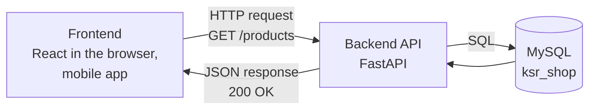
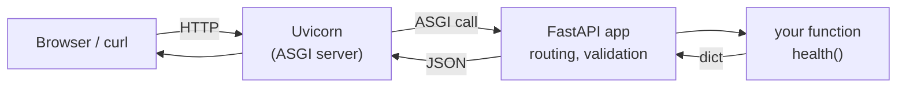

# Introduction to FastAPI

!!! abstract "Learning Objectives"
    By the end of this lesson, you can:

    - Explain what a backend API does in a full stack application
    - Describe REST: resources, HTTP methods, status codes and JSON
    - Install FastAPI and run an API with `fastapi dev`
    - Write your first endpoints and call them from the browser, `curl` and `/docs`
    - Explain what Uvicorn, ASGI and the OpenAPI docs are

**Prerequisites:** [Working with JSON & APIs](../oop/06-working-with-json-and-apis.md) (you've *called* APIs) and the [MySQL](../../database/index.md) module. Now you'll **build** them.

## What is a Backend API?

In the OOP module you called other people's APIs with `requests`. Now you'll build your own. Every modern app is split into two parts:



- The **frontend** shows screens and buttons. It never touches the database directly.
- The **backend API** receives requests, applies business rules (validation, permissions, prices), talks to the database, and returns JSON.

!!! example "Real-life analogy: a restaurant kitchen"
    Customers (the frontend) never walk into the kitchen. They order through a waiter, using a menu that lists what you can ask for. The kitchen (your API) prepares the order using ingredients from the store room (the database) and sends back a plate (a JSON response). The menu is your **API documentation**.

Throughout this module you'll build the **KSR Shop API**: the backend for the online store whose database you designed in the MySQL module. Products, customers, orders, login, everything.

## REST in Five Minutes

**REST** is the most common style for web APIs. Its core ideas:

| Idea | Meaning | KSR Shop example |
|------|---------|------------------|
| **Resources** | Things your API manages, each with a URL | `/products`, `/products/7`, `/orders` |
| **HTTP methods** | The action to perform on a resource | `GET` read, `POST` create, `PUT`/`PATCH` update, `DELETE` remove |
| **Status codes** | Did it work? | `200 OK`, `201 Created`, `404 Not Found`, `422` invalid input |
| **JSON** | The data format | `{"id": 7, "name": "Running Shoes", "price": 4299}` |
| **Stateless** | Each request carries everything needed (like a login token) | No server memory of "the previous click" |

| Request | Meaning |
|---------|---------|
| `GET /products` | List products |
| `GET /products/7` | Get product 7 |
| `POST /products` | Create a product (data in the body) |
| `PUT /products/7` | Replace product 7 |
| `PATCH /products/7` | Update some fields of product 7 |
| `DELETE /products/7` | Delete product 7 |

Notice the pattern: **nouns** in the URL, **verbs** as the HTTP method. Avoid URLs like `/getProducts` or `/deleteProduct?id=7`.

## Why FastAPI?

**FastAPI** is a modern Python framework for building APIs.

| Feature | What it means for you |
|---------|----------------------|
| **Type hints drive everything** | `def get_product(product_id: int)` automatically converts and validates the input |
| **Automatic validation** | Bad input gets a clear `422` error, without writing `if` checks |
| **Automatic docs** | Interactive API documentation at `/docs`, generated from your code |
| **Fast** | One of the fastest Python frameworks (built on Starlette and Pydantic) |
| **Easy to learn** | Plain Python functions; little boilerplate |

| | FastAPI | Django | Flask |
|---|---|---|---|
| Best for | APIs and microservices | Full websites with admin, templates, ORM | Small apps, flexible |
| Validation | Built in (Pydantic) | Forms / DRF serializers | Add-on libraries |
| API docs | Automatic | With DRF + extras | Add-on libraries |
| Async support | Native | Partial | Limited |

!!! realworld "In Real Projects"
    FastAPI is used at Microsoft, Uber, Netflix and many Indian startups for microservices and **AI/ML APIs**: most "chat with your documents" backends and model-serving APIs are FastAPI apps. Job listings for Python backend roles increasingly ask for it alongside Django.

## Setup and Your First API

Create a project folder with a virtual environment and install FastAPI with its standard extras (the `fastapi` command, the Uvicorn server and helpers):

```bash
mkdir ksr-shop-api
cd ksr-shop-api
python -m venv .venv
source .venv/bin/activate          # Windows: .venv\Scripts\activate
pip install "fastapi[standard]"
```

Create `main.py`:

```python title="main.py"
from fastapi import FastAPI

app = FastAPI(title="KSR Shop API", version="1.0")


@app.get("/")
def home():
    return {"message": "Welcome to the KSR Shop API"}


@app.get("/health")
def health():
    return {"status": "ok"}
```

Line by line:

| Code | Meaning |
|------|---------|
| `app = FastAPI(...)` | Creates the application. `title` and `version` appear in the docs |
| `@app.get("/")` | A **path operation decorator**: "when a `GET` request arrives for `/`, call the function below" |
| `def home():` | The **path operation function** (also called a route handler or endpoint) |
| `return {...}` | FastAPI converts the dict to JSON automatically |

### Run it

```{ .bash .no-run }
fastapi dev main.py
```

```{ .text .output }
 ⚡️ Starting FastAPI in development mode

 🐍 Using import string: main:app

 🌐 Server started at http://127.0.0.1:8000
    Documentation at http://127.0.0.1:8000/docs

  Logs:

INFO:     Will watch for changes in these directories: ['/Users/ravi/ksr-shop-api']
INFO:     Uvicorn running on http://127.0.0.1:8000 (Press CTRL+C to quit)
INFO:     Started reloader process [31693] using WatchFiles
INFO:     Started server process [31696]
INFO:     Waiting for application startup.
INFO:     Application startup complete.
```

`fastapi dev` starts **Uvicorn**, the web server, in development mode with **auto-reload**: save `main.py` and the server restarts by itself. Press ++ctrl+c++ to stop it.

!!! info "uvicorn directly"
    Many tutorials and projects start the server with `uvicorn main:app --reload`. That means: in file `main.py`, find the variable `app`, and reload on changes. It's exactly the same server.

### Call it

Open **http://127.0.0.1:8000/health** in your browser, and you'll see the JSON. Or use `curl` in a second terminal:

```bash
curl -s http://127.0.0.1:8000/
```

```{ .text .output }
{
  "message": "Welcome to the KSR Shop API"
}
```

```bash
curl -s http://127.0.0.1:8000/health
```

```{ .text .output }
{
  "status": "ok"
}
```

A URL that doesn't exist returns **404** with a JSON error:

```bash
curl -s -w "\nHTTP %{http_code}\n" http://127.0.0.1:8000/products
```

```{ .text .output }
{
  "detail": "Not Found"
}
HTTP 404
```

`-s` hides curl's progress bar, and `-w "\nHTTP %{http_code}\n"` prints the status code after the body. We'll use this throughout the module.

!!! tip "curl on Windows"
    Windows 10 and 11 include `curl`. JSON quoting is easier in **Git Bash** (installed with Git) than in Command Prompt. Or skip curl entirely and test everything from the `/docs` page, which works the same on every OS.

## Interactive Docs at /docs

Open **http://127.0.0.1:8000/docs**. FastAPI generated an interactive page (**Swagger UI**) listing every endpoint:

1. Click **GET /health**.
2. Click **Try it out**, then **Execute**.
3. See the request URL, the response body, the status code and the headers.

There's also an alternative documentation style at **/redoc**, and the raw machine-readable description at **/openapi.json**:

```bash
curl -s http://127.0.0.1:8000/openapi.json | python -c "import json,sys; d=json.load(sys.stdin); print(d['info']); print(list(d['paths']))"
```

```{ .text .output }
{'title': 'KSR Shop API', 'version': '1.0'}
['/', '/health']
```

This JSON follows the **OpenAPI** standard. Tools use it to generate client code, Postman collections and tests, and frontend developers read `/docs` to learn how to call your API without asking you.

!!! realworld "In Real Projects"
    In a team, the backend developer shares the `/docs` link with the React and mobile developers on day one. As soon as an endpoint is added in code, it appears in the docs, so documentation never goes out of date.

## How It Works: ASGI, Uvicorn and Async



- **Uvicorn** is the server. It listens on a port, speaks HTTP, and passes each request to your app.
- **ASGI** (Asynchronous Server Gateway Interface) is the standard way Python servers talk to async web apps. Django and Flask traditionally use the older **WSGI**.
- **FastAPI** does the routing (which function handles which URL), validation and JSON conversion.

You can write handlers as normal functions (`def`) or as **async** functions (`async def`):

```{ .python .no-run }
@app.get("/slow-report")
async def slow_report():
    data = await fetch_from_another_api()   # waits without blocking other requests
    return data
```

!!! tip "def or async def?"
    Use plain `def` until you're calling something that supports `await` (async HTTP clients, async database drivers). FastAPI runs normal `def` functions in a thread pool, so they don't block the server either. Most of this module uses `def`, which is simpler and works perfectly with SQLAlchemy.

## Common Mistakes

| Mistake | Error / Symptom | Fix |
|---------|-----------------|-----|
| venv not activated | `fastapi: command not found` / `No module named 'fastapi'` | Activate `.venv`, then `pip install "fastapi[standard]"` |
| Port 8000 already in use | `ERROR: [Errno 48] Address already in use` | Stop the other server, or `fastapi dev main.py --port 8001` |
| Variable not named `app` with `uvicorn main:app` | `Error loading ASGI app. Attribute "app" not found in module "main".` | Name it `app` or adjust the import string |
| Forgot the decorator | Endpoint missing from `/docs`, 404 | Add `@app.get("/path")` above the function |
| Two functions with the same path and method | Only the first one runs | Unique path + method per endpoint |
| Returning a non-JSON-able object (e.g. a set) | `500 Internal Server Error` | Return dicts, lists, strings, numbers, or Pydantic models |
| Saving with a syntax error | The server stops reloading and shows a traceback | Fix the error; the server reloads |

## Practice Exercises

**Easy**

1. Add `GET /about` that returns `{"app": "KSR Shop API", "version": "1.0", "team": "<your name>"}`.
2. Open `/docs` and call every endpoint with **Try it out**.
3. Use `curl -w` to show the status code for `/about` and for a URL that doesn't exist.

**Medium**

4. Add `GET /time` that returns the current server time in ISO format (`datetime.now().isoformat()`).
5. Add `GET /store-info` that returns a nested JSON with the store name, a list of three categories, and an `address` object (city, pincode).
6. Change the app's `title` and add a `description` in `FastAPI(...)`. Where does it appear?

**Challenge**

7. Write a Python script (using `requests` from the OOP module) that calls `/health` every 2 seconds, 5 times, and prints `UP` or `DOWN` with the response time in milliseconds. Stop the server halfway through and watch the output change.

??? success "Solutions (click to expand)"

    ```{ .python .no-run }
    from datetime import datetime
    from fastapi import FastAPI

    app = FastAPI(
        title="KSR Shop API",
        description="Backend for the KSR online store",    # 6: shown under the title in /docs
        version="1.0",
    )

    # 1
    @app.get("/about")
    def about():
        return {"app": "KSR Shop API", "version": "1.0", "team": "Ravi"}

    # 4
    @app.get("/time")
    def server_time():
        return {"time": datetime.now().isoformat()}

    # 5
    @app.get("/store-info")
    def store_info():
        return {
            "name": "KSR Shop",
            "categories": ["Electronics", "Fashion", "Books"],
            "address": {"city": "Hyderabad", "pincode": "500081"},
        }
    ```

    ```bash
    # 3
    curl -s -w "\nHTTP %{http_code}\n" http://127.0.0.1:8000/about
    curl -s -w "\nHTTP %{http_code}\n" http://127.0.0.1:8000/nope
    ```

    ```{ .python .no-run }
    # 7
    import time
    import requests

    for _ in range(5):
        start = time.perf_counter()
        try:
            r = requests.get("http://127.0.0.1:8000/health", timeout=2)
            ms = (time.perf_counter() - start) * 1000
            print("UP" if r.ok else "DOWN", f"{ms:.1f} ms")
        except requests.exceptions.ConnectionError:
            print("DOWN (no connection)")
        time.sleep(2)
    ```

!!! note "Mini Assignment"
    Start your **KSR Shop API** repository: create the project with a venv, `main.py` with `/`, `/health` and `/about`, a `requirements.txt` (`pip freeze > requirements.txt`), a `.gitignore` (`.venv/`, `__pycache__/`, `.env`) and a `README.md` with run instructions. Push it to GitHub. You'll extend this same repository in every lesson.

## Interview Questions

!!! interview "1. What is FastAPI and why is it popular?"
    A modern, high-performance Python web framework for building APIs, based on standard type hints. It provides automatic request validation and serialisation (via Pydantic), automatic interactive documentation (OpenAPI / Swagger UI), dependency injection and native async support, with very little boilerplate.

!!! interview "2. What is REST?"
    An architectural style for APIs where resources are identified by URLs and manipulated with HTTP methods (GET, POST, PUT, PATCH, DELETE). Communication is stateless, responses use standard status codes, and data is usually exchanged as JSON.

!!! interview "3. What is the difference between ASGI and WSGI?"
    WSGI is the older, synchronous interface between Python web servers and apps (Django and Flask traditionally). ASGI is its asynchronous successor: it supports async request handling, WebSockets and long-lived connections. FastAPI is an ASGI app, usually served by Uvicorn.

!!! interview "4. What is Uvicorn?"
    A lightning-fast ASGI server. It listens for HTTP connections and passes requests to the ASGI application (FastAPI). `fastapi dev` and `fastapi run` start Uvicorn for you.

!!! interview "5. What is OpenAPI and where does FastAPI use it?"
    A standard, language-independent specification for describing REST APIs in JSON or YAML. FastAPI generates an OpenAPI schema from your code (`/openapi.json`) and uses it to render the interactive docs at `/docs` (Swagger UI) and `/redoc`.

!!! interview "Scenario: the React developer says your API 'isn't documented'. What do you tell them?"
    Point them to `/docs` (Swagger UI) or `/redoc`, which are generated automatically from the code and always up to date, and share `/openapi.json` if they want to generate a typed client or import it into Postman. Then improve the docs with summaries, descriptions, tags and response models on each endpoint.

## Summary

| Concept | Remember |
|---------|----------|
| Backend API | Receives HTTP requests, applies rules, talks to MySQL, returns JSON |
| REST | Nouns in URLs, HTTP methods as verbs, status codes, JSON, stateless |
| Install | `pip install "fastapi[standard]"` inside a venv |
| First endpoint | `@app.get("/path")` above a function that returns a dict |
| Run | `fastapi dev main.py` (or `uvicorn main:app --reload`) |
| Test | Browser, `curl -s -w "\nHTTP %{http_code}\n" URL`, or `/docs` |
| Docs | `/docs` (Swagger UI), `/redoc`, `/openapi.json` |
| Under the hood | Uvicorn (ASGI server) → FastAPI (routing, validation) → your function |

**Next lesson:** [Path & Query Parameters](02-path-and-query-parameters.md), reading input from the URL.
