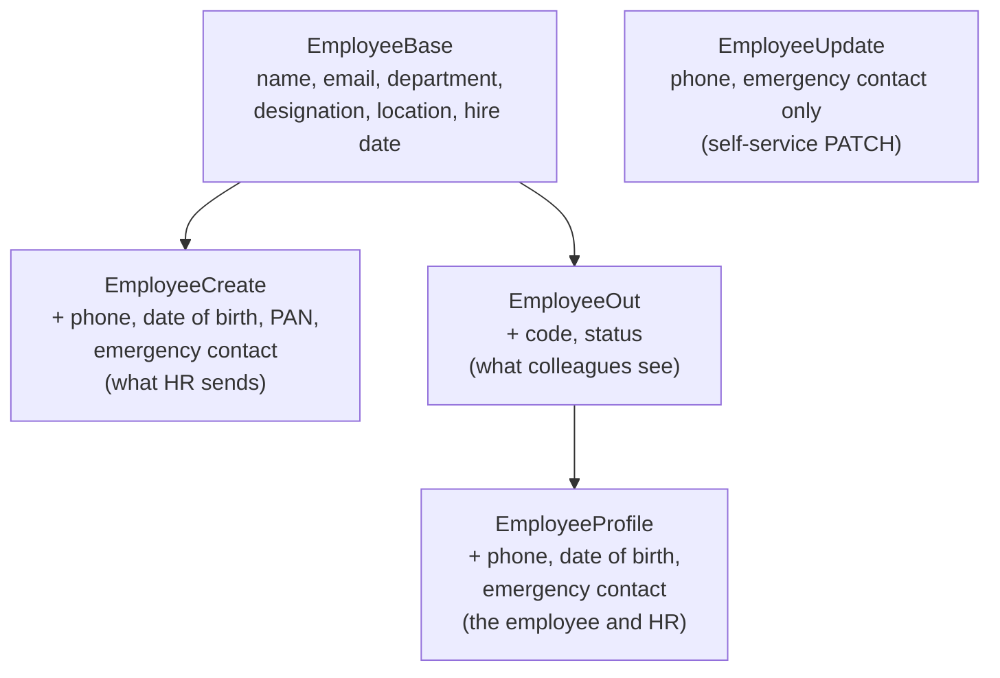

# Responses, Status Codes & Errors

!!! abstract "Learning Objectives"
    By the end of this lesson, you can:

    - Shape responses with `response_model` so private fields never leak
    - Organise schemas as `Base` / `Create` / `Update` / `Out` models, with a public and a private view
    - Return the right status code: `200`, `201`, `204`, `400`, `404`, `409`
    - Raise `HTTPException` and design consistent error responses
    - Create custom exceptions with exception handlers, and do self-service partial updates with `PATCH`

**Prerequisites:** [Request Bodies & Pydantic](03-request-bodies-and-pydantic.md)

## Why Control the Response?

At the end of the last lesson, creating an employee returned their date of birth and emergency contact. The BRD is clear about this:

> Personal details (date of birth, personal phone, emergency contact, PAN) are visible only to the employee and HR. Colleagues see the work profile: name, designation, department, location and work email.

Removing fields by hand with `model_dump(exclude=...)` in every endpoint is easy to forget. One missed `exclude` and every employee's PAN number is on every colleague's screen.

A **response model** declares exactly what an endpoint may return. FastAPI filters everything else out, validates the output, and documents it in `/docs`.

!!! example "Real-life analogy: the office notice board"
    HR's filing cabinet has everything: PAN cards, bank details, home addresses, appraisal notes. The notice board in the corridor shows only names, photos, teams and desk numbers. A response model is that notice board: the public view of private records.

## The Complete Example

```python title="main.py"
from datetime import date
from itertools import count
from typing import Literal

from fastapi import FastAPI, HTTPException, Request, Response, status
from fastapi.responses import JSONResponse
from pydantic import BaseModel, ConfigDict, EmailStr, Field

app = FastAPI(title="AcmeHR API")

INDIAN_MOBILE = r"^[6-9]\d{9}$"


# ---------- schemas ----------
class EmergencyContact(BaseModel):
    name: str = Field(min_length=2, max_length=100)
    relation: str = Field(min_length=3, max_length=30)
    phone: str = Field(pattern=INDIAN_MOBILE)


class EmployeeBase(BaseModel):
    first_name: str = Field(min_length=2, max_length=50)
    last_name: str = Field(min_length=1, max_length=50)
    email: EmailStr
    department: str
    designation: str
    location: str
    hire_date: date


class EmployeeCreate(EmployeeBase):
    phone: str = Field(pattern=INDIAN_MOBILE)
    date_of_birth: date
    pan_number: str = Field(pattern=r"^[A-Z]{5}\d{4}[A-Z]$", description="Private: for payroll only")
    emergency_contact: EmergencyContact


class EmployeeUpdate(BaseModel):
    """What an employee may change on their own profile."""
    model_config = ConfigDict(extra="forbid")
    phone: str | None = Field(default=None, pattern=INDIAN_MOBILE)
    emergency_contact: EmergencyContact | None = None


class EmployeeOut(EmployeeBase):
    """The work profile that any colleague can see."""
    code: str
    status: str


class EmployeeProfile(EmployeeOut):
    """The private profile: the employee themselves and HR."""
    phone: str
    date_of_birth: date
    emergency_contact: EmergencyContact


# ---------- "database" ----------
EMPLOYEES: dict[str, dict] = {
    "E-1002": {"code": "E-1002", "first_name": "Karthik", "last_name": "Menon", "email": "karthik.menon@acme.example",
               "department": "Engineering", "designation": "Engineering Manager", "location": "Hyderabad",
               "hire_date": date(2019, 6, 15), "status": "active", "phone": "9000001002",
               "date_of_birth": date(1984, 7, 21), "pan_number": "AKMPM1002K",
               "emergency_contact": {"name": "Divya Menon", "relation": "spouse", "phone": "9000011002"},
               "hr_notes": "Leads the platform rewrite"},
    "E-1042": {"code": "E-1042", "first_name": "Ananya", "last_name": "Rao", "email": "ananya.rao@acme.example",
               "department": "Engineering", "designation": "Senior Software Engineer", "location": "Hyderabad",
               "hire_date": date(2021, 7, 12), "status": "active", "phone": "9000001042",
               "date_of_birth": date(1994, 8, 17), "pan_number": "BQRPR1042A",
               "emergency_contact": {"name": "Ravi Rao", "relation": "father", "phone": "9000011111"},
               "hr_notes": "Promotion review due in January"},
}
LEAVE_BALANCES: dict[str, dict[str, float]] = {"E-1042": {"CL": 8, "SL": 10, "EL": 15}}
NEXT_CODE = count(1057)     # codes are never reused, even after someone leaves
DOCUMENTS: dict[int, dict] = {5: {"id": 5, "employee_code": "E-1042", "doc_type": "education",
                                  "file_name": "ananya_btech_degree.pdf"}}


# ---------- custom exception ----------
class InsufficientBalanceError(Exception):
    def __init__(self, leave_type: str, requested: float, available: float):
        self.leave_type = leave_type
        self.requested = requested
        self.available = available


@app.exception_handler(InsufficientBalanceError)
def insufficient_balance_handler(request: Request, exc: InsufficientBalanceError):
    return JSONResponse(
        status_code=status.HTTP_409_CONFLICT,
        content={
            "error": "insufficient_balance",
            "message": f"Only {exc.available:g} day(s) of {exc.leave_type} left",
            "requested": exc.requested,
            "available": exc.available,
        },
    )


def get_or_404(code: str) -> dict:
    employee = EMPLOYEES.get(code)
    if employee is None:
        raise HTTPException(status_code=status.HTTP_404_NOT_FOUND, detail=f"Employee {code} not found")
    return employee


# ---------- endpoints ----------
@app.get("/employees", response_model=list[EmployeeOut])
def list_employees():
    return list(EMPLOYEES.values())


@app.get("/employees/{code}", response_model=EmployeeOut)
def get_employee(code: str):
    return get_or_404(code)


@app.get("/employees/{code}/profile", response_model=EmployeeProfile)
def get_profile(code: str):
    return get_or_404(code)


@app.post("/employees", response_model=EmployeeProfile, status_code=status.HTTP_201_CREATED)
def create_employee(employee: EmployeeCreate, response: Response):
    if any(e["email"] == employee.email for e in EMPLOYEES.values()):
        raise HTTPException(status_code=status.HTTP_409_CONFLICT, detail="An employee with this email already exists")
    code = f"E-{next(NEXT_CODE)}"
    EMPLOYEES[code] = {"code": code, "status": "active", **employee.model_dump(), "hr_notes": ""}
    response.headers["Location"] = f"/employees/{code}"
    return EMPLOYEES[code]


@app.patch("/employees/{code}", response_model=EmployeeProfile)
def update_my_profile(code: str, changes: EmployeeUpdate):
    employee = get_or_404(code)
    updates = changes.model_dump(exclude_unset=True)
    if not updates:
        raise HTTPException(status_code=status.HTTP_400_BAD_REQUEST, detail="No fields to update")
    employee.update(updates)
    return employee


@app.delete("/documents/{document_id}", status_code=status.HTTP_204_NO_CONTENT)
def delete_document(document_id: int):
    if document_id not in DOCUMENTS:
        raise HTTPException(status_code=status.HTTP_404_NOT_FOUND, detail=f"Document {document_id} not found")
    del DOCUMENTS[document_id]


class LeaveApply(BaseModel):
    leave_type: Literal["CL", "SL", "EL"]
    days: float = Field(gt=0, multiple_of=0.5)


@app.post("/employees/{code}/leave-requests", status_code=status.HTTP_201_CREATED)
def apply_leave(code: str, request: LeaveApply):
    get_or_404(code)
    balances = LEAVE_BALANCES.get(code, {})
    available = balances.get(request.leave_type, 0)
    if request.days > available:
        raise InsufficientBalanceError(request.leave_type, request.days, available)
    balances[request.leave_type] = available - request.days
    return {"leave_type": request.leave_type, "days": request.days, "status": "pending",
            "remaining": balances[request.leave_type]}
```

## response_model: The Public Shape

Our stored employee has `phone`, `date_of_birth`, `pan_number`, `emergency_contact` and `hr_notes`, which colleagues must never see. `EmployeeOut` doesn't include them:

```{ .python .no-run }
class EmployeeOut(EmployeeBase):
    code: str
    status: str

@app.get("/employees/{code}", response_model=EmployeeOut)
def get_employee(code: str):
    return get_or_404(code)        # the dict still contains pan_number and hr_notes!
```

```bash
curl -s http://127.0.0.1:8000/employees/E-1042
```

```{ .text .output }
{
  "first_name": "Ananya",
  "last_name": "Rao",
  "email": "ananya.rao@acme.example",
  "department": "Engineering",
  "designation": "Senior Software Engineer",
  "location": "Hyderabad",
  "hire_date": "2021-07-12",
  "code": "E-1042",
  "status": "active"
}
```

Even though the function returned a dict **containing** the PAN number, the date of birth and HR's notes, FastAPI **filtered them out**, because they're not in `EmployeeOut`. The response model is a safety net.

For lists, use `list[EmployeeOut]`:

```bash
curl -s http://127.0.0.1:8000/employees
```

```{ .text .output }
[
  {
    "first_name": "Karthik",
    "last_name": "Menon",
    "email": "karthik.menon@acme.example",
    "department": "Engineering",
    "designation": "Engineering Manager",
    "location": "Hyderabad",
    "hire_date": "2019-06-15",
    "code": "E-1002",
    "status": "active"
  },
  {
    "first_name": "Ananya",
    "last_name": "Rao",
    "email": "ananya.rao@acme.example",
    "department": "Engineering",
    "designation": "Senior Software Engineer",
    "location": "Hyderabad",
    "hire_date": "2021-07-12",
    "code": "E-1042",
    "status": "active"
  }
]
```

The private profile uses a **bigger** model, `EmployeeProfile`, which adds the personal details the employee and HR need. It still leaves out `pan_number` (payroll only) and `hr_notes` (HR only):

```bash
curl -s http://127.0.0.1:8000/employees/E-1042/profile
```

```{ .text .output }
{
  "first_name": "Ananya",
  "last_name": "Rao",
  "email": "ananya.rao@acme.example",
  "department": "Engineering",
  "designation": "Senior Software Engineer",
  "location": "Hyderabad",
  "hire_date": "2021-07-12",
  "code": "E-1042",
  "status": "active",
  "phone": "9000001042",
  "date_of_birth": "1994-08-17",
  "emergency_contact": {
    "name": "Ravi Rao",
    "relation": "father",
    "phone": "9000011111"
  }
}
```

Right now anyone can call `/profile`. In lesson 10 you'll protect it so only Ananya herself and HR admins get a 200; everyone else gets a 403.

!!! tip "Return type annotations work too"
    Instead of `response_model=EmployeeOut`, you can write `def get_employee(code: str) -> EmployeeOut:`. FastAPI uses the return annotation the same way. Use `response_model=` when the function returns a dict or ORM object rather than the model itself, as here.

## Organising Schemas

Real projects use a small family of models per resource:



| Schema | Used for | Notes |
|--------|----------|-------|
| `EmployeeBase` | Shared fields | Not used directly |
| `EmployeeCreate` | `POST` body | Required fields; may include write-only fields (PAN, passwords) |
| `EmployeeUpdate` | `PATCH` body | Every field optional, and only the fields this caller may change |
| `EmployeeOut` | Public responses | Adds server-generated fields (`code`, `status`); never private data |
| `EmployeeProfile` | Private responses | A wider view for a narrower audience |

!!! realworld "In Real Projects"
    This `Create` / `Update` / `Out` pattern is how most professional FastAPI codebases are organised, usually in a `schemas/` folder. In Django REST Framework the same idea is called a *serializer*, and in Spring Boot a *DTO* (Data Transfer Object). HR, banking and healthcare systems add **several** output views per resource, one for each audience, because data-protection laws (India's DPDP Act, Europe's GDPR) require showing personal data only to people who need it.

## Status Codes

Set the success code with `status_code=` on the decorator. The `status` module gives readable names:

| Code | `status.` constant | Use for |
|------|--------------------|---------|
| 200 | `HTTP_200_OK` | Successful GET, PUT, PATCH (the default) |
| 201 | `HTTP_201_CREATED` | Resource created (POST) |
| 204 | `HTTP_204_NO_CONTENT` | Success with no body (DELETE) |
| 400 | `HTTP_400_BAD_REQUEST` | The request makes no sense (e.g. empty update) |
| 401 | `HTTP_401_UNAUTHORIZED` | Not logged in / bad token |
| 403 | `HTTP_403_FORBIDDEN` | Logged in, but not allowed (a manager approving another team's leave) |
| 404 | `HTTP_404_NOT_FOUND` | Resource doesn't exist |
| 409 | `HTTP_409_CONFLICT` | Conflicts with current state (duplicate email, not enough leave balance) |
| 422 | `HTTP_422_UNPROCESSABLE_CONTENT` | Validation failed (FastAPI sends it automatically) |
| 500 | `HTTP_500_INTERNAL_SERVER_ERROR` | A bug or crash on the server |

### 201 Created with a Location header

HR adds a new joiner:

```bash
curl -s -i -X POST http://127.0.0.1:8000/employees \
  -H "Content-Type: application/json" \
  -d '{"first_name": "Kiran", "last_name": "Deshpande", "email": "kiran.deshpande@acme.example",
       "department": "Engineering", "designation": "Software Engineer", "location": "Pune",
       "hire_date": "2026-10-12", "phone": "9876500011", "date_of_birth": "1999-04-12",
       "pan_number": "CKDPD5678Q",
       "emergency_contact": {"name": "Sunita Deshpande", "relation": "mother", "phone": "9876500022"}}' \
  | grep -iE "^HTTP|^location|^\{"
```

```{ .text .output }
HTTP/1.1 201 Created
location: /employees/E-1057
{"first_name":"Kiran","last_name":"Deshpande","email":"kiran.deshpande@acme.example","department":"Engineering","designation":"Software Engineer","location":"Pune","hire_date":"2026-10-12","code":"E-1057","status":"active","phone":"9876500011","date_of_birth":"1999-04-12","emergency_contact":{"name":"Sunita Deshpande","relation":"mother","phone":"9876500022"}}
```

The new joiner got the next free code, `E-1057`. `curl -i` prints the response headers too (we filtered the output with `grep` to the interesting lines). The `Location` header tells the client where the new resource lives, a REST convention. Notice `pan_number` was **accepted** in the request but **not returned**: it's write-only. Payroll will read it from the database, never from an API response.

### 204 No Content for DELETE

You'll notice there's no `DELETE /employees/{code}`. In HR, people are never deleted: when someone leaves, their status becomes `exited` and their records are kept for years, as the law requires. That's called a **soft delete**. A wrongly uploaded document, on the other hand, can be removed:

```bash
curl -s -w "HTTP %{http_code}\n" -X DELETE http://127.0.0.1:8000/documents/5
```

```{ .text .output }
HTTP 204
```

A 204 response has **no body** at all, just the status. Deleting it again is now a 404:

```bash
curl -s -w "\nHTTP %{http_code}\n" -X DELETE http://127.0.0.1:8000/documents/5
```

```{ .text .output }
{
  "detail": "Document 5 not found"
}
HTTP 404
```

## HTTPException and Error Design

`raise HTTPException(status_code=..., detail=...)` immediately stops the request and returns an error. `detail` can be a string, a list or a dict.

```{ .python .no-run }
def get_or_404(code: str) -> dict:
    employee = EMPLOYEES.get(code)
    if employee is None:
        raise HTTPException(status_code=404, detail=f"Employee {code} not found")
    return employee
```

A small helper like `get_or_404` keeps every endpoint short and every "not found" error consistent.

A duplicate work email returns **409 Conflict**:

```bash
curl -s -w "\nHTTP %{http_code}\n" -X POST http://127.0.0.1:8000/employees \
  -H "Content-Type: application/json" \
  -d '{"first_name": "Ananya", "last_name": "R", "email": "ananya.rao@acme.example",
       "department": "Engineering", "designation": "Software Engineer", "location": "Pune",
       "hire_date": "2026-10-12", "phone": "9876500055", "date_of_birth": "1999-01-01",
       "pan_number": "ABCDE1234F",
       "emergency_contact": {"name": "Ravi Rao", "relation": "father", "phone": "9876500066"}}'
```

```{ .text .output }
{
  "detail": "An employee with this email already exists"
}
HTTP 409
```

!!! warning "Use `raise`, not `return`"
    `return HTTPException(...)` doesn't raise anything: it tries to send the exception object as a normal 200 response. Always `raise` it.

!!! tip "Don't leak internals in error messages"
    Error messages are public. Say *"Employee E-9999 not found"*, never *"SQL error in table employees column pan_number: …"*. Log the technical details on the server instead.

## Custom Exceptions and Handlers

"Not enough leave balance" is a business rule you'll check in several places: applying for leave, approving it, and HR's bulk import. Define your own exception class once, and register a handler that turns it into a response:

```{ .python .no-run }
class InsufficientBalanceError(Exception):
    def __init__(self, leave_type, requested, available): ...

@app.exception_handler(InsufficientBalanceError)
def insufficient_balance_handler(request: Request, exc: InsufficientBalanceError):
    return JSONResponse(status_code=409, content={"error": "insufficient_balance", ...})
```

Now any code (an endpoint, a helper, a service) can simply `raise InsufficientBalanceError(...)`. Ananya has 8 casual leave days left; she applies for 3:

```bash
curl -s -X POST http://127.0.0.1:8000/employees/E-1042/leave-requests \
  -H "Content-Type: application/json" -d '{"leave_type": "CL", "days": 3}'
```

```{ .text .output }
{
  "leave_type": "CL",
  "days": 3.0,
  "status": "pending",
  "remaining": 5.0
}
```

Then for 6 more:

```bash
curl -s -w "\nHTTP %{http_code}\n" -X POST http://127.0.0.1:8000/employees/E-1042/leave-requests \
  -H "Content-Type: application/json" -d '{"leave_type": "CL", "days": 6}'
```

```{ .text .output }
{
  "error": "insufficient_balance",
  "message": "Only 5 day(s) of CL left",
  "requested": 6.0,
  "available": 5.0
}
HTTP 409
```

Only 5 days were left, so the custom handler produced a structured, machine-readable error. The frontend can check `error == "insufficient_balance"` and suggest *"Apply 5 days as CL and 1 as Earned leave?"*.

!!! info "Deducting on apply is a simplification"
    Here the balance drops as soon as Ananya applies. In the real workflow (lesson 08) the balance changes only when her manager **approves** the request, inside a database transaction.

!!! realworld "In Real Projects"
    Teams agree on **one error format** for the whole API, e.g. `{"error": "code", "message": "...", "details": {...}}`, and implement it with exception handlers. Business code raises meaningful exceptions (`InsufficientBalanceError`, `OverlappingLeaveError`, `NotYourTeamError`), and the handlers translate them into HTTP responses. That keeps HTTP details out of business logic.

## Partial Updates with PATCH

The BRD's self-service rule: *"Employees can update their contact number and emergency contact. Changes to department, designation or manager go through HR."* `EmployeeUpdate` contains exactly those two fields, both optional. The key is `model_dump(exclude_unset=True)`, which returns **only the fields the client actually sent**:

```{ .python .no-run }
updates = changes.model_dump(exclude_unset=True)   # e.g. {"phone": "9123456780"}
employee.update(updates)
```

Ananya changes her phone number:

```bash
curl -s -X PATCH http://127.0.0.1:8000/employees/E-1042 \
  -H "Content-Type: application/json" \
  -d '{"phone": "9123456780"}'
```

```{ .text .output }
{
  "first_name": "Ananya",
  "last_name": "Rao",
  "email": "ananya.rao@acme.example",
  "department": "Engineering",
  "designation": "Senior Software Engineer",
  "location": "Hyderabad",
  "hire_date": "2021-07-12",
  "code": "E-1042",
  "status": "active",
  "phone": "9123456780",
  "date_of_birth": "1994-08-17",
  "emergency_contact": {
    "name": "Ravi Rao",
    "relation": "father",
    "phone": "9000011111"
  }
}
```

Only the phone changed; her emergency contact kept its value. Without `exclude_unset=True`, the unsent `emergency_contact` would be `None` and would wipe out the existing one.

An empty body, or an attempt at self-promotion:

```bash
curl -s -w "\nHTTP %{http_code}\n" -X PATCH http://127.0.0.1:8000/employees/E-1042 \
  -H "Content-Type: application/json" -d '{}'
```

```{ .text .output }
{
  "detail": "No fields to update"
}
HTTP 400
```

```bash
curl -s -w "\nHTTP %{http_code}\n" -X PATCH http://127.0.0.1:8000/employees/E-1042 \
  -H "Content-Type: application/json" -d '{"designation": "Engineering Manager"}'
```

```{ .text .output }
{
  "detail": [
    {
      "type": "extra_forbidden",
      "loc": ["body", "designation"],
      "msg": "Extra inputs are not permitted",
      "input": "Engineering Manager"
    }
  ]
}
HTTP 422
```

`designation` isn't in `EmployeeUpdate`, and `extra="forbid"` rejects it, so employees can't change their own job title through the self-service API.

| Method | Body | Missing fields |
|--------|------|----------------|
| `PUT` | The **complete** resource | Replaced (set to defaults / required) |
| `PATCH` | Only the fields to change | Left unchanged |

## Common Mistakes

| Mistake | Problem | Fix |
|---------|---------|-----|
| No `response_model` | Private fields (PAN, date of birth, notes) leak | Always declare an `Out` schema |
| One output model for every audience | Colleagues see what only HR should | A public `Out` and a private `Profile` |
| `return HTTPException(...)` | Returns 200 with a weird body | `raise HTTPException(...)` |
| `201`/`204` not set | Clients can't distinguish create/delete | `status_code=status.HTTP_201_CREATED` |
| Returning a body with `204` | Protocol error (`Response content longer than Content-Length`) | Return nothing for 204 |
| `model_dump()` without `exclude_unset` in PATCH | Unsent fields become `None` | `model_dump(exclude_unset=True)` |
| Hard-deleting employees | Payroll, audit and legal history lost | Soft delete: `status = "exited"` |
| Database or stack-trace text in `detail` | Information leak | Generic message + server logs |

## Practice Exercises

**Easy**

1. Add `GET /employees/{code}/card` that returns only the name, designation and location using a new `EmployeeCard` response model (for the "who's who" page).
2. Make `POST /employees` reject a `hire_date` earlier than 2018-04-01 (when Acme was founded) with a `400` and a clear message.
3. Call `DELETE /documents/5` twice and explain both responses.

**Medium**

4. Add `PUT /employees/{code}/job` for HR, with a `JobUpdate` body (department, designation, location: all required) that replaces those three fields.
5. Add a `full_name` field to `EmployeeOut`, built from first and last name. (Hint: a `@computed_field` property, or set it in a helper before returning.)
6. Create an `EmployeeNotFoundError` exception with a handler that returns `{"error": "not_found", "resource": "employee", "code": ...}`, and use it instead of `HTTPException` in `get_or_404`.

**Challenge**

7. Implement a consistent error format for the **whole** API, `{"error": <code>, "message": <text>, "details": <optional>}`, for `HTTPException` (handle `StarletteHTTPException`), validation errors (`RequestValidationError`, keep it 422 but simplify each error to `field` + `message`) and your custom exceptions. Show one example response of each kind.

??? success "Solutions (click to expand)"

    ```{ .python .no-run }
    from fastapi.exceptions import RequestValidationError
    from pydantic import computed_field
    from starlette.exceptions import HTTPException as StarletteHTTPException

    # 1
    class EmployeeCard(BaseModel):
        first_name: str
        last_name: str
        designation: str
        location: str

    @app.get("/employees/{code}/card", response_model=EmployeeCard)
    def employee_card(code: str):
        return get_or_404(code)

    # 2 (inside create_employee, before saving)
    if employee.hire_date < date(2018, 4, 1):
        raise HTTPException(status_code=400, detail="Acme was founded on 2018-04-01")

    # 4
    class JobUpdate(BaseModel):
        department: str
        designation: str
        location: str

    @app.put("/employees/{code}/job", response_model=EmployeeOut)
    def replace_job(code: str, job: JobUpdate):
        employee = get_or_404(code)
        employee.update(job.model_dump())
        return employee

    # 5 (in EmployeeOut)
    @computed_field
    @property
    def full_name(self) -> str:
        return f"{self.first_name} {self.last_name}"

    # 6
    class EmployeeNotFoundError(Exception):
        def __init__(self, code: str):
            self.code = code

    @app.exception_handler(EmployeeNotFoundError)
    def not_found_handler(request: Request, exc: EmployeeNotFoundError):
        return JSONResponse(status_code=404,
                            content={"error": "not_found", "resource": "employee", "code": exc.code})

    # 7
    @app.exception_handler(StarletteHTTPException)
    def http_error(request: Request, exc: StarletteHTTPException):
        return JSONResponse(status_code=exc.status_code,
                            content={"error": f"http_{exc.status_code}", "message": str(exc.detail)})

    @app.exception_handler(RequestValidationError)
    def validation_error(request: Request, exc: RequestValidationError):
        details = [{"field": ".".join(str(p) for p in e["loc"][1:]), "message": e["msg"]} for e in exc.errors()]
        return JSONResponse(status_code=422,
                            content={"error": "validation_failed", "message": "Invalid input", "details": details})
    ```

!!! note "Mini Assignment"
    Refactor your **AcmeHR API**: create the `Employee*` schema family and a `LeaveRequestCreate` / `LeaveRequestOut` pair, add `response_model` to every endpoint (PAN numbers and HR notes must never appear in any response), return `201` with `Location` for creates and `204` for deletes, add the self-service `PATCH` with `exclude_unset`, and introduce `InsufficientBalanceError` with its handler. Update your `curl_examples.md` with the new status codes.

## Interview Questions

!!! interview "1. What is `response_model` used for?"
    It declares the output schema of an endpoint. FastAPI validates and serialises the return value through it, **filters out** fields not in the model (preventing leaks of personal or internal data), and documents the response in OpenAPI.

!!! interview "2. Why use separate Create, Update and Out schemas?"
    Different operations need different shapes: Create has required input fields and possibly write-only ones (PAN, password); Update has optional fields for partial updates, limited to what the caller may change; Out has server-generated fields (code, timestamps) and excludes private data. One shared model would let clients set server-owned fields and would leak sensitive ones.

!!! interview "3. When should an API return 201, 204, 400, 404, 409 and 422?"
    201 when a resource is created; 204 for success without a body (usually DELETE); 400 for a malformed or nonsensical request; 404 when the resource doesn't exist; 409 when the request conflicts with current state (duplicate email, not enough leave balance, overlapping leave); 422 when the input fails validation (FastAPI does this automatically).

!!! interview "4. How do you implement PATCH correctly in FastAPI?"
    Use an update schema where all fields are optional, then `changes.model_dump(exclude_unset=True)` to get only the fields the client actually sent, and apply those to the stored object. Otherwise unsent fields default to `None` and overwrite existing data.

!!! interview "5. How do you handle custom exceptions globally?"
    Define an exception class, register a handler with `@app.exception_handler(MyError)` that returns a `JSONResponse`, and raise the exception anywhere in the code. Handlers can also override the built-in `HTTPException` and `RequestValidationError` responses for a consistent error format.

!!! interview "Scenario: a security review finds employees' PAN numbers in the `GET /employees` response. How did it happen and how do you fix it permanently?"
    The endpoint returned the ORM object or dict directly without a response model, so every column was serialised. Fix it by adding `response_model=list[EmployeeOut]` (with no PAN field) to every employee endpoint, with a separate private model where needed. Prevent recurrence with code review rules and tests that assert sensitive fields never appear in responses.

## Summary

| Concept | Syntax |
|---------|--------|
| Response model | `@app.get(..., response_model=EmployeeOut)` or `-> EmployeeOut` |
| Lists | `response_model=list[EmployeeOut]` |
| Schema family | `Base` → `Create` / `Out` → `Profile`; `Update` with optional fields |
| Status code | `status_code=status.HTTP_201_CREATED`; `204` for DELETE with no body |
| Header | `response: Response` → `response.headers["Location"] = ...` |
| Error | `raise HTTPException(status_code=404, detail="...")` |
| Custom error | `class MyError(Exception)` + `@app.exception_handler(MyError)` → `JSONResponse` |
| Partial update | `changes.model_dump(exclude_unset=True)` |
| Soft delete | Change `status`, keep the record |

**Next lesson:** [Routers & Project Structure](05-routers-and-project-structure.md), organising a growing API into routers, schemas and services, and writing Acme's leave rules.
