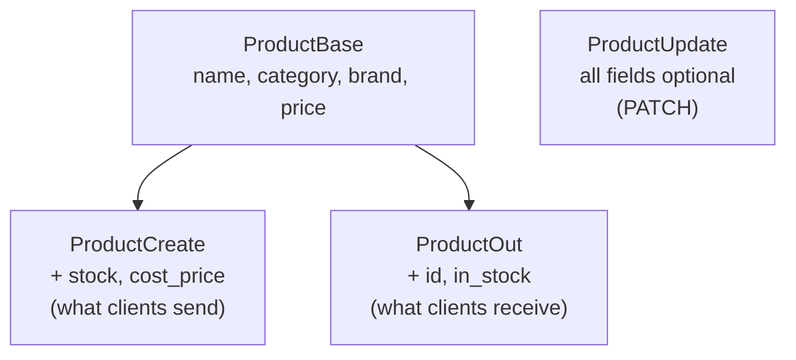

# Responses, Status Codes & Errors

!!! abstract "Learning Objectives"
    By the end of this lesson, you can:

    - Shape responses with `response_model` so internal fields never leak
    - Organise schemas as `Base` / `Create` / `Update` / `Out` models
    - Return the right status code: `200`, `201`, `204`, `400`, `404`, `409`
    - Raise `HTTPException` and design consistent error responses
    - Create custom exceptions with exception handlers, and do partial updates with `PATCH`

**Prerequisites:** [Request Bodies & Pydantic](03-request-bodies-and-pydantic.md)

## Why Control the Response?

In the last lesson we removed passwords from a response by hand with `model_dump(exclude=...)`. That's easy to forget. One missed `exclude` and you've leaked password hashes, cost prices or internal notes to the whole internet.

A **response model** declares exactly what an endpoint may return. FastAPI filters everything else out, validates the output, and documents it in `/docs`.

!!! example "Real-life analogy: a shop counter"
    The stockroom has supplier invoices, cost prices and staff notes. The counter shows customers only the product name, price and availability. A response model is that counter: the public view of your internal data.

## The Complete Example

```python title="main.py"
from fastapi import FastAPI, HTTPException, Request, Response, status
from fastapi.responses import JSONResponse
from pydantic import BaseModel, ConfigDict, Field

app = FastAPI(title="KSR Shop API")


# ---------- schemas ----------
class ProductBase(BaseModel):
    name: str = Field(min_length=2, max_length=100)
    category: str
    brand: str | None = None
    price: float = Field(gt=0)


class ProductCreate(ProductBase):
    stock: int = Field(default=0, ge=0)
    cost_price: float = Field(gt=0, description="Internal: what we paid the supplier")


class ProductUpdate(BaseModel):
    model_config = ConfigDict(extra="forbid")
    name: str | None = Field(default=None, min_length=2, max_length=100)
    category: str | None = None
    brand: str | None = None
    price: float | None = Field(default=None, gt=0)
    stock: int | None = Field(default=None, ge=0)


class ProductOut(ProductBase):
    id: int
    in_stock: bool


# ---------- "database" ----------
PRODUCTS: dict[int, dict] = {
    1: {"id": 1, "name": "iPhone 15", "category": "Electronics", "brand": "Apple",
        "price": 79999.0, "stock": 25, "cost_price": 68000.0, "supplier_notes": "Q3 batch"},
    10: {"id": 10, "name": "Wings of Fire", "category": "Books", "brand": "Universities Press",
         "price": 350.0, "stock": 0, "cost_price": 210.0, "supplier_notes": "reprint pending"},
}


def to_out(product: dict) -> dict:
    return {**product, "in_stock": product["stock"] > 0}


# ---------- custom exception ----------
class OutOfStockError(Exception):
    def __init__(self, product_name: str, requested: int, available: int):
        self.product_name = product_name
        self.requested = requested
        self.available = available


@app.exception_handler(OutOfStockError)
def out_of_stock_handler(request: Request, exc: OutOfStockError):
    return JSONResponse(
        status_code=status.HTTP_409_CONFLICT,
        content={
            "error": "out_of_stock",
            "message": f"Only {exc.available} unit(s) of {exc.product_name} left",
            "requested": exc.requested,
            "available": exc.available,
        },
    )


def get_or_404(product_id: int) -> dict:
    product = PRODUCTS.get(product_id)
    if product is None:
        raise HTTPException(status_code=status.HTTP_404_NOT_FOUND, detail=f"Product {product_id} not found")
    return product


# ---------- endpoints ----------
@app.get("/products", response_model=list[ProductOut])
def list_products():
    return [to_out(p) for p in PRODUCTS.values()]


@app.get("/products/{product_id}", response_model=ProductOut)
def get_product(product_id: int):
    return to_out(get_or_404(product_id))


@app.post("/products", response_model=ProductOut, status_code=status.HTTP_201_CREATED)
def create_product(product: ProductCreate, response: Response):
    if any(p["name"].lower() == product.name.lower() for p in PRODUCTS.values()):
        raise HTTPException(status_code=status.HTTP_409_CONFLICT, detail="A product with this name already exists")
    new_id = max(PRODUCTS) + 1
    PRODUCTS[new_id] = {"id": new_id, **product.model_dump(), "supplier_notes": ""}
    response.headers["Location"] = f"/products/{new_id}"
    return to_out(PRODUCTS[new_id])


@app.patch("/products/{product_id}", response_model=ProductOut)
def update_product(product_id: int, changes: ProductUpdate):
    product = get_or_404(product_id)
    updates = changes.model_dump(exclude_unset=True)
    if not updates:
        raise HTTPException(status_code=status.HTTP_400_BAD_REQUEST, detail="No fields to update")
    product.update(updates)
    return to_out(product)


@app.delete("/products/{product_id}", status_code=status.HTTP_204_NO_CONTENT)
def delete_product(product_id: int):
    get_or_404(product_id)
    del PRODUCTS[product_id]


@app.post("/products/{product_id}/reserve")
def reserve(product_id: int, quantity: int = 1):
    product = get_or_404(product_id)
    if quantity > product["stock"]:
        raise OutOfStockError(product["name"], quantity, product["stock"])
    product["stock"] -= quantity
    return {"reserved": quantity, "remaining": product["stock"]}
```

## response_model: The Public Shape

Our stored product has `cost_price` and `supplier_notes`, which customers must never see. `ProductOut` doesn't include them:

```{ .python .no-run }
class ProductOut(ProductBase):
    id: int
    in_stock: bool

@app.get("/products/{product_id}", response_model=ProductOut)
def get_product(product_id: int):
    return to_out(get_or_404(product_id))     # the dict still contains cost_price!
```

```bash
curl -s http://127.0.0.1:8000/products/1
```

```{ .text .output }
{
  "name": "iPhone 15",
  "category": "Electronics",
  "brand": "Apple",
  "price": 79999.0,
  "id": 1,
  "in_stock": true
}
```

Even though the function returned a dict **containing** `cost_price` and `supplier_notes`, FastAPI **filtered them out**, because they're not in `ProductOut`. The response model is a safety net.

For lists, use `list[ProductOut]`:

```bash
curl -s http://127.0.0.1:8000/products
```

```{ .text .output }
[
  {
    "name": "iPhone 15",
    "category": "Electronics",
    "brand": "Apple",
    "price": 79999.0,
    "id": 1,
    "in_stock": true
  },
  {
    "name": "Wings of Fire",
    "category": "Books",
    "brand": "Universities Press",
    "price": 350.0,
    "id": 10,
    "in_stock": false
  }
]
```

!!! tip "Return type annotations work too"
    Instead of `response_model=ProductOut`, you can write `def get_product(product_id: int) -> ProductOut:`. FastAPI uses the return annotation the same way. Use `response_model=` when the function returns a dict or ORM object rather than the model itself, as here.

## Organising Schemas

Real projects use a small family of models per resource:



| Schema | Used for | Notes |
|--------|----------|-------|
| `ProductBase` | Shared fields | Not used directly |
| `ProductCreate` | `POST` body | Required fields; may include write-only fields (password, cost price) |
| `ProductUpdate` | `PATCH` body | Every field optional |
| `ProductOut` | Responses | Adds server-generated fields (`id`, `created_at`); never secrets |

!!! realworld "In Real Projects"
    This `Create` / `Update` / `Out` pattern is how most professional FastAPI codebases are organised, usually in a `schemas/` folder. In Django REST Framework the same idea is called a *serializer*, and in Spring Boot a *DTO* (Data Transfer Object). Learn it once and you'll recognise it everywhere.

## Status Codes

Set the success code with `status_code=` on the decorator. The `status` module gives readable names:

| Code | `status.` constant | Use for |
|------|--------------------|---------|
| 200 | `HTTP_200_OK` | Successful GET, PUT, PATCH (the default) |
| 201 | `HTTP_201_CREATED` | Resource created (POST) |
| 204 | `HTTP_204_NO_CONTENT` | Success with no body (DELETE) |
| 400 | `HTTP_400_BAD_REQUEST` | The request makes no sense (e.g. empty update) |
| 401 | `HTTP_401_UNAUTHORIZED` | Not logged in / bad token |
| 403 | `HTTP_403_FORBIDDEN` | Logged in, but not allowed |
| 404 | `HTTP_404_NOT_FOUND` | Resource doesn't exist |
| 409 | `HTTP_409_CONFLICT` | Conflicts with current state (duplicate, out of stock) |
| 422 | `HTTP_422_UNPROCESSABLE_CONTENT` | Validation failed (FastAPI sends it automatically) |
| 500 | `HTTP_500_INTERNAL_SERVER_ERROR` | A bug or crash on the server |

### 201 Created with a Location header

```bash
curl -s -i -X POST http://127.0.0.1:8000/products \
  -H "Content-Type: application/json" \
  -d '{"name": "Galaxy S24", "category": "Electronics", "brand": "Samsung", "price": 74999, "stock": 30, "cost_price": 64000}' \
  | grep -iE "^HTTP|^location|^\{"
```

```{ .text .output }
HTTP/1.1 201 Created
location: /products/11
{"name":"Galaxy S24","category":"Electronics","brand":"Samsung","price":74999.0,"id":11,"in_stock":true}
```

`curl -i` prints the response headers too (we filtered the output with `grep` to the interesting lines). The `Location` header tells the client where the new resource lives, a REST convention. Notice `cost_price` was **accepted** in the request but **not returned**: it's write-only.

### 204 No Content for DELETE

```bash
curl -s -w "HTTP %{http_code}\n" -X DELETE http://127.0.0.1:8000/products/11
```

```{ .text .output }
HTTP 204
```

A 204 response has **no body** at all, just the status. Deleting it again is now a 404:

```bash
curl -s -w "\nHTTP %{http_code}\n" -X DELETE http://127.0.0.1:8000/products/11
```

```{ .text .output }
{
  "detail": "Product 11 not found"
}
HTTP 404
```

## HTTPException and Error Design

`raise HTTPException(status_code=..., detail=...)` immediately stops the request and returns an error. `detail` can be a string, a list or a dict.

```{ .python .no-run }
def get_or_404(product_id: int) -> dict:
    product = PRODUCTS.get(product_id)
    if product is None:
        raise HTTPException(status_code=404, detail=f"Product {product_id} not found")
    return product
```

A small helper like `get_or_404` keeps every endpoint short and every "not found" error consistent.

A duplicate name returns **409 Conflict**:

```bash
curl -s -w "\nHTTP %{http_code}\n" -X POST http://127.0.0.1:8000/products \
  -H "Content-Type: application/json" \
  -d '{"name": "iphone 15", "category": "Electronics", "price": 1, "cost_price": 1}'
```

```{ .text .output }
{
  "detail": "A product with this name already exists"
}
HTTP 409
```

!!! warning "Use `raise`, not `return`"
    `return HTTPException(...)` doesn't raise anything: it tries to send the exception object as a normal 200 response. Always `raise` it.

!!! tip "Don't leak internals in error messages"
    Error messages are public. Say *"Product 99 not found"*, never *"SQL error in table products column cost_price: …"*. Log the technical details on the server instead.

## Custom Exceptions and Handlers

For business rules used in many places, define your own exception class and register a handler that turns it into a response:

```{ .python .no-run }
class OutOfStockError(Exception):
    def __init__(self, product_name, requested, available): ...

@app.exception_handler(OutOfStockError)
def out_of_stock_handler(request: Request, exc: OutOfStockError):
    return JSONResponse(status_code=409, content={"error": "out_of_stock", ...})
```

Now any code (an endpoint, a helper, a service) can simply `raise OutOfStockError(...)`:

```bash
curl -s -X POST "http://127.0.0.1:8000/products/1/reserve?quantity=3"
```

```{ .text .output }
{
  "reserved": 3,
  "remaining": 22
}
```

```bash
curl -s -w "\nHTTP %{http_code}\n" -X POST "http://127.0.0.1:8000/products/10/reserve?quantity=1"
```

```{ .text .output }
{
  "error": "out_of_stock",
  "message": "Only 0 unit(s) of Wings of Fire left",
  "requested": 1,
  "available": 0
}
HTTP 409
```

Wings of Fire has 0 in stock, so the custom handler produced a structured, machine-readable error. The frontend can check `error == "out_of_stock"` and show a "Notify me when available" button.

!!! realworld "In Real Projects"
    Teams agree on **one error format** for the whole API, e.g. `{"error": "code", "message": "...", "details": {...}}`, and implement it with exception handlers. Business code raises meaningful exceptions (`OutOfStockError`, `PaymentFailedError`), and the handlers translate them into HTTP responses. That keeps HTTP details out of business logic.

## Partial Updates with PATCH

`ProductUpdate` makes every field optional. The key is `model_dump(exclude_unset=True)`, which returns **only the fields the client actually sent**:

```{ .python .no-run }
updates = changes.model_dump(exclude_unset=True)   # e.g. {"price": 74999.0}
product.update(updates)
```

```bash
curl -s -X PATCH http://127.0.0.1:8000/products/1 \
  -H "Content-Type: application/json" \
  -d '{"price": 74999}'
```

```{ .text .output }
{
  "name": "iPhone 15",
  "category": "Electronics",
  "brand": "Apple",
  "price": 74999.0,
  "id": 1,
  "in_stock": true
}
```

Only the price changed; every other field kept its value. Without `exclude_unset=True`, the unsent fields would be `None` and would wipe out the existing name, brand and so on.

An empty body or an unknown field:

```bash
curl -s -w "\nHTTP %{http_code}\n" -X PATCH http://127.0.0.1:8000/products/1 \
  -H "Content-Type: application/json" -d '{}'
```

```{ .text .output }
{
  "detail": "No fields to update"
}
HTTP 400
```

```bash
curl -s -w "\nHTTP %{http_code}\n" -X PATCH http://127.0.0.1:8000/products/1 \
  -H "Content-Type: application/json" -d '{"cost_price": 1}'
```

```{ .text .output }
{
  "detail": [
    {
      "type": "extra_forbidden",
      "loc": ["body", "cost_price"],
      "msg": "Extra inputs are not permitted",
      "input": 1
    }
  ]
}
HTTP 422
```

`cost_price` isn't in `ProductUpdate`, and `extra="forbid"` rejects it, so clients can't change internal fields through the public API.

| Method | Body | Missing fields |
|--------|------|----------------|
| `PUT` | The **complete** resource | Replaced (set to defaults / required) |
| `PATCH` | Only the fields to change | Left unchanged |

## Common Mistakes

| Mistake | Problem | Fix |
|---------|---------|-----|
| No `response_model` | Internal fields (passwords, cost prices) leak | Always declare an `Out` schema |
| `return HTTPException(...)` | Returns 200 with a weird body | `raise HTTPException(...)` |
| `201`/`204` not set | Clients can't distinguish create/delete | `status_code=status.HTTP_201_CREATED` |
| Returning a body with `204` | Protocol error (`Response content longer than Content-Length`) | Return nothing for 204 |
| `model_dump()` without `exclude_unset` in PATCH | Unsent fields become `None` | `model_dump(exclude_unset=True)` |
| Same model for input and output | Clients can set `id`; secrets returned | Separate `Create` / `Update` / `Out` |
| Database or stack-trace text in `detail` | Information leak | Generic message + server logs |
| Inconsistent error formats | Frontend needs special cases | One format via exception handlers |

## Practice Exercises

**Easy**

1. Add `GET /products/{product_id}/public` that returns only `name` and `price` using a new `ProductSummary` response model.
2. Make `POST /products` reject a price higher than `cost_price × 3` with a `400` and a clear message.
3. Call `DELETE` twice on the same product and explain both responses.

**Medium**

4. Add `PUT /products/{product_id}` that requires a full `ProductCreate` body and replaces the product.
5. Add an `updated_at` field to `ProductOut`, set whenever a product is created or patched.
6. Create a `ProductNotFoundError` exception with a handler that returns `{"error": "not_found", "resource": "product", "id": ...}`, and use it instead of `HTTPException` in `get_or_404`.

**Challenge**

7. Implement a consistent error format for the **whole** API, `{"error": <code>, "message": <text>, "details": <optional>}`, for `HTTPException` (handle `StarletteHTTPException`), validation errors (`RequestValidationError`, keep it 422 but simplify each error to `field` + `message`) and your custom exceptions. Show one example response of each kind.

??? success "Solutions (click to expand)"

    ```{ .python .no-run }
    from datetime import datetime
    from fastapi.exceptions import RequestValidationError
    from starlette.exceptions import HTTPException as StarletteHTTPException

    # 1
    class ProductSummary(BaseModel):
        name: str
        price: float

    @app.get("/products/{product_id}/public", response_model=ProductSummary)
    def public_product(product_id: int):
        return get_or_404(product_id)

    # 2 (inside create_product, before saving)
    if product.price > product.cost_price * 3:
        raise HTTPException(status_code=400, detail="Price cannot exceed 3x the cost price")

    # 4
    @app.put("/products/{product_id}", response_model=ProductOut)
    def replace_product(product_id: int, product: ProductCreate):
        get_or_404(product_id)
        PRODUCTS[product_id] = {"id": product_id, **product.model_dump(), "supplier_notes": ""}
        return to_out(PRODUCTS[product_id])

    # 6
    class ProductNotFoundError(Exception):
        def __init__(self, product_id: int):
            self.product_id = product_id

    @app.exception_handler(ProductNotFoundError)
    def not_found_handler(request: Request, exc: ProductNotFoundError):
        return JSONResponse(status_code=404,
                            content={"error": "not_found", "resource": "product", "id": exc.product_id})

    # 7
    @app.exception_handler(StarletteHTTPException)
    def http_error(request: Request, exc: StarletteHTTPException):
        return JSONResponse(status_code=exc.status_code,
                            content={"error": f"http_{exc.status_code}", "message": str(exc.detail)})

    @app.exception_handler(RequestValidationError)
    def validation_error(request: Request, exc: RequestValidationError):
        details = [{"field": ".".join(str(p) for p in e["loc"][1:]), "message": e["msg"]} for e in exc.errors()]
        return JSONResponse(status_code=422,
                            content={"error": "validation_failed", "message": "Invalid input", "details": details})
    ```

!!! note "Mini Assignment"
    Refactor your **KSR Shop API**: create `CustomerCreate` / `CustomerUpdate` / `CustomerOut` and `Product*` schema families, add `response_model` to every endpoint (passwords must never appear in any response), return `201` with `Location` for creates and `204` for deletes, add `PATCH` endpoints using `exclude_unset`, and introduce one custom exception with a handler. Update your `curl_examples.md` with the new status codes.

## Interview Questions

!!! interview "1. What is `response_model` used for?"
    It declares the output schema of an endpoint. FastAPI validates and serialises the return value through it, **filters out** fields not in the model (preventing leaks of passwords or internal data), and documents the response in OpenAPI.

!!! interview "2. Why use separate Create, Update and Out schemas?"
    Different operations need different shapes: Create has required input fields and possibly write-only ones (password); Update has all fields optional for partial updates; Out has server-generated fields (id, timestamps) and excludes secrets. One shared model would allow clients to set ids and would leak sensitive fields.

!!! interview "3. When should an API return 201, 204, 400, 404, 409 and 422?"
    201 when a resource is created; 204 for success without a body (usually DELETE); 400 for a malformed or nonsensical request; 404 when the resource doesn't exist; 409 when the request conflicts with current state (duplicate, out of stock); 422 when the input fails validation (FastAPI does this automatically).

!!! interview "4. How do you implement PATCH correctly in FastAPI?"
    Use an update schema where all fields are optional, then `changes.model_dump(exclude_unset=True)` to get only the fields the client actually sent, and apply those to the stored object. Otherwise unsent fields default to `None` and overwrite existing data.

!!! interview "5. How do you handle custom exceptions globally?"
    Define an exception class, register a handler with `@app.exception_handler(MyError)` that returns a `JSONResponse`, and raise the exception anywhere in the code. Handlers can also override the built-in `HTTPException` and `RequestValidationError` responses for a consistent error format.

!!! interview "Scenario: a security review finds password hashes in the `GET /users/{id}` response. How did it happen and how do you fix it permanently?"
    The endpoint returned the ORM object or dict directly without a response model, so every column was serialised. Fix it by adding `response_model=UserOut` (with no password field) to every user endpoint. Prevent recurrence with code review rules and tests that assert sensitive fields never appear in responses.

## Summary

| Concept | Syntax |
|---------|--------|
| Response model | `@app.get(..., response_model=ProductOut)` or `-> ProductOut` |
| Lists | `response_model=list[ProductOut]` |
| Schema family | `Base` → `Create` / `Out`; `Update` with optional fields |
| Status code | `status_code=status.HTTP_201_CREATED`; `204` for DELETE with no body |
| Header | `response: Response` → `response.headers["Location"] = ...` |
| Error | `raise HTTPException(status_code=404, detail="...")` |
| Custom error | `class MyError(Exception)` + `@app.exception_handler(MyError)` → `JSONResponse` |
| Partial update | `changes.model_dump(exclude_unset=True)` |

**Next lesson:** [Routers & Project Structure](05-routers-and-project-structure.md), organising a growing API into routers, schemas and services.
