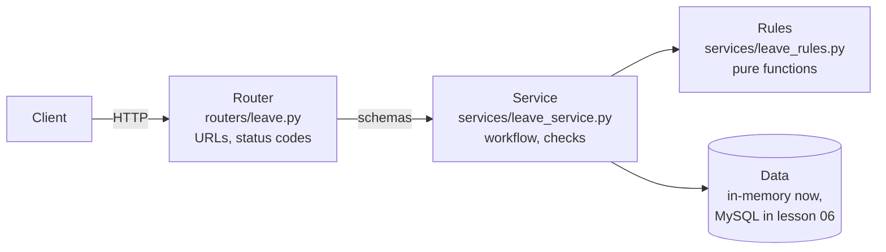

# Routers & Project Structure

!!! abstract "Learning Objectives"
    By the end of this lesson, you can:

    - Explain why a single `main.py` doesn't scale, and how to split an API into layers
    - Use `APIRouter` with prefixes and tags to group endpoints
    - Separate **routers** (HTTP), **schemas** (data shapes) and **services** (business logic)
    - Turn the BRD's leave policy into small, pure functions you can test without a server
    - Organise `/docs` with tags, summaries and descriptions

**Prerequisites:** [Responses, Status Codes & Errors](04-responses-and-errors.md)

## Why Structure Matters

After four lessons, `main.py` already has schemas, fake data, helpers, exception handlers and endpoints mixed together. The AcmeHR BRD lists eight modules (employees, organisation, leave, attendance, documents, performance, onboarding, reports), each with five or more endpoints. In one file that becomes thousands of lines nobody can navigate, and several developers editing the same file means constant merge conflicts.

!!! example "Real-life analogy: the HR department itself"
    Acme's HR team doesn't have one person who answers questions, applies the leave policy and maintains the files. The **HR helpdesk** (routers) talks to employees, the **policy experts** (services) apply the rules ("is 20 October a holiday? does she have enough balance?"), and the **records room** (data) holds the files. Each role is simple, and you can change one without retraining the others.

## The Layers



| Layer | Folder | Knows about | Must NOT know about |
|-------|--------|-------------|---------------------|
| **Router** | `routers/` | HTTP: paths, query params, status codes | SQL, storage details, leave policy |
| **Schema** | `schemas/` | Data shapes and validation (Pydantic) | HTTP, storage |
| **Service** | `services/` | Business rules: working days, balances, overlaps | HTTP status codes, request objects |
| **Data** | `repositories/`, `models/` | Storage: dicts now, MySQL later | Business rules, HTTP |

This lesson uses an in-memory store so you can focus on the structure. In [lesson 06](06-mysql-connector.md) you'll swap the store for MySQL **without touching the routers**. That's the payoff of layers.

## The Project Layout

```text
acmehr-api/
├── .venv/
├── requirements.txt
└── app/
    ├── __init__.py
    ├── main.py                    ← creates the app, includes routers
    ├── exceptions.py              ← domain exceptions + handlers
    ├── schemas/
    │   ├── __init__.py
    │   ├── employee.py            ← EmployeeOut, EmployeePage, DepartmentOut
    │   └── leave.py               ← LeaveRequestCreate, LeaveRequestOut, LeaveBalanceOut
    ├── services/
    │   ├── __init__.py
    │   ├── employee_service.py    ← directory + in-memory employees
    │   ├── leave_rules.py         ← pure rules: working days, overlaps
    │   └── leave_service.py       ← apply for leave, balances
    └── routers/
        ├── __init__.py
        ├── health.py
        ├── employees.py           ← /employees
        ├── departments.py         ← /departments
        └── leave.py               ← /leave-requests, /holidays
```

Create the folders and empty `__init__.py` files (they mark folders as Python packages):

```bash
mkdir -p app/schemas app/services app/routers
touch app/__init__.py app/schemas/__init__.py app/services/__init__.py app/routers/__init__.py
```

## Schemas

```python title="app/schemas/employee.py"
from datetime import date

from pydantic import BaseModel


class EmployeeOut(BaseModel):
    code: str
    name: str
    email: str
    department: str
    designation: str
    location: str
    manager_code: str | None
    hire_date: date
    status: str


class EmployeePage(BaseModel):
    total: int
    page: int
    size: int
    items: list[EmployeeOut]


class DepartmentOut(BaseModel):
    name: str
    headcount: int
```

`EmployeePage` is the response for a list endpoint: the items for this page plus the information the frontend needs to draw pagination controls.

```python title="app/schemas/leave.py"
from datetime import date
from enum import Enum
from typing import Literal

from pydantic import BaseModel, Field, model_validator


class LeaveType(str, Enum):
    CL = "CL"
    SL = "SL"
    EL = "EL"
    LOP = "LOP"


class LeaveRequestCreate(BaseModel):
    employee_code: str = Field(pattern=r"^E-\d{4}$")
    leave_type: LeaveType
    start_date: date
    end_date: date
    duration: Literal["full", "first_half", "second_half"] = "full"
    reason: str = Field(min_length=5, max_length=255)

    @model_validator(mode="after")
    def check_dates(self):
        if self.end_date < self.start_date:
            raise ValueError("end_date can't be before start_date")
        if self.duration != "full" and self.start_date != self.end_date:
            raise ValueError("a half day must start and end on the same date")
        return self


class LeaveRequestOut(BaseModel):
    id: int
    employee_code: str
    leave_type: LeaveType
    start_date: date
    end_date: date
    duration: str
    days: float
    reason: str
    status: str


class LeaveBalanceOut(BaseModel):
    leave_type: str
    allocated: float
    used: float
    remaining: float
```

## Exceptions

Business errors are plain Python exceptions with **no HTTP knowledge**. One place translates them to responses:

```python title="app/exceptions.py"
from fastapi import FastAPI, Request
from fastapi.responses import JSONResponse


class NotFoundError(Exception):
    def __init__(self, resource: str, key):
        self.resource = resource
        self.key = key


class ConflictError(Exception):
    def __init__(self, message: str):
        self.message = message


class BusinessRuleError(Exception):
    def __init__(self, message: str):
        self.message = message


class InsufficientBalanceError(Exception):
    def __init__(self, leave_type: str, requested: float, available: float):
        self.leave_type = leave_type
        self.requested = requested
        self.available = available


def register_exception_handlers(app: FastAPI) -> None:
    @app.exception_handler(NotFoundError)
    def not_found(request: Request, exc: NotFoundError):
        return JSONResponse(status_code=404, content={"detail": f"{exc.resource} {exc.key} not found"})

    @app.exception_handler(ConflictError)
    def conflict(request: Request, exc: ConflictError):
        return JSONResponse(status_code=409, content={"detail": exc.message})

    @app.exception_handler(BusinessRuleError)
    def business_rule(request: Request, exc: BusinessRuleError):
        return JSONResponse(status_code=400, content={"detail": exc.message})

    @app.exception_handler(InsufficientBalanceError)
    def insufficient_balance(request: Request, exc: InsufficientBalanceError):
        return JSONResponse(status_code=409, content={
            "error": "insufficient_balance",
            "message": f"Only {exc.available:g} day(s) of {exc.leave_type} left",
            "requested": exc.requested,
            "available": exc.available,
        })
```

## The Service Layer

### Pure rules

Acme's leave policy (BRD, Module 4) says:

> Leave is counted in working days. Saturdays, Sundays and company holidays inside the leave period are not deducted. A half day counts as 0.5. An employee can't have two active leave requests (pending or approved) for the same date.

These rules don't need a database, a request or a server, just dates. So they live in their own module as **pure functions**: same input, same output, no side effects:

```python title="app/services/leave_rules.py"
from datetime import date, timedelta


def working_days(start: date, end: date, duration: str, holidays: set[date]) -> float:
    """Days deducted from the balance: weekends and holidays don't count."""
    def is_working(day: date) -> bool:
        return day.weekday() < 5 and day not in holidays

    if duration != "full":
        return 0.5 if is_working(start) else 0.0
    days = 0
    day = start
    while day <= end:
        if is_working(day):
            days += 1
        day += timedelta(days=1)
    return float(days)


def overlaps(start: date, end: date, other_start: date, other_end: date) -> bool:
    """True when the two date ranges share at least one day."""
    return start <= other_end and other_start <= end
```

Because they're pure, you can check them straight from Python, without starting FastAPI. Meera's earned leave from Monday 19 to Friday 23 October includes Dussehra on the 20th:

```python
from datetime import date
from app.services.leave_rules import working_days, overlaps

holidays = {date(2026, 10, 2), date(2026, 10, 20), date(2026, 11, 9)}
print(working_days(date(2026, 10, 19), date(2026, 10, 23), "full", holidays))        # Meera
print(working_days(date(2026, 10, 14), date(2026, 10, 14), "first_half", holidays))  # half day
print(working_days(date(2026, 10, 10), date(2026, 10, 11), "full", holidays))        # Sat-Sun
print(working_days(date(2026, 11, 6), date(2026, 11, 10), "full", holidays))         # Fri to Tue, Diwali Mon
print(overlaps(date(2026, 11, 16), date(2026, 11, 20), date(2026, 11, 19), date(2026, 11, 19)))
```

```{ .text .output }
4.0
0.5
0.0
2.0
True
```

Five days in the calendar, **4** deducted for Meera. Friday 6 to Tuesday 10 November is five calendar days but only 2 working days (Friday and Tuesday): the weekend and Diwali are free. In lesson 11 these exact cases become automated tests.

### The services

The services hold the workflow. They accept and return schemas and plain values, never `Request` objects or status codes:

```python title="app/services/employee_service.py"
from app.exceptions import NotFoundError

_employees: dict[str, dict] = {e["code"]: e for e in [
    {"code": "E-1001", "name": "Lakshmi Menon", "email": "lakshmi.menon@acme.example", "department": "Leadership", "designation": "Chief Executive Officer", "location": "Hyderabad", "manager_code": None, "hire_date": "2018-04-01", "status": "active"},
    {"code": "E-1002", "name": "Karthik Menon", "email": "karthik.menon@acme.example", "department": "Engineering", "designation": "Engineering Manager", "location": "Hyderabad", "manager_code": "E-1001", "hire_date": "2019-06-15", "status": "active"},
    {"code": "E-1003", "name": "Neha Kapoor", "email": "neha.kapoor@acme.example", "department": "Product", "designation": "Product Manager", "location": "Bengaluru", "manager_code": "E-1001", "hire_date": "2019-09-01", "status": "active"},
    {"code": "E-1042", "name": "Ananya Rao", "email": "ananya.rao@acme.example", "department": "Engineering", "designation": "Senior Software Engineer", "location": "Hyderabad", "manager_code": "E-1002", "hire_date": "2021-07-12", "status": "active"},
    {"code": "E-1044", "name": "Fatima Khan", "email": "fatima.khan@acme.example", "department": "Product", "designation": "Product Designer", "location": "Bengaluru", "manager_code": "E-1003", "hire_date": "2021-10-18", "status": "active"},
    {"code": "E-1045", "name": "Meera Iyer", "email": "meera.iyer@acme.example", "department": "Finance", "designation": "Accountant", "location": "Hyderabad", "manager_code": "E-1005", "hire_date": "2021-04-05", "status": "active"},
    {"code": "E-1046", "name": "Priya Nair", "email": "priya.nair@acme.example", "department": "Engineering", "designation": "Software Engineer", "location": "Hyderabad", "manager_code": "E-1002", "hire_date": "2023-02-13", "status": "active"},
    {"code": "E-1047", "name": "Vikram Joshi", "email": "vikram.joshi@acme.example", "department": "Platform Engineering", "designation": "DevOps Engineer", "location": "Pune", "manager_code": "E-1002", "hire_date": "2020-08-24", "status": "active"},
    {"code": "E-1054", "name": "Ritu Kapoor", "email": "ritu.kapoor@acme.example", "department": "Product", "designation": "Product Designer", "location": "Bengaluru", "manager_code": "E-1003", "hire_date": "2020-05-11", "status": "exited"},
]}


def list_employees(q=None, department=None, location=None, status="active", sort="name", page=1, size=10):
    items = [e for e in _employees.values() if e["status"] == status]
    if q:
        items = [e for e in items if q.lower() in e["name"].lower()]
    if department:
        items = [e for e in items if e["department"].lower() == department.lower()]
    if location:
        items = [e for e in items if e["location"].lower() == location.lower()]
    items.sort(key=lambda e: e[sort])
    start = (page - 1) * size
    return {"total": len(items), "page": page, "size": size, "items": items[start:start + size]}


def get_employee(code: str) -> dict:
    employee = _employees.get(code)
    if employee is None:
        raise NotFoundError("Employee", code)
    return employee


def list_departments() -> list[dict]:
    counts: dict[str, int] = {}
    for e in _employees.values():
        if e["status"] != "exited":
            counts[e["department"]] = counts.get(e["department"], 0) + 1
    return [{"name": name, "headcount": n} for name, n in sorted(counts.items())]
```

```python title="app/services/leave_service.py"
from datetime import date

from app.exceptions import BusinessRuleError, ConflictError, InsufficientBalanceError
from app.schemas.leave import LeaveRequestCreate, LeaveType
from app.services import employee_service
from app.services.leave_rules import overlaps, working_days

HOLIDAYS: dict[date, str] = {
    date(2026, 1, 26): "Republic Day", date(2026, 3, 4): "Holi", date(2026, 8, 15): "Independence Day",
    date(2026, 10, 2): "Gandhi Jayanti", date(2026, 10, 20): "Dussehra", date(2026, 11, 9): "Diwali",
    date(2026, 12, 25): "Christmas",
}

_balances: dict[str, dict[str, dict]] = {    # 2026 allocations and approved (used) days
    "E-1042": {"CL": {"allocated": 12, "used": 4}, "SL": {"allocated": 12, "used": 2}, "EL": {"allocated": 15, "used": 0}},
    "E-1045": {"CL": {"allocated": 12, "used": 0}, "SL": {"allocated": 12, "used": 0}, "EL": {"allocated": 15, "used": 0}},
}

_requests: list[dict] = [
    {"id": 3, "employee_code": "E-1042", "leave_type": "CL", "start_date": date(2026, 8, 20), "end_date": date(2026, 8, 21),
     "duration": "full", "days": 2.0, "reason": "Personal work", "status": "approved"},
    {"id": 4, "employee_code": "E-1042", "leave_type": "EL", "start_date": date(2026, 11, 16), "end_date": date(2026, 11, 20),
     "duration": "full", "days": 5.0, "reason": "Trip to Goa", "status": "pending"},
]
_next_id = 16


def list_requests(employee_code: str | None = None, status: str | None = None) -> list[dict]:
    items = _requests
    if employee_code:
        items = [r for r in items if r["employee_code"] == employee_code]
    if status:
        items = [r for r in items if r["status"] == status]
    return items


def get_balances(employee_code: str) -> list[dict]:
    employee_service.get_employee(employee_code)
    return [{"leave_type": t, "allocated": b["allocated"], "used": b["used"],
             "remaining": b["allocated"] - b["used"]}
            for t, b in _balances.get(employee_code, {}).items()]


def apply_leave(data: LeaveRequestCreate) -> dict:
    global _next_id
    employee_service.get_employee(data.employee_code)                  # NotFoundError if unknown

    days = working_days(data.start_date, data.end_date, data.duration, set(HOLIDAYS))
    if days == 0:
        raise BusinessRuleError("The selected dates have no working days (weekends and holidays don't count)")

    for r in _requests:
        if (r["employee_code"] == data.employee_code and r["status"] in ("pending", "approved")
                and overlaps(data.start_date, data.end_date, r["start_date"], r["end_date"])):
            raise ConflictError(f"Overlaps leave request {r['id']} ({r['start_date']} to {r['end_date']}, {r['status']})")

    if data.leave_type != LeaveType.LOP:                               # loss of pay has no balance
        balance = _balances.get(data.employee_code, {}).get(data.leave_type.value)
        remaining = float(balance["allocated"] - balance["used"]) if balance else 0.0
        if days > remaining:
            raise InsufficientBalanceError(data.leave_type.value, days, remaining)

    request = {"id": _next_id, **data.model_dump(), "days": days, "status": "pending"}
    _requests.append(request)
    _next_id += 1
    return request
```

Notice that `NotFoundError`, `ConflictError` and friends are raised here, but no status codes appear. The same `apply_leave` could be called by a command-line import script or a nightly job.

## Routers

An `APIRouter` is a mini-app: a group of related endpoints with a shared URL **prefix** and **tags**:

```python title="app/routers/employees.py"
from typing import Annotated, Literal

from fastapi import APIRouter, Path, Query

from app.schemas.employee import EmployeeOut, EmployeePage
from app.schemas.leave import LeaveBalanceOut
from app.services import employee_service, leave_service

router = APIRouter(prefix="/employees", tags=["Employees"])

EmployeeCode = Annotated[str, Path(pattern=r"^E-\d{4}$")]


@router.get("", response_model=EmployeePage, summary="Search the employee directory")
def list_employees(
    q: Annotated[str | None, Query(min_length=2)] = None,
    department: str | None = None,
    location: str | None = None,
    status: Literal["active", "on_notice", "exited"] = "active",
    sort: Literal["name", "hire_date"] = "name",
    page: Annotated[int, Query(ge=1)] = 1,
    size: Annotated[int, Query(ge=1, le=50)] = 10,
):
    """Filter by name, department and location; sort and paginate."""
    return employee_service.list_employees(q, department, location, status, sort, page, size)


@router.get("/{code}", response_model=EmployeeOut)
def get_employee(code: EmployeeCode):
    return employee_service.get_employee(code)


@router.get("/{code}/leave-balances", response_model=list[LeaveBalanceOut])
def leave_balances(code: EmployeeCode):
    return leave_service.get_balances(code)
```

Each endpoint is now **one or two lines**: read the HTTP input, call the service, return. A docstring becomes the description in `/docs`.

```python title="app/routers/departments.py"
from fastapi import APIRouter

from app.schemas.employee import DepartmentOut
from app.services import employee_service

router = APIRouter(prefix="/departments", tags=["Organisation"])


@router.get("", response_model=list[DepartmentOut])
def list_departments():
    return employee_service.list_departments()
```

A router doesn't need a prefix. The leave router owns two different top-level paths:

```python title="app/routers/leave.py"
from datetime import date
from typing import Literal

from fastapi import APIRouter, status

from app.schemas.leave import LeaveRequestCreate, LeaveRequestOut
from app.services import leave_service

router = APIRouter(tags=["Leave"])


@router.get("/holidays")
def list_holidays():
    return [{"date": d, "name": name} for d, name in leave_service.HOLIDAYS.items()]


@router.get("/leave-requests", response_model=list[LeaveRequestOut])
def list_leave_requests(employee: str | None = None,
                        status: Literal["pending", "approved", "rejected", "cancelled"] | None = None):
    return leave_service.list_requests(employee, status)


@router.post("/leave-requests", response_model=LeaveRequestOut, status_code=status.HTTP_201_CREATED,
             summary="Apply for leave")
def apply_leave(request: LeaveRequestCreate):
    """Counts working days, then checks for overlaps and the leave balance."""
    return leave_service.apply_leave(request)
```

```python title="app/routers/health.py"
from fastapi import APIRouter

router = APIRouter(tags=["Health"])


@router.get("/health")
def health():
    return {"status": "ok"}
```

## Wiring It Together in main.py

`main.py` becomes short and boring, exactly as it should be:

```python title="app/main.py"
from fastapi import FastAPI

from app.exceptions import register_exception_handlers
from app.routers import departments, employees, health, leave

app = FastAPI(
    title="AcmeHR API",
    version="1.0",
    description="Employee management system for Acme Technologies.",
)

register_exception_handlers(app)
app.include_router(health.router)
app.include_router(employees.router)
app.include_router(departments.router)
app.include_router(leave.router)
```

Run it from the project root (the folder that **contains** `app/`):

```{ .bash .no-run }
fastapi dev app/main.py
```

!!! mistake "Common Mistake: ModuleNotFoundError: No module named 'app'"
    You ran the command from **inside** the `app/` folder. Python imports like `from app.routers import ...` are resolved from the folder you start in. Run from the project root. With plain Uvicorn, the import string becomes `uvicorn app.main:app --reload`.

## Trying the API

The directory, sorted by name, two per page:

```bash
curl -s "http://127.0.0.1:8000/employees?size=2"
```

```{ .text .output }
{
  "total": 8,
  "page": 1,
  "size": 2,
  "items": [
    {
      "code": "E-1042",
      "name": "Ananya Rao",
      "email": "ananya.rao@acme.example",
      "department": "Engineering",
      "designation": "Senior Software Engineer",
      "location": "Hyderabad",
      "manager_code": "E-1002",
      "hire_date": "2021-07-12",
      "status": "active"
    },
    {
      "code": "E-1044",
      "name": "Fatima Khan",
      "email": "fatima.khan@acme.example",
      "department": "Product",
      "designation": "Product Designer",
      "location": "Bengaluru",
      "manager_code": "E-1003",
      "hire_date": "2021-10-18",
      "status": "active"
    }
  ]
}
```

Engineering's longest-serving people first:

```bash
curl -s "http://127.0.0.1:8000/employees?department=engineering&sort=hire_date" \
  | python -c "import json,sys; [print(e['hire_date'], e['name']) for e in json.load(sys.stdin)['items']]"
```

```{ .text .output }
2019-06-15 Karthik Menon
2021-07-12 Ananya Rao
2023-02-13 Priya Nair
```

Departments with their headcount (Ritu has exited, so Product counts two):

```bash
curl -s http://127.0.0.1:8000/departments
```

```{ .text .output }
[
  {
    "name": "Engineering",
    "headcount": 3
  },
  {
    "name": "Finance",
    "headcount": 1
  },
  {
    "name": "Leadership",
    "headcount": 1
  },
  {
    "name": "Platform Engineering",
    "headcount": 1
  },
  {
    "name": "Product",
    "headcount": 2
  }
]
```

### Applying for leave

Meera applies for her trip to Chennai. The service counts **4** working days, not 5:

```bash
curl -s -X POST http://127.0.0.1:8000/leave-requests \
  -H "Content-Type: application/json" \
  -d '{"employee_code": "E-1045", "leave_type": "EL", "start_date": "2026-10-19",
       "end_date": "2026-10-23", "reason": "Visiting parents in Chennai"}'
```

```{ .text .output }
{
  "id": 16,
  "employee_code": "E-1045",
  "leave_type": "EL",
  "start_date": "2026-10-19",
  "end_date": "2026-10-23",
  "duration": "full",
  "days": 4.0,
  "reason": "Visiting parents in Chennai",
  "status": "pending"
}
```

Her balance doesn't change yet: the request is only `pending`. Days move from `remaining` to `used` when her manager approves it, which you'll build in lesson 08:

```bash
curl -s http://127.0.0.1:8000/employees/E-1045/leave-balances
```

```{ .text .output }
[
  {
    "leave_type": "CL",
    "allocated": 12.0,
    "used": 0.0,
    "remaining": 12.0
  },
  {
    "leave_type": "SL",
    "allocated": 12.0,
    "used": 0.0,
    "remaining": 12.0
  },
  {
    "leave_type": "EL",
    "allocated": 15.0,
    "used": 0.0,
    "remaining": 15.0
  }
]
```

The rules raised in the service come out as clean HTTP responses. Ananya already has earned leave pending for 16–20 November, and tries to add a casual day inside it:

```bash
curl -s -w "\nHTTP %{http_code}\n" -X POST http://127.0.0.1:8000/leave-requests \
  -H "Content-Type: application/json" \
  -d '{"employee_code": "E-1042", "leave_type": "CL", "start_date": "2026-11-19",
       "end_date": "2026-11-19", "reason": "Doctor appointment"}'
```

```{ .text .output }
{
  "detail": "Overlaps leave request 4 (2026-11-16 to 2026-11-20, pending)"
}
HTTP 409
```

She has 8 casual days left. From Monday 26 October to Thursday 5 November is 9 working days:

```bash
curl -s -w "\nHTTP %{http_code}\n" -X POST http://127.0.0.1:8000/leave-requests \
  -H "Content-Type: application/json" \
  -d '{"employee_code": "E-1042", "leave_type": "CL", "start_date": "2026-10-26",
       "end_date": "2026-11-05", "reason": "Family function"}'
```

```{ .text .output }
{
  "error": "insufficient_balance",
  "message": "Only 8 day(s) of CL left",
  "requested": 9.0,
  "available": 8.0
}
HTTP 409
```

A request for a weekend, and one for someone who doesn't exist:

```bash
curl -s -w "\nHTTP %{http_code}\n" -X POST http://127.0.0.1:8000/leave-requests \
  -H "Content-Type: application/json" \
  -d '{"employee_code": "E-1042", "leave_type": "CL", "start_date": "2026-10-10",
       "end_date": "2026-10-11", "reason": "Weekend trip"}'
curl -s -w "\nHTTP %{http_code}\n" -X POST http://127.0.0.1:8000/leave-requests \
  -H "Content-Type: application/json" \
  -d '{"employee_code": "E-9999", "leave_type": "CL", "start_date": "2026-10-14",
       "end_date": "2026-10-14", "reason": "Testing"}'
```

```{ .text .output }
{"detail":"The selected dates have no working days (weekends and holidays don't count)"}
HTTP 400
{"detail":"Employee E-9999 not found"}
HTTP 404
```

All pending requests, Ananya's and Meera's new one:

```bash
curl -s "http://127.0.0.1:8000/leave-requests?status=pending" \
  | python -c "import json,sys; [print(r['id'], r['employee_code'], r['leave_type'], r['start_date'], r['days']) for r in json.load(sys.stdin)]"
```

```{ .text .output }
4 E-1042 EL 2026-11-16 5.0
16 E-1045 EL 2026-10-19 4.0
```

Open `/docs`: endpoints are now grouped under **Health**, **Employees**, **Organisation** and **Leave**, with your summaries and docstrings.

!!! realworld "In Real Projects"
    This router → service → data structure is the standard layout for production FastAPI services, and it mirrors Spring Boot's `@RestController` → `@Service` → `@Repository` layers that Java students will learn. Real HR products keep their policy rules (working days, accrual, carry forward) in exactly this kind of pure module, because the rules change every year and every change must come with tests. Teams often add `core/` (config, security), `models/` (database tables) and `tests/` as the project grows.

## Common Mistakes

| Mistake | Symptom | Fix |
|---------|---------|-----|
| Running from inside `app/` | `ModuleNotFoundError: No module named 'app'` | Run from the project root |
| Forgot `app.include_router(...)` | Endpoints missing from `/docs`, 404 | Include every router in `main.py` |
| Prefix repeated in paths: `prefix="/employees"` + `@router.get("/employees")` | URL becomes `/employees/employees` | Use `""` or `"/{code}"` inside the router |
| `raise HTTPException` inside services | Services tied to HTTP; hard to reuse | Raise domain exceptions; translate in handlers |
| Circular imports (`main` ↔ `routers`) | `ImportError: cannot import name ... (most likely due to a circular import)` | Routers never import `main`; dependencies flow one way |
| Leave policy written inside the router | The same rule copied into apply, approve and import | One pure function in `leave_rules.py` |
| Counting calendar days | Employees lose balance for weekends and holidays | `working_days()` skips both |

## Practice Exercises

**Easy**

1. Add `GET /holidays?month=10` filtering by month (keep it in the leave router).
2. Add `summary=` and a docstring to every employees endpoint, and check `/docs`.
3. Add `GET /employees/{code}/team` that returns the employees whose `manager_code` is that code, using a new service function.

**Medium**

4. Add `POST /employees` (HR adds a new joiner) through the layers: an `EmployeeCreate` schema, `employee_service.create_employee()` (unique email → `ConflictError`, next free code) and the router endpoint.
5. Pending requests should "reserve" balance, so nobody can apply for more than they have with several pending requests. Change `apply_leave` so `remaining` subtracts the days of the employee's pending requests of the same type.
6. Version your API: every endpoint should live under `/api/v1` (hint: `app.include_router(router, prefix="/api/v1")`).

**Challenge**

7. Add `POST /leave-requests/{id}/cancel`: only `pending` or future `approved` requests can be cancelled (else `BusinessRuleError`); an approved one gives its days back to the balance. Put every rule in `leave_service.py`, and write two `python -c` checks that call the service directly, without HTTP.

??? success "Solutions (click to expand)"

    ```{ .python .no-run }
    # 1  routers/leave.py
    @router.get("/holidays")
    def list_holidays(month: Annotated[int | None, Query(ge=1, le=12)] = None):
        return [{"date": d, "name": n} for d, n in leave_service.HOLIDAYS.items()
                if month is None or d.month == month]

    # 3  services/employee_service.py
    def get_team(code: str) -> list[dict]:
        get_employee(code)
        return [e for e in _employees.values() if e["manager_code"] == code and e["status"] != "exited"]
    #    routers/employees.py
    @router.get("/{code}/team", response_model=list[EmployeeOut])
    def team(code: EmployeeCode):
        return employee_service.get_team(code)

    # 5  in apply_leave, before comparing with days
    pending = sum(r["days"] for r in _requests
                  if r["employee_code"] == data.employee_code and r["status"] == "pending"
                  and r["leave_type"] == data.leave_type.value)
    remaining = (balance["allocated"] - balance["used"] - pending) if balance else 0

    # 6  main.py
    app.include_router(employees.router, prefix="/api/v1")

    # 7  services/leave_service.py (core idea)
    def cancel_leave(request_id: int, today: date) -> dict:
        r = next((r for r in _requests if r["id"] == request_id), None)
        if r is None:
            raise NotFoundError("Leave request", request_id)
        if r["status"] == "approved" and r["start_date"] <= today:
            raise BusinessRuleError("Leave that has already started can't be cancelled")
        if r["status"] not in ("pending", "approved"):
            raise BusinessRuleError(f"A {r['status']} request can't be cancelled")
        if r["status"] == "approved" and r["leave_type"] != "LOP":
            _balances[r["employee_code"]][r["leave_type"]]["used"] -= r["days"]
        r["status"] = "cancelled"
        return r
    ```

!!! note "Mini Assignment"
    Restructure your **AcmeHR API** repository into the `app/` layout from this lesson, with `routers/`, `schemas/`, `services/` and `exceptions.py`, for **employees**, **departments**, **leave** and **health**. All endpoints from lessons 01–04 must keep working, with identical URLs and responses. Add a short "Project structure" section to your README explaining what each folder is for, and list the leave rules from the BRD next to the function that implements each one.

## Interview Questions

!!! interview "1. What is APIRouter and why use it?"
    A way to group related path operations in their own module, with a shared prefix, tags, dependencies and responses. Routers keep large apps organised and are combined into the main app with `app.include_router()`.

!!! interview "2. How would you structure a medium-sized FastAPI project?"
    A package (e.g. `app/`) with `main.py` (app creation, router inclusion, handlers), `routers/` (HTTP layer), `schemas/` (Pydantic models), `services/` (business logic), `models/` and `repositories/` (database access), `core/` (config, security) and `tests/`. Dependencies flow one way: routers → services → repositories.

!!! interview "3. Why separate the service layer from routers?"
    It keeps HTTP concerns (status codes, request parsing) apart from business rules, makes the logic reusable (CLI scripts, background jobs, other endpoints), easier to unit test without HTTP, and lets you change storage or transport without rewriting the rules.

!!! interview "4. What is a pure function, and why put business rules in them?"
    A function whose result depends only on its arguments and that changes nothing outside itself (no database, no globals, no clock). Rules like "count working days excluding weekends and holidays" written this way can be tested with a single line, reused anywhere, and reasoned about without running the app. Pass in anything external, like the holiday list or today's date, as an argument.

!!! interview "5. Where should exceptions be converted to HTTP responses?"
    At the edge of the application. Services raise domain exceptions (`NotFoundError`, `ConflictError`, `InsufficientBalanceError`), and exception handlers registered on the app translate them into consistent HTTP responses.

!!! interview "Scenario: HR changes the policy so that Saturdays count as working days for the Pune office. Where does the change go?"
    Into `leave_rules.working_days()` only: it gains a parameter for which weekdays are working days (looked up from the employee's location or shift), and the service passes it in. Routers and schemas don't change. Then add test cases for a Pune employee and a Hyderabad employee over the same dates.

## Summary

| Concept | Remember |
|---------|----------|
| Layers | Router (HTTP) → Service (workflow) → Rules (pure) / Data (storage) |
| Package | `app/` with `__init__.py` files; run from the project root |
| Router | `router = APIRouter(prefix="/employees", tags=["Employees"])` |
| Include | `app.include_router(employees.router)` (optional `prefix="/api/v1"`) |
| Services | Raise domain exceptions, never `HTTPException` |
| Pure rules | `working_days(start, end, duration, holidays)`: no I/O, easy to test |
| Handlers | Map domain exceptions to status codes in one place |
| Pagination schema | `{total, page, size, items}` |

**Next lesson:** [MySQL with mysql-connector-python](06-mysql-connector.md), replacing the in-memory data with the real `acmehr` database.
