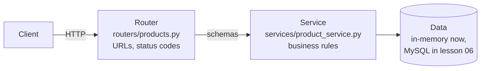

# Routers & Project Structure

!!! abstract "Learning Objectives"
    By the end of this lesson, you can:

    - Explain why a single `main.py` doesn't scale, and how to split an API into layers
    - Use `APIRouter` with prefixes and tags to group endpoints
    - Separate **routers** (HTTP), **schemas** (data shapes) and **services** (business logic)
    - Build a complete CRUD resource with filtering, sorting and pagination
    - Organise `/docs` with tags, summaries and descriptions

**Prerequisites:** [Responses, Status Codes & Errors](04-responses-and-errors.md)

## Why Structure Matters

After four lessons, `main.py` already has schemas, fake data, helpers, exception handlers and endpoints mixed together. A real shop API has dozens of resources (products, categories, customers, orders, payments, reviews), each with five or more endpoints. In one file that becomes thousands of lines nobody can navigate, and several developers editing the same file means constant merge conflicts.

!!! example "Real-life analogy: a restaurant"
    A restaurant doesn't have one person who takes orders, cooks, washes dishes and handles billing. **Waiters** (routers) talk to customers, **chefs** (services) follow the recipes and rules, and the **store room** (repository/database) holds ingredients. Each role is simple, and you can change one without retraining the others.

## The Layers



| Layer | Folder | Knows about | Must NOT know about |
|-------|--------|-------------|---------------------|
| **Router** | `routers/` | HTTP: paths, query params, status codes, `HTTPException` | SQL, storage details |
| **Schema** | `schemas/` | Data shapes and validation (Pydantic) | HTTP, storage |
| **Service** | `services/` | Business rules: stock checks, pricing, duplicates | HTTP status codes, request objects |
| **Data** | `repositories/`, `models/` | Storage: lists now, SQLAlchemy and MySQL later | Business rules, HTTP |

This lesson uses an in-memory store so you can focus on the structure. In [lesson 06](06-sqlalchemy-and-mysql.md) you'll swap the store for MySQL **without touching the routers**. That's the payoff of layers.

## The Project Layout

```text
ksr-shop-api/
├── .venv/
├── requirements.txt
└── app/
    ├── __init__.py
    ├── main.py                    ← creates the app, includes routers
    ├── exceptions.py              ← custom exceptions + handlers
    ├── schemas/
    │   ├── __init__.py
    │   └── product.py             ← ProductCreate, ProductUpdate, ProductOut, ProductPage
    ├── services/
    │   ├── __init__.py
    │   └── product_service.py     ← business logic + in-memory data
    └── routers/
        ├── __init__.py
        ├── health.py
        └── products.py            ← /products endpoints
```

Create the folders and empty `__init__.py` files (they mark folders as Python packages):

```bash
mkdir -p app/schemas app/services app/routers
touch app/__init__.py app/schemas/__init__.py app/services/__init__.py app/routers/__init__.py
```

## Schemas

```python title="app/schemas/product.py"
from pydantic import BaseModel, ConfigDict, Field


class ProductBase(BaseModel):
    name: str = Field(min_length=2, max_length=100)
    category: str
    brand: str | None = None
    price: float = Field(gt=0)
    stock: int = Field(default=0, ge=0)


class ProductCreate(ProductBase):
    pass


class ProductUpdate(BaseModel):
    model_config = ConfigDict(extra="forbid")
    name: str | None = Field(default=None, min_length=2, max_length=100)
    category: str | None = None
    brand: str | None = None
    price: float | None = Field(default=None, gt=0)
    stock: int | None = Field(default=None, ge=0)


class ProductOut(ProductBase):
    id: int


class ProductPage(BaseModel):
    total: int
    page: int
    size: int
    items: list[ProductOut]
```

`ProductPage` is the response for a list endpoint: the items for this page plus the information the frontend needs to draw pagination controls.

## Exceptions

Business errors are plain Python exceptions with **no HTTP knowledge**. One place translates them to responses:

```python title="app/exceptions.py"
from fastapi import FastAPI, Request
from fastapi.responses import JSONResponse


class NotFoundError(Exception):
    def __init__(self, resource: str, resource_id: int):
        self.resource = resource
        self.resource_id = resource_id


class ConflictError(Exception):
    def __init__(self, message: str):
        self.message = message


def register_exception_handlers(app: FastAPI) -> None:
    @app.exception_handler(NotFoundError)
    def not_found(request: Request, exc: NotFoundError):
        return JSONResponse(status_code=404, content={"detail": f"{exc.resource} {exc.resource_id} not found"})

    @app.exception_handler(ConflictError)
    def conflict(request: Request, exc: ConflictError):
        return JSONResponse(status_code=409, content={"detail": exc.message})
```

## The Service Layer

The service holds the business rules. It accepts and returns schemas and plain values, never `Request` objects or status codes:

```python title="app/services/product_service.py"
from app.exceptions import ConflictError, NotFoundError
from app.schemas.product import ProductCreate, ProductUpdate

_products: dict[int, dict] = {
    1: {"id": 1, "name": "iPhone 15", "category": "Electronics", "brand": "Apple", "price": 79999.0, "stock": 25},
    3: {"id": 3, "name": "Airdopes 141", "category": "Electronics", "brand": "boAt", "price": 1299.0, "stock": 200},
    6: {"id": 6, "name": "Denim Jacket", "category": "Fashion", "brand": "Levis", "price": 3499.0, "stock": 40},
    7: {"id": 7, "name": "Running Shoes", "category": "Fashion", "brand": "Puma", "price": 4299.0, "stock": 60},
    9: {"id": 9, "name": "Atomic Habits", "category": "Books", "brand": "Penguin", "price": 499.0, "stock": 80},
}
_next_id = 16

SORTABLE = {"name", "price", "stock"}


def list_products(category=None, search=None, max_price=None, sort="name", desc=False, page=1, size=10):
    items = list(_products.values())
    if category:
        items = [p for p in items if p["category"].lower() == category.lower()]
    if search:
        items = [p for p in items if search.lower() in p["name"].lower()]
    if max_price is not None:
        items = [p for p in items if p["price"] <= max_price]
    items.sort(key=lambda p: p[sort], reverse=desc)
    start = (page - 1) * size
    return {"total": len(items), "page": page, "size": size, "items": items[start:start + size]}


def get_product(product_id: int) -> dict:
    product = _products.get(product_id)
    if product is None:
        raise NotFoundError("Product", product_id)
    return product


def create_product(data: ProductCreate) -> dict:
    global _next_id
    if any(p["name"].lower() == data.name.lower() for p in _products.values()):
        raise ConflictError(f"Product '{data.name}' already exists")
    product = {"id": _next_id, **data.model_dump()}
    _products[_next_id] = product
    _next_id += 1
    return product


def update_product(product_id: int, changes: ProductUpdate) -> dict:
    product = get_product(product_id)
    product.update(changes.model_dump(exclude_unset=True))
    return product


def delete_product(product_id: int) -> None:
    get_product(product_id)
    del _products[product_id]
```

Notice that `NotFoundError` and `ConflictError` are raised here, but no status codes appear. The service could equally be used by a command-line script or a background job.

## Routers

An `APIRouter` is a mini-app: a group of related endpoints with a shared URL **prefix** and **tags**:

```python title="app/routers/products.py"
from typing import Annotated, Literal

from fastapi import APIRouter, Query, status

from app.schemas.product import ProductCreate, ProductOut, ProductPage, ProductUpdate
from app.services import product_service

router = APIRouter(prefix="/products", tags=["Products"])


@router.get("", response_model=ProductPage, summary="List products")
def list_products(
    category: str | None = None,
    search: Annotated[str | None, Query(min_length=2)] = None,
    max_price: Annotated[float | None, Query(gt=0)] = None,
    sort: Literal["name", "price", "stock"] = "name",
    desc: bool = False,
    page: Annotated[int, Query(ge=1)] = 1,
    size: Annotated[int, Query(ge=1, le=50)] = 10,
):
    """Filter, sort and paginate the catalogue."""
    return product_service.list_products(category, search, max_price, sort, desc, page, size)


@router.get("/{product_id}", response_model=ProductOut)
def get_product(product_id: int):
    return product_service.get_product(product_id)


@router.post("", response_model=ProductOut, status_code=status.HTTP_201_CREATED)
def create_product(product: ProductCreate):
    return product_service.create_product(product)


@router.patch("/{product_id}", response_model=ProductOut)
def update_product(product_id: int, changes: ProductUpdate):
    return product_service.update_product(product_id, changes)


@router.delete("/{product_id}", status_code=status.HTTP_204_NO_CONTENT)
def delete_product(product_id: int):
    product_service.delete_product(product_id)
```

Each endpoint is now **one or two lines**: read the HTTP input, call the service, return. A docstring becomes the description in `/docs`.

```python title="app/routers/health.py"
from fastapi import APIRouter

router = APIRouter(tags=["Health"])


@router.get("/health")
def health():
    return {"status": "ok"}
```

## Wiring It Together in main.py

`main.py` becomes short and boring, exactly as it should be:

```python title="app/main.py"
from fastapi import FastAPI

from app.exceptions import register_exception_handlers
from app.routers import health, products

app = FastAPI(
    title="KSR Shop API",
    version="1.0",
    description="Backend for the KSR online store.",
)

register_exception_handlers(app)
app.include_router(health.router)
app.include_router(products.router)
```

Run it from the project root (the folder that **contains** `app/`):

```{ .bash .no-run }
fastapi dev app/main.py
```

!!! mistake "Common Mistake: ModuleNotFoundError: No module named 'app'"
    You ran the command from **inside** the `app/` folder. Python imports like `from app.routers import ...` are resolved from the folder you start in. Run from the project root. With plain Uvicorn, the import string becomes `uvicorn app.main:app --reload`.

## Trying the API

The list endpoint with defaults:

```bash
curl -s "http://127.0.0.1:8000/products?size=2"
```

```{ .text .output }
{
  "total": 5,
  "page": 1,
  "size": 2,
  "items": [
    {
      "name": "Airdopes 141",
      "category": "Electronics",
      "brand": "boAt",
      "price": 1299.0,
      "stock": 200,
      "id": 3
    },
    {
      "name": "Atomic Habits",
      "category": "Books",
      "brand": "Penguin",
      "price": 499.0,
      "stock": 80,
      "id": 9
    }
  ]
}
```

Sort by price, highest first, and take page 2 with 2 products per page:

```bash
curl -s "http://127.0.0.1:8000/products?sort=price&desc=true&page=2&size=2"
```

```{ .text .output }
{
  "total": 5,
  "page": 2,
  "size": 2,
  "items": [
    {
      "name": "Denim Jacket",
      "category": "Fashion",
      "brand": "Levis",
      "price": 3499.0,
      "stock": 40,
      "id": 6
    },
    {
      "name": "Airdopes 141",
      "category": "Electronics",
      "brand": "boAt",
      "price": 1299.0,
      "stock": 200,
      "id": 3
    }
  ]
}
```

Create, then fetch, the new product:

```bash
curl -s -X POST http://127.0.0.1:8000/products \
  -H "Content-Type: application/json" \
  -d '{"name": "Cricket Bat", "category": "Sports", "brand": "SG", "price": 2499, "stock": 22}'
```

```{ .text .output }
{
  "name": "Cricket Bat",
  "category": "Sports",
  "brand": "SG",
  "price": 2499.0,
  "stock": 22,
  "id": 16
}
```

```bash
curl -s -X PATCH http://127.0.0.1:8000/products/16 -H "Content-Type: application/json" -d '{"stock": 18}'
```

```{ .text .output }
{
  "name": "Cricket Bat",
  "category": "Sports",
  "brand": "SG",
  "price": 2499.0,
  "stock": 18,
  "id": 16
}
```

The errors raised in the service come out as clean HTTP responses:

```bash
curl -s -w "\nHTTP %{http_code}\n" -X POST http://127.0.0.1:8000/products \
  -H "Content-Type: application/json" \
  -d '{"name": "cricket bat", "category": "Sports", "price": 100}'
```

```{ .text .output }
{
  "detail": "Product 'cricket bat' already exists"
}
HTTP 409
```

```bash
curl -s -w "HTTP %{http_code}\n" -X DELETE http://127.0.0.1:8000/products/16
curl -s -w "\nHTTP %{http_code}\n" http://127.0.0.1:8000/products/16
```

```{ .text .output }
HTTP 204
{"detail":"Product 16 not found"}
HTTP 404
```

Open `/docs`: endpoints are now grouped under **Health** and **Products**, with your summaries and docstrings.

!!! realworld "In Real Projects"
    This router → service → data structure is the standard layout for production FastAPI services, and it mirrors Spring Boot's `@RestController` → `@Service` → `@Repository` layers that Java students will learn. Teams often add `core/` (config, security), `models/` (database tables) and `tests/` as the project grows.

## Common Mistakes

| Mistake | Symptom | Fix |
|---------|---------|-----|
| Running from inside `app/` | `ModuleNotFoundError: No module named 'app'` | Run from the project root |
| Forgot `app.include_router(...)` | Endpoints missing from `/docs`, 404 | Include every router in `main.py` |
| Prefix repeated in paths: `prefix="/products"` + `@router.get("/products")` | URL becomes `/products/products` | Use `""` or `"/{id}"` inside the router |
| `raise HTTPException` inside services | Services tied to HTTP; hard to reuse | Raise domain exceptions; translate in handlers |
| Circular imports (`main` ↔ `routers`) | `ImportError: cannot import name ... (most likely due to a circular import)` | Routers never import `main`; dependencies flow one way |
| Business logic in routers | Fat routers, duplicated rules | Move rules into services |
| Missing `__init__.py` with some tools | Imports or tests fail in IDEs and pytest | Add empty `__init__.py` files |

## Practice Exercises

**Easy**

1. Add a `categories` router (`/categories`, tag "Categories") with `GET /categories` returning the distinct categories from the product service.
2. Add `summary=` and a docstring to every products endpoint, and check `/docs`.
3. Add a `GET /products/{product_id}/availability` endpoint that returns `{"in_stock": bool, "stock": int}` using the service.

**Medium**

4. Create a full **customers** resource: `schemas/customer.py`, `services/customer_service.py` (in-memory, unique email → `ConflictError`) and `routers/customers.py` with list (filter by city, paginated), get, create, patch and delete.
5. Add a business rule to `update_product`: the price can't be reduced by more than 50% in one update (raise a new `BusinessRuleError` mapped to `400`).
6. Version your API: change the routers' prefixes so every endpoint lives under `/api/v1` (hint: `app.include_router(router, prefix="/api/v1")`).

**Challenge**

7. Add an **orders** resource that uses both services: `POST /orders` takes a customer id and items, checks that the customer exists and that every product has enough stock, reduces the stock, and stores the order with a calculated total. `GET /orders/{id}` returns it. Put all rules in `order_service.py`, and make sure that a failed stock check leaves **no** stock changed (validate everything before changing anything).

??? success "Solutions (click to expand)"

    ```{ .python .no-run }
    # 1  app/routers/categories.py
    from fastapi import APIRouter
    from app.services import product_service

    router = APIRouter(prefix="/categories", tags=["Categories"])

    @router.get("")
    def list_categories():
        return sorted({p["category"] for p in product_service._products.values()})

    # main.py:  app.include_router(categories.router)

    # 5  services/product_service.py
    class BusinessRuleError(Exception):          # better: put it in app/exceptions.py
        def __init__(self, message): self.message = message

    def update_product(product_id, changes):
        product = get_product(product_id)
        updates = changes.model_dump(exclude_unset=True)
        if "price" in updates and updates["price"] < product["price"] * 0.5:
            raise BusinessRuleError("Price cannot drop by more than 50% at once")
        product.update(updates)
        return product
    # exceptions.py: handler for BusinessRuleError returning status_code=400

    # 6  main.py
    app.include_router(products.router, prefix="/api/v1")

    # 7  services/order_service.py (core idea)
    def place_order(customer_id, items):
        customer_service.get_customer(customer_id)                 # NotFoundError if missing
        products = [product_service.get_product(i.product_id) for i in items]
        for product, item in zip(products, items):                 # validate everything first
            if product["stock"] < item.quantity:
                raise ConflictError(f"Not enough stock for {product['name']}")
        for product, item in zip(products, items):                 # then change
            product["stock"] -= item.quantity
        total = sum(p["price"] * i.quantity for p, i in zip(products, items))
        ...
    ```

!!! note "Mini Assignment"
    Restructure your **KSR Shop API** repository into the `app/` layout from this lesson, with `routers/`, `schemas/`, `services/` and `exceptions.py`, for **products**, **customers** and **health**. All endpoints from lessons 01–04 must keep working, with identical URLs and responses. Add a short "Project structure" section to your README explaining what each folder is for.

## Interview Questions

!!! interview "1. What is APIRouter and why use it?"
    A way to group related path operations in their own module, with a shared prefix, tags, dependencies and responses. Routers keep large apps organised and are combined into the main app with `app.include_router()`.

!!! interview "2. How would you structure a medium-sized FastAPI project?"
    A package (e.g. `app/`) with `main.py` (app creation, router inclusion, handlers), `routers/` (HTTP layer), `schemas/` (Pydantic models), `services/` (business logic), `models/` and `repositories/` (database access), `core/` (config, security) and `tests/`. Dependencies flow one way: routers → services → repositories.

!!! interview "3. Why separate the service layer from routers?"
    It keeps HTTP concerns (status codes, request parsing) apart from business rules, makes the logic reusable (CLI scripts, background jobs, other endpoints), easier to unit test without HTTP, and lets you change storage or transport without rewriting the rules.

!!! interview "4. How do you version an API in FastAPI?"
    Commonly with a URL prefix: include routers with `prefix="/api/v1"`, and later add `/api/v2` routers for breaking changes while keeping v1 running. Alternatives are header-based versioning or separate apps mounted on different paths.

!!! interview "5. Where should exceptions be converted to HTTP responses?"
    At the edge of the application. Services raise domain exceptions (`NotFoundError`, `ConflictError`), and exception handlers registered on the app (or the routers) translate them into consistent HTTP responses.

!!! interview "Scenario: two developers keep getting merge conflicts in `main.py`. What would you change?"
    Split the app into routers per resource (`routers/products.py`, `routers/orders.py`), with schemas and services in their own modules, so each developer works in separate files, and `main.py` only creates the app and includes routers.

## Summary

| Concept | Remember |
|---------|----------|
| Layers | Router (HTTP) → Service (rules) → Data (storage) |
| Package | `app/` with `__init__.py` files; run from the project root |
| Router | `router = APIRouter(prefix="/products", tags=["Products"])` |
| Include | `app.include_router(products.router)` (optional `prefix="/api/v1"`) |
| Services | Raise domain exceptions, never `HTTPException` |
| Handlers | Map domain exceptions to status codes in one place |
| Pagination schema | `{total, page, size, items}` |
| Docs | Tags, `summary=`, docstrings |

**Next lesson:** [SQLAlchemy & MySQL](06-sqlalchemy-and-mysql.md), replacing the in-memory dict with the real `ksr_shop` database.
