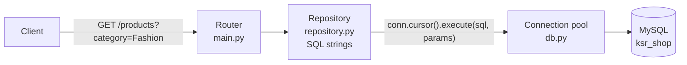

# MySQL with mysql-connector-python

!!! abstract "Learning Objectives"
    By the end of this lesson, you can:

    - Connect FastAPI to MySQL using `mysql-connector-python`, the driver from the MySQL module
    - Reuse connections efficiently with a **connection pool**
    - Give every request its own connection with a `yield` dependency that always returns it to the pool
    - Build three real endpoints with parameterised SQL: a filtered, paginated list, a detail view and a create
    - Translate MySQL error codes (`1452`, `1062`) into proper HTTP responses, and explain what an ORM will automate next

**Prerequisites:** [Routers & Project Structure](05-routers-and-project-structure.md), [Python + MySQL](../../database/mysql/13-python-mysql.md), and the [ksr_shop database](../../database/mysql/02-mysql-setup.md#loading-the-ksr_shop-database) loaded in your MySQL.

## From In-Memory Lists to a Real Database

Until now, the KSR Shop API kept products in Python lists, and every restart lost the data. Now the API will read and write the real **ksr_shop** database you built in the MySQL module.

You already know how to talk to MySQL from Python with `mysql-connector-python`: connect, run parameterised SQL, fetch rows, commit. This lesson puts exactly that inside FastAPI. In the [next lesson](07-sqlalchemy-and-mysql.md) you'll see how an ORM (SQLAlchemy) removes much of the repetitive work, and you'll appreciate *why*, because you'll have done it by hand first.



!!! example "Real-life analogy: a taxi stand"
    Opening a new MySQL connection is like calling a taxi from the depot for every trip: slow. A **connection pool** is a taxi stand outside your office: a few cars are always waiting. You take one, finish your trip, and it goes back to the stand for the next person.

Install the driver in your project's virtual environment:

```bash
pip install mysql-connector-python
```

Set your connection details as environment variables (never hard-code passwords):

=== "macOS / Linux"

    ```{ .bash .no-run }
    export DB_HOST=localhost DB_PORT=3306 DB_USER=root DB_PASSWORD='your-password' DB_NAME=ksr_shop
    ```

=== "Windows (Command Prompt)"

    ```{ .bash .no-run }
    set DB_PASSWORD=your-password
    ```

## The Connection Pool and Dependency

```python title="app/db.py"
import os
from collections.abc import Generator

from mysql.connector import pooling
from mysql.connector.pooling import PooledMySQLConnection

pool = pooling.MySQLConnectionPool(
    pool_name="ksr_pool",
    pool_size=5,
    host=os.environ.get("DB_HOST", "localhost"),
    port=int(os.environ.get("DB_PORT", 3306)),
    user=os.environ.get("DB_USER", "root"),
    password=os.environ.get("DB_PASSWORD", ""),
    database=os.environ.get("DB_NAME", "ksr_shop"),
)


def get_connection() -> Generator[PooledMySQLConnection, None, None]:
    conn = pool.get_connection()      # borrow a connection from the pool
    try:
        yield conn                    # the endpoint runs here
    finally:
        conn.close()                  # for a pooled connection, close() returns it to the pool
```

| Piece | What it does |
|-------|--------------|
| `MySQLConnectionPool(pool_size=5, ...)` | Opens up to 5 connections once, when the app starts |
| `pool.get_connection()` | Borrows a free connection (raises `PoolError` if all 5 are busy) |
| `yield conn` | Hands the connection to the endpoint; code after `yield` runs once the response is sent (more in [lesson 09](09-dependencies-and-settings.md)) |
| `conn.close()` in `finally` | Returns it to the pool, even if the endpoint raised an error |

!!! tip "Why not one global connection?"
    A single connection shared by all requests breaks under load: requests would interfere with each other's transactions, and if MySQL drops the connection the whole API stops. One connection **per request**, borrowed from a pool, is the standard pattern.

## Schemas

The same Pydantic patterns as before. `ProductOut` matches the columns our SQL returns:

```python title="app/schemas.py"
from pydantic import BaseModel, Field


class ProductOut(BaseModel):
    id: int
    name: str
    category: str
    brand: str | None
    price: float
    stock: int
    rating: float | None


class ProductPage(BaseModel):
    total: int
    page: int
    size: int
    items: list[ProductOut]


class ProductCreate(BaseModel):
    name: str = Field(min_length=2, max_length=100)
    category_id: int = Field(gt=0)
    brand: str | None = None
    price: float = Field(gt=0)
    stock: int = Field(default=0, ge=0)
```

MySQL returns `price` and `rating` as Python `Decimal` objects; Pydantic converts them to `float` for the JSON response.

## The Repository: SQL in One Place

All SQL for products lives in one module. Every function receives the connection from the endpoint:

```python title="app/repository.py"
from datetime import date

from mysql.connector.pooling import PooledMySQLConnection

SELECT_PRODUCT = """
    SELECT p.id, p.name, c.name AS category, p.brand, p.price, p.stock, p.rating
    FROM products p
    JOIN categories c ON c.id = p.category_id
"""

SORT_COLUMNS = {"name": "p.name", "price": "p.price", "rating": "p.rating DESC"}


def list_products(conn: PooledMySQLConnection, category: str | None, search: str | None,
                  max_price: float | None, sort: str, page: int, size: int) -> dict:
    conditions, params = [], []
    if category:
        conditions.append("c.name = %s")
        params.append(category)
    if search:
        conditions.append("p.name LIKE %s")
        params.append(f"%{search}%")
    if max_price is not None:
        conditions.append("p.price <= %s")
        params.append(max_price)
    where = f"WHERE {' AND '.join(conditions)}" if conditions else ""

    cursor = conn.cursor(dictionary=True)
    cursor.execute(
        f"SELECT COUNT(*) AS total FROM products p JOIN categories c ON c.id = p.category_id {where}",
        params,
    )
    total = cursor.fetchone()["total"]

    order_by = SORT_COLUMNS[sort]                     # from a fixed allow-list, never from user text
    cursor.execute(
        f"{SELECT_PRODUCT} {where} ORDER BY {order_by}, p.id LIMIT %s OFFSET %s",
        params + [size, (page - 1) * size],
    )
    items = cursor.fetchall()
    cursor.close()
    return {"total": total, "page": page, "size": size, "items": items}


def get_product(conn: PooledMySQLConnection, product_id: int) -> dict | None:
    cursor = conn.cursor(dictionary=True)
    cursor.execute(f"{SELECT_PRODUCT} WHERE p.id = %s", (product_id,))
    row = cursor.fetchone()
    cursor.close()
    return row


def create_product(conn: PooledMySQLConnection, name: str, category_id: int, brand: str | None,
                   price: float, stock: int) -> int:
    cursor = conn.cursor()
    try:
        cursor.execute(
            """INSERT INTO products (name, category_id, brand, price, stock, added_on)
               VALUES (%s, %s, %s, %s, %s, %s)""",
            (name, category_id, brand, price, stock, date.today()),
        )
        conn.commit()
        return cursor.lastrowid
    except Exception:
        conn.rollback()
        raise
    finally:
        cursor.close()
```

Three things to notice:

1. **Every value is a `%s` parameter**, including the `LIKE` pattern (`f"%{search}%"` builds the *value*, not the SQL). No user input is ever pasted into the SQL text, so the API is safe from SQL injection.
2. **The WHERE clause is built from fixed pieces.** We only add conditions we wrote ourselves; only the *values* come from the user.
3. **`ORDER BY` can't be a parameter.** Placeholders work only for values, not for column names. So the user picks a key (`"price"`), and we look up the real SQL from our own `SORT_COLUMNS` dictionary. Anything else is rejected by FastAPI's validation before it gets here.

## The Endpoints

```python title="app/main.py"
from typing import Annotated, Literal

import mysql.connector
from fastapi import Depends, FastAPI, HTTPException, Query, status
from mysql.connector.pooling import PooledMySQLConnection

from app import repository
from app.db import get_connection
from app.schemas import ProductCreate, ProductOut, ProductPage

app = FastAPI(title="KSR Shop API", version="2.0")

Conn = Annotated[PooledMySQLConnection, Depends(get_connection)]


@app.get("/products", response_model=ProductPage, tags=["Products"])
def list_products(
    conn: Conn,
    category: str | None = None,
    search: Annotated[str | None, Query(min_length=2)] = None,
    max_price: Annotated[float | None, Query(gt=0)] = None,
    sort: Literal["name", "price", "rating"] = "name",
    page: Annotated[int, Query(ge=1)] = 1,
    size: Annotated[int, Query(ge=1, le=50)] = 5,
):
    return repository.list_products(conn, category, search, max_price, sort, page, size)


@app.get("/products/{product_id}", response_model=ProductOut, tags=["Products"])
def get_product(product_id: int, conn: Conn):
    product = repository.get_product(conn, product_id)
    if product is None:
        raise HTTPException(status_code=404, detail=f"Product {product_id} not found")
    return product


@app.post("/products", response_model=ProductOut, status_code=status.HTTP_201_CREATED, tags=["Products"])
def create_product(data: ProductCreate, conn: Conn):
    try:
        new_id = repository.create_product(conn, data.name, data.category_id, data.brand, data.price, data.stock)
    except mysql.connector.Error as e:
        if e.errno == 1452:          # foreign key: category doesn't exist
            raise HTTPException(status_code=400, detail=f"Category {data.category_id} does not exist")
        if e.errno == 1062:          # duplicate value in a UNIQUE column
            raise HTTPException(status_code=409, detail="Product already exists")
        raise
    return repository.get_product(conn, new_id)
```

Run it from the project root:

```{ .bash .no-run }
fastapi dev app/main.py
```

## Trying the Three Endpoints

### 1. List: filters, sorting and pagination in SQL

```bash
curl -s "http://127.0.0.1:8000/products?category=Fashion&sort=price"
```

```{ .text .output }
{
  "total": 3,
  "page": 1,
  "size": 5,
  "items": [
    {
      "id": 8,
      "name": "Cotton T-Shirt",
      "category": "Fashion",
      "brand": "Puma",
      "price": 799.0,
      "stock": 150,
      "rating": 4.0
    },
    {
      "id": 6,
      "name": "Denim Jacket",
      "category": "Fashion",
      "brand": "Levis",
      "price": 3499.0,
      "stock": 40,
      "rating": 4.4
    },
    {
      "id": 7,
      "name": "Running Shoes",
      "category": "Fashion",
      "brand": "Puma",
      "price": 4299.0,
      "stock": 60,
      "rating": 4.2
    }
  ]
}
```

The filtering, sorting and paging all happened **inside MySQL** (`WHERE`, `ORDER BY`, `LIMIT/OFFSET`), so only the rows needed for this page travel over the network.

Page 2 of a search: three products contain "at" and cost at most ₹3,000, so with 2 per page the second page has one item, and `total` still reports all 3:

```bash
curl -s "http://127.0.0.1:8000/products?search=at&max_price=3000&size=2&page=2"
```

```{ .text .output }
{
  "total": 3,
  "page": 2,
  "size": 2,
  "items": [
    {
      "id": 14,
      "name": "Yoga Mat",
      "category": "Sports",
      "brand": "Decathlon",
      "price": 999.0,
      "stock": 0,
      "rating": 4.3
    }
  ]
}
```

Validation still protects the database: `sort` must be one of three words, so a malicious value never reaches the SQL:

```bash
curl -s -w "\nHTTP %{http_code}\n" "http://127.0.0.1:8000/products?sort=price;DROP%20TABLE%20products"
```

```{ .text .output }
{
  "detail": [
    {
      "type": "literal_error",
      "loc": ["query", "sort"],
      "msg": "Input should be 'name', 'price' or 'rating'",
      "input": "price;DROP TABLE products",
      "ctx": {
        "expected": "'name', 'price' or 'rating'"
      }
    }
  ]
}
HTTP 422
```

### 2. Detail

```bash
curl -s http://127.0.0.1:8000/products/7
```

```{ .text .output }
{
  "id": 7,
  "name": "Running Shoes",
  "category": "Fashion",
  "brand": "Puma",
  "price": 4299.0,
  "stock": 60,
  "rating": 4.2
}
```

```bash
curl -s -w "\nHTTP %{http_code}\n" http://127.0.0.1:8000/products/999
```

```{ .text .output }
{
  "detail": "Product 999 not found"
}
HTTP 404
```

### 3. Create

```bash
curl -s -X POST http://127.0.0.1:8000/products \
  -H "Content-Type: application/json" \
  -d '{"name": "Football", "category_id": 5, "brand": "Nivia", "price": 899, "stock": 40}'
```

```{ .text .output }
{
  "id": 16,
  "name": "Football",
  "category": "Sports",
  "brand": "Nivia",
  "price": 899.0,
  "stock": 40,
  "rating": null
}
```

MySQL generated `id` 16 (`cursor.lastrowid`), and we read the row back with its category name. Open MySQL Workbench and run `SELECT * FROM products WHERE id = 16;`: the row is really there.

A category that doesn't exist triggers MySQL's foreign key (`ERROR 1452` from the MySQL module), which we translate into a clear **400**:

```bash
curl -s -w "\nHTTP %{http_code}\n" -X POST http://127.0.0.1:8000/products \
  -H "Content-Type: application/json" \
  -d '{"name": "Kite", "category_id": 99, "price": 150}'
```

```{ .text .output }
{
  "detail": "Category 99 does not exist"
}
HTTP 400
```

!!! realworld "In Real Projects"
    Many production APIs use exactly this approach (a pool, a repository of SQL, error-code mapping), especially for reporting endpoints with complex queries or for teams with strong SQL skills. Even teams that use an ORM drop down to raw SQL for heavy reports. Knowing both is what makes a backend developer dependable.

## What's Painful Here, and What an ORM Fixes

Writing the API by hand taught you what really happens. It also shows the pain points:

| Pain point in this lesson | How SQLAlchemy helps (next lesson) |
|---------------------------|------------------------------------|
| SQL strings repeated and joined by hand (`SELECT_PRODUCT + WHERE ...`) | Queries built with Python: `select(Product).where(...)` |
| Rows are dicts; typos in keys fail at runtime | Rows are typed objects: `product.price` |
| Joins written manually every time | Relationships: `product.category.name` |
| `cursor`, `commit`, `rollback`, `close` everywhere | The session manages the unit of work |
| Building `WHERE` lists and parameter lists by hand | Chainable `.where()` calls |
| Switching databases means rewriting SQL | Dialects handle MySQL, PostgreSQL, SQLite |

You'll keep the same driver: SQLAlchemy will talk to MySQL **through `mysql-connector-python`**.

## Common Mistakes

| Mistake | Error / Symptom | Fix |
|---------|-----------------|-----|
| MySQL not running or wrong host/port | `mysql.connector.errors.DatabaseError: 2003 (HY000): Can't connect to MySQL server` | Start MySQL; check `DB_HOST` / `DB_PORT` |
| Wrong password | `ProgrammingError: 1045 (28000): Access denied for user 'root'@'localhost'` | Check `DB_PASSWORD` |
| Forgetting `conn.commit()` | `201` returned but the row isn't in MySQL | Commit after writes |
| Not returning connections to the pool | `PoolError: Failed getting connection; pool exhausted` | `conn.close()` in a `finally` (the dependency does it) |
| f-string with user values in SQL | SQL injection | `%s` placeholders + params |
| Putting `ORDER BY %s` | The sort is ignored (it sorts by a constant string) | Allow-list dictionary of column names |
| `(product_id)` instead of `(product_id,)` | `ProgrammingError` / wrong parameters | One-item tuple needs a comma |
| `cursor()` without `dictionary=True` | Rows are tuples; `response_model` fails | `conn.cursor(dictionary=True)` |

## Practice Exercises

Use a fresh `ksr_shop`.

**Easy**

1. Add `GET /categories` that returns each category with its product count (use `LEFT JOIN` + `GROUP BY`).
2. Add a `brand` filter to `GET /products`.
3. Add `GET /customers/{customer_id}` returning id, name, email and city, with a 404 for unknown ids.

**Medium**

4. Add `PATCH /products/{product_id}/stock` with a body `{"change": n}` that adds or removes stock, returns 404 for unknown products, and refuses to go below zero (400).
5. Add `GET /customers/{customer_id}/orders` that returns each order with its total. Write one SQL query with `JOIN` and `GROUP BY`.
6. Add `POST /categories` and return 409 when the name already exists (MySQL error `1062` from the `UNIQUE` constraint).

**Challenge**

7. Add `POST /orders` that places an order as **one transaction**: `SELECT ... FOR UPDATE` on the products, check stock, insert into `orders` and `order_items`, reduce stock, then `commit()`, or `rollback()` on any problem. (Lesson 08 builds the same flow with SQLAlchemy, so you'll be able to compare both versions.)

??? success "Solutions (click to expand)"

    ```{ .python .no-run }
    # 1  repository.py
    def list_categories(conn):
        cursor = conn.cursor(dictionary=True)
        cursor.execute("""
            SELECT c.id, c.name, COUNT(p.id) AS product_count
            FROM categories c LEFT JOIN products p ON p.category_id = c.id
            GROUP BY c.id, c.name ORDER BY c.name
        """)
        rows = cursor.fetchall()
        cursor.close()
        return rows

    # 2  in list_products
    if brand:
        conditions.append("p.brand = %s")
        params.append(brand)

    # 4  main.py
    class StockChange(BaseModel):
        change: int

    @app.patch("/products/{product_id}/stock", response_model=ProductOut)
    def change_stock(product_id: int, body: StockChange, conn: Conn):
        product = repository.get_product(conn, product_id)
        if product is None:
            raise HTTPException(status_code=404, detail="Product not found")
        if product["stock"] + body.change < 0:
            raise HTTPException(status_code=400, detail="Stock cannot go below zero")
        cursor = conn.cursor()
        cursor.execute("UPDATE products SET stock = stock + %s WHERE id = %s", (body.change, product_id))
        conn.commit()
        cursor.close()
        return repository.get_product(conn, product_id)

    # 5  repository.py
    def customer_orders(conn, customer_id):
        cursor = conn.cursor(dictionary=True)
        cursor.execute("""
            SELECT o.id, o.order_date, o.status, SUM(oi.quantity * oi.unit_price) AS total
            FROM orders o JOIN order_items oi ON oi.order_id = o.id
            WHERE o.customer_id = %s
            GROUP BY o.id, o.order_date, o.status ORDER BY o.order_date
        """, (customer_id,))
        rows = cursor.fetchall()
        cursor.close()
        return rows

    # 7  (core of the transaction)
    def place_order(conn, customer_id, items):
        cursor = conn.cursor(dictionary=True)
        try:
            ids = [i.product_id for i in items]
            placeholders = ", ".join(["%s"] * len(ids))
            cursor.execute(f"SELECT id, name, price, stock FROM products WHERE id IN ({placeholders}) FOR UPDATE", ids)
            products = {row["id"]: row for row in cursor.fetchall()}
            for item in items:
                p = products.get(item.product_id)
                if p is None or p["stock"] < item.quantity:
                    raise ValueError(f"Not enough stock for product {item.product_id}")
            cursor.execute("INSERT INTO orders (customer_id, order_date, status) VALUES (%s, CURDATE(), 'pending')",
                           (customer_id,))
            order_id = cursor.lastrowid
            for item in items:
                cursor.execute("INSERT INTO order_items (order_id, product_id, quantity, unit_price) VALUES (%s, %s, %s, %s)",
                               (order_id, item.product_id, item.quantity, products[item.product_id]["price"]))
                cursor.execute("UPDATE products SET stock = stock - %s WHERE id = %s", (item.quantity, item.product_id))
            conn.commit()
            return order_id
        except Exception:
            conn.rollback()
            raise
        finally:
            cursor.close()
    ```

!!! note "Mini Assignment"
    Connect your **KSR Shop API** to MySQL with `mysql-connector-python`: add `app/db.py` with a pool and the `get_connection` dependency, `app/repository.py` with parameterised SQL, and convert the products, categories and customers **read** endpoints plus `POST /products` to the database. Keep a list in your README of every SQL statement your API runs. It will be a useful comparison after the next lesson.

## Interview Questions

!!! interview "1. What is a connection pool and why use one in a web API?"
    A set of database connections opened once and reused. Each request borrows a connection and returns it afterwards. It avoids the cost of opening a new connection (TCP handshake, authentication) on every request and caps the number of connections the database must handle.

!!! interview "2. How do you make sure a database connection is always released in FastAPI?"
    Use a `yield` dependency: borrow the connection, `yield` it to the endpoint, and close (return it to the pool) in a `finally` block. FastAPI runs the code after `yield` once the response is sent, even when the endpoint raises an exception.

!!! interview "3. How do you prevent SQL injection when building dynamic queries?"
    Pass every user-supplied value as a bound parameter (`%s` with a params list), never via string formatting. Build dynamic structure (which WHERE conditions to include) only from fixed SQL fragments you wrote. For identifiers like sort columns, map user choices through an allow-list.

!!! interview "4. Why can't `ORDER BY` use a `%s` placeholder?"
    Placeholders bind values, not SQL identifiers or keywords. `ORDER BY %s` would sort by a constant string literal, so the order wouldn't change. Column names must be part of the SQL text, chosen from an allow-list.

!!! interview "5. How do you turn MySQL errors into meaningful HTTP responses?"
    Catch `mysql.connector.Error` and inspect `errno`: for example 1452 (foreign key fails) → 400 Bad Request, 1062 (duplicate entry) → 409 Conflict. Roll back the transaction first, keep the message user-friendly, and re-raise anything unexpected so it's logged as a 500.

!!! interview "Scenario: under load, the API starts failing with 'pool exhausted'. What's wrong and how do you fix it?"
    Connections aren't being returned (a code path skips `close()`), or the pool is too small for the concurrency. Ensure every connection is returned through a `yield` dependency with `finally`, avoid holding connections during slow non-database work, and size the pool to match the number of workers and threads (and MySQL's `max_connections`).

## Summary

| Concept | Code |
|---------|------|
| Install | `pip install mysql-connector-python` |
| Pool | `pooling.MySQLConnectionPool(pool_name=..., pool_size=5, host=..., user=..., password=..., database=...)` |
| Dependency | `conn = pool.get_connection()` → `yield conn` → `conn.close()` in `finally` |
| Use it | `conn: Annotated[PooledMySQLConnection, Depends(get_connection)]` |
| Query | `cursor = conn.cursor(dictionary=True)` → `cursor.execute(sql, params)` → `fetchone()` / `fetchall()` |
| Write | `execute(...)` → `conn.commit()`; `rollback()` on error; `cursor.lastrowid` |
| Safety | `%s` for every value; allow-list for `ORDER BY` |
| Errors | `mysql.connector.Error` → `e.errno`: 1452 → 400, 1062 → 409 |

**Next lesson:** [SQLAlchemy & MySQL](07-sqlalchemy-and-mysql.md), the same API with an ORM, using the same `mysql-connector-python` driver.
