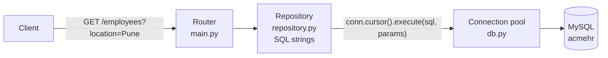
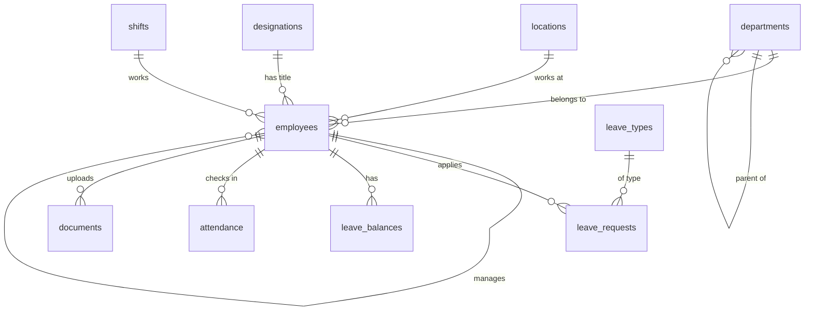

# MySQL with mysql-connector-python

!!! abstract "Learning Objectives"
    By the end of this lesson, you can:

    - Load the `acmehr` database and connect FastAPI to it using `mysql-connector-python`, the driver from the MySQL module
    - Reuse connections efficiently with a **connection pool**
    - Give every request its own connection with a `yield` dependency that always returns it to the pool
    - Build real endpoints with parameterised SQL and joins: a filtered, paginated directory, a profile, leave balances and a create
    - Translate MySQL error codes (`1452`, `1062`) into proper HTTP responses, and explain what an ORM will automate next

**Prerequisites:** [Routers & Project Structure](05-routers-and-project-structure.md) and [Python + MySQL](../../database/mysql/13-python-mysql.md).

## From In-Memory Lists to a Real Database

Until now, the AcmeHR API kept employees in Python dicts, and every restart lost the data. Now the API will read and write a real MySQL database, **acmehr**, built from the BRD.

You already know how to talk to MySQL from Python with `mysql-connector-python`: connect, run parameterised SQL, fetch rows, commit. This lesson puts exactly that inside FastAPI. In the [next lesson](07-sqlalchemy-and-mysql.md) you'll see how an ORM (SQLAlchemy) removes much of the repetitive work, and you'll appreciate *why*, because you'll have done it by hand first.



!!! example "Real-life analogy: the office cab pool"
    Booking a brand-new cab for every trip between Acme's offices is slow: the driver has to come from the depot each time. A **cab pool** keeps a few cars waiting in the parking lot. You take one, finish your trip, and it goes back to the lot for the next person. A **connection pool** does that with database connections.

## Loading the acmehr Database

Download **[acmehr.sql](../../assets/sql/acmehr.sql)** and load it into your MySQL 8 server, from MySQL Workbench (**File → Open SQL Script**, then run it) or from a terminal:

```{ .bash .no-run }
mysql -u root -p < acmehr.sql
```

The script is safe to re-run: it drops and recreates the database, so you can always go back to a clean copy. It has 12 tables:



| Table | Rows | What it holds |
|-------|------|---------------|
| `employees` | 20 | The master record: `employee_code`, names, work email, department, designation, location, **manager** (`manager_id` points to another employee), shift, status, role, emergency contact |
| `departments` | 8 | With sub-departments (`parent_id`): Platform Engineering and Quality Assurance sit under Engineering |
| `designations`, `locations`, `shifts` | 14, 3, 2 | Job titles, the three offices, General (09:00–18:00) and Early (07:00–16:00) shifts |
| `leave_types`, `holidays` | 6, 7 | CL, SL, EL, maternity, paternity, loss of pay; Acme's 2026 holidays |
| `leave_requests`, `leave_balances` | 15, 57 | Requests in every status; 2026 balances where `used` equals the approved days |
| `attendance` | 93 | Check-ins and check-outs for the week of Monday 5 October 2026 |
| `documents`, `audit_logs` | 6, 0 | Uploaded document details; the audit trail the API will write |

A quick check in MySQL:

```sql
SELECT employee_code, first_name, last_name FROM acmehr.employees WHERE manager_id = 2;
```

That lists Karthik's direct reports, including Ananya Rao (E-1042), the employee from the BRD's wireframes.

## Setup

Install the driver in your project's virtual environment:

```bash
pip install mysql-connector-python
```

Set your connection details as environment variables (never hard-code passwords):

=== "macOS / Linux"

    ```{ .bash .no-run }
    export DB_HOST=localhost DB_PORT=3306 DB_USER=root DB_PASSWORD='your-password' DB_NAME=acmehr
    ```

=== "Windows (Command Prompt)"

    ```{ .bash .no-run }
    set DB_PASSWORD=your-password
    ```

## The Connection Pool and Dependency

```python title="app/db.py"
import os
from collections.abc import Generator

from mysql.connector import pooling
from mysql.connector.pooling import PooledMySQLConnection

pool = pooling.MySQLConnectionPool(
    pool_name="acmehr_pool",
    pool_size=5,
    host=os.environ.get("DB_HOST", "localhost"),
    port=int(os.environ.get("DB_PORT", 3306)),
    user=os.environ.get("DB_USER", "root"),
    password=os.environ.get("DB_PASSWORD", ""),
    database=os.environ.get("DB_NAME", "acmehr"),
)


def get_connection() -> Generator[PooledMySQLConnection, None, None]:
    conn = pool.get_connection()      # borrow a connection from the pool
    try:
        yield conn                    # the endpoint runs here
    finally:
        conn.close()                  # for a pooled connection, close() returns it to the pool
```

| Piece | What it does |
|-------|--------------|
| `MySQLConnectionPool(pool_size=5, ...)` | Opens up to 5 connections once, when the app starts |
| `pool.get_connection()` | Borrows a free connection (raises `PoolError` if all 5 are busy) |
| `yield conn` | Hands the connection to the endpoint; code after `yield` runs once the response is sent (more in [lesson 09](09-dependencies-and-settings.md)) |
| `conn.close()` in `finally` | Returns it to the pool, even if the endpoint raised an error |

!!! tip "Why not one global connection?"
    A single connection shared by all requests breaks under load: requests would interfere with each other's transactions, and if MySQL drops the connection the whole API stops. One connection **per request**, borrowed from a pool, is the standard pattern.

## Schemas

The same Pydantic patterns as before. Each `Out` model matches the columns our SQL returns:

```python title="app/schemas.py"
from datetime import date

from pydantic import BaseModel, Field


class EmployeeOut(BaseModel):
    code: str
    name: str
    email: str
    department: str
    designation: str
    location: str
    manager: str | None
    hire_date: date
    status: str


class EmployeePage(BaseModel):
    total: int
    page: int
    size: int
    items: list[EmployeeOut]


class LeaveBalanceOut(BaseModel):
    leave_type: str
    name: str
    allocated: float
    used: float
    remaining: float


class DepartmentCreate(BaseModel):
    name: str = Field(min_length=2, max_length=60)
    parent_id: int | None = Field(default=None, gt=0)


class DepartmentOut(BaseModel):
    id: int
    name: str
    parent: str | None
    headcount: int
```

MySQL returns `DECIMAL` columns like `allocated` and `used` as Python `Decimal` objects; Pydantic converts them to `float` for the JSON response.

## The Repository: SQL in One Place

All SQL lives in one module. Every function receives the connection from the endpoint. An employee's directory entry needs **five tables**: the employee, their department, designation and location, and their manager, which is the `employees` table joined to **itself**:

```python title="app/repository.py"
from mysql.connector.pooling import PooledMySQLConnection

EMPLOYEE_FROM = """
    FROM employees e
    JOIN departments d  ON d.id = e.department_id
    JOIN designations g ON g.id = e.designation_id
    JOIN locations l    ON l.id = e.location_id
    LEFT JOIN employees m ON m.id = e.manager_id
"""

SELECT_EMPLOYEE = f"""
    SELECT e.employee_code AS code,
           CONCAT(e.first_name, ' ', e.last_name) AS name,
           e.email, d.name AS department, g.title AS designation, l.city AS location,
           CONCAT(m.first_name, ' ', m.last_name) AS manager,
           e.hire_date, e.status
    {EMPLOYEE_FROM}
"""

SORT_COLUMNS = {"name": "e.first_name, e.last_name", "hire_date": "e.hire_date", "code": "e.employee_code"}


def list_employees(conn: PooledMySQLConnection, q: str | None, department: str | None,
                   location: str | None, status: str, sort: str, page: int, size: int) -> dict:
    conditions, params = ["e.status = %s"], [status]
    if q:
        conditions.append("CONCAT(e.first_name, ' ', e.last_name) LIKE %s")
        params.append(f"%{q}%")
    if department:
        conditions.append("d.name = %s")
        params.append(department)
    if location:
        conditions.append("l.city = %s")
        params.append(location)
    where = "WHERE " + " AND ".join(conditions)

    cursor = conn.cursor(dictionary=True)
    cursor.execute(f"SELECT COUNT(*) AS total {EMPLOYEE_FROM} {where}", params)
    total = cursor.fetchone()["total"]

    order_by = SORT_COLUMNS[sort]                     # from a fixed allow-list, never from user text
    cursor.execute(
        f"{SELECT_EMPLOYEE} {where} ORDER BY {order_by}, e.id LIMIT %s OFFSET %s",
        params + [size, (page - 1) * size],
    )
    items = cursor.fetchall()
    cursor.close()
    return {"total": total, "page": page, "size": size, "items": items}


def get_employee(conn: PooledMySQLConnection, code: str) -> dict | None:
    cursor = conn.cursor(dictionary=True)
    cursor.execute(f"{SELECT_EMPLOYEE} WHERE e.employee_code = %s", (code,))
    row = cursor.fetchone()
    cursor.close()
    return row


def get_leave_balances(conn: PooledMySQLConnection, code: str, year: int) -> list[dict]:
    cursor = conn.cursor(dictionary=True)
    cursor.execute(
        """SELECT lt.code AS leave_type, lt.name, b.allocated, b.used, b.allocated - b.used AS remaining
           FROM leave_balances b
           JOIN leave_types lt ON lt.id = b.leave_type_id
           JOIN employees e    ON e.id = b.employee_id
           WHERE e.employee_code = %s AND b.year = %s
           ORDER BY lt.id""",
        (code, year),
    )
    rows = cursor.fetchall()
    cursor.close()
    return rows


def get_department(conn: PooledMySQLConnection, department_id: int) -> dict | None:
    cursor = conn.cursor(dictionary=True)
    cursor.execute(
        """SELECT d.id, d.name, p.name AS parent,
                  (SELECT COUNT(*) FROM employees e
                   WHERE e.department_id = d.id AND e.status <> 'exited') AS headcount
           FROM departments d LEFT JOIN departments p ON p.id = d.parent_id
           WHERE d.id = %s""",
        (department_id,),
    )
    row = cursor.fetchone()
    cursor.close()
    return row


def create_department(conn: PooledMySQLConnection, name: str, parent_id: int | None) -> int:
    cursor = conn.cursor()
    try:
        cursor.execute("INSERT INTO departments (name, parent_id) VALUES (%s, %s)", (name, parent_id))
        conn.commit()
        return cursor.lastrowid
    except Exception:
        conn.rollback()
        raise
    finally:
        cursor.close()
```

Four things to notice:

1. **Every value is a `%s` parameter**, including the `LIKE` pattern (`f"%{q}%"` builds the *value*, not the SQL). No user input is ever pasted into the SQL text, so the API is safe from SQL injection.
2. **The WHERE clause is built from fixed pieces.** We only add conditions we wrote ourselves; only the *values* come from the user.
3. **`ORDER BY` can't be a parameter.** Placeholders work only for values, not for column names. So the user picks a key (`"hire_date"`), and we look up the real SQL from our own `SORT_COLUMNS` dictionary. Anything else is rejected by FastAPI's validation before it gets here.
4. **The manager is a `LEFT JOIN`.** Lakshmi, the CEO, has no manager (`manager_id` is `NULL`). An inner `JOIN` would silently drop her from the directory; a `LEFT JOIN` keeps her, with `manager` as `null`.

## The Endpoints

```python title="app/main.py"
from typing import Annotated, Literal

import mysql.connector
from fastapi import Depends, FastAPI, HTTPException, Path, Query, status
from mysql.connector.pooling import PooledMySQLConnection

from app import repository
from app.db import get_connection
from app.schemas import DepartmentCreate, DepartmentOut, EmployeeOut, EmployeePage, LeaveBalanceOut

app = FastAPI(title="AcmeHR API", version="2.0")

Conn = Annotated[PooledMySQLConnection, Depends(get_connection)]
EmployeeCode = Annotated[str, Path(pattern=r"^E-\d{4}$")]


@app.get("/employees", response_model=EmployeePage, tags=["Employees"])
def list_employees(
    conn: Conn,
    q: Annotated[str | None, Query(min_length=2)] = None,
    department: str | None = None,
    location: str | None = None,
    status: Literal["active", "on_notice", "exited"] = "active",
    sort: Literal["name", "hire_date", "code"] = "name",
    page: Annotated[int, Query(ge=1)] = 1,
    size: Annotated[int, Query(ge=1, le=50)] = 5,
):
    return repository.list_employees(conn, q, department, location, status, sort, page, size)


@app.get("/employees/{code}", response_model=EmployeeOut, tags=["Employees"])
def get_employee(code: EmployeeCode, conn: Conn):
    employee = repository.get_employee(conn, code)
    if employee is None:
        raise HTTPException(status_code=404, detail=f"Employee {code} not found")
    return employee


@app.get("/employees/{code}/leave-balances", response_model=list[LeaveBalanceOut], tags=["Leave"])
def leave_balances(code: EmployeeCode, conn: Conn, year: Annotated[int, Query(ge=2020, le=2100)] = 2026):
    balances = repository.get_leave_balances(conn, code, year)
    if not balances and repository.get_employee(conn, code) is None:
        raise HTTPException(status_code=404, detail=f"Employee {code} not found")
    return balances


@app.post("/departments", response_model=DepartmentOut, status_code=status.HTTP_201_CREATED,
          tags=["Organisation"])
def create_department(data: DepartmentCreate, conn: Conn):
    try:
        new_id = repository.create_department(conn, data.name, data.parent_id)
    except mysql.connector.Error as e:
        if e.errno == 1452:          # foreign key: the parent department doesn't exist
            raise HTTPException(status_code=400, detail=f"Parent department {data.parent_id} does not exist")
        if e.errno == 1062:          # duplicate value in a UNIQUE column
            raise HTTPException(status_code=409, detail=f"Department '{data.name}' already exists")
        raise
    return repository.get_department(conn, new_id)
```

Run it from the project root:

```{ .bash .no-run }
fastapi dev app/main.py
```

## Trying the Endpoints

### 1. The directory: filters, sorting and pagination in SQL

Who works from the Pune office?

```bash
curl -s "http://127.0.0.1:8000/employees?location=Pune"
```

```{ .text .output }
{
  "total": 2,
  "page": 1,
  "size": 5,
  "items": [
    {
      "code": "E-1048",
      "name": "Sneha Patil",
      "email": "sneha.patil@acme.example",
      "department": "Platform Engineering",
      "designation": "Software Engineer",
      "location": "Pune",
      "manager": "Karthik Menon",
      "hire_date": "2024-06-03",
      "status": "active"
    },
    {
      "code": "E-1047",
      "name": "Vikram Joshi",
      "email": "vikram.joshi@acme.example",
      "department": "Platform Engineering",
      "designation": "DevOps Engineer",
      "location": "Pune",
      "manager": "Karthik Menon",
      "hire_date": "2020-08-24",
      "status": "active"
    }
  ]
}
```

Each row came from five tables, joined in one query. The filtering, sorting and paging all happened **inside MySQL** (`WHERE`, `ORDER BY`, `LIMIT/OFFSET`), so only the rows needed for this page travel over the network.

Engineering by joining date, page 2 with 3 per page. `total` still counts everyone in Engineering:

```bash
curl -s "http://127.0.0.1:8000/employees?department=Engineering&sort=hire_date&size=3&page=2" \
  | python -c "import json,sys; d=json.load(sys.stdin); print('total', d['total']); [print(e['hire_date'], e['code'], e['name'], '->', e['manager']) for e in d['items']]"
```

```{ .text .output }
total 5
2023-02-13 E-1046 Priya Nair -> Karthik Menon
2025-01-06 E-1050 Kavya Srinivasan -> Karthik Menon
```

The CEO has no manager, and the `LEFT JOIN` keeps her:

```bash
curl -s "http://127.0.0.1:8000/employees?department=Leadership" \
  | python -c "import json,sys; [print(e['name'], '|', e['designation'], '| manager:', e['manager']) for e in json.load(sys.stdin)['items']]"
```

```{ .text .output }
Lakshmi Menon | Chief Executive Officer | manager: None
```

Validation still protects the database: `sort` must be one of three words, so a malicious value never reaches the SQL:

```bash
curl -s -w "\nHTTP %{http_code}\n" "http://127.0.0.1:8000/employees?sort=name;DROP%20TABLE%20employees"
```

```{ .text .output }
{
  "detail": [
    {
      "type": "literal_error",
      "loc": ["query", "sort"],
      "msg": "Input should be 'name', 'hire_date' or 'code'",
      "input": "name;DROP TABLE employees",
      "ctx": {
        "expected": "'name', 'hire_date' or 'code'"
      }
    }
  ]
}
HTTP 422
```

### 2. A profile

Arjun is a QA Engineer in the Quality Assurance sub-department, reporting to Swati:

```bash
curl -s http://127.0.0.1:8000/employees/E-1043
```

```{ .text .output }
{
  "code": "E-1043",
  "name": "Arjun Reddy",
  "email": "arjun.reddy@acme.example",
  "department": "Quality Assurance",
  "designation": "QA Engineer",
  "location": "Hyderabad",
  "manager": "Swati Kulkarni",
  "hire_date": "2022-01-10",
  "status": "active"
}
```

```bash
curl -s -w "\nHTTP %{http_code}\n" http://127.0.0.1:8000/employees/E-1999
```

```{ .text .output }
{
  "detail": "Employee E-1999 not found"
}
HTTP 404
```

### 3. Leave balances

The BRD's wireframe shows Ananya's dashboard with *Casual 8, Sick 10, Earned 15*. Her approved leave this year (four casual days and two sick days) is already in `used`:

```bash
curl -s http://127.0.0.1:8000/employees/E-1042/leave-balances
```

```{ .text .output }
[
  {
    "leave_type": "CL",
    "name": "Casual leave",
    "allocated": 12.0,
    "used": 4.0,
    "remaining": 8.0
  },
  {
    "leave_type": "SL",
    "name": "Sick leave",
    "allocated": 12.0,
    "used": 2.0,
    "remaining": 10.0
  },
  {
    "leave_type": "EL",
    "name": "Earned leave",
    "allocated": 15.0,
    "used": 0.0,
    "remaining": 15.0
  }
]
```

### 4. Create a department, and MySQL's errors

Acme is starting a data team under Engineering:

```bash
curl -s -X POST http://127.0.0.1:8000/departments \
  -H "Content-Type: application/json" \
  -d '{"name": "Data Science", "parent_id": 2}'
```

```{ .text .output }
{
  "id": 9,
  "name": "Data Science",
  "parent": "Engineering",
  "headcount": 0
}
```

MySQL generated `id` 9 (`cursor.lastrowid`), and we read the row back with its parent's name. Open MySQL Workbench and run `SELECT * FROM departments WHERE id = 9;`: the row is really there.

A parent that doesn't exist triggers MySQL's foreign key (`ERROR 1452` from the MySQL module), and a name that's taken triggers the `UNIQUE` constraint (`ERROR 1062`). We translate each into a clear response:

```bash
curl -s -w "\nHTTP %{http_code}\n" -X POST http://127.0.0.1:8000/departments \
  -H "Content-Type: application/json" -d '{"name": "Research", "parent_id": 99}'
curl -s -w "\nHTTP %{http_code}\n" -X POST http://127.0.0.1:8000/departments \
  -H "Content-Type: application/json" -d '{"name": "Finance"}'
```

```{ .text .output }
{"detail":"Parent department 99 does not exist"}
HTTP 400
{"detail":"Department 'Finance' already exists"}
HTTP 409
```

The database enforced both rules for us; the API just explains them politely.

!!! realworld "In Real Projects"
    Many production APIs use exactly this approach (a pool, a repository of SQL, error-code mapping), especially for reporting endpoints with complex queries or for teams with strong SQL skills. HR and payroll reports (headcount by department and location, attrition, leave liability) are often hand-written SQL even in projects that use an ORM everywhere else. Knowing both is what makes a backend developer dependable.

## What's Painful Here, and What an ORM Fixes

Writing the API by hand taught you what really happens. It also shows the pain points:

| Pain point in this lesson | How SQLAlchemy helps (next lesson) |
|---------------------------|------------------------------------|
| SQL strings repeated and joined by hand (`SELECT_EMPLOYEE + WHERE ...`) | Queries built with Python: `select(Employee).where(...)` |
| Rows are dicts; typos in keys fail at runtime | Rows are typed objects: `employee.hire_date` |
| Five-table joins written manually every time | Relationships: `employee.department.name`, `employee.manager.first_name` |
| The self-join for managers needs aliases (`e`, `m`) | `manager` and `direct_reports` relationships on one class |
| `cursor`, `commit`, `rollback`, `close` everywhere | The session manages the unit of work |
| Switching databases means rewriting SQL | Dialects handle MySQL, PostgreSQL, SQLite |

You'll keep the same driver: SQLAlchemy will talk to MySQL **through `mysql-connector-python`**.

## Common Mistakes

| Mistake | Error / Symptom | Fix |
|---------|-----------------|-----|
| MySQL not running or wrong host/port | `mysql.connector.errors.DatabaseError: 2003 (HY000): Can't connect to MySQL server` | Start MySQL; check `DB_HOST` / `DB_PORT` |
| Wrong password | `ProgrammingError: 1045 (28000): Access denied for user 'root'@'localhost'` | Check `DB_PASSWORD` |
| `acmehr.sql` not loaded | `ProgrammingError: 1049 (42000): Unknown database 'acmehr'` | Run the script first |
| Forgetting `conn.commit()` | `201` returned but the row isn't in MySQL | Commit after writes |
| Not returning connections to the pool | `PoolError: Failed getting connection; pool exhausted` | `conn.close()` in a `finally` (the dependency does it) |
| `JOIN employees m` instead of `LEFT JOIN` | The CEO disappears from the directory | `LEFT JOIN` for optional relationships |
| f-string with user values in SQL | SQL injection | `%s` placeholders + params |
| `(code)` instead of `(code,)` | `ProgrammingError` / wrong parameters | One-item tuple needs a comma |

## Practice Exercises

Reload a fresh `acmehr` before you start.

**Easy**

1. Add `GET /departments` that returns each department with its parent's name and its headcount (`LEFT JOIN` + `GROUP BY`, or the subquery from `get_department`).
2. Add a `designation` filter to `GET /employees`.
3. Add `GET /holidays?year=2026` returning each holiday's date and name, ordered by date.

**Medium**

4. Add `GET /employees/{code}/team` that returns the manager's **direct reports** (code, name, designation). Who reports to Karthik (E-1002)?
5. Add `GET /employees/{code}/leave-requests?status=pending` that returns that employee's requests with the leave type's name, newest first.
6. Add `PATCH /employees/{code}/phone` with a body `{"phone": "..."}` (Indian mobile pattern) that updates the phone and returns 404 for unknown codes. Check `cursor.rowcount` to know whether a row was updated.

**Challenge**

7. Add `GET /employees/{code}/manager-chain` that returns the chain of managers up to the CEO, using MySQL 8's **recursive CTE** (`WITH RECURSIVE`) in a single query. Arjun's (E-1043) chain should be Swati → Karthik → Lakshmi.

??? success "Solutions (click to expand)"

    ```{ .python .no-run }
    # 1  repository.py
    def list_departments(conn):
        cursor = conn.cursor(dictionary=True)
        cursor.execute("""
            SELECT d.id, d.name, p.name AS parent, COUNT(e.id) AS headcount
            FROM departments d
            LEFT JOIN departments p ON p.id = d.parent_id
            LEFT JOIN employees e ON e.department_id = d.id AND e.status <> 'exited'
            GROUP BY d.id, d.name, p.name ORDER BY d.name
        """)
        rows = cursor.fetchall()
        cursor.close()
        return rows

    # 2  in list_employees
    if designation:
        conditions.append("g.title = %s")
        params.append(designation)

    # 4  repository.py
    def get_team(conn, code):
        cursor = conn.cursor(dictionary=True)
        cursor.execute("""
            SELECT e.employee_code AS code, CONCAT(e.first_name, ' ', e.last_name) AS name, g.title AS designation
            FROM employees e
            JOIN employees m ON m.id = e.manager_id
            JOIN designations g ON g.id = e.designation_id
            WHERE m.employee_code = %s AND e.status <> 'exited'
            ORDER BY e.first_name
        """, (code,))
        rows = cursor.fetchall()
        cursor.close()
        return rows
    # Karthik: Ananya, Kavya, Priya, Rohan, Sneha, Swati, Vikram

    # 6  main.py
    class PhoneUpdate(BaseModel):
        phone: str = Field(pattern=r"^[6-9]\d{9}$")

    @app.patch("/employees/{code}/phone", response_model=EmployeeOut)
    def update_phone(code: EmployeeCode, body: PhoneUpdate, conn: Conn):
        cursor = conn.cursor()
        cursor.execute("UPDATE employees SET phone = %s WHERE employee_code = %s", (body.phone, code))
        conn.commit()
        updated = cursor.rowcount
        cursor.close()
        if updated == 0 and repository.get_employee(conn, code) is None:
            raise HTTPException(status_code=404, detail=f"Employee {code} not found")
        return repository.get_employee(conn, code)

    # 7  repository.py
    def manager_chain(conn, code):
        cursor = conn.cursor(dictionary=True)
        cursor.execute("""
            WITH RECURSIVE chain AS (
                SELECT id, manager_id, employee_code, first_name, last_name, 0 AS level
                FROM employees WHERE employee_code = %s
                UNION ALL
                SELECT m.id, m.manager_id, m.employee_code, m.first_name, m.last_name, c.level + 1
                FROM employees m JOIN chain c ON m.id = c.manager_id
            )
            SELECT level, employee_code AS code, CONCAT(first_name, ' ', last_name) AS name
            FROM chain WHERE level > 0 ORDER BY level
        """, (code,))
        rows = cursor.fetchall()
        cursor.close()
        return rows
    ```

!!! note "Mini Assignment"
    Connect your **AcmeHR API** to MySQL with `mysql-connector-python`: add `app/db.py` with a pool and the `get_connection` dependency, `app/repository.py` with parameterised SQL, and convert the employee directory, profile, team and leave-balance **read** endpoints plus `POST /departments` to the database. Keep a list in your README of every SQL statement your API runs. It will be a useful comparison after the next lesson.

## Interview Questions

!!! interview "1. What is a connection pool and why use one in a web API?"
    A set of database connections opened once and reused. Each request borrows a connection and returns it afterwards. It avoids the cost of opening a new connection (TCP handshake, authentication) on every request and caps the number of connections the database must handle.

!!! interview "2. How do you make sure a database connection is always released in FastAPI?"
    Use a `yield` dependency: borrow the connection, `yield` it to the endpoint, and close (return it to the pool) in a `finally` block. FastAPI runs the code after `yield` once the response is sent, even when the endpoint raises an exception.

!!! interview "3. How do you prevent SQL injection when building dynamic queries?"
    Pass every user-supplied value as a bound parameter (`%s` with a params list), never via string formatting. Build dynamic structure (which WHERE conditions to include) only from fixed SQL fragments you wrote. For identifiers like sort columns, map user choices through an allow-list.

!!! interview "4. How do you model and query an employee's manager in SQL?"
    With a self-referencing foreign key: `employees.manager_id REFERENCES employees(id)`. To show the manager's name, join the table to itself with two aliases (`employees e LEFT JOIN employees m ON m.id = e.manager_id`), using a `LEFT JOIN` so the top of the hierarchy (no manager) isn't dropped. For a whole chain or org tree, use a recursive CTE.

!!! interview "5. How do you turn MySQL errors into meaningful HTTP responses?"
    Catch `mysql.connector.Error` and inspect `errno`: for example 1452 (foreign key fails) → 400 Bad Request, 1062 (duplicate entry) → 409 Conflict. Roll back the transaction first, keep the message user-friendly, and re-raise anything unexpected so it's logged as a 500.

!!! interview "Scenario: under load, the API starts failing with 'pool exhausted'. What's wrong and how do you fix it?"
    Connections aren't being returned (a code path skips `close()`), or the pool is too small for the concurrency. Ensure every connection is returned through a `yield` dependency with `finally`, avoid holding connections during slow non-database work, and size the pool to match the number of workers and threads (and MySQL's `max_connections`).

## Summary

| Concept | Code |
|---------|------|
| Load the data | `mysql -u root -p < acmehr.sql` (safe to re-run) |
| Install | `pip install mysql-connector-python` |
| Pool | `pooling.MySQLConnectionPool(pool_name=..., pool_size=5, host=..., user=..., password=..., database=...)` |
| Dependency | `conn = pool.get_connection()` → `yield conn` → `conn.close()` in `finally` |
| Use it | `conn: Annotated[PooledMySQLConnection, Depends(get_connection)]` |
| Query | `cursor = conn.cursor(dictionary=True)` → `cursor.execute(sql, params)` → `fetchone()` / `fetchall()` |
| Self-join | `employees e LEFT JOIN employees m ON m.id = e.manager_id` |
| Write | `execute(...)` → `conn.commit()`; `rollback()` on error; `cursor.lastrowid` |
| Safety | `%s` for every value; allow-list for `ORDER BY` |
| Errors | `mysql.connector.Error` → `e.errno`: 1452 → 400, 1062 → 409 |

**Next lesson:** [SQLAlchemy & MySQL](07-sqlalchemy-and-mysql.md), the same API with an ORM, using the same `mysql-connector-python` driver.
