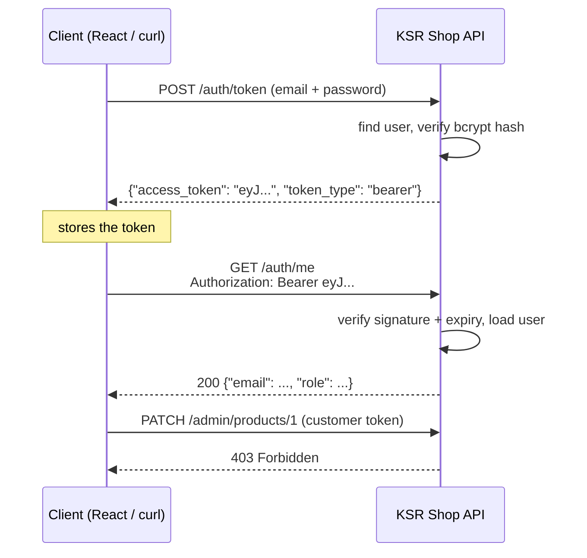

# Authentication with JWT

!!! abstract "Learning Objectives"
    By the end of this lesson, you can:

    - Explain authentication vs authorisation, and how token-based login works
    - Hash and verify passwords with **bcrypt**, and never store plain text
    - Create and verify **JWT** access tokens with **PyJWT**
    - Build register, login (`/auth/token`) and `/auth/me` endpoints with OAuth2 password flow
    - Protect endpoints with a `get_current_user` dependency and restrict actions by **role**

**Prerequisites:** [Dependency Injection & Settings](09-dependencies-and-settings.md)

## Authentication vs Authorisation

| | Question | KSR Shop example | Failure status |
|---|---|---|---|
| **Authentication** | *Who are you?* | Log in with email and password | **401 Unauthorized** |
| **Authorisation** | *Are you allowed to do this?* | Only admins can change prices | **403 Forbidden** |

!!! example "Real-life analogy: an office building"
    At reception you show your ID and get a **visitor badge** (authentication → token). The badge has an expiry time and says which floors you may enter. Every door checks the badge, not your ID again (authorisation). Losing the badge is risky, so it expires at the end of the day.

## How Token Login Works



1. The user logs in **once** with email and password.
2. The API returns a signed **token**.
3. The client sends the token in the `Authorization: Bearer <token>` header on every request.
4. The API verifies the token's **signature** and **expiry**. No password or database session lookup is needed for each request.

## Passwords: Hash, Never Store

Storing passwords in plain text means one database leak exposes every user's password, and people reuse passwords across sites. Store a **hash** instead: a one-way fingerprint.

| Approach | Safe? | Why |
|----------|-------|-----|
| Plain text | ❌ | Anyone who sees the table sees the passwords |
| Encryption | ❌ | Whoever has the key can decrypt everything |
| Fast hash (MD5, SHA-256) | ❌ | Billions of guesses per second on a GPU |
| **bcrypt / argon2** with a salt | ✅ | Deliberately slow, unique salt per password |

```bash
pip install bcrypt PyJWT
```

```python
import bcrypt

hashed = bcrypt.hashpw(b"Secret@123", bcrypt.gensalt())
print(hashed[:7], "... length", len(hashed))
print(bcrypt.checkpw(b"Secret@123", hashed))
print(bcrypt.checkpw(b"secret@123", hashed))
print(bcrypt.hashpw(b"Secret@123", bcrypt.gensalt()) == hashed)
```

```{ .text .output }
b'$2b$12$' ... length 60
True
False
False
```

The last line is `False`: hashing the **same** password twice gives **different** hashes, because each one has a random **salt**. You can't compare hashes directly; always use `checkpw`.

## JWT: JSON Web Tokens

A **JWT** has three Base64-encoded parts separated by dots: `header.payload.signature`.

```text
eyJhbGciOiJIUzI1NiIsInR5cCI6IkpXVCJ9 . eyJzdWIiOiJhc2hhQGV4YW1wbGUuY29tIiwicm9sZSI6Ii4uLiJ9 . 3kL9w...
└─────────── header ───────────────┘   └────────────────── payload (claims) ─────────────┘   └ signature ┘
```

| Part | Contains |
|------|----------|
| Header | Algorithm (`HS256`) and type (`JWT`) |
| Payload | **Claims**: `sub` (subject: who), `role`, `exp` (expiry time), `iat` (issued at) |
| Signature | HMAC of header + payload using your **secret key**. Any change breaks it |

!!! warning "JWTs are signed, not encrypted"
    Anyone can decode the payload and read it (you'll do it below). The signature only proves it wasn't **changed**. Never put passwords, card numbers or other secrets in a JWT.

## The Complete Example

```text title=".env"
SECRET_KEY=change-this-to-a-long-random-string-at-least-32-chars
ACCESS_TOKEN_MINUTES=30
```

```python title="app/config.py"
from functools import lru_cache

from pydantic_settings import BaseSettings, SettingsConfigDict


class Settings(BaseSettings):
    model_config = SettingsConfigDict(env_file=".env")

    secret_key: str
    algorithm: str = "HS256"
    access_token_minutes: int = 30


@lru_cache
def get_settings() -> Settings:
    return Settings()
```

```python title="app/security.py"
from datetime import datetime, timedelta, timezone

import bcrypt
import jwt

from app.config import get_settings


def hash_password(plain: str) -> str:
    return bcrypt.hashpw(plain.encode(), bcrypt.gensalt()).decode()


def verify_password(plain: str, hashed: str) -> bool:
    return bcrypt.checkpw(plain.encode(), hashed.encode())


def create_access_token(subject: str, role: str) -> str:
    settings = get_settings()
    now = datetime.now(timezone.utc)
    payload = {
        "sub": subject,
        "role": role,
        "iat": now,
        "exp": now + timedelta(minutes=settings.access_token_minutes),
    }
    return jwt.encode(payload, settings.secret_key, algorithm=settings.algorithm)


def decode_access_token(token: str) -> dict:
    settings = get_settings()
    return jwt.decode(token, settings.secret_key, algorithms=[settings.algorithm])
```

```python title="app/users.py"
from app.security import hash_password

# In-memory users for this lesson. In your project these live in a MySQL `users` table.
USERS: dict[str, dict] = {
    "admin@ksrshop.in": {"email": "admin@ksrshop.in", "name": "Lakshmi Menon",
                         "role": "admin", "password_hash": hash_password("Admin@2026")},
    "asha@example.com": {"email": "asha@example.com", "name": "Asha Reddy",
                         "role": "customer", "password_hash": hash_password("Asha@2026")},
}
```

```python title="app/auth.py"
from typing import Annotated

import jwt
from fastapi import APIRouter, Depends, HTTPException, status
from fastapi.security import OAuth2PasswordBearer, OAuth2PasswordRequestForm
from pydantic import BaseModel, EmailStr, Field

from app.security import create_access_token, decode_access_token, hash_password, verify_password
from app.users import USERS

router = APIRouter(prefix="/auth", tags=["Auth"])
oauth2_scheme = OAuth2PasswordBearer(tokenUrl="/auth/token")


class RegisterIn(BaseModel):
    email: EmailStr
    name: str = Field(min_length=2)
    password: str = Field(min_length=8)


class UserOut(BaseModel):
    email: EmailStr
    name: str
    role: str


class Token(BaseModel):
    access_token: str
    token_type: str = "bearer"


CREDENTIALS_ERROR = HTTPException(
    status_code=status.HTTP_401_UNAUTHORIZED,
    detail="Could not validate credentials",
    headers={"WWW-Authenticate": "Bearer"},
)


def get_current_user(token: Annotated[str, Depends(oauth2_scheme)]) -> dict:
    try:
        payload = decode_access_token(token)
    except jwt.ExpiredSignatureError:
        raise HTTPException(status_code=401, detail="Token expired", headers={"WWW-Authenticate": "Bearer"})
    except jwt.InvalidTokenError:
        raise CREDENTIALS_ERROR
    user = USERS.get(payload.get("sub"))
    if user is None:
        raise CREDENTIALS_ERROR
    return user


CurrentUser = Annotated[dict, Depends(get_current_user)]


def require_role(*roles: str):
    def checker(user: CurrentUser) -> dict:
        if user["role"] not in roles:
            raise HTTPException(status_code=status.HTTP_403_FORBIDDEN, detail="Not enough permissions")
        return user
    return checker


@router.post("/register", response_model=UserOut, status_code=201)
def register(data: RegisterIn):
    if data.email in USERS:
        raise HTTPException(status_code=409, detail="Email already registered")
    USERS[data.email] = {"email": data.email, "name": data.name, "role": "customer",
                         "password_hash": hash_password(data.password)}
    return USERS[data.email]


@router.post("/token", response_model=Token)
def login(form: Annotated[OAuth2PasswordRequestForm, Depends()]):
    user = USERS.get(form.username)
    if user is None or not verify_password(form.password, user["password_hash"]):
        raise HTTPException(status_code=401, detail="Incorrect email or password",
                            headers={"WWW-Authenticate": "Bearer"})
    return {"access_token": create_access_token(user["email"], user["role"])}


@router.get("/me", response_model=UserOut)
def me(user: CurrentUser):
    return user
```

```python title="app/main.py"
from typing import Annotated

from fastapi import Depends, FastAPI

from app.auth import CurrentUser, require_role
from app.auth import router as auth_router

app = FastAPI(title="KSR Shop API")
app.include_router(auth_router)

PRODUCTS = {1: {"id": 1, "name": "iPhone 15", "price": 79999}}


@app.get("/products/1")
def public_product():
    return PRODUCTS[1]


@app.get("/orders/mine")
def my_orders(user: CurrentUser):
    return {"customer": user["name"], "orders": []}


@app.patch("/admin/products/{product_id}/price")
def change_price(product_id: int, price: float, admin: Annotated[dict, Depends(require_role("admin"))]):
    PRODUCTS[product_id]["price"] = price
    return {"updated_by": admin["email"], "product": PRODUCTS[product_id]}
```

## The Pieces Explained

### OAuth2PasswordBearer

```{ .python .no-run }
oauth2_scheme = OAuth2PasswordBearer(tokenUrl="/auth/token")
```

A dependency that reads the `Authorization: Bearer <token>` header and returns the token string, or responds **401** if it's missing. `tokenUrl` tells `/docs` where to log in, which adds the 🔒 **Authorize** button.

### Login with OAuth2PasswordRequestForm

The OAuth2 standard says the login request is **form data** (not JSON) with fields `username` and `password`. We use the email as the username. That's why the curl below uses `-d "username=...&password=..."`.

!!! tip "Same error for wrong email and wrong password"
    Return *"Incorrect email or password"* in both cases. Saying *"No account with this email"* lets attackers discover which emails are registered.

### get_current_user

The dependency that turns a token into a user: decode → verify signature and expiry → load the user → or 401. Any endpoint that adds `user: CurrentUser` is now **login-only**.

### require_role

A **dependency factory**: `require_role("admin")` returns a dependency that first gets the current user (401 if not logged in), then checks the role (403 if not allowed).

## Trying the Flow

A public endpoint works for anyone:

```bash
curl -s http://127.0.0.1:8000/products/1
```

```{ .text .output }
{
  "id": 1,
  "name": "iPhone 15",
  "price": 79999
}
```

A protected one without a token:

```bash
curl -s -w "\nHTTP %{http_code}\n" http://127.0.0.1:8000/orders/mine
```

```{ .text .output }
{
  "detail": "Not authenticated"
}
HTTP 401
```

Log in as Asha (form data, not JSON). We print just the start of the token:

```bash
curl -s -X POST http://127.0.0.1:8000/auth/token \
  -d "username=asha@example.com&password=Asha@2026" \
  | python -c "import json,sys; t=json.load(sys.stdin); print(t['token_type'], t['access_token'][:36] + '...')"
```

```{ .text .output }
bearer eyJhbGciOiJIUzI1NiIsInR5cCI6IkpXVCJ9...
```

Wrong password:

```bash
curl -s -w "\nHTTP %{http_code}\n" -X POST http://127.0.0.1:8000/auth/token \
  -d "username=asha@example.com&password=wrong"
```

```{ .text .output }
{
  "detail": "Incorrect email or password"
}
HTTP 401
```

Use the token: store it in a shell variable, then send it in the `Authorization` header:

```bash
TOKEN=$(curl -s -X POST http://127.0.0.1:8000/auth/token \
  -d "username=asha@example.com&password=Asha@2026" | python -c "import json,sys; print(json.load(sys.stdin)['access_token'])")

curl -s -H "Authorization: Bearer $TOKEN" http://127.0.0.1:8000/auth/me
echo
curl -s -H "Authorization: Bearer $TOKEN" http://127.0.0.1:8000/orders/mine
```

```{ .text .output }
{"email":"asha@example.com","name":"Asha Reddy","role":"customer"}
{"customer":"Asha Reddy","orders":[]}
```

Asha is a **customer**, so the admin endpoint refuses her (**403**, not 401: she *is* logged in, she's just not allowed):

```bash
TOKEN=$(curl -s -X POST http://127.0.0.1:8000/auth/token \
  -d "username=asha@example.com&password=Asha@2026" | python -c "import json,sys; print(json.load(sys.stdin)['access_token'])")

curl -s -w "\nHTTP %{http_code}\n" -X PATCH "http://127.0.0.1:8000/admin/products/1/price?price=74999" \
  -H "Authorization: Bearer $TOKEN"
```

```{ .text .output }
{
  "detail": "Not enough permissions"
}
HTTP 403
```

The admin can:

```bash
ADMIN=$(curl -s -X POST http://127.0.0.1:8000/auth/token \
  -d "username=admin@ksrshop.in&password=Admin@2026" | python -c "import json,sys; print(json.load(sys.stdin)['access_token'])")

curl -s -X PATCH "http://127.0.0.1:8000/admin/products/1/price?price=74999" \
  -H "Authorization: Bearer $ADMIN"
```

```{ .text .output }
{
  "updated_by": "admin@ksrshop.in",
  "product": {
    "id": 1,
    "name": "iPhone 15",
    "price": 74999.0
  }
}
```

A tampered token, with one character changed in the signature, is rejected:

```bash
TOKEN=$(curl -s -X POST http://127.0.0.1:8000/auth/token \
  -d "username=asha@example.com&password=Asha@2026" | python -c "import json,sys; print(json.load(sys.stdin)['access_token'])")
BAD="${TOKEN%?}X"

curl -s -w "\nHTTP %{http_code}\n" -H "Authorization: Bearer $BAD" http://127.0.0.1:8000/auth/me
```

```{ .text .output }
{
  "detail": "Could not validate credentials"
}
HTTP 401
```

Register a new customer (the password is hashed; the response never includes it):

```bash
curl -s -X POST http://127.0.0.1:8000/auth/register \
  -H "Content-Type: application/json" \
  -d '{"email": "ravi@example.com", "name": "Ravi Kumar", "password": "Ravi@2026"}'
```

```{ .text .output }
{
  "email": "ravi@example.com",
  "name": "Ravi Kumar",
  "role": "customer"
}
```

### Anyone can read a JWT

```bash
TOKEN=$(curl -s -X POST http://127.0.0.1:8000/auth/token \
  -d "username=asha@example.com&password=Asha@2026" | python -c "import json,sys; print(json.load(sys.stdin)['access_token'])")

python -c "
import base64, json, sys
payload = sys.argv[1].split('.')[1]
payload += '=' * (-len(payload) % 4)
claims = json.loads(base64.urlsafe_b64decode(payload))
print({k: claims[k] for k in ('sub', 'role')}, '| expires in', claims['exp'] - claims['iat'], 'seconds')
" "$TOKEN"
```

```{ .text .output }
{'sub': 'asha@example.com', 'role': 'customer'} | expires in 1800 seconds
```

No secret key was needed to **read** it. The key is only needed to **create** or **verify** a token. That's why the payload must never contain secrets.

### In /docs

Open `/docs` and click **Authorize** 🔒. Enter `asha@example.com` / `Asha@2026` and click Authorize. Swagger UI calls `/auth/token` and sends the token automatically with every request you try. Protected endpoints show a padlock.

!!! realworld "In Real Projects"
    - Store users in a database table (`users`: id, email UNIQUE, password_hash, role, is_active, created_at).
    - Keep access tokens **short-lived** (15–60 minutes) and add **refresh tokens** so users stay logged in.
    - Rate-limit the login endpoint to slow down password guessing.
    - Many companies delegate login to an identity provider (Google, Auth0, AWS Cognito, Keycloak) via OAuth2 / OpenID Connect; your API then only **verifies** their JWTs, using exactly the `get_current_user` pattern from this lesson.

## Common Mistakes

| Mistake | Risk / Symptom | Fix |
|---------|----------------|-----|
| Storing plain-text passwords | Every account exposed in a leak | `bcrypt.hashpw` + `checkpw` |
| Comparing hashes with `==` | Always `False` (random salt) | `bcrypt.checkpw(plain, hashed)` |
| Hard-coded `SECRET_KEY` in code | Anyone with the repo can forge tokens | Load it from the environment; make it long and random |
| No `exp` claim | Stolen tokens work forever | Always set an expiry |
| Secrets in the JWT payload | Readable by anyone | Only ids, roles and expiry |
| Sending JSON to `/auth/token` | `422` "Field required: username" | Use form data: `-d "username=...&password=..."` |
| 403 for "not logged in" | Confusing for clients | 401 = not authenticated, 403 = not allowed |
| Different errors for "no user" and "wrong password" | Account enumeration | One generic message |
| `jwt.decode` without `algorithms=[...]` | Algorithm-confusion attacks; PyJWT raises an error | Always pass `algorithms=["HS256"]` |

## Practice Exercises

**Easy**

1. Add `GET /auth/users` for **admins only** that lists all users (without password hashes).
2. Change `ACCESS_TOKEN_MINUTES` to `1`, log in, wait over a minute, and call `/auth/me`. What's the response?
3. Make `/auth/register` reject passwords that don't contain at least one digit and one uppercase letter.

**Medium**

4. Add an `is_active` flag to users and make `get_current_user` reject inactive users with `403 "Account disabled"`.
5. Add `POST /auth/change-password` (logged-in users only) that checks the current password before setting a new one.
6. Add a `manager` role and let `require_role("admin", "manager")` protect a `GET /admin/reports` endpoint.

**Challenge**

7. Move users into **MySQL**: create a `users` table (id, email UNIQUE, name, password_hash, role ENUM('customer','admin'), is_active, created_at), an SQLAlchemy `User` model, and change register, login and `get_current_user` to use the database. Then link `orders` to the logged-in user so `GET /orders/mine` returns only that user's real orders.

??? success "Solutions (click to expand)"

    ```{ .python .no-run }
    import re

    # 1
    @router.get("/users", response_model=list[UserOut])
    def list_users(admin: Annotated[dict, Depends(require_role("admin"))]):
        return list(USERS.values())

    # 2: {"detail": "Token expired"} with 401

    # 3 (in RegisterIn)
    @field_validator("password")
    @classmethod
    def strong_password(cls, value: str) -> str:
        if not re.search(r"\d", value) or not re.search(r"[A-Z]", value):
            raise ValueError("password needs at least one digit and one uppercase letter")
        return value

    # 4 (end of get_current_user)
    if not user.get("is_active", True):
        raise HTTPException(status_code=403, detail="Account disabled")

    # 5
    class ChangePasswordIn(BaseModel):
        current_password: str
        new_password: str = Field(min_length=8)

    @router.post("/change-password", status_code=204)
    def change_password(data: ChangePasswordIn, user: CurrentUser):
        if not verify_password(data.current_password, user["password_hash"]):
            raise HTTPException(status_code=400, detail="Current password is incorrect")
        user["password_hash"] = hash_password(data.new_password)

    # 7 (model)
    class User(Base):
        __tablename__ = "users"
        id: Mapped[int] = mapped_column(primary_key=True)
        email: Mapped[str] = mapped_column(String(100), unique=True)
        name: Mapped[str] = mapped_column(String(100))
        password_hash: Mapped[str] = mapped_column(String(100))
        role: Mapped[str] = mapped_column(String(20), default="customer")
        is_active: Mapped[bool] = mapped_column(default=True)
    # get_current_user: user = db.scalars(select(User).where(User.email == payload["sub"])).first()
    ```

!!! note "Mini Assignment"
    Add authentication to your **KSR Shop API** with users stored in MySQL (exercise 7): register, login, `/auth/me`, customers can place and view **their own** orders only, admins can create, update and delete products and change order statuses. Document the test accounts in your README (practice passwords only) and confirm every protected endpoint shows a padlock in `/docs`.

## Interview Questions

!!! interview "1. What is the difference between authentication and authorisation?"
    Authentication verifies identity (who you are), for example by logging in and receiving a token; failure returns 401. Authorisation checks permissions (what you may do), such as admin-only actions; failure returns 403.

!!! interview "2. What is a JWT and what are its parts?"
    A compact, URL-safe token with three Base64URL parts: a header (algorithm, type), a payload (claims such as `sub`, `role`, `exp`, `iat`) and a signature (HMAC or RSA over header and payload). The signature proves integrity and authenticity; the payload is readable by anyone, not encrypted.

!!! interview "3. Why use bcrypt instead of SHA-256 for passwords?"
    bcrypt is deliberately slow and has a tunable cost factor, plus a random salt per password, which makes brute-force and rainbow-table attacks impractical. SHA-256 is designed to be fast, so attackers can try billions of guesses per second.

!!! interview "4. How do you protect an endpoint in FastAPI?"
    Add a dependency such as `user: Annotated[User, Depends(get_current_user)]`, which uses `OAuth2PasswordBearer` to read the bearer token, verifies it (signature, expiry), loads the user, and raises 401 otherwise. For role checks, use a dependency factory like `require_role("admin")` that raises 403.

!!! interview "5. How do you log a user out with JWTs, given that they're stateless?"
    Tokens can't be "deleted" server-side by default. Options: keep access tokens short-lived and delete them on the client; use refresh tokens stored server-side (revoke them on logout); or maintain a denylist of revoked token ids (`jti`) checked in `get_current_user`, often in Redis.

!!! interview "Scenario: a JWT secret key was accidentally pushed to a public GitHub repo. What do you do?"
    Treat it as compromised: generate a new strong secret and deploy it immediately (which invalidates all existing tokens, so users must log in again), remove the secret from the code and Git history, move secrets to environment variables or a secrets manager, check logs for suspicious activity, and add secret scanning to CI.

## Summary

| Concept | Code |
|---------|------|
| Install | `pip install bcrypt PyJWT` |
| Hash / verify | `bcrypt.hashpw(pw, bcrypt.gensalt())` · `bcrypt.checkpw(pw, hashed)` |
| Create token | `jwt.encode({"sub": email, "role": role, "exp": ...}, SECRET_KEY, algorithm="HS256")` |
| Verify token | `jwt.decode(token, SECRET_KEY, algorithms=["HS256"])` |
| Read the header | `OAuth2PasswordBearer(tokenUrl="/auth/token")` |
| Login form | `OAuth2PasswordRequestForm` (form data: `username`, `password`) |
| Protect | `user: Annotated[dict, Depends(get_current_user)]` → 401 |
| Roles | `Depends(require_role("admin"))` → 403 |
| Use a token | `Authorization: Bearer <token>` |

**Next lesson:** [Testing FastAPI](11-testing-fastapi.md), with automated tests using pytest and TestClient.
