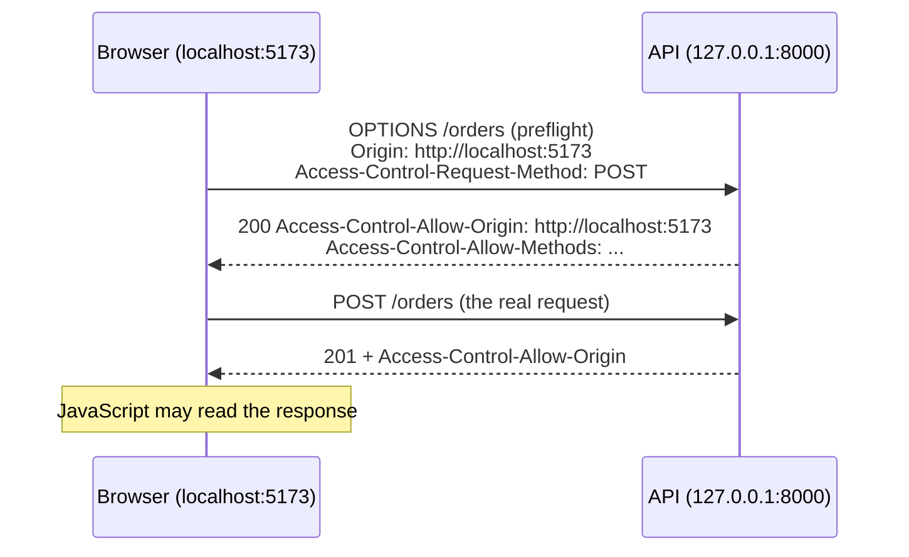
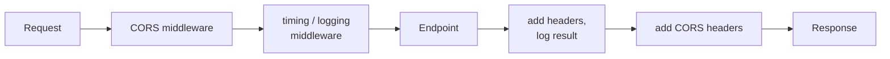

# CORS, Middleware & Background Tasks

!!! abstract "Learning Objectives"
    By the end of this lesson, you can:

    - Explain why browsers block requests to other origins, and fix it with **CORS**
    - Write **middleware** that runs for every request (timing, logging, request IDs)
    - Send emails and other slow work with **background tasks** after responding
    - Call your API from plain JavaScript (`fetch`) and from React, including the auth token
    - Serve a simple HTML page from FastAPI for quick demos

**Prerequisites:** [Testing FastAPI](10-testing-fastapi.md) and the Frontend module basics (HTML and JavaScript).

## The Problem: The Browser Blocks Your API

Your React app runs at `http://localhost:5173` and your API at `http://127.0.0.1:8000`. The first time the frontend calls the API, the browser console shows:

```{ .text .output }
Access to fetch at 'http://127.0.0.1:8000/products' from origin 'http://localhost:5173'
has been blocked by CORS policy: No 'Access-Control-Allow-Origin' header is present
on the requested resource.
```

The API worked perfectly with curl. What happened?

An **origin** is the combination of **scheme + host + port**. `http://localhost:5173` and `http://127.0.0.1:8000` are **different origins**. For security, browsers follow the **Same-Origin Policy**: JavaScript on one origin can't read responses from another origin **unless that server explicitly allows it**. That permission system is **CORS** (Cross-Origin Resource Sharing).

!!! example "Real-life analogy: a guest list"
    A security guard (the browser) protects the building. Visitors from another company (another origin) can only enter if the host (your API) has put them on the **guest list**. curl and Postman aren't browsers, so they don't have a guard. That's why your API "worked in curl".



For "non-simple" requests (JSON bodies, `Authorization` headers, `PUT`/`PATCH`/`DELETE`), the browser first sends a **preflight** `OPTIONS` request asking for permission.

## The Complete Example

```python title="app/main.py"
import logging
import time
import uuid

from fastapi import BackgroundTasks, FastAPI, Request
from fastapi.middleware.cors import CORSMiddleware
from fastapi.responses import HTMLResponse
from pydantic import BaseModel, EmailStr

logging.basicConfig(level=logging.INFO, format="%(levelname)s %(message)s")
logger = logging.getLogger("ksr_shop")

app = FastAPI(title="KSR Shop API")

# ---- CORS: which browser origins may call this API ----
app.add_middleware(
    CORSMiddleware,
    allow_origins=["http://localhost:5173", "https://shop.ksrtrainings.in"],
    allow_credentials=True,
    allow_methods=["GET", "POST", "PUT", "PATCH", "DELETE"],
    allow_headers=["Authorization", "Content-Type"],
)


# ---- Custom middleware: request id + timing + access log ----
@app.middleware("http")
async def add_request_context(request: Request, call_next):
    request_id = request.headers.get("X-Request-ID", uuid.uuid4().hex[:8])
    start = time.perf_counter()
    response = await call_next(request)                   # run the endpoint
    elapsed_ms = (time.perf_counter() - start) * 1000
    response.headers["X-Request-ID"] = request_id
    response.headers["X-Process-Time-Ms"] = f"{elapsed_ms:.1f}"
    logger.info("%s %s -> %s (%.1f ms) id=%s", request.method, request.url.path,
                response.status_code, elapsed_ms, request_id)
    return response


PRODUCTS = [
    {"id": 1, "name": "iPhone 15", "price": 79999},
    {"id": 7, "name": "Running Shoes", "price": 4299},
    {"id": 9, "name": "Atomic Habits", "price": 499},
]


@app.get("/products")
def list_products():
    return PRODUCTS


# ---- Background tasks ----
class OrderIn(BaseModel):
    email: EmailStr
    product_id: int
    quantity: int = 1


def send_confirmation_email(email: str, order_id: int) -> None:
    time.sleep(1)                                         # pretend: talking to an email service
    with open("emails.log", "a", encoding="utf-8") as log:
        log.write(f"Sent order #{order_id} confirmation to {email}\n")


@app.post("/orders", status_code=201)
def place_order(order: OrderIn, background_tasks: BackgroundTasks):
    order_id = 1001
    background_tasks.add_task(send_confirmation_email, order.email, order_id)
    return {"order_id": order_id, "status": "pending", "message": "Confirmation email will follow"}


# ---- A tiny demo page served by the API itself ----
@app.get("/demo", response_class=HTMLResponse)
def demo_page():
    return """
    <!doctype html>
    <html>
      <body>
        <h1>KSR Shop</h1>
        <ul id="list"></ul>
        <script>
          fetch("/products")
            .then((r) => r.json())
            .then((products) => {
              document.getElementById("list").innerHTML =
                products.map((p) => `<li>${p.name} - ₹${p.price}</li>`).join("");
            });
        </script>
      </body>
    </html>
    """
```

## Fixing CORS with CORSMiddleware

```{ .python .no-run }
app.add_middleware(
    CORSMiddleware,
    allow_origins=["http://localhost:5173", "https://shop.ksrtrainings.in"],
    allow_credentials=True,
    allow_methods=["GET", "POST", "PUT", "PATCH", "DELETE"],
    allow_headers=["Authorization", "Content-Type"],
)
```

| Option | Meaning |
|--------|---------|
| `allow_origins` | Exact origins allowed (scheme + host + port, no trailing slash) |
| `allow_methods` | HTTP methods the browser may use |
| `allow_headers` | Request headers the browser may send (`Authorization` for tokens) |
| `allow_credentials` | Allow cookies / `Authorization` with cross-origin requests |
| `expose_headers` | Response headers JavaScript may read (e.g. `X-Request-ID`) |

Simulate the browser's preflight with curl, from an allowed origin:

```bash
curl -s -i -X OPTIONS http://127.0.0.1:8000/products \
  -H "Origin: http://localhost:5173" \
  -H "Access-Control-Request-Method: GET" \
  | grep -iE "^HTTP|^access-control-allow-(origin|methods|credentials)"
```

```{ .text .output }
HTTP/1.1 200 OK
access-control-allow-methods: GET, POST, PUT, PATCH, DELETE
access-control-allow-credentials: true
access-control-allow-origin: http://localhost:5173
```

From an origin that **isn't** on the list:

```bash
curl -s -i -X OPTIONS http://127.0.0.1:8000/products \
  -H "Origin: http://evil.example" \
  -H "Access-Control-Request-Method: GET" \
  | grep -iE "^HTTP|^access-control-allow-origin|^Disallowed"
```

```{ .text .output }
HTTP/1.1 400 Bad Request
Disallowed CORS origin
```

The preflight is refused with **400 Disallowed CORS origin** and no `Access-Control-Allow-Origin` header, so the browser blocks the real request. CORS doesn't stop the request reaching your server (curl still works). It stops **other websites' JavaScript** from reading your API's responses with your users' credentials.

!!! warning "`allow_origins=[\"*\"]` is not a fix"
    `"*"` allows **any** website to call your API from a visitor's browser. It's acceptable for a fully public, read-only API. For anything with logins, list the exact frontend origins, and note that browsers refuse `"*"` together with credentials anyway. Load the list from settings so local, staging and production can differ.

## Middleware

**Middleware** is code that wraps **every** request: it runs before the endpoint, and again after it, around the response.



```{ .python .no-run }
@app.middleware("http")
async def add_request_context(request: Request, call_next):
    start = time.perf_counter()
    response = await call_next(request)      # everything after this line runs after the endpoint
    response.headers["X-Process-Time-Ms"] = f"{(time.perf_counter() - start) * 1000:.1f}"
    return response
```

Every response now carries extra headers. Send our own request id and check:

```bash
curl -s -i http://127.0.0.1:8000/products -H "X-Request-ID: demo-123" \
  | grep -iE "^HTTP|^x-request-id|^x-process-time" | sed -E 's/(x-process-time-ms: ).*/\1<time in ms>/I'
```

```{ .text .output }
HTTP/1.1 200 OK
x-request-id: demo-123
x-process-time-ms: <time in ms>
```

(The timing varies on each request, so we replaced the number.) In the server terminal you'll see a log line like:

```{ .text .output }
INFO GET /products -> 200 (0.4 ms) id=demo-123
```

| Use middleware for | Use a dependency for |
|--------------------|---------------------|
| Things that apply to **every** request | Things specific endpoints need |
| Logging, timing, request IDs, CORS, GZip, security headers | DB sessions, current user, pagination |
| Can't easily see the endpoint's parameters | Gets typed, validated parameters |

FastAPI ships useful middleware: `CORSMiddleware`, `GZipMiddleware` (compress large responses), `TrustedHostMiddleware` (reject unexpected `Host` headers) and `HTTPSRedirectMiddleware`.

!!! realworld "In Real Projects"
    A **request ID** middleware is standard in production: the ID is returned to the client and written into every log line. When a user reports *"my payment failed"*, support asks for the request ID and finds the exact logs across all services in seconds.

## Background Tasks

Some work shouldn't make the user wait: sending a confirmation email, generating an invoice PDF, notifying the warehouse. `BackgroundTasks` runs a function **after the response has been sent**:

```{ .python .no-run }
@app.post("/orders", status_code=201)
def place_order(order: OrderIn, background_tasks: BackgroundTasks):
    background_tasks.add_task(send_confirmation_email, order.email, order_id)
    return {...}                      # sent to the client immediately
```

The email takes 1 second, but the response comes back right away:

```bash
start=$(python -c "import time; print(time.time())")
curl -s -X POST http://127.0.0.1:8000/orders \
  -H "Content-Type: application/json" \
  -d '{"email": "asha@example.com", "product_id": 7, "quantity": 2}'
echo
python -c "import time,sys; print('response took', 'under 1 second' if time.time() - float(sys.argv[1]) < 0.9 else 'over 1 second')" "$start"
cat emails.log 2>/dev/null || echo "emails.log: not written yet"
sleep 1.5
cat emails.log
```

```{ .text .output }
{"order_id":1001,"status":"pending","message":"Confirmation email will follow"}
response took under 1 second
emails.log: not written yet
Sent order #1001 confirmation to asha@example.com
```

The response arrived immediately, **before** the email was "sent". A moment later the background task finished and wrote the log.

!!! tip "When to use a real task queue"
    `BackgroundTasks` runs in the same process, so if the server restarts the task is lost, and long jobs compete with requests for resources. For critical or heavy work (bulk emails, video processing, reports that take minutes), use a dedicated queue such as **Celery** or **RQ** with Redis, or a cloud queue.

## Calling the API from a Frontend

### Plain JavaScript with fetch

Open `http://127.0.0.1:8000/demo`: the page is served by the API itself (same origin, so no CORS needed) and uses `fetch` to load products:

```bash
curl -s http://127.0.0.1:8000/demo | grep -E "<h1>|fetch"
```

```{ .text .output }
<h1>KSR Shop</h1>
          fetch("/products")
```

### From React, with a login token

In the React module you'll build the KSR Shop frontend. Calling a protected endpoint looks like this:

```{ .javascript .no-run }
const API_URL = import.meta.env.VITE_API_URL;           // e.g. http://127.0.0.1:8000

export async function login(email, password) {
  const response = await fetch(`${API_URL}/auth/token`, {
    method: "POST",
    headers: { "Content-Type": "application/x-www-form-urlencoded" },
    body: new URLSearchParams({ username: email, password }),
  });
  if (!response.ok) throw new Error("Incorrect email or password");
  const data = await response.json();
  localStorage.setItem("token", data.access_token);
}

export async function placeOrder(productId, quantity) {
  const response = await fetch(`${API_URL}/orders`, {
    method: "POST",
    headers: {
      "Content-Type": "application/json",
      Authorization: `Bearer ${localStorage.getItem("token")}`,
    },
    body: JSON.stringify({ product_id: productId, quantity }),
  });
  if (response.status === 401) throw new Error("Please log in again");
  if (!response.ok) {
    const error = await response.json();
    throw new Error(error.detail ?? "Something went wrong");
  }
  return response.json();
}
```

Because this request sends `Content-Type: application/json` and an `Authorization` header from a different origin, the browser sends a preflight first, and your `CORSMiddleware` configuration must allow both headers.

!!! tip "Development proxy: another way around CORS locally"
    Vite (the React dev server) can forward `/api/*` requests to your backend, making them same-origin during development. You'll still need correct CORS settings in production if the frontend and API live on different domains.

## Common Mistakes

| Mistake | Symptom | Fix |
|---------|---------|-----|
| No `CORSMiddleware` | Browser: "blocked by CORS policy"; curl works | Add it with your frontend origin |
| Origin with a trailing slash or wrong port | Still blocked | Exact match: `http://localhost:5173` |
| `allow_origins=["*"]` with credentials | Browser rejects; or a security hole | List exact origins |
| `Authorization` not in `allow_headers` | Preflight fails for authenticated calls | Add it (or `["*"]` for headers) |
| Thinking CORS protects the API | Bots and curl still call it | Use authentication; CORS only governs browsers |
| Blocking work (`time.sleep`, sync HTTP) in `async def` middleware | Every request slows down | Keep middleware light; offload heavy work |
| Critical jobs in `BackgroundTasks` | Lost on restart | Use Celery / RQ / a cloud queue |
| Middleware order confusion | Headers missing on some responses | Add CORS middleware first (it should wrap everything) |

## Practice Exercises

**Easy**

1. Add `http://127.0.0.1:5500` (VS Code Live Server) to `allow_origins` and verify the preflight response with curl.
2. Add `expose_headers=["X-Request-ID"]` to the CORS settings. Why does a React app need this to read the header?
3. Add `GZipMiddleware` with `minimum_size=500` and check the `content-encoding` header when calling an endpoint with `-H "Accept-Encoding: gzip"`.

**Medium**

4. Move the allowed origins into `Settings` (`CORS_ORIGINS` as a comma-separated string in `.env`), and build the list from it at startup.
5. Write a middleware that rejects requests larger than 1 MB (check the `content-length` header) with `413 Payload Too Large`.
6. Add a background task to product creation that appends `"<timestamp> product <name> created"` to `audit.log`.

**Challenge**

7. Build a one-page HTML frontend in a separate folder, served by VS Code Live Server (a different origin), with a login form and an "Order" button that calls your **lesson 09** auth API: it logs in, stores the token, places an order with the `Authorization` header, and shows the response or a friendly error. Make it work by configuring CORS correctly, and document each preflight you see in the browser's Network tab.

??? success "Solutions (click to expand)"

    ```{ .python .no-run }
    from fastapi.middleware.gzip import GZipMiddleware
    from fastapi.responses import JSONResponse
    from datetime import datetime

    # 2: browsers only expose a few "safe" response headers to JavaScript;
    #    custom headers must be listed in expose_headers to be readable via response.headers.get(...)

    # 3
    app.add_middleware(GZipMiddleware, minimum_size=500)

    # 4 (config.py)
    class Settings(BaseSettings):
        cors_origins: str = "http://localhost:5173"

        @property
        def cors_origin_list(self) -> list[str]:
            return [o.strip() for o in self.cors_origins.split(",") if o.strip()]
    # main.py: allow_origins=get_settings().cors_origin_list

    # 5
    @app.middleware("http")
    async def limit_body_size(request: Request, call_next):
        if int(request.headers.get("content-length", 0)) > 1_000_000:
            return JSONResponse(status_code=413, content={"detail": "Payload too large"})
        return await call_next(request)

    # 6
    def audit(message: str):
        with open("audit.log", "a", encoding="utf-8") as f:
            f.write(f"{datetime.now().isoformat()} {message}\n")

    # in create_product: background_tasks.add_task(audit, f"product {product.name} created")
    ```

!!! note "Mini Assignment"
    Add to your **KSR Shop API**: `CORSMiddleware` with origins loaded from settings, a request-ID + timing middleware that logs every request, `GZipMiddleware`, and background tasks that write an order-confirmation "email" to a log file after `POST /orders`. Then build the small HTML/JS page from exercise 7 so you can demo login → browse → order from a browser.

## Interview Questions

!!! interview "1. What is CORS and why do browsers enforce it?"
    Cross-Origin Resource Sharing is a mechanism that lets a server declare which other origins (scheme + host + port) may read its responses from browser JavaScript. Browsers enforce the Same-Origin Policy so that a malicious site can't use a logged-in user's browser to read data from other sites; CORS headers selectively relax it.

!!! interview "2. What is a preflight request?"
    An automatic `OPTIONS` request the browser sends before a "non-simple" cross-origin request (custom headers like `Authorization`, JSON content type, methods like PUT/PATCH/DELETE) to ask whether the real request is allowed. The server answers with `Access-Control-Allow-*` headers.

!!! interview "3. Does CORS protect your API from unauthorised access?"
    No. CORS only controls whether browsers let JavaScript from other origins read responses. Non-browser clients (curl, scripts, other servers) ignore it. Protect APIs with authentication, authorisation and rate limiting.

!!! interview "4. What is middleware in FastAPI? Give examples."
    Code that wraps every request/response: it can inspect or modify the request before the endpoint and the response after it. Examples: CORS, GZip compression, request IDs, timing and access logs, security headers, trusted hosts, rate limiting.

!!! interview "5. When would you use `BackgroundTasks` vs Celery?"
    `BackgroundTasks` suits small, non-critical work that can run in the same process right after the response (sending a notification email, writing an audit log). Celery (or RQ, or cloud queues) suits heavy, long-running or critical jobs that need retries, scheduling, persistence across restarts and separate worker scaling.

!!! interview "Scenario: the React app works locally but in production every API call fails with a CORS error. What do you check?"
    That the production frontend origin (exact scheme, domain and port, e.g. `https://shop.example.com`) is in `allow_origins`, typically loaded from production settings; that `Authorization` and `Content-Type` are allowed headers; that a reverse proxy or load balancer isn't stripping CORS headers or blocking `OPTIONS`; and that the frontend calls the correct API URL (http vs https mismatches count as different origins).

## Summary

| Concept | Code |
|---------|------|
| CORS | `app.add_middleware(CORSMiddleware, allow_origins=[...], allow_methods=[...], allow_headers=[...])` |
| Origin | Scheme + host + port; must match exactly |
| Preflight | Browser `OPTIONS` before non-simple requests |
| Custom middleware | `@app.middleware("http") async def f(request, call_next): ... await call_next(request)` |
| Built-in middleware | `GZipMiddleware`, `TrustedHostMiddleware`, `HTTPSRedirectMiddleware` |
| Background task | `background_tasks: BackgroundTasks` → `.add_task(func, *args)` |
| Heavy jobs | Celery / RQ with Redis |
| Frontend call | `fetch(url, {headers: {Authorization: "Bearer " + token}})` |

**Next lesson:** [Deployment & Capstone Project](12-deployment-and-capstone.md), taking the KSR Shop API to production.
