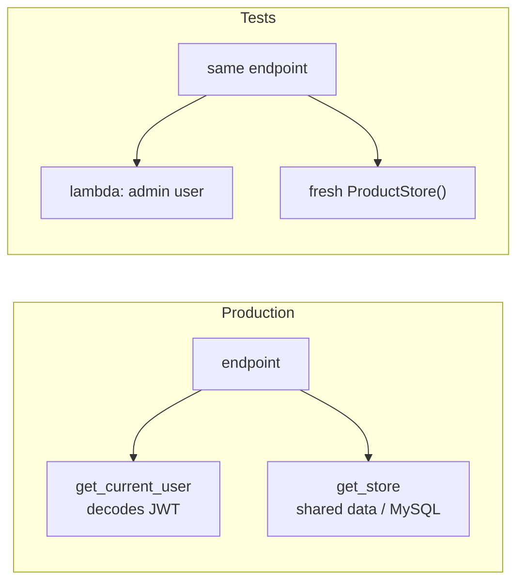

# Testing FastAPI

!!! abstract "Learning Objectives"
    By the end of this lesson, you can:

    - Explain why automated tests matter, and what to test in an API
    - Write tests with **pytest** and FastAPI's **TestClient**
    - Use fixtures for a fresh client and fresh data in every test
    - Test success paths, validation errors, 404s and permissions, and use `parametrize` for many cases
    - Replace real dependencies (login, database) in tests with `app.dependency_overrides`

**Prerequisites:** [Authentication with JWT](10-authentication-jwt.md)

## Why Automated Tests?

So far you've tested by hand with curl and `/docs`. That's fine for one endpoint, but the KSR Shop API now has dozens of endpoints, and every change can break something you're not looking at. Clicking through all of them after every change isn't realistic.

**Automated tests** are code that calls your API and checks the responses. Run them in seconds, every time you change anything.

!!! example "Real-life analogy: a car's pre-delivery inspection"
    Before a new car reaches the customer, a checklist tests brakes, lights, indicators and horn, every single time, the same way. Nobody trusts "I drove it around the block and it seemed fine". Tests are your API's inspection checklist.

| Benefit | Example |
|---------|---------|
| Catch bugs before users do | Refactoring the price logic broke discounts, and a test fails immediately |
| Change code with confidence | Swap in-memory data for MySQL; the same tests prove nothing broke |
| Living documentation | A test shows exactly how an endpoint should behave |
| Required in jobs | Pull requests without tests are often rejected; CI runs tests automatically |

**What to test in an API**

- ✅ The **happy path**: valid requests return the right status and data
- ✅ **Validation**: bad input returns 422 with the right field
- ✅ **Errors**: missing resources return 404, conflicts 409
- ✅ **Security**: protected endpoints return 401 without a token and 403 for the wrong role
- ✅ **Business rules**: stock can't go negative, duplicate names are rejected

## The App Under Test

A small products API with two dependencies we'll replace in tests: the **data store** and the **current user**.

```python title="app/main.py"
from typing import Annotated

from fastapi import Depends, FastAPI, Header, HTTPException, status
from pydantic import BaseModel, Field

app = FastAPI(title="KSR Shop API")


class ProductIn(BaseModel):
    name: str = Field(min_length=2)
    price: float = Field(gt=0)
    stock: int = Field(default=0, ge=0)


class ProductOut(ProductIn):
    id: int


class ProductStore:
    def __init__(self):
        self.items: dict[int, dict] = {
            1: {"id": 1, "name": "iPhone 15", "price": 79999.0, "stock": 25},
            7: {"id": 7, "name": "Running Shoes", "price": 4299.0, "stock": 60},
        }
        self.next_id = 16


_store = ProductStore()


def get_store() -> ProductStore:
    return _store


def get_current_user(authorization: Annotated[str | None, Header()] = None) -> dict:
    # Simplified: lesson 10 decodes a real JWT here.
    if authorization is None:
        raise HTTPException(status_code=401, detail="Not authenticated")
    if authorization == "Bearer admin-token":
        return {"email": "admin@ksrshop.in", "role": "admin"}
    return {"email": "asha@example.com", "role": "customer"}


def require_admin(user: Annotated[dict, Depends(get_current_user)]) -> dict:
    if user["role"] != "admin":
        raise HTTPException(status_code=403, detail="Not enough permissions")
    return user


Store = Annotated[ProductStore, Depends(get_store)]


@app.get("/health")
def health():
    return {"status": "ok"}


@app.get("/products", response_model=list[ProductOut])
def list_products(store: Store, max_price: float | None = None):
    items = list(store.items.values())
    if max_price is not None:
        items = [p for p in items if p["price"] <= max_price]
    return items


@app.get("/products/{product_id}", response_model=ProductOut)
def get_product(product_id: int, store: Store):
    if product_id not in store.items:
        raise HTTPException(status_code=404, detail="Product not found")
    return store.items[product_id]


@app.post("/products", response_model=ProductOut, status_code=status.HTTP_201_CREATED)
def create_product(product: ProductIn, store: Store, admin: Annotated[dict, Depends(require_admin)]):
    if any(p["name"].lower() == product.name.lower() for p in store.items.values()):
        raise HTTPException(status_code=409, detail="Product already exists")
    new = {"id": store.next_id, **product.model_dump()}
    store.items[store.next_id] = new
    store.next_id += 1
    return new


@app.post("/products/{product_id}/sell")
def sell(product_id: int, quantity: int, store: Store):
    product = get_product(product_id, store)
    if quantity > product["stock"]:
        raise HTTPException(status_code=409, detail="Not enough stock")
    product["stock"] -= quantity
    return {"remaining": product["stock"]}
```

## Your First Tests

```bash
pip install pytest httpx
```

Tell pytest that the project root is on the import path, so tests can `import app`:

```ini title="pytest.ini"
[pytest]
pythonpath = .
testpaths = tests
```

`TestClient` (it needs `httpx`) calls your app **directly in memory**: no server, no network, very fast. It has the same methods as `requests`: `.get()`, `.post()`, `.patch()`, `.delete()`.

```python title="tests/test_basics.py"
from fastapi.testclient import TestClient

from app.main import app

client = TestClient(app)


def test_health():
    response = client.get("/health")
    assert response.status_code == 200
    assert response.json() == {"status": "ok"}


def test_get_product():
    response = client.get("/products/7")
    assert response.status_code == 200
    data = response.json()
    assert data["name"] == "Running Shoes"
    assert data["price"] == 4299.0


def test_unknown_product_returns_404():
    response = client.get("/products/999")
    assert response.status_code == 404
    assert response.json()["detail"] == "Product not found"
```

The rules of pytest:

- Test files are named `test_*.py`, and test functions start with `test_`.
- A test **passes** if it finishes; it **fails** if an `assert` is false or an exception is raised.
- Each test follows **Arrange, Act, Assert**: set up, call the API, check the result.

Run all tests from the project root:

```bash
pytest -q tests/test_basics.py
```

```{ .text .output }
...                                                                      [100%]
3 passed in 0.30s
```

Three dots = three passing tests. Now break something on purpose. Change the expected price in `test_get_product` to `4000.0` and run again:

```bash
sed -i.bak 's/== 4299.0/== 4000.0/' tests/test_basics.py
pytest -q tests/test_basics.py 2>&1 | grep -E "^(FAILED|E  |[0-9]+ (passed|failed))" | head -5
mv tests/test_basics.py.bak tests/test_basics.py
```

```{ .text .output }
E       assert 4299.0 == 4000.0
FAILED tests/test_basics.py::test_get_product - assert 4299.0 == 4000.0
1 failed, 2 passed in 0.30s
```

pytest shows exactly which test failed, the line and both values. That's how a test tells you *what* broke.


## Fixtures: Fresh State for Every Test

The tests above share **one** global store, so a test that creates or sells products changes the data for the next test. Tests must be **independent**: each one should pass alone and in any order.

A **fixture** is a function that prepares something for a test. Put shared fixtures in `tests/conftest.py`; pytest finds them automatically. Combined with **`app.dependency_overrides`**, every test gets a brand-new store:

```python title="tests/conftest.py"
import pytest
from fastapi.testclient import TestClient

from app.main import ProductStore, app, get_current_user, get_store


@pytest.fixture
def store():
    return ProductStore()                      # fresh data for each test


@pytest.fixture
def client(store):
    app.dependency_overrides[get_store] = lambda: store
    with TestClient(app) as test_client:
        yield test_client
    app.dependency_overrides.clear()           # clean up after the test


@pytest.fixture
def admin_client(client):
    app.dependency_overrides[get_current_user] = lambda: {"email": "admin@ksrshop.in", "role": "admin"}
    return client


@pytest.fixture
def customer_client(client):
    app.dependency_overrides[get_current_user] = lambda: {"email": "asha@example.com", "role": "customer"}
    return client
```

`app.dependency_overrides[real] = fake` tells FastAPI: *"whenever an endpoint asks for `real`, give it `fake` instead"*. The endpoint code doesn't change at all.



## Testing Behaviour, Errors and Permissions

```python title="tests/test_products.py"
import pytest


def test_list_products(client):
    response = client.get("/products")
    assert response.status_code == 200
    assert [p["name"] for p in response.json()] == ["iPhone 15", "Running Shoes"]


def test_filter_by_max_price(client):
    response = client.get("/products", params={"max_price": 5000})
    assert [p["id"] for p in response.json()] == [7]


def test_admin_can_create_product(admin_client, store):
    response = admin_client.post("/products", json={"name": "Cricket Bat", "price": 2499, "stock": 22})
    assert response.status_code == 201
    assert response.json() == {"id": 16, "name": "Cricket Bat", "price": 2499.0, "stock": 22}
    assert 16 in store.items                    # really saved


def test_duplicate_name_is_rejected(admin_client):
    response = admin_client.post("/products", json={"name": "iphone 15", "price": 1})
    assert response.status_code == 409


def test_customer_cannot_create_product(customer_client):
    response = customer_client.post("/products", json={"name": "Cricket Bat", "price": 2499})
    assert response.status_code == 403


def test_anonymous_cannot_create_product(client):
    response = client.post("/products", json={"name": "Cricket Bat", "price": 2499})
    assert response.status_code == 401


@pytest.mark.parametrize(
    "payload, bad_field",
    [
        ({"name": "X", "price": 100}, "name"),                     # too short
        ({"name": "Bat", "price": 0}, "price"),                    # not > 0
        ({"name": "Bat", "price": 100, "stock": -1}, "stock"),     # negative stock
        ({"price": 100}, "name"),                                   # missing
    ],
)
def test_invalid_products_return_422(admin_client, payload, bad_field):
    response = admin_client.post("/products", json=payload)
    assert response.status_code == 422
    assert response.json()["detail"][0]["loc"] == ["body", bad_field]


def test_selling_reduces_stock(client, store):
    response = client.post("/products/7/sell", params={"quantity": 5})
    assert response.json() == {"remaining": 55}
    assert store.items[7]["stock"] == 55


def test_cannot_sell_more_than_stock(client, store):
    response = client.post("/products/7/sell", params={"quantity": 61})
    assert response.status_code == 409
    assert store.items[7]["stock"] == 60        # unchanged
```

`@pytest.mark.parametrize` runs one test function with **many inputs**: four validation cases with almost no extra code.

Run everything with `-v` (verbose) to see each test by name:

```bash
pytest -v tests/test_products.py 2>&1 | grep -E "PASSED|FAILED|passed|failed" | sed -E 's/ +\[ *[0-9]+%\]//'
```

```{ .text .output }
tests/test_products.py::test_list_products PASSED
tests/test_products.py::test_filter_by_max_price PASSED
tests/test_products.py::test_admin_can_create_product PASSED
tests/test_products.py::test_duplicate_name_is_rejected PASSED
tests/test_products.py::test_customer_cannot_create_product PASSED
tests/test_products.py::test_anonymous_cannot_create_product PASSED
tests/test_products.py::test_invalid_products_return_422[payload0-name] PASSED
tests/test_products.py::test_invalid_products_return_422[payload1-price] PASSED
tests/test_products.py::test_invalid_products_return_422[payload2-stock] PASSED
tests/test_products.py::test_invalid_products_return_422[payload3-name] PASSED
tests/test_products.py::test_selling_reduces_stock PASSED
tests/test_products.py::test_cannot_sell_more_than_stock PASSED
============================== 12 passed in 0.03s ==============================
```

And the whole suite:

```bash
pytest -q
```

```{ .text .output }
...............                                                          [100%]
15 passed in 0.03s
```

!!! realworld "In Real Projects"
    Tests run automatically on every push and pull request in **CI** (Continuous Integration): GitHub Actions, GitLab CI, Jenkins. A red ❌ blocks the merge until the tests pass. Teams also measure **coverage**, the percentage of code lines executed by tests, with `pytest-cov`, and often require 80% or more for new code.

## Testing with a Real Database

For endpoints that use SQLAlchemy, override `get_db` to point at a **test database**, so tests never touch your real data:

```{ .python .no-run }
# tests/conftest.py (database version)
import pytest
from fastapi.testclient import TestClient
from sqlalchemy import create_engine
from sqlalchemy.orm import sessionmaker
from sqlalchemy.pool import StaticPool

from app.database import Base, get_db
from app.main import app

engine = create_engine("sqlite://", connect_args={"check_same_thread": False}, poolclass=StaticPool)
TestingSession = sessionmaker(bind=engine)


@pytest.fixture
def db():
    Base.metadata.create_all(engine)        # fresh tables for each test
    session = TestingSession()
    yield session
    session.close()
    Base.metadata.drop_all(engine)


@pytest.fixture
def client(db):
    app.dependency_overrides[get_db] = lambda: db
    with TestClient(app) as c:
        yield c
    app.dependency_overrides.clear()
```

| Option | Pros | Cons |
|--------|------|------|
| SQLite in memory | Very fast, no setup | Slightly different SQL from MySQL (no `FOR UPDATE`, different types) |
| A separate MySQL test database (`ksr_shop_test`) | Identical behaviour to production | Needs MySQL running; slower |
| MySQL in Docker for CI (or Testcontainers) | Realistic and automated | More setup |

Most teams run fast unit tests on SQLite or with fakes, and a smaller set of integration tests against real MySQL in CI.

## Common Mistakes

| Mistake | Symptom | Fix |
|---------|---------|-----|
| Tests depend on each other | Pass alone, fail together (or the reverse) | Fresh data per test via fixtures + overrides |
| Forgetting `dependency_overrides.clear()` | Overrides leak into other tests | Clear in the fixture's teardown |
| Testing against the real database | Tests delete or alter real data | Separate test database or overrides |
| Only testing happy paths | Bugs in error handling slip through | Test 401/403/404/409/422 too |
| `ModuleNotFoundError: No module named 'app'` in pytest | Import path issue | Run from the project root with `pythonpath = .` in `pytest.ini` |
| `RuntimeError: The starlette.testclient module requires the httpx package` | httpx missing | `pip install httpx` |
| Asserting on huge JSON blobs | Brittle tests that fail on harmless changes | Assert on the fields that matter |
| No tests in CI | Broken code merged | Run `pytest` in GitHub Actions on every PR |

## Practice Exercises

**Easy**

1. Write a test that `GET /products?max_price=100` returns an empty list.
2. Write a test showing that selling with `quantity=0` currently returns 200 (that's a bug). Then add `Query(ge=1)` to `quantity` in the app, and update the test to expect 422.
3. Run `pytest --collect-only -q` to list all tests without running them.

**Medium**

4. Add a `test_create_then_get` test: an admin creates a product, then a plain client fetches it by the returned id.
5. Parametrise a test over `[("Bearer admin-token", 201), ("Bearer other", 403), (None, 401)]` **without** fixture overrides, by sending real `Authorization` headers.
6. Install `pytest-cov` and run `pytest --cov=app --cov-report=term-missing`. Which lines in `app/main.py` aren't covered? Write tests to cover them.

**Challenge**

7. Write tests for your **lesson 08 order flow** using the SQLite override: create a category, a product with stock 3 and a customer in the fixture; then test that ordering 2 succeeds and reduces stock to 1, ordering 5 returns 409 and leaves stock unchanged, and an unknown customer returns 404. (Skip the `with_for_update` behaviour, which SQLite ignores.)

??? success "Solutions (click to expand)"

    ```{ .python .no-run }
    import pytest
    from fastapi.testclient import TestClient
    from app.main import app

    # 1
    def test_no_products_under_100(client):
        assert client.get("/products", params={"max_price": 100}).json() == []

    # 2 (after adding: quantity: Annotated[int, Query(ge=1)])
    def test_sell_zero_is_invalid(client):
        assert client.post("/products/7/sell", params={"quantity": 0}).status_code == 422

    # 4
    def test_create_then_get(admin_client):
        created = admin_client.post("/products", json={"name": "Yoga Mat", "price": 999}).json()
        response = admin_client.get(f"/products/{created['id']}")
        assert response.status_code == 200
        assert response.json()["name"] == "Yoga Mat"

    # 5 (no override of get_current_user: uses the real header logic)
    @pytest.mark.parametrize("auth, expected", [("Bearer admin-token", 201), ("Bearer other", 403), (None, 401)])
    def test_create_permissions(client, auth, expected):
        headers = {"Authorization": auth} if auth else {}
        response = client.post("/products", json={"name": "Football", "price": 899}, headers=headers)
        assert response.status_code == expected
    ```

!!! note "Mini Assignment"
    Add a `tests/` folder to your **KSR Shop API** with at least **15 tests**: health, product listing and filters, create/update/delete (admin), 401 and 403 checks, 404s, a parametrised validation test, and the order flow (success, insufficient stock, unknown customer) using a database override. Add a GitHub Actions workflow (`.github/workflows/tests.yml`) that runs `pytest` on every push, and add the passing badge to your README.

## Interview Questions

!!! interview "1. How do you test a FastAPI application?"
    With pytest and `fastapi.testclient.TestClient`, which calls the ASGI app in-process (no server needed) and exposes a requests-like API. Tests assert on status codes and JSON bodies; fixtures provide fresh clients and data; `app.dependency_overrides` swaps real dependencies (DB, auth, external services) for test versions.

!!! interview "2. What is `dependency_overrides` and why is it useful?"
    A dict on the app mapping a dependency function to a replacement. During tests, every endpoint that depends on the original receives the replacement instead, so you can inject a test database session, a fake current user, or a mocked external client without changing application code.

!!! interview "3. What is a pytest fixture?"
    A function decorated with `@pytest.fixture` that sets up a resource (and optionally tears it down after `yield`) and is injected into tests by naming it as a parameter. Fixtures in `conftest.py` are shared across test files, and they can depend on other fixtures.

!!! interview "4. What should you test in a REST API?"
    Happy paths (status and body), input validation (422), error handling (404, 409), authentication and authorisation (401, 403), business rules and side effects (e.g. stock reduced, nothing changed on failure), pagination and filters, and response models not leaking sensitive fields.

!!! interview "5. What is the difference between unit tests and integration tests?"
    Unit tests check a small piece (a function, a service) in isolation, with dependencies faked; they're fast. Integration tests check pieces working together (endpoint + service + a real database); they're slower but catch wiring and SQL issues. A healthy suite has many unit tests and fewer integration tests.

!!! interview "Scenario: tests pass on your laptop but fail randomly in CI. What could cause it?"
    Shared state between tests (global data or a leftover `dependency_overrides`), test order dependence, reliance on the local database or environment variables, time- or date-sensitive assertions, or parallel tests sharing one database. Fix it by isolating each test with fixtures, clearing overrides, using a dedicated test database, and freezing or injecting time.

## Summary

| Concept | Code |
|---------|------|
| Install | `pip install pytest httpx` |
| Client | `client = TestClient(app)` → `client.get("/path")`, `.post(..., json=...)`, `params=`, `headers=` |
| Assert | `assert response.status_code == 201` · `assert response.json()["name"] == ...` |
| Run | `pytest -q` · `pytest -v` · `pytest -k name` · `pytest --cov=app` |
| Fixture | `@pytest.fixture def client(): ...` in `tests/conftest.py` |
| Override | `app.dependency_overrides[get_db] = lambda: test_db` → `.clear()` |
| Many cases | `@pytest.mark.parametrize("payload, field", [...])` |
| Test DB | SQLite in memory, or a separate MySQL test database |

**Next lesson:** [CORS, Middleware & Background Tasks](12-cors-middleware-background.md), connecting a React frontend and adding cross-cutting features.
