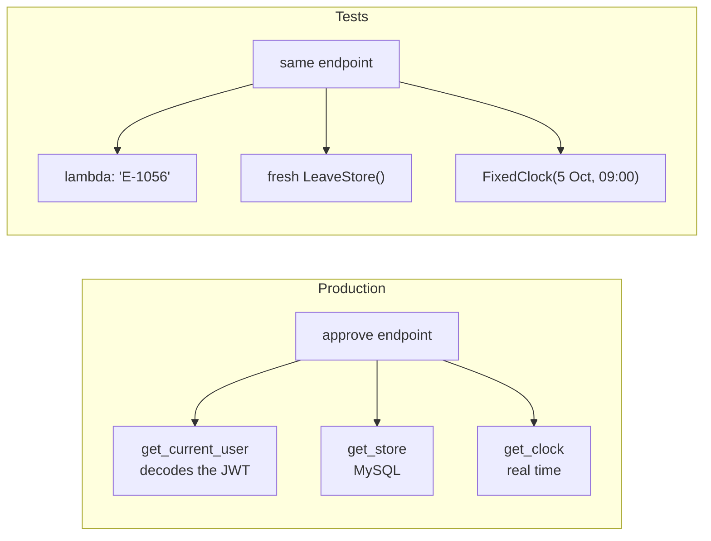

# Testing FastAPI

!!! abstract "Learning Objectives"
    By the end of this lesson, you can:

    - Explain why automated tests matter, and what to test in an API
    - Write tests with **pytest**, and test pure business rules with `parametrize`
    - Test endpoints with FastAPI's **TestClient**: success paths, validation errors and permissions
    - Replace real dependencies (data, the clock, the logged-in user) with `app.dependency_overrides`
    - Run tests against a real MySQL database without leaving any changes behind

**Prerequisites:** [Authentication with JWT](10-authentication-jwt.md)

## Why Automated Tests?

So far you've tested by hand with curl and `/docs`. That's fine for one endpoint, but the AcmeHR API now has dozens of endpoints and a leave policy full of edge cases, and every change can break something you're not looking at. Clicking through all of them after every change isn't realistic.

**Automated tests** are code that calls your API and checks the responses. Run them in seconds, every time you change anything.

!!! example "Real-life analogy: payroll's month-end checklist"
    Before salaries go out, Acme's payroll team runs the same checklist every month: totals match last month's plus new joiners, nobody exited is still being paid, deductions add up. Nobody trusts "I looked at a few payslips and they seemed fine". Tests are your API's month-end checklist, except they run on every change.

| Benefit | Example |
|---------|---------|
| Catch bugs before users do | Someone "simplifies" the working-days loop and Saturdays start counting; a test fails immediately |
| Change code with confidence | Move from in-memory data to MySQL; the same tests prove nothing broke |
| Living documentation | A test shows exactly how a rule should behave: "Meera's week is 4 days" |
| Required in jobs | Pull requests without tests are often rejected; CI runs tests automatically |

**What to test in an API**

- ✅ **Business rules**: working days, holidays, half days, overlaps
- ✅ The **happy path**: valid requests return the right status and data
- ✅ **Validation**: bad input returns 422 with the right message
- ✅ **Errors**: missing resources return 404, conflicts 409
- ✅ **Security**: 401 without a login, 403 when the wrong person tries (a manager approving another team's leave)

## The Code Under Test

The leave rules from lesson 05, unchanged:

```python title="app/leave_rules.py"
from datetime import date, timedelta


def working_days(start: date, end: date, duration: str, holidays: set[date]) -> float:
    """Days deducted from the balance: weekends and holidays don't count."""
    def is_working(day: date) -> bool:
        return day.weekday() < 5 and day not in holidays

    if duration != "full":
        return 0.5 if is_working(start) else 0.0
    days = 0
    day = start
    while day <= end:
        if is_working(day):
            days += 1
        day += timedelta(days=1)
    return float(days)


def overlaps(start: date, end: date, other_start: date, other_end: date) -> bool:
    """True when the two date ranges share at least one day."""
    return start <= other_end and other_start <= end
```

And a compact leave API with three dependencies we'll replace in tests: the **data store**, the **clock** and the **current user**:

```python title="app/main.py"
from datetime import date, datetime
from typing import Annotated, Literal

from fastapi import Depends, FastAPI, Header, HTTPException, status
from pydantic import BaseModel, Field, model_validator

from app.leave_rules import overlaps, working_days

app = FastAPI(title="AcmeHR API")

HOLIDAYS = {date(2026, 10, 2), date(2026, 10, 20), date(2026, 11, 9), date(2026, 12, 25)}


class LeaveRequestIn(BaseModel):
    leave_type: Literal["CL", "SL", "EL", "LOP"]
    start_date: date
    end_date: date
    duration: Literal["full", "first_half", "second_half"] = "full"
    reason: str = Field(min_length=5)

    @model_validator(mode="after")
    def check_dates(self):
        if self.end_date < self.start_date:
            raise ValueError("end_date can't be before start_date")
        if self.duration != "full" and self.start_date != self.end_date:
            raise ValueError("a half day must start and end on the same date")
        return self


class LeaveStore:
    def __init__(self):
        self.employees = {
            "E-1002": {"name": "Karthik Menon", "manager": "E-1001"},
            "E-1042": {"name": "Ananya Rao", "manager": "E-1002"},
            "E-1043": {"name": "Arjun Reddy", "manager": "E-1056"},
            "E-1056": {"name": "Swati Kulkarni", "manager": "E-1002"},
        }
        self.requests = {
            4: {"id": 4, "employee": "E-1042", "leave_type": "EL", "start_date": date(2026, 11, 16),
                "end_date": date(2026, 11, 20), "days": 5.0, "status": "pending"},
            5: {"id": 5, "employee": "E-1043", "leave_type": "CL", "start_date": date(2026, 10, 8),
                "end_date": date(2026, 10, 9), "days": 2.0, "status": "pending"},
        }
        self.next_id = 16


class Clock:
    def now(self) -> datetime:
        return datetime.now()


class FixedClock(Clock):
    def __init__(self, moment: datetime):
        self.moment = moment

    def now(self) -> datetime:
        return self.moment


_store = LeaveStore()


def get_store() -> LeaveStore:
    return _store


def get_clock() -> Clock:
    return Clock()


Store = Annotated[LeaveStore, Depends(get_store)]
ClockDep = Annotated[Clock, Depends(get_clock)]


def get_current_user(store: Store, authorization: Annotated[str | None, Header()] = None) -> str:
    # Simplified: lesson 10 decodes a real JWT here. The "token" is just "Bearer E-1042".
    if authorization is None or not authorization.startswith("Bearer "):
        raise HTTPException(status_code=401, detail="Not authenticated")
    code = authorization.removeprefix("Bearer ")
    if code not in store.employees:
        raise HTTPException(status_code=401, detail="Could not validate credentials")
    return code


CurrentUser = Annotated[str, Depends(get_current_user)]


def find(store: LeaveStore, request_id: int) -> dict:
    if request_id not in store.requests:
        raise HTTPException(status_code=404, detail=f"Leave request {request_id} not found")
    return store.requests[request_id]


@app.get("/health")
def health():
    return {"status": "ok"}


@app.get("/leave-requests/{request_id}")
def get_request(request_id: int, store: Store):
    return find(store, request_id)


@app.post("/leave-requests", status_code=status.HTTP_201_CREATED)
def apply(data: LeaveRequestIn, me: CurrentUser, store: Store, clock: ClockDep):
    if data.start_date < clock.now().date() and data.leave_type != "SL":
        raise HTTPException(status_code=400, detail="Only sick leave can be applied for past dates")
    days = working_days(data.start_date, data.end_date, data.duration, HOLIDAYS)
    if days == 0:
        raise HTTPException(status_code=400, detail="The selected dates have no working days")
    for r in store.requests.values():
        if (r["employee"] == me and r["status"] in ("pending", "approved")
                and overlaps(data.start_date, data.end_date, r["start_date"], r["end_date"])):
            raise HTTPException(status_code=409, detail=f"Overlaps leave request {r['id']}")
    new = {"id": store.next_id, "employee": me, **data.model_dump(exclude={"reason"}),
           "days": days, "status": "pending"}
    store.requests[store.next_id] = new
    store.next_id += 1
    return new


@app.post("/leave-requests/{request_id}/approve")
def approve(request_id: int, me: CurrentUser, store: Store):
    r = find(store, request_id)
    if r["employee"] == me:
        raise HTTPException(status_code=403, detail="You can't approve your own leave")
    if store.employees[r["employee"]]["manager"] != me:
        raise HTTPException(status_code=403, detail="Only the employee's manager can approve this")
    if r["status"] != "pending":
        raise HTTPException(status_code=409, detail=f"Leave request {request_id} is already {r['status']}")
    r.update(status="approved", approver=me)
    return r


@app.post("/leave-requests/{request_id}/cancel")
def cancel(request_id: int, me: CurrentUser, store: Store, clock: ClockDep):
    r = find(store, request_id)
    if r["employee"] != me:
        raise HTTPException(status_code=403, detail="You can only cancel your own leave")
    if r["status"] not in ("pending", "approved"):
        raise HTTPException(status_code=409, detail=f"Leave request {request_id} is already {r['status']}")
    if r["status"] == "approved" and r["start_date"] <= clock.now().date():
        raise HTTPException(status_code=400, detail="Leave that has already started can't be cancelled")
    r["status"] = "cancelled"
    return r
```

## Your First Tests: the Leave Rules

```bash
pip install pytest httpx
```

Tell pytest that the project root is on the import path, so tests can `import app`:

```ini title="pytest.ini"
[pytest]
pythonpath = .
testpaths = tests
```

Pure functions are the easiest things to test: no server, no database, just inputs and expected outputs. The leave policy has many edge cases, and **`@pytest.mark.parametrize`** runs one test function once per case:

```python title="tests/test_leave_rules.py"
from datetime import date

import pytest

from app.leave_rules import overlaps, working_days

HOLIDAYS = {date(2026, 10, 2), date(2026, 10, 20), date(2026, 11, 9)}


@pytest.mark.parametrize(
    "start, end, duration, expected",
    [
        ("2026-10-12", "2026-10-16", "full", 5.0),           # a normal Monday to Friday
        ("2026-10-19", "2026-10-23", "full", 4.0),           # Meera's week: Dussehra on the 20th
        ("2026-10-10", "2026-10-11", "full", 0.0),           # Saturday and Sunday
        ("2026-11-06", "2026-11-10", "full", 2.0),           # Friday to Tuesday around Diwali
        ("2026-10-14", "2026-10-14", "first_half", 0.5),     # a half day
        ("2026-10-20", "2026-10-20", "second_half", 0.0),    # a half day on a holiday
    ],
)
def test_working_days(start, end, duration, expected):
    result = working_days(date.fromisoformat(start), date.fromisoformat(end), duration, HOLIDAYS)
    assert result == expected


@pytest.mark.parametrize(
    "first, second, expected",
    [
        (("2026-11-16", "2026-11-20"), ("2026-11-19", "2026-11-19"), True),    # a day inside
        (("2026-11-16", "2026-11-20"), ("2026-11-20", "2026-11-23"), True),    # sharing the last day
        (("2026-11-16", "2026-11-20"), ("2026-11-21", "2026-11-22"), False),   # starts the day after
        (("2026-11-16", "2026-11-20"), ("2026-11-09", "2026-11-15"), False),   # ends the day before
    ],
)
def test_overlaps(first, second, expected):
    dates = [date.fromisoformat(d) for d in (*first, *second)]
    assert overlaps(*dates) is expected
```

The rules of pytest:

- Test files are named `test_*.py`, and test functions start with `test_`.
- A test **passes** if it finishes; it **fails** if an `assert` is false or an exception is raised.
- Each test follows **Arrange, Act, Assert**: set up, call the code, check the result.

Run the file from the project root:

```bash
pytest -q tests/test_leave_rules.py
```

```{ .text .output }
..........                                                               [100%]
10 passed in 0.01s
```

Ten dots: ten cases from two functions. Now break the rule on purpose, the way a hurried developer might, by counting Saturdays as working days (`weekday() <= 5`):

```bash
sed -i.bak 's/weekday() < 5/weekday() <= 5/' app/leave_rules.py
pytest -q tests/test_leave_rules.py 2>&1 | grep -E "^(FAILED|[0-9]+ (passed|failed))"
mv app/leave_rules.py.bak app/leave_rules.py
```

```{ .text .output }
FAILED tests/test_leave_rules.py::test_working_days[2026-10-10-2026-10-11-full-0.0]
FAILED tests/test_leave_rules.py::test_working_days[2026-11-06-2026-11-10-full-2.0]
2 failed, 8 passed in 0.01s
```

pytest shows exactly which cases failed (the parameters are in the test's name) and the values. Two of the ten cases caught the bug, and the other eight tell you what still works. Without these tests, the first sign would have been an employee complaining that a long weekend cost them an extra day.

## Testing Endpoints with TestClient

`TestClient` (it needs `httpx`) calls your app **directly in memory**: no server, no network, very fast. It has the same methods as `requests`: `.get()`, `.post()`, `.patch()`, `.delete()`.

### Fixtures: fresh state for every test

Tests must be **independent**: each one should pass alone and in any order. If one test approves request 5, the next test must still see it pending. A **fixture** is a function that prepares something for a test. Put shared fixtures in `tests/conftest.py`; pytest finds them automatically. Combined with **`app.dependency_overrides`**, every test gets its own store, its own frozen clock, and whichever user it wants to be:

```python title="tests/conftest.py"
from datetime import datetime

import pytest
from fastapi.testclient import TestClient

from app.main import FixedClock, LeaveStore, app, get_clock, get_current_user, get_store


@pytest.fixture
def store():
    return LeaveStore()                                  # fresh data for each test


@pytest.fixture
def clock():
    return FixedClock(datetime(2026, 10, 5, 9, 0))       # "today" is Monday 5 October 2026


@pytest.fixture
def client(store, clock):
    app.dependency_overrides[get_store] = lambda: store
    app.dependency_overrides[get_clock] = lambda: clock
    with TestClient(app) as test_client:
        yield test_client
    app.dependency_overrides.clear()                     # clean up after the test


@pytest.fixture
def login(client):
    def as_user(code: str) -> TestClient:
        app.dependency_overrides[get_current_user] = lambda: code
        return client
    return as_user
```

`app.dependency_overrides[real] = fake` tells FastAPI: *"whenever an endpoint asks for `real`, give it `fake` instead"*. The endpoint code doesn't change at all. `login` is a fixture that returns a **function**, so a test can write `login("E-1056")` to act as Swati, then `login("E-1043")` to act as Arjun.



### Applying for leave

```python title="tests/test_leave_api.py"
from datetime import datetime

import pytest

VALID = {"leave_type": "CL", "start_date": "2026-10-14", "end_date": "2026-10-15", "reason": "Family function"}


def test_health(client):
    response = client.get("/health")
    assert response.status_code == 200
    assert response.json() == {"status": "ok"}


def test_apply_counts_working_days(login, store):
    week = {**VALID, "leave_type": "EL", "start_date": "2026-10-19", "end_date": "2026-10-23"}
    response = login("E-1042").post("/leave-requests", json=week)
    assert response.status_code == 201
    body = response.json()
    assert body["days"] == 4.0                       # Dussehra isn't deducted
    assert body["status"] == "pending"
    assert store.requests[body["id"]]["employee"] == "E-1042"       # really saved


def test_anonymous_gets_401(client):
    assert client.post("/leave-requests", json=VALID).status_code == 401


def test_overlap_is_rejected(login):
    one_day = {**VALID, "start_date": "2026-11-19", "end_date": "2026-11-19"}
    response = login("E-1042").post("/leave-requests", json=one_day)
    assert response.status_code == 409
    assert response.json()["detail"] == "Overlaps leave request 4"


@pytest.mark.parametrize(
    "changes, message",
    [
        ({"end_date": "2026-10-13"}, "end_date can't be before start_date"),
        ({"duration": "first_half"}, "a half day must start and end on the same date"),
        ({"leave_type": "WFH"}, "Input should be 'CL', 'SL', 'EL' or 'LOP'"),
        ({"reason": "abc"}, "String should have at least 5 characters"),
    ],
)
def test_invalid_requests_return_422(login, changes, message):
    response = login("E-1042").post("/leave-requests", json={**VALID, **changes})
    assert response.status_code == 422
    assert message in response.json()["detail"][0]["msg"]


def test_past_dates_depend_on_the_clock(login, clock):
    last_thursday = {**VALID, "start_date": "2026-10-01", "end_date": "2026-10-01"}
    assert login("E-1042").post("/leave-requests", json=last_thursday).status_code == 400
    clock.moment = datetime(2026, 9, 30, 9, 0)          # move "today" back two days
    assert login("E-1042").post("/leave-requests", json=last_thursday).status_code == 201


# ---------- permissions ----------
def test_manager_approves_own_team(login, store):
    response = login("E-1056").post("/leave-requests/5/approve")          # Swati, Arjun's manager
    assert response.status_code == 200
    assert response.json()["status"] == "approved"
    assert store.requests[5]["approver"] == "E-1056"


@pytest.mark.parametrize(
    "user",
    [
        "E-1043",    # Arjun can't approve his own leave
        "E-1002",    # Karthik manages Swati, not Arjun
        "E-1042",    # Ananya is just a colleague
    ],
)
def test_only_the_manager_can_approve(login, store, user):
    assert login(user).post("/leave-requests/5/approve").status_code == 403
    assert store.requests[5]["status"] == "pending"                       # nothing changed


def test_cannot_approve_twice(login):
    assert login("E-1056").post("/leave-requests/5/approve").status_code == 200
    assert login("E-1056").post("/leave-requests/5/approve").status_code == 409


def test_cancel_depends_on_whether_leave_started(login, clock):
    login("E-1056").post("/leave-requests/5/approve")                     # 8-9 October, approved
    clock.moment = datetime(2026, 10, 8, 9, 0)                            # the leave has started
    assert login("E-1043").post("/leave-requests/5/cancel").status_code == 400
    clock.moment = datetime(2026, 10, 7, 18, 0)                           # the evening before
    response = login("E-1043").post("/leave-requests/5/cancel")
    assert response.status_code == 200
    assert response.json()["status"] == "cancelled"
```

Look at the last test and `test_past_dates_depend_on_the_clock`: they **move time** in the middle of a test, by changing the fixed clock that the override returns. Without lesson 09's clock dependency, these rules could only be tested by waiting for the right day.

Run them with `-v` (verbose) to see each test by name:

```bash
pytest -v tests/test_leave_api.py 2>&1 | grep -E "PASSED|FAILED|passed|failed" | sed -E 's/ +\[ *[0-9]+%\]//'
```

```{ .text .output }
tests/test_leave_api.py::test_health PASSED
tests/test_leave_api.py::test_apply_counts_working_days PASSED
tests/test_leave_api.py::test_anonymous_gets_401 PASSED
tests/test_leave_api.py::test_overlap_is_rejected PASSED
tests/test_leave_api.py::test_invalid_requests_return_422[changes0-end_date can't be before start_date] PASSED
tests/test_leave_api.py::test_invalid_requests_return_422[changes1-a half day must start and end on the same date] PASSED
tests/test_leave_api.py::test_invalid_requests_return_422[changes2-Input should be 'CL', 'SL', 'EL' or 'LOP'] PASSED
tests/test_leave_api.py::test_invalid_requests_return_422[changes3-String should have at least 5 characters] PASSED
tests/test_leave_api.py::test_past_dates_depend_on_the_clock PASSED
tests/test_leave_api.py::test_manager_approves_own_team PASSED
tests/test_leave_api.py::test_only_the_manager_can_approve[E-1043] PASSED
tests/test_leave_api.py::test_only_the_manager_can_approve[E-1002] PASSED
tests/test_leave_api.py::test_only_the_manager_can_approve[E-1042] PASSED
tests/test_leave_api.py::test_cannot_approve_twice PASSED
tests/test_leave_api.py::test_cancel_depends_on_whether_leave_started PASSED
============================== 15 passed in 0.08s ==============================
```

`test_anonymous_gets_401` is the only test that doesn't call `login`, so the **real** `get_current_user` runs, finds no `Authorization` header, and returns 401.

!!! realworld "In Real Projects"
    Tests run automatically on every push and pull request in **CI** (Continuous Integration): GitHub Actions, GitLab CI, Jenkins. A red ❌ blocks the merge until the tests pass. Teams also measure **coverage**, the percentage of code lines executed by tests, with `pytest-cov` (`pytest --cov=app --cov-report=term-missing`), and often require 80% or more for new code. In HR and payroll products, every policy change ("Pune now works Saturdays") ships with new test cases, because a wrong leave balance is a wrong salary.

## Testing with a Real Database

Overrides and fakes are fast, but they can't catch a typo in a SQL query or a missing column. A few **integration tests** should run against real MySQL. The trick is to make sure they never leave changes behind: open a connection, start a transaction, give the test a session inside it, and **roll back** at the end, whatever the test did:

```python title="tests/test_database.py"
import os

import pytest
from sqlalchemy import create_engine, text
from sqlalchemy.orm import Session

DATABASE_URL = os.environ.get("TEST_DATABASE_URL") or os.environ.get("DATABASE_URL")
pytestmark = pytest.mark.skipif(DATABASE_URL is None, reason="needs MySQL: set DATABASE_URL")

BALANCES = text("""
    SELECT lt.code, b.allocated - b.used AS remaining
    FROM leave_balances b
    JOIN leave_types lt ON lt.id = b.leave_type_id
    JOIN employees e    ON e.id = b.employee_id
    WHERE e.employee_code = :code AND b.year = 2026
    ORDER BY lt.id
""")


@pytest.fixture(scope="module")
def engine():
    engine = create_engine(DATABASE_URL)
    yield engine
    engine.dispose()


@pytest.fixture
def db(engine):
    connection = engine.connect()
    transaction = connection.begin()
    session = Session(bind=connection)
    yield session
    session.close()
    transaction.rollback()               # undo everything the test did
    connection.close()


def test_wireframe_balances(db):
    rows = db.execute(BALANCES, {"code": "E-1042"}).all()
    assert [(code, float(remaining)) for code, remaining in rows] == [("CL", 8.0), ("SL", 10.0), ("EL", 15.0)]


def test_changes_stay_inside_the_test(db, engine):
    db.execute(text("UPDATE leave_balances SET used = used + 1 WHERE employee_id = 6 AND year = 2026"))
    inside = db.execute(BALANCES, {"code": "E-1042"}).all()
    assert float(inside[0].remaining) == 7.0                 # this test sees its own change
    with engine.connect() as other:                          # another connection doesn't
        outside = other.execute(BALANCES, {"code": "E-1042"}).all()
    assert float(outside[0].remaining) == 8.0
```

`pytestmark = pytest.mark.skipif(...)` marks every test in the file as **skipped** when no database is configured, so a teammate without MySQL can still run the rest of the suite.

!!! tip "Use a separate test database"
    The rollback makes these tests safe, but it's still good practice to point `TEST_DATABASE_URL` at a copy, such as `acmehr_test` (load `acmehr.sql` into it after changing the database name on its first three lines). Then a bug in a test can never touch the data you use for development.

The whole suite, fast tests and database tests together:

```bash
pytest -q
```

```{ .text .output }
...........................                                              [100%]
27 passed in 0.61s
```

| Option for database tests | Pros | Cons |
|---------------------------|------|------|
| Fakes and overrides (like `LeaveStore`) | Very fast, no setup | Don't test your SQL |
| SQLite in memory | Fast, real SQL | Different from MySQL (no `FOR UPDATE`, no `CHECK` before 3.25, different types) |
| A MySQL test database with rollback per test | Identical behaviour to production | Needs MySQL running; slower |
| MySQL in Docker for CI (or Testcontainers) | Realistic and automated | More setup |

Most teams run many fast tests with fakes and a smaller set of integration tests against real MySQL in CI.

## Common Mistakes

| Mistake | Symptom | Fix |
|---------|---------|-----|
| Tests depend on each other | Pass alone, fail together (or the reverse) | Fresh data per test via fixtures + overrides |
| Forgetting `dependency_overrides.clear()` | Overrides leak into other tests | Clear in the fixture's teardown |
| `datetime.now()` in the code under test | Tests pass today and fail next week | Inject a clock and freeze it in tests |
| Testing against the real database without rollback | Tests change real balances | Rollback per test, or a separate test database |
| Only testing happy paths | Bugs in permissions slip through | Test 401/403/404/409/422 too |
| `ModuleNotFoundError: No module named 'app'` in pytest | Import path issue | Run from the project root with `pythonpath = .` in `pytest.ini` |
| `RuntimeError: The starlette.testclient module requires the httpx package` | httpx missing | `pip install httpx` |
| Asserting on huge JSON blobs | Brittle tests that fail on harmless changes | Assert on the fields that matter |

## Practice Exercises

**Easy**

1. Add a `working_days` case for a whole calendar month (October 2026) and work out the expected number by hand first.
2. Write a test that `GET /leave-requests/99` returns 404 with the right message.
3. Run `pytest --collect-only -q` to list all tests without running them.

**Medium**

4. Write `test_apply_then_cancel`: Ananya applies for leave, then cancels it, and the store shows `cancelled`.
5. Add a rule to `apply`: earned leave (EL) must be applied at least 7 days in advance. Write the tests **first** (one 6 days ahead → 400, one 7 days ahead → 201), watch them fail, then implement the rule.
6. Parametrise a test over `[("Bearer E-1056", 200), ("Bearer E-1002", 403), ("Bearer E-9999", 401), (None, 401)]` **without** overriding `get_current_user`, by sending real `Authorization` headers.

**Challenge**

7. Write integration tests for **lesson 08's** `LeaveService` against MySQL with the rollback fixture: approving Arjun's request 5 as Swati moves 2 days to `used` and writes one `audit_logs` row; approving it as Neha raises `ForbiddenError` and changes nothing. (Hint: build the service with the test session, `LeaveService(db)`, and mind that the service calls `commit()`: use `Session(bind=connection, join_transaction_mode="create_savepoint")` so its commits become savepoints inside your transaction.)

??? success "Solutions (click to expand)"

    ```{ .python .no-run }
    from datetime import date
    import pytest

    # 1: October 2026 has 22 weekdays; minus Gandhi Jayanti (Fri 2nd) and Dussehra (Tue 20th) = 20
    #   ("2026-10-01", "2026-10-31", "full", 20.0),

    # 2
    def test_unknown_request_returns_404(client):
        response = client.get("/leave-requests/99")
        assert response.status_code == 404
        assert response.json()["detail"] == "Leave request 99 not found"

    # 4
    def test_apply_then_cancel(login, store):
        created = login("E-1042").post("/leave-requests", json=VALID).json()
        response = login("E-1042").post(f"/leave-requests/{created['id']}/cancel")
        assert response.status_code == 200
        assert store.requests[created["id"]]["status"] == "cancelled"

    # 5 (tests first; "today" is 5 October)
    @pytest.mark.parametrize("start, expected", [("2026-10-11", 400), ("2026-10-12", 201)])
    def test_earned_leave_needs_a_week_notice(login, start, expected):
        body = {**VALID, "leave_type": "EL", "start_date": start, "end_date": "2026-10-13"}
        assert login("E-1042").post("/leave-requests", json=body).status_code == expected
    #   in apply(): if data.leave_type == "EL" and (data.start_date - clock.now().date()).days < 7: raise 400
    #   (2026-10-11 is a Sunday: the 400 must come from the notice rule, so check it before working days)

    # 6 (only the client fixture: no login override)
    @pytest.mark.parametrize("auth, expected",
                             [("Bearer E-1056", 200), ("Bearer E-1002", 403), ("Bearer E-9999", 401), (None, 401)])
    def test_approve_with_real_headers(client, auth, expected):
        headers = {"Authorization": auth} if auth else {}
        assert client.post("/leave-requests/5/approve", headers=headers).status_code == expected

    # 7 (core idea)
    @pytest.fixture
    def db(engine):
        connection = engine.connect()
        transaction = connection.begin()
        session = Session(bind=connection, join_transaction_mode="create_savepoint")
        yield session
        session.close()
        transaction.rollback()
        connection.close()

    def test_approve_moves_balance_and_audits(db):
        LeaveService(db).approve(5, Decision(approver_code="E-1056"))
        used = db.execute(text("SELECT used FROM leave_balances WHERE employee_id = 7 AND leave_type_id = 1")).scalar()
        assert float(used) == 2.0
        assert db.execute(text("SELECT COUNT(*) FROM audit_logs WHERE entity_id = 5")).scalar() == 1
    ```

!!! note "Mini Assignment"
    Add a `tests/` folder to your **AcmeHR API** with at least **25 tests**: parametrised leave rules (every case from the BRD's leave policy), apply/approve/reject/cancel through the API with overrides for the clock and the current user, every 401/403/404/409/422 path, and at least two integration tests against MySQL with rollback. Add a GitHub Actions workflow (`.github/workflows/tests.yml`) that runs `pytest` on every push, and add the passing badge to your README.

## Interview Questions

!!! interview "1. How do you test a FastAPI application?"
    With pytest and `fastapi.testclient.TestClient`, which calls the ASGI app in-process (no server needed) and exposes a requests-like API. Tests assert on status codes and JSON bodies; fixtures provide fresh clients and data; `app.dependency_overrides` swaps real dependencies (database, current user, clock, external services) for test versions.

!!! interview "2. What is `dependency_overrides` and why is it useful?"
    A dict on the app mapping a dependency function to a replacement. During tests, every endpoint that depends on the original receives the replacement instead, so you can inject a test database session, a fake logged-in user, or a frozen clock without changing application code.

!!! interview "3. How do you test code that depends on the current date or time?"
    Don't call `datetime.now()` inside business logic; inject a clock (a dependency or a parameter). In tests, override it with a fixed clock, and change the fixed moment inside a test to cover "before" and "after" cases, such as cancelling leave the evening before it starts versus on the first day.

!!! interview "4. What is `parametrize` and when do you use it?"
    `@pytest.mark.parametrize("args", [cases])` runs one test function once per case, reporting each case separately with its parameters in the test name. Use it for rules with many edge cases (working days across weekends, holidays and half days) and for permission matrices (which users get 200, 403 or 401).

!!! interview "5. What is the difference between unit tests and integration tests?"
    Unit tests check a small piece (a pure rule, a service) in isolation, with dependencies faked; they're fast. Integration tests check pieces working together (endpoint + service + a real database); they're slower but catch wiring and SQL issues. A healthy suite has many unit tests and fewer integration tests.

!!! interview "Scenario: the leave tests pass on your laptop but fail every Monday in CI. What could cause it?"
    Something depends on the real date: a test or the code uses `date.today()` or `datetime.now()`, so "past" and "future" shift with the calendar (or a weekend makes a working-days count zero). Inject a clock and freeze it in tests. Other common causes of flaky tests are shared state between tests, leftover `dependency_overrides`, and tests sharing one database without rollback.

## Summary

| Concept | Code |
|---------|------|
| Install | `pip install pytest httpx` |
| Pure rules | `assert working_days(start, end, "full", holidays) == 4.0` |
| Many cases | `@pytest.mark.parametrize("start, end, duration, expected", [...])` |
| Client | `client = TestClient(app)` → `client.get("/path")`, `.post(..., json=...)`, `params=`, `headers=` |
| Fixture | `@pytest.fixture def client(): ...` in `tests/conftest.py` |
| Override | `app.dependency_overrides[get_clock] = lambda: FixedClock(...)` → `.clear()` |
| Act as a user | `app.dependency_overrides[get_current_user] = lambda: "E-1056"` |
| Real database | Connection → `begin()` → `Session(bind=connection)` → `rollback()` |
| Run | `pytest -q` · `pytest -v` · `pytest -k name` · `pytest --cov=app` |

**Next lesson:** [CORS, Middleware & Background Tasks](12-cors-middleware-background.md), connecting a frontend, notifying managers and uploading documents.
