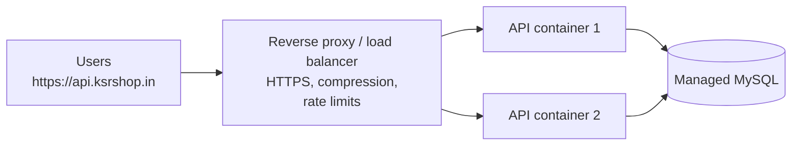

# Deployment & Capstone Project

!!! abstract "Learning Objectives"
    By the end of this lesson, you can:

    - Explain the difference between running FastAPI in development and in production
    - Prepare an app for production: settings, secrets, logging, health checks, pinned dependencies
    - Package the API in a **Docker** image and run it with **MySQL** using **docker compose**
    - Describe common deployment targets and what a reverse proxy does
    - Plan, build and present the **KSR Shop API** capstone project

**Prerequisites:** The whole FastAPI module. Install **Docker Desktop** to follow the Docker sections.

## Development vs Production

| | Development | Production |
|---|---|---|
| Command | `fastapi dev app/main.py` | `fastapi run app/main.py --workers 4` |
| Auto-reload | On | **Off** (slower, can restart mid-request) |
| Listens on | `127.0.0.1` (only your machine) | `0.0.0.0` (reachable by the network) |
| Workers | 1 | Several processes (roughly one per CPU core) |
| `DEBUG` | `true` | **`false`** |
| Secrets | `.env` on your laptop | Environment variables / secrets manager |
| Errors | Full tracebacks are fine | Generic messages to users; details in logs |
| Database | Local MySQL | Managed MySQL (backups, monitoring) |

```{ .bash .no-run }
fastapi run app/main.py --port 8000 --workers 4
```

The equivalent with Uvicorn directly is `uvicorn app.main:app --host 0.0.0.0 --port 8000 --workers 4`. Each **worker** is a separate process with its own copy of the app, so several requests can be handled truly in parallel.

!!! example "Real-life analogy: a restaurant opening night"
    Cooking at home for friends (development), you taste as you go, change the recipe and serve one table. On opening night (production) you need fixed recipes, several cooks working at once (workers), a manager at the door (reverse proxy), fire safety (security), and a logbook of every order (logging).

## Production Readiness

### 1. Pin your dependencies

```text title="requirements.txt"
fastapi[standard]==0.162.0
sqlalchemy==2.1.6
pymysql==1.2.3
cryptography==50.0.2
pydantic-settings==2.16.2
bcrypt==5.0.0
PyJWT==2.15.1
```

Exact versions (`==`) mean the server installs exactly what you tested. Generate them with `pip freeze`, then remove packages your code doesn't use directly.

### 2. Configuration only from the environment

Everything that differs between laptop and server (database URL, secret key, CORS origins, debug flag) comes from **settings** ([lesson 08](08-dependencies-and-settings.md)). The code is identical everywhere.

### 3. A health check that tests dependencies

```{ .python .no-run }
from sqlalchemy import text

@app.get("/health", tags=["Health"])
def health(db: Annotated[Session, Depends(get_db)]):
    db.execute(text("SELECT 1"))
    return {"status": "ok", "database": "connected"}
```

Load balancers and container platforms call `/health` every few seconds and stop sending traffic to (or restart) instances that fail.

### 4. Logging instead of print

```{ .python .no-run }
import logging

logging.basicConfig(level=logging.INFO, format="%(asctime)s %(levelname)s %(name)s %(message)s")
logger = logging.getLogger("ksr_shop")

logger.info("Order %s placed by customer %s", order.id, order.customer_id)
logger.exception("Payment failed for order %s", order_id)     # inside except: includes the traceback
```

Never log passwords, tokens or full card numbers.

### 5. Database migrations

In development you might use `Base.metadata.create_all()`. In production, schema changes must be **versioned and repeatable**. That's what **Alembic** (SQLAlchemy's migration tool) does:

```{ .bash .no-run }
pip install alembic
alembic init migrations
alembic revision --autogenerate -m "add users table"
alembic upgrade head
```

Each migration is a small Python file committed to Git, so every environment applies exactly the same changes in the same order.

## Docker

**Docker** packages your app, its Python version and its dependencies into an **image** that runs the same on any machine: your laptop, a teammate's laptop, or a cloud server. *"It works on my machine"* stops being a problem.

| Term | Meaning |
|------|---------|
| **Image** | A read-only package: OS base + Python + your code + dependencies |
| **Container** | A running instance of an image |
| **Dockerfile** | The recipe for building an image |
| **docker compose** | Runs several containers together (API + MySQL) from one YAML file |

### The Dockerfile

```dockerfile title="Dockerfile"
FROM python:3.12-slim

ENV PYTHONDONTWRITEBYTECODE=1 \
    PYTHONUNBUFFERED=1

WORKDIR /code

COPY requirements.txt .
RUN pip install --no-cache-dir --root-user-action=ignore -r requirements.txt

COPY ./app ./app

RUN useradd --create-home appuser
USER appuser

EXPOSE 8000
CMD ["fastapi", "run", "app/main.py", "--port", "8000", "--workers", "2"]
```

| Line | Why |
|------|-----|
| `FROM python:3.12-slim` | Small official Python base image |
| `PYTHONUNBUFFERED=1` | Logs appear immediately in `docker logs` |
| `COPY requirements.txt` **before** the code | Docker caches the slow `pip install` layer; code changes rebuild in seconds |
| `--no-cache-dir` | Smaller image |
| `USER appuser` | Don't run as root inside the container |
| `CMD [...]` | The production command |

Keep secrets and junk out of the image with a `.dockerignore`:

```text title=".dockerignore"
.venv/
__pycache__/
*.pyc
.env
.git/
tests/
```

### Running the API with MySQL using docker compose

```yaml title="docker-compose.yml"
services:
  db:
    image: mysql:8.4
    environment:
      MYSQL_ROOT_PASSWORD: ${MYSQL_ROOT_PASSWORD}
      MYSQL_DATABASE: ksr_shop
    volumes:
      - db_data:/var/lib/mysql
      - ./ksr_shop.sql:/docker-entrypoint-initdb.d/01-ksr_shop.sql:ro
    healthcheck:
      test: ["CMD", "mysqladmin", "ping", "-h", "localhost", "-p${MYSQL_ROOT_PASSWORD}"]
      interval: 5s
      retries: 20

  api:
    build: .
    ports:
      - "8000:8000"
    environment:
      DATABASE_URL: mysql+pymysql://root:${MYSQL_ROOT_PASSWORD}@db:3306/ksr_shop
      SECRET_KEY: ${SECRET_KEY}
    depends_on:
      db:
        condition: service_healthy

volumes:
  db_data:
```

```text title=".env (next to docker-compose.yml, never committed)"
MYSQL_ROOT_PASSWORD=Compose#Pass2026
SECRET_KEY=replace-with-a-long-random-value-from-a-password-generator
```

Key points:

- The API reaches MySQL at host **`db`**, the service name, not `localhost`. Inside Docker, `localhost` means "this container".
- `depends_on: condition: service_healthy` waits until MySQL actually accepts connections before starting the API.
- The `db_data` **volume** keeps the database when containers are recreated.
- Files in `/docker-entrypoint-initdb.d/` run once when the database is first created, which loads `ksr_shop.sql` automatically.

Start everything:

```{ .bash .no-run }
docker compose up -d --build
docker compose logs -f api
```

```{ .text .output }
api-1  |  ⚡️ Starting FastAPI in production mode
api-1  |  🌐 Server started at http://0.0.0.0:8000
api-1  |     Documentation at http://0.0.0.0:8000/docs
api-1  | INFO:     Uvicorn running on http://0.0.0.0:8000 (Press CTRL+C to quit)
api-1  | INFO:     Started parent process [1]
api-1  | INFO:     Started server process [8]
api-1  | INFO:     Application startup complete.
api-1  | INFO:     Started server process [9]
api-1  | INFO:     Application startup complete.
```

Two worker processes started, as requested by `--workers 2`. Check it:

```{ .bash .no-run }
curl -s http://127.0.0.1:8000/health
```

```{ .text .output }
{"status":"ok","database":"connected"}
```

| Command | Does |
|---------|------|
| `docker compose up -d --build` | Build images and start in the background |
| `docker compose ps` | Show running services |
| `docker compose logs -f api` | Follow the API logs |
| `docker compose exec db mysql -uroot -p ksr_shop` | Open a MySQL shell inside the db container |
| `docker compose down` | Stop and remove containers (data volume kept) |
| `docker compose down -v` | Also delete the database volume (fresh start) |

!!! realworld "In Real Projects"
    The same Dockerfile is used on every developer's laptop, in CI (to run tests) and in production. CI builds the image once, tags it with the Git commit hash, pushes it to a registry (Docker Hub, AWS ECR, GitHub Container Registry), and the production platform runs exactly that image.

## Deployment Options

| Option | How it works | Good for |
|--------|--------------|----------|
| **Render / Railway / Fly.io** | Connect your GitHub repo or Dockerfile; they build and run it, with HTTPS included | Portfolio projects, startups, demos |
| **AWS EC2 / Azure VM / GCP VM** | You rent a Linux server and run Docker or Uvicorn yourself, behind Nginx | Full control; learning DevOps |
| **AWS ECS / Google Cloud Run / Azure Container Apps** | Managed containers that scale automatically | Production apps at scale |
| **Kubernetes** | Orchestrates many containers across many servers | Large microservice systems |

The database should usually be **managed** (AWS RDS, Azure Database for MySQL, PlanetScale, Railway MySQL) so backups, patches and monitoring are handled for you.

### The reverse proxy

In production, users don't connect to Uvicorn directly. A **reverse proxy** (Nginx, Caddy, or the cloud's load balancer) sits in front:



It terminates **HTTPS** (TLS certificates, e.g. from Let's Encrypt), spreads traffic across instances, and protects the app from slow or malicious clients.

## Go-Live Checklist

- [ ] `DEBUG=false`; no secrets in code or Git (check the history too)
- [ ] `SECRET_KEY` is long and random; tokens expire
- [ ] CORS lists only the real frontend origins
- [ ] HTTPS everywhere; HTTP redirects to HTTPS
- [ ] The database user has only the permissions the app needs (not `root`)
- [ ] Dependencies pinned in `requirements.txt`; image builds in CI
- [ ] All tests pass in CI before deploying
- [ ] `/health` checks the database; the platform uses it
- [ ] Structured logging; no passwords or tokens in logs
- [ ] Migrations run as part of the deployment
- [ ] Database backups enabled and a restore tested at least once
- [ ] Rate limiting on login and other sensitive endpoints
- [ ] `/docs` disabled or protected if the API is private (`FastAPI(docs_url=None, redoc_url=None)`)

## Capstone: The KSR Shop API

Build the complete backend for the KSR online store using everything from this module, on the `ksr_shop` database from the MySQL module.

### Requirements

**Customers and auth**

- Register and log in (JWT); passwords hashed with bcrypt; users stored in MySQL
- Roles: `customer` and `admin`
- `GET /auth/me`, `PATCH /auth/me` (name, phone, city)

**Catalogue**

- `GET /products`: filters (category, brand, price range, in stock, search), sorting (price, rating, newest), pagination with `total`
- `GET /products/{id}` and `GET /categories` (with product counts)
- Admin: create, update (PATCH), soft-delete products; manage categories

**Orders**

- Customer: `POST /orders` (multiple items; one transaction with row locking; stock reduced; price stored per line)
- Customer: `GET /orders/mine`, `GET /orders/{id}` (only their own; others get 404)
- Customer: cancel a **pending** order (stock restored)
- Admin: list all orders with filters (status, date range, customer); change status with valid transitions only

**Reports (admin)**

- Revenue per day for a date range; top 5 products by units; top 5 customers by spend; low-stock products

### Non-functional requirements

- Layered structure: `routers/`, `schemas/`, `services/`, `repositories/`, `models/`, `core/` (config, security)
- `response_model` on every endpoint; no secrets ever returned
- A consistent error format via exception handlers
- Settings from `.env` with a committed `.env.example`
- CORS configured for `http://localhost:5173`
- At least **25 tests** with pytest (auth, permissions, validation, order transaction, reports), run in GitHub Actions
- Dockerfile + `docker-compose.yml` that starts MySQL (with the seed) and the API with one command
- README: setup, environment variables, how to run tests, an endpoint overview, and test accounts

### Suggested plan

| Day | Milestone |
|-----|-----------|
| 1 | Project structure, settings, database connection, models for all tables, health check |
| 2 | Catalogue read endpoints with filters and pagination |
| 3 | Users table, register, login, `/auth/me`, roles |
| 4 | Admin product and category management |
| 5 | Order placement transaction, my orders, cancel |
| 6 | Admin order management and reports |
| 7 | Tests + GitHub Actions |
| 8 | Docker, README, polish, demo rehearsal |

### Evaluation rubric

| Area | Points | What we look for |
|------|--------|------------------|
| Functionality | 30 | All requirements work; correct status codes |
| Data integrity | 15 | Transactions, locking, constraints, no overselling, stock restored on cancel |
| Security | 15 | Hashing, JWT, role checks, no leaks in responses or logs, CORS |
| Code quality | 15 | Layered structure, clear names, no duplication, type hints |
| Testing | 15 | 25+ meaningful tests, CI passing |
| Delivery | 10 | Docker one-command start, README, clear demo |

### Demo script (10 minutes)

1. `docker compose up -d --build`; show `/health` and `/docs`.
2. Register a customer; log in through the **Authorize** button.
3. Browse products with filters and pagination.
4. Place an order with two items; show the stock decreasing in MySQL.
5. Try to order more than the stock: 409, and nothing changed.
6. Log in as admin; ship the order; try an invalid status transition: 400.
7. Show the reports endpoints.
8. Run `pytest -q` and show the GitHub Actions badge.

!!! realworld "Put it on your resume"
    *"Built a production-style e-commerce REST API with FastAPI, SQLAlchemy and MySQL: JWT auth with role-based access, transactional order processing with row-level locking, 25+ pytest tests in GitHub Actions, and Docker Compose deployment."* Every phrase in that sentence is something you can now demonstrate and explain in an interview.

## Interview Questions

!!! interview "1. How do you run FastAPI in production?"
    With `fastapi run` (or Uvicorn / Gunicorn with Uvicorn workers) without auto-reload, binding to `0.0.0.0`, with several worker processes, behind a reverse proxy or load balancer that terminates HTTPS, packaged in a container, with configuration from environment variables, logging, and a health check.

!!! interview "2. Why use Docker for a FastAPI app?"
    It packages the exact Python version, dependencies and code into an image that runs identically on every machine and platform, which eliminates environment differences, simplifies onboarding and CI, and lets platforms scale by running more containers.

!!! interview "3. Why does the API container connect to `db` instead of `localhost` in docker compose?"
    Each container has its own network namespace, so `localhost` refers to the API container itself. Compose puts services on a shared network where each service is reachable by its service name (`db`) through built-in DNS.

!!! interview "4. What are workers, and how many should you run?"
    Separate OS processes, each running a copy of the app, so requests are handled in parallel across CPU cores. A common starting point is about one worker per CPU core (or 2 × cores + 1 for I/O-heavy apps), tuned with load testing. In container platforms you often run fewer workers per container and scale the number of containers instead.

!!! interview "5. How do you manage database schema changes in production?"
    With a migration tool like Alembic: each change is a versioned migration script in Git, applied in order (`alembic upgrade head`) as part of the deployment, tested on staging first, and written so it doesn't lock large tables for long. Never edit production tables by hand.

!!! interview "Scenario: after deploying, the API container keeps restarting with 'Can't connect to MySQL server on db'. What do you check?"
    Whether the API starts before MySQL is ready (add a healthcheck and `depends_on: condition: service_healthy`, or retry logic); that `DATABASE_URL` uses the right host (`db`), port, user and password; that the database and user exist; and the db container's logs for initialisation errors.

## Summary

| Topic | Remember |
|-------|----------|
| Production command | `fastapi run app/main.py --workers N` (no reload, `0.0.0.0`) |
| Readiness | Pinned deps, env-based settings, `/health` with a DB check, logging, migrations |
| Docker | `Dockerfile` (deps layer first, non-root user) + `.dockerignore` |
| Compose | `db` + `api` services, a volume, healthcheck, `depends_on`; host is `db` |
| Deploy targets | Render/Railway (simple), VMs + Nginx (control), Cloud Run/ECS (scale) |
| Reverse proxy | HTTPS, load balancing, protection |
| Capstone | KSR Shop API: auth, catalogue, transactional orders, reports, tests, Docker |

🎉 **You've completed the FastAPI module!** Next on the Python roadmap: **Django**, the full-featured framework with an ORM, admin panel and Django REST Framework.
