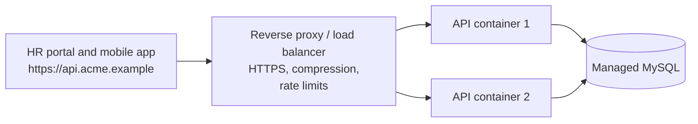

# Deployment & Capstone Project

!!! abstract "Learning Objectives"
    By the end of this lesson, you can:

    - Explain the difference between running FastAPI in development and in production
    - Prepare an app for production: settings, secrets, logging, health checks, pinned dependencies
    - Package the API in a **Docker** image and run it with **MySQL**, seeded from `acmehr.sql`, using **docker compose**
    - Describe common deployment targets and what a reverse proxy does
    - Plan, build and present the **AcmeHR** capstone: the rest of the BRD's Phase 1, judged against its acceptance criteria

**Prerequisites:** The whole FastAPI module. Install **Docker Desktop** to follow the Docker sections.

## Development vs Production

| | Development | Production |
|---|---|---|
| Command | `fastapi dev app/main.py` | `fastapi run app/main.py --workers 4` |
| Auto-reload | On | **Off** (slower, can restart mid-request) |
| Listens on | `127.0.0.1` (only your machine) | `0.0.0.0` (reachable by the network) |
| Workers | 1 | Several processes (roughly one per CPU core) |
| `DEBUG` | `true` | **`false`** |
| Secrets | `.env` on your laptop | Environment variables / secrets manager |
| Errors | Full tracebacks are fine | Generic messages to users; details in logs |
| Database | Local MySQL | Managed MySQL (backups, monitoring) |

```{ .bash .no-run }
fastapi run app/main.py --port 8000 --workers 4
```

The equivalent with Uvicorn directly is `uvicorn app.main:app --host 0.0.0.0 --port 8000 --workers 4`. Each **worker** is a separate process with its own copy of the app, so several requests can be handled truly in parallel.

!!! example "Real-life analogy: Acme's go-live day"
    While HR tried AcmeHR on a test laptop (development), anyone could change a setting and restart it. On go-live day (production), 20 people log in at 09:00 to check in at once: you need a fixed version, several workers handling requests in parallel, a gatekeeper in front (reverse proxy), locked doors (security), and a record of everything that happened (logging and the audit trail).

## Production Readiness

### 1. Pin your dependencies

```text title="requirements.txt"
fastapi[standard]==0.162.0
sqlalchemy==2.1.6
mysql-connector-python==26.10.0
pydantic-settings==2.16.2
bcrypt==5.0.0
PyJWT==2.15.1
```

That's the module's stack: FastAPI, SQLAlchemy over `mysql-connector-python`, settings, bcrypt and JWT (`fastapi[standard]` brings Uvicorn, `python-multipart` and `email-validator`).

Exact versions (`==`) mean the server installs exactly what you tested. Generate them with `pip freeze`, then remove packages your code doesn't use directly.

### 2. Configuration only from the environment

Everything that differs between laptop and server (database URL, secret key, CORS origins, debug flag) comes from **settings** ([lesson 09](09-dependencies-and-settings.md)). The code is identical everywhere.

### 3. A health check that tests dependencies

```{ .python .no-run }
from sqlalchemy import text

@app.get("/health", tags=["Health"])
def health(db: Annotated[Session, Depends(get_db)]):
    db.execute(text("SELECT 1"))
    return {"status": "ok", "database": "connected"}
```

Load balancers and container platforms call `/health` every few seconds and stop sending traffic to (or restart) instances that fail.

### 4. Logging instead of print

```{ .python .no-run }
import logging

logging.basicConfig(level=logging.INFO, format="%(asctime)s %(levelname)s %(name)s %(message)s")
logger = logging.getLogger("acmehr")

logger.info("Leave request %s approved by %s", request.id, approver.employee_code)
logger.exception("Notification failed for leave request %s", request_id)   # inside except: includes the traceback
```

Never log passwords, tokens, PAN numbers or other personal data. Log employee **codes**, not names and phone numbers.

### 5. Database migrations

In lesson 10 you created `user_accounts` with `Base.metadata.create_all()`. That's fine on your laptop, but in production schema changes must be **versioned and repeatable**: the `goals` and `reviews` tables your capstone adds must reach the test server, staging and production in exactly the same way. That's what **Alembic** (SQLAlchemy's migration tool) does:

```{ .bash .no-run }
pip install alembic
alembic init migrations
alembic revision --autogenerate -m "add user_accounts table"
alembic upgrade head
```

Each migration is a small Python file committed to Git, so every environment applies exactly the same changes in the same order.

## Docker

**Docker** packages your app, its Python version and its dependencies into an **image** that runs the same on any machine: your laptop, a teammate's laptop, or a cloud server. *"It works on my machine"* stops being a problem.

| Term | Meaning |
|------|---------|
| **Image** | A read-only package: OS base + Python + your code + dependencies |
| **Container** | A running instance of an image |
| **Dockerfile** | The recipe for building an image |
| **docker compose** | Runs several containers together (API + MySQL) from one YAML file |

### The Dockerfile

```dockerfile title="Dockerfile"
FROM python:3.12-slim

ENV PYTHONDONTWRITEBYTECODE=1 \
    PYTHONUNBUFFERED=1

WORKDIR /code

COPY requirements.txt .
RUN pip install --no-cache-dir --root-user-action=ignore -r requirements.txt

COPY ./app ./app

RUN useradd --create-home appuser
USER appuser

EXPOSE 8000
CMD ["fastapi", "run", "app/main.py", "--port", "8000", "--workers", "2"]
```

| Line | Why |
|------|-----|
| `FROM python:3.12-slim` | Small official Python base image |
| `PYTHONUNBUFFERED=1` | Logs appear immediately in `docker logs` |
| `COPY requirements.txt` **before** the code | Docker caches the slow `pip install` layer; code changes rebuild in seconds |
| `--no-cache-dir` | Smaller image |
| `USER appuser` | Don't run as root inside the container |
| `CMD [...]` | The production command |

Keep secrets and junk out of the image with a `.dockerignore`:

```text title=".dockerignore"
.venv/
__pycache__/
*.pyc
.env
.git/
tests/
```

### Running the API with MySQL using docker compose

```yaml title="docker-compose.yml"
services:
  db:
    image: mysql:8.4
    environment:
      MYSQL_ROOT_PASSWORD: ${MYSQL_ROOT_PASSWORD}
      MYSQL_DATABASE: acmehr
    volumes:
      - db_data:/var/lib/mysql
      - ./acmehr.sql:/docker-entrypoint-initdb.d/01-acmehr.sql:ro
    healthcheck:
      test: ["CMD", "mysqladmin", "ping", "-h", "localhost", "-p${MYSQL_ROOT_PASSWORD}"]
      interval: 5s
      retries: 20

  api:
    build: .
    ports:
      - "8000:8000"
    environment:
      DATABASE_URL: mysql+mysqlconnector://root:${MYSQL_ROOT_PASSWORD}@db:3306/acmehr
      SECRET_KEY: ${SECRET_KEY}
    depends_on:
      db:
        condition: service_healthy

volumes:
  db_data:
```

```text title=".env (next to docker-compose.yml, never committed)"
MYSQL_ROOT_PASSWORD=Compose#Pass2026
SECRET_KEY=replace-with-a-long-random-value-from-a-password-generator
```

Key points:

- The API reaches MySQL at host **`db`**, the service name, not `localhost`. Inside Docker, `localhost` means "this container".
- `depends_on: condition: service_healthy` waits until MySQL actually accepts connections before starting the API.
- The `db_data` **volume** keeps the database when containers are recreated.
- Files in `/docker-entrypoint-initdb.d/` run once when the database is first created, which loads `acmehr.sql` automatically: all 20 employees, the leave data and the attendance week are there on first start.

Start everything:

```{ .bash .no-run }
docker compose up -d --build
docker compose logs -f api
```

```{ .text .output }
api-1  |  ⚡️ Starting FastAPI in production mode
api-1  |  🐍 Using import string: app.main:app
api-1  |  🌐 Server started at http://0.0.0.0:8000
api-1  |     Documentation at http://0.0.0.0:8000/docs
api-1  | INFO:     Uvicorn running on http://0.0.0.0:8000 (Press CTRL+C to quit)
api-1  | INFO:     Started parent process [1]
api-1  | INFO:     Started server process [9]
api-1  | INFO:     Application startup complete.
api-1  | INFO:     Started server process [8]
api-1  | INFO:     Application startup complete.
```

Two worker processes started, as requested by `--workers 2`. Check it:

```{ .bash .no-run }
curl -s http://127.0.0.1:8000/health
```

```{ .text .output }
{"status":"ok","database":"connected"}
```

And the seed ran: the database inside the container already holds the 20 employees from `acmehr.sql`:

```{ .bash .no-run }
docker compose exec db sh -c 'mysql -uroot -p"$MYSQL_ROOT_PASSWORD" acmehr -e "SELECT COUNT(*) AS employees FROM employees"'
```

```{ .text .output }
employees
20
```

(MySQL also prints a warning about using a password on the command line. That's expected for a quick check like this.)

| Command | Does |
|---------|------|
| `docker compose up -d --build` | Build images and start in the background |
| `docker compose ps` | Show running services |
| `docker compose logs -f api` | Follow the API logs |
| `docker compose exec db mysql -uroot -p acmehr` | Open a MySQL shell inside the db container |
| `docker compose down` | Stop and remove containers (data volume kept) |
| `docker compose down -v` | Also delete the database volume (fresh start) |

!!! realworld "In Real Projects"
    The same Dockerfile is used on every developer's laptop, in CI (to run tests) and in production. CI builds the image once, tags it with the Git commit hash, pushes it to a registry (Docker Hub, AWS ECR, GitHub Container Registry), and the production platform runs exactly that image.

## Deployment Options

| Option | How it works | Good for |
|--------|--------------|----------|
| **Render / Railway / Fly.io** | Connect your GitHub repo or Dockerfile; they build and run it, with HTTPS included | Portfolio projects, startups, demos |
| **AWS EC2 / Azure VM / GCP VM** | You rent a Linux server and run Docker or Uvicorn yourself, behind Nginx | Full control; learning DevOps |
| **AWS ECS / Google Cloud Run / Azure Container Apps** | Managed containers that scale automatically | Production apps at scale |
| **Kubernetes** | Orchestrates many containers across many servers | Large microservice systems |

The database should usually be **managed** (AWS RDS, Azure Database for MySQL, PlanetScale, Railway MySQL) so backups, patches and monitoring are handled for you. For an HR system that's not optional: employee records must survive a disk failure, and the BRD asks for 99.9% uptime.

### The reverse proxy

In production, users don't connect to Uvicorn directly. A **reverse proxy** (Nginx, Caddy, or the cloud's load balancer) sits in front:



It terminates **HTTPS** (TLS certificates, e.g. from Let's Encrypt), spreads traffic across instances, and protects the app from slow or malicious clients.

## Go-Live Checklist

- [ ] `DEBUG=false`; no secrets in code or Git (check the history too)
- [ ] `SECRET_KEY` is long and random; tokens expire
- [ ] CORS lists only the real frontend origins
- [ ] HTTPS everywhere; HTTP redirects to HTTPS
- [ ] The database user has only the permissions the app needs (not `root`)
- [ ] Dependencies pinned in `requirements.txt`; image builds in CI
- [ ] All tests pass in CI before deploying
- [ ] `/health` checks the database; the platform uses it
- [ ] Structured logging; no passwords or tokens in logs
- [ ] Migrations run as part of the deployment
- [ ] Database backups enabled and a restore tested at least once
- [ ] Rate limiting on login and other sensitive endpoints
- [ ] Private fields (date of birth, PAN, emergency contacts) never appear in public responses; tests prove it
- [ ] Every approval and status change writes an audit row
- [ ] `/docs` disabled or protected if the API is private (`FastAPI(docs_url=None, redoc_url=None)`)

## Capstone: The AcmeHR API, Phase 1

Over the module you've built the core of the BRD: the directory and profiles, departments and reporting lines, the leave workflow with balances and audit, attendance, the HR dashboard, documents and role-based access. The capstone completes **Phase 1** and delivers it the way a real team would: tested, containerised, and judged against the BRD's own acceptance criteria.

Start from your module repository and the `acmehr` database. Add tables with **Alembic migrations**, not by editing `acmehr.sql`.

### Requirements

**1. Employee records, end to end (BRD Modules 1, 2, 8)**

- HR creates, updates and changes the status of employees (`active` → `on_notice` → `exited`); exiting someone disables their login in the same transaction
- `GET /employees/{code}/org-chart` (reports nested to any depth) and `GET /employees/{code}/manager-chain`
- Self-service: update phone and emergency contact, upload documents, **request an attendance correction** that their manager approves

**2. Leave, complete (Module 4)**

- Everything from lessons 05 and 08, with the approver taken from the token
- Pending requests reserve balance; managers see their whole reporting tree's pending requests
- A year-end job (an admin endpoint is fine) that carries forward unused earned leave (up to 15 days) and creates next year's balances

**3. Attendance reports (Module 3)**

- Daily (lesson 07), **monthly** (per employee: present, late, absent and leave days) and **exception** reports (late arrivals and unexplained absences for a date range)

**4. Onboarding and offboarding (Modules 5, 6)**

- Creating an employee generates an **onboarding checklist** from a template: HR tasks (documents verified), IT tasks (account created, laptop issued) and manager tasks (orientation done), each with an owner role and a due date
- Initiating an exit generates an **exit checklist** (asset return, knowledge transfer, clearance); the exit can't be completed until every item is done
- `GET /me/tasks` shows each user the checklist items they own

**5. Performance management (Module 7)**

- Managers assign **goals** (annual or quarterly, with a KPI target) to their reports; employees update progress
- A review cycle: **self-review**, then **manager review** with a rating from 1 to 5; only the manager can submit the manager review, and only after the self-review

**6. Reporting & analytics (Module 9)**

- Workforce: headcount by department and location, **attrition** for a period, gender **diversity**
- Leave: **utilisation** by leave type and department, and **leave liability** (unused earned leave days per employee)
- Performance: goal achievement and **rating distribution** for a cycle
- One dashboard endpoint per role: employee (my balances, my tasks), manager (my team's pending approvals and attendance today), HR (lesson 12's dashboard)

### Non-functional requirements (BRD section 8, adapted)

- Layered structure: `routers/`, `schemas/`, `services/`, `repositories/`, `models/`, `core/` (config, security, clock)
- `response_model` on every endpoint; private fields only in private views; a test proves it
- Every approval, rejection, status change and review submission writes an audit row in the same transaction
- A consistent error format via exception handlers
- Settings from `.env` with a committed `.env.example`; the clock injectable everywhere
- **Response times under 500 ms** for every endpoint on the seed data (measure with the timing middleware); no N+1 queries
- At least **40 tests** with pytest (rules, permissions, workflows, reports, two or more MySQL integration tests), run in GitHub Actions
- Dockerfile + `docker-compose.yml` that starts MySQL (seeded) and the API with one command, and runs the migrations
- README: setup, environment variables, how to run tests, an endpoint overview, practice accounts per role

### Suggested plan

| Day | Milestone |
|-----|-----------|
| 1 | Merge the module's lessons into one layered project; Alembic set up; Docker compose running |
| 2 | Employee management, exit flow, org chart, manager chain |
| 3 | Leave completion: reservations, reporting tree, year-end carry forward |
| 4 | Attendance corrections; monthly and exception reports |
| 5 | Onboarding and offboarding checklists; `/me/tasks` |
| 6 | Goals and the review cycle |
| 7 | Reports and role dashboards; performance check against 500 ms |
| 8 | Tests to 40+ and GitHub Actions; audit coverage |
| 9 | README, demo rehearsal, UAT with a classmate playing HR |

### Evaluation rubric

| Area | Points | What we look for |
|------|--------|------------------|
| Functionality | 30 | All six requirement groups work; correct status codes |
| Data integrity | 15 | Transactions, row locking, constraints, audit rows, balances always reconcile |
| Security | 15 | Hashing, JWT, role **and** relationship checks, no personal data in public responses or logs, CORS |
| Code quality | 15 | Layered structure, clear names, no duplication, type hints, pure rule functions |
| Testing | 15 | 40+ meaningful tests, frozen clock, CI passing |
| Delivery | 10 | One-command Docker start, migrations, README, clear demo |

### Acceptance: the BRD's own checklist

The BRD (section 14) says the system is accepted when each statement below is true. Your demo must prove each one:

| BRD acceptance criterion | Prove it by |
|--------------------------|-------------|
| Employee records can be managed end-to-end | Hire Kiran with an onboarding checklist, complete it, then exit Manoj through his exit checklist |
| Leave management workflows function correctly | Apply, approve (balance moves, audit row written), reject, cancel; a manager is refused another team's request |
| Attendance tracking is operational | Check in and out with a frozen clock; the late arrival appears in the exception report |
| Reporting dashboards are available | HR, manager and employee dashboards; attrition and leave liability reports |
| Security and audit controls are validated | 401 vs 403 cases, an exited employee's token stops working, the audit log shows who did what |
| UAT signoff is completed | A classmate playing "HR" completes a scripted test run and signs your checklist |

(The BRD's remaining criterion, an operational integration framework for payroll and identity providers, is out of scope for this capstone.)

### Demo script (12 minutes)

1. `docker compose up -d --build`; show `/health` and `/docs`.
2. Log in as Rahul (HR) with **Authorize**; hire a new employee and show the generated onboarding checklist.
3. Log in as Ananya; update her phone, upload a document, apply for leave; show `/me/tasks` for the new joiner's manager.
4. Log in as Karthik; approve Ananya's leave; show the balance and the audit row in MySQL; try Meera's request: 403.
5. Show the daily, monthly and exception attendance reports for the week of 5 October.
6. Assign a goal, submit a self-review and a manager review; show the rating distribution.
7. Exit Manoj; show his old token now gets 401.
8. Run `pytest -q` and show the GitHub Actions badge; show the timing header under 500 ms.

!!! realworld "Put it on your resume"
    *"Built an HR management REST API from a business requirements document with FastAPI, SQLAlchemy and MySQL: JWT auth with role- and relationship-based access, transactional leave approvals with row locking and audit trails, attendance and workforce reports, 40+ pytest tests in GitHub Actions, and Docker Compose deployment."* Every phrase in that sentence is something you can now demonstrate and explain in an interview, and "built from a BRD" tells an interviewer you can turn business language into working software.

## Interview Questions

!!! interview "1. How do you run FastAPI in production?"
    With `fastapi run` (or Uvicorn / Gunicorn with Uvicorn workers) without auto-reload, binding to `0.0.0.0`, with several worker processes, behind a reverse proxy or load balancer that terminates HTTPS, packaged in a container, with configuration from environment variables, logging, and a health check.

!!! interview "2. Why use Docker for a FastAPI app?"
    It packages the exact Python version, dependencies and code into an image that runs identically on every machine and platform, which eliminates environment differences, simplifies onboarding and CI, and lets platforms scale by running more containers.

!!! interview "3. Why does the API container connect to `db` instead of `localhost` in docker compose?"
    Each container has its own network namespace, so `localhost` refers to the API container itself. Compose puts services on a shared network where each service is reachable by its service name (`db`) through built-in DNS.

!!! interview "4. What are workers, and how many should you run?"
    Separate OS processes, each running a copy of the app, so requests are handled in parallel across CPU cores. A common starting point is about one worker per CPU core (or 2 × cores + 1 for I/O-heavy apps), tuned with load testing. In container platforms you often run fewer workers per container and scale the number of containers instead.

!!! interview "5. How do you manage database schema changes in production?"
    With a migration tool like Alembic: each change is a versioned migration script in Git, applied in order (`alembic upgrade head`) as part of the deployment, tested on staging first, and written so it doesn't lock large tables for long. Never edit production tables by hand.

!!! interview "Scenario: after deploying, the API container keeps restarting with 'Can't connect to MySQL server on db'. What do you check?"
    Whether the API starts before MySQL is ready (add a healthcheck and `depends_on: condition: service_healthy`, or retry logic); that `DATABASE_URL` uses the right host (`db`), port, user and password; that the database and user exist; and the db container's logs for initialisation errors.

## Summary

| Topic | Remember |
|-------|----------|
| Production command | `fastapi run app/main.py --workers N` (no reload, `0.0.0.0`) |
| Readiness | Pinned deps, env-based settings, `/health` with a DB check, logging, migrations |
| Docker | `Dockerfile` (deps layer first, non-root user) + `.dockerignore` |
| Compose | `db` + `api` services, a volume, healthcheck, `depends_on`; host is `db` |
| Deploy targets | Render/Railway (simple), VMs + Nginx (control), Cloud Run/ECS (scale) |
| Reverse proxy | HTTPS, load balancing, protection |
| Capstone | AcmeHR Phase 1: employees end to end, leave, attendance reports, onboarding, performance, analytics; judged against the BRD |

🎉 **You've completed the FastAPI module!** Next on the Python roadmap: **[Django](../django/index.md)**, the full-featured framework with an ORM, admin panel and Django REST Framework.
