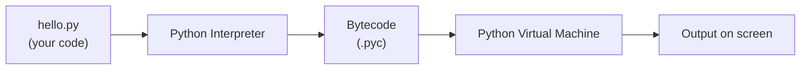

# Introduction to Python

!!! abstract "Learning Objectives"
    By the end of this lesson, you can:

    - Explain what Python is and why companies use it
    - Install Python and VS Code on Windows or macOS
    - Write, save and run your first Python program
    - Describe what happens when Python runs your code
    - Use comments and indentation correctly

**Prerequisites:** None. You only need a computer and the ability to install software.

## What is Python?

**Python** is a programming language. A programming language is a way to give instructions to a computer in a form that both humans and computers can understand.

Think of it like this:

!!! example "Real-life analogy: a recipe"
    A **recipe** is a list of steps a cook follows: *boil water, add rice, wait 15 minutes*.
    A **program** is a list of steps a computer follows: *read the marks, add them up, print the total*.
    **Python** is the language you write that recipe in.

Here is a complete Python program:

```python
print("Hello, World!")
```

```{ .text .output }
Hello, World!
```

That is it. One line. In many other languages, the same program needs five or more lines. This simplicity is the main reason Python is the most popular first language.

**Key facts about Python**

| Fact | Detail |
|------|--------|
| Created by | Guido van Rossum, first released in 1991 |
| Named after | *Monty Python's Flying Circus* (a comedy show), not the snake |
| Type | High-level, interpreted, general-purpose |
| Current version | Python 3 (Python 2 is dead; never learn it) |
| Cost | Free and open source |

## Why Learn Python?

1. **Easy to read.** Python code looks almost like English.
2. **Less code, more work.** Tasks that take 20 lines in other languages often take 5 in Python.
3. **Huge demand.** Python is used in web development, data science, AI, automation and testing, so one language opens many job paths.
4. **Massive library ecosystem.** Ready-made code (libraries) exists for almost everything: websites (Django, FastAPI), data (Pandas), AI (PyTorch, LangChain).
5. **Big community.** Any error you get, someone has already solved it online.

Compare the same program in Java and Python:

=== "Python"

    ```python
    print("Welcome to KSR Trainings")
    ```

=== "Java"

    ```java
    public class Main {
        public static void main(String[] args) {
            System.out.println("Welcome to KSR Trainings");
        }
    }
    ```

Both print the same line. Python lets you focus on **what** you want to do, not on the ceremony around it.

## Where Python Is Used

!!! realworld "In Real Projects"
    - **Instagram** runs one of the world's largest Django (Python) deployments.
    - **Netflix** uses Python for its recommendation engine and internal tools.
    - **Swiggy, Zomato and Flipkart** use Python for data pipelines and machine learning.
    - **ChatGPT-style AI apps** are mostly built with Python libraries.

| Area | What Python does | Popular tools |
|------|------------------|---------------|
| Web development | Builds the backend of websites and APIs | Django, FastAPI, Flask |
| Data analysis | Cleans and analyses data | Pandas, NumPy |
| AI & Machine Learning | Trains models, builds AI apps | PyTorch, scikit-learn, LangChain |
| Automation | Automates boring tasks (files, emails, Excel) | os, openpyxl, Selenium |
| Testing | Writes automated tests | pytest |

In this course you will use Python for **web development**: building backends with Django and FastAPI that connect to MySQL and serve data to a React frontend.

## Installing Python

You need two things:

1. **Python**: the language itself (the interpreter that runs your code)
2. **VS Code**: an editor where you write your code

=== "Windows"

    1. Go to [python.org/downloads](https://www.python.org/downloads/) and download the latest **Python 3** installer.
    2. Run the installer.
    3. **Tick the box "Add python.exe to PATH"** at the bottom of the first screen. This is the most important step.
    4. Click **Install Now**.
    5. Open **Command Prompt** and check:

    ```bash
    python --version
    ```

    ```{ .text .output }
    Python 3.12.7
    ```

=== "macOS"

    1. Go to [python.org/downloads](https://www.python.org/downloads/) and download the latest **Python 3** installer for macOS.
    2. Open the `.pkg` file and follow the steps.
    3. Open **Terminal** and check:

    ```bash
    python3 --version
    ```

    ```{ .text .output }
    Python 3.12.7
    ```

    On macOS, always type `python3` (not `python`).

Then install the editor:

1. Download **VS Code** from [code.visualstudio.com](https://code.visualstudio.com/).
2. Open VS Code → **Extensions** (left sidebar) → search **Python** → install the one by **Microsoft**.

!!! mistake "Common Mistake: 'python' is not recognized"
    On Windows, if you see `'python' is not recognized as an internal or external command`, you forgot to tick **Add python.exe to PATH**. Run the installer again, choose **Modify**, and enable it. Then close and reopen Command Prompt.

## Your First Program

**Step 1.** Create a folder called `python-course` anywhere on your computer and open it in VS Code (**File → Open Folder**).

**Step 2.** Create a new file called `hello.py`. The `.py` extension tells the computer this is a Python file.

**Step 3.** Type this code (don't copy-paste; typing helps you learn):

```python
# My first Python program
print("Hello, World!")
print("My name is Ravi")
print("I am learning Python at KSR Trainings")
```

**Step 4.** Save the file (++ctrl+s++ on Windows, ++cmd+s++ on macOS).

**Step 5.** Run it. Either click the **▶ Run** button at the top right of VS Code, or open the terminal (**View → Terminal**) and type:

```bash
python hello.py
```

```{ .text .output }
Hello, World!
My name is Ravi
I am learning Python at KSR Trainings
```

**What each part means**

| Code | Meaning |
|------|---------|
| `# My first Python program` | A **comment**. Python ignores it. It's a note for humans. |
| `print(...)` | A built-in **function** that displays something on the screen |
| `"Hello, World!"` | A **string**: text inside quotes |

Python runs the lines **top to bottom, one at a time**. Change the order of lines and the output order changes too.

`print()` can show numbers and do maths as well:

```python
print(10 + 5)
print("Total marks:", 85 + 90 + 78)
print("Python", "is", "fun")
```

```{ .text .output }
15
Total marks: 253
Python is fun
```

When you give `print()` several values separated by commas, it prints them with a space in between.

## How Python Runs Your Code

Computers only understand **machine code** (0s and 1s). Python code has to be translated first. A program called the **Python interpreter** does this.



1. You write code in `hello.py`.
2. The interpreter checks it for **syntax errors** (spelling and grammar mistakes in code).
3. It converts the code into **bytecode**, a simpler form.
4. The **Python Virtual Machine (PVM)** runs the bytecode line by line and shows the output.

This is why Python is called an **interpreted language**: you run the `.py` file directly, without a separate "compile" step like in Java or C.

!!! tip "Interpreted vs compiled, in one line"
    **Compiled** (C, Java): translate the whole book first, then read it. **Interpreted** (Python): a translator reads it to you line by line.

## Python Interactive Shell (REPL)

Python also has an **interactive mode** where you type one line and see the result immediately. It's great for quick experiments.

Open a terminal and type `python` (Windows) or `python3` (macOS):

```pycon
>>> 2 + 3
5
>>> print("Hi")
Hi
>>> 10 * 4
40
>>> exit()
```

The `>>>` is Python waiting for your input. This mode is called the **REPL**: **R**ead, **E**valuate, **P**rint, **L**oop.

| Use the REPL for | Use a `.py` file for |
|------------------|----------------------|
| Testing a single line quickly | Programs you want to save and run again |
| Checking how a function behaves | Anything longer than a few lines |

## Comments and Indentation

### Comments

Comments are notes for humans. Python ignores them.

```python
# This is a single-line comment

print("Hello")  # A comment can also go at the end of a line

"""
This is a multi-line string.
It is often used as a multi-line comment
or to describe what a file or function does.
"""
```

Write comments to explain **why** you did something, not **what** the code obviously does.

### Indentation

**Indentation** means the spaces at the start of a line. In most languages it's only for looks. **In Python, indentation is part of the grammar.** It shows which lines belong together.

```python
marks = 75

if marks >= 35:
    print("Pass")          # indented: belongs to the if
    print("Well done!")    # indented: belongs to the if
print("Result checked")    # not indented: always runs
```

```{ .text .output }
Pass
Well done!
Result checked
```

Use **4 spaces** per level. VS Code inserts them automatically when you press ++tab++.

!!! mistake "Common Mistake: IndentationError"
    ```python
    if marks >= 35:
    print("Pass")
    ```

    ```{ .text .output }
    IndentationError: expected an indented block after 'if' statement on line 1
    ```

    **Fix:** indent the line under `if` by 4 spaces.

## Common Mistakes

| Mistake | Error you will see | Fix |
|---------|-------------------|-----|
| `Print("Hi")` with a capital P | `NameError: name 'Print' is not defined` | Python is case-sensitive. Use `print` |
| `print("Hi)` with a missing quote | `SyntaxError: unterminated string literal` | Close the quotes: `"Hi"` |
| `print "Hi"` without brackets | `SyntaxError: Missing parentheses in call to 'print'` | That's Python 2 style. Use `print("Hi")` |
| Saved as `hello.txt` | Code doesn't run | Save as `hello.py` |
| Extra space at the start of a line | `IndentationError: unexpected indent` | Remove the space |
| `python` not found on Windows | `'python' is not recognized...` | Reinstall with **Add to PATH** ticked |

!!! tip "Read the last line of the error first"
    Python error messages look scary, but the **last line** tells you the error type and the reason. The line number above it tells you where to look.

## Practice Exercises

**Easy**

1. Print your name, your city and your favourite food on three separate lines.
2. Print the result of `25 * 4`.
3. Print `Python`, `Java` and `React` on one line, separated by spaces, using a single `print()`.

**Medium**

4. Print this pattern exactly:
    ```text
    *
    **
    ***
    ```
5. Your marks are 78, 85 and 92. Print the total and the average with labels, like `Total: 255`.
6. Open the REPL and find the result of `17 / 5`, `17 // 5` and `17 % 5`. Write down what you think each one does.

**Challenge**

7. Write a program that prints a simple ID card using `print()`, with a border made of `=` characters, your name, course name and batch.

??? success "Solutions (click to expand)"

    ```python
    # 1
    print("Ravi")
    print("Hyderabad")
    print("Biryani")

    # 2
    print(25 * 4)

    # 3
    print("Python", "Java", "React")

    # 4
    print("*")
    print("**")
    print("***")

    # 5
    print("Total:", 78 + 85 + 92)
    print("Average:", (78 + 85 + 92) / 3)

    # 6: 17 / 5 = 3.4 (division), 17 // 5 = 3 (whole-number division), 17 % 5 = 2 (remainder)

    # 7
    print("==============================")
    print("  KSR TRAININGS - STUDENT ID")
    print("==============================")
    print("  Name   : Ravi Kumar")
    print("  Course : Full Stack Python")
    print("  Batch  : Nov 2026")
    print("==============================")
    ```

!!! note "Mini Assignment"
    Create a file `about_me.py` that prints a short introduction: your name, your background (what you studied or worked as), why you want to become a developer, and one goal for this course. Use at least one comment. Run it and share the output with your trainer.

## Interview Questions

!!! interview "1. What is Python?"
    Python is a high-level, interpreted, general-purpose programming language known for its simple, readable syntax. It supports multiple styles of programming (procedural, object-oriented and functional) and is widely used for web development, data science, AI and automation.

!!! interview "2. Is Python compiled or interpreted?"
    Python is generally called **interpreted**. Internally, the source code is first compiled to **bytecode** (`.pyc`), which is then executed by the **Python Virtual Machine** line by line. There is no separate compile step for the developer.

!!! interview "3. Why is indentation important in Python?"
    Python uses indentation to define **blocks of code** (for example, the body of an `if`, a loop or a function), where other languages use curly braces `{}`. Wrong indentation causes an `IndentationError` or changes the program's logic.

!!! interview "4. What are the key features of Python?"
    Easy to read and write, interpreted, dynamically typed (no need to declare variable types), free and open source, cross-platform, a large standard library, and a huge ecosystem of third-party packages.

!!! interview "5. What is the difference between Python 2 and Python 3?"
    Python 3 is the current version; Python 2 reached end of life in 2020. Key differences: `print` is a function in Python 3 (`print("hi")`), text is Unicode by default, and `/` returns a decimal result (`5 / 2 = 2.5`). Always use Python 3.

!!! interview "Scenario: Your program shows `NameError: name 'Print' is not defined`. What is wrong?"
    Python is **case-sensitive**. `Print` and `print` are different names. The built-in function is lowercase `print`, so `Print` is undefined. Fix the capitalisation.

## Summary

| Concept | Remember |
|---------|----------|
| Python | Simple, readable, interpreted language used in web, data, AI and automation |
| Install | Python 3 from python.org (**tick Add to PATH** on Windows) + VS Code with the Python extension |
| Run a file | `python hello.py` (Windows) or `python3 hello.py` (macOS) |
| `print()` | Displays output; commas add spaces between values |
| Comments | Start with `#`; Python ignores them |
| Indentation | 4 spaces; defines code blocks; wrong indentation = error |
| REPL | Interactive mode (`>>>`) for quick experiments |
| Errors | Read the **last line** first |

**Next lesson:** [Variables in Python](02-variables.md), where you'll learn how to store and reuse data.
