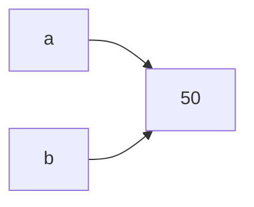

# Variables in Python

!!! abstract "Learning Objectives"
    By the end of this lesson, you can:

    - Explain what a variable is and why programs need them
    - Create, update and print variables
    - Follow Python's naming rules and conventions
    - Assign multiple variables in one line and swap values
    - Understand that variables are labels pointing to values

**Prerequisites:** [Introduction to Python](01-introduction-to-python.md): you can write and run a `.py` file.

## What is a Variable?

A **variable** is a name that stores a value so you can use it later.

!!! example "Real-life analogy: labelled boxes"
    Imagine boxes in a storeroom. Each box has a **label** (`marks`, `name`, `city`) and something **inside** it (`85`, `"Ravi"`, `"Hyderabad"`). When you need the value, you don't search every box. You read the label.

    A variable is the label. The value is what's in the box.

Without variables, you would have to repeat the same value everywhere:

```python
print("Ravi scored", 85)
print("Ravi's grade is based on", 85)
print("Ravi needs", 100 - 85, "more marks for full score")
```

If Ravi's marks change, you must edit three lines. With a variable, you change it once:

```python
name = "Ravi"
marks = 85

print(name, "scored", marks)
print(name + "'s grade is based on", marks)
print(name, "needs", 100 - marks, "more marks for full score")
```

```{ .text .output }
Ravi scored 85
Ravi's grade is based on 85
Ravi needs 15 more marks for full score
```

## Creating Variables

In Python you create a variable by **assigning** a value with `=`:

```python
student_name = "Priya"
age = 22
height = 5.4
is_placed = False

print(student_name)
print(age)
print(height)
print(is_placed)
```

```{ .text .output }
Priya
22
5.4
False
```

Read `age = 22` as **"age is assigned 22"**, not "age equals 22". The `=` sign means *store the value on the right into the name on the left*.

!!! tip "No declaration needed"
    In Java you must write the type: `int age = 22;`. In Python you just write `age = 22`. Python figures out the type itself. This is called **dynamic typing**.

## Updating Variables

A variable's value can change. That's why it's called a *variable*.

```python
balance = 1000
print("Start:", balance)

balance = balance + 500     # deposit
print("After deposit:", balance)

balance = balance - 200     # withdrawal
print("After withdrawal:", balance)
```

```{ .text .output }
Start: 1000
After deposit: 1500
After withdrawal: 1300
```

`balance = balance + 500` means: take the current value of `balance`, add 500, and store the result back in `balance`.

Python has shortcuts for this, called **compound assignment**:

| Long form | Short form |
|-----------|------------|
| `x = x + 5` | `x += 5` |
| `x = x - 5` | `x -= 5` |
| `x = x * 5` | `x *= 5` |
| `x = x / 5` | `x /= 5` |

```python
likes = 10
likes += 1
likes += 1
print(likes)
```

```{ .text .output }
12
```

A variable can even change to a different **type** of value:

```python
data = 100
print(data)
data = "one hundred"
print(data)
```

```{ .text .output }
100
one hundred
```

This is allowed, but avoid it in real code. It confuses whoever reads your program next.

## Naming Rules and Conventions

### Rules (break these and you get an error)

1. Names can contain **letters, digits and underscores** (`_`) only.
2. Names **cannot start with a digit**.
3. Names are **case-sensitive**: `Marks`, `marks` and `MARKS` are three different variables.
4. Names **cannot be Python keywords** like `if`, `for`, `class`, `True`.

| Name | Valid? | Why |
|------|--------|-----|
| `total_marks` | ✅ | Letters and underscore |
| `marks2` | ✅ | Digit not at the start |
| `_count` | ✅ | Starting with `_` is allowed |
| `2marks` | ❌ | Starts with a digit |
| `total-marks` | ❌ | `-` is the minus sign |
| `total marks` | ❌ | Spaces are not allowed |
| `class` | ❌ | `class` is a keyword |

To see all keywords:

```python
import keyword
print(keyword.kwlist)
```

### Conventions (what professional developers follow)

- Use **snake_case**: lowercase words joined by underscores: `first_name`, `total_price`.
- Use **meaningful names**: `marks` not `m`, `customer_email` not `ce`.
- Use **UPPER_CASE** for values that should never change (constants): `MAX_LOGIN_ATTEMPTS = 3`.

=== "Good names"

    ```python
    customer_name = "Anita"
    order_total = 2499.50
    MAX_CART_ITEMS = 20
    ```

=== "Bad names"

    ```python
    a = "Anita"
    x1 = 2499.50
    CustomerName = "Anita"   # works, but this style is for classes
    ```

!!! realworld "In Real Projects"
    Companies follow **PEP 8**, Python's official style guide. Code reviews in product companies often reject code with names like `x`, `temp1` or `data2` because nobody can tell what they hold. Good names are the cheapest documentation you can write.

## Multiple Assignment

Assign several variables in one line:

```python
name, age, city = "Kiran", 24, "Pune"
print(name)
print(age)
print(city)
```

```{ .text .output }
Kiran
24
Pune
```

Give the same value to several variables:

```python
x = y = z = 0
print(x, y, z)
```

```{ .text .output }
0 0 0
```

### Swapping two values

In most languages you need a third, temporary variable to swap. Python does it in one line:

```python
a = 10
b = 20
a, b = b, a
print("a =", a)
print("b =", b)
```

```{ .text .output }
a = 20
b = 10
```

!!! interview "Popular interview question"
    *"Swap two variables without a third variable."* In Python the answer is `a, b = b, a`.

## How Variables Work Behind the Scenes

In Python, a variable is a **label attached to an object in memory**. It is not a box that holds the value itself.

```python
a = 50
b = a
print(id(a))
print(id(b))
```

```{ .text .output }
4371229264
4371229264
```

`id()` shows an object's memory address (your numbers will be different). Both are the same, so `a` and `b` are two labels on **one** object.



When you assign a new value, the label moves. The old object is not changed:

```python
a = 50
b = a
a = 99
print(a, b)
```

```{ .text .output }
99 50
```

`a` now points to `99`; `b` still points to `50`. This idea becomes very important when you learn lists in a later lesson.

## Common Mistakes

| Mistake | Error you will see | Fix |
|---------|-------------------|-----|
| Using a variable before creating it | `NameError: name 'total' is not defined` | Assign it first: `total = 0` |
| Spelling it differently: `Marks` vs `marks` | `NameError: name 'Marks' is not defined` | Names are case-sensitive; use the exact spelling |
| `2nd_place = "Ravi"` | `SyntaxError: invalid decimal literal` | Don't start names with a digit |
| `first name = "Ravi"` | `SyntaxError: invalid syntax` | Use `first_name` |
| `if = 5` | `SyntaxError: invalid syntax` | Don't use keywords as names |
| `print = 10`, then `print("hi")` | `TypeError: 'int' object is not callable` | Never reuse built-in names like `print`, `input`, `list`, `str` |

!!! mistake "Common Mistake: overwriting a built-in"
    ```python
    list = [1, 2, 3]
    numbers = list("abc")
    ```

    ```{ .text .output }
    TypeError: 'list' object is not callable
    ```

    You replaced Python's built-in `list` with your own variable. Pick a different name, like `numbers` or `items`.

## Practice Exercises

**Easy**

1. Create variables for your name, age and city and print them on separate lines.
2. Create `price = 499` and `quantity = 3`. Print the total cost.
3. Which of these names are valid? `user1`, `1user`, `user_name`, `user-name`, `_user`, `for`

**Medium**

4. Start with `score = 0`. Add 10, add 25, subtract 5 using compound assignment. Print the final score.
5. Swap the values of `first = "Java"` and `second = "Python"` in one line and print both.
6. Store the length and width of a rectangle in variables and print its area and perimeter.

**Challenge**

7. A shopping cart has three items priced 1200, 850 and 399. Store them in variables, calculate the subtotal, add 18% GST, and print the subtotal, GST amount and final total with labels.

??? success "Solutions (click to expand)"

    ```python
    # 1
    name = "Ravi"
    age = 23
    city = "Hyderabad"
    print(name)
    print(age)
    print(city)

    # 2
    price = 499
    quantity = 3
    print("Total:", price * quantity)        # Total: 1497

    # 3: valid: user1, user_name, _user | invalid: 1user, user-name, for

    # 4
    score = 0
    score += 10
    score += 25
    score -= 5
    print(score)                             # 30

    # 5
    first = "Java"
    second = "Python"
    first, second = second, first
    print(first, second)                     # Python Java

    # 6
    length = 10
    width = 4
    print("Area:", length * width)           # Area: 40
    print("Perimeter:", 2 * (length + width))  # Perimeter: 28

    # 7
    item1 = 1200
    item2 = 850
    item3 = 399
    subtotal = item1 + item2 + item3
    gst = subtotal * 18 / 100
    total = subtotal + gst
    print("Subtotal:", subtotal)             # Subtotal: 2449
    print("GST:", gst)                       # GST: 440.82
    print("Total:", total)                   # Total: 2889.82
    ```

!!! note "Mini Assignment"
    Write `profile.py` that stores a student profile in variables: name, email, phone, course, batch, fees paid and fees total. Print a neat profile card and the **pending fee** (total minus paid). Use snake_case names and one constant in UPPER_CASE.

## Interview Questions

!!! interview "1. What is a variable in Python?"
    A variable is a name that refers to a value (an object) stored in memory. It's created the moment you assign a value to it with `=`; no separate declaration is needed.

!!! interview "2. What does 'dynamically typed' mean?"
    The type of a variable is decided at **runtime** from the value assigned, not declared in advance. The same variable can later refer to a value of a different type: `x = 5` then `x = "five"`.

!!! interview "3. What are the rules for naming variables?"
    Letters, digits and underscores only; cannot start with a digit; case-sensitive; cannot be a keyword. By convention (PEP 8), use `snake_case` for variables and `UPPER_CASE` for constants.

!!! interview "4. How do you swap two variables in Python?"
    `a, b = b, a`. Python builds a tuple of the right-hand values and unpacks it into the left-hand names, so no temporary variable is needed.

!!! interview "5. If `b = a` and then `a` is reassigned, does `b` change?"
    No. `b = a` makes `b` point to the same object `a` pointed to. Reassigning `a` only moves the label `a` to a new object; `b` still points to the old one.

!!! interview "Scenario: `print(\"hi\")` suddenly fails with `TypeError: 'str' object is not callable`. Why?"
    Somewhere earlier in the program, someone wrote `print = "something"`, overwriting the built-in `print` function with a string. Rename that variable and restart the program.

## Summary

| Concept | Remember |
|---------|----------|
| Variable | A name that refers to a value |
| Create | `name = value` with no type declaration |
| Update | `x = x + 1` or `x += 1` |
| Naming | letters/digits/`_`, no leading digit, case-sensitive, no keywords |
| Style | `snake_case` for variables, `UPPER_CASE` for constants |
| Multiple | `a, b, c = 1, 2, 3` and `x = y = 0` |
| Swap | `a, b = b, a` |
| Behind the scenes | Variables are labels; `id()` shows the object they point to |

**Next lesson:** [Data Types in Python](03-data-types.md), the kinds of values variables can hold.
