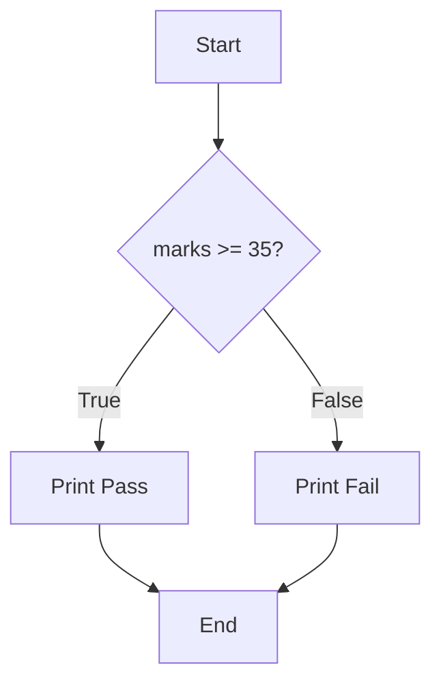

# Conditional Statements

!!! abstract "Learning Objectives"
    By the end of this lesson, you can:

    - Make decisions with `if`, `if-else` and `if-elif-else`
    - Combine conditions using `and`, `or`, `not`
    - Write nested conditions and know when to avoid them
    - Use the one-line conditional (ternary) expression
    - Use `match-case` for multiple fixed options

**Prerequisites:** [Operators in Python](04-operators.md) and [Input, Output & Type Conversion](05-input-output-type-conversion.md)

## Why Do We Need Conditions?

So far, every program ran **every line, top to bottom**. Real programs must **decide**:

- *If* the password is correct, log in; *otherwise* show an error.
- *If* the cart total is above ₹499, delivery is free.
- *If* marks are 90 or more, grade A; *else if* 75 or more, grade B; and so on.

!!! example "Real-life analogy: a traffic signal"
    **If** the light is green, go. **Else if** it's yellow, slow down. **Else** (red), stop. Your brain checks the conditions in order and takes exactly **one** action.



## The if Statement

```python
temperature = 38

if temperature > 35:
    print("It's very hot today")
    print("Drink plenty of water")

print("Have a nice day")
```

```{ .text .output }
It's very hot today
Drink plenty of water
Have a nice day
```

**Syntax rules:**

1. `if`, then a **condition**, then a **colon** `:`
2. The lines that belong to the `if` are **indented** by 4 spaces. This is the **block**.
3. The first line that is **not** indented is outside the `if` and always runs.

Change `temperature` to `30` and only `Have a nice day` prints.

## if-else

`else` runs when the condition is **False**. Exactly one of the two blocks runs.

```python
age = int(input("Enter your age: "))

if age >= 18:
    print("You are eligible to vote")
else:
    print(f"You can vote in {18 - age} year(s)")
```

```{ .text .output }
Enter your age: 15
You can vote in 3 year(s)
```

```python
number = 7

if number % 2 == 0:
    print(f"{number} is even")
else:
    print(f"{number} is odd")
```

```{ .text .output }
7 is odd
```

## if-elif-else

Use `elif` (short for "else if") to check **several conditions in order**. Python runs the **first** block whose condition is `True` and skips the rest.

```python
marks = 82

if marks >= 90:
    grade = "A"
elif marks >= 75:
    grade = "B"
elif marks >= 60:
    grade = "C"
elif marks >= 35:
    grade = "D"
else:
    grade = "F"

print(f"Marks: {marks}, Grade: {grade}")
```

```{ .text .output }
Marks: 82, Grade: B
```

`82 >= 90` is false, so Python checks `82 >= 75`. That's true, so it sets `B` and **skips all remaining checks**.

!!! mistake "Common Mistake: wrong order"
    ```python
    if marks >= 35:
        grade = "D"
    elif marks >= 90:
        grade = "A"     # never reached for 95!
    ```

    95 is also `>= 35`, so it gets `D`. Always check the **most specific / highest** condition first.

!!! realworld "In Real Projects"
    E-commerce delivery charges are a classic `if-elif-else`:

    ```python
    cart_total = 650
    if cart_total >= 499:
        delivery = 0
    elif cart_total >= 199:
        delivery = 40
    else:
        delivery = 80
    print(f"Delivery charge: ₹{delivery}")
    ```

    ```{ .text .output }
    Delivery charge: ₹0
    ```

## Combining Conditions

Use logical operators to check multiple things at once.

```python
email = "ravi@example.com"
password = "Secret@123"

if email == "ravi@example.com" and password == "Secret@123":
    print("Login successful")
else:
    print("Invalid email or password")
```

```{ .text .output }
Login successful
```

```python
day = "Sunday"

if day == "Saturday" or day == "Sunday":
    print("Weekend!")
```

```{ .text .output }
Weekend!
```

The `or` check can be written more cleanly with `in`:

```python
if day in ("Saturday", "Sunday"):
    print("Weekend!")
```

### Truthy and falsy conditions

A condition doesn't have to be a comparison. Any value works: empty and zero values count as `False`.

```python
name = input("Enter your name: ").strip()

if name:
    print(f"Hello, {name}")
else:
    print("Name cannot be empty")
```

```{ .text .output }
Enter your name:
Name cannot be empty
```

## Nested Conditions

An `if` inside another `if`:

```python
has_account = True
balance = 1500
amount = 2000

if has_account:
    if balance >= amount:
        print("Withdrawal successful")
    else:
        print("Insufficient balance")
else:
    print("Please open an account first")
```

```{ .text .output }
Insufficient balance
```

!!! tip "Keep nesting shallow"
    More than 2–3 levels of nesting is hard to read. Often you can flatten it with `and`, or by handling the "bad" case first:

    ```python
    if not has_account:
        print("Please open an account first")
    elif balance < amount:
        print("Insufficient balance")
    else:
        print("Withdrawal successful")
    ```

## Ternary Operator and match-case

### One-line conditional (ternary expression)

When you just need to pick one of two **values**:

```python
age = 20
status = "Adult" if age >= 18 else "Minor"
print(status)

stock = 0
print("In stock" if stock > 0 else "Out of stock")
```

```{ .text .output }
Adult
Out of stock
```

Format: `value_if_true if condition else value_if_false`. Use it for simple choices only. If it doesn't fit comfortably on one line, use a normal `if-else`.

### `match-case` (Python 3.10+)

When you compare **one value** against many **fixed options**, `match-case` is cleaner than a long `elif` chain.

```python
command = "stop"

match command:
    case "start":
        print("Starting the server...")
    case "stop":
        print("Stopping the server...")
    case "restart":
        print("Restarting...")
    case _:
        print("Unknown command")
```

```{ .text .output }
Stopping the server...
```

`case _:` is the default. It matches anything not matched above, like `else`. Several values can share a case with `|`:

```python
day = "Sun"
match day:
    case "Sat" | "Sun":
        print("Weekend")
    case _:
        print("Weekday")
```

```{ .text .output }
Weekend
```

## Common Mistakes

| Mistake | Error / Result | Fix |
|---------|---------------|-----|
| Missing colon: `if x > 5` | `SyntaxError: expected ':'` | `if x > 5:` |
| Block not indented | `IndentationError: expected an indented block` | Indent by 4 spaces |
| `if x = 5:` | `SyntaxError` | Use `==` |
| `else if` | `SyntaxError` | Python uses `elif` |
| `if day == "Sat" or "Sun":` | Always `True`! | `if day == "Sat" or day == "Sun":` or `if day in ("Sat", "Sun"):` |
| Conditions in the wrong order | Wrong branch runs | Check the most specific / highest values first |
| Comparing input to a number without converting | Condition never true | `int(input(...))` |

!!! mistake "Why is `if day == \"Sat\" or \"Sun\":` always true?"
    Python reads it as `(day == "Sat") or ("Sun")`. The string `"Sun"` is non-empty, so it's truthy, and the whole condition is always `True`.

## Practice Exercises

**Easy**

1. Ask for a number and print whether it is positive, negative or zero.
2. Ask for a year and print whether it is a leap year.
3. Ask for two numbers and print the larger one (use a ternary expression).

**Medium**

4. Ask for the three sides of a triangle and print whether it's equilateral, isosceles or scalene.
5. Electricity bill: first 100 units at ₹3/unit, next 100 at ₹5/unit, above 200 at ₹8/unit. Ask for units used and print the bill.
6. Ask for a character and print whether it is a vowel, a consonant, a digit or a special character.

**Challenge**

7. **ATM simulation:** the stored PIN is `4321` and the balance is ₹10,000. Ask for the PIN; if it's wrong, print an error. If it's correct, ask for the withdrawal amount and check: it must be a multiple of 100, must not exceed the balance, and must not exceed the daily limit of ₹20,000. Print the result and the remaining balance.

??? success "Solutions (click to expand)"

    ```python
    # 1
    n = float(input("Number: "))
    if n > 0:
        print("Positive")
    elif n < 0:
        print("Negative")
    else:
        print("Zero")

    # 2
    year = int(input("Year: "))
    if (year % 4 == 0 and year % 100 != 0) or year % 400 == 0:
        print("Leap year")
    else:
        print("Not a leap year")

    # 3
    a = float(input("a: "))
    b = float(input("b: "))
    print(a if a > b else b)

    # 4
    x, y, z = (float(input(f"Side {i}: ")) for i in (1, 2, 3))
    if x == y == z:
        print("Equilateral")
    elif x == y or y == z or x == z:
        print("Isosceles")
    else:
        print("Scalene")

    # 5
    units = int(input("Units: "))
    if units <= 100:
        bill = units * 3
    elif units <= 200:
        bill = 100 * 3 + (units - 100) * 5
    else:
        bill = 100 * 3 + 100 * 5 + (units - 200) * 8
    print(f"Bill: ₹{bill}")

    # 6
    ch = input("Character: ")
    if ch.lower() in "aeiou" and ch.isalpha():
        print("Vowel")
    elif ch.isalpha():
        print("Consonant")
    elif ch.isdigit():
        print("Digit")
    else:
        print("Special character")

    # 7
    PIN = 4321
    balance = 10000
    DAILY_LIMIT = 20000

    pin = int(input("Enter PIN: "))
    if pin != PIN:
        print("Incorrect PIN")
    else:
        amount = int(input("Amount: "))
        if amount % 100 != 0:
            print("Amount must be a multiple of 100")
        elif amount > DAILY_LIMIT:
            print("Exceeds daily limit")
        elif amount > balance:
            print("Insufficient balance")
        else:
            balance -= amount
            print(f"Please collect ₹{amount}. Remaining balance: ₹{balance}")
    ```

!!! note "Mini Assignment"
    Complete the `bmi.py` program from the previous lesson: after calculating BMI, print the category: **Underweight** (< 18.5), **Normal** (18.5–24.9), **Overweight** (25–29.9), **Obese** (30+). Add a friendly health tip for each category.

## Interview Questions

!!! interview "1. What is the difference between `if-elif` and multiple `if` statements?"
    In an `if-elif-else` chain, only the **first** true branch runs and the rest are skipped. With separate `if` statements, **every** condition is checked independently, so several blocks may run.

!!! interview "2. What is the ternary operator in Python?"
    A conditional expression that picks one of two values in a single line: `x if condition else y`. Example: `status = "Adult" if age >= 18 else "Minor"`.

!!! interview "3. Does Python have a switch statement?"
    Not a classic `switch`, but Python 3.10 introduced **structural pattern matching** with `match-case`, which covers switch-like use and more (matching on types, sequences and dict shapes). `case _` acts as the default.

!!! interview "4. What values are considered False in a condition?"
    `False`, `None`, `0`, `0.0`, empty string `""`, and empty collections `[]`, `()`, `{}`, `set()`. Everything else is truthy.

!!! interview "5. What is the `pass` statement?"
    A placeholder that does nothing. A block can't be empty in Python, so `pass` is used when the syntax needs a statement but you haven't written the logic yet: `if x > 0: pass`.

!!! interview "Scenario: `if role == \"admin\" or \"manager\":` lets every user into the admin panel. Why?"
    It's evaluated as `(role == "admin") or "manager"`. `"manager"` is a non-empty string, so it's truthy, and the condition is always `True`. Fix: `if role in ("admin", "manager"):`.

## Summary

| Concept | Syntax |
|---------|--------|
| if | `if cond:` + indented block |
| if-else | exactly one of two blocks runs |
| if-elif-else | first true branch runs; order matters |
| Combine | `and`, `or`, `not`, `in (...)` |
| Truthy / falsy | empty and zero values are `False` |
| Nested | `if` inside `if`; keep it shallow |
| Ternary | `a if cond else b` |
| match-case | `match x:` / `case "v":` / `case _:` (Python 3.10+) |

**Next lesson:** [Loops in Python](08-loops.md), repeating work with `for` and `while`.
