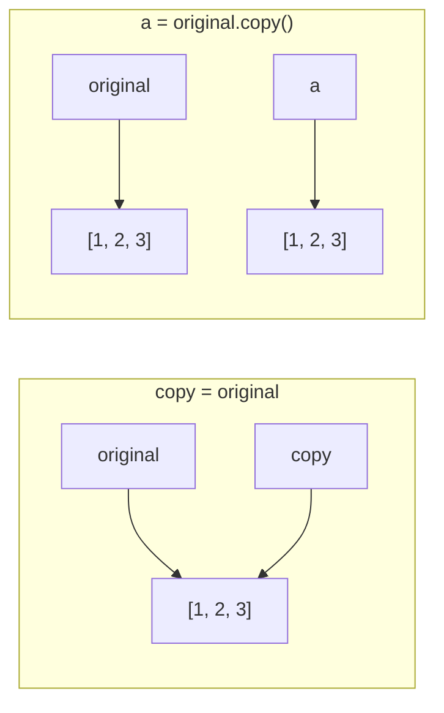

# Lists in Python

!!! abstract "Learning Objectives"
    By the end of this lesson, you can:

    - Create lists and access items with indexing and slicing
    - Add, change and remove items
    - Use the important list methods: `sort`, `reverse`, `index`, `count`, `copy`
    - Loop through lists and build new lists
    - Copy lists correctly and work with nested lists

**Prerequisites:** [Loops in Python](08-loops.md) and [Strings in Python](06-strings.md)

## What is a List?

A **list** is an ordered collection of items stored in **one variable**.

```python
fruits = ["apple", "banana", "mango"]
marks = [85, 92, 78, 66]
mixed = ["Ravi", 23, 5.9, True]
empty = []

print(fruits)
print(type(fruits))
print(len(marks))
```

```{ .text .output }
['apple', 'banana', 'mango']
<class 'list'>
4
```

!!! example "Real-life analogy: a shopping list"
    A shopping list keeps items **in order**, lets you **add** or **cross out** items, can contain the **same item twice**, and you can say "the 3rd item". Python lists work exactly the same way.

**Key characteristics**

| Property | Meaning |
|----------|---------|
| Ordered | Items keep the order you added them |
| Mutable | You can add, change and remove items |
| Allows duplicates | `[1, 1, 2]` is fine |
| Mixed types | One list can hold strings, numbers, even other lists |

## Creating Lists

```python
# Square brackets
cities = ["Hyderabad", "Pune", "Chennai"]

# From another sequence with list()
letters = list("Python")
numbers = list(range(1, 6))

# Repetition
zeros = [0] * 5

print(letters)
print(numbers)
print(zeros)
```

```{ .text .output }
['P', 'y', 't', 'h', 'o', 'n']
[1, 2, 3, 4, 5]
[0, 0, 0, 0, 0]
```

From user input, using `split()`:

```python
skills = input("Enter skills separated by commas: ").split(",")
print(skills)
```

```{ .text .output }
Enter skills separated by commas: Python,SQL,React
['Python', 'SQL', 'React']
```

## Indexing and Slicing

Lists use the same indexing and slicing as strings.

```python
fruits = ["apple", "banana", "mango", "orange", "grape"]

print(fruits[0])       # first
print(fruits[-1])      # last
print(fruits[1:4])     # index 1, 2, 3
print(fruits[:2])      # first two
print(fruits[::-1])    # reversed copy
```

```{ .text .output }
apple
grape
['banana', 'mango', 'orange']
['apple', 'banana']
['grape', 'orange', 'mango', 'banana', 'apple']
```

Check if an item exists with `in`:

```python
print("mango" in fruits)
print("kiwi" in fruits)
```

```{ .text .output }
True
False
```

## Changing and Adding Items

Lists are **mutable**: unlike strings, you can change them in place.

```python
fruits = ["apple", "banana", "mango"]
fruits[1] = "kiwi"
print(fruits)
```

```{ .text .output }
['apple', 'kiwi', 'mango']
```

### Adding items

| Method | What it does |
|--------|--------------|
| `append(x)` | Adds **one** item at the end |
| `insert(i, x)` | Adds an item at position `i` |
| `extend(seq)` | Adds **all** items from another sequence |

```python
cart = ["laptop"]

cart.append("mouse")
print(cart)

cart.insert(0, "bag")
print(cart)

cart.extend(["keyboard", "monitor"])
print(cart)
```

```{ .text .output }
['laptop', 'mouse']
['bag', 'laptop', 'mouse']
['bag', 'laptop', 'mouse', 'keyboard', 'monitor']
```

!!! mistake "Common Mistake: append vs extend"
    ```python
    cart = ["laptop"]
    cart.append(["mouse", "pen"])
    print(cart)
    ```

    ```{ .text .output }
    ['laptop', ['mouse', 'pen']]
    ```

    `append` added the whole list as **one item**. Use `extend` to add each item separately.

## Removing Items

| Method | What it does |
|--------|--------------|
| `remove(x)` | Removes the **first** item equal to `x` |
| `pop()` | Removes and **returns** the last item |
| `pop(i)` | Removes and returns the item at index `i` |
| `del list[i]` | Deletes the item at index `i` (or a slice) |
| `clear()` | Removes everything |

```python
tasks = ["email", "meeting", "code", "lunch", "review"]

tasks.remove("lunch")
print(tasks)

last = tasks.pop()
print("Popped:", last, "| Now:", tasks)

first = tasks.pop(0)
print("Popped:", first, "| Now:", tasks)

del tasks[0]
print(tasks)

tasks.clear()
print(tasks)
```

```{ .text .output }
['email', 'meeting', 'code', 'review']
Popped: review | Now: ['email', 'meeting', 'code']
Popped: email | Now: ['meeting', 'code']
['code']
[]
```

!!! mistake "Common Mistake: removing an item that isn't there"
    `tasks.remove("gym")` raises `ValueError: list.remove(x): x not in list`. Check first: `if "gym" in tasks: tasks.remove("gym")`.

## Important List Methods

```python
marks = [78, 92, 65, 92, 88]

print(marks.count(92))     # how many times
print(marks.index(65))     # position of first match

marks.sort()               # ascending, in place
print(marks)

marks.sort(reverse=True)   # descending
print(marks)

marks.reverse()            # reverse current order
print(marks)
```

```{ .text .output }
2
2
[65, 78, 88, 92, 92]
[92, 92, 88, 78, 65]
[65, 78, 88, 92, 92]
```

### `sort()` vs `sorted()`

```python
prices = [499, 99, 1299, 299]

new_list = sorted(prices)     # returns a NEW sorted list
print(new_list)
print(prices)                 # original unchanged

prices.sort()                 # sorts the SAME list, returns None
print(prices)
```

```{ .text .output }
[99, 299, 499, 1299]
[499, 99, 1299, 299]
[99, 299, 499, 1299]
```

!!! mistake "Common Mistake: `x = x.sort()`"
    `sort()` changes the list in place and returns `None`. Writing `prices = prices.sort()` replaces your list with `None`. Use either `prices.sort()` or `prices = sorted(prices)`.

Sort strings ignoring case, or by length, with `key`:

```python
names = ["ravi", "Asha", "kiran", "Bala"]
print(sorted(names))
print(sorted(names, key=str.lower))
print(sorted(names, key=len))
```

```{ .text .output }
['Asha', 'Bala', 'kiran', 'ravi']
['Asha', 'Bala', 'kiran', 'ravi']
['ravi', 'Asha', 'Bala', 'kiran']
```

Useful built-ins: `len()`, `sum()`, `min()`, `max()`.

```python
marks = [78, 92, 65, 88]
print(len(marks), sum(marks), min(marks), max(marks))
print(f"Average: {sum(marks) / len(marks):.2f}")
```

```{ .text .output }
4 323 65 92
Average: 80.75
```

## Looping Through Lists

```python
products = ["Laptop", "Mouse", "Keyboard"]
prices = [55000, 799, 1499]

for p in products:
    print(p)

for i, p in enumerate(products, start=1):
    print(i, p)

for name, price in zip(products, prices):
    print(f"{name}: ₹{price}")
```

```{ .text .output }
Laptop
Mouse
Keyboard
1 Laptop
2 Mouse
3 Keyboard
Laptop: ₹55000
Mouse: ₹799
Keyboard: ₹1499
```

`zip()` pairs items from two lists by position.

### Building a new list from an old one

```python
marks = [45, 82, 30, 91, 67]
passed = []

for m in marks:
    if m >= 50:
        passed.append(m)

print(passed)
```

```{ .text .output }
[82, 91, 67]
```

The same thing in one line, with a **list comprehension**:

```python
passed = [m for m in marks if m >= 50]
squares = [n ** 2 for n in range(1, 6)]
print(passed)
print(squares)
```

```{ .text .output }
[82, 91, 67]
[1, 4, 9, 16, 25]
```

List comprehensions get a full lesson in the Functions & Modules module.

!!! realworld "In Real Projects"
    When your Django or FastAPI backend fetches products from MySQL, the result is a **list** of rows. Filtering ("only in-stock items"), sorting ("price low to high") and paginating (`products[0:10]`) are exactly the list operations in this lesson.

## Copying Lists and Nested Lists

### The copy trap

```python
original = [1, 2, 3]
copy = original          # NOT a copy, just a second label
copy.append(4)

print(original)
```

```{ .text .output }
[1, 2, 3, 4]
```

Both names point to the **same** list (remember labels from the [Variables](02-variables.md) lesson). To make a real copy:

```python
original = [1, 2, 3]

a = original.copy()
b = original[:]
c = list(original)

a.append(99)
print(original)
print(a)
```

```{ .text .output }
[1, 2, 3]
[1, 2, 3, 99]
```



### Nested lists (lists inside lists)

```python
students = [
    ["Asha", 85, 90],
    ["Ravi", 72, 68],
    ["Kiran", 91, 95],
]

print(students[1])        # second student
print(students[1][0])     # their name
print(students[2][2])     # Kiran's second mark

for name, m1, m2 in students:
    print(f"{name}: total {m1 + m2}")
```

```{ .text .output }
['Ravi', 72, 68]
Ravi
95
Asha: total 175
Ravi: total 140
Kiran: total 186
```

Nested lists are how you represent tables, grids and matrices.

## Common Mistakes

| Mistake | Error / Result | Fix |
|---------|---------------|-----|
| `items[5]` on a 5-item list | `IndexError: list index out of range` | Last index is `len(items) - 1` |
| `b = a` to copy | Changes to `b` affect `a` | `b = a.copy()` |
| `x = x.sort()` | `x` becomes `None` | `x.sort()` or `x = sorted(x)` |
| `append([1, 2])` to add two items | Adds one nested list | `extend([1, 2])` |
| `remove(x)` when `x` is missing | `ValueError: list.remove(x): x not in list` | Check with `in` first |
| Removing items while looping over the same list | Items get skipped | Loop over a copy or build a new list |
| Sorting a mix of numbers and strings | `TypeError: '<' not supported between instances of 'str' and 'int'` | Keep one type per list when sorting |

## Practice Exercises

**Easy**

1. Create a list of 5 favourite movies. Print the first, last and middle one.
2. Add a movie at the end, insert one at the start, and remove the third movie. Print the list after each step.
3. Given `nums = [12, 45, 7, 89, 23]`, print the sum, the largest and the smallest number.

**Medium**

4. Remove all duplicates from `[3, 1, 3, 2, 1, 5]` while **keeping the original order**.
5. Given `marks = [45, 78, 32, 90, 66, 55]`, create two lists: `passed` (≥ 50) and `failed`.
6. Find the **second largest** number in `[10, 45, 32, 67, 45, 89]` without using `sort()`.

**Challenge**

7. **Shopping cart:** start with an empty cart. In a loop, let the user type `add <item>`, `remove <item>`, `show` or `checkout`. On `checkout`, print the items sorted alphabetically with numbers and the total item count, then stop.

??? success "Solutions (click to expand)"

    ```python
    # 1
    movies = ["RRR", "Dangal", "3 Idiots", "Baahubali", "Jawan"]
    print(movies[0], movies[-1], movies[len(movies) // 2])

    # 2
    movies.append("Pushpa")
    print(movies)
    movies.insert(0, "Lagaan")
    print(movies)
    del movies[2]
    print(movies)

    # 3
    nums = [12, 45, 7, 89, 23]
    print(sum(nums), max(nums), min(nums))     # 176 89 7

    # 4
    data = [3, 1, 3, 2, 1, 5]
    unique = []
    for x in data:
        if x not in unique:
            unique.append(x)
    print(unique)                              # [3, 1, 2, 5]

    # 5
    marks = [45, 78, 32, 90, 66, 55]
    passed = [m for m in marks if m >= 50]
    failed = [m for m in marks if m < 50]
    print(passed, failed)                      # [78, 90, 66, 55] [45, 32]

    # 6
    nums = [10, 45, 32, 67, 45, 89]
    first = second = float("-inf")
    for n in nums:
        if n > first:
            first, second = n, first
        elif first > n > second:
            second = n
    print(second)                              # 67

    # 7
    cart = []
    while True:
        command = input("> ").strip()
        if command.startswith("add "):
            cart.append(command[4:])
        elif command.startswith("remove "):
            item = command[7:]
            if item in cart:
                cart.remove(item)
            else:
                print(f"{item} is not in the cart")
        elif command == "show":
            print(cart)
        elif command == "checkout":
            for i, item in enumerate(sorted(cart), start=1):
                print(f"{i}. {item}")
            print(f"Total items: {len(cart)}")
            break
        else:
            print("Commands: add <item>, remove <item>, show, checkout")
    ```

!!! note "Mini Assignment"
    Write `marks_report.py`: ask for the number of students, then each student's name and marks. Store names and marks in two lists. Print a ranked report (highest first) with position, name and marks, plus the class average, the topper and the number of students above average. Hint: `sorted(zip(marks, names), reverse=True)`.

## Interview Questions

!!! interview "1. What is a list in Python?"
    An ordered, mutable collection that allows duplicate items and items of different types. It's written with square brackets: `[1, "a", 2.5]`.

!!! interview "2. What is the difference between `append()` and `extend()`?"
    `append(x)` adds `x` as a **single** item (even if `x` is a list). `extend(iterable)` adds **each** element of the iterable individually.

!!! interview "3. What is the difference between `sort()` and `sorted()`?"
    `list.sort()` sorts the list **in place** and returns `None`; it only works on lists. `sorted(iterable)` returns a **new** sorted list and works on any iterable (tuples, strings, sets, dicts).

!!! interview "4. What is the difference between `remove()`, `pop()` and `del`?"
    `remove(x)` deletes the first item equal to `x` (by value). `pop(i)` deletes by index and **returns** the item (last item by default). `del lst[i]` deletes by index or slice and returns nothing.

!!! interview "5. What is the difference between a shallow copy and a deep copy?"
    A shallow copy (`lst.copy()`, `lst[:]`) creates a new outer list but the inner objects are shared, so nested lists are still linked. A deep copy (`copy.deepcopy(lst)`) recursively copies everything, so nothing is shared.

!!! interview "Scenario: you wrote `b = a`, changed `b`, and `a` changed too. Explain."
    `b = a` doesn't copy the list. It makes `b` a second reference to the same list object. Use `b = a.copy()` (or `copy.deepcopy(a)` for nested lists) to get an independent copy.

## Summary

| Task | Code |
|------|------|
| Create | `[1, 2, 3]`, `list("abc")`, `list(range(5))` |
| Access | `lst[0]`, `lst[-1]`, `lst[1:3]` |
| Change | `lst[0] = "new"` |
| Add | `append(x)`, `insert(i, x)`, `extend(seq)` |
| Remove | `remove(x)`, `pop()`, `pop(i)`, `del lst[i]`, `clear()` |
| Find | `x in lst`, `index(x)`, `count(x)` |
| Sort | `lst.sort()` (in place), `sorted(lst)` (new list), `reverse=True`, `key=` |
| Aggregate | `len()`, `sum()`, `min()`, `max()` |
| Loop | `for x in lst`, `enumerate()`, `zip()` |
| Copy | `lst.copy()` or `lst[:]`, never `b = a` |

**Next lesson:** [Tuples in Python](10-tuples.md), lists that can't be changed.
