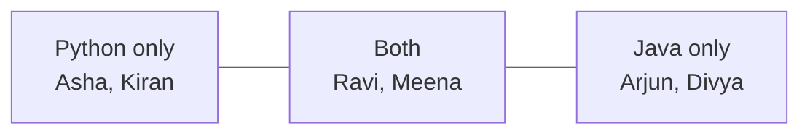

# Sets in Python

!!! abstract "Learning Objectives"
    By the end of this lesson, you can:

    - Create sets and explain their properties
    - Remove duplicates from data using sets
    - Add and remove items safely
    - Use set operations: union, intersection, difference, symmetric difference
    - Explain why membership checks on sets are fast

**Prerequisites:** [Lists in Python](09-lists.md) and [Tuples in Python](10-tuples.md)

## What is a Set?

A **set** is an **unordered** collection of **unique** items.

```python
skills = {"Python", "SQL", "React", "Python", "SQL"}
print(skills)
print(len(skills))
print(type(skills))
```

```{ .text .output }
{'React', 'SQL', 'Python'}
3
<class 'set'>
```

The duplicates disappeared automatically. Your output order may be different, because sets don't keep order.

!!! example "Real-life analogy: a stamp collection"
    A collector keeps only **one** of each stamp. Getting a duplicate doesn't change the collection, and the album has no "first" or "third" stamp, only whether a stamp **is in the collection or not**.

**Key characteristics**

| Property | Meaning |
|----------|---------|
| Unordered | No index; `s[0]` doesn't work |
| Unique | Duplicates are removed automatically |
| Mutable | You can add and remove items |
| Items must be immutable | Numbers, strings and tuples are allowed; lists and dicts are not |

## Creating Sets

```python
colors = {"red", "green", "blue"}
from_list = set([1, 2, 2, 3, 3, 3])
from_string = set("banana")
empty = set()

print(from_list)
print(from_string)
print(type(empty))
```

```{ .text .output }
{1, 2, 3}
{'n', 'b', 'a'}
<class 'set'>
```

!!! mistake "Common Mistake: `{}` is not an empty set"
    ```python
    data = {}
    print(type(data))
    ```

    ```{ .text .output }
    <class 'dict'>
    ```

    `{}` creates an empty **dictionary**. For an empty set, use `set()`.

Lists can't go inside a set, because they're mutable:

```python
s = {[1, 2], [3, 4]}
```

```{ .text .output }
TypeError: unhashable type: 'list'
```

Use tuples instead: `{(1, 2), (3, 4)}` works.

## Removing Duplicates

This is the most common everyday use of sets.

```python
emails = [
    "ravi@ksr.com", "asha@ksr.com", "ravi@ksr.com",
    "kiran@ksr.com", "asha@ksr.com",
]

unique_emails = set(emails)
print(len(emails), "→", len(unique_emails))
print(sorted(unique_emails))
```

```{ .text .output }
5 → 3
['asha@ksr.com', 'kiran@ksr.com', 'ravi@ksr.com']
```

To remove duplicates **and keep the original order**, use `dict.fromkeys()`:

```python
cities = ["Pune", "Delhi", "Pune", "Goa", "Delhi"]
print(list(dict.fromkeys(cities)))
```

```{ .text .output }
['Pune', 'Delhi', 'Goa']
```

## Adding and Removing Items

```python
tags = {"python", "backend"}

tags.add("django")
print(tags)

tags.update(["api", "mysql"])     # add several
print(tags)

tags.add("python")                # already there: nothing happens
print(len(tags))
```

```{ .text .output }
{'django', 'python', 'backend'}
{'django', 'api', 'mysql', 'python', 'backend'}
5
```

| Method | If the item is missing |
|--------|------------------------|
| `remove(x)` | Raises `KeyError` |
| `discard(x)` | Does nothing (safe) |
| `pop()` | Removes and returns an **arbitrary** item |
| `clear()` | Empties the set |

```python
tags = {"python", "backend", "api"}

tags.discard("java")      # safe: no error
tags.remove("api")
print(tags)

tags.remove("java")
```

```{ .text .output }
{'python', 'backend'}
KeyError: 'java'
```

!!! tip "Prefer `discard()`"
    Use `discard()` when you just want the item gone and don't care whether it was there. Use `remove()` when a missing item means something went wrong.

## Set Operations

Sets support the same operations as sets in maths, and they're extremely useful for comparing groups.

```python
python_batch = {"Asha", "Ravi", "Kiran", "Meena"}
java_batch = {"Ravi", "Arjun", "Meena", "Divya"}
```



| Operation | Operator | Method | Meaning |
|-----------|----------|--------|---------|
| Union | `a | b` | `a.union(b)` | Everyone in **either** batch |
| Intersection | `a & b` | `a.intersection(b)` | In **both** batches |
| Difference | `a - b` | `a.difference(b)` | In `a` but **not** in `b` |
| Symmetric difference | `a ^ b` | `a.symmetric_difference(b)` | In **exactly one** batch |

```python
print("All students :", sorted(python_batch | java_batch))
print("Both batches :", sorted(python_batch & java_batch))
print("Python only  :", sorted(python_batch - java_batch))
print("Java only    :", sorted(java_batch - python_batch))
print("Only one     :", sorted(python_batch ^ java_batch))
```

```{ .text .output }
All students : ['Arjun', 'Asha', 'Divya', 'Kiran', 'Meena', 'Ravi']
Both batches : ['Meena', 'Ravi']
Python only  : ['Asha', 'Kiran']
Java only    : ['Arjun', 'Divya']
Only one     : ['Arjun', 'Asha', 'Divya', 'Kiran']
```

### Subset and superset checks

```python
required = {"Python", "SQL"}
candidate = {"Python", "SQL", "Django", "Git"}

print(required.issubset(candidate))      # does the candidate have all required skills?
print(candidate.issuperset(required))
print(required.isdisjoint({"Java", "C"}))  # no common items?
```

```{ .text .output }
True
True
True
```

!!! realworld "In Real Projects"
    - **Job portals** match candidates with `required_skills <= candidate_skills` (subset).
    - **Social apps** find "mutual friends" with `my_friends & your_friends`.
    - **E-commerce** finds products viewed but not bought with `viewed - purchased`.
    - **Permissions:** `user_permissions & required_permissions` checks access.

## Fast Membership Checks

Checking `x in my_set` is **much faster** than `x in my_list` for large collections.

- A **list** checks items one by one: slower as the list grows.
- A **set** uses a **hash table** to jump straight to where the item would be: almost instant, whatever the size.

```python
blocked_users = {"spam01", "bot_x", "fake_acc"}    # use a set for lookups

username = "bot_x"
if username in blocked_users:
    print("Access denied")
```

```{ .text .output }
Access denied
```

!!! example "Analogy: a book's index"
    Looking for a word in a list is like reading every page of a book. Looking it up in a set is like using the **index at the back**: you go straight to the right page.

### frozenset: an immutable set

```python
weekdays = frozenset(["Mon", "Tue", "Wed", "Thu", "Fri"])
print("Sat" in weekdays)
weekdays.add("Sat")
```

```{ .text .output }
False
AttributeError: 'frozenset' object has no attribute 'add'
```

A `frozenset` can't be changed, so it can be used as a dictionary key or inside another set.

## Common Mistakes

| Mistake | Error / Result | Fix |
|---------|---------------|-----|
| `s = {}` for an empty set | Creates a `dict` | `s = set()` |
| `s[0]` | `TypeError: 'set' object is not subscriptable` | Sets have no index; loop, or convert with `sorted(s)` |
| Expecting a fixed order | Order changes | Use `sorted(s)` to display |
| `remove()` on a missing item | `KeyError` | Use `discard()` |
| Putting a list in a set | `TypeError: unhashable type: 'list'` | Use a tuple |
| `set("hello world")` expecting words | A set of characters | `set("hello world".split())` |

## Practice Exercises

**Easy**

1. Remove duplicates from `[5, 3, 5, 1, 3, 7, 1]` and print the result sorted.
2. Create an empty set, add three city names, then add one of them again. Print the length.
3. Count how many **unique** characters are in `"mississippi"`.

**Medium**

4. Given two lists of customer IDs who bought in January and February, find customers who bought in **both** months, **only in January**, and **at least once**.
5. Check whether a sentence is a **pangram** (contains every letter a–z), e.g. `"The quick brown fox jumps over the lazy dog"`.
6. A job needs `{"Python", "Django", "SQL"}`. Given a candidate's skills, print `Eligible` if they have all of them, otherwise print the missing skills.

**Challenge**

7. You have the friend lists of three users as sets. Find: friends common to all three, friends of user A that B doesn't know (to suggest to B), and the total number of distinct people across all three lists.

??? success "Solutions (click to expand)"

    ```python
    # 1
    print(sorted(set([5, 3, 5, 1, 3, 7, 1])))   # [1, 3, 5, 7]

    # 2
    cities = set()
    cities.add("Pune")
    cities.add("Goa")
    cities.add("Delhi")
    cities.add("Pune")
    print(len(cities))                           # 3

    # 3
    print(len(set("mississippi")))               # 4  (m, i, s, p)

    # 4
    jan = [101, 102, 103, 104]
    feb = [103, 104, 105]
    print(set(jan) & set(feb))                   # {103, 104}
    print(set(jan) - set(feb))                   # {101, 102}
    print(set(jan) | set(feb))                   # {101, 102, 103, 104, 105}

    # 5
    sentence = "The quick brown fox jumps over the lazy dog"
    letters = set("abcdefghijklmnopqrstuvwxyz")
    print(letters <= set(sentence.lower()))      # True

    # 6
    required = {"Python", "Django", "SQL"}
    skills = {"Python", "SQL", "Git"}
    missing = required - skills
    print("Eligible" if not missing else f"Missing: {missing}")   # Missing: {'Django'}

    # 7
    a = {"Ravi", "Asha", "Kiran", "Meena"}
    b = {"Asha", "Kiran", "Arjun"}
    c = {"Kiran", "Asha", "Divya", "Ravi"}
    print("Common to all:", a & b & c)           # {'Asha', 'Kiran'}
    print("Suggest to B :", a - b)               # {'Ravi', 'Meena'}
    print("Total people :", len(a | b | c))      # 6
    ```

!!! note "Mini Assignment"
    Write `attendance.py`: store the students who attended each of 3 days as sets. Print students who attended **all** 3 days, students who attended **at least one** day, and, given the full class list, students who **never** attended. Display all results sorted.

## Interview Questions

!!! interview "1. What is a set and how is it different from a list?"
    A set is an unordered collection of unique, hashable items. Unlike a list, it has no index, removes duplicates automatically, and offers O(1) average-time membership checks thanks to hashing. A list is ordered, indexable and allows duplicates.

!!! interview "2. How do you create an empty set?"
    `set()`. Writing `{}` creates an empty dictionary.

!!! interview "3. What is the difference between `remove()` and `discard()`?"
    Both delete an item. `remove()` raises `KeyError` if the item isn't present; `discard()` silently does nothing.

!!! interview "4. Why can't a list be added to a set?"
    Set items must be **hashable** (immutable), so their hash never changes. Lists are mutable and therefore unhashable. Use a tuple or frozenset instead.

!!! interview "5. What is a frozenset?"
    An immutable version of a set. It supports all the non-modifying operations (union, intersection, membership) and, being hashable, can be used as a dict key or as an element of another set.

!!! interview "Scenario: checking `if user_id in active_users` is slow with 1 million users. How would you speed it up?"
    `active_users` is probably a list, which needs a linear scan. Convert it to a set once (`active_users = set(active_users)`); each membership check then takes roughly constant time.

## Summary

| Concept | Remember |
|---------|----------|
| Set | Unordered, unique, mutable; items must be immutable |
| Create | `{1, 2}`, `set(list)`; empty: `set()` (not `{}`) |
| Dedupe | `set(items)`; keep order: `list(dict.fromkeys(items))` |
| Add | `add(x)`, `update(seq)` |
| Remove | `remove(x)` (errors if missing), `discard(x)` (safe), `pop()`, `clear()` |
| Union / Intersection | `a | b`, `a & b` |
| Difference / Symmetric | `a - b`, `a ^ b` |
| Subset / Superset | `a <= b`, `a >= b`, `issubset()`, `issuperset()` |
| Speed | `x in set` is very fast |
| frozenset | Immutable set; can be a dict key |

**Next lesson:** [Dictionaries in Python](12-dictionaries.md), storing data as key-value pairs.
