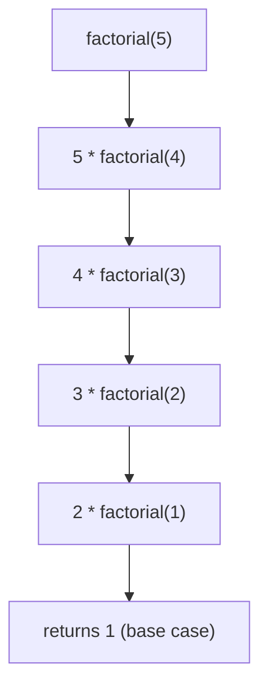

# Arguments & Return Values

!!! abstract "Learning Objectives"
    By the end of this lesson, you can:

    - Call functions with positional and keyword arguments
    - Give parameters default values and avoid the mutable-default trap
    - Accept any number of arguments with `*args` and `**kwargs`
    - Return multiple values from a function
    - Write simple recursive functions and add type hints

**Prerequisites:** [Functions](01-functions.md)

## Positional and Keyword Arguments

### Positional arguments

Matched to parameters **by position**: first argument to first parameter, and so on.

```python
def create_user(name, email, city):
    print(f"Name: {name} | Email: {email} | City: {city}")

create_user("Asha", "asha@ksr.com", "Pune")
create_user("Pune", "Asha", "asha@ksr.com")     # wrong order, wrong result!
```

```{ .text .output }
Name: Asha | Email: asha@ksr.com | City: Pune
Name: Pune | Email: Asha | City: asha@ksr.com
```

### Keyword arguments

Pass values **by name**, and the order no longer matters:

```python
create_user(city="Pune", name="Asha", email="asha@ksr.com")
```

```{ .text .output }
Name: Asha | Email: asha@ksr.com | City: Pune
```

You can mix both, but **positional arguments must come first**:

```python
create_user("Asha", city="Pune", email="asha@ksr.com")    # OK
```

```python
create_user(name="Asha", "asha@ksr.com", "Pune")
```

```{ .text .output }
SyntaxError: positional argument follows keyword argument
```

!!! tip "When to use keyword arguments"
    When a function has many parameters, or the values aren't self-explanatory. `send_email(to=user, subject="Welcome", retry=True)` is far clearer than `send_email(user, "Welcome", True)`.

## Default Arguments

A parameter can have a **default value** that's used when the caller doesn't pass one.

```python
def place_order(item, quantity=1, delivery="standard"):
    print(f"{quantity} x {item} ({delivery} delivery)")

place_order("Laptop")
place_order("Mouse", 3)
place_order("Monitor", delivery="express")
```

```{ .text .output }
1 x Laptop (standard delivery)
3 x Mouse (standard delivery)
1 x Monitor (express delivery)
```

Parameters **with** defaults must come **after** parameters without them:

```python
def place_order(quantity=1, item):
    pass
```

```{ .text .output }
SyntaxError: parameter without a default follows parameter with a default
```

You've been using default arguments all along: `print(..., sep=" ", end="\n")` and `sorted(..., reverse=False)`.

!!! mistake "Common Mistake: mutable default arguments"
    ```python
    def add_skill(skill, skills=[]):
        skills.append(skill)
        return skills

    print(add_skill("Python"))
    print(add_skill("SQL"))       # expected ['SQL']
    ```

    ```{ .text .output }
    ['Python']
    ['Python', 'SQL']
    ```

    The default list is created **once**, when the function is defined, and shared by every call. Use `None` as the default and create a new list inside:

    ```python
    def add_skill(skill, skills=None):
        if skills is None:
            skills = []
        skills.append(skill)
        return skills
    ```

    This is one of the most famous Python interview questions.

## *args: Any Number of Positional Arguments

Sometimes you don't know how many values will be passed. `*args` collects all extra positional arguments into a **tuple**.

```python
def total(*numbers):
    print(type(numbers), numbers)
    return sum(numbers)

print(total(10, 20))
print(total(5, 15, 25, 35))
print(total())
```

```{ .text .output }
<class 'tuple'> (10, 20)
30
<class 'tuple'> (5, 15, 25, 35)
80
<class 'tuple'> ()
0
```

The name `args` is a convention; the `*` is what matters. Combine it with normal parameters:

```python
def print_bill(customer, *items):
    print(f"Bill for {customer}:")
    for i, item in enumerate(items, start=1):
        print(f"  {i}. {item}")

print_bill("Ravi", "Laptop", "Mouse", "Bag")
```

```{ .text .output }
Bill for Ravi:
  1. Laptop
  2. Mouse
  3. Bag
```

## **kwargs: Any Number of Keyword Arguments

`**kwargs` collects extra keyword arguments into a **dictionary**.

```python
def create_profile(name, **details):
    print(f"Profile: {name}")
    for key, value in details.items():
        print(f"  {key}: {value}")

create_profile("Priya", age=24, city="Bangalore", role="Developer")
```

```{ .text .output }
Profile: Priya
  age: 24
  city: Bangalore
  role: Developer
```

### Order of parameters

When combining everything, use this order:

```python
def f(regular, default="x", *args, **kwargs):
    print(regular, default, args, kwargs)

f(1, 2, 3, 4, a=5, b=6)
```

```{ .text .output }
1 2 (3, 4) {'a': 5, 'b': 6}
```

### Unpacking when calling

`*` and `**` also work the other way: they spread a list or dict into arguments.

```python
def create_user(name, email, city):
    print(name, email, city)

data = ["Asha", "asha@ksr.com", "Pune"]
create_user(*data)

info = {"name": "Ravi", "email": "ravi@ksr.com", "city": "Goa"}
create_user(**info)
```

```{ .text .output }
Asha asha@ksr.com Pune
Ravi ravi@ksr.com Goa
```

!!! realworld "In Real Projects"
    `**kwargs` is everywhere in frameworks. In Django, `Product.objects.filter(category="mobile", price__lt=20000)` passes filters as keyword arguments, and `Product.objects.create(**form_data)` creates a record from a dictionary of form fields.

## Returning Multiple Values

A function can return several values separated by commas. Python packs them into a **tuple**, which you can unpack:

```python
def analyse_marks(marks):
    highest = max(marks)
    lowest = min(marks)
    average = sum(marks) / len(marks)
    return highest, lowest, average

result = analyse_marks([78, 92, 65, 88])
print(result)

high, low, avg = analyse_marks([78, 92, 65, 88])
print(f"High: {high}, Low: {low}, Average: {avg:.2f}")
```

```{ .text .output }
(92, 65, 80.75)
High: 92, Low: 65, Average: 80.75
```

Returning a **dictionary** is often clearer when there are many values:

```python
def analyse(marks):
    return {"highest": max(marks), "lowest": min(marks), "count": len(marks)}

stats = analyse([78, 92, 65, 88])
print(stats["highest"], stats["count"])
```

```{ .text .output }
92 4
```

### Returning early for validation

```python
def withdraw(balance, amount):
    if amount <= 0:
        return balance, "Amount must be positive"
    if amount > balance:
        return balance, "Insufficient balance"
    return balance - amount, "Success"

balance, message = withdraw(5000, 7000)
print(balance, message)
balance, message = withdraw(5000, 1500)
print(balance, message)
```

```{ .text .output }
5000 Insufficient balance
3500 Success
```

## Recursion

A **recursive** function is one that calls **itself**. Every recursive function needs:

1. A **base case** that stops the recursion
2. A **recursive case** that moves towards the base case

```python
def factorial(n):
    if n <= 1:                     # base case
        return 1
    return n * factorial(n - 1)    # recursive case

print(factorial(5))
```

```{ .text .output }
120
```



!!! example "Real-life analogy: Russian dolls"
    Open a doll and there's a smaller doll inside. Keep opening until you reach the smallest doll that doesn't open: that's the base case.

```python
def countdown(n):
    if n == 0:
        print("Liftoff!")
        return
    print(n)
    countdown(n - 1)

countdown(3)
```

```{ .text .output }
3
2
1
Liftoff!
```

!!! mistake "Common Mistake: no base case"
    Without a base case, the function calls itself forever until Python stops it with `RecursionError: maximum recursion depth exceeded`. Python's default limit is about 1,000 calls. For simple repetition, a loop is usually better.

## Type Hints

**Type hints** document what types a function expects and returns. Python doesn't enforce them at runtime, but editors use them to catch mistakes and autocomplete.

```python
def calculate_total(price: float, quantity: int = 1) -> float:
    return price * quantity

def greet(name: str) -> str:
    return f"Hello, {name}"

def average(marks: list[int]) -> float:
    return sum(marks) / len(marks)

print(calculate_total(499.5, 2))
print(greet("Asha"))
print(average([80, 90]))
```

```{ .text .output }
999.0
Hello, Asha
85.0
```

!!! realworld "In Real Projects"
    **FastAPI is built on type hints.** When you write `def get_product(product_id: int)`, FastAPI automatically converts the URL value to an int, rejects invalid input with a clear error, and documents the API, all from the type hint. You'll see this in the FastAPI module.

## Common Mistakes

| Mistake | Error / Result | Fix |
|---------|---------------|-----|
| Positional after keyword: `f(a=1, 2)` | `SyntaxError: positional argument follows keyword argument` | Put positional arguments first |
| Default before non-default parameter | `SyntaxError: parameter without a default follows parameter with a default` | Put defaulted parameters last |
| `def f(items=[])` | Shared list grows across calls | Default to `None`, create inside |
| Unknown keyword: `f(nme="Ravi")` | `TypeError: f() got an unexpected keyword argument 'nme'` | Check the parameter names |
| Same argument twice: `f("Ravi", name="Ravi")` | `TypeError: f() got multiple values for argument 'name'` | Pass it once |
| Recursion without a base case | `RecursionError` | Add a stopping condition |
| Unpacking the wrong count | `ValueError: too many values to unpack` | Match the number of returned values |

## Practice Exercises

**Easy**

1. Write `power(base, exponent=2)` and call it with one and two arguments.
2. Write `describe_pet(name, animal="dog")` and call it using keyword arguments in a different order.
3. Write `average(*numbers)` that returns the average of any number of values (return 0 if none are given).

**Medium**

4. Write `min_max(numbers)` that returns both the smallest and largest value, and unpack the result.
5. Write `build_url(base, **params)` that returns a URL like `https://shop.com/search?q=laptop&sort=price`.
6. Write a recursive function `sum_digits(n)` that returns the sum of the digits of `n`.

**Challenge**

7. Write `make_invoice(customer, *items, gst=18, **extra)`, where each item is a `(name, price)` tuple. Return a dict with the customer, item count, subtotal, GST amount, total and any extra fields (like `coupon="NEW10"`). Print it neatly.

??? success "Solutions (click to expand)"

    ```python
    # 1
    def power(base, exponent=2):
        return base ** exponent

    print(power(5), power(2, 10))                  # 25 1024

    # 2
    def describe_pet(name, animal="dog"):
        return f"{name} is a {animal}"

    print(describe_pet(animal="cat", name="Kitty"))  # Kitty is a cat

    # 3
    def average(*numbers):
        return sum(numbers) / len(numbers) if numbers else 0

    print(average(10, 20, 30), average())          # 20.0 0

    # 4
    def min_max(numbers):
        return min(numbers), max(numbers)

    low, high = min_max([4, 9, 1, 7])
    print(low, high)                               # 1 9

    # 5
    def build_url(base, **params):
        if not params:
            return base
        query = "&".join(f"{k}={v}" for k, v in params.items())
        return f"{base}?{query}"

    print(build_url("https://shop.com/search", q="laptop", sort="price"))

    # 6
    def sum_digits(n):
        if n < 10:
            return n
        return n % 10 + sum_digits(n // 10)

    print(sum_digits(4729))                        # 22

    # 7
    def make_invoice(customer, *items, gst=18, **extra):
        subtotal = sum(price for _, price in items)
        gst_amount = subtotal * gst / 100
        return {
            "customer": customer,
            "items": len(items),
            "subtotal": subtotal,
            "gst": round(gst_amount, 2),
            "total": round(subtotal + gst_amount, 2),
            **extra,
        }

    invoice = make_invoice("Asha", ("Laptop", 55000), ("Mouse", 799), coupon="NEW10")
    for key, value in invoice.items():
        print(f"{key:<10}: {value}")
    ```

!!! note "Mini Assignment"
    Write a `notifications.py` module-style file with a function `send_notification(user, message, *channels, priority="normal", **meta)`. `channels` can be any of `"email"`, `"sms"`, `"push"` (default to `"email"` if none are given). Print one line per channel, such as `[EMAIL][high] To Ravi: Your order shipped (order_id=ORD101)`. Call it in at least four different ways.

## Interview Questions

!!! interview "1. What are `*args` and `**kwargs`?"
    `*args` collects extra positional arguments into a **tuple**; `**kwargs` collects extra keyword arguments into a **dictionary**. They let a function accept a variable number of arguments. The names are conventions; the `*` and `**` are what matter.

!!! interview "2. What is the problem with mutable default arguments?"
    Default values are evaluated **once**, when the function is defined. A mutable default like `[]` or `{}` is shared across all calls, so changes persist between calls. Use `None` as the default and create the object inside the function.

!!! interview "3. Can a Python function return multiple values?"
    Yes. `return a, b` returns a tuple `(a, b)`, which can be unpacked: `x, y = f()`. You can also return a list, dict or object.

!!! interview "4. What is recursion? What are its risks?"
    A function calling itself, with a base case to stop. Risks: missing or unreachable base cases cause `RecursionError`, Python's recursion limit (~1000) makes deep recursion fail, and each call uses memory. Loops are usually more efficient for simple repetition.

!!! interview "5. Are type hints enforced by Python?"
    No. Type hints are not checked at runtime. They're used by editors, linters and tools like `mypy`, and frameworks such as FastAPI and Pydantic use them to validate and convert data.

!!! interview "Scenario: a function `log_event(msg, events=[])` shows events from previous requests in a web app. Why?"
    The default list is created once and shared by every call, so each call appends to the same list. Change it to `events=None` and create `events = []` inside the function when it's `None`.

## Summary

| Concept | Remember |
|---------|----------|
| Positional | Matched by order |
| Keyword | `f(name="Ravi")`, order doesn't matter; positional first |
| Default | `def f(x, y=10)`; defaults go last; never use a mutable default |
| `*args` | Extra positional arguments → tuple |
| `**kwargs` | Extra keyword arguments → dict |
| Order | `regular, default, *args, **kwargs` |
| Unpack on call | `f(*list)`, `f(**dict)` |
| Multiple returns | `return a, b` → tuple; or return a dict |
| Recursion | Base case + recursive case |
| Type hints | `def f(x: int) -> str:`, documentation that FastAPI uses |

**Next lesson:** [Lambda, Map & Filter](03-lambda-map-filter.md), small anonymous functions and functional tools.
