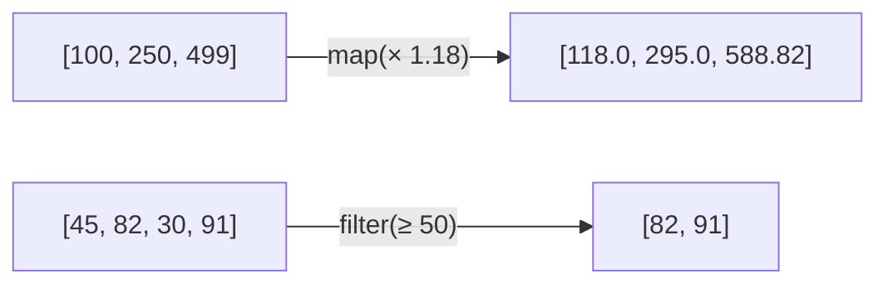

# Lambda, Map & Filter

!!! abstract "Learning Objectives"
    By the end of this lesson, you can:

    - Treat functions as values: store them and pass them to other functions
    - Write small anonymous functions with `lambda`
    - Sort complex data with `sorted(..., key=...)`
    - Transform and filter data with `map()` and `filter()`
    - Use `reduce()`, `any()`, `all()` and `zip()`

**Prerequisites:** [Arguments & Return Values](02-arguments-and-return-values.md)

## Functions are Values

In Python, a function is an **object**, just like a number or a string. You can store it in a variable, put it in a list, and pass it to another function.

```python
def shout(text):
    return text.upper() + "!"

def whisper(text):
    return text.lower() + "..."

speak = shout            # no parentheses: we store the function itself
print(speak("hello"))

for style in [shout, whisper]:
    print(style("Python"))
```

```{ .text .output }
HELLO!
PYTHON!
python...
```

Passing a function to another function:

```python
def apply_to_all(func, items):
    result = []
    for item in items:
        result.append(func(item))
    return result

print(apply_to_all(shout, ["hi", "bye"]))
print(apply_to_all(len, ["Python", "SQL"]))
```

```{ .text .output }
['HI!', 'BYE!']
[6, 3]
```

A function that takes or returns another function is called a **higher-order function**. `map()`, `filter()` and `sorted()` are built-in higher-order functions.

!!! example "Real-life analogy: a photo filter"
    An app has one "apply" button but many filters (black & white, sepia, vivid). You **choose a filter** and **pass it** to the apply button. Higher-order functions work the same way: one function does the looping, and you pass in *what to do* to each item.

## Lambda Functions

A **lambda** is a small, one-line function **without a name**.

```python
# Normal function
def square(x):
    return x * x

# Same thing as a lambda
square_lambda = lambda x: x * x

print(square(5))
print(square_lambda(5))
```

```{ .text .output }
25
25
```

**Syntax:** `lambda parameters: expression`

- No `def`, no name, no `return`: the expression's value is returned automatically.
- Only **one expression**: no loops, no multiple statements.

```python
add = lambda a, b: a + b
is_adult = lambda age: age >= 18
full_name = lambda first, last: f"{first} {last}".title()

print(add(3, 4))
print(is_adult(16))
print(full_name("ravi", "kumar"))
```

```{ .text .output }
7
False
Ravi Kumar
```

!!! tip "When to use lambda"
    Lambdas are meant to be used **inline**, passed directly to functions like `sorted()`, `map()` and `filter()`. If you're assigning a lambda to a name (`square = lambda x: ...`), a normal `def` is clearer, and PEP 8 recommends `def` in that case.

## Sorting with key=

`sorted()` and `list.sort()` accept a `key` function: Python calls it on each item and sorts by the result. This is the **most common** real use of lambda.

```python
names = ["kiran", "Asha", "ravi", "Meenakshi"]

print(sorted(names))                     # uppercase sorts before lowercase
print(sorted(names, key=str.lower))      # case-insensitive
print(sorted(names, key=len))            # by length
```

```{ .text .output }
['Asha', 'Meenakshi', 'kiran', 'ravi']
['Asha', 'kiran', 'Meenakshi', 'ravi']
['Asha', 'ravi', 'kiran', 'Meenakshi']
```

Sorting a list of dictionaries, like data from a database:

```python
products = [
    {"name": "Laptop", "price": 55000, "rating": 4.5},
    {"name": "Mouse", "price": 799, "rating": 4.1},
    {"name": "Monitor", "price": 12999, "rating": 4.7},
]

by_price = sorted(products, key=lambda p: p["price"])
by_rating = sorted(products, key=lambda p: p["rating"], reverse=True)

print([p["name"] for p in by_price])
print([p["name"] for p in by_rating])
```

```{ .text .output }
['Mouse', 'Monitor', 'Laptop']
['Monitor', 'Laptop', 'Mouse']
```

Sort by **two** things: return a tuple from the key.

```python
students = [("Asha", 85), ("Ravi", 92), ("Kiran", 85), ("Meena", 92)]

# highest marks first; same marks → alphabetical by name
ranked = sorted(students, key=lambda s: (-s[1], s[0]))
print(ranked)
```

```{ .text .output }
[('Meena', 92), ('Ravi', 92), ('Asha', 85), ('Kiran', 85)]
```

`max()` and `min()` accept `key` too:

```python
print(max(products, key=lambda p: p["rating"])["name"])
print(min(products, key=lambda p: p["price"])["name"])
```

```{ .text .output }
Monitor
Mouse
```

!!! realworld "In Real Projects"
    "Sort by: Price low to high / Rating / Newest" on Flipkart or Amazon is exactly `sorted(products, key=...)`. On large datasets this is usually done in the database with `ORDER BY`, but small in-memory lists are sorted in Python like this.

## map(): Transform Every Item

`map(function, iterable)` applies a function to **every item** and gives back the results.

```python
prices = [100, 250, 499]

with_gst = map(lambda p: round(p * 1.18, 2), prices)
print(with_gst)            # a map object (lazy)
print(list(with_gst))      # convert to see the values
```

```{ .text .output }
<map object at 0x...>
[118.0, 295.0, 588.82]
```

`map()` returns a **lazy** map object: values are computed only when you loop over it or convert it with `list()`. (Your memory address will differ from `0x...`.)

```python
# Convert a list of strings to ints: very common with input()
numbers = list(map(int, "10 20 30".split()))
print(numbers, sum(numbers))

# Built-in functions work too
print(list(map(str.upper, ["py", "sql"])))
print(list(map(len, ["Python", "SQL", "React"])))
```

```{ .text .output }
[10, 20, 30] 60
['PY', 'SQL']
[6, 3, 5]
```



## filter(): Keep Only Matching Items

`filter(function, iterable)` keeps the items for which the function returns `True`.

```python
marks = [45, 82, 30, 91, 67, 55]

passed = list(filter(lambda m: m >= 50, marks))
print(passed)

emails = ["ravi@ksr.com", "", "asha@ksr.com", "", "kiran@ksr.com"]
valid = list(filter(None, emails))       # None keeps truthy values only
print(valid)
```

```{ .text .output }
[82, 91, 67, 55]
['ravi@ksr.com', 'asha@ksr.com', 'kiran@ksr.com']
```

Combining `filter` and `map`:

```python
orders = [1200, 350, 4999, 80, 2500]

# 10% discount on orders above ₹1000
discounted = list(map(lambda o: o * 0.9, filter(lambda o: o > 1000, orders)))
print(discounted)
```

```{ .text .output }
[1080.0, 4499.1, 2250.0]
```

!!! tip "map/filter vs list comprehensions"
    The same result with a list comprehension, covered in the [next lesson](04-list-comprehensions.md), is often easier to read:

    ```python
    discounted = [o * 0.9 for o in orders if o > 1000]
    ```

    Most Python developers prefer comprehensions. Use `map` when you already have a named function (`map(int, items)`), and know both styles, because you'll see both in real codebases and interviews.

## reduce(), any(), all() and zip()

### `reduce()`: combine all items into one value

`reduce` lives in the `functools` module. It applies a function **cumulatively**: first to items 1 and 2, then to that result and item 3, and so on.

```python
from functools import reduce

numbers = [2, 3, 4, 5]
product = reduce(lambda acc, n: acc * n, numbers)
print(product)
```

```{ .text .output }
120
```

Step by step: `2*3 = 6` → `6*4 = 24` → `24*5 = 120`. For sums, just use `sum()`.

### `any()` and `all()`

| Function | Returns `True` if |
|----------|-------------------|
| `any(items)` | **at least one** item is truthy |
| `all(items)` | **every** item is truthy |

```python
marks = [72, 45, 88, 91]

print(any(m >= 90 for m in marks))    # did anyone score 90+?
print(all(m >= 35 for m in marks))    # did everyone pass?

password = "Secret123"
print(any(ch.isdigit() for ch in password))
print(any(ch.isupper() for ch in password))
```

```{ .text .output }
True
True
True
True
```

### `zip()`: pair items from several lists

```python
names = ["Asha", "Ravi", "Kiran"]
marks = [85, 92, 78]
cities = ["Pune", "Goa", "Delhi"]

for name, mark, city in zip(names, marks, cities):
    print(f"{name} ({city}): {mark}")

print(dict(zip(names, marks)))
```

```{ .text .output }
Asha (Pune): 85
Ravi (Goa): 92
Kiran (Delhi): 78
{'Asha': 85, 'Ravi': 92, 'Kiran': 78}
```

`zip()` stops at the **shortest** list.

## Common Mistakes

| Mistake | Error / Result | Fix |
|---------|---------------|-----|
| `print(map(...))` | Shows `<map object at 0x...>` | Wrap in `list()` |
| Looping over a map/filter object twice | Second loop gets nothing | Convert to a list first if you need it twice |
| Multiple statements in a lambda | `SyntaxError` | Use a normal `def` function |
| `sorted(items, key=len())` | `TypeError: len() takes exactly one argument (0 given)` | Pass the function, don't call it: `key=len` |
| `reduce` without importing | `NameError: name 'reduce' is not defined` | `from functools import reduce` |
| Complex nested `map(filter(lambda...))` | Hard to read | Use a list comprehension or a named function |

## Practice Exercises

**Easy**

1. Write a lambda that returns the cube of a number and test it with 3.
2. Use `map()` to convert `["1", "2", "3", "4"]` into integers.
3. Use `filter()` to get all even numbers from `range(1, 21)`.

**Medium**

4. Sort `["banana", "Kiwi", "apple", "Cherry"]` alphabetically, ignoring case.
5. Given a list of `(name, salary)` tuples, sort by salary in descending order and print the top 2.
6. Given a list of words, use `filter` to keep only words longer than 4 characters, then `map` to capitalise them.

**Challenge**

7. You have a list of order dicts with `customer`, `amount` and `status` (`"delivered"`, `"cancelled"`, `"pending"`). Using `filter`, `map`, `sorted` and `reduce`: (a) get all delivered orders, (b) sort them by amount (highest first), (c) calculate the total delivered revenue, and (d) check with `any()` whether any order is above ₹10,000.

??? success "Solutions (click to expand)"

    ```python
    from functools import reduce

    # 1
    cube = lambda x: x ** 3
    print(cube(3))                                         # 27

    # 2
    print(list(map(int, ["1", "2", "3", "4"])))            # [1, 2, 3, 4]

    # 3
    print(list(filter(lambda n: n % 2 == 0, range(1, 21))))

    # 4
    print(sorted(["banana", "Kiwi", "apple", "Cherry"], key=str.lower))
    # ['apple', 'banana', 'Cherry', 'Kiwi']

    # 5
    staff = [("Asha", 65000), ("Ravi", 72000), ("Meena", 91000), ("Kiran", 58000)]
    top = sorted(staff, key=lambda s: s[1], reverse=True)[:2]
    print(top)                                             # [('Meena', 91000), ('Ravi', 72000)]

    # 6
    words = ["code", "python", "api", "django", "react"]
    print(list(map(str.capitalize, filter(lambda w: len(w) > 4, words))))
    # ['Python', 'Django', 'React']

    # 7
    orders = [
        {"customer": "Asha", "amount": 2500, "status": "delivered"},
        {"customer": "Ravi", "amount": 12000, "status": "pending"},
        {"customer": "Kiran", "amount": 8000, "status": "delivered"},
        {"customer": "Meena", "amount": 1500, "status": "cancelled"},
        {"customer": "Arjun", "amount": 4300, "status": "delivered"},
    ]
    delivered = list(filter(lambda o: o["status"] == "delivered", orders))
    ranked = sorted(delivered, key=lambda o: o["amount"], reverse=True)
    revenue = reduce(lambda total, o: total + o["amount"], delivered, 0)
    print([o["customer"] for o in ranked])                 # ['Kiran', 'Arjun', 'Asha']
    print("Revenue:", revenue)                             # Revenue: 14800
    print(any(o["amount"] > 10000 for o in orders))        # True
    ```

!!! note "Mini Assignment"
    Load this data into a list of dicts: 8 students with `name`, `batch` (`"Java"` or `"Python"`) and `score`. Write a small report using **only** `sorted`, `map`, `filter`, `max`, `min`, `any` and `all` (no explicit `for` loops except for printing): topper of each batch, students who scored above 75, whether every Python student passed (≥ 40), and the names of all students in upper case sorted by score.

## Interview Questions

!!! interview "1. What is a lambda function?"
    An anonymous, single-expression function defined with `lambda args: expression`. It returns the expression's value automatically. It's typically used inline as an argument to functions like `sorted()`, `map()` and `filter()`.

!!! interview "2. What is the difference between `map()` and `filter()`?"
    `map(f, items)` applies `f` to every item and returns the **transformed** values (same count). `filter(f, items)` returns only the items for which `f` returns truthy (same or fewer items, unchanged). Both return lazy iterators.

!!! interview "3. What does `reduce()` do and where is it?"
    `functools.reduce(f, items, initial)` applies a two-argument function cumulatively to reduce a sequence to a single value, e.g. a product of all numbers. It was moved to `functools` in Python 3.

!!! interview "4. What is a higher-order function?"
    A function that takes another function as an argument or returns a function. Examples: `map`, `filter`, `sorted` with `key`, and decorators.

!!! interview "5. Lambda vs `def`: when would you use each?"
    Use a lambda for short, throwaway logic passed directly to another function (`key=lambda p: p["price"]`). Use `def` for anything reused, longer than one expression, or that needs a name, docstring or type hints.

!!! interview "Scenario: `result = map(str.strip, names)` works the first time you loop over it, but a second loop prints nothing. Why?"
    `map()` returns an iterator, which can be consumed only once. After the first loop it's exhausted. Convert it with `list(map(...))` if you need to use the result more than once.

## Summary

| Tool | What it does | Example |
|------|--------------|---------|
| Functions as values | Store or pass functions | `apply(shout, items)` |
| `lambda` | One-line anonymous function | `lambda x: x * 2` |
| `sorted(key=)` | Sort by a computed value | `sorted(p, key=lambda x: x["price"])` |
| `map(f, items)` | Transform every item | `list(map(int, ["1", "2"]))` |
| `filter(f, items)` | Keep matching items | `list(filter(lambda m: m > 50, marks))` |
| `reduce(f, items)` | Combine into one value | `reduce(lambda a, b: a * b, nums)` |
| `any()` / `all()` | At least one / every item true | `all(m >= 35 for m in marks)` |
| `zip()` | Pair items from several lists | `dict(zip(keys, values))` |

**Next lesson:** [List Comprehensions](04-list-comprehensions.md), the Pythonic way to build lists.
