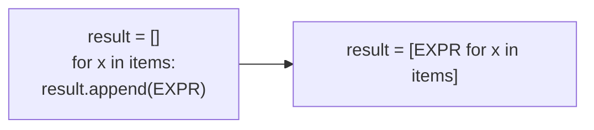

# List Comprehensions

!!! abstract "Learning Objectives"
    By the end of this lesson, you can:

    - Convert a `for` loop that builds a list into a list comprehension
    - Filter items with `if` and transform them with `if-else`
    - Write dict and set comprehensions
    - Read nested comprehensions and flatten lists
    - Use generator expressions to save memory, and know when **not** to use a comprehension

**Prerequisites:** [Loops](../foundation/08-loops.md), [Lists](../foundation/09-lists.md) and [Lambda, Map & Filter](03-lambda-map-filter.md)

## What is a List Comprehension?

A **list comprehension** is a short, readable way to **build a new list from an existing sequence** in a single line.

The loop way:

```python
squares = []
for n in range(1, 6):
    squares.append(n * n)
print(squares)
```

The comprehension way:

```python
squares = [n * n for n in range(1, 6)]
print(squares)
```

```{ .text .output }
[1, 4, 9, 16, 25]
```

Both give the same result. The comprehension says it in one line: *"a list of `n * n` for every `n` in 1 to 5"*.

!!! example "Real-life analogy: a factory conveyor belt"
    Raw items come down a belt (the **sequence**). A machine shapes each item (the **expression**). A quality checker throws away rejects (the **condition**). Finished products pile up in a box (the **new list**). A list comprehension describes the whole belt in one line.

## The Basic Syntax

```text
[ expression   for item in iterable ]
  ──────────   ───────────────────
  what to put  where items come from
  in the list
```

**How to convert any "build a list" loop:**



More examples:

```python
names = ["asha", "ravi", "kiran"]
prices = [100, 250, 499]

print([name.title() for name in names])
print([len(name) for name in names])
print([round(p * 1.18, 2) for p in prices])
print([ch for ch in "SQL"])
```

```{ .text .output }
['Asha', 'Ravi', 'Kiran']
[4, 4, 5]
[118.0, 295.0, 588.82]
['S', 'Q', 'L']
```

Converting input to numbers is a classic one-liner:

```python
raw = "78 92 65 88"
marks = [int(x) for x in raw.split()]
print(marks, sum(marks))
```

```{ .text .output }
[78, 92, 65, 88] 323
```

## Filtering with if

Add `if` **at the end** to keep only some items:

```text
[ expression for item in iterable if condition ]
```

```python
marks = [45, 82, 30, 91, 67, 55]

passed = [m for m in marks if m >= 50]
evens = [n for n in range(1, 21) if n % 2 == 0]
long_words = [w for w in ["api", "django", "sql", "react"] if len(w) > 3]

print(passed)
print(evens)
print(long_words)
```

```{ .text .output }
[82, 91, 67, 55]
[2, 4, 6, 8, 10, 12, 14, 16, 18, 20]
['django', 'react']
```

Filter and transform together:

```python
products = [
    {"name": "Laptop", "price": 55000, "in_stock": True},
    {"name": "Mouse", "price": 799, "in_stock": False},
    {"name": "Keyboard", "price": 1499, "in_stock": True},
]

available = [p["name"] for p in products if p["in_stock"]]
print(available)
```

```{ .text .output }
['Laptop', 'Keyboard']
```

!!! realworld "In Real Projects"
    Backend code is full of comprehensions: extracting IDs from query results (`[order.id for order in orders]`), cleaning input (`[tag.strip().lower() for tag in tags if tag.strip()]`), and shaping API responses (`[{"id": u.id, "name": u.name} for u in users]`).

## if-else Inside a Comprehension

To **transform** every item one of two ways (not filter), put `if-else` **before** the `for`:

```text
[ value_if_true if condition else value_if_false  for item in iterable ]
```

```python
marks = [45, 82, 30, 91]

results = ["Pass" if m >= 50 else "Fail" for m in marks]
print(results)

numbers = [1, 2, 3, 4, 5, 6]
labels = ["even" if n % 2 == 0 else "odd" for n in numbers]
print(labels)
```

```{ .text .output }
['Fail', 'Pass', 'Fail', 'Pass']
['odd', 'even', 'odd', 'even', 'odd', 'even']
```

!!! mistake "Common Mistake: if position"
    | Goal | Where `if` goes | Example |
    |------|-----------------|---------|
    | **Filter** (drop items) | At the **end**, no `else` | `[m for m in marks if m >= 50]` |
    | **Choose** a value for every item | **Before** `for`, with `else` | `["P" if m >= 50 else "F" for m in marks]` |

    `[m for m in marks if m >= 50 else 0]` is a `SyntaxError`. An `else` can't go in the filter position.

## Dict and Set Comprehensions

### Dictionary comprehension

```text
{ key_expr: value_expr for item in iterable }
```

```python
names = ["Asha", "Ravi", "Kiran"]

name_lengths = {name: len(name) for name in names}
print(name_lengths)

prices = {"pen": 10, "notebook": 50, "bag": 800}
with_gst = {item: round(price * 1.18, 2) for item, price in prices.items()}
cheap = {item: price for item, price in prices.items() if price < 100}

print(with_gst)
print(cheap)
```

```{ .text .output }
{'Asha': 4, 'Ravi': 4, 'Kiran': 5}
{'pen': 11.8, 'notebook': 59.0, 'bag': 944.0}
{'pen': 10, 'notebook': 50}
```

Swap keys and values:

```python
codes = {"HYD": "Hyderabad", "BLR": "Bangalore"}
print({city: code for code, city in codes.items()})
```

```{ .text .output }
{'Hyderabad': 'HYD', 'Bangalore': 'BLR'}
```

### Set comprehension

Same as a list comprehension but with `{}`: duplicates are removed automatically.

```python
emails = ["ravi@gmail.com", "asha@ksr.com", "kiran@gmail.com", "meena@yahoo.com"]
domains = {e.split("@")[1] for e in emails}
print(sorted(domains))
```

```{ .text .output }
['gmail.com', 'ksr.com', 'yahoo.com']
```

## Nested Comprehensions

A comprehension can have more than one `for`. They're read **left to right**, in the same order as nested loops.

### Flattening a list of lists

```python
batches = [["Asha", "Ravi"], ["Kiran"], ["Meena", "Arjun", "Divya"]]

all_students = [student for batch in batches for student in batch]
print(all_students)
```

```{ .text .output }
['Asha', 'Ravi', 'Kiran', 'Meena', 'Arjun', 'Divya']
```

The equivalent loops:

```python
all_students = []
for batch in batches:            # first for
    for student in batch:        # second for
        all_students.append(student)
```

### Building a grid

```python
table = [[row * col for col in range(1, 4)] for row in range(1, 4)]
print(table)

pairs = [(size, color) for size in ["S", "M"] for color in ["Red", "Blue"]]
print(pairs)
```

```{ .text .output }
[[1, 2, 3], [2, 4, 6], [3, 6, 9]]
[('S', 'Red'), ('S', 'Blue'), ('M', 'Red'), ('M', 'Blue')]
```

!!! tip "Readability first"
    If a comprehension needs more than two `for` clauses or a long condition, or you need to read it twice to understand it, **use a normal loop**. Comprehensions are for making code clearer, not shorter at any cost.

## Generator Expressions

Replace `[]` with `()` and you get a **generator expression**. It produces values **one at a time, on demand**, instead of building the whole list in memory.

```python
squares_list = [n * n for n in range(1_000_000)]
squares_gen = (n * n for n in range(1_000_000))

import sys
print(sys.getsizeof(squares_list) > 1_000_000)   # the list holds a million items
print(sys.getsizeof(squares_gen) < 1_000)        # the generator holds almost nothing
```

```{ .text .output }
True
True
```

Generators are perfect when you only need to **loop once**, for example inside `sum()`, `max()`, `any()` or `all()`. You can even drop the extra brackets:

```python
marks = [78, 92, 65, 88]

print(sum(m * 2 for m in marks))
print(max(len(w) for w in ["api", "django", "sql"]))
print(any(m > 90 for m in marks))
```

```{ .text .output }
646
6
True
```

!!! realworld "In Real Projects"
    Processing a 2 GB log file or millions of database rows with a list would load everything into memory at once and could crash the server. Generators process one item at a time, so memory use stays tiny however big the data is.

## Common Mistakes

| Mistake | Error / Result | Fix |
|---------|---------------|-----|
| `else` in the filter position | `SyntaxError` | Move `if-else` before `for`, or drop `else` |
| Using a comprehension only for side effects: `[print(x) for x in items]` | Builds a useless list of `None` | Use a normal `for` loop |
| Very long nested comprehension | Unreadable | Split into loops or helper functions |
| `{}` comprehension without `key: value` | Creates a **set**, not a dict | `{k: v for ...}` for dicts |
| Reusing a generator | Second use gives nothing | Use a list if you need the values twice |
| Wrong `for` order when flattening | `NameError` | Outer loop first: `[x for row in rows for x in row]` |

## Practice Exercises

**Easy**

1. Create a list of the cubes of 1 to 10.
2. From `["Python", "SQL", "Django", "React"]`, create a list of the names in lower case.
3. Create a list of numbers from 1 to 50 that are divisible by 7.

**Medium**

4. From a sentence, create a list of words that start with a vowel.
5. Given `marks = {"Asha": 85, "Ravi": 42, "Kiran": 91, "Meena": 38}`, create a dict of only the students who passed (≥ 40), and another dict mapping each name to `"Pass"` or `"Fail"`.
6. Flatten `[[1, 2, 3], [4, 5], [6, 7, 8, 9]]` and keep only the even numbers.

**Challenge**

7. Given a list of order dicts (`id`, `customer`, `items` as a list of `(name, price)` tuples), use comprehensions to create: (a) a dict mapping order id → order total, (b) a set of all unique item names across all orders, (c) a list of customers whose order total is above ₹5,000.

??? success "Solutions (click to expand)"

    ```python
    # 1
    print([n ** 3 for n in range(1, 11)])

    # 2
    print([s.lower() for s in ["Python", "SQL", "Django", "React"]])

    # 3
    print([n for n in range(1, 51) if n % 7 == 0])     # [7, 14, 21, 28, 35, 42, 49]

    # 4
    sentence = "Every developer is always improving and learning"
    print([w for w in sentence.split() if w[0].lower() in "aeiou"])
    # ['Every', 'is', 'always', 'improving', 'and']

    # 5
    marks = {"Asha": 85, "Ravi": 42, "Kiran": 91, "Meena": 38}
    print({n: m for n, m in marks.items() if m >= 40})
    print({n: "Pass" if m >= 40 else "Fail" for n, m in marks.items()})

    # 6
    nested = [[1, 2, 3], [4, 5], [6, 7, 8, 9]]
    print([x for row in nested for x in row if x % 2 == 0])   # [2, 4, 6, 8]

    # 7
    orders = [
        {"id": 1, "customer": "Asha", "items": [("Laptop", 55000), ("Mouse", 799)]},
        {"id": 2, "customer": "Ravi", "items": [("Pen", 20), ("Notebook", 60)]},
        {"id": 3, "customer": "Kiran", "items": [("Monitor", 12999), ("Mouse", 799)]},
    ]
    totals = {o["id"]: sum(price for _, price in o["items"]) for o in orders}
    unique_items = {name for o in orders for name, _ in o["items"]}
    big_spenders = [o["customer"] for o in orders if totals[o["id"]] > 5000]
    print(totals)                 # {1: 55799, 2: 80, 3: 13798}
    print(sorted(unique_items))   # ['Laptop', 'Monitor', 'Mouse', 'Notebook', 'Pen']
    print(big_spenders)           # ['Asha', 'Kiran']
    ```

!!! note "Mini Assignment"
    Take the student data from the previous lesson's mini assignment and rewrite the report using comprehensions: a dict of name → grade, a list of toppers (score ≥ 90), a set of all batches, and the average score per batch using a dict comprehension over the set of batches.

## Interview Questions

!!! interview "1. What is a list comprehension?"
    A concise syntax for creating a list from an iterable: `[expression for item in iterable if condition]`. It's usually more readable and slightly faster than an equivalent loop with `append()`.

!!! interview "2. What is the difference between a list comprehension and a generator expression?"
    A list comprehension `[...]` builds the entire list in memory immediately. A generator expression `(...)` produces items lazily, one at a time, using almost no memory, but can only be iterated once.

!!! interview "3. Where do `if` and `if-else` go in a comprehension?"
    A filter `if` goes at the end: `[x for x in items if x > 0]`. A conditional expression choosing between two values goes before the `for`: `[x if x > 0 else 0 for x in items]`.

!!! interview "4. How do you flatten a list of lists with a comprehension?"
    `[item for sublist in nested for item in sublist]`. The `for` clauses appear in the same order as the equivalent nested loops.

!!! interview "5. Are there dict and set comprehensions?"
    Yes. Dict: `{k: v for k, v in pairs}`. Set: `{x for x in items}`. There is no tuple comprehension: `(x for x in items)` is a generator; use `tuple(x for x in items)`.

!!! interview "Scenario: a script that sums values from a 50-million-line file with `sum([int(line) for line in f])` runs out of memory. How do you fix it?"
    The list comprehension loads every value into memory at once. Use a generator expression instead: `sum(int(line) for line in f)`. It processes one line at a time with constant memory.

## Summary

| Type | Syntax |
|------|--------|
| List | `[expr for x in items]` |
| With filter | `[expr for x in items if cond]` |
| With if-else | `[a if cond else b for x in items]` |
| Dict | `{k: v for x in items}` |
| Set | `{expr for x in items}` |
| Nested / flatten | `[x for row in rows for x in row]` |
| Generator | `(expr for x in items)`, lazy and memory-light |
| Rule | Use a loop when a comprehension gets hard to read |

**Next lesson:** [Modules & Packages](05-modules-and-packages.md), organising code across files and using Python's standard library.
